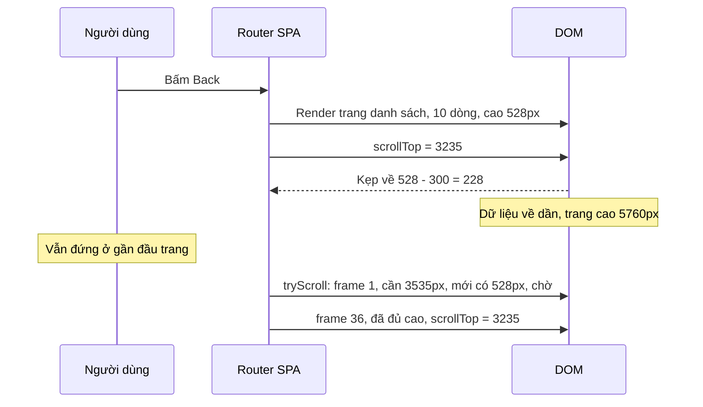

Bạn cuộn xuống sản phẩm thứ 70 trong danh sách, bấm vào xem, rồi bấm Back. Trang danh sách hiện lại, nhưng bạn đang đứng ở sản phẩm thứ 5. Đây là lỗi mà gần như SPA nào cũng từng gặp. Nguyên nhân không nằm ở chỗ quên lưu vị trí: vị trí **có** được lưu, và **có** được đặt lại. Chỉ là lúc đặt lại, trang chưa đủ cao.

Khi bạn gán `scrollTop = 3235` cho một phần tử chỉ cao 528px (dữ liệu mới về 10 dòng đầu), trình duyệt kẹp giá trị đó về mức tối đa có thể (528 − chiều cao khung nhìn). Lát sau dữ liệu về đủ, trang cao 5760px, nhưng không ai cuộn lại nữa.

App Store bản web (apps.apple.com) giải quyết việc này bằng một hàm 60 dòng tên `tryScroll`: thử lại mỗi frame cho tới khi trang đủ cao, tối đa 100 frame. Bài này cũng đi qua một mẹo nhỏ cùng họ "focus/cuộn cho đúng chỗ" của Zappos: skip link kiểm tra xem focus có **thật sự** tới nơi hay chưa.

> [!TIP]
> **Tóm tắt**
> - Lưu vị trí theo từng mục lịch sử (history entry), không theo URL: cùng một URL có thể xuất hiện hai lần trong lịch sử.
> - Khi Back, đừng đặt `scrollTop` ngay. Mỗi frame kiểm tra `targetY + clientHeight <= scrollHeight + 16`; đủ cao mới đặt. Apple chờ tối đa 100 frame (khoảng 1,6 giây ở 60Hz, nhưng chỉ khoảng 0,8 giây ở 120Hz).
> - Người dùng tự cuộn trong lúc đang chờ thì huỷ, đừng giật trang của họ.
> - Skip link: thử `focus()` từng ứng viên rồi hỏi lại `document.activeElement`. Không có gì focus được thì cho chính vùng nội dung `tabindex="-1"` và focus nó.

<iframe class="demo-frame" src="/demos/web-patterns/index.html?theme=dark#/try-scroll" title="Demo try-scroll" loading="lazy" style="height: 1180px"></iframe>

<p class="demo-links">▶ <a href="/demos/web-patterns/index.html#/try-scroll" target="_blank" rel="noopener">Mở demo toàn màn hình ↗</a> · <a href="https://stackblitz.com/github/hunghg255/blog-hunghg/tree/master/examples/web-patterns?file=src/lib/tryScroll.ts" target="_blank" rel="noopener">Sửa code trên StackBlitz ↗</a> · <a href="https://github.com/hunghg255/blog-hunghg/blob/master/examples/web-patterns/src/lib/tryScroll.ts" target="_blank" rel="noopener">Xem source trên GitHub ↗</a></p>

Cuộn xuống giữa danh sách, bấm một sản phẩm, rồi "← Quay lại". Đổi sang "Đặt scrollTop ngay" để thấy vị trí bị kẹp về gần đầu trang. Chọn "400 ms (mạng chậm)" với "Chờ tối đa 800 ms" để thấy trường hợp bỏ cuộc. Đang chờ mà bạn lăn chuột thì việc khôi phục bị huỷ.

## Apple làm thế nào?

### Ai lưu vị trí, lưu ở đâu

[`apps.apple.com/shared/utils/src/history.ts`](https://github.com/hunghg255/codebase/blob/main/apps.apple.com/shared/utils/src/history.ts) bọc `window.history` trong một class `History<State>`:

- Mỗi lần `pushState`/`replaceState`, class sinh một UUID làm id, và chỉ id đó được ghi vào `history.state`.
- Dữ liệu trang và vị trí cuộn nằm trong một `LruMap` (`HISTORY_SIZE_LIMIT = 10`) trong bộ nhớ, tra theo id.
- Comment trong file giải thích vì sao id phải ngẫu nhiên, không thể là bộ đếm tăng dần: `history.state` sống qua lần tải lại trang, nên id phải duy nhất trên toàn cục chứ không chỉ trong một lần tải.

Phần tử cuộn được lấy qua một hàm do nơi gọi truyền vào ([`src/jet/action-handlers/flow-action.ts`](https://github.com/hunghg255/codebase/blob/main/apps.apple.com/src/jet/action-handlers/flow-action.ts)):

```ts
getScrollablePageElement() {
  return (
    document.getElementById('scrollable-page-override') ||
    document.getElementById('scrollable-page') ||
    // If we haven't defined a specific scrollable element, scroll the whole page
    document.getElementsByTagName('html')?.[0]
  );
},
```

Trước khi chuyển trang, `history.beforeTransition()` đọc `scrollTop` hiện tại và ghi vào entry của trang đang rời đi. Comment ở chỗ gọi nói rõ lý do phải gọi **trước** khi cập nhật `<App>`: sau khi DOM đổi, vị trí cũ không còn đọc được nữa.

Khi `popstate` (Back/Forward), class lấy lại dữ liệu trang từ LRU, đưa cho app render, rồi gọi `tryScroll`.

### `tryScroll`: chờ trang đủ cao

[`apps.apple.com/shared/utils/src/try-scroll.ts`](https://github.com/hunghg255/codebase/blob/main/apps.apple.com/shared/utils/src/try-scroll.ts):

```ts
// Global is okay here as this only runs in the browser
let nextTry: number | null = null;

export function tryScroll(log, getScrollablePageElement, scrollY) {
  let tries = 0;
  if (nextTry !== null) window.cancelAnimationFrame(nextTry);

  nextTry = window.requestAnimationFrame(function doNextTry() {
    // At 16ms per frame, this is 1600ms
    if (++tries >= 100) {
      log.warn("wasn't able to restore scroll within 100 frames");
      nextTry = null;
      return;
    }
    const element = getScrollablePageElement();
    const { scrollHeight, offsetHeight } = element;
    // +16 is a bit of a fudge factor to count for imperfections in features like lazy loading.
    const canScroll = scrollY + offsetHeight <= scrollHeight + 16;
    if (!canScroll) {
      nextTry = window.requestAnimationFrame(doNextTry);
      return;
    }
    element.scrollTop = scrollY;
    nextTry = null;
  });
}
```

Comment trong code dẫn nguồn: con số 100 frame lấy từ addon `ember-router-scroll` của DockYard. Ba quyết định đáng chú ý:

1. **Điều kiện "đủ cao"**: `scrollY + offsetHeight <= scrollHeight`, nghĩa là đặt `scrollTop = scrollY` mà vẫn còn đủ **một màn hình** nội dung phía dưới. Nếu chỉ kiểm tra `scrollY <= scrollHeight`, ta sẽ cuộn tới đúng vị trí nhưng nửa dưới màn hình là khoảng trống, và trình duyệt vẫn kẹp giá trị.
2. **Sai số 16px**: comment giải thích rằng nếu vị trí cần khôi phục là đúng đáy trang, chỉ cần một component lazy-load làm trang cao thêm vài px là điều kiện "bằng đúng" không bao giờ thoả.
3. **Biến toàn cục `nextTry`**: Back hai lần liên tiếp thì lần thử thứ nhất bị huỷ trước khi lần thứ hai bắt đầu. Không có hai vòng thử giành nhau đặt `scrollTop`.

**Giới hạn của bản gốc:**

- **"100 frame" không phải là thời gian.** Trên màn hình 120Hz, 100 frame là khoảng 0,8 giây. Ở tab nền, `requestAnimationFrame` gần như dừng hẳn. Chờ theo mili giây thì dễ đoán hơn.
- **Không huỷ khi người dùng tự cuộn.** Nếu trong lúc chờ bạn đã cuộn đi chỗ khác, khi trang đủ cao, `tryScroll` vẫn kéo bạn về vị trí cũ.
- **Forward không được khôi phục.** Comment ở `onPopState` ghi: "We don't call `history.beforeTransition()` anywhere here, because we don't expect to save any state from the previous page on back." Bấm Back rồi Forward thì trang chi tiết luôn bắt đầu từ đầu.
- **Có lẽ còn sót chỗ đọc `history.state`.** Đầu class có comment nói Safari đôi khi biến `window.history.state` thành `null` sau luồng đăng nhập nhiều iframe, nên class giữ `currentStateId` riêng. Nhưng `beforeTransition()` vẫn đọc `window.history.state.id`, nên có lẽ vẫn dính đúng lỗi Safari đó.

## Zappos làm thế nào?

Skip link ("Bỏ qua tới nội dung chính") là link đầu tiên trong trang, giúp người dùng bàn phím và trình đọc màn hình nhảy qua menu. Cách làm phổ biến là `href="#main"`, rồi trình duyệt tự cuộn tới đó. Nhưng cuộn chưa đủ: **focus** cũng phải chuyển tới đó, nếu không thì phím Tab tiếp theo vẫn đi vào menu.

[`zappos.com/src/helpers/a11yUtils.js`](https://github.com/hunghg255/codebase/blob/main/zappos.com/src/helpers/a11yUtils.js):

```js
export const handleAccessibilityAnchorsFocus = (e, name) => {
  e.preventDefault();
  trackEvent('TE_SKIP_LINK_CLICK', `linkName:${name}`);
  const id = e.target && e.target.href ? e.target.getAttribute('href') : null;
  const containerEl = id ? document.querySelector(`${id}`) : null;
  if (containerEl) {
    const listOfElements = Array.from(containerEl.querySelectorAll(TABBABLE_ELEMENTS_SELECTOR));
    if (containerEl.matches(TABBABLE_ELEMENTS_SELECTOR)) listOfElements.unshift(containerEl);

    for (const el of listOfElements) {
      el.focus();
      const successfullyFocused = document.activeElement === el;
      if (successfullyFocused) {
        el.scrollIntoView(false);
        break;
      }
    }
  }
};
```

Mẹo nằm ở `document.activeElement === el`. Một selector như `a[href], button:not([disabled]), [tabindex]` không biết phần tử đó có đang `display: none`, nằm trong vùng `inert`, trong một `<details>` đang đóng, hay `visibility: hidden` hay không. Tự kiểm tra từng trường hợp thì dài và dễ sót. Zappos để chính trình duyệt trả lời: gọi `focus()`, rồi hỏi lại xem focus có thật sự nằm trên phần tử đó không. Trình duyệt bỏ qua `focus()` vào phần tử không focus được, nên `activeElement` không đổi.

Cùng file có `handleLockingTabbableFocusInContainer`, một focus trap dựa trên `focusout`, bọc trong `setTimeout(…, 1)` vì lúc `focusout` chạy, `document.activeElement` vẫn chưa phải phần tử mới (comment trong code: "Need to wrap in setTimeout so we can reliably get document.activeElement, ugh").

**Hai chỗ chưa ổn:**

- **Không có gì focus được thì không làm gì cả.** Ví dụ trang chính sách chỉ có chữ. Focus vẫn nằm trên skip link, `preventDefault()` đã chặn luôn cả việc cuộn mặc định, nên bấm skip link không có tác dụng gì.
- **`document.querySelector(\`${id}\`)`**: với `href="#3-steps"` (id bắt đầu bằng chữ số), selector `#3-steps` không hợp lệ và hàm ném lỗi. `getElementById` thì không gặp vấn đề này.

## Bên trong trình duyệt: vì sao scrollTop bị "kẹp"?



`scrollTop` không phải một biến tự do. Giá trị hợp lệ chỉ nằm trong khoảng từ 0 tới `scrollHeight - clientHeight`; gán giá trị lớn hơn thì trình duyệt lưu giá trị lớn nhất có thể. Giá trị bạn muốn **không được nhớ lại** để áp dụng khi trang cao lên. Vì vậy phải chờ.

Với cuộn của cả trang, trình duyệt có cơ chế tự khôi phục (`history.scrollRestoration = 'auto'`). Cơ chế này chạy tốt cho trang tải kiểu truyền thống. Với SPA, nó chạy quá sớm, khi DOM của trang cũ còn chưa được dựng lại. Vì thế các router SPA thường đặt `'manual'` rồi tự lo. Với một `div` cuộn riêng (như `#scrollable-page` của Apple, hay khung trong demo), trình duyệt không lo gì cả.

## Viết lại

Phần chờ trang đủ cao, đo theo **thời gian** thay vì số frame (đây là vòng lặp bên trong `restoreScroll`; phần huỷ bằng `AbortSignal` nằm ngay phía trên trong file):

```ts title=src/lib/tryScroll.ts
    const tick = () => {
      frame++;
      const element = getElement();
      if (!element) return finish('missing');
      const { scrollHeight, clientHeight } = element;
      // Chỉ cuộn khi đặt scrollTop = targetY vẫn còn đủ một màn hình nội dung phía dưới.
      // Đặt sớm hơn thì trình duyệt kẹp scrollTop về (scrollHeight - clientHeight) và vị trí bị mất.
      const needed = targetY + clientHeight;
      if (needed <= scrollHeight + tolerance) {
        element.scrollTop = targetY;
        return finish('restored');
      }
      if (performance.now() - start >= timeout) return finish('gave-up');
      onWait?.({ frame, scrollHeight, needed });
      frameId = requestAnimationFrame(tick);
    };
```

`createScrollHistory` lưu vị trí theo mục lịch sử, giữ tối đa 10 mục như Apple (xem file đầy đủ). Skip link:

```ts title=src/lib/tryScroll.ts
export function focusFirstReachable(container: HTMLElement): HTMLElement | null {
  const candidates = Array.from(container.querySelectorAll<HTMLElement>(TABBABLE));
  if (container.matches(TABBABLE)) candidates.unshift(container);
  for (const el of candidates) {
    el.focus({ preventScroll: true });
    if (document.activeElement === el) {
      el.scrollIntoView({ block: 'nearest' });
      return el;
    }
  }
  // Không có gì focus được (bản gốc dừng ở đây, người dùng bàn phím vẫn ở đầu trang):
  // cho chính container nhận focus bằng tabindex="-1", Tab tiếp theo sẽ đi từ đây.
  if (!container.hasAttribute('tabindex')) container.setAttribute('tabindex', '-1');
  container.focus({ preventScroll: true });
  container.scrollIntoView({ block: 'start' });
  return document.activeElement === container ? container : null;
}
```

::: spoiler Xem toàn bộ src/lib/tryScroll.ts

```ts title=src/lib/tryScroll.ts
/**
 * Khôi phục vị trí cuộn khi trang còn đang tải dần (ý tưởng từ try-scroll.ts của apps.apple.com)
 * và skip link kiểm tra focus thật (ý tưởng từ a11yUtils.js của Zappos).
 */

export interface ScrollableElement {
  scrollTop: number;
  scrollHeight: number;
  /** chiều cao khung nhìn của phần tử cuộn; window thì dùng innerHeight */
  clientHeight: number;
}

export type RestoreResult = 'restored' | 'gave-up' | 'missing' | 'cancelled';

export interface RestoreOptions {
  /** chờ tối đa bao lâu (ms). Apple dùng 100 frame, tức ~1,6 giây ở 60Hz nhưng chỉ ~0,8 giây ở 120Hz */
  timeout?: number;
  /** sai số cho phép (px): nội dung lazy-load có thể làm trang cao thêm vài px, bản gốc dùng 16 */
  tolerance?: number;
  signal?: AbortSignal;
  /** gọi mỗi frame phải chờ, để log/hiển thị */
  onWait?: (info: { frame: number; scrollHeight: number; needed: number }) => void;
}

// Mỗi phần tử cuộn chỉ có một lần khôi phục đang chạy: back liên tiếp thì lần sau thay lần trước.
const pending = new WeakMap<object, AbortController>();

export function restoreScroll(
  getElement: () => ScrollableElement | null,
  targetY: number,
  { timeout = 1600, tolerance = 16, signal, onWait }: RestoreOptions = {},
): Promise<RestoreResult> {
  return new Promise((resolve) => {
    if (signal?.aborted) return resolve('cancelled');
    const first = getElement();
    if (!first) return resolve('missing');

    pending.get(first)?.abort();
    const controller = new AbortController();
    pending.set(first, controller);
    const onAbort = () => {
      cancelAnimationFrame(frameId);
      resolve('cancelled');
    };
    controller.signal.addEventListener('abort', onAbort, { once: true });
    signal?.addEventListener('abort', () => controller.abort(), { once: true });

    const start = performance.now();
    let frame = 0;
    let frameId = 0;

    const tick = () => {
      frame++;
      const element = getElement();
      if (!element) return finish('missing');
      const { scrollHeight, clientHeight } = element;
      // Chỉ cuộn khi đặt scrollTop = targetY vẫn còn đủ một màn hình nội dung phía dưới.
      // Đặt sớm hơn thì trình duyệt kẹp scrollTop về (scrollHeight - clientHeight) và vị trí bị mất.
      const needed = targetY + clientHeight;
      if (needed <= scrollHeight + tolerance) {
        element.scrollTop = targetY;
        return finish('restored');
      }
      if (performance.now() - start >= timeout) return finish('gave-up');
      onWait?.({ frame, scrollHeight, needed });
      frameId = requestAnimationFrame(tick);
    };

    const finish = (result: RestoreResult) => {
      controller.signal.removeEventListener('abort', onAbort);
      if (pending.get(first) === controller) pending.delete(first);
      resolve(result);
    };

    frameId = requestAnimationFrame(tick);
  });
}

/** Người dùng tự cuộn/chạm trong lúc đang chờ: thôi khôi phục, đừng giật trang của họ. */
export function cancelOnUserScroll(target: EventTarget): AbortController {
  const controller = new AbortController();
  const stop = () => controller.abort();
  for (const type of ['wheel', 'touchstart', 'keydown', 'pointerdown']) {
    target.addEventListener(type, stop, { once: true, passive: true, signal: controller.signal });
  }
  return controller;
}

/**
 * Lưu vị trí cuộn theo từng mục lịch sử (history entry). Apple giữ tối đa 10 mục trong một LRU.
 * Id nằm trong history.state nên reload trang vẫn còn; map vị trí thì nằm trong bộ nhớ.
 */
export function createScrollHistory(getElement: () => ScrollableElement | null, limit = 10) {
  const positions = new Map<string, number>();
  const newId = () => (crypto.randomUUID ? crypto.randomUUID() : `${Date.now()}-${Math.random()}`);
  const remember = (id: string, y: number) => {
    positions.delete(id);
    positions.set(id, y);
    // Map giữ thứ tự chèn: phần tử đầu là cũ nhất
    while (positions.size > limit) positions.delete(positions.keys().next().value!);
  };
  const currentId = () => (history.state as { scrollId?: string } | null)?.scrollId;

  if ('scrollRestoration' in history) history.scrollRestoration = 'manual';
  if (!currentId()) history.replaceState({ ...(history.state ?? {}), scrollId: newId() }, '');

  return {
    /** gọi ngay trước khi chuyển trang (pushState) */
    saveCurrent() {
      const id = currentId();
      const el = getElement();
      if (id && el) remember(id, el.scrollTop);
    },
    push(state: Record<string, unknown> = {}, url?: string) {
      this.saveCurrent();
      history.pushState({ ...state, scrollId: newId() }, '', url);
      const el = getElement();
      if (el) el.scrollTop = 0;
    },
    /** gọi trong popstate, sau khi đã bắt đầu render trang cũ */
    restore(options?: RestoreOptions) {
      const id = currentId();
      const y = id ? positions.get(id) : undefined;
      if (y === undefined) return Promise.resolve('missing' as RestoreResult);
      return restoreScroll(getElement, y, options);
    },
  };
}

// ---------- skip link (Zappos) ----------

const TABBABLE =
  'a[href], area[href], button:not([disabled]), input:not([disabled]):not([type="hidden"]), select:not([disabled]), textarea:not([disabled]), iframe, [contenteditable]:not([contenteditable="false"]), [tabindex]:not([tabindex="-1"])';

/**
 * Focus vào phần tử đầu tiên TRONG container mà thật sự nhận được focus.
 * Thay vì tự đoán (display:none? visibility? inert? nằm trong <details> đóng?), cứ thử focus()
 * rồi hỏi lại document.activeElement: trình duyệt là bên biết chắc nhất.
 */
export function focusFirstReachable(container: HTMLElement): HTMLElement | null {
  const candidates = Array.from(container.querySelectorAll<HTMLElement>(TABBABLE));
  if (container.matches(TABBABLE)) candidates.unshift(container);
  for (const el of candidates) {
    el.focus({ preventScroll: true });
    if (document.activeElement === el) {
      el.scrollIntoView({ block: 'nearest' });
      return el;
    }
  }
  // Không có gì focus được (bản gốc dừng ở đây, người dùng bàn phím vẫn ở đầu trang):
  // cho chính container nhận focus bằng tabindex="-1", Tab tiếp theo sẽ đi từ đây.
  if (!container.hasAttribute('tabindex')) container.setAttribute('tabindex', '-1');
  container.focus({ preventScroll: true });
  container.scrollIntoView({ block: 'start' });
  return document.activeElement === container ? container : null;
}

/** Gắn cho mọi skip link trong trang: <a href="#main" data-skip-link>. */
export function handleSkipLinkClick(event: MouseEvent, root: ParentNode = document) {
  const link = (event.target as Element | null)?.closest<HTMLAnchorElement>('a[href^="#"]');
  if (!link) return;
  const id = decodeURIComponent(link.hash.slice(1));
  // getElementById: id bắt đầu bằng số hay có ký tự đặc biệt vẫn đúng, querySelector(`#${id}`) thì không
  const target = 'getElementById' in root ? (root as Document).getElementById(id) : root.querySelector(`[id="${CSS.escape(id)}"]`);
  if (!(target instanceof HTMLElement)) return;
  event.preventDefault();
  focusFirstReachable(target);
}
```

:::

**Khác bản gốc:**

- `timeout` tính bằng mili giây thay cho 100 frame.
- Dùng `clientHeight` (khung nhìn không tính viền và thanh cuộn) thay cho `offsetHeight`. Sai số 16px của Apple đủ bù phần chênh lệch đó, nhưng `clientHeight` mới là đại lượng mà trình duyệt dùng để kẹp `scrollTop`.
- Mỗi phần tử cuộn có một lần khôi phục đang chạy (`WeakMap`), thay cho một biến toàn cục duy nhất. Trang có hai vùng cuộn độc lập vẫn chạy đúng.
- Có `cancelOnUserScroll`: lăn chuột, chạm, nhấn phím hay bấm chuột trong lúc chờ sẽ huỷ việc khôi phục.
- Trả về `Promise` với kết quả `'restored' | 'gave-up' | 'missing' | 'cancelled'` để nơi gọi ghi log hoặc làm phương án dự phòng (ví dụ cuộn tới phần tử đã bấm, theo id).
- Skip link có phương án cuối cùng: cho vùng nội dung `tabindex="-1"` và focus chính nó.

## Đi qua code

**`restoreScroll`:**

- Nếu đang có một lần khôi phục khác cho cùng phần tử thì huỷ nó trước.
- Mỗi frame, gọi lại `getElement()`, vì app có thể đã thay phần tử cuộn sau khi render.
- Phép so sánh `targetY + clientHeight <= scrollHeight + tolerance` giữ đúng ý của Apple.
- `onWait` báo số frame đã chờ; demo dùng nó để in "sau 36 frame chờ (605 ms)".
- `finish` dọn listener và xoá khỏi `pending`, chỉ khi đúng là lần đang chạy (một lần mới có thể đã thay chỗ).

**`createScrollHistory`:**

- Đặt `history.scrollRestoration = 'manual'`, và gắn id cho entry hiện tại nếu chưa có.
- `push` lưu vị trí của entry đang rời, tạo entry mới có id mới, rồi đưa phần tử cuộn về đầu.
- `restore` đọc id của entry vừa quay lại và tra vị trí đã lưu.
- LRU dựa vào việc `Map` giữ thứ tự chèn: xoá rồi chèn lại là đưa lên cuối, và `keys().next()` luôn là phần tử cũ nhất.

**`focusFirstReachable`:**

- `focus({ preventScroll: true })` để thử từng ứng viên mà trang không giật qua lại; chỉ phần tử thành công mới được `scrollIntoView`.
- Không có ứng viên nào thì gắn `tabindex="-1"` cho container (focus được bằng script, nhưng không chen vào thứ tự Tab) rồi focus nó. Tab tiếp theo sẽ đi tới phần tử focus được kế tiếp **sau** vùng đó.

## Tại sao không làm cách khác?

**Tại sao không chờ dữ liệu tải xong rồi mới cuộn?** Router thường không biết khi nào "xong". Một trang có thể có ảnh lazy-load, component tải code riêng (`React.lazy`), và danh sách ảo (virtualized list) tự đo lại chiều cao. Điều kiện "đủ cao để cuộn tới đây" là thứ duy nhất vừa đo được vừa đúng là điều ta cần.

**Tại sao không dùng `ResizeObserver` thay cho vòng `requestAnimationFrame`?** Dùng được, và tiết kiệm hơn khi phải chờ lâu. Nhưng `ResizeObserver` trên phần tử cuộn chỉ báo khi **khung** của nó đổi kích thước, không báo khi nội dung bên trong cao lên. Phải quan sát phần tử nội dung bên trong, mà phần tử đó thì mỗi trang mỗi khác. Một vòng rAF tối đa 1,6 giây đơn giản hơn nhiều, và chi phí mỗi frame chỉ là một lần đọc `scrollHeight`.

**Tại sao không cuộn tới đúng phần tử đã bấm (theo id) thay vì theo pixel?** Đó là phương án tốt hơn khi làm được: lưu "đang xem sản phẩm #70", và khi quay lại thì `scrollIntoView` phần tử đó. Cách này đúng cả khi chiều cao các dòng phía trên thay đổi (ví dụ quảng cáo chèn thêm). Nhưng nó cần app biết phần tử nào là mốc. `tryScroll` không cần biết gì về nội dung trang, nên Apple dùng được ở tầng router cho mọi trang.

**Tại sao skip link không chỉ dùng `href="#main"` + `tabindex="-1"` trên `<main>`?** Cách đó (focus luôn vào `<main>`) là cách được khuyên dùng phổ biến và vẫn đúng. Zappos muốn focus thẳng vào phần tử tương tác đầu tiên để người dùng bấm Enter được ngay. Bản viết lại giữ ý đó, và dùng cách `<main tabindex="-1">` làm phương án cuối cùng.

## Edge case và cạm bẫy

- **Trang ngắn hơn vị trí đã lưu**, ví dụ lúc trước có 120 sản phẩm, giờ bộ lọc chỉ còn 20. Điều kiện không bao giờ thoả, và sau `timeout` kết quả là `'gave-up'`. Hãy chọn cách xử lý: cuộn tới đáy, hay để yên ở đầu.
- **Tab nền**: `requestAnimationFrame` gần như dừng khi tab bị ẩn, còn `performance.now()` vẫn chạy. Nếu người dùng bấm Back rồi chuyển tab ngay, lần khôi phục có thể hết hạn trước cả frame đầu tiên. Đó cũng là hành vi hợp lý.
- **`scroll-behavior: smooth` trên phần tử cuộn**: gán `scrollTop` sẽ chạy hiệu ứng cuộn mượt từ đầu trang xuống. Hãy dùng `element.scrollTo({ top, behavior: 'instant' })` nếu CSS của bạn có `scroll-behavior: smooth`.
- **Scroll anchoring** (`overflow-anchor`) của Chrome và Firefox giữ nội dung đứng yên khi phần phía trên thay đổi kích thước. Sau khi đã khôi phục, nó giúp vị trí không trôi khi ảnh phía trên tải xong.
- **Skip link và `scroll-margin-top`**: nếu header là `position: sticky`, `scrollIntoView` có thể đặt phần tử nằm khuất dưới header. Hãy đặt `scroll-margin-top` bằng chiều cao header cho vùng nội dung.

## Dùng trong dự án

```ts
const scrollHistory = createScrollHistory(() => document.scrollingElement);

router.beforeNavigate(() => scrollHistory.saveCurrent());
router.onNavigate((to) => scrollHistory.push({ route: to.name }, to.url));
window.addEventListener('popstate', async () => {
  renderFromState(history.state); // render ngay, dữ liệu có thể về dần
  const user = cancelOnUserScroll(window);
  const result = await scrollHistory.restore({ signal: user.signal });
  user.abort();
  if (result === 'gave-up') document.querySelector(`[data-id="${lastClickedId}"]`)?.scrollIntoView();
});

// skip link
document.querySelector('a.skip-link')?.addEventListener('click', (e) => handleSkipLinkClick(e as MouseEvent));
```

React Router v6.4+ có component `<ScrollRestoration />` làm phần "lưu theo entry". Nếu danh sách của bạn render dần sau khi điều hướng, bạn vẫn có thể cần vòng "chờ đủ cao" ở trên. Next.js App Router tự lo cuộn trang khi điều hướng, nhưng không lo cho các `div` cuộn riêng.

## Kiểm thử

::: spoiler Ví dụ test (bản phác, không có trong repo)

```ts
import { describe, expect, it, vi } from 'vitest';
import { focusFirstReachable, restoreScroll } from './tryScroll';

function fakeScroller(heights: number[]) {
  // mỗi frame, chiều cao nội dung tăng theo danh sách
  let frame = 0;
  const el = { scrollTop: 0, clientHeight: 300, get scrollHeight() { return heights[Math.min(frame, heights.length - 1)]; } };
  vi.stubGlobal('requestAnimationFrame', (cb: FrameRequestCallback) => setTimeout(() => { frame++; cb(0); }, 0));
  vi.stubGlobal('cancelAnimationFrame', (id: number) => clearTimeout(id));
  return el;
}

describe('restoreScroll', () => {
  it('chờ tới khi trang đủ cao rồi mới đặt scrollTop', async () => {
    const el = fakeScroller([500, 1500, 2500, 4000]);
    const result = await restoreScroll(() => el, 3000);
    expect(result).toBe('restored');
    expect(el.scrollTop).toBe(3000);
  });

  it('bỏ cuộc sau timeout', async () => {
    const el = fakeScroller([500]);
    expect(await restoreScroll(() => el, 3000, { timeout: 20 })).toBe('gave-up');
    expect(el.scrollTop).toBe(0);
  });

  it('huỷ khi signal abort', async () => {
    const el = fakeScroller([500]);
    const controller = new AbortController();
    const promise = restoreScroll(() => el, 3000, { signal: controller.signal });
    controller.abort();
    expect(await promise).toBe('cancelled');
  });

  it('lần mới cho cùng phần tử thay lần cũ', async () => {
    const el = fakeScroller([500, 500, 5000]);
    const first = restoreScroll(() => el, 3000);
    const second = restoreScroll(() => el, 1000);
    expect(await first).toBe('cancelled');
    expect(await second).toBe('restored');
    expect(el.scrollTop).toBe(1000);
  });
});

describe('focusFirstReachable', () => {
  // jsdom không có scrollIntoView
  Element.prototype.scrollIntoView = vi.fn();

  it('bỏ qua phần tử không focus được, rơi về container', () => {
    document.body.innerHTML = '<main id="m"><button disabled>x</button><p>chữ</p></main>';
    const main = document.getElementById('m')!;
    expect(focusFirstReachable(main)).toBe(main);
    expect(main.getAttribute('tabindex')).toBe('-1');
  });
});
```

jsdom không tính layout, nên phần "bỏ qua `display: none`" của `focusFirstReachable` phải kiểm trên trình duyệt thật. Demo trong bài đã được kiểm bằng Playwright: skip link ngây thơ để focus nằm lại trên chính nó, còn bản kiểm tra `activeElement` tới đúng "Sản phẩm đầu tiên".

:::

## So với thư viện và chuẩn web

- **`history.scrollRestoration`**: `'auto'` là mặc định cho trang tải kiểu truyền thống; SPA thường đặt `'manual'`. Đây là chuẩn được mọi trình duyệt lớn hỗ trợ.
- **Navigation API** (`navigation.addEventListener('navigate', e => e.intercept({ scroll: 'manual', handler }))`) cho phép gọi `e.scroll()` vào đúng lúc bạn muốn, sau khi dữ liệu đã về. Đây là cách "chuẩn" cho chính vấn đề này. Mức hỗ trợ vẫn chưa đồng đều giữa các trình duyệt, hãy xem [caniuse](https://caniuse.com/?search=navigation%20api) trước khi dựa vào nó.
- **`ember-router-scroll`** (nguồn của con số 100 frame), **React Router `<ScrollRestoration>`** và **Vue Router `scrollBehavior`** đều giải bài "lưu theo entry". Vue Router cho `scrollBehavior` trả về một Promise, tức là cho phép chờ trước khi cuộn.
- **Skip link**: hướng dẫn của WAI và WebAIM khuyên dùng vùng đích có `tabindex="-1"`. Cách "focus phần tử tương tác đầu tiên" của Zappos là một biến thể; bước kiểm tra `activeElement` giúp nó không bao giờ tệ hơn cách chuẩn.

---

Bài này thuộc series **[Học từ mã nguồn các web lớn](/series/web)** (65 bài, đọc theo thứ tự).

::: spoiler Xem nhanh danh sách bài trong series

*Mở đầu*

- [Mở đầu: đọc code production của 28 trang web](/blogs/learn-from-big-web-apps)

*Phần 1: trải nghiệm người dùng*

- [#1 Dark mode không nháy (Gatsby)](/blogs/web-dark-mode-no-flash)
- [#2 useValueByMedia: giá trị theo breakpoint (Toptal)](/blogs/web-use-value-by-media)
- [#3 Đoán ý định: idle, exit-intent, lắc chuột (Toptal, InVision)](/blogs/web-user-intent-idle-exit-wiggle)
- [#4 Validate form thân thiện (Udacity, Pipedrive)](/blogs/web-form-validation-ux)
- [#5 Magic number, EXIF và dán ảnh (Ello)](/blogs/web-file-magic-number-exif-paste)
- [#6 fastSmoothScroll: cuộn xa vẫn nhanh (Telegram)](/blogs/web-telegram-fast-smooth-scroll)
- [#7 Countdown time-travel và tombstone giỏ hàng (Best Buy)](/blogs/web-countdown-time-travel-tombstone)

*Phần 2: hiệu năng và đo lường*

- [#8 Hàng đợi requestAnimationFrame 3ms (Apple)](/blogs/web-raf-queue-3ms)
- [#9 srcset cho artwork và preconnect tự động (Apple)](/blogs/web-responsive-artwork-preconnect)
- [#10 Quick-fetch: gọi API trước khi bundle tải xong (HubSpot)](/blogs/web-quick-fetch-early-requests)
- [#11 Performance span và long task (Postman, Calibre)](/blogs/web-performance-spans-long-tasks)
- [#12 Gọi Web Worker như hàm async (Telegram)](/blogs/web-worker-promise-rpc)
- [#13 Đồng hồ media: đếm giờ xem và sửa lệch (Skillshare, Simplified)](/blogs/web-media-clock-watch-time-drift)

*Phần 3: nhiều tab, phiên đăng nhập, cập nhật*

- [#14 Bầu tab chủ cho thông báo (HubSpot, Telegram)](/blogs/web-leader-tab-notifications)
- [#15 Đồng bộ đăng nhập giữa tab và giới hạn cookie (Elastic, InVision)](/blogs/web-cross-tab-auth-cookie-guard)
- [#16 SPA tự cập nhật: Trello, Zappos, Facebook, Elastic](/blogs/web-spa-self-update-strategies)

*Phần 4: kiến trúc*

- [#17 Reverse portal: di chuyển component không remount (Zappos)](/blogs/web-reverse-portal)
- [#18 Page behaviors: gắn hành vi từ CMS (Intercom)](/blogs/web-page-behaviors-cms)
- [#19 Giới hạn tần suất hiển thị bằng bitmask (Outlook)](/blogs/web-frequency-cap-bitmask)
- [#20 Chuyển REST sang GraphQL dần dần (Coursera)](/blogs/web-rest-to-graphql-hybrid-link)

*Phần 5: soạn thảo và hiển thị nội dung*

- [#21 Autocomplete tại con trỏ trong contenteditable (Ello, Telegram)](/blogs/web-caret-autocomplete-contenteditable)
- [#22 Dark mode cho email HTML bằng CIELAB (Outlook)](/blogs/web-email-dark-mode-cielab)
- [#23 Thu nhỏ bảng rộng cho vừa khung, vá font emoji (Outlook)](/blogs/web-email-wide-content-scale)
- [#24 Cảnh báo quên đính kèm file (Outlook)](/blogs/web-forgotten-attachment-warning)
- [#25 Cắt chữ nhiều dòng chính xác (Pipedrive, Apple, Toptal)](/blogs/web-multiline-truncate-measure-text)
- [#26 Parse ngày giờ gõ tay khoan dung (Outlook, Elastic)](/blogs/web-lenient-date-parser)

*Phần 6: tương tác*

- [#27 menuAim: rê chéo vào submenu không bị đóng (Udemy)](/blogs/web-menu-aim-triangle)
- [#28 Kéo, vuốt chung cho chuột và cảm ứng (Telegram)](/blogs/web-unified-pointer-gestures)
- [#29 Phím tắt theo phạm vi, IME và bàn phím phi Latinh (Trello)](/blogs/web-scoped-keyboard-shortcuts)
- [#30 Nội suy màu: đổi theme và nền theo cuộn (Telegram, Anchor)](/blogs/web-color-interpolation-theme-scroll)
- [#31 Đường gióng hút cạnh và undo/redo trên canvas (Simplified)](/blogs/web-canvas-snap-guides-undo)
- [#32 Giả lập mù màu bằng feColorMatrix (Trello)](/blogs/web-color-vision-simulator)
- [#33 Vạch thước theo mức zoom và cấp phát màu cho biểu đồ (Anchor, Similarweb)](/blogs/web-timeline-ticks-color-stack)

*Phần 7: mạng, dữ liệu và async*

- [#34 Ô tìm kiếm chuẩn production (Similarweb, Udemy, Pipedrive)](/blogs/web-production-search-box)
- [#35 Điều phối async: latest-wins, single-flight (Glitch, Toptal)](/blogs/web-async-coordination-latest-wins)
- [#36 Polling thưa dần và debounce động (Trello)](/blogs/web-decaying-polling-dynamic-debounce)
- [#37 Cache phía client theo version (Similarweb, Telegram, Udemy)](/blogs/web-client-cache-versioned)
- [#38 Upload file lớn theo chunk (Outlook, Tribe)](/blogs/web-chunked-upload-pipeline)
- [#39 Phát video qua Service Worker bằng Range request (Telegram, Outlook)](/blogs/web-service-worker-range-streaming)

*Phần 8: hiệu năng và vận hành*

- [#40 TTI governor: hoãn việc phụ tới sau khi trang dùng được (Outlook)](/blogs/web-tti-governor)
- [#41 Tự đo LCP/CLS/TBT và phục vụ bản nhẹ cho máy yếu (Udemy)](/blogs/web-rum-adaptive-loading)

*Phần 9: thuật toán và dữ liệu phía client*

- [#42 Three-way merge ngay trên trình duyệt (Postman)](/blogs/web-three-way-merge-client)
- [#43 Dọn cache GraphQL bằng đếm tham chiếu (Outlook)](/blogs/web-graphql-cache-refcount-gc)
- [#44 LRU cache theo 3 cách (Apple, Similarweb, Outlook)](/blogs/web-lru-cache-three-ways)
- [#45 Lọc tăng dần trong Web Worker (Similarweb)](/blogs/web-incremental-filter-worker)
- [#46 Xếp hạng gợi ý trên client, so ngầm với server (Outlook)](/blogs/web-client-side-ranking-shadow-test)
- [#47 Nối OT với editor: undo stack và chặn echo (Glitch)](/blogs/web-ot-codemirror-undo)
- [#48 Ngôn ngữ markup riêng dịch hai chiều với HTML (Coursera)](/blogs/web-custom-markup-compiler)

*Phần 10: thời gian, ngôn ngữ, định dạng*

- [#49 Xử lý giờ mùa hè không cần thư viện (Udemy, Pipedrive)](/blogs/web-dst-without-library)
- [#50 Intl thực chiến: Segmenter, số rút gọn, số nhiều, fallback locale (Apple, Outlook)](/blogs/web-intl-in-production)
- [#51 WebVTT và bôi chọn transcript (Udemy, Coursera)](/blogs/web-webvtt-transcript-selection)

*Phần 11: tương tác và giao diện*

- [#52 Kéo-thả trên lịch (Pipedrive)](/blogs/web-calendar-drag-drop)
- [#53 Focus stack cho popup lồng nhau (Outlook)](/blogs/web-focus-stack-nested-popups)
- [#54 Clipboard: copy, dán chữ thuần, dán thông minh (Trello, Anchor, Pipedrive, Tribe)](/blogs/web-clipboard-tricks)
- **#55 Khôi phục vị trí cuộn khi trang còn đang tải (Apple, Zappos)** (bài này)
- [#56 Lấy màu từ ảnh: gradient nền, màu chữ (Apple, Telegram, Trello)](/blogs/web-colors-from-images)
- [#57 JS đọc breakpoint từ CSS, phát hiện chế độ PWA (Ello, Apple)](/blogs/web-css-js-breakpoint-bridge)

*Phần 12: media*

- [#58 Tin nhắn thoại: ghi âm, waveform realtime, nén 5-bit (Telegram)](/blogs/web-voice-message-waveform)
- [#59 Chụp frame video thành ảnh, canvas bị taint (Coursera, Outlook)](/blogs/web-video-frame-snapshot)

*Phần 13: đo lường, bảo mật, vận hành*

- [#60 Đo lúc ảnh màn hình đầu tải xong, cả khi chuyển trang SPA (Zappos, Best Buy, Outlook)](/blogs/web-above-the-fold-image-timing)
- [#61 Buffer analytics chờ SDK, phát hiện adblock (Best Buy)](/blogs/web-analytics-buffer-adblock)
- [#62 Proof-of-work trên client để chặn API ẩn danh (Udemy)](/blogs/web-client-proof-of-work)
- [#63 Prefetch không làm lệch số liệu, nén cài đặt bằng bit (Outlook)](/blogs/web-synthetic-prefetch-bit-flags)
- [#64 Micro-frontend: AngularJS và React chung app, giao tiếp xuyên frame (Similarweb, InVision, HubSpot)](/blogs/web-micro-frontend-bridges)

:::

Code + demo: [`examples/web-patterns`](https://github.com/hunghg255/blog-hunghg/tree/master/examples/web-patterns) · [Mở trên StackBlitz](https://stackblitz.com/github/hunghg255/blog-hunghg/tree/master/examples/web-patterns)
