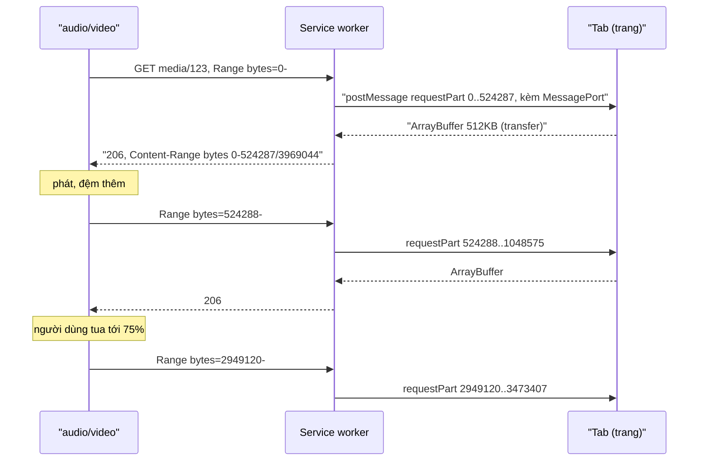

Thẻ `<video>` và `<audio>` chỉ biết phát từ một URL. Khi phát, trình duyệt tự gửi các request `Range: bytes=…` để lấy từng đoạn, và khi người dùng tua tới giữa video, nó xin đoạn byte ở giữa file. Mọi thứ trơn tru nếu file nằm trên một server HTTP bình thường.

Telegram Web thì không có server HTTP như vậy. Video trong tin nhắn được tải qua **MTProto**, giao thức riêng của Telegram, chạy trong JavaScript (qua WebSocket). Cách ngây thơ là tải hết file về thành Blob rồi mới `URL.createObjectURL()`: video 200MB thì người dùng chờ tải xong 200MB mới xem được giây đầu tiên, và tua tới cuối cũng phải chờ như vậy.

Telegram giải bằng một **service worker** (SW) đóng vai "server HTTP giả": nó chặn các request Range của thẻ video, hỏi lại tab "cho tôi byte a..b", tab tải đúng đoạn đó qua MTProto, SW trả về response `206 Partial Content`. Thẻ video không hề biết dữ liệu không đến từ HTTP.

Phần sau của bài xem thêm service worker của Outlook Web: cache app shell theo version, và chuyển hướng bằng JavaScript để giữ nguyên `#hash`.

> [!TIP]
> **Tóm tắt**
> - Cho media một URL "ảo" trong phạm vi (scope) của SW. SW đọc header `Range`, cắt về tối đa 512KB, rồi **hỏi tab** qua `postMessage` và trả `206` với `Content-Range`, `Accept-Ranges`.
> - Mỗi lần hỏi dùng một `MessageChannel` riêng để ghép câu trả lời; tab trả `ArrayBuffer` bằng transfer (không sao chép); có timeout và trả lỗi nhanh khi không có dữ liệu.
> - Cache API **không nhận response 206**: lưu phần thân như response 200 dưới key riêng, header dựng lại khi đọc.
> - Đặt version vào tên cache, dọn bản cũ lúc `activate`; chuyển hướng bằng trang HTML nhỏ chạy `location.replace(url + location.hash)` để giữ `#hash`.

<iframe class="demo-frame" src="/demos/web-patterns/index.html?theme=dark#/sw-range" title="Demo sw-range" loading="lazy" style="height: 760px"></iframe>

<p class="demo-links">▶ <a href="/demos/web-patterns/index.html#/sw-range" target="_blank" rel="noopener">Mở demo toàn màn hình ↗</a> · <a href="https://stackblitz.com/github/hunghg255/blog-hunghg/tree/master/examples/web-patterns?file=src/lib/swRange.ts" target="_blank" rel="noopener">Sửa code trên StackBlitz ↗</a> · <a href="https://github.com/hunghg255/blog-hunghg/blob/master/examples/web-patterns/src/lib/swRange.ts" target="_blank" rel="noopener">Xem source trên GitHub ↗</a></p>

Bấm **Bật service worker**, rồi phát. Log hiện từng request `bytes=…` mà thẻ `<audio>` gửi và SW trả về. Đặt "Mạng chậm 900ms", tải lại trang rồi bấm **Tua tới 75%** trước khi phát: request đầu tiên sau phần header là một đoạn ở giữa file, không phải từ đầu. Tải lại trang lần nữa và phát: 2MB đầu lấy từ Cache Storage, không hỏi tab.

## Bên trong trình duyệt: Range, 206 và service worker



- **Range và 206**: request `Range: bytes=1000-` xin từ byte 1000 tới hết. Server được phép trả **ít hơn**: response `206 Partial Content` với `Content-Range: bytes 1000-525287/3969044` cho biết thực sự trả đoạn nào và tổng kích thước file. Trình duyệt thấy chưa đủ thì tự xin tiếp từ byte 525288. Đây là lý do SW có thể luôn cắt về 512KB.
- **`Accept-Ranges: bytes`** báo cho trình duyệt biết có thể xin đoạn bất kỳ, tức là tua được.
- **Service worker** là một worker nằm giữa trang và mạng, chỉ chặn request của những trang nằm trong **scope** của nó (mặc định là thư mục chứa file SW). Request từ thẻ media cũng đi qua SW như mọi request khác. SW không truy cập được DOM hay biến của trang; muốn lấy dữ liệu từ trang thì phải nhắn tin.
- **Một SW có thể không điều khiển trang** dù đã cài: lần tải đầu tiên trước khi đăng ký, hoặc khi người dùng tải lại cứng (Shift+F5). Lúc đó request đi thẳng ra mạng. Code phải kiểm tra `navigator.serviceWorker.controller`.

## Telegram làm thế nào?

### Phía SW: `serviceWorker/progressive.ts`

[`web.telegram.org/src/serviceWorker/progressive.ts`](https://github.com/hunghg255/codebase/blob/main/web.telegram.org/src/serviceWorker/progressive.ts) xử lý mọi URL bắt đầu bằng `./progressive/` (tiền tố được thêm trong `util/mediaLoader.ts`):

```ts
const DEFAULT_PART_SIZE = 0.5 * MB;
const MAX_END_TO_CACHE = 2 * MB - 1; // We only cache the first 2 MB of each file
const PART_TIMEOUT = 30000;

const bytes = /^bytes=(\d+)-(\d+)?$/g.exec(range || '')!;
const start = Number(bytes[1]);
let end = Number(bytes[2]);
if (!end || (end - start + 1) > DEFAULT_PART_SIZE) {
  end = start + DEFAULT_PART_SIZE - 1;
}
```

Sau đó SW tìm trong cache, không có thì gọi `requestPart`: lấy đúng tab đã gửi request bằng `self.clients.get(e.clientId)`, tạo `messageId` (bằng `generateIdFor`), lưu cặp `resolve/reject` vào một `Map`, gửi `postMessage({ type: 'requestPart', messageId, params })`, và đua với một bộ đếm 30 giây bằng `Promise.race`. Listener `message` của SW nhận `partResponse` thì tra `Map` theo `messageId` để resolve.

Phía tab, `util/mediaLoader.ts` lắng nghe `requestPart`, gọi `callApi('downloadMedia', { mediaFormat: Progressive, ...params })` để tải đoạn byte qua MTProto, rồi gửi `ArrayBuffer` về SW kèm danh sách transfer `[arrayBuffer]`.

### Ba chi tiết đáng học

**Không cache được 206.** Comment trong code dẫn tới issue của Workbox: `cache.put()` từ chối response có status 206. Telegram lưu mỗi phần thành **hai** mục: thân dưới key `…&type=arrayBuffer`, header dưới key `…&type=headers` (dạng JSON), và chỉ cache phần nằm trong 2MB đầu. Video thường được xem lại từ đầu, nên 2MB đầu cho cảm giác "mở là chạy".

**Mẹo cho Safari.** Safari hay mở đầu bằng request `bytes=0-1` để dò kích thước file. Telegram trả lời ngay trong SW, không hỏi tab:

```ts
if (start === 0 && end === 1) {
  const match = e.request.url.match(/fileSize=(\d+)&mimeType=([\w/]+)/);
  // ...
  return new Response(new Uint8Array(2).buffer, {
    status: 206,
    headers: [['Content-Range', `bytes 0-1/${fileSize}`], ['Accept-Ranges', 'bytes'], ['Content-Length', '2'], ['Content-Type', mimeType]],
  });
}
```

Kích thước và MIME đã nằm sẵn trong URL (`fileSize=…&mimeType=…`), nên trả lời được tức thì. Hai byte trả về là hai số 0, không phải dữ liệu thật; có lẽ Safari chỉ dùng lần dò này để biết tổng kích thước, nên vẫn chạy được. Ngoài ra `util/patchSafariProgressiveAudio.ts` còn một bản vá cho audio trên Safari: khi bắt đầu phát, tua tới gần cuối rồi tua về, có lẽ để Safari tính đúng thời lượng.

**Chống "HTML trong video".** Ở `mediaLoader.ts`, Blob có type chứa `text/html` bị thay bằng một ảnh trong suốt trước khi tạo object URL. Nội dung do người khác gửi không bao giờ được mở như một trang HTML trên origin của Telegram.

### Chỗ nên làm khác

- Khi tab không tải được đoạn byte (`callApi` trả về rỗng), listener phía tab chỉ `return` mà **không trả lời** SW. SW phải chờ đủ 30 giây mới thôi, trong lúc đó thẻ video đứng yên. Nên trả lời lỗi ngay.
- Regex chỉ chấp nhận `bytes=start-end?`. Một request không có header `Range` (hoặc dạng `bytes=-500`) làm `bytes` là `null`, và dấu `!` của TypeScript chỉ che lỗi lúc biên dịch: lúc chạy sẽ là `TypeError`. Trong thực tế thẻ media luôn gửi `Range`, nhưng đây là chỗ đáng phòng thủ.
- Ghép câu hỏi và câu trả lời bằng `messageId` + `Map` chạy được, nhưng `MessageChannel` làm việc này gọn hơn: mỗi câu hỏi kèm một cổng riêng để trả lời.

## Outlook làm thế nào: app shell theo version

Service worker của Outlook Web (`owa-serviceworker-v2`) không phát media, nhưng có hai kỹ thuật đáng mang về.

**Cache theo version.** Trong [`utils/handleGetResourceFetch.ts`](https://github.com/hunghg255/codebase/blob/main/outlook.live.com/src/modules/owa-serviceworker-v2/src/utils/handleGetResourceFetch.ts), request điều hướng (mở trang) được trả từ cache **chỉ khi version khớp**:

```ts
const extractedVersion = extractVersion(url); // ?version=... trên URL
if (extractedVersion) {
    if (cacheWrapper && cacheWrapper.version == extractedVersion) {
        return cacheWrapper.cache.match(rootUrl);
    }
    trace.log('Version is not in cache');
    return Promise.resolve(undefined); // -> handleResponse sẽ fetch từ mạng
}
```

Mỗi bản build có cache riêng (tên theo version). Một mục đặc biệt `https://active/<scope>` trong cache "active" lưu **tên** của cache đang dùng, nên SW khởi động lại vẫn biết bản nào hiện hành (`cacheWrapperMap.ts`). `cleanupOldCaches.ts` xoá các cache cùng nguồn nhưng không phải bản đang dùng. `handleResponse.ts` còn coi mục cache cũ hơn 30 ngày (theo header `Date`) là hết hạn.

**Chuyển hướng bằng JavaScript.** Người dùng gõ `outlook.live.com/mail` (thiếu dấu `/` cuối) thì SW không trả redirect HTTP, mà trả một trang HTML tí hon ([`utils/sendJavascriptRedirect.ts`](https://github.com/hunghg255/codebase/blob/main/outlook.live.com/src/modules/owa-serviceworker-v2/src/utils/sendJavascriptRedirect.ts)):

```ts
`<script>window.location.replace('${encodeURI(uri)}' + window.location.hash);</script>`
```

Phần `#hash` không bao giờ được gửi lên server hay SW, nên chỉ code chạy trong trang mới đọc được nó để nối vào URL mới. Cách này chạy hoàn toàn trong SW, không tốn một round-trip ra mạng. Lưu ý: `encodeURI` **không** mã hoá dấu nháy đơn; chuỗi được an toàn ở đây vì URL parser đã percent-encode dấu nháy trong query. Viết lại thì dùng `JSON.stringify(uri)` để khỏi phải nghĩ.

Một chi tiết nữa trong `handlers/onFetch.ts`: có một đoạn tắt tính năng "refresh mọi tab khi có mạng lại" kèm comment giải thích Chromium 89 tự bắn một request điều hướng giả để kiểm tra trang có chạy offline được không, làm SW tưởng đang mất mạng. Đó là ví dụ điển hình của việc SW chạy giữa trình duyệt và mạng: nó thấy cả những request không do code của bạn tạo ra.

## Viết lại

Hai file: `public/sw-range.js` (service worker, JS thuần vì file trong `public/` không đi qua bundler) và `src/lib/swRange.ts` (phía trang).

### SW: chỉ chặn đúng những gì cần

```js title=public/sw-range.js
self.addEventListener('fetch', (event) => {
  const { request } = event;
  if (request.method !== 'GET') return;
  const url = new URL(request.url);
  if (url.origin !== self.location.origin) return;
  const base = new URL(self.registration.scope).pathname; // vd /demos/web-patterns/

  if (url.pathname.startsWith(`${base}sw-range/media/`)) {
    event.respondWith(respondRange(event, url));
  } else if (request.mode === 'navigate' && url.pathname === `${base}sw-range/old-link`) {
    // Link cũ: chuyển hướng bằng JS để giữ nguyên #hash (cách sendJavascriptRedirect của Outlook)
    event.respondWith(javascriptRedirect(`${base}index.html${url.search}`));
  }
  // còn lại: không gọi respondWith -> trình duyệt tự đi mạng
});
```

### SW: cache, hỏi tab, trả 206

```js title=public/sw-range.js
  // Cache API không nhận response 206 (cache.put ném TypeError), nên lưu phần thân như một
  // response 200 bình thường dưới key riêng, header thì dựng lại từ size/mime.
  const cacheKey = `${url.origin}${url.pathname}?size=${size}&start=${range.start}&end=${range.end}`;
  const cacheable = range.end <= MAX_END_TO_CACHE;
  if (cacheable) {
    const cached = await caches.open(CACHE_NAME).then((c) => c.match(cacheKey));
    if (cached) {
      const body = await cached.arrayBuffer();
      log(`${rangeHeader} → 206 ${range.start}-${range.end} (từ Cache Storage)`, 'ok');
      return new Response(body, { status: 206, statusText: 'Partial Content', headers: headersFor(range.start, range.end, size, mime) });
    }
  }

  const t0 = Date.now();
  let buffer;
  try {
    buffer = await requestPart(client, { type: 'requestPart', id, start: range.start, end: range.end });
  } catch (error) {
    log(`${rangeHeader} → 504 (${error.message})`, 'err');
    return new Response('', { status: 504, statusText: 'Part not available' });
  }

  // trang có thể trả ít hơn (cuối file): sửa `end` theo dữ liệu thật
  const end = range.start + buffer.byteLength - 1;
  if (cacheable) {
    event.waitUntil(caches.open(CACHE_NAME).then((c) => c.put(cacheKey, new Response(buffer.slice(0)))));
  }
  log(`${rangeHeader} → 206 ${range.start}-${end}/${size} (từ trang, ${Date.now() - t0}ms)`);
  return new Response(buffer, { status: 206, statusText: 'Partial Content', headers: headersFor(range.start, end, size, mime) });
}
```

### SW: hỏi tab qua MessageChannel

```js title=public/sw-range.js
/** Hỏi trang đúng tab đã gửi request; trả lời đi qua MessagePort riêng của lần hỏi này. */
function requestPart(client, message) {
  if (!client) return Promise.reject(new Error('không tìm thấy tab'));
  return new Promise((resolve, reject) => {
    const channel = new MessageChannel();
    const timer = setTimeout(() => {
      channel.port1.close();
      reject(new Error('quá thời gian chờ'));
    }, PART_TIMEOUT);
    channel.port1.onmessage = (e) => {
      clearTimeout(timer);
      channel.port1.close();
      if (e.data && e.data.buffer) resolve(e.data.buffer);
      else reject(new Error((e.data && e.data.error) || 'trang không có dữ liệu'));
    };
    client.postMessage(message, [channel.port2]);
  });
}
```

### Phía trang: trả lời SW

`startPartResponder` (trong `swRange.ts`) nghe `message` từ `navigator.serviceWorker`, tra dữ liệu theo `id`, cắt `buffer.slice(start, end + 1)` rồi `port.postMessage({ buffer, size, mime }, [buffer])` trên đúng `MessagePort` SW gửi kèm. `registerMedia(id, buffer, mime)` trả về URL ảo `./sw-range/media/<id>?size=…&mime=…` để gán vào `src`.

::: spoiler Xem toàn bộ public/sw-range.js

```js title=public/sw-range.js
/* Service worker cho demo "Phát media qua Service Worker bằng Range request" (web-patterns #39).
 * File tĩnh trong public/: không qua Vite, nên viết JS thuần và không import được code TS.
 * Chỉ xử lý URL dưới `<scope>/sw-range/`; mọi request khác đi mạng như khi không có SW. */

const CACHE_PREFIX = 'sw-range-';
const CACHE_NAME = `${CACHE_PREFIX}v2`; // đổi format lưu -> đổi tên, activate sẽ dọn bản cũ
const PART_SIZE = 512 * 1024;
const MAX_END_TO_CACHE = 2 * 1024 * 1024 - 1; // chỉ cache 2MB đầu mỗi file (như Telegram)
const PART_TIMEOUT = 10000;

self.addEventListener('install', () => {
  // không chờ các tab cũ đóng hết mới kích hoạt
  self.skipWaiting();
});

self.addEventListener('activate', (event) => {
  event.waitUntil(
    (async () => {
      const names = await caches.keys();
      await Promise.all(names.filter((n) => n.startsWith(CACHE_PREFIX) && n !== CACHE_NAME).map((n) => caches.delete(n)));
      // nhận điều khiển các trang đang mở ngay, khỏi bắt người dùng tải lại
      await self.clients.claim();
    })(),
  );
});

self.addEventListener('fetch', (event) => {
  const { request } = event;
  if (request.method !== 'GET') return;
  const url = new URL(request.url);
  if (url.origin !== self.location.origin) return;
  const base = new URL(self.registration.scope).pathname; // vd /demos/web-patterns/

  if (url.pathname.startsWith(`${base}sw-range/media/`)) {
    event.respondWith(respondRange(event, url));
  } else if (request.mode === 'navigate' && url.pathname === `${base}sw-range/old-link`) {
    // Link cũ: chuyển hướng bằng JS để giữ nguyên #hash (cách sendJavascriptRedirect của Outlook)
    event.respondWith(javascriptRedirect(`${base}index.html${url.search}`));
  }
  // còn lại: không gọi respondWith -> trình duyệt tự đi mạng
});

// Bản sao của parseRange trong src/lib/swRange.ts
function parseRange(header, size) {
  if (!(size > 0)) return null;
  const m = /^bytes=(\d*)-(\d*)/.exec(header || 'bytes=0-');
  if (!m || (m[1] === '' && m[2] === '')) return null;
  let start;
  let end;
  if (m[1] === '') {
    start = Math.max(0, size - Number(m[2]));
    end = size - 1;
  } else {
    start = Number(m[1]);
    end = m[2] === '' ? size - 1 : Math.min(Number(m[2]), size - 1);
  }
  if (start >= size || end < start) return null;
  return { start, end: Math.min(end, start + PART_SIZE - 1) };
}

function headersFor(start, end, size, mime) {
  return {
    'Content-Range': `bytes ${start}-${end}/${size}`,
    'Content-Length': String(end - start + 1),
    'Content-Type': mime,
    'Accept-Ranges': 'bytes',
  };
}

async function respondRange(event, url) {
  const size = Number(url.searchParams.get('size'));
  const mime = url.searchParams.get('mime') || 'application/octet-stream';
  const id = decodeURIComponent(url.pathname.split('/').pop());
  const rangeHeader = event.request.headers.get('range');
  const range = parseRange(rangeHeader, size);
  const client = event.clientId ? await self.clients.get(event.clientId) : null;
  const log = (text, tone) => client && client.postMessage({ type: 'sw-log', text, tone });

  if (!range) {
    log(`${rangeHeader || '(không có Range)'} → 416`, 'err');
    return new Response(null, { status: 416, headers: { 'Content-Range': `bytes */${size}` } });
  }

  // Cache API không nhận response 206 (cache.put ném TypeError), nên lưu phần thân như một
  // response 200 bình thường dưới key riêng, header thì dựng lại từ size/mime.
  const cacheKey = `${url.origin}${url.pathname}?size=${size}&start=${range.start}&end=${range.end}`;
  const cacheable = range.end <= MAX_END_TO_CACHE;
  if (cacheable) {
    const cached = await caches.open(CACHE_NAME).then((c) => c.match(cacheKey));
    if (cached) {
      const body = await cached.arrayBuffer();
      log(`${rangeHeader} → 206 ${range.start}-${range.end} (từ Cache Storage)`, 'ok');
      return new Response(body, { status: 206, statusText: 'Partial Content', headers: headersFor(range.start, range.end, size, mime) });
    }
  }

  const t0 = Date.now();
  let buffer;
  try {
    buffer = await requestPart(client, { type: 'requestPart', id, start: range.start, end: range.end });
  } catch (error) {
    log(`${rangeHeader} → 504 (${error.message})`, 'err');
    return new Response('', { status: 504, statusText: 'Part not available' });
  }

  // trang có thể trả ít hơn (cuối file): sửa `end` theo dữ liệu thật
  const end = range.start + buffer.byteLength - 1;
  if (cacheable) {
    event.waitUntil(caches.open(CACHE_NAME).then((c) => c.put(cacheKey, new Response(buffer.slice(0)))));
  }
  log(`${rangeHeader} → 206 ${range.start}-${end}/${size} (từ trang, ${Date.now() - t0}ms)`);
  return new Response(buffer, { status: 206, statusText: 'Partial Content', headers: headersFor(range.start, end, size, mime) });
}

/** Hỏi trang đúng tab đã gửi request; trả lời đi qua MessagePort riêng của lần hỏi này. */
function requestPart(client, message) {
  if (!client) return Promise.reject(new Error('không tìm thấy tab'));
  return new Promise((resolve, reject) => {
    const channel = new MessageChannel();
    const timer = setTimeout(() => {
      channel.port1.close();
      reject(new Error('quá thời gian chờ'));
    }, PART_TIMEOUT);
    channel.port1.onmessage = (e) => {
      clearTimeout(timer);
      channel.port1.close();
      if (e.data && e.data.buffer) resolve(e.data.buffer);
      else reject(new Error((e.data && e.data.error) || 'trang không có dữ liệu'));
    };
    client.postMessage(message, [channel.port2]);
  });
}

function javascriptRedirect(target) {
  // JSON.stringify tạo chuỗi JS an toàn, không lo dấu nháy trong URL phá vỡ script
  const html = `<!doctype html><meta charset="utf-8"><script>location.replace(${JSON.stringify(target)} + location.hash)</script>`;
  return new Response(html, { headers: { 'Content-Type': 'text/html; charset=utf-8' } });
}
```

:::

::: spoiler Xem toàn bộ src/lib/swRange.ts

```ts title=src/lib/swRange.ts
/**
 * Phía TRANG của kỹ thuật "phát media qua Service Worker bằng Range request"
 * (ý tưởng từ src/serviceWorker/progressive.ts + util/mediaLoader.ts của Telegram Web).
 *
 * <video>/<audio> tự gửi request `Range: bytes=…` khi phát và khi tua. Service worker
 * (public/sw-range.js) chặn các request đó, hỏi lại trang qua postMessage "cho tôi byte a..b",
 * trang lấy dữ liệu (Telegram: tải qua MTProto; demo: cắt từ ArrayBuffer có sẵn) rồi gửi về,
 * SW đóng gói thành response 206 Partial Content.
 */

export const PART_SIZE = 512 * 1024;
export const MEDIA_PATH = 'sw-range/media/';

export interface ByteRange {
  start: number;
  /** byte cuối, TÍNH CẢ (đúng như trong header HTTP) */
  end: number;
}

/**
 * Đọc header Range và cắt về tối đa `partSize` byte.
 * - "bytes=100-"     -> từ 100 tới hết, cắt còn 1 phần
 * - "bytes=100-199"  -> đúng đoạn đó (nếu không dài quá partSize)
 * - "bytes=-500"     -> 500 byte cuối file
 * - không có header  -> phần đầu tiên
 * Trả 'unsatisfiable' khi đoạn nằm ngoài file (-> HTTP 416).
 * Bản sao của hàm này nằm trong public/sw-range.js (SW là file tĩnh, không import được TS).
 */
export function parseRange(header: string | null, size: number, partSize = PART_SIZE): ByteRange | 'unsatisfiable' {
  if (size <= 0) return 'unsatisfiable';
  const m = /^bytes=(\d*)-(\d*)/.exec(header ?? 'bytes=0-');
  if (!m || (m[1] === '' && m[2] === '')) return 'unsatisfiable';
  let start: number;
  let end: number;
  if (m[1] === '') {
    // suffix range: N byte cuối
    start = Math.max(0, size - Number(m[2]));
    end = size - 1;
  } else {
    start = Number(m[1]);
    end = m[2] === '' ? size - 1 : Math.min(Number(m[2]), size - 1);
  }
  if (start >= size || end < start) return 'unsatisfiable';
  return { start, end: Math.min(end, start + partSize - 1) };
}

export function rangeHeaders({ start, end }: ByteRange, size: number, mime: string): Record<string, string> {
  return {
    'Content-Range': `bytes ${start}-${end}/${size}`,
    'Content-Length': String(end - start + 1),
    'Content-Type': mime,
    'Accept-Ranges': 'bytes',
  };
}

// ---------- đăng ký SW ----------

export type WorkerStatus = 'controlled' | 'needs-reload' | 'unsupported' | 'error';

/**
 * Đăng ký SW và chờ nó điều khiển trang. SW gọi clients.claim() lúc activate nên thường
 * không cần tải lại. Ngoại lệ: tải lại cứng (Shift+F5) luôn bỏ qua SW cho tới lần tải sau.
 */
export async function ensureRangeWorker(scriptUrl = './sw-range.js', scope = './'): Promise<WorkerStatus> {
  if (!('serviceWorker' in navigator)) return 'unsupported';
  try {
    await navigator.serviceWorker.register(scriptUrl, { scope });
  } catch (error) {
    console.warn('register sw-range', error);
    return 'error';
  }
  if (navigator.serviceWorker.controller) return 'controlled';
  return new Promise((resolve) => {
    const timer = setTimeout(() => resolve('needs-reload'), 4000);
    navigator.serviceWorker.addEventListener(
      'controllerchange',
      () => {
        clearTimeout(timer);
        resolve('controlled');
      },
      { once: true },
    );
  });
}

export async function unregisterRangeWorker(scriptName = 'sw-range.js') {
  if (!('serviceWorker' in navigator)) return false;
  const regs = await navigator.serviceWorker.getRegistrations();
  const mine = regs.filter((r) => (r.active ?? r.waiting ?? r.installing)?.scriptURL.endsWith(scriptName));
  const results = await Promise.all(mine.map((r) => r.unregister()));
  return results.some(Boolean);
}

// ---------- trả lời SW ----------

interface RegisteredMedia {
  buffer: ArrayBuffer;
  mime: string;
}

const registry = new Map<string, RegisteredMedia>();

/** Đăng ký dữ liệu và trả về URL để gán vào <audio src> / <video src>. */
export function registerMedia(id: string, buffer: ArrayBuffer, mime: string) {
  registry.set(id, { buffer, mime });
  // size + mime nằm luôn trong URL để SW biết tổng kích thước mà không phải hỏi
  return `./${MEDIA_PATH}${encodeURIComponent(id)}?size=${buffer.byteLength}&mime=${encodeURIComponent(mime)}`;
}

export function unregisterMedia(id: string) {
  registry.delete(id);
}

export interface PartRequest {
  type: 'requestPart';
  id: string;
  start: number;
  end: number;
}

export interface SwLog {
  type: 'sw-log';
  text: string;
  tone?: 'ok' | 'warn' | 'err' | 'muted';
}

export interface ResponderOptions {
  /** giả lập mạng chậm: ms chờ trước khi trả mỗi phần */
  delay?: () => number;
  onRequest?: (req: PartRequest) => void;
  onLog?: (log: SwLog) => void;
}

/**
 * Lắng nghe yêu cầu từ SW. Mỗi yêu cầu kèm một MessagePort riêng để trả lời
 * (bản gốc của Telegram dùng messageId + Map trong SW; MessagePort khỏi phải tự ghép cặp).
 */
export function startPartResponder({ delay = () => 0, onRequest, onLog }: ResponderOptions = {}) {
  if (!('serviceWorker' in navigator)) return () => {};

  const onMessage = async (event: MessageEvent) => {
    const data = event.data as PartRequest | SwLog | undefined;
    if (data?.type === 'sw-log') return onLog?.(data);
    if (data?.type !== 'requestPart') return;
    const port = event.ports[0];
    if (!port) return;
    onRequest?.(data);

    const media = registry.get(data.id);
    if (!media) {
      // trả lời NGAY để SW không phải chờ hết timeout (bản gốc: client im lặng, SW chờ 30s)
      port.postMessage({ error: 'not-found' });
      return;
    }
    const wait = delay();
    if (wait > 0) await new Promise((r) => setTimeout(r, wait));
    const part = media.buffer.slice(data.start, data.end + 1);
    // transfer: chuyển quyền sở hữu bản cắt cho SW, không sao chép lần nữa
    port.postMessage({ buffer: part, size: media.buffer.byteLength, mime: media.mime }, [part]);
  };

  navigator.serviceWorker.addEventListener('message', onMessage);
  // Tin nhắn từ SW chỉ được giao sau khi trang "bật" hàng đợi tin nhắn client
  navigator.serviceWorker.startMessages();
  return () => navigator.serviceWorker.removeEventListener('message', onMessage);
}
```

:::

## Đi qua code

- **Phạm vi chặn hẹp**: SW được đăng ký với scope `./` (thư mục của app demo) vì thẻ `<audio>` nằm trên trang chính của app, và SW chỉ chặn request của những trang nằm trong scope. Nhưng handler `fetch` chỉ gọi `respondWith` cho `…/sw-range/media/` và `…/sw-range/old-link`; mọi request khác không gọi `respondWith` nên trình duyệt tự đi mạng như khi không có SW.
- **`parseRange`** chấp nhận `bytes=a-`, `bytes=a-b`, `bytes=-n` (n byte cuối), không có header thì coi như từ đầu. Đoạn nằm ngoài file trả `416` kèm `Content-Range: bytes */size`, đúng quy định HTTP. SW là file tĩnh nên giữ một bản sao của hàm này; bản TypeScript trong `swRange.ts` có test.
- **Kích thước và MIME nằm trong URL** (`?size=…&mime=…`) giống Telegram: SW dựng header mà không phải hỏi.
- **Cache 2MB đầu**: thân lưu như response 200 dưới key có `start` và `end`, header dựng lại từ `size`/`mime` khi đọc nên khỏi lưu mục thứ hai. Ghi cache trong `event.waitUntil` để không làm chậm response.
- **`requestPart`** tạo `MessageChannel` mới cho mỗi lần hỏi, gửi `port2` cho tab, chờ trên `port1` với timeout 10 giây. Không cần `Map` hay id.
- **Phía trang**, `startPartResponder` trả lời ngay `{ error: 'not-found' }` khi không có dữ liệu (SW trả 504 tức thì thay vì chờ timeout), và gửi đoạn byte bằng transfer. Gọi `navigator.serviceWorker.startMessages()` để chắc chắn tin nhắn từ SW được giao (khi dùng `addEventListener` thay vì gán `onmessage`).
- **`activate`** dọn cache cũ cùng tiền tố và gọi `clients.claim()` để điều khiển trang đang mở ngay, khỏi bắt người dùng tải lại. `install` gọi `skipWaiting()` để bản SW mới không phải chờ mọi tab cũ đóng.
- **Chuyển hướng**: `javascriptRedirect` dùng `JSON.stringify(target)` để tạo chuỗi JavaScript an toàn rồi nối `location.hash`.

**Khác bản gốc:** dùng `MessageChannel` thay cho `messageId` + `Map`; tab trả lỗi ngay khi không có dữ liệu; chấp nhận cả `bytes=-n` và request không có `Range`; chỉ lưu một mục cache mỗi phần (header dựng lại); không có mẹo `bytes=0-1` cho Safari (demo chỉ kiểm tra trên Chromium, và trả hai byte giả là một đánh đổi chỉ nên làm khi đã thử trên Safari thật).

## Tại sao không làm cách khác?

- **Tải hết rồi `URL.createObjectURL(blob)`?** Đơn giản nhất và đúng cho file nhỏ (demo dùng cách này khi không có SW). Với file lớn: phải chờ tải xong mới phát được, tua tới cuối cũng phải chờ, và cả file nằm trong bộ nhớ.
- **Media Source Extensions (MSE)?** Cho phép tự đẩy từng đoạn dữ liệu vào `<video>` (`SourceBuffer.appendBuffer`). Đây là cách các trình phát HLS/DASH làm. Nhưng MSE chỉ nhận định dạng phân mảnh (fMP4, WebM…) và bạn phải tự xử lý tua, đệm, dọn bộ nhớ. File MP4 bình thường mà người dùng gửi thì không đẩy thẳng vào được. Telegram có cờ `IS_STREAMING_SUPPORTED = 'MediaSource' in window`, nhưng đường "progressive" qua SW áp dụng được cho mọi file.
- **Server HTTP proxy cho MTProto?** Thêm một tầng hạ tầng, và dữ liệu (vốn được mã hoá giữa client và Telegram) phải đi qua server đó.
- **Redirect HTTP 301/302 thay cho trang HTML?** Theo chuẩn Fetch, trình duyệt cũng giữ lại `#hash` khi đi theo redirect mà URL mới không có hash. Outlook chọn trang HTML có lẽ để mọi trình duyệt cư xử giống nhau và để SW tự trả lời mà không cần server. Nếu server của bạn redirect được thì cứ dùng redirect HTTP.

## Edge case và cạm bẫy

- **Tab đóng giữa chừng**: `clients.get(clientId)` trả `undefined`, SW trả 504. Với video đang phát thì tab đã đóng, không còn ai xem.
- **Nhiều tab cùng phát một file**: mỗi request mang `clientId` của tab đã tạo ra nó, nên câu hỏi luôn quay về đúng tab có dữ liệu.
- **Tải lại cứng** bỏ qua SW: `navigator.serviceWorker.controller` là `null`, URL ảo sẽ 404 từ server. Demo kiểm tra trạng thái này và chuyển sang Blob URL.
- **Cập nhật SW**: `skipWaiting()` + `clients.claim()` thay SW ngay cả với tab đang mở. Nếu bản mới đổi giao thức tin nhắn, tab cũ đang dùng định dạng cũ sẽ hỏng. Đặt version vào tin nhắn, hoặc chỉ `skipWaiting` khi giao thức không đổi.
- **Iframe khác origin và trình duyệt chặn bộ nhớ của bên thứ ba**: đăng ký SW trong iframe có thể bị từ chối. Demo hiện thông báo và phát bằng Blob URL.
- **Bảo mật**: SW chạy trên toàn scope, mọi lỗi trong `fetch` handler ảnh hưởng mọi trang trong scope. Giữ handler nhỏ, chỉ chặn đúng tiền tố URL của bạn, và luôn có đường để gỡ (`registration.unregister()`). Đừng tạo object URL cho Blob có type `text/html` từ dữ liệu người khác gửi, như Telegram đã làm.

## Dùng trong dự án

```ts
import { ensureRangeWorker, registerMedia, startPartResponder } from './lib/swRange';

const stop = startPartResponder(); // trả lời các yêu cầu từ SW
if ((await ensureRangeWorker('./sw-range.js', './')) === 'controlled') {
  // buffer: dữ liệu bạn tự có (giải mã, tải qua WebSocket, ghép từ IndexedDB…)
  video.src = registerMedia('clip-42', buffer, 'video/mp4');
} else {
  video.src = URL.createObjectURL(new Blob([buffer], { type: 'video/mp4' }));
}
```

Ví dụ trên giữ cả file trong bộ nhớ của trang cho gọn. Để làm như Telegram (chỉ tải phần đang cần), thay `media.buffer.slice(...)` trong `startPartResponder` bằng lời gọi tải đúng đoạn byte đó.

## Kiểm thử

::: spoiler Ví dụ test (bản phác, không có trong repo)

`parseRange` là hàm thuần nên test thẳng bằng Vitest. Phần SW thật thì nên kiểm tra bằng Playwright trên trang đã build (SW cần HTTPS hoặc `localhost`).

```ts
import { describe, expect, it } from 'vitest';
import { parseRange } from './swRange';

describe('parseRange', () => {
  const size = 2_000_000;
  const part = 512 * 1024;
  it.each([
    ['bytes=0-', { start: 0, end: part - 1 }],
    ['bytes=0-1', { start: 0, end: 1 }],
    ['bytes=1048576-', { start: 1048576, end: 1048576 + part - 1 }],
    ['bytes=1900000-', { start: 1900000, end: size - 1 }],
    ['bytes=-1000', { start: size - 1000, end: size - 1 }],
    [null, { start: 0, end: part - 1 }],
  ])('%s', (header, expected) => {
    expect(parseRange(header, size)).toEqual(expected);
  });

  it('ngoài file -> unsatisfiable (HTTP 416)', () => {
    expect(parseRange('bytes=2000000-', size)).toBe('unsatisfiable');
    expect(parseRange('bytes=10-5', size)).toBe('unsatisfiable');
    expect(parseRange('items=0-1', size)).toBe('unsatisfiable');
  });
});
```

```js
// Playwright: SW thật phục vụ thẻ <audio>
await page.goto('http://localhost:4173/index.html#/sw-range');
await page.getByTestId('enable-sw').click();
await page.getByText('SW đang điều khiển trang').waitFor();
await page.evaluate(() => { const a = document.querySelector('audio'); a.muted = true; return a.play(); });
await page.waitForTimeout(2000);
expect(await page.locator('.log').innerText()).toMatch(/bytes=0- → 206 0-524287/);
```

:::

## So sánh với thư viện và chuẩn web

- **Workbox** có module `workbox-range-requests`: lấy một response đầy đủ trong cache rồi cắt ra theo header `Range`. Hợp khi bạn đã cache cả file (ví dụ podcast tải về nghe offline). Trường hợp của Telegram là dữ liệu chưa có, phải đi lấy từng phần, nên họ tự viết.
- **Media Source Extensions** và các thư viện `hls.js`, `dash.js`, `shaka-player`: chuẩn cho video phát trực tuyến có nhiều chất lượng. Khác bài toán: chúng cần nội dung được đóng gói sẵn thành các đoạn.
- **Background Fetch API** cho phép tải file lớn tiếp tục cả khi đóng tab, nhưng mới có trên trình duyệt Chromium (tính tới 10/2026).
- **Navigation Preload** (`registration.navigationPreload.enable()`) cho phép request điều hướng chạy song song với lúc SW khởi động, giảm độ trễ khi SW chỉ cần quyết định "cache hay mạng" như Outlook.

---

Bài này thuộc series **[Học từ mã nguồn các web lớn](/series/web)** (65 bài, đọc theo thứ tự).

::: spoiler Xem nhanh danh sách bài trong series

*Mở đầu*

- [Mở đầu: đọc code production của 28 trang web](/blogs/learn-from-big-web-apps)

*Phần 1: trải nghiệm người dùng*

- [#1 Dark mode không nháy (Gatsby)](/blogs/web-dark-mode-no-flash)
- [#2 useValueByMedia: giá trị theo breakpoint (Toptal)](/blogs/web-use-value-by-media)
- [#3 Đoán ý định: idle, exit-intent, lắc chuột (Toptal, InVision)](/blogs/web-user-intent-idle-exit-wiggle)
- [#4 Validate form thân thiện (Udacity, Pipedrive)](/blogs/web-form-validation-ux)
- [#5 Magic number, EXIF và dán ảnh (Ello)](/blogs/web-file-magic-number-exif-paste)
- [#6 fastSmoothScroll: cuộn xa vẫn nhanh (Telegram)](/blogs/web-telegram-fast-smooth-scroll)
- [#7 Countdown time-travel và tombstone giỏ hàng (Best Buy)](/blogs/web-countdown-time-travel-tombstone)

*Phần 2: hiệu năng và đo lường*

- [#8 Hàng đợi requestAnimationFrame 3ms (Apple)](/blogs/web-raf-queue-3ms)
- [#9 srcset cho artwork và preconnect tự động (Apple)](/blogs/web-responsive-artwork-preconnect)
- [#10 Quick-fetch: gọi API trước khi bundle tải xong (HubSpot)](/blogs/web-quick-fetch-early-requests)
- [#11 Performance span và long task (Postman, Calibre)](/blogs/web-performance-spans-long-tasks)
- [#12 Gọi Web Worker như hàm async (Telegram)](/blogs/web-worker-promise-rpc)
- [#13 Đồng hồ media: đếm giờ xem và sửa lệch (Skillshare, Simplified)](/blogs/web-media-clock-watch-time-drift)

*Phần 3: nhiều tab, phiên đăng nhập, cập nhật*

- [#14 Bầu tab chủ cho thông báo (HubSpot, Telegram)](/blogs/web-leader-tab-notifications)
- [#15 Đồng bộ đăng nhập giữa tab và giới hạn cookie (Elastic, InVision)](/blogs/web-cross-tab-auth-cookie-guard)
- [#16 SPA tự cập nhật: Trello, Zappos, Facebook, Elastic](/blogs/web-spa-self-update-strategies)

*Phần 4: kiến trúc*

- [#17 Reverse portal: di chuyển component không remount (Zappos)](/blogs/web-reverse-portal)
- [#18 Page behaviors: gắn hành vi từ CMS (Intercom)](/blogs/web-page-behaviors-cms)
- [#19 Giới hạn tần suất hiển thị bằng bitmask (Outlook)](/blogs/web-frequency-cap-bitmask)
- [#20 Chuyển REST sang GraphQL dần dần (Coursera)](/blogs/web-rest-to-graphql-hybrid-link)

*Phần 5: soạn thảo và hiển thị nội dung*

- [#21 Autocomplete tại con trỏ trong contenteditable (Ello, Telegram)](/blogs/web-caret-autocomplete-contenteditable)
- [#22 Dark mode cho email HTML bằng CIELAB (Outlook)](/blogs/web-email-dark-mode-cielab)
- [#23 Thu nhỏ bảng rộng cho vừa khung, vá font emoji (Outlook)](/blogs/web-email-wide-content-scale)
- [#24 Cảnh báo quên đính kèm file (Outlook)](/blogs/web-forgotten-attachment-warning)
- [#25 Cắt chữ nhiều dòng chính xác (Pipedrive, Apple, Toptal)](/blogs/web-multiline-truncate-measure-text)
- [#26 Parse ngày giờ gõ tay khoan dung (Outlook, Elastic)](/blogs/web-lenient-date-parser)

*Phần 6: tương tác*

- [#27 menuAim: rê chéo vào submenu không bị đóng (Udemy)](/blogs/web-menu-aim-triangle)
- [#28 Kéo, vuốt chung cho chuột và cảm ứng (Telegram)](/blogs/web-unified-pointer-gestures)
- [#29 Phím tắt theo phạm vi, IME và bàn phím phi Latinh (Trello)](/blogs/web-scoped-keyboard-shortcuts)
- [#30 Nội suy màu: đổi theme và nền theo cuộn (Telegram, Anchor)](/blogs/web-color-interpolation-theme-scroll)
- [#31 Đường gióng hút cạnh và undo/redo trên canvas (Simplified)](/blogs/web-canvas-snap-guides-undo)
- [#32 Giả lập mù màu bằng feColorMatrix (Trello)](/blogs/web-color-vision-simulator)
- [#33 Vạch thước theo mức zoom và cấp phát màu cho biểu đồ (Anchor, Similarweb)](/blogs/web-timeline-ticks-color-stack)

*Phần 7: mạng, dữ liệu và async*

- [#34 Ô tìm kiếm chuẩn production (Similarweb, Udemy, Pipedrive)](/blogs/web-production-search-box)
- [#35 Điều phối async: latest-wins, single-flight (Glitch, Toptal)](/blogs/web-async-coordination-latest-wins)
- [#36 Polling thưa dần và debounce động (Trello)](/blogs/web-decaying-polling-dynamic-debounce)
- [#37 Cache phía client theo version (Similarweb, Telegram, Udemy)](/blogs/web-client-cache-versioned)
- [#38 Upload file lớn theo chunk (Outlook, Tribe)](/blogs/web-chunked-upload-pipeline)
- **#39 Phát video qua Service Worker bằng Range request (Telegram, Outlook)** (bài này)

*Phần 8: hiệu năng và vận hành*

- [#40 TTI governor: hoãn việc phụ tới sau khi trang dùng được (Outlook)](/blogs/web-tti-governor)
- [#41 Tự đo LCP/CLS/TBT và phục vụ bản nhẹ cho máy yếu (Udemy)](/blogs/web-rum-adaptive-loading)

*Phần 9: thuật toán và dữ liệu phía client*

- [#42 Three-way merge ngay trên trình duyệt (Postman)](/blogs/web-three-way-merge-client)
- [#43 Dọn cache GraphQL bằng đếm tham chiếu (Outlook)](/blogs/web-graphql-cache-refcount-gc)
- [#44 LRU cache theo 3 cách (Apple, Similarweb, Outlook)](/blogs/web-lru-cache-three-ways)
- [#45 Lọc tăng dần trong Web Worker (Similarweb)](/blogs/web-incremental-filter-worker)
- [#46 Xếp hạng gợi ý trên client, so ngầm với server (Outlook)](/blogs/web-client-side-ranking-shadow-test)
- [#47 Nối OT với editor: undo stack và chặn echo (Glitch)](/blogs/web-ot-codemirror-undo)
- [#48 Ngôn ngữ markup riêng dịch hai chiều với HTML (Coursera)](/blogs/web-custom-markup-compiler)

*Phần 10: thời gian, ngôn ngữ, định dạng*

- [#49 Xử lý giờ mùa hè không cần thư viện (Udemy, Pipedrive)](/blogs/web-dst-without-library)
- [#50 Intl thực chiến: Segmenter, số rút gọn, số nhiều, fallback locale (Apple, Outlook)](/blogs/web-intl-in-production)
- [#51 WebVTT và bôi chọn transcript (Udemy, Coursera)](/blogs/web-webvtt-transcript-selection)

*Phần 11: tương tác và giao diện*

- [#52 Kéo-thả trên lịch (Pipedrive)](/blogs/web-calendar-drag-drop)
- [#53 Focus stack cho popup lồng nhau (Outlook)](/blogs/web-focus-stack-nested-popups)
- [#54 Clipboard: copy, dán chữ thuần, dán thông minh (Trello, Anchor, Pipedrive, Tribe)](/blogs/web-clipboard-tricks)
- [#55 Khôi phục vị trí cuộn khi trang còn đang tải (Apple, Zappos)](/blogs/web-scroll-restore-wait-height)
- [#56 Lấy màu từ ảnh: gradient nền, màu chữ (Apple, Telegram, Trello)](/blogs/web-colors-from-images)
- [#57 JS đọc breakpoint từ CSS, phát hiện chế độ PWA (Ello, Apple)](/blogs/web-css-js-breakpoint-bridge)

*Phần 12: media*

- [#58 Tin nhắn thoại: ghi âm, waveform realtime, nén 5-bit (Telegram)](/blogs/web-voice-message-waveform)
- [#59 Chụp frame video thành ảnh, canvas bị taint (Coursera, Outlook)](/blogs/web-video-frame-snapshot)

*Phần 13: đo lường, bảo mật, vận hành*

- [#60 Đo lúc ảnh màn hình đầu tải xong, cả khi chuyển trang SPA (Zappos, Best Buy, Outlook)](/blogs/web-above-the-fold-image-timing)
- [#61 Buffer analytics chờ SDK, phát hiện adblock (Best Buy)](/blogs/web-analytics-buffer-adblock)
- [#62 Proof-of-work trên client để chặn API ẩn danh (Udemy)](/blogs/web-client-proof-of-work)
- [#63 Prefetch không làm lệch số liệu, nén cài đặt bằng bit (Outlook)](/blogs/web-synthetic-prefetch-bit-flags)
- [#64 Micro-frontend: AngularJS và React chung app, giao tiếp xuyên frame (Similarweb, InVision, HubSpot)](/blogs/web-micro-frontend-bridges)

:::

Code + demo: [`examples/web-patterns`](https://github.com/hunghg255/blog-hunghg/tree/master/examples/web-patterns) · [Mở trên StackBlitz](https://stackblitz.com/github/hunghg255/blog-hunghg/tree/master/examples/web-patterns)
