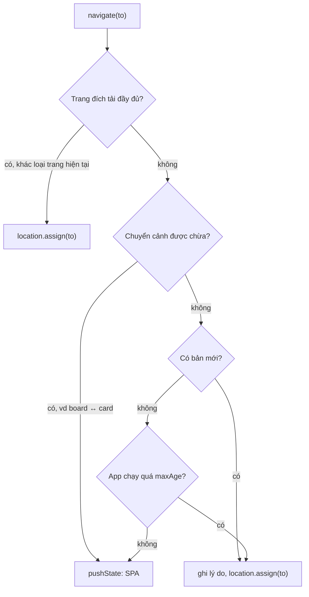

Website truyền thống tự cập nhật mỗi khi người dùng bấm link: mỗi trang là một lần tải HTML, JS, CSS mới. SPA thì khác. Người dùng mở Trello lúc 9 giờ sáng thứ Hai và để tab đó cả tuần. Trong tuần đó đội Trello deploy hai mươi lần, nhưng tab kia vẫn chạy **đúng bộ JavaScript của sáng thứ Hai**. Hậu quả:

- Lỗi đã sửa vẫn còn trên máy người dùng nhiều ngày sau.
- API đổi định dạng, code cũ gọi API mới, lỗi khó hiểu.
- Code cũ cần tải một chunk (`import()`) mà server đã xoá sau lần deploy mới: lỗi `ChunkLoadError`, trang trắng.
- Bộ nhớ rò rỉ tích tụ, tab chậm dần.

Cách hay gặp là hiện banner "Đã có phiên bản mới, bấm để tải lại". Người dùng phần lớn bỏ qua banner. Trello, Zappos và Facebook chọn cách lặng lẽ hơn: **lần điều hướng kế tiếp sẽ là một lần tải trang đầy đủ**. Người dùng vừa bấm sang trang khác, họ đã sẵn sàng chờ trang mới hiện ra, nên một lần tải trang thật gần như không bị nhận ra.

> [!TIP]
> **Tóm tắt**
> - Đừng reload giữa chừng; hãy **biến lần điều hướng kế tiếp thành tải trang đầy đủ**, tới đúng trang người dùng vừa bấm.
> - Ba tín hiệu để quyết định: app đã chạy **quá lâu** (Trello 24 giờ, Zappos 16 giờ), server có **bản mới** (Facebook), hoặc trang đích **không làm bằng SPA** (Zappos cấu hình theo loại trang).
> - Chừa ra những chuyển cảnh mà reload làm hỏng trải nghiệm: Trello không reload khi mở/đóng card trên board.
> - Trả về **lý do** dạng enum để test từng nhánh, và ghi lý do vào storage trước khi reload để gửi analytics sau khi tải xong.

<iframe class="demo-frame" src="/demos/web-patterns/index.html?theme=dark#/self-update" title="Demo self-update" loading="lazy" style="height: 620px"></iframe>

<p class="demo-links">▶ <a href="/demos/web-patterns/index.html#/self-update" target="_blank" rel="noopener">Mở demo toàn màn hình ↗</a> · <a href="https://stackblitz.com/github/hunghg255/blog-hunghg/tree/master/examples/web-patterns?file=src/lib/selfUpdate.ts" target="_blank" rel="noopener">Sửa code trên StackBlitz ↗</a> · <a href="https://github.com/hunghg255/blog-hunghg/blob/master/examples/web-patterns/src/lib/selfUpdate.ts" target="_blank" rel="noopener">Xem source trên GitHub ↗</a></p>

## Trello làm thế nào?

Trello tách phần này thành một package nhỏ: `trello.com/packages/client-updater/` ([xem trên GitHub](https://github.com/hunghg255/codebase/tree/main/trello.com/packages/client-updater/src)), ba file.

### `shouldReloadToUpdate.ts`

```ts
export const startTime = Date.now();
const oneDayInMs = 24 * 60 * 60 * 1000;

export enum ReloadCheckResult {
  RELOAD,
  FEATURE_FLAG_OFF,
  BOARD_TO_CARD_TRANSITION,
  CARD_TO_BOARD_TRANSITION,
  SHORTCUTS_OVERLAY_TRANSITION,
  NOT_TIME_YET,
}
```

`startTime` được tính một lần lúc module nạp, tức là lúc trang tải. Hàm `getReloadCheckResult(currentRoute, nextRoute)` đi qua các điều kiện theo thứ tự:

1. Feature flag `fep.evergreen_clients_passive_update` tắt → không reload. Cả tính năng nằm sau một cờ, bật/tắt từ xa được nếu có sự cố.
2. Từ board sang card, hoặc card về board → không reload.
3. Sang overlay phím tắt (`SHORTCUTS_OVERLAY`) → không reload.
4. App chạy chưa quá 1 ngày → không reload.
5. Còn lại → `RELOAD`.

Vì sao chừa board ↔ card? Trong Trello, mở một card là một lớp phủ (overlay) nằm trên board; URL đổi sang `/c/...` nhưng board vẫn ở phía sau. Reload ở đây biến một thao tác mở popup nhẹ nhàng thành một lần tải lại cả board, có lẽ quá lộ liễu. Overlay phím tắt cũng vậy.

Comment trên hàm giải thích vì sao trả về enum thay cho boolean: *"using an enum of outcomes lets us unit test with confidence (each return value is unique, which lets us avoid false negatives when testing each possible branch of code)"*. Nếu chỉ trả `false`, test "không reload vì board → card" vẫn qua dù thực tế là "không reload vì chưa đủ 1 ngày", nhánh board → card không hề được kiểm.

### `controller/navigate.ts`: chỗ dùng

```ts
export const navigate = (path, options) => {
  if (shouldReloadToUpdate(path)) {
    const nextUrl = new URL(path, window.location.origin);
    try {
      TrelloStorage.set(reloadedToUpdateStorageKey, {
        fromClientVersion: clientVersion,
        fromRoute: getRouteIdFromPathname(getLocation().pathname),
        toRoute: getRouteIdFromPathname(nextUrl.pathname),
        sessionLengthInSeconds: (Date.now() - startTime) / 1000,
      });
    } catch (e) { /* sắp reload rồi, bỏ qua lỗi storage */ }
    window.location.href = nextUrl.href;
    return;
  }
  Backbone.history.navigate(path, options);
};
```

Mọi điều hướng trong app đi qua một hàm `navigate`. Thay vì `Backbone.history.navigate` (đổi URL, render phía client), nó gán `window.location.href`: trình duyệt tải trang mới với JS mới. Trước đó, thông tin về phiên cũ được ghi vào storage. Khi trang mới tải xong, entry `app.js` gọi `sendReloadedToUpdateEvent()`: đọc thông tin đó, gửi một sự kiện analytics `reloaded` (kèm `toClientVersion`), rồi xoá khoá để lần tải sau không gửi lại. Nhờ vậy Trello biết một phiên trung bình dài bao lâu trước khi được cập nhật, và cập nhật từ bản nào lên bản nào.

## Zappos làm thế nào?

Zappos (React, history v3) bọc đối tượng `history` trong `zappos.com/src/history/createSmartHistory.js` ([xem trên GitHub](https://github.com/hunghg255/codebase/blob/main/zappos.com/src/history/createSmartHistory.js)):

```js
// 16 * 60 * 60 * 1000 : 16 hours in ms, This originally came from ztoken expiration...
const DEFAULT_SPA_TIME = new Date().getTime() + 57600000;

const isTimeToRefresh = () => new Date().getTime() > refreshTimestamp;
const respectRefresh = url => (refresh, browser) => (isTimeToRefresh() ? refresh(url) : browser(url));

const push = function(url) {
  url = urlCleanser(url);
  return shouldForceRefresh(url, win.location.pathname)
    ? refreshHistory.push(url)
    : pushRespectRefresh(url);
};
```

Có hai đối tượng history: `browserHistory` (SPA bình thường) và `refreshHistory` tạo bằng `createBrowserHistory({ forceRefresh: true })`, tức là mỗi `push` là một lần tải trang thật. `push` chọn một trong hai:

- **Theo thời gian**: quá 16 giờ kể từ lúc tải trang thì mọi `push`/`replace` đi qua `refreshHistory`. Comment nói con số 16 giờ đến từ thời hạn của token đăng nhập ("ztoken") và được giữ nguyên.
- **Theo loại trang**: `shouldForceRefresh(url, currentPath)` trong `historyFactory.js` phân loại URL bằng một loạt regex (`search`, `pdp` (trang sản phẩm), `cart`, `checkout`, `account`…). Trang đăng nhập (`zap`) luôn tải đầy đủ. Đi giữa hai trang **cùng loại** (tìm kiếm → tìm kiếm, sản phẩm → sản phẩm khác) thì luôn SPA. Còn lại tra cấu hình `forceRefresh` trong `marketplace.json`, cấu hình riêng cho desktop và mobile. Loại không nhận ra thì tải đầy đủ.

Loại trang được cấu hình tải đầy đủ có lẽ là những trang chưa được chuyển sang SPA hoặc cần môi trường sạch (thanh toán chẳng hạn). Thêm nữa, `historyFactory` có một chế độ `pageError`: trang đang lỗi thì **mọi** điều hướng đều tải đầy đủ, để thoát hẳn khỏi trạng thái hỏng.

## Facebook làm thế nào?

Bài [#20 của series Facebook](/blogs/facebook-spa-router-resilient-loading) đã phân tích kỹ router của facebook.com. Tóm lại: router reload ở lần điều hướng kế tiếp khi **có bản deploy mới** (server gửi kèm số revision trong response, module `ClientConsistency` so với revision của trang và chỉ tính các module trang này đã thật sự tải), khi đã **điều hướng quá 50 lần**, hoặc khi phiên **quá 2,5 ngày**. Một số loại route (xem ảnh, đang tạo bài) được chừa ra khi lý do là "có bản mới".

| | Trello | Zappos | Facebook |
|---|---|---|---|
| Hết hạn theo thời gian | 24 giờ | 16 giờ | 2,5 ngày |
| Biết có bản mới | không | không | có (revision từ server) |
| Giới hạn số lần điều hướng | không | không | 50 lần |
| Chừa chuyển cảnh | board ↔ card, overlay phím tắt | không | xem ảnh, tạo bài |
| Trang luôn tải đầy đủ | không | có, theo loại trang + cấu hình | không |
| Analytics sau reload | có (lý do, phiên dài bao lâu) | không thấy trong code | có (lấy mẫu) |
| Bật/tắt từ xa | feature flag | cấu hình marketplace | không phân tích |

Trello và Zappos **không hỏi server** có bản mới hay chưa. Họ chấp nhận: deploy hôm nay thì người dùng nhận được trong vòng một ngày. Đơn giản, không cần thêm hạ tầng. Facebook deploy nhiều lần mỗi ngày và có hạ tầng báo revision trong mọi response, nên làm được chính xác hơn.



## Viết lại

[`src/lib/selfUpdate.ts`](https://github.com/hunghg255/blog-hunghg/blob/master/examples/web-patterns/src/lib/selfUpdate.ts) gộp cả ba thành một chính sách cấu hình được. Phần quyết định là một hàm thuần (pure function), dễ test:

```ts title=src/lib/selfUpdate.ts
export function decideNavigation(from: string, to: string, policy: UpdatePolicy, ctx: NavContext): NavDecision {
  const fromType = policy.classify(from);
  const toType = policy.classify(to);

  // 1. Trang đích không làm bằng SPA (hoặc không nhận ra): tải đầy đủ.
  //    Đi giữa hai trang cùng một loại đã biết thì vẫn SPA (giống Zappos).
  if (toType === null) return NavDecision.FULL_LOAD_ROUTE;
  if ((policy.fullLoadTypes ?? []).includes(toType) && toType !== fromType) return NavDecision.FULL_LOAD_ROUTE;

  // 2. Chuyển cảnh nhạy cảm: kể cả có bản mới cũng chờ lần sau
  const isProtected = (policy.protectedTransitions ?? []).some(([a, b]) => a === fromType && b === toType);
  if (isProtected) return NavDecision.PROTECTED_TRANSITION;

  // 3. Có bản mới, hoặc app đã chạy quá lâu
  if (ctx.newVersionAvailable) return NavDecision.NEW_VERSION;
  if (ctx.now - ctx.startedAt > policy.maxAge) return NavDecision.MAX_AGE;

  return NavDecision.NOT_TIME_YET;
}
```

Bộ điều hướng gọi hàm trên, ghi báo cáo trước khi tải trang đầy đủ:

```ts title=src/lib/selfUpdate.ts
export function createSelfUpdatingNavigator({
  policy,
  version,
  currentPath,
  push,
  fullLoad = (path) => location.assign(path),
  now = Date.now,
  storage,
}: NavigatorOptions) {
  const startedAt = now();
  let newVersionAvailable = false;

  return {
    navigate(to: string): NavDecision {
      const from = currentPath();
      const decision = decideNavigation(from, to, policy, { startedAt, now: now(), newVersionAvailable });
      if (!isFullLoad(decision)) {
        push(to);
        return decision;
      }
      if (decision !== NavDecision.FULL_LOAD_ROUTE) {
        saveReloadReport(
          { reason: decision, fromVersion: version, fromPath: from, toPath: to, sessionSeconds: Math.round((now() - startedAt) / 1000) },
          storage,
        );
      }
      fullLoad(to);
      return decision;
    },
    markNewVersion() {
      newVersionAvailable = true;
    },
  };
}
```

Dùng trong app:

```ts
// tạo MỘT lần lúc app khởi động: startedAt tính từ đây
const nav = createSelfUpdatingNavigator({
  version: import.meta.env.VITE_APP_VERSION,
  policy: {
    classify: (p) => (p.startsWith('/b/') ? 'board' : p.startsWith('/c/') ? 'card' : p === '/login' ? 'auth' : 'page'),
    maxAge: 24 * 60 * 60 * 1000,
    fullLoadTypes: ['auth'],
    protectedTransitions: [['board', 'card'], ['card', 'board']],
  },
  currentPath: () => location.pathname,
  push: (to) => router.push(to),
});

watchVersion({ url: '/version.json', current: import.meta.env.VITE_APP_VERSION, onNewVersion: nav.markNewVersion });

const report = consumeReloadReport();
if (report) analytics.track('reloaded_to_update', { ...report, toVersion: import.meta.env.VITE_APP_VERSION });
```

::: spoiler Xem toàn bộ src/lib/selfUpdate.ts

```ts title=src/lib/selfUpdate.ts
/**
 * SPA tự cập nhật: thay vì hỏi "Có bản mới, tải lại?", app tự tải lại toàn trang ở lần
 * điều hướng kế tiếp, đúng trang người dùng vừa bấm. Ghép ý tưởng từ:
 *
 * - Trello (client-updater/shouldReloadToUpdate.ts): app mở quá 1 ngày thì reload ở lần điều
 *   hướng tới; không reload ở các chuyển cảnh "nhạy cảm" (board <-> card); kết quả là enum để
 *   test từng nhánh; ghi lý do vào storage để sau reload gửi analytics.
 * - Zappos (history/createSmartHistory.js): quá 16 giờ thì mọi push/replace thành tải trang
 *   đầy đủ; một số loại trang luôn tải đầy đủ, trừ khi đi giữa hai trang cùng loại.
 * - Facebook: reload khi server báo có bản deploy mới (xem bài router của series Facebook).
 */

// Enum kết quả như Trello: mỗi nhánh một giá trị riêng, test được từng nhánh.
// Dùng object `as const` thay cho `enum` để code vẫn là JavaScript thuần sau khi bỏ kiểu.
export const NavDecision = {
  /** loại trang đích luôn tải đầy đủ (trang đăng nhập, trang chưa làm bằng SPA…) */
  FULL_LOAD_ROUTE: 'FULL_LOAD_ROUTE',
  /** chuyển cảnh không được phép reload (vd mở card nằm đè lên board) */
  PROTECTED_TRANSITION: 'PROTECTED_TRANSITION',
  /** server đã có bản mới */
  NEW_VERSION: 'NEW_VERSION',
  /** app đã chạy quá lâu */
  MAX_AGE: 'MAX_AGE',
  /** chưa có lý do reload: điều hướng trong SPA */
  NOT_TIME_YET: 'NOT_TIME_YET',
} as const;
export type NavDecision = (typeof NavDecision)[keyof typeof NavDecision];

const FULL = new Set<NavDecision>([NavDecision.FULL_LOAD_ROUTE, NavDecision.NEW_VERSION, NavDecision.MAX_AGE]);
export const isFullLoad = (decision: NavDecision) => FULL.has(decision);

export interface UpdatePolicy {
  /** url -> loại trang ('board', 'card', 'search'…), null nếu không nhận ra */
  classify: (path: string) => string | null;
  /** app sống quá thời gian này (ms) thì reload ở lần điều hướng tới */
  maxAge: number;
  /** loại trang luôn tải đầy đủ. Loại không nhận ra (null) cũng tải đầy đủ. */
  fullLoadTypes?: string[];
  /** cặp [từ, tới] không bao giờ reload để cập nhật */
  protectedTransitions?: Array<[string, string]>;
}

export interface NavContext {
  /** app bắt đầu chạy lúc nào (thường là lúc module được nạp) */
  startedAt: number;
  now: number;
  newVersionAvailable: boolean;
}

export function decideNavigation(from: string, to: string, policy: UpdatePolicy, ctx: NavContext): NavDecision {
  const fromType = policy.classify(from);
  const toType = policy.classify(to);

  // 1. Trang đích không làm bằng SPA (hoặc không nhận ra): tải đầy đủ.
  //    Đi giữa hai trang cùng một loại đã biết thì vẫn SPA (giống Zappos).
  if (toType === null) return NavDecision.FULL_LOAD_ROUTE;
  if ((policy.fullLoadTypes ?? []).includes(toType) && toType !== fromType) return NavDecision.FULL_LOAD_ROUTE;

  // 2. Chuyển cảnh nhạy cảm: kể cả có bản mới cũng chờ lần sau
  const isProtected = (policy.protectedTransitions ?? []).some(([a, b]) => a === fromType && b === toType);
  if (isProtected) return NavDecision.PROTECTED_TRANSITION;

  // 3. Có bản mới, hoặc app đã chạy quá lâu
  if (ctx.newVersionAvailable) return NavDecision.NEW_VERSION;
  if (ctx.now - ctx.startedAt > policy.maxAge) return NavDecision.MAX_AGE;

  return NavDecision.NOT_TIME_YET;
}

// ---------------------------------------------------------------------------
// Ghi lý do trước khi reload, đọc lại sau khi tải xong (Trello: sendReloadedToUpdateEvent)
// ---------------------------------------------------------------------------

const REPORT_KEY = 'reloadedToUpdate';

export interface ReloadReport {
  reason: NavDecision;
  fromVersion: string;
  fromPath: string;
  toPath: string;
  sessionSeconds: number;
}

export function saveReloadReport(report: ReloadReport, storage: Storage = sessionStorage) {
  try {
    storage.setItem(REPORT_KEY, JSON.stringify(report));
  } catch {
    // storage đầy / bị chặn: sắp reload rồi, bỏ qua
  }
}

/** Gọi một lần lúc app khởi động; trả về báo cáo (nếu lần tải này là do tự cập nhật) rồi xoá. */
export function consumeReloadReport(storage: Storage = sessionStorage): ReloadReport | null {
  try {
    const raw = storage.getItem(REPORT_KEY);
    storage.removeItem(REPORT_KEY); // xoá ngay để lần tải sau không gửi lại
    return raw ? (JSON.parse(raw) as ReloadReport) : null;
  } catch {
    return null;
  }
}

// ---------------------------------------------------------------------------
// Bộ điều hướng
// ---------------------------------------------------------------------------

export interface NavigatorOptions {
  policy: UpdatePolicy;
  version: string;
  currentPath: () => string;
  /** điều hướng trong SPA, vd history.pushState + render */
  push: (path: string) => void;
  /** tải trang đầy đủ, mặc định location.assign */
  fullLoad?: (path: string) => void;
  now?: () => number;
  storage?: Storage;
}

export function createSelfUpdatingNavigator({
  policy,
  version,
  currentPath,
  push,
  fullLoad = (path) => location.assign(path),
  now = Date.now,
  storage,
}: NavigatorOptions) {
  const startedAt = now();
  let newVersionAvailable = false;

  return {
    navigate(to: string): NavDecision {
      const from = currentPath();
      const decision = decideNavigation(from, to, policy, { startedAt, now: now(), newVersionAvailable });
      if (!isFullLoad(decision)) {
        push(to);
        return decision;
      }
      if (decision !== NavDecision.FULL_LOAD_ROUTE) {
        saveReloadReport(
          { reason: decision, fromVersion: version, fromPath: from, toPath: to, sessionSeconds: Math.round((now() - startedAt) / 1000) },
          storage,
        );
      }
      fullLoad(to);
      return decision;
    },
    markNewVersion() {
      newVersionAvailable = true;
    },
  };
}

/**
 * Hỏi server bản đang deploy (vd /version.json do bước build sinh ra). Gọi định kỳ và mỗi
 * khi tab được hiện lại; thấy khác bản đang chạy thì gọi onNewVersion một lần.
 */
export function watchVersion({
  url,
  current,
  interval = 10 * 60 * 1000,
  onNewVersion,
  fetchImpl = fetch,
}: {
  url: string;
  current: string;
  interval?: number;
  onNewVersion: (version: string) => void;
  fetchImpl?: typeof fetch;
}) {
  let done = false;
  const check = async () => {
    if (done || document.hidden) return;
    try {
      const response = await fetchImpl(url, { cache: 'no-store' });
      const { version } = (await response.json()) as { version: string };
      if (!done && version && version !== current) {
        done = true;
        onNewVersion(version);
      }
    } catch {
      // mạng lỗi: lần sau thử lại
    }
  };
  const id = setInterval(check, interval);
  const onVisible = () => void check();
  document.addEventListener('visibilitychange', onVisible);
  return () => {
    done = true;
    clearInterval(id);
    document.removeEventListener('visibilitychange', onVisible);
  };
}
```

:::

## Đi qua code

**Thứ tự kiểm tra có chủ ý.** Trang đích không làm bằng SPA thì tải đầy đủ bất kể lý do khác, nên đứng đầu. Chuyển cảnh được chừa đứng **trước** "có bản mới" và "quá hạn": ngay cả khi có bản mới, mở card vẫn là SPA; lần điều hướng sau đó mới reload. Giống Trello, nơi kiểm tra board ↔ card nằm trước kiểm tra thời gian.

**Hàm quyết định là hàm thuần.** `decideNavigation` không đọc `location`, không đọc `Date.now()`: mọi thứ truyền vào qua tham số. Test chỉ cần gọi hàm với các bộ tham số khác nhau, không phải giả lập trình duyệt hay đồng hồ.

**Kết quả là một tập giá trị có tên** (`NavDecision`), giống `ReloadCheckResult` của Trello. Bản viết lại dùng object `as const` thay cho `enum` của TypeScript: cùng cách dùng (`NavDecision.MAX_AGE`), nhưng sau khi bỏ kiểu thì vẫn là JavaScript thuần (`enum` sinh ra code JavaScript thật, nên các công cụ chỉ xoá kiểu, như chế độ type stripping của Node, không chạy được).

**Chỉ ghi báo cáo khi reload để cập nhật.** Tải đầy đủ vì trang đích không phải SPA là chuyện bình thường, không cần gửi sự kiện "reloaded".

**`consumeReloadReport` xoá khoá ngay sau khi đọc**, giống `TrelloStorage.unset` của Trello: người dùng reload thêm lần nữa thì không gửi lại sự kiện cũ.

**`watchVersion`** hỏi `/version.json` (bước build ghi ra file này) mỗi 10 phút và mỗi khi tab được hiện lại, với `cache: 'no-store'` để không nhận bản cache. Tab đang ẩn thì bỏ qua, không tốn request.

**Khác bản gốc:**
- Gộp tín hiệu của cả ba site: thời gian (Trello, Zappos), bản mới (Facebook), loại trang (Zappos).
- Lưu báo cáo vào `sessionStorage` (mỗi tab một bản) thay vì storage dùng chung. Hai tab cùng reload để cập nhật thì mỗi tab gửi đúng báo cáo của mình.
- Không có feature flag trong lib; muốn bật/tắt từ xa thì đặt `maxAge: Infinity`.
- Zappos áp quy tắc theo loại trang cho `push`, còn `replace` chỉ xét thời gian. Bản viết lại chỉ có một hàm `navigate`; với `replace` bạn có thể gọi `decideNavigation` và xử lý tương tự.

## Tại sao không làm cách khác?

**Banner "Có bản mới, bấm để tải lại"?** Người dùng bỏ qua, hoặc bấm đúng lúc đang gõ dở. Banner hợp khi bản mới **bắt buộc** (sửa lỗi bảo mật, đổi API không tương thích). Còn lại, reload lặng lẽ ở ranh giới điều hướng ít phiền hơn nhiều.

**Service worker `skipWaiting` + `clients.claim`?** Service worker cập nhật được cache, nhưng JS đang chạy trong tab vẫn là bản cũ cho tới khi trang tải lại. Rốt cuộc vẫn cần quyết định **khi nào** tải lại, đúng là câu hỏi bài này trả lời. Hai thứ dùng chung được: service worker lo tải trước bản mới, chính sách điều hướng lo thời điểm reload.

**Reload ngay khi biết có bản mới?** Người dùng đang điền form, đang xem video, đang kéo thả. Không có thời điểm nào an toàn để reload mà người dùng không chủ động bấm. Lần điều hướng kế tiếp là lúc gần với "người dùng chủ động" nhất.

**Chỉ dựa vào thời gian, không hỏi server?** Đó chính là Trello và Zappos, và nó đủ tốt cho phần lớn app. Thêm `watchVersion` khi cần đẩy bản sửa lỗi tới người dùng nhanh hơn.

## Edge case và cạm bẫy

- **Dữ liệu chưa lưu**: tải trang đầy đủ làm mất mọi thứ trong bộ nhớ. Hỏi các "unload hook" trước khi reload, như bản viết lại của router Facebook trong [bài #20 series Facebook](/blogs/facebook-spa-router-resilient-loading).
- **Điều hướng không đi qua `navigate`**: nút back/forward (`popstate`) không gọi hàm của bạn. Muốn áp chính sách cho cả back/forward thì xử lý trong listener `popstate`: kiểm tra, nếu cần thì `location.reload()` (URL đã đổi sẵn rồi).
- **Link `<a>` thường**: nếu router của bạn chặn click trên `<a>` để điều hướng SPA thì điểm chặn đó phải gọi `nav.navigate`. Link mở tab mới (Ctrl+click) thì luôn tải bản mới, không cần làm gì.
- **App mở trên màn hình TV/kiosk không ai bấm gì**: không có điều hướng thì không bao giờ cập nhật. Cần thêm lịch reload vào giờ không ai dùng.
- **Chunk cũ bị xoá ngay sau deploy**: chính sách này giảm nhưng không loại bỏ `ChunkLoadError`; giữ lại file của vài bản deploy cũ trên CDN và bắt lỗi tải chunk để reload (xem phần Bootloader trong bài router Facebook).
- **Đồng hồ máy người dùng**: `Date.now()` nhảy khi đổi giờ hệ thống; với ngưỡng 16–24 giờ thì sai lệch vài phút không đáng kể. Máy ngủ qua đêm thì thời gian ngủ vẫn được tính, đúng ý đồ (bản cũ đã nằm đó cả đêm).

## Dùng trong dự án

- Mọi SPA mà người dùng để tab mở lâu: dashboard, công cụ nội bộ, app quản lý dự án, email. Bắt đầu với `maxAge` 24 giờ, chưa cần hạ tầng gì thêm.
- Khi deploy dày và cần đẩy bản sửa nhanh: bước build ghi `version.json`, bật `watchVersion`.
- Trong quá trình chuyển dần từ trang server-render sang SPA (như Zappos): `fullLoadTypes` là danh sách các trang chưa chuyển, xoá dần khi chuyển xong.
- Theo dõi `reloaded_to_update` trên dashboard: biết bao nhiêu % người dùng còn chạy bản cũ sau N giờ kể từ khi deploy.

::: spoiler Ví dụ test (bản phác, không có trong repo)

```ts
import { describe, expect, it, vi } from 'vitest';
import { consumeReloadReport, createSelfUpdatingNavigator, decideNavigation, NavDecision, type UpdatePolicy } from './selfUpdate';

const policy: UpdatePolicy = {
  classify: (p) => (p.startsWith('/b/') ? 'board' : p.startsWith('/c/') ? 'card' : p === '/login' ? 'auth' : p.startsWith('/') ? 'page' : null),
  maxAge: 1000,
  fullLoadTypes: ['auth'],
  protectedTransitions: [['board', 'card']],
};
const fresh = { startedAt: 0, now: 10, newVersionAvailable: false };
const old = { startedAt: 0, now: 5000, newVersionAvailable: false };

describe('decideNavigation', () => {
  it.each([
    ['/b/1', '/login', fresh, NavDecision.FULL_LOAD_ROUTE],
    ['/b/1', '/c/2', old, NavDecision.PROTECTED_TRANSITION],
    ['/b/1', '/c/2', { ...fresh, newVersionAvailable: true }, NavDecision.PROTECTED_TRANSITION],
    ['/c/2', '/x', { ...fresh, newVersionAvailable: true }, NavDecision.NEW_VERSION],
    ['/c/2', '/x', old, NavDecision.MAX_AGE],
    ['/c/2', '/x', fresh, NavDecision.NOT_TIME_YET],
  ])('%s → %s', (from, to, ctx, expected) => {
    expect(decideNavigation(from, to, policy, ctx)).toBe(expected);
  });
});

it('ghi báo cáo trước khi reload và chỉ đọc được một lần', () => {
  let t = 0;
  const fullLoad = vi.fn();
  const nav = createSelfUpdatingNavigator({
    policy, version: 'v1', currentPath: () => '/x', push: vi.fn(), fullLoad, now: () => t,
  });
  t = 5000;
  expect(nav.navigate('/y')).toBe(NavDecision.MAX_AGE);
  expect(fullLoad).toHaveBeenCalledWith('/y');
  expect(consumeReloadReport()).toMatchObject({ reason: 'MAX_AGE', fromVersion: 'v1', sessionSeconds: 5 });
  expect(consumeReloadReport()).toBeNull();
});
```

:::

## So với thư viện và chuẩn web

- Các framework có router như Next.js, Remix/React Router, Nuxt có cơ chế phát hiện bản build mới hoặc lỗi tải chunk ở mức khác nhau (vd khi chunk không tải được thì chuyển sang tải trang đầy đủ). Đọc tài liệu của framework bạn dùng trước khi tự làm, rồi bổ sung phần còn thiếu (thường là "hết hạn theo thời gian" và analytics).
- **Navigation API** (`navigation.addEventListener('navigate', …)`) cho một điểm duy nhất để chặn **mọi** điều hướng, kể cả back/forward và click `<a>`. Đó là chỗ lý tưởng để gắn chính sách này. Tính tới 10/2026, kiểm tra [caniuse](https://caniuse.com/mdn-api_navigation) vì chưa phải trình duyệt nào cũng có.
- **Service worker** lo phần "tải trước bản mới", còn chính sách điều hướng lo phần "lúc nào chuyển sang bản mới". Hai thứ bổ sung cho nhau.

---

Bài này thuộc series **[Học từ mã nguồn các web lớn](/series/web)** (21 bài, đọc theo thứ tự).

::: spoiler Xem nhanh danh sách bài trong series

*Mở đầu*

- [Mở đầu: đọc code production của 28 trang web](/blogs/learn-from-big-web-apps)

*Phần 1: trải nghiệm người dùng*

- [#1 Dark mode không nháy (Gatsby)](/blogs/web-dark-mode-no-flash)
- [#2 useValueByMedia: giá trị theo breakpoint (Toptal)](/blogs/web-use-value-by-media)
- [#3 Đoán ý định: idle, exit-intent, lắc chuột (Toptal, InVision)](/blogs/web-user-intent-idle-exit-wiggle)
- [#4 Validate form thân thiện (Udacity, Pipedrive)](/blogs/web-form-validation-ux)
- [#5 Magic number, EXIF và dán ảnh (Ello)](/blogs/web-file-magic-number-exif-paste)
- [#6 fastSmoothScroll: cuộn xa vẫn nhanh (Telegram)](/blogs/web-telegram-fast-smooth-scroll)
- [#7 Countdown time-travel và tombstone giỏ hàng (Best Buy)](/blogs/web-countdown-time-travel-tombstone)

*Phần 2: hiệu năng và đo lường*

- [#8 Hàng đợi requestAnimationFrame 3ms (Apple)](/blogs/web-raf-queue-3ms)
- [#9 srcset cho artwork và preconnect tự động (Apple)](/blogs/web-responsive-artwork-preconnect)
- [#10 Quick-fetch: gọi API trước khi bundle tải xong (HubSpot)](/blogs/web-quick-fetch-early-requests)
- [#11 Performance span và long task (Postman, Calibre)](/blogs/web-performance-spans-long-tasks)
- [#12 Gọi Web Worker như hàm async (Telegram)](/blogs/web-worker-promise-rpc)
- [#13 Đồng hồ media: đếm giờ xem và sửa lệch (Skillshare, Simplified)](/blogs/web-media-clock-watch-time-drift)

*Phần 3: nhiều tab, phiên đăng nhập, cập nhật*

- [#14 Bầu tab chủ cho thông báo (HubSpot, Telegram)](/blogs/web-leader-tab-notifications)
- [#15 Đồng bộ đăng nhập giữa tab và giới hạn cookie (Elastic, InVision)](/blogs/web-cross-tab-auth-cookie-guard)
- **#16 SPA tự cập nhật: Trello, Zappos, Facebook** (bài này)

*Phần 4: kiến trúc*

- [#17 Reverse portal: di chuyển component không remount (Zappos)](/blogs/web-reverse-portal)
- [#18 Page behaviors: gắn hành vi từ CMS (Intercom)](/blogs/web-page-behaviors-cms)
- [#19 Giới hạn tần suất hiển thị bằng bitmask (Outlook)](/blogs/web-frequency-cap-bitmask)
- [#20 Chuyển REST sang GraphQL dần dần (Coursera)](/blogs/web-rest-to-graphql-hybrid-link)

:::

Code + demo: [`examples/web-patterns`](https://github.com/hunghg255/blog-hunghg/tree/master/examples/web-patterns) · [Mở trên StackBlitz](https://stackblitz.com/github/hunghg255/blog-hunghg/tree/master/examples/web-patterns)
