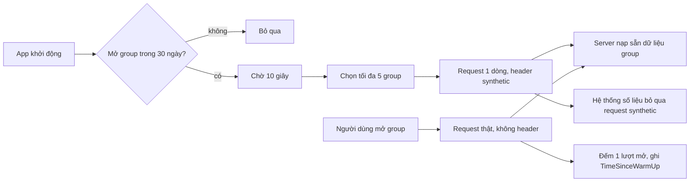

Bài này gom hai kỹ thuật nhỏ của Outlook trên web. Chúng không liên quan về chức năng, nhưng có chung một tinh thần: **dữ liệu sản phẩm (số liệu, cấu hình) cũng là một phần của API**, phải giữ cho đúng như code.

1. **Prefetch có đánh dấu "synthetic".** 10 giây sau khi khởi động, Outlook gọi trước một request rất nhẹ cho tối đa 5 group người dùng hay mở, để lúc họ bấm vào thì server đã sẵn sàng. Request đó mang một header riêng, để server **không đếm** nó là người dùng mở group. Không có header, mỗi lần prefetch là một "lượt mở" giả, số liệu engagement của tính năng Group tăng vọt mà không ai dùng thêm.
2. **Bit flags.** Hàng chục lựa chọn bật/tắt của giao diện (ẩn ảnh người gửi, thu gọn cột thư mục, tắt tin tức…) được lưu trong **một số nguyên 32 bit** trong cấu hình người dùng trên server, mỗi lựa chọn một bit.

> [!TIP]
> **Tóm tắt**
> - Prefetch, warm-up, kiểm tra sức khoẻ… là request **do máy tạo ra**. Gắn header để server và hệ thống số liệu tách chúng khỏi hành vi thật của người dùng.
> - Đo hiệu quả của prefetch ngay trong số liệu của hành động thật: Outlook ghi "đã warm bao lâu trước khi người dùng mở" vào datapoint chuyển group.
> - Bit flags tiết kiệm chỗ và số request ghi, nhưng **vị trí bit là hợp đồng vĩnh viễn**: không đổi, không dùng lại.
> - Code bit flags của Outlook có một lỗi nhỏ: chỉ ghi khi giá trị hiện tại khác 0, nên từ 0 thì không bật được cờ nào.

<iframe class="demo-frame" src="/demos/web-patterns/index.html?theme=dark#/synthetic-prefetch" title="Demo synthetic-prefetch" loading="lazy" style="height: 980px"></iframe>

<p class="demo-links">▶ <a href="/demos/web-patterns/index.html#/synthetic-prefetch" target="_blank" rel="noopener">Mở demo toàn màn hình ↗</a> · <a href="https://stackblitz.com/github/hunghg255/blog-hunghg/tree/master/examples/web-patterns?file=src/lib/syntheticPrefetch.ts" target="_blank" rel="noopener">Sửa code trên StackBlitz ↗</a> · <a href="https://github.com/hunghg255/blog-hunghg/blob/master/examples/web-patterns/src/lib/syntheticPrefetch.ts" target="_blank" rel="noopener">Xem source trên GitHub ↗</a></p>

Bấm **Khởi động**, chờ 2 giây (Outlook là 10 giây) cho bốn group được đánh dấu "warm", rồi mở "Thiết kế" (khoảng 120ms) và "Pháp chế" (900ms vì chưa warm). Đổi sang **Không gắn header** rồi khởi động lại: người dùng chỉ mở 2 lần nhưng server đếm 6. Ở khung bit flags, bật "Mô phỏng bản gốc", về 0 rồi tick bất kỳ cờ nào: giá trị lưu vẫn là 0.

## Outlook làm thế nào?

### Warm-up group hay dùng

Code nằm ở [`owa-group-prefetch-actions/src/actions/warmUpFrequentlyUsedGroups.ts`](https://github.com/hunghg255/codebase/blob/main/outlook.live.com/src/modules/owa-group-prefetch-actions/src/actions/warmUpFrequentlyUsedGroups.ts), được gọi một lần sau khi danh sách group trong thanh bên trái tải xong (`owa-group-left-nav-actions/src/actions/loadGroups.ts`).

```ts
const MAX_GROUPS_TO_WARM_UP = 5;
const GROUP_PREFETCH_DELAY_MS: number = 10000; // 10 seconds
const MAX_DAYS_SINCE_LAST_VISIT: number = 30; // Max days since last visit to be considered a groups user

// This needs to be in Sync with SyntheticActionSource in %SDXROOT%\sources\dev\services\src\Core\Search\NormalQueryView.cs
// so that these calls don't count for engagement
const SyntheticGroupActionSource = 'GroupModulePrefetch';
const ActionSourceHeaderName = 'X-OWA-ActionSource';
```

Chú thích nói rõ mục đích: giá trị header phải khớp với một hằng số **phía server** (file C# của Exchange), để các lời gọi này "không bị tính vào engagement".

Luồng chạy:

1. Cờ cấp module `wasGroupsWarmUpTriggered` bảo đảm chỉ chạy **một lần** cho cả phiên.
2. Chờ 10 giây: lúc khởi động là lúc mạng và CPU bận nhất, việc phụ để sau.
3. Nếu người dùng không mở group nào trong 30 ngày (`isGroupsSpaceUser`), bỏ qua: người không dùng group thì không tốn request.
4. Chọn group: trước hết là group **yêu thích** có mở trong 30 ngày; chưa đủ 5 thì lấy thêm group **không yêu thích** nằm trong 5 vị trí đầu thanh bên (`MAX_GROUP_NODES_WHEN_COLLAPSED = 5`, số group hiện khi danh sách thu gọn) và cũng có mở trong 30 ngày.
5. Với mỗi group, gọi API lấy danh sách thư nhưng chỉ **1 dòng**, kèm hai header:

```ts
options.headers = new Headers();
options.headers.set(ActionSourceHeaderName, SyntheticGroupActionSource); // 'GroupModulePrefetch'
options.headers.set(ActionNameHeaderName, GroupWarmUpActionName); // 'GroupMailbox_WarmUp'
```

6. Lỗi của request warm-up bị nuốt: `.catch(error => { return; })`, kèm chú thích "để không đẩy lên hệ thống cảnh báo lỗi".

Kết quả của request (1 dòng thư) **không được dùng** ở client: promise trả về không ai đọc. Vậy mục đích là phía server: có lẽ để Exchange nạp mailbox của group vào bộ nhớ đệm, lần mở thật đầu tiên khỏi phải đọc từ đĩa (suy đoán từ cách dùng, code server không có trong dump).

### Đo xem warm-up có đáng không

Một kho nhỏ ([`owa-group-prefetch-store/src/store.ts`](https://github.com/hunghg255/codebase/blob/main/outlook.live.com/src/modules/owa-group-prefetch-store/src/store.ts)) nhớ danh sách group đã warm và thời điểm warm. Khi người dùng mở group thật, `owa-mail-list-actions/src/actions/table/loadInitialGroupTable.ts` gắn vào datapoint hiệu năng của thao tác chuyển group:

```ts
const groupId = getGroupIdFromTableQuery(tableView.tableQuery);
if (wasGroupWarmedUp(groupId)) {
    const groupsWarmUpTime = getGroupsWarmUpTime();
    datapoint.addCustomProperty('TimeSinceWarmUp', Date.now() - groupsWarmUpTime);
}
```

Nhờ vậy nhóm phát triển so được thời gian mở group **có** và **không** warm-up, và biết warm-up bao lâu thì còn tác dụng. Một tối ưu mà không đo thì không biết có nên giữ.

### Bit flags

Thư mục [`owa-bit-flags/src/utils/`](https://github.com/hunghg255/codebase/tree/main/outlook.live.com/src/modules/owa-bit-flags/src/utils) có ba bộ cờ: giao diện danh sách thư, Focused Inbox, trợ năng. Bộ đầu tiên:

```ts
/* PLEASE DO NOT CHANGE THE BIT POSITIONS FOR THE FLAGS STORED IN ListViewBitFlagsMasks */
export const enum ListViewBitFlagsMasks {
    None = 0,
    DateHeadersDisabled = 1 << 1,
    FolderPaneCollapsed = 1 << 2,
    HideSenderImage = 1 << 3,
    LikeSurfaceActionFirstRun = 1 << 4,
    IsCommercialUserInitialized = 1 << 5,
    // … tới 1 << 12
    // MAX = 1 << 31
}
```

Số nguyên này nằm trong `ViewStateConfiguration` của cấu hình người dùng, lưu ở server. Khi đổi một cờ, ví dụ thu gọn cột thư mục ([`owa-mail-layout/src/services/setFolderPaneCollapsedState.ts`](https://github.com/hunghg255/codebase/blob/main/outlook.live.com/src/modules/owa-mail-layout/src/services/setFolderPaneCollapsedState.ts)), cả số nguyên được ghi lên server với kiểu `Integer32`.

Bộ cờ Focused Inbox còn có chú thích thú vị: vài bit đầu của số nguyên **đang được bản Outlook cũ (JsMvvm) dùng** để nhớ tab cuối cùng người dùng xem, và chú thích ghi rõ bit nào còn trống. Hai thế hệ client cùng đọc ghi một số nguyên, nên bit nào đã có chủ thì bản mới phải tránh.

### Lỗi nhỏ: từ 0 thì không bật được

```ts
export function setBit(value: boolean, bitMask: ListViewBitFlagsMasks) {
    // Already same value, no need to set again and update user config
    if (getIsBitSet(bitMask) === value) {
        return;
    }

    updateUserConfiguration(userConfig => {
        if (userConfig.ViewStateConfiguration?.ListViewBitFlags) {
            if (value) {
                userConfig.ViewStateConfiguration.ListViewBitFlags |= bitMask;
            } else {
                userConfig.ViewStateConfiguration.ListViewBitFlags &= ~bitMask;
            }
        }
    });
}
```

Điều kiện `if (…ListViewBitFlags)` kiểm "có giá trị", nhưng `0` là falsy trong JavaScript. Khi số nguyên đang là 0 (chưa bật cờ nào), `setBit(true, …)` không làm gì, rồi `setFolderPaneCollapsedState` ghi lên server đúng số 0 đó: lựa chọn của người dùng biến mất. Có lẽ ý định là "bỏ qua khi `ViewStateConfiguration` chưa có", nhưng viết thành kiểm cả số.

Trong thực tế lỗi này ít lộ ra: chỉ cần một cờ nào đó đã bật (ví dụ `IsCommercialUserInitialized` cho tài khoản doanh nghiệp) là số khác 0. Bộ cờ tương tự trong `owa-favorites` (`favoritesBitFlagsActions.ts`) **không** có điều kiện này, nên không bị.

## Bên trong: header, CORS và số liệu



Hai điều cần biết khi gắn header tự đặt:

- **Header tự đặt làm request "không đơn giản".** Gửi sang origin khác, trình duyệt phải hỏi trước bằng một request `OPTIONS` (preflight CORS), và server phải liệt kê header đó trong `Access-Control-Allow-Headers`. Outlook gọi API cùng origin nên không gặp.
- **Đánh dấu ở client, lọc ở server.** Client chỉ có thể *khai báo*; việc bỏ qua khi đếm phải nằm ở chỗ tính số liệu. Hai nơi phải dùng chung một hằng số, như chú thích "needs to be in Sync" của Outlook.

## Viết lại

Phần warm-up tách thành hàm chọn group (`pickWarmUpTargets`, hàm thuần, dễ test) và bộ chạy một lần:

```ts title=src/lib/syntheticPrefetch.ts
export function createWarmUp({ candidates, warm, delayMs = 10_000, pick }: WarmUpOptions) {
  let triggered = false;
  let timer: ReturnType<typeof setTimeout> | undefined;
  let warmed = new Set<string>();
  let warmedAt = 0;

  return {
    /** gọi bao nhiêu lần cũng chỉ chạy một lần */
    trigger() {
      if (triggered) return;
      triggered = true;
      timer = setTimeout(() => {
        const ids = pickWarmUpTargets(candidates(), pick);
        // Outlook: nếu người dùng không mở group nào trong 30 ngày thì thôi, không warm gì cả
        if (ids.length === 0) return;
        warmedAt = Date.now();
        warmed = new Set(ids);
        for (const id of ids) {
          const headers = new Headers({ [SYNTHETIC_SOURCE_HEADER]: 'prefetch' });
          // lỗi của request phụ không được làm phiền ai: nuốt, không đẩy lên hệ thống báo lỗi
          warm(id, headers).catch(() => {});
        }
      }, delayMs);
    },
    /** để gắn vào số liệu khi người dùng mở group thật: group này có được warm không, cách bao lâu */
    measure(id: string): { warmed: boolean; msSinceWarmUp?: number } {
      return warmed.has(id) ? { warmed: true, msSinceWarmUp: Date.now() - warmedAt } : { warmed: false };
    },
    cancel() {
      clearTimeout(timer);
    },
  };
}
```

Phần bit flags định nghĩa cờ bằng **vị trí bit** thay vì mặt nạ, kiểm trùng và chặn bit 31:

```ts title=src/lib/syntheticPrefetch.ts
export function defineBitFlags<const T extends Record<string, number>>(positions: T) {
  for (const [name, bit] of Object.entries(positions)) {
    // bit 31 là bit dấu của Integer32 bên server: tránh luôn cho khỏi lẫn số âm
    if (!Number.isInteger(bit) || bit < 0 || bit > 30) throw new RangeError(`${name}: bit ${bit} ngoài 0–30`);
  }
  const bits = Object.values(positions);
  if (new Set(bits).size !== bits.length) throw new Error('hai cờ trùng một vị trí bit');

  const mask = (name: keyof T) => 1 << positions[name];
  return {
    has: (value: number | undefined, name: keyof T) => ((value ?? 0) & mask(name)) !== 0,
    /** trả về số mới; giá trị đang là 0 hoặc chưa có vẫn đặt được (xem "Khác bản gốc" trong bài) */
    set: (value: number | undefined, name: keyof T, on: boolean) =>
      on ? (value ?? 0) | mask(name) : (value ?? 0) & ~mask(name),
    names: Object.keys(positions) as (keyof T)[],
    positions,
  };
}
```

::: spoiler Xem toàn bộ src/lib/syntheticPrefetch.ts

```ts title=src/lib/syntheticPrefetch.ts
/**
 * Hai kỹ thuật nhỏ trong Outlook Web:
 *
 * 1. "Warm up" có đánh dấu synthetic (owa-group-prefetch-actions/warmUpFrequentlyUsedGroups.ts):
 *    10 giây sau khi khởi động, gọi trước một request rất nhẹ (lấy 1 dòng) cho tối đa 5 group
 *    người dùng hay mở, để server nạp sẵn dữ liệu của group vào cache. Request mang header
 *    `X-OWA-ActionSource: GroupModulePrefetch` để server KHÔNG tính nó là người dùng mở group.
 *
 * 2. Bit flags (owa-bit-flags): gom nhiều cờ bật/tắt của giao diện vào MỘT số nguyên lưu ở
 *    cấu hình người dùng trên server.
 */

// ---------------------------------------------------------------------------
// 1. Warm-up đánh dấu synthetic
// ---------------------------------------------------------------------------

export const SYNTHETIC_SOURCE_HEADER = 'X-Action-Source';

export interface WarmUpCandidate {
  id: string;
  favorite: boolean;
  /** lần cuối người dùng mở (ms since epoch), không có = chưa mở bao giờ */
  lastVisited?: number;
  /** vị trí trong thanh điều hướng (0 = trên cùng) */
  rank: number;
}

export interface PickOptions {
  max?: number;
  /** chỉ warm group mở trong N ngày gần đây */
  maxDaysSinceVisit?: number;
  /** chỉ xét group không yêu thích nằm trong N vị trí đầu (Outlook: số group hiện khi thu gọn) */
  topNonFavorites?: number;
  now?: number;
}

const DAY = 86_400_000;

/** Chọn group để warm: group yêu thích trước, thiếu thì lấy thêm group đứng đầu danh sách. */
export function pickWarmUpTargets(
  candidates: WarmUpCandidate[],
  { max = 5, maxDaysSinceVisit = 30, topNonFavorites = 5, now = Date.now() }: PickOptions = {},
): string[] {
  const recent = (c: WarmUpCandidate) => c.lastVisited !== undefined && now - c.lastVisited <= maxDaysSinceVisit * DAY;
  const sorted = [...candidates].sort((a, b) => a.rank - b.rank);
  const favorites = sorted.filter((c) => c.favorite && recent(c));
  const others = sorted.filter((c) => !c.favorite && c.rank < topNonFavorites && recent(c));
  return [...favorites, ...others].slice(0, max).map((c) => c.id);
}

export interface WarmUpOptions {
  candidates: () => WarmUpCandidate[];
  /** gửi request warm-up; PHẢI chuyển `headers` xuống request thật */
  warm: (id: string, headers: Headers) => Promise<unknown>;
  delayMs?: number;
  pick?: PickOptions;
}

export function createWarmUp({ candidates, warm, delayMs = 10_000, pick }: WarmUpOptions) {
  let triggered = false;
  let timer: ReturnType<typeof setTimeout> | undefined;
  let warmed = new Set<string>();
  let warmedAt = 0;

  return {
    /** gọi bao nhiêu lần cũng chỉ chạy một lần */
    trigger() {
      if (triggered) return;
      triggered = true;
      timer = setTimeout(() => {
        const ids = pickWarmUpTargets(candidates(), pick);
        // Outlook: nếu người dùng không mở group nào trong 30 ngày thì thôi, không warm gì cả
        if (ids.length === 0) return;
        warmedAt = Date.now();
        warmed = new Set(ids);
        for (const id of ids) {
          const headers = new Headers({ [SYNTHETIC_SOURCE_HEADER]: 'prefetch' });
          // lỗi của request phụ không được làm phiền ai: nuốt, không đẩy lên hệ thống báo lỗi
          warm(id, headers).catch(() => {});
        }
      }, delayMs);
    },
    /** để gắn vào số liệu khi người dùng mở group thật: group này có được warm không, cách bao lâu */
    measure(id: string): { warmed: boolean; msSinceWarmUp?: number } {
      return warmed.has(id) ? { warmed: true, msSinceWarmUp: Date.now() - warmedAt } : { warmed: false };
    },
    cancel() {
      clearTimeout(timer);
    },
  };
}

/** Phía server: request có header synthetic thì không cộng vào số liệu "người dùng mở". */
export const isSynthetic = (headers: Headers) => headers.has(SYNTHETIC_SOURCE_HEADER);

// ---------------------------------------------------------------------------
// 2. Bit flags
// ---------------------------------------------------------------------------

/**
 * Định nghĩa cờ bằng vị trí bit CỐ ĐỊNH. Giá trị đã nằm trong cấu hình của hàng triệu người
 * dùng, nên vị trí một khi đã dùng thì không bao giờ đổi hay dùng lại cho cờ khác.
 */
export function defineBitFlags<const T extends Record<string, number>>(positions: T) {
  for (const [name, bit] of Object.entries(positions)) {
    // bit 31 là bit dấu của Integer32 bên server: tránh luôn cho khỏi lẫn số âm
    if (!Number.isInteger(bit) || bit < 0 || bit > 30) throw new RangeError(`${name}: bit ${bit} ngoài 0–30`);
  }
  const bits = Object.values(positions);
  if (new Set(bits).size !== bits.length) throw new Error('hai cờ trùng một vị trí bit');

  const mask = (name: keyof T) => 1 << positions[name];
  return {
    has: (value: number | undefined, name: keyof T) => ((value ?? 0) & mask(name)) !== 0,
    /** trả về số mới; giá trị đang là 0 hoặc chưa có vẫn đặt được (xem "Khác bản gốc" trong bài) */
    set: (value: number | undefined, name: keyof T, on: boolean) =>
      on ? (value ?? 0) | mask(name) : (value ?? 0) & ~mask(name),
    names: Object.keys(positions) as (keyof T)[],
    positions,
  };
}

/**
 * Cập nhật một cờ và chỉ gọi `persist` khi giá trị thật sự đổi (Outlook cũng bỏ qua nếu cờ đã
 * đúng giá trị, đỡ một request ghi cấu hình).
 */
export function updateFlag<T extends Record<string, number>>(
  flags: ReturnType<typeof defineBitFlags<T>>,
  current: number | undefined,
  name: keyof T,
  on: boolean,
  persist: (next: number) => void,
): number {
  if (flags.has(current, name) === on) return current ?? 0;
  const next = flags.set(current, name, on);
  persist(next);
  return next;
}
```

:::

## Đi qua code

**`pickWarmUpTargets`** giữ đúng thứ tự ưu tiên của Outlook: group yêu thích có mở trong 30 ngày, rồi group không yêu thích trong top 5 và cũng có mở gần đây, cắt ở 5. Group chưa mở bao giờ (`lastVisited` không có) bị loại. Hàm nhận `now` để test không phụ thuộc đồng hồ thật.

**`createWarmUp`** thay cờ cấp module của Outlook bằng biến trong closure: mỗi lần tạo là một bộ đếm riêng, test không ảnh hưởng nhau. `trigger()` gọi bao nhiêu lần cũng chỉ hẹn giờ một lần. Request lỗi bị nuốt (`.catch(() => {})`), y như bản gốc: warm-up hỏng thì cùng lắm là lần mở thật chậm như bình thường. Nếu không chọn được group nào thì không ghi thời điểm warm, tương ứng với bước "người không dùng group thì bỏ qua".

**`measure(id)`** là phần đo: gắn kết quả vào số liệu của thao tác thật, giống `TimeSinceWarmUp`.

**`defineBitFlags`** nhận `{ tên: vị trí bit }`. Kiểm hai lỗi hay gặp khi thêm cờ mới: trùng vị trí với cờ cũ, và dùng bit 31. Bit 31 là bit dấu của số nguyên 32 bit có dấu: `1 << 31` trong JavaScript ra `-2147483648`, server lưu `Integer32` cũng ra số âm. Không sai, nhưng dễ gây nhầm khi so sánh hay in ra; tránh luôn cho gọn.

**`set`** coi `undefined` là 0 (`value ?? 0`), sửa đúng chỗ lỗi của bản gốc.

**`updateFlag`** chỉ gọi `persist` khi giá trị thật sự đổi, giữ lại tối ưu "đã đúng thì không ghi" của Outlook.

**Khác bản gốc:** Outlook dùng `const enum` với mặt nạ `1 << n` và hàm get/set riêng cho từng bộ cờ (ba bản gần giống nhau). Bản viết lại dùng một hàm dựng chung, định nghĩa bằng vị trí bit, và không có lỗi "từ 0 không bật được".

## Tại sao không làm cách khác?

**Sao không dùng `<link rel="prefetch">` hay Speculation Rules?** Hai cách đó tải trước **tài nguyên** cho trình duyệt dùng lại (file, trang). Ở đây thứ cần "nóng" nằm ở **server**, và kết quả request bị bỏ đi. Một `fetch` thường với header riêng là đủ và rõ ý.

**Sao không lọc request synthetic theo URL?** Cùng một API (lấy danh sách thư) được gọi cả bởi người dùng lẫn bởi warm-up. Phân biệt bằng URL thì phải tạo endpoint riêng; header thì tái dùng nguyên API.

**Sao không lưu mỗi cờ thành một trường riêng?** Mỗi trường mới trong cấu hình người dùng là một lần đổi schema phía server, có khi phải đợi bên backend. Một số nguyên có sẵn 31 chỗ trống, thêm cờ chỉ là sửa client. Đổi lại: không đọc được bằng mắt, không có tên trong cơ sở dữ liệu, và vị trí bit thành hợp đồng không đổi được.

**Sao không lưu JSON `{ hideNews: true, … }`?** Được, nếu backend cho. Bit flags hợp khi kho cấu hình chỉ nhận kiểu đơn giản (Outlook ghi `valuetype: 'Integer32'`) hoặc khi cần gửi kèm trong mọi request với kích thước nhỏ nhất.

## Edge case và cạm bẫy

- **Warm-up tốn tài nguyên server.** 5 request cho mỗi phiên của mỗi người dùng nhân với hàng triệu phiên là con số lớn. Outlook giới hạn chặt: chỉ người dùng group, chỉ 5 group, chỉ 1 dòng, chỉ một lần.
- **Header không đến được số liệu.** Nếu số liệu được tính từ log của CDN hay proxy không đọc header, warm-up vẫn bị đếm. Kiểm tra cả đường đi của dữ liệu, không chỉ chỗ gửi.
- **Prefetch làm sai số liệu ở chỗ khác.** Thời gian phản hồi trung bình của API đẹp lên nhờ nhiều request 1 dòng; tỉ lệ lỗi thay đổi. Dashboard hiệu năng cũng nên lọc theo header.
- **Bit flags không có lịch sử.** Ai đó xoá một cờ khỏi enum rồi người khác dùng lại vị trí đó cho cờ mới: người dùng cũ tự nhiên "đã bật" cờ mới. Giữ vị trí cũ dưới dạng chú thích "đã bỏ, không dùng lại".
- **Ghi đè lẫn nhau.** Hai tab cùng đổi hai cờ khác nhau, mỗi tab ghi cả số nguyên lên server: tab ghi sau xoá thay đổi của tab trước. Muốn chắc thì server nhận phép "bật bit X / tắt bit Y" thay vì nhận cả số.
- **Phép toán bit trong JavaScript là 32 bit có dấu.** Muốn in dạng nhị phân cho đúng thì dùng `(value >>> 0).toString(2)`.

## Dùng trong dự án

Warm-up kèm đánh dấu, với `fetch` thường:

```ts
import { createWarmUp } from './syntheticPrefetch';

const warmUp = createWarmUp({
  candidates: () => sidebarProjects.map((p, i) => ({ id: p.id, favorite: p.pinned, lastVisited: p.lastOpenedAt, rank: i })),
  warm: (id, headers) => fetch(`/api/projects/${id}/tasks?limit=1`, { headers }),
});
onSidebarLoaded(() => warmUp.trigger());

// khi người dùng mở project thật
const m = warmUp.measure(projectId);
analytics.track('project_open', { durationMs, warmed: m.warmed, msSinceWarmUp: m.msSinceWarmUp });
```

Phía server, đọc header `X-Action-Source` và bỏ qua request synthetic khi ghi sự kiện "mở project".

Bit flags cho lựa chọn giao diện:

```ts
import { defineBitFlags, updateFlag } from './syntheticPrefetch';

const UI_FLAGS = defineBitFlags({ compactMode: 0, hideAvatars: 1, newsDismissed: 2 }); // vị trí đã dùng thì giữ nguyên mãi
let flags = user.uiFlags; // số nguyên từ server

flags = updateFlag(UI_FLAGS, flags, 'hideAvatars', true, (next) =>
  fetch('/api/me/ui-flags', { method: 'PUT', body: String(next) }),
);
```

## Kiểm thử

::: spoiler Ví dụ test (bản phác, không có trong repo)

```ts
import { afterEach, describe, expect, it, vi } from 'vitest';
import { createWarmUp, defineBitFlags, isSynthetic, pickWarmUpTargets, updateFlag } from './syntheticPrefetch';

const DAY = 86_400_000;
const NOW = 100 * DAY;

describe('pickWarmUpTargets', () => {
  it('ưu tiên group yêu thích, bỏ group lâu không mở', () => {
    const ids = pickWarmUpTargets(
      [
        { id: 'a', favorite: false, lastVisited: NOW - DAY, rank: 0 },
        { id: 'old', favorite: true, lastVisited: NOW - 40 * DAY, rank: 1 },
        { id: 'fav', favorite: true, lastVisited: NOW - DAY, rank: 9 },
        { id: 'far', favorite: false, lastVisited: NOW - DAY, rank: 8 },
        { id: 'never', favorite: false, rank: 2 },
      ],
      { now: NOW, max: 5, topNonFavorites: 5 },
    );
    expect(ids).toEqual(['fav', 'a']);
  });
});

describe('createWarmUp', () => {
  afterEach(() => vi.useRealTimers());

  it('chạy một lần sau delay, gắn header synthetic, nuốt lỗi', () => {
    vi.useFakeTimers();
    const calls: [string, Headers][] = [];
    const warmUp = createWarmUp({
      candidates: () => [{ id: 'g1', favorite: true, lastVisited: Date.now(), rank: 0 }],
      warm: async (id, headers) => {
        calls.push([id, headers]);
        throw new Error('500');
      },
      delayMs: 1000,
    });
    warmUp.trigger();
    warmUp.trigger();
    vi.advanceTimersByTime(1000);
    expect(calls.map((c) => c[0])).toEqual(['g1']);
    expect(isSynthetic(calls[0][1])).toBe(true);
    expect(warmUp.measure('g1').warmed).toBe(true);
  });
});

describe('bit flags', () => {
  const flags = defineBitFlags({ a: 1, b: 3 });

  it('đặt được cờ khi giá trị đang là 0 hoặc chưa có', () => {
    expect(flags.set(undefined, 'a', true)).toBe(2);
    expect(flags.set(0, 'b', true)).toBe(8);
    expect(flags.set(10, 'a', false)).toBe(8);
  });

  it('không ghi khi cờ đã đúng giá trị', () => {
    const persist = vi.fn();
    expect(updateFlag(flags, 8, 'b', true, persist)).toBe(8);
    expect(persist).not.toHaveBeenCalled();
    expect(updateFlag(flags, 8, 'a', true, persist)).toBe(10);
    expect(persist).toHaveBeenCalledWith(10);
  });

  it('chặn bit 31 và hai cờ trùng vị trí', () => {
    expect(() => defineBitFlags({ x: 31 })).toThrow(RangeError);
    expect(() => defineBitFlags({ x: 2, y: 2 })).toThrow();
  });
});
```

:::

## So với cách làm phổ biến khác

- **Header `Purpose` / `Sec-Purpose`.** Khi trình duyệt tự prefetch (qua `<link rel="prefetch">` hay Speculation Rules), nó gửi kèm header `Sec-Purpose: prefetch` để server phân biệt. Ý tưởng giống hệt header của Outlook, chỉ là do trình duyệt đặt. Với `fetch` tự gọi thì phải tự gắn header của mình.
- **Công cụ analytics** thường có cách đánh dấu sự kiện không do người dùng tương tác (ví dụ `nonInteraction` trong Universal Analytics). Cùng một tinh thần: đừng để máy làm đẹp số liệu.
- **Bit flags** là kỹ thuật rất cũ (cờ quyền truy cập file Unix, cờ trong giao thức mạng). Trong JavaScript, chỉ cần nhớ phép toán bit chạy trên số 32 bit có dấu.

---

Bài này thuộc series **[Học từ mã nguồn các web lớn](/series/web)** (65 bài, đọc theo thứ tự).

::: spoiler Xem nhanh danh sách bài trong series

*Mở đầu*

- [Mở đầu: đọc code production của 28 trang web](/blogs/learn-from-big-web-apps)

*Phần 1: trải nghiệm người dùng*

- [#1 Dark mode không nháy (Gatsby)](/blogs/web-dark-mode-no-flash)
- [#2 useValueByMedia: giá trị theo breakpoint (Toptal)](/blogs/web-use-value-by-media)
- [#3 Đoán ý định: idle, exit-intent, lắc chuột (Toptal, InVision)](/blogs/web-user-intent-idle-exit-wiggle)
- [#4 Validate form thân thiện (Udacity, Pipedrive)](/blogs/web-form-validation-ux)
- [#5 Magic number, EXIF và dán ảnh (Ello)](/blogs/web-file-magic-number-exif-paste)
- [#6 fastSmoothScroll: cuộn xa vẫn nhanh (Telegram)](/blogs/web-telegram-fast-smooth-scroll)
- [#7 Countdown time-travel và tombstone giỏ hàng (Best Buy)](/blogs/web-countdown-time-travel-tombstone)

*Phần 2: hiệu năng và đo lường*

- [#8 Hàng đợi requestAnimationFrame 3ms (Apple)](/blogs/web-raf-queue-3ms)
- [#9 srcset cho artwork và preconnect tự động (Apple)](/blogs/web-responsive-artwork-preconnect)
- [#10 Quick-fetch: gọi API trước khi bundle tải xong (HubSpot)](/blogs/web-quick-fetch-early-requests)
- [#11 Performance span và long task (Postman, Calibre)](/blogs/web-performance-spans-long-tasks)
- [#12 Gọi Web Worker như hàm async (Telegram)](/blogs/web-worker-promise-rpc)
- [#13 Đồng hồ media: đếm giờ xem và sửa lệch (Skillshare, Simplified)](/blogs/web-media-clock-watch-time-drift)

*Phần 3: nhiều tab, phiên đăng nhập, cập nhật*

- [#14 Bầu tab chủ cho thông báo (HubSpot, Telegram)](/blogs/web-leader-tab-notifications)
- [#15 Đồng bộ đăng nhập giữa tab và giới hạn cookie (Elastic, InVision)](/blogs/web-cross-tab-auth-cookie-guard)
- [#16 SPA tự cập nhật: Trello, Zappos, Facebook, Elastic](/blogs/web-spa-self-update-strategies)

*Phần 4: kiến trúc*

- [#17 Reverse portal: di chuyển component không remount (Zappos)](/blogs/web-reverse-portal)
- [#18 Page behaviors: gắn hành vi từ CMS (Intercom)](/blogs/web-page-behaviors-cms)
- [#19 Giới hạn tần suất hiển thị bằng bitmask (Outlook)](/blogs/web-frequency-cap-bitmask)
- [#20 Chuyển REST sang GraphQL dần dần (Coursera)](/blogs/web-rest-to-graphql-hybrid-link)

*Phần 5: soạn thảo và hiển thị nội dung*

- [#21 Autocomplete tại con trỏ trong contenteditable (Ello, Telegram)](/blogs/web-caret-autocomplete-contenteditable)
- [#22 Dark mode cho email HTML bằng CIELAB (Outlook)](/blogs/web-email-dark-mode-cielab)
- [#23 Thu nhỏ bảng rộng cho vừa khung, vá font emoji (Outlook)](/blogs/web-email-wide-content-scale)
- [#24 Cảnh báo quên đính kèm file (Outlook)](/blogs/web-forgotten-attachment-warning)
- [#25 Cắt chữ nhiều dòng chính xác (Pipedrive, Apple, Toptal)](/blogs/web-multiline-truncate-measure-text)
- [#26 Parse ngày giờ gõ tay khoan dung (Outlook, Elastic)](/blogs/web-lenient-date-parser)

*Phần 6: tương tác*

- [#27 menuAim: rê chéo vào submenu không bị đóng (Udemy)](/blogs/web-menu-aim-triangle)
- [#28 Kéo, vuốt chung cho chuột và cảm ứng (Telegram)](/blogs/web-unified-pointer-gestures)
- [#29 Phím tắt theo phạm vi, IME và bàn phím phi Latinh (Trello)](/blogs/web-scoped-keyboard-shortcuts)
- [#30 Nội suy màu: đổi theme và nền theo cuộn (Telegram, Anchor)](/blogs/web-color-interpolation-theme-scroll)
- [#31 Đường gióng hút cạnh và undo/redo trên canvas (Simplified)](/blogs/web-canvas-snap-guides-undo)
- [#32 Giả lập mù màu bằng feColorMatrix (Trello)](/blogs/web-color-vision-simulator)
- [#33 Vạch thước theo mức zoom và cấp phát màu cho biểu đồ (Anchor, Similarweb)](/blogs/web-timeline-ticks-color-stack)

*Phần 7: mạng, dữ liệu và async*

- [#34 Ô tìm kiếm chuẩn production (Similarweb, Udemy, Pipedrive)](/blogs/web-production-search-box)
- [#35 Điều phối async: latest-wins, single-flight (Glitch, Toptal)](/blogs/web-async-coordination-latest-wins)
- [#36 Polling thưa dần và debounce động (Trello)](/blogs/web-decaying-polling-dynamic-debounce)
- [#37 Cache phía client theo version (Similarweb, Telegram, Udemy)](/blogs/web-client-cache-versioned)
- [#38 Upload file lớn theo chunk (Outlook, Tribe)](/blogs/web-chunked-upload-pipeline)
- [#39 Phát video qua Service Worker bằng Range request (Telegram, Outlook)](/blogs/web-service-worker-range-streaming)

*Phần 8: hiệu năng và vận hành*

- [#40 TTI governor: hoãn việc phụ tới sau khi trang dùng được (Outlook)](/blogs/web-tti-governor)
- [#41 Tự đo LCP/CLS/TBT và phục vụ bản nhẹ cho máy yếu (Udemy)](/blogs/web-rum-adaptive-loading)

*Phần 9: thuật toán và dữ liệu phía client*

- [#42 Three-way merge ngay trên trình duyệt (Postman)](/blogs/web-three-way-merge-client)
- [#43 Dọn cache GraphQL bằng đếm tham chiếu (Outlook)](/blogs/web-graphql-cache-refcount-gc)
- [#44 LRU cache theo 3 cách (Apple, Similarweb, Outlook)](/blogs/web-lru-cache-three-ways)
- [#45 Lọc tăng dần trong Web Worker (Similarweb)](/blogs/web-incremental-filter-worker)
- [#46 Xếp hạng gợi ý trên client, so ngầm với server (Outlook)](/blogs/web-client-side-ranking-shadow-test)
- [#47 Nối OT với editor: undo stack và chặn echo (Glitch)](/blogs/web-ot-codemirror-undo)
- [#48 Ngôn ngữ markup riêng dịch hai chiều với HTML (Coursera)](/blogs/web-custom-markup-compiler)

*Phần 10: thời gian, ngôn ngữ, định dạng*

- [#49 Xử lý giờ mùa hè không cần thư viện (Udemy, Pipedrive)](/blogs/web-dst-without-library)
- [#50 Intl thực chiến: Segmenter, số rút gọn, số nhiều, fallback locale (Apple, Outlook)](/blogs/web-intl-in-production)
- [#51 WebVTT và bôi chọn transcript (Udemy, Coursera)](/blogs/web-webvtt-transcript-selection)

*Phần 11: tương tác và giao diện*

- [#52 Kéo-thả trên lịch (Pipedrive)](/blogs/web-calendar-drag-drop)
- [#53 Focus stack cho popup lồng nhau (Outlook)](/blogs/web-focus-stack-nested-popups)
- [#54 Clipboard: copy, dán chữ thuần, dán thông minh (Trello, Anchor, Pipedrive, Tribe)](/blogs/web-clipboard-tricks)
- [#55 Khôi phục vị trí cuộn khi trang còn đang tải (Apple, Zappos)](/blogs/web-scroll-restore-wait-height)
- [#56 Lấy màu từ ảnh: gradient nền, màu chữ (Apple, Telegram, Trello)](/blogs/web-colors-from-images)
- [#57 JS đọc breakpoint từ CSS, phát hiện chế độ PWA (Ello, Apple)](/blogs/web-css-js-breakpoint-bridge)

*Phần 12: media*

- [#58 Tin nhắn thoại: ghi âm, waveform realtime, nén 5-bit (Telegram)](/blogs/web-voice-message-waveform)
- [#59 Chụp frame video thành ảnh, canvas bị taint (Coursera, Outlook)](/blogs/web-video-frame-snapshot)

*Phần 13: đo lường, bảo mật, vận hành*

- [#60 Đo lúc ảnh màn hình đầu tải xong, cả khi chuyển trang SPA (Zappos, Best Buy, Outlook)](/blogs/web-above-the-fold-image-timing)
- [#61 Buffer analytics chờ SDK, phát hiện adblock (Best Buy)](/blogs/web-analytics-buffer-adblock)
- [#62 Proof-of-work trên client để chặn API ẩn danh (Udemy)](/blogs/web-client-proof-of-work)
- **#63 Prefetch không làm lệch số liệu, nén cài đặt bằng bit (Outlook)** (bài này)
- [#64 Micro-frontend: AngularJS và React chung app, giao tiếp xuyên frame (Similarweb, InVision, HubSpot)](/blogs/web-micro-frontend-bridges)

:::

Code + demo: [`examples/web-patterns`](https://github.com/hunghg255/blog-hunghg/tree/master/examples/web-patterns) · [Mở trên StackBlitz](https://stackblitz.com/github/hunghg255/blog-hunghg/tree/master/examples/web-patterns)
