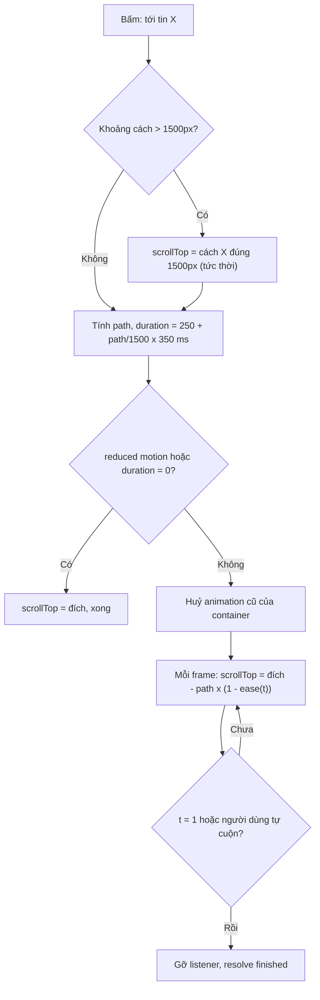

Trong một nhóm chat, bạn bấm vào tin được trả lời (reply), hoặc bấm nút "↓" để về tin mới nhất. Tin đó có thể cách vị trí hiện tại vài trăm pixel, cũng có thể cách **hàng chục nghìn pixel**. Có hai cách quen thuộc, và cả hai đều dở:

- **Nhảy thẳng** (`scrollTop = x`): nhanh, nhưng người dùng mất phương hướng. Không biết mình vừa đi lên hay đi xuống, đi xa hay gần.
- **Cuộn mượt** (`behavior: 'smooth'`): có cảm giác chuyển động, nhưng với quãng đường dài thì hoặc **lâu** (trong demo, Chromium mất khoảng 1,5 giây cho 78.000px), hoặc **lướt quá nhanh** (gần 3.700px mỗi frame, mắt chẳng đọc được gì). Trong lúc đó trình duyệt còn phải vẽ hết mọi tin nhắn nằm giữa đường.

Telegram Web (bản `web.telegram.org/a`) giải quyết bằng một hàm nhỏ tên `fastSmoothScroll`: **nhảy tức thời tới chỗ cách đích 1500px, rồi chỉ animate đoạn cuối**. Người dùng vẫn thấy chuyển động đúng hướng, và mọi cú cuộn đều xong trong 250–600ms.

> [!TIP]
> **Tóm tắt**
> - Quãng đường xa hơn `maxDistance` (Telegram: 1500px) thì đặt `scrollTop` tức thời tới cách đích đúng `maxDistance`, sau đó mới animate.
> - Thời lượng tăng tuyến tính theo quãng đường, kẹp trong 250–600ms; quãng ngắn dùng easing nhẹ hơn quãng dài.
> - Mỗi container chỉ có **một** animation; animation mới huỷ animation cũ. Nên huỷ khi người dùng tự cuộn.
> - Tôn trọng `prefers-reduced-motion`: nhảy thẳng, không animate.

<iframe class="demo-frame" src="/demos/web-patterns/index.html?theme=dark#/fast-smooth-scroll" title="Demo fast-smooth-scroll" loading="lazy" style="height: 880px"></iframe>

<p class="demo-links">▶ <a href="/demos/web-patterns/index.html#/fast-smooth-scroll" target="_blank" rel="noopener">Mở demo toàn màn hình ↗</a> · <a href="https://stackblitz.com/github/hunghg255/blog-hunghg/tree/master/examples/web-patterns?file=src/lib/fastSmoothScroll.ts" target="_blank" rel="noopener">Sửa code trên StackBlitz ↗</a> · <a href="https://github.com/hunghg255/blog-hunghg/blob/master/examples/web-patterns/src/lib/fastSmoothScroll.ts" target="_blank" rel="noopener">Xem source trên GitHub ↗</a></p>

Thử chọn lần lượt ba cách cuộn trong ô chọn rồi bấm "Tin #1500": cột "px/frame lớn nhất" cho thấy sự khác biệt. Cách animate toàn bộ quãng đường dịch hơn 10.000px trong một frame; `fastSmoothScroll` không quá khoảng 200px.

## Telegram làm thế nào?

Code nằm ở [`web.telegram.org/src/util/fastSmoothScroll.ts`](https://github.com/hunghg255/codebase/blob/main/web.telegram.org/src/util/fastSmoothScroll.ts), các hằng số trong `src/config.ts`:

```ts
export const FAST_SMOOTH_MAX_DISTANCE = 1500;
export const FAST_SMOOTH_MIN_DURATION = 250;
export const FAST_SMOOTH_MAX_DURATION = 600;
export const FAST_SMOOTH_SHORT_TRANSITION_MAX_DISTANCE = 500; // px
```

Hàm được dùng ở khắp nơi: nhảy tới tin nhắn được focus (`useFocusMessage`), nút cuộn xuống cuối (`ScrollDownButton`), chọn nhóm emoji trong `EmojiPicker`, chọn bộ sticker trong `StickerPicker`, tab trong trang hồ sơ.

### Bước 1: tính điểm xuất phát

```ts
function calculateScrollFrom(container, element, maxDistance = FAST_SMOOTH_MAX_DISTANCE, forceDirection) {
  const { offsetTop: elementTop } = element;
  const { scrollTop } = container;

  if (forceDirection === undefined) {
    const offset = elementTop - container.scrollTop;
    if (offset < -maxDistance) return scrollTop + (offset + maxDistance);
    else if (offset > maxDistance) return scrollTop + (offset - maxDistance);
  } else if (forceDirection === FocusDirection.Up) {
    return elementTop + maxDistance;
  } else if (forceDirection === FocusDirection.Down) {
    return Math.max(0, elementTop - maxDistance);
  }
  return scrollTop;
}
```

`offset` là khoảng cách từ đỉnh khung nhìn tới phần tử. Nếu nó lớn hơn 1500px (đích ở dưới xa), điểm xuất phát được đặt ở `elementTop - 1500`; nếu đích ở trên xa thì là `elementTop + 1500`. `forceDirection` cho phép ép hướng: khi vừa tải một đoạn tin nhắn mới quanh tin cần tới, Telegram muốn animation luôn đi **từ dưới lên** (hoặc ngược lại) cho đúng cảm giác "quay lại quá khứ", bất kể vị trí hiện tại ra sao.

### Bước 2: tính quãng đường và thời lượng

```ts
if (currentScrollTop !== scrollFrom) container.scrollTop = scrollFrom;   // nhảy tức thời

// position: 'start' | 'end' | 'center' | 'centerOrTop'  →  path = vị trí đích - scrollFrom
// kẹp path để không vượt quá mép trên/dưới

const transition = absPath < FAST_SMOOTH_SHORT_TRANSITION_MAX_DISTANCE ? shortTransition : longTransition;
const duration = forceDuration || (
  FAST_SMOOTH_MIN_DURATION
  + (absPath / FAST_SMOOTH_MAX_DISTANCE) * (FAST_SMOOTH_MAX_DURATION - FAST_SMOOTH_MIN_DURATION)
);
```

(đã rút gọn). Hai đường cong easing:

```ts
function longTransition(t) { return 1 - ((1 - t) ** 5); }    // easeOutQuint
function shortTransition(t) { return 1 - ((1 - t) ** 3.5); }
```

Cả hai đều là **ease-out**: bắt đầu nhanh, chậm dần khi tới đích. Quãng dài dùng số mũ 5 nên phần lớn quãng đường được đi trong vài frame đầu, và đoạn cuối, chỗ người dùng cần nhìn rõ, chậm hơn. `centerOrTop` là một vị trí riêng của Telegram: căn giữa nếu tin nhắn thấp hơn khung nhìn, còn nếu tin cao hơn khung (một bài dài) thì căn **đầu** tin để người dùng đọc từ đầu.

Một chi tiết nhỏ: chiều cao khung được đọc từ `container.dataset.normalHeight` nếu có. `MessageList` lưu chiều cao "bình thường" vào đó, có lẽ để phép tính không bị sai khi khung chat tạm thời bị thu nhỏ (ví dụ lúc bàn phím ảo hoặc ô soạn tin mở rộng) (suy đoán).

### Bước 3: animate bằng một vòng requestAnimationFrame duy nhất

```ts
const startAt = Date.now();
const onHeavyAnimationStop = dispatchHeavyAnimationEvent();

animateSingle(() => {
  const t = Math.min((Date.now() - startAt) / duration, 1);
  const currentPath = path * (1 - transition(t));
  container.scrollTop = Math.round(target - currentPath);
  isAnimating = t < 1;
  if (!isAnimating) onHeavyAnimationStop();
  return isAnimating;
});
```

Có hai điểm đáng học:

- **`animateSingle`** (trong `src/util/animation.ts`) giữ một biến `currentInstance` toàn cục. Gọi animation mới thì animation cũ bị đánh dấu `isCancelled`. Bấm liên tiếp ba nút "nhảy tới" thì chỉ animation cuối chạy, không có ba vòng `rAF` giành nhau `scrollTop`.
- **`dispatchHeavyAnimationEvent`** (trong `src/hooks/useHeavyAnimationCheck.ts`) bắn sự kiện `tt-event-heavy-animation-start` lên `document`. Các component nặng (sticker động, video, các tác vụ tải dữ liệu) lắng nghe sự kiện này để **tạm dừng** cho tới khi animation xong. Main thread được dành cho việc cuộn. Lưu ý trạng thái này chỉ là một cờ boolean dùng chung: hai animation nặng chạy chồng nhau thì cái nào xong trước sẽ bắn sự kiện kết thúc sớm cho cả hai.

## Bên trong trình duyệt: vì sao không chỉ dùng `behavior: 'smooth'`?

`element.scrollIntoView({ behavior: 'smooth' })` và `scrollTo({ behavior: 'smooth' })` để trình duyệt tự animate. Ưu điểm lớn: chạy trên **compositor thread** nên vẫn mượt khi main thread bận. Nhưng:

- **Thời lượng và đường cong do trình duyệt quyết định**, khác nhau giữa Chrome, Firefox, Safari và không chỉnh được. Trong demo (Chromium headless), cuộn 78.000px mất khoảng 1,5 giây.
- **Không có callback khi xong**. Sự kiện `scrollend` mới có gần đây và chưa phải trình duyệt nào cũng hỗ trợ ([caniuse](https://caniuse.com/mdn-api_element_scrollend_event)).
- **Không huỷ được** một cách tường minh (chỉ có cách đặt lại `scrollTop`).
- Với danh sách ảo hoá (virtualized list), cuộn qua 70.000px nghĩa là danh sách phải render, đo đạc, rồi bỏ hàng nghìn phần tử ở giữa đường. Dịch chuyển tức thời bỏ qua toàn bộ phần đó.



## Viết lại

Hai hàm thuần (dễ test) và một hàm chính.

```ts title=src/lib/fastSmoothScroll.ts
const MIN_DURATION = 250;
const MAX_DURATION = 600;
const SHORT_TRANSITION_MAX_DISTANCE = 500;

// easeOutQuint cho quãng dài, "easeOut 3.5" cho quãng ngắn (đúng công thức của Telegram)
const longTransition = (t: number) => 1 - (1 - t) ** 5;
const shortTransition = (t: number) => 1 - (1 - t) ** 3.5;

/** Vị trí của element tính theo hệ toạ độ nội dung của container (không phụ thuộc offsetParent). */
function offsetWithin(container: HTMLElement, element: HTMLElement) {
  return element.getBoundingClientRect().top - container.getBoundingClientRect().top - container.clientTop + container.scrollTop;
}

/** Điểm xuất phát: nếu đích cách xa hơn maxDistance thì nhảy tới cách đích đúng maxDistance. */
export function calculateScrollFrom(scrollTop: number, elementTop: number, maxDistance: number) {
  const offset = elementTop - scrollTop;
  if (offset < -maxDistance) return scrollTop + (offset + maxDistance);
  if (offset > maxDistance) return scrollTop + (offset - maxDistance);
  return scrollTop;
}

/** Thời lượng tăng tuyến tính theo quãng đường: 0px → 250ms, ≥ maxDistance → 600ms. */
export function durationFor(distance: number, maxDistance: number) {
  const ratio = Math.min(Math.abs(distance) / maxDistance, 1);
  return MIN_DURATION + ratio * (MAX_DURATION - MIN_DURATION);
}
```

`offsetWithin` tính vị trí phần tử theo hệ toạ độ **nội dung** của container bằng `getBoundingClientRect`, thay cho `element.offsetTop` của Telegram. `offsetTop` tính theo **offsetParent** (tổ tiên gần nhất có `position` khác `static`), nên chỉ đúng khi container có `position: relative`. Trong demo, chính các nút "cách ngây thơ" từng bị lệch 280px vì lý do này trước khi mình sửa.

Hàm chính, phần chuẩn bị: huỷ animation cũ, nhảy tức thời, tính quãng đường.

```ts title=src/lib/fastSmoothScroll.ts
export function fastSmoothScroll(
  container: HTMLElement,
  element: HTMLElement,
  {
    position = 'start',
    margin = 0,
    maxDistance = 1500,
    duration,
    abortOnUserInput = true,
  }: FastSmoothScrollOptions = {},
): ScrollAnimation {
  running.get(container)?.();

  const elementTop = offsetWithin(container, element);
  const elementHeight = element.offsetHeight;
  const containerHeight = container.clientHeight;
  const maxScrollTop = container.scrollHeight - containerHeight;
  const scrollFrom = Math.min(
    Math.max(calculateScrollFrom(container.scrollTop, elementTop, maxDistance), 0),
    maxScrollTop,
  );
  const teleported = Math.abs(scrollFrom - container.scrollTop);
  if (teleported > 0) container.scrollTop = scrollFrom; // bước 1: nhảy tức thời phần dư

  let path: number;
  switch (position) {
    case 'start':
      path = elementTop - margin - scrollFrom;
      break;
    case 'end':
      path = elementTop + elementHeight + margin - (scrollFrom + containerHeight);
      break;
    case 'center':
    case 'centerOrTop':
      // element cao hơn khung nhìn thì căn đầu element thay vì căn giữa
      path =
        position === 'center' || elementHeight < containerHeight
          ? elementTop + elementHeight / 2 - (scrollFrom + containerHeight / 2)
          : elementTop - margin - scrollFrom;
      break;
  }

  // không cuộn quá mép trên/dưới, nếu không animation sẽ "chạy không" ở cuối
  path = Math.max(-scrollFrom, Math.min(path, maxScrollTop - scrollFrom));
  const target = scrollFrom + path;

  const ms = prefersReducedMotion() ? 0 : (duration ?? durationFor(path, maxDistance));
  if (path === 0 || ms === 0) {
    container.scrollTop = target;
    return { finished: Promise.resolve(true), cancel() {}, teleported };
  }
```

Phần animate:

```ts title=src/lib/fastSmoothScroll.ts
  const ease = Math.abs(path) < SHORT_TRANSITION_MAX_DISTANCE ? shortTransition : longTransition;
  let frame = 0;
  let resolve!: (done: boolean) => void;
  const finished = new Promise<boolean>((r) => (resolve = r));

  const stop = (done: boolean) => {
    cancelAnimationFrame(frame);
    if (running.get(container) === cancel) running.delete(container);
    if (abortOnUserInput) USER_INPUT_EVENTS.forEach((type) => container.removeEventListener(type, onUserInput));
    resolve(done);
  };
  const cancel = () => stop(false);
  const onUserInput = () => cancel();

  if (abortOnUserInput) {
    USER_INPUT_EVENTS.forEach((type) => container.addEventListener(type, onUserInput, { passive: true }));
  }
  running.set(container, cancel);

  let start: number | undefined;
  const tick = (now: number) => {
    start ??= now;
    const t = Math.min((now - start) / ms, 1);
    // vị trí = đích - phần đường còn lại; làm tròn để tránh scrollTop lẻ gây rung chữ
    container.scrollTop = Math.round(target - path * (1 - ease(t)));
    if (t < 1) frame = requestAnimationFrame(tick);
    else stop(true);
  };
  frame = requestAnimationFrame(tick);

  return { finished, cancel, teleported };
}
```

## Đi qua code

1. **Huỷ animation cũ trước tiên** (`running.get(container)?.()`). Telegram dùng một biến toàn cục cho cả trang; bản viết lại dùng `WeakMap` theo container, để hai vùng cuộn độc lập (danh sách chat và bảng emoji) không huỷ lẫn nhau.
2. **Kẹp `scrollFrom`** vào `[0, maxScrollTop]`. Nếu đích nằm sát đáy, `elementTop - 1500` có thể vượt quá chỗ cuộn tối đa; trình duyệt tự kẹp `scrollTop`, nhưng biến `scrollFrom` thì không, và `path` sẽ tính sai.
3. **Kẹp `path`** để không đi quá mép. Nếu không, animation sẽ "chạy không" một đoạn ở cuối: `scrollTop` không đổi nữa nhưng vòng `rAF` vẫn chạy.
4. **`duration` theo quãng đường đã kẹp**, nên luôn trong 250–600ms. Đường cong được chọn theo độ dài: dưới 500px dùng mũ 3,5.
5. **Dùng timestamp của `requestAnimationFrame`** thay cho `Date.now()`. Timestamp này là thời điểm bắt đầu frame, giống nhau cho mọi callback trong cùng frame, và không bị ảnh hưởng khi người dùng chỉnh đồng hồ hệ thống.
6. **`Math.round`** khi gán `scrollTop`, như Telegram. Giá trị lẻ có thể khiến chữ bị rung nhẹ giữa các frame trên một số màn hình.
7. **`finished`** là Promise trả `true` khi tới đích, `false` khi bị huỷ. Có nó thì "nhảy tới tin rồi nháy sáng tin đó" viết được bằng `await`.

**Khác bản gốc:**

- Huỷ khi người dùng tự cuộn (`wheel`, `touchstart`, `keydown`). Telegram không làm việc này; nếu người dùng kéo trong lúc animation chạy, hai bên giành nhau `scrollTop` trong tối đa 600ms.
- `prefers-reduced-motion: reduce` → nhảy thẳng. Telegram có cài đặt "mức animation" riêng trong app (`animationLevel`) với tác dụng tương tự.
- Chưa có `forceDirection` và `dataset.normalHeight`, vì chúng phục vụ những tình huống riêng của danh sách tin nhắn Telegram.
- Không phát sự kiện "heavy animation"; nếu app của bạn có tác vụ nặng chạy theo frame, hãy thêm một cơ chế tương tự và dùng **bộ đếm** thay vì cờ boolean.

::: spoiler Xem toàn bộ src/lib/fastSmoothScroll.ts

```ts title=src/lib/fastSmoothScroll.ts
/**
 * Cuộn mượt tới một phần tử, nhưng KHÔNG BAO GIỜ lâu: nếu đích ở quá xa thì "dịch chuyển tức thời"
 * tới gần đích trước, rồi mới animate đoạn cuối. Ý tưởng từ src/util/fastSmoothScroll.ts của
 * Telegram Web (web.telegram.org/a).
 */

export type ScrollPosition = 'start' | 'center' | 'end' | 'centerOrTop';

export interface FastSmoothScrollOptions {
  position?: ScrollPosition;
  /** khoảng chừa ra ở mép (px) */
  margin?: number;
  /** quãng đường animate tối đa; xa hơn thì nhảy tức thời phần dư. Telegram: 1500px */
  maxDistance?: number;
  /** ép thời lượng (ms); 0 = nhảy thẳng, không animate */
  duration?: number;
  /** người dùng tự cuộn (wheel/touch/phím) thì dừng animation, mặc định true */
  abortOnUserInput?: boolean;
}

const MIN_DURATION = 250;
const MAX_DURATION = 600;
const SHORT_TRANSITION_MAX_DISTANCE = 500;

// easeOutQuint cho quãng dài, "easeOut 3.5" cho quãng ngắn (đúng công thức của Telegram)
const longTransition = (t: number) => 1 - (1 - t) ** 5;
const shortTransition = (t: number) => 1 - (1 - t) ** 3.5;

/** Vị trí của element tính theo hệ toạ độ nội dung của container (không phụ thuộc offsetParent). */
function offsetWithin(container: HTMLElement, element: HTMLElement) {
  return element.getBoundingClientRect().top - container.getBoundingClientRect().top - container.clientTop + container.scrollTop;
}

/** Điểm xuất phát: nếu đích cách xa hơn maxDistance thì nhảy tới cách đích đúng maxDistance. */
export function calculateScrollFrom(scrollTop: number, elementTop: number, maxDistance: number) {
  const offset = elementTop - scrollTop;
  if (offset < -maxDistance) return scrollTop + (offset + maxDistance);
  if (offset > maxDistance) return scrollTop + (offset - maxDistance);
  return scrollTop;
}

/** Thời lượng tăng tuyến tính theo quãng đường: 0px → 250ms, ≥ maxDistance → 600ms. */
export function durationFor(distance: number, maxDistance: number) {
  const ratio = Math.min(Math.abs(distance) / maxDistance, 1);
  return MIN_DURATION + ratio * (MAX_DURATION - MIN_DURATION);
}

export interface ScrollAnimation {
  /** resolve true khi tới đích, false khi bị huỷ (animation khác chen vào, người dùng tự cuộn) */
  finished: Promise<boolean>;
  cancel(): void;
  /** quãng đường được "dịch chuyển tức thời" (px), để demo/đo đạc */
  teleported: number;
}

const USER_INPUT_EVENTS = ['wheel', 'touchstart', 'keydown'] as const;

// Mỗi container chỉ có một animation: animation mới huỷ animation cũ (Telegram: animateSingle)
const running = new WeakMap<HTMLElement, () => void>();

const prefersReducedMotion = () =>
  typeof matchMedia === 'function' && matchMedia('(prefers-reduced-motion: reduce)').matches;

export function fastSmoothScroll(
  container: HTMLElement,
  element: HTMLElement,
  {
    position = 'start',
    margin = 0,
    maxDistance = 1500,
    duration,
    abortOnUserInput = true,
  }: FastSmoothScrollOptions = {},
): ScrollAnimation {
  running.get(container)?.();

  const elementTop = offsetWithin(container, element);
  const elementHeight = element.offsetHeight;
  const containerHeight = container.clientHeight;
  const maxScrollTop = container.scrollHeight - containerHeight;
  const scrollFrom = Math.min(
    Math.max(calculateScrollFrom(container.scrollTop, elementTop, maxDistance), 0),
    maxScrollTop,
  );
  const teleported = Math.abs(scrollFrom - container.scrollTop);
  if (teleported > 0) container.scrollTop = scrollFrom; // bước 1: nhảy tức thời phần dư

  let path: number;
  switch (position) {
    case 'start':
      path = elementTop - margin - scrollFrom;
      break;
    case 'end':
      path = elementTop + elementHeight + margin - (scrollFrom + containerHeight);
      break;
    case 'center':
    case 'centerOrTop':
      // element cao hơn khung nhìn thì căn đầu element thay vì căn giữa
      path =
        position === 'center' || elementHeight < containerHeight
          ? elementTop + elementHeight / 2 - (scrollFrom + containerHeight / 2)
          : elementTop - margin - scrollFrom;
      break;
  }

  // không cuộn quá mép trên/dưới, nếu không animation sẽ "chạy không" ở cuối
  path = Math.max(-scrollFrom, Math.min(path, maxScrollTop - scrollFrom));
  const target = scrollFrom + path;

  const ms = prefersReducedMotion() ? 0 : (duration ?? durationFor(path, maxDistance));
  if (path === 0 || ms === 0) {
    container.scrollTop = target;
    return { finished: Promise.resolve(true), cancel() {}, teleported };
  }

  const ease = Math.abs(path) < SHORT_TRANSITION_MAX_DISTANCE ? shortTransition : longTransition;
  let frame = 0;
  let resolve!: (done: boolean) => void;
  const finished = new Promise<boolean>((r) => (resolve = r));

  const stop = (done: boolean) => {
    cancelAnimationFrame(frame);
    if (running.get(container) === cancel) running.delete(container);
    if (abortOnUserInput) USER_INPUT_EVENTS.forEach((type) => container.removeEventListener(type, onUserInput));
    resolve(done);
  };
  const cancel = () => stop(false);
  const onUserInput = () => cancel();

  if (abortOnUserInput) {
    USER_INPUT_EVENTS.forEach((type) => container.addEventListener(type, onUserInput, { passive: true }));
  }
  running.set(container, cancel);

  let start: number | undefined;
  const tick = (now: number) => {
    start ??= now;
    const t = Math.min((now - start) / ms, 1);
    // vị trí = đích - phần đường còn lại; làm tròn để tránh scrollTop lẻ gây rung chữ
    container.scrollTop = Math.round(target - path * (1 - ease(t)));
    if (t < 1) frame = requestAnimationFrame(tick);
    else stop(true);
  };
  frame = requestAnimationFrame(tick);

  return { finished, cancel, teleported };
}
```

:::

## Tại sao không làm cách khác?

**Chỉ dùng CSS `scroll-behavior: smooth`?** Đơn giản và chạy trên compositor, phù hợp cho cuộn trong một trang tài liệu. Nhưng như phần trên, bạn không kiểm soát được thời lượng, không biết khi nào xong, và quãng đường dài thì vẫn lâu.

**Animate toàn bộ quãng đường trong 600ms?** Đó là chế độ thứ ba trong demo. Xong nhanh, nhưng hơn 10.000px mỗi frame: màn hình chỉ là một vệt nhoè, và trình duyệt vẫn phải vẽ từng frame ở những vị trí ngẫu nhiên giữa đường.

**Fade out rồi fade in ở vị trí mới?** Cũng là một lựa chọn (một số app dùng). Nhưng mất hoàn toàn cảm giác "đi lên hay đi xuống", thứ rất quan trọng trong lịch sử chat.

**Dùng `transform: translateY` thay vì `scrollTop`?** Mượt hơn trên máy yếu vì không gây scroll event mỗi frame, nhưng phức tạp hơn nhiều: phải đồng bộ lại `scrollTop` khi xong, và sticky element, IntersectionObserver sẽ chạy sai trong lúc animate.

## Edge case và cạm bẫy

- **Danh sách ảo hoá:** phần tử đích có thể chưa tồn tại trong DOM. Telegram tải đoạn tin nhắn quanh tin cần tới trước, rồi mới gọi `fastSmoothScroll` (và dùng `forceDirection` để chọn hướng animation).
- **Nội dung thay đổi chiều cao trong lúc animate** (ảnh vừa tải xong): `target` đã tính từ trước sẽ lệch. Với chat, kết hợp với kỹ thuật neo vị trí như trong bài [khung chat không giật](/blogs/facebook-chat-scroller).
- **`scroll-snap`** trên container sẽ "giật" về điểm snap gần nhất sau mỗi lần gán `scrollTop`. Tắt snap trong lúc animate.
- **`scroll-behavior: smooth` trong CSS của container** làm mỗi lần gán `scrollTop` cũng thành cuộn mượt, animation JS sẽ chạy rất kỳ. Đặt `scroll-behavior: auto` cho container dùng hàm này.
- **Tab bị ẩn:** `requestAnimationFrame` dừng; animation sẽ tiếp tục (và kết thúc ngay ở frame đầu tiên) khi tab hiện lại, vì `t` được tính theo thời gian thực.

## Dùng trong dự án

```ts
import { fastSmoothScroll } from './lib/fastSmoothScroll';

async function jumpToMessage(id: string) {
  await ensureMessageLoaded(id); // danh sách ảo hoá: tải đoạn chứa tin trước
  const list = document.querySelector<HTMLElement>('.message-list')!;
  const el = list.querySelector<HTMLElement>(`[data-id="${id}"]`)!;
  const done = await fastSmoothScroll(list, el, { position: 'centerOrTop', margin: 16 }).finished;
  if (done) el.animate([{ background: 'var(--highlight)' }, { background: 'transparent' }], 1500);
}
```

## Kiểm thử

::: spoiler Ví dụ test (bản phác, không có trong repo)

```ts
import { describe, expect, it } from 'vitest';
import { calculateScrollFrom, durationFor } from './fastSmoothScroll';

describe('calculateScrollFrom', () => {
  it('gần thì giữ nguyên', () => {
    expect(calculateScrollFrom(1000, 1800, 1500)).toBe(1000);
  });
  it('đích ở dưới xa: nhảy tới cách đích đúng maxDistance', () => {
    expect(calculateScrollFrom(0, 50_000, 1500)).toBe(48_500);
  });
  it('đích ở trên xa: nhảy tới phía dưới đích', () => {
    expect(calculateScrollFrom(50_000, 100, 1500)).toBe(1600);
  });
});

describe('durationFor', () => {
  it('kẹp trong 250–600ms', () => {
    expect(durationFor(0, 1500)).toBe(250);
    expect(durationFor(750, 1500)).toBe(425);
    expect(durationFor(-9000, 1500)).toBe(600);
  });
});
```

Phần animate nên test trong trình duyệt thật (Playwright): bấm nút, đo `scrollTop` sau 700ms, và kiểm tra quãng dịch mỗi frame không vượt quá một màn hình, như cách demo ở trên tự đo.

:::

## So với chuẩn web và thư viện

- `scrollIntoView({ behavior: 'smooth', block: 'center' })` là đủ cho phần lớn trường hợp cuộn **gần**. Dùng kỹ thuật của Telegram khi quãng đường có thể rất dài và bạn cần thời lượng cố định.
- Sự kiện [`scrollend`](https://developer.mozilla.org/en-US/docs/Web/API/Element/scrollend_event) giúp biết khi nào cuộn native xong; kiểm tra hỗ trợ trước khi dựa vào nó (tính tới 10/2026).
- Các thư viện danh sách ảo hoá (react-virtuoso, TanStack Virtual) có hàm `scrollToIndex` với tuỳ chọn `behavior: 'smooth'`; khi index ở rất xa, chúng cũng phải xử lý vấn đề "đi qua hàng nghìn phần tử", mỗi thư viện một cách.

---

Bài này thuộc series **[Học từ mã nguồn các web lớn](/series/web)** (42 bài, đọc theo thứ tự).

::: spoiler Xem nhanh danh sách bài trong series

*Mở đầu*

- [Mở đầu: đọc code production của 28 trang web](/blogs/learn-from-big-web-apps)

*Phần 1: trải nghiệm người dùng*

- [#1 Dark mode không nháy (Gatsby)](/blogs/web-dark-mode-no-flash)
- [#2 useValueByMedia: giá trị theo breakpoint (Toptal)](/blogs/web-use-value-by-media)
- [#3 Đoán ý định: idle, exit-intent, lắc chuột (Toptal, InVision)](/blogs/web-user-intent-idle-exit-wiggle)
- [#4 Validate form thân thiện (Udacity, Pipedrive)](/blogs/web-form-validation-ux)
- [#5 Magic number, EXIF và dán ảnh (Ello)](/blogs/web-file-magic-number-exif-paste)
- **#6 fastSmoothScroll: cuộn xa vẫn nhanh (Telegram)** (bài này)
- [#7 Countdown time-travel và tombstone giỏ hàng (Best Buy)](/blogs/web-countdown-time-travel-tombstone)

*Phần 2: hiệu năng và đo lường*

- [#8 Hàng đợi requestAnimationFrame 3ms (Apple)](/blogs/web-raf-queue-3ms)
- [#9 srcset cho artwork và preconnect tự động (Apple)](/blogs/web-responsive-artwork-preconnect)
- [#10 Quick-fetch: gọi API trước khi bundle tải xong (HubSpot)](/blogs/web-quick-fetch-early-requests)
- [#11 Performance span và long task (Postman, Calibre)](/blogs/web-performance-spans-long-tasks)
- [#12 Gọi Web Worker như hàm async (Telegram)](/blogs/web-worker-promise-rpc)
- [#13 Đồng hồ media: đếm giờ xem và sửa lệch (Skillshare, Simplified)](/blogs/web-media-clock-watch-time-drift)

*Phần 3: nhiều tab, phiên đăng nhập, cập nhật*

- [#14 Bầu tab chủ cho thông báo (HubSpot, Telegram)](/blogs/web-leader-tab-notifications)
- [#15 Đồng bộ đăng nhập giữa tab và giới hạn cookie (Elastic, InVision)](/blogs/web-cross-tab-auth-cookie-guard)
- [#16 SPA tự cập nhật: Trello, Zappos, Facebook, Elastic](/blogs/web-spa-self-update-strategies)

*Phần 4: kiến trúc*

- [#17 Reverse portal: di chuyển component không remount (Zappos)](/blogs/web-reverse-portal)
- [#18 Page behaviors: gắn hành vi từ CMS (Intercom)](/blogs/web-page-behaviors-cms)
- [#19 Giới hạn tần suất hiển thị bằng bitmask (Outlook)](/blogs/web-frequency-cap-bitmask)
- [#20 Chuyển REST sang GraphQL dần dần (Coursera)](/blogs/web-rest-to-graphql-hybrid-link)

*Phần 5: soạn thảo và hiển thị nội dung*

- [#21 Autocomplete tại con trỏ trong contenteditable (Ello, Telegram)](/blogs/web-caret-autocomplete-contenteditable)
- [#22 Dark mode cho email HTML bằng CIELAB (Outlook)](/blogs/web-email-dark-mode-cielab)
- [#23 Thu nhỏ bảng rộng cho vừa khung, vá font emoji (Outlook)](/blogs/web-email-wide-content-scale)
- [#24 Cảnh báo quên đính kèm file (Outlook)](/blogs/web-forgotten-attachment-warning)
- [#25 Cắt chữ nhiều dòng chính xác (Pipedrive, Apple, Toptal)](/blogs/web-multiline-truncate-measure-text)
- [#26 Parse ngày giờ gõ tay khoan dung (Outlook, Elastic)](/blogs/web-lenient-date-parser)

*Phần 6: tương tác*

- [#27 menuAim: rê chéo vào submenu không bị đóng (Udemy)](/blogs/web-menu-aim-triangle)
- [#28 Kéo, vuốt chung cho chuột và cảm ứng (Telegram)](/blogs/web-unified-pointer-gestures)
- [#29 Phím tắt theo phạm vi, IME và bàn phím phi Latinh (Trello)](/blogs/web-scoped-keyboard-shortcuts)
- [#30 Nội suy màu: đổi theme và nền theo cuộn (Telegram, Anchor)](/blogs/web-color-interpolation-theme-scroll)
- [#31 Đường gióng hút cạnh và undo/redo trên canvas (Simplified)](/blogs/web-canvas-snap-guides-undo)
- [#32 Giả lập mù màu bằng feColorMatrix (Trello)](/blogs/web-color-vision-simulator)
- [#33 Vạch thước theo mức zoom và cấp phát màu cho biểu đồ (Anchor, Similarweb)](/blogs/web-timeline-ticks-color-stack)

*Phần 7: mạng, dữ liệu và async*

- [#34 Ô tìm kiếm chuẩn production (Similarweb, Udemy, Pipedrive)](/blogs/web-production-search-box)
- [#35 Điều phối async: latest-wins, single-flight (Glitch, Toptal)](/blogs/web-async-coordination-latest-wins)
- [#36 Polling thưa dần và debounce động (Trello)](/blogs/web-decaying-polling-dynamic-debounce)
- [#37 Cache phía client theo version (Similarweb, Telegram, Udemy)](/blogs/web-client-cache-versioned)
- [#38 Upload file lớn theo chunk (Outlook, Tribe)](/blogs/web-chunked-upload-pipeline)
- [#39 Phát video qua Service Worker bằng Range request (Telegram, Outlook)](/blogs/web-service-worker-range-streaming)

*Phần 8: hiệu năng và vận hành*

- [#40 TTI governor: hoãn việc phụ tới sau khi trang dùng được (Outlook)](/blogs/web-tti-governor)
- [#41 Tự đo LCP/CLS/TBT và phục vụ bản nhẹ cho máy yếu (Udemy)](/blogs/web-rum-adaptive-loading)

:::

Code + demo: [`examples/web-patterns`](https://github.com/hunghg255/blog-hunghg/tree/master/examples/web-patterns) · [Mở trên StackBlitz](https://stackblitz.com/github/hunghg255/blog-hunghg/tree/master/examples/web-patterns)
