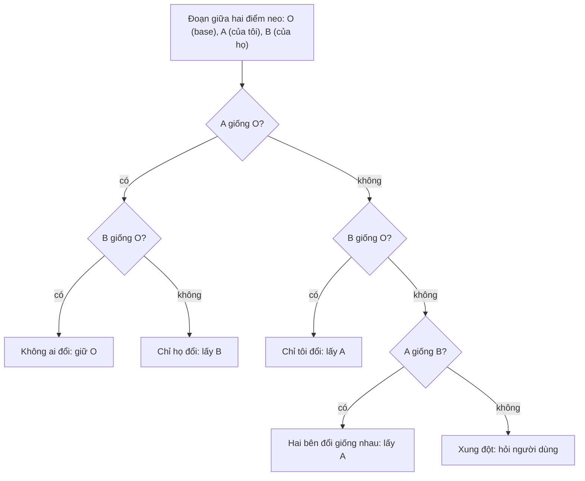

Bạn fork một collection trên Postman, sửa vài test script. Trong lúc đó đồng nghiệp sửa bản gốc. Khi bấm "Pull changes" hay "Merge", Postman phải trả lời hai câu hỏi: **chỗ nào gộp tự động được**, và **chỗ nào hai người sửa đụng nhau** để hỏi bạn chọn.

Git làm việc này ở dòng lệnh. Postman làm ngay trong trình duyệt, với giao diện cho từng khối: "giữ của tôi" hay "giữ của họ". Bài này đọc phần client của tính năng đó (thư mục `pmDiff`), chỉ ra một điểm yếu thiết kế làm sinh xung đột giả, rồi viết lại thuật toán **diff3** chuẩn bằng TypeScript thuần, không thư viện.

> [!TIP]
> **Tóm tắt**
> - Gộp ba bản (base, của tôi, của họ) cần **căn dòng** trước: dùng LCS (dãy con chung dài nhất) để biết dòng nào của base còn ở mỗi bản.
> - Giữa hai "điểm neo" (dòng còn nguyên ở cả hai bản): chỉ một bên đổi thì lấy bên đó, hai bên đổi giống nhau thì lấy luôn, khác nhau mới là xung đột.
> - pmDiff của Postman so ba bản **theo số thứ tự dòng**: chèn một dòng ở đầu là mọi dòng phía sau thành xung đột, và chỉ một bên sửa cũng bị tính là xung đột.
> - Xung đột chưa chọn thì ghi dấu xung đột kiểu Git vào văn bản, đừng âm thầm bỏ dữ liệu của bên nào.

<iframe class="demo-frame" src="/demos/web-patterns/index.html?theme=dark#/three-way-merge" title="Demo three-way-merge" loading="lazy" style="height: 980px"></iframe>

<p class="demo-links">▶ <a href="/demos/web-patterns/index.html#/three-way-merge" target="_blank" rel="noopener">Mở demo toàn màn hình ↗</a> · <a href="https://stackblitz.com/github/hunghg255/blog-hunghg/tree/master/examples/web-patterns?file=src/lib/threeWayMerge.ts" target="_blank" rel="noopener">Sửa code trên StackBlitz ↗</a> · <a href="https://github.com/hunghg255/blog-hunghg/blob/master/examples/web-patterns/src/lib/threeWayMerge.ts" target="_blank" rel="noopener">Xem source trên GitHub ↗</a></p>

Bấm "Hai người sửa hai chỗ khác nhau": tôi đổi `status(200)` thành `status(201)`, họ thêm một dòng chú thích ở đầu và đổi dòng cuối. diff3 gộp xong, **0 xung đột**. Cách so theo số dòng thì cả 9 dòng thành **một khối xung đột**.

## Postman làm thế nào?

Code nằm trong [`web.postman.co/js/utils/pmDiff/`](https://github.com/hunghg255/codebase/tree/main/web.postman.co/js/utils/pmDiff), bốn file: `index.js`, `itemDiff.js`, `baseDiff.js`, `algorithmUtil.js`.

### Server phát hiện, client trình bày và giải quyết

API trả về, cho từng thuộc tính của request (tên, header, body, script…), một object dạng `{ conflict: { base, source, dest } }` hoặc `{ diff: { from, to } }`. `source` là bản fork (của mình), `dest` là bản đích. `pmDiff()` trong `index.js` biến đống đó thành các object cùng giao diện, tuỳ kiểu thuộc tính:

| Lớp | Dùng cho | Cách so |
|---|---|---|
| `ItemStringDiff` | tên, URL, method, mô tả | `diffWordsWithSpace` của thư viện `diff` (theo từ) |
| `ItemSentenceDiff` | header, query param, biến, body urlencoded (đổi key/value thành văn bản trước) | `diffSentences` (theo câu) |
| `ItemScriptDiff` | pre-request script, test | `threeWaylineDiff` (theo dòng) |
| `ItemArrayDiff` | bảng key/value | so từng hàng theo chỉ số (`getTableConflict`) |

Mỗi lớp có `getDiff()` (dựng dữ liệu cho UI) và `resolveConflict(type, index)` (người dùng chọn một bên). Với script, sau khi chọn, `resolveConflict` dựng lại `this.source` từ các khối không còn xung đột: đó là văn bản sẽ gửi lên server.

Ý tưởng đáng học: **server chỉ cần trả ba phiên bản**, còn việc chia khối, đánh số dòng (`attachLines`), cho chọn từng khối là việc của client. Không phải gọi API mỗi lần người dùng bấm "giữ của tôi".

### Thuật toán ba bản: so theo số thứ tự dòng

Phần lõi là `threeWaylineDiff(base, source, dest)` trong `algorithmUtil.js` (rút gọn):

```js
while (index < maxLength) {
  const baseLine = baseLines[index], sourceLine = sourceLines[index], destLine = destLines[index];

  if (sourceLine !== destLine) {
    // gom các dòng liên tiếp mà source và dest khác nhau -> một khối xung đột
    const end = collectConflict(index, baseLines, sourceLines, destLines);
    threeWayDiffArray.push({ conflict: true, type: 'source', value: flattenDiff(diff.diffLines('', sourceChanges)) });
    threeWayDiffArray.push({ conflict: true, type: 'dest', value: flattenDiff(diff.diffLines(baseChanges, '')) });
    conflictedBlockIndex++;
  } else if (baseLine !== sourceLine) {
    // hai bên giống nhau nhưng khác base: hai bên cùng sửa giống hệt
    ...
  } else {
    // ba bản giống nhau
  }
}
```

Ba điểm cần để ý:

1. **Dòng thứ `i` của bản này được so với dòng thứ `i` của bản kia.** Không có bước căn dòng. Chèn một dòng ở đầu `dest` làm mọi dòng phía sau lệch một vị trí, nên đều "khác nhau".
2. **Chỉ một bên sửa cũng là xung đột.** Điều kiện vào nhánh xung đột là `sourceLine !== destLine`. Nếu tôi giữ nguyên dòng 5 mà họ sửa, hai bản khác nhau ở dòng 5, vậy là xung đột, dù theo nghĩa three-way merge thì đó là thay đổi một phía, lấy luôn được. Nhánh `else if` chỉ xử lý trường hợp hai bên sửa **giống hệt** nhau.
3. `collectConflict` có một nhánh "chạm cuối một bản thì coi là xung đột tới hết", với comment *"there is no point of finding diff for rest of two blocks since that will always be conflict"*. Hai bản dài khác nhau là cả đoạn đuôi thành một khối.

### Khối "dest" không chứa nội dung của dest

Đọc kỹ nhánh xung đột: hàm tính cả `sourceChanges` lẫn `destChanges`, nhưng khối `type: 'dest'` lại dựng từ `diff.diffLines(baseChanges, '')`, tức **các dòng của base, đánh dấu là bị xoá**. Biến `destChanges` không được dùng.

Mình chạy lại `algorithmUtil.js` gốc với thư viện `diff` 5.2.2 trên ví dụ nhỏ (base `a b c`, của tôi `a B c`, của họ `a b2 c`), rồi giải quyết theo đúng logic của `ItemScriptDiff.resolveConflict` (giữ khối được chọn, lấy các dòng không có cờ `removed`):

```text
khối source: [{ added: true, value: "B" }]
khối dest:   [{ removed: true, value: "b" }]
chọn "dest" -> ["a", "c"]
```

Chọn "dest" cho ra `a, c`: dòng `b2` của bên kia **biến mất**. Có lẽ ở Postman, phía dest được hiểu là "huỷ thay đổi của tôi" và luồng thực tế không đi qua trường hợp này, nhưng chỉ đọc client thì không xác nhận được. Bài học vẫn rõ: khi dựng dữ liệu cho một lựa chọn, hãy dựng từ **chính phiên bản đó**.

## Bên trong: diff3 hoạt động thế nào?

Three-way merge kinh điển (thuật toán diff3, dùng trong GNU diff3 và Git) có hai bước.

**Bước 1: căn dòng.** Tính LCS giữa base và bản của tôi, và giữa base và bản của họ. Kết quả là, với mỗi dòng của base, biết nó còn nằm ở vị trí nào trong mỗi bản (hoặc đã bị xoá/sửa).

**Bước 2: đi theo điểm neo.** Một dòng của base còn nguyên ở **cả hai** bản là một điểm neo: chắc chắn không ai đụng vào. Giữa hai điểm neo liên tiếp là một đoạn mà ít nhất một bên đã sửa. So ba mảnh của đoạn đó:



Chỉ ô cuối cùng mới cần con người. Ba ô còn lại máy tự quyết, và đó chính là chỗ cách so theo số dòng làm sai: nó gộp "chỉ họ đổi" và "lệch vị trí" vào ô xung đột.

LCS tính bằng quy hoạch động: bảng `dp[i][j]` là độ dài LCS của phần đuôi hai mảng. Bảng tốn `m × n` ô, nên mẹo quen thuộc là **cắt phần đầu và phần cuối giống nhau** trước (hầu hết lần sửa chỉ đụng một vùng nhỏ), bảng chỉ còn cho đoạn giữa.

## Viết lại

Code ở `src/lib/threeWayMerge.ts`. Đầu tiên là căn dòng bằng LCS. Hàm `lcsMatch` cắt phần đầu và cuối giống nhau, rồi dựng bảng cho đoạn giữa và lấy vết:

```ts title=src/lib/threeWayMerge.ts

  // dp[i][j] = độ dài LCS của a[start+i..endA) và b[start+j..endB), tính từ cuối lên
  const width = cols + 1;
  const dp = new Uint32Array((rows + 1) * width);
  for (let i = rows - 1; i >= 0; i--) {
    for (let j = cols - 1; j >= 0; j--) {
      dp[i * width + j] =
        a[start + i] === b[start + j]
          ? dp[(i + 1) * width + j + 1] + 1
          : Math.max(dp[(i + 1) * width + j], dp[i * width + j + 1]);
    }
  }

  let i = 0;
  let j = 0;
  while (i < rows && j < cols) {
    if (a[start + i] === b[start + j]) {
      match[start + i] = start + j;
      i++;
      j++;
    } else if (dp[(i + 1) * width + j] >= dp[i * width + j + 1]) {
      i++;
    } else {
      j++;
    }
  }
  return match;
```

Rồi đi theo điểm neo, phân loại từng đoạn:

```ts title=src/lib/threeWayMerge.ts
export function merge3(base: string, ours: string, theirs: string): MergeResult {
  const o = splitLines(base);
  const a = splitLines(ours);
  const b = splitLines(theirs);
  const matchA = lcsMatch(o, a);
  const matchB = lcsMatch(o, b);

  const chunks: MergeChunk[] = [];
  let conflicts = 0;

  const pushSame = (lines: string[]) => {
    if (lines.length === 0) return;
    const last = chunks[chunks.length - 1];
    if (last?.kind === 'same') last.lines.push(...lines);
    else chunks.push({ kind: 'same', lines: [...lines] });
  };

  let io = 0; // vị trí đang xét trong base
  let ia = 0; // trong ours
  let ib = 0; // trong theirs

  for (;;) {
    // Tìm "điểm neo" tiếp theo: một dòng của base còn nguyên ở CẢ HAI bản
    let k = io;
    while (k < o.length && (matchA[k] < 0 || matchB[k] < 0)) k++;
    const ka = k < o.length ? matchA[k] : a.length;
    const kb = k < o.length ? matchB[k] : b.length;

    // Đoạn giữa hai điểm neo: có thể bên nào đó đã sửa
    if (k > io || ka > ia || kb > ib) {
      const O = o.slice(io, k);
      const A = a.slice(ia, ka);
      const B = b.slice(ib, kb);

      if (sameLines(A, O) && sameLines(B, O)) pushSame(O);
      else if (sameLines(A, O)) chunks.push({ kind: 'theirs', base: O, lines: B });
      else if (sameLines(B, O)) chunks.push({ kind: 'ours', base: O, lines: A });
      else if (sameLines(A, B)) chunks.push({ kind: 'both', base: O, lines: A });
      else chunks.push({ kind: 'conflict', id: conflicts++, base: O, ours: A, theirs: B });
    }

    if (k >= o.length) break;
    pushSame([o[k]]);
    io = k + 1;
    ia = ka + 1;
    ib = kb + 1;
  }

  return { chunks, conflicts };
}
```

Cuối cùng `buildMergedText(chunks, choices)` dựng văn bản theo lựa chọn của người dùng cho từng xung đột (`ours`, `theirs`, `both`, `base`); xem trong file đầy đủ bên dưới.

::: spoiler Xem toàn bộ src/lib/threeWayMerge.ts

```ts title=src/lib/threeWayMerge.ts
/**
 * Three-way merge theo dòng (thuật toán diff3), chạy hoàn toàn trên trình duyệt.
 *
 * Ý tưởng từ pmDiff của Postman: server trả về ba phiên bản (base, của mình, của họ),
 * client tự tính chỗ nào gộp được, chỗ nào xung đột, và cho người dùng chọn từng khối.
 * Khác Postman: dòng được căn bằng LCS (dãy con chung dài nhất) thay vì so theo số thứ tự dòng,
 * nên chèn một dòng ở đầu file không biến cả phần còn lại thành xung đột.
 */

export type MergeChunk =
  /** giống nhau ở cả ba bản */
  | { kind: 'same'; lines: string[] }
  /** chỉ một bên đổi (hoặc hai bên đổi giống hệt nhau): tự gộp được */
  | { kind: 'ours' | 'theirs' | 'both'; base: string[]; lines: string[] }
  /** hai bên đổi cùng một chỗ theo hai cách khác nhau */
  | { kind: 'conflict'; id: number; base: string[]; ours: string[]; theirs: string[] };

export type Resolution = 'ours' | 'theirs' | 'both' | 'base';

export interface MergeResult {
  chunks: MergeChunk[];
  conflicts: number;
}

/** Bảng LCS tốn (số dòng a) × (số dòng b) ô: vượt mức này thì báo lỗi thay vì treo tab. */
export const MAX_LCS_CELLS = 4_000_000;

export function splitLines(text: string): string[] {
  return text === '' ? [] : text.split('\n');
}

/**
 * Với mỗi dòng của `a`, trả về chỉ số dòng khớp với nó trong `b` theo LCS, hoặc -1.
 * Các cặp khớp luôn tăng dần ở cả hai phía (đó là tính chất của dãy con chung).
 */
export function lcsMatch(a: string[], b: string[]): number[] {
  const match = new Array<number>(a.length).fill(-1);

  // Phần đầu và phần cuối giống nhau thì khớp luôn, bảng LCS chỉ cần cho đoạn giữa.
  let start = 0;
  while (start < a.length && start < b.length && a[start] === b[start]) {
    match[start] = start;
    start++;
  }
  let endA = a.length;
  let endB = b.length;
  while (endA > start && endB > start && a[endA - 1] === b[endB - 1]) {
    endA--;
    endB--;
    match[endA] = endB;
  }

  const rows = endA - start;
  const cols = endB - start;
  if (rows === 0 || cols === 0) return match;
  if (rows * cols > MAX_LCS_CELLS) {
    throw new RangeError(`Đoạn khác nhau quá lớn để so (${rows} × ${cols} dòng)`);
  }

  // dp[i][j] = độ dài LCS của a[start+i..endA) và b[start+j..endB), tính từ cuối lên
  const width = cols + 1;
  const dp = new Uint32Array((rows + 1) * width);
  for (let i = rows - 1; i >= 0; i--) {
    for (let j = cols - 1; j >= 0; j--) {
      dp[i * width + j] =
        a[start + i] === b[start + j]
          ? dp[(i + 1) * width + j + 1] + 1
          : Math.max(dp[(i + 1) * width + j], dp[i * width + j + 1]);
    }
  }

  let i = 0;
  let j = 0;
  while (i < rows && j < cols) {
    if (a[start + i] === b[start + j]) {
      match[start + i] = start + j;
      i++;
      j++;
    } else if (dp[(i + 1) * width + j] >= dp[i * width + j + 1]) {
      i++;
    } else {
      j++;
    }
  }
  return match;
}

const sameLines = (x: string[], y: string[]) =>
  x.length === y.length && x.every((line, i) => line === y[i]);

/** Gộp ba phiên bản. `ours` là bản của mình, `theirs` là bản người khác, `base` là tổ tiên chung. */
export function merge3(base: string, ours: string, theirs: string): MergeResult {
  const o = splitLines(base);
  const a = splitLines(ours);
  const b = splitLines(theirs);
  const matchA = lcsMatch(o, a);
  const matchB = lcsMatch(o, b);

  const chunks: MergeChunk[] = [];
  let conflicts = 0;

  const pushSame = (lines: string[]) => {
    if (lines.length === 0) return;
    const last = chunks[chunks.length - 1];
    if (last?.kind === 'same') last.lines.push(...lines);
    else chunks.push({ kind: 'same', lines: [...lines] });
  };

  let io = 0; // vị trí đang xét trong base
  let ia = 0; // trong ours
  let ib = 0; // trong theirs

  for (;;) {
    // Tìm "điểm neo" tiếp theo: một dòng của base còn nguyên ở CẢ HAI bản
    let k = io;
    while (k < o.length && (matchA[k] < 0 || matchB[k] < 0)) k++;
    const ka = k < o.length ? matchA[k] : a.length;
    const kb = k < o.length ? matchB[k] : b.length;

    // Đoạn giữa hai điểm neo: có thể bên nào đó đã sửa
    if (k > io || ka > ia || kb > ib) {
      const O = o.slice(io, k);
      const A = a.slice(ia, ka);
      const B = b.slice(ib, kb);

      if (sameLines(A, O) && sameLines(B, O)) pushSame(O);
      else if (sameLines(A, O)) chunks.push({ kind: 'theirs', base: O, lines: B });
      else if (sameLines(B, O)) chunks.push({ kind: 'ours', base: O, lines: A });
      else if (sameLines(A, B)) chunks.push({ kind: 'both', base: O, lines: A });
      else chunks.push({ kind: 'conflict', id: conflicts++, base: O, ours: A, theirs: B });
    }

    if (k >= o.length) break;
    pushSame([o[k]]);
    io = k + 1;
    ia = ka + 1;
    ib = kb + 1;
  }

  return { chunks, conflicts };
}

export const MARKER = { ours: '<'.repeat(7), sep: '='.repeat(7), theirs: '>'.repeat(7) };

/**
 * Dựng văn bản kết quả. Xung đột chưa chọn được ghi kèm dấu kiểu Git
 * (7 dấu <, 7 dấu =, 7 dấu >) để không âm thầm mất dữ liệu của bên nào.
 */
export function buildMergedText(
  chunks: MergeChunk[],
  choices: Partial<Record<number, Resolution>> = {},
): { text: string; unresolved: number } {
  const out: string[] = [];
  let unresolved = 0;

  for (const chunk of chunks) {
    if (chunk.kind !== 'conflict') {
      out.push(...chunk.lines);
      continue;
    }
    const choice = choices[chunk.id];
    if (choice === 'ours') out.push(...chunk.ours);
    else if (choice === 'theirs') out.push(...chunk.theirs);
    else if (choice === 'both') out.push(...chunk.ours, ...chunk.theirs);
    else if (choice === 'base') out.push(...chunk.base);
    else {
      unresolved++;
      out.push(`${MARKER.ours} của tôi`, ...chunk.ours, MARKER.sep, ...chunk.theirs, `${MARKER.theirs} của họ`);
    }
  }

  return { text: out.join('\n'), unresolved };
}
```

:::

**Khác bản gốc:**

- Căn dòng bằng LCS thay vì so theo chỉ số. Chèn hay xoá dòng ở một bên không kéo theo xung đột giả.
- Thay đổi một phía được gộp tự động, chỉ hỏi khi hai bên sửa cùng một đoạn theo hai cách khác nhau.
- Thêm lựa chọn "giữ cả hai" và "về bản gốc". Xung đột chưa chọn được ghi dấu kiểu Git thay vì bị bỏ đi.
- Chỉ làm phần văn bản theo dòng. Postman còn so theo từ (tên, URL) và theo câu (header, biến); phần đó vẫn nên dùng thư viện như `diff`.

## Đi qua code

- **`lcsMatch` trả về mảng**, phần tử thứ `i` là vị trí của dòng `i` (của base) trong bản kia, hoặc `-1`. Các vị trí khớp tăng dần, nên điểm neo sau luôn nằm sau điểm neo trước ở cả ba bản.
- **Cắt đầu đuôi giống nhau** (vòng `while` thứ nhất và thứ hai) trước khi dựng bảng. Với file 2.000 dòng sửa 3 dòng, bảng chỉ còn vài ô thay vì 4 triệu.
- **Bảng `Uint32Array` một chiều** thay vì mảng của mảng: ít đối tượng, ít rác cho GC. Có giới hạn `MAX_LCS_CELLS` (4 triệu ô, khoảng 16MB): vượt thì ném `RangeError` để UI báo "file quá khác nhau", không treo tab.
- **Vòng `for (;;)` của `merge3`** tìm điểm neo tiếp theo `k`. Mọi thứ từ vị trí hiện tại tới điểm neo là một đoạn; điều kiện `k > io || ka > ia || kb > ib` bắt cả trường hợp base không đổi nhưng một bên chèn thêm dòng.
- **Thứ tự kiểm tra** trong khối `if/else` quyết định nghĩa: kiểm tra "cả hai giống base" trước, rồi "một bên giống base", rồi "hai bên giống nhau", cuối cùng mới là xung đột.
- **`buildMergedText`** không tự chọn thay người dùng. Xung đột chưa chọn được bọc bằng ba dòng dấu như Git (bảy dấu `<`, bảy dấu `=`, bảy dấu `>`), nên văn bản lưu xuống vẫn đủ dữ liệu của cả hai bên. Dấu được dựng bằng `'<'.repeat(7)` trong hằng `MARKER`.

## Tại sao không làm cách khác?

**Tại sao không so theo số thứ tự dòng như Postman?** Đơn giản và nhanh (`O(n)`), đủ dùng khi hai bên chỉ *sửa* dòng chứ không thêm bớt. Nhưng test script là thứ hay bị chèn thêm `pm.test(...)` ở giữa. Một dòng chèn là cả đoạn sau thành xung đột, người dùng phải bấm chọn những chỗ thực ra không ai tranh nhau.

**Tại sao không merge hai chiều (chỉ so của tôi với của họ)?** Không có base thì không biết dòng khác nhau là do tôi sửa hay họ sửa. Mọi khác biệt đều phải hỏi. Base là thứ biến "khác nhau" thành "ai đã đổi gì".

**Tại sao không dùng Myers diff?** Myers nhanh hơn nhiều khi hai bản giống nhau phần lớn (`O((n+m)·d)` với `d` là số chỗ khác). Thư viện `diff` mà Postman dùng cài Myers. Bản viết lại dùng LCS quy hoạch động cho dễ đọc; với script vài trăm dòng sau khi đã cắt đầu đuôi thì chênh lệch không đáng kể. File lớn thì nên dùng Myers.

**Tại sao không merge theo cấu trúc (AST) thay vì theo dòng?** Chính xác hơn với code, nhưng phải có parser cho từng ngôn ngữ. Postman cũng không merge script theo AST; dòng là đơn vị người đọc hiểu được.

## Edge case và cạm bẫy

- **Dòng trống và khoảng trắng cuối dòng.** `"a "` và `"a"` là hai dòng khác nhau. Nếu editor tự xoá khoảng trắng cuối dòng, hãy chuẩn hoá cả ba bản trước khi merge, nếu không sẽ có xung đột "vô hình".
- **Xuống dòng kiểu Windows.** `\r\n` tách bằng `'\n'` để lại `\r` cuối mỗi dòng. Chuẩn hoá về `\n` trước.
- **Dòng lặp lại** (`});` xuất hiện nhiều lần). LCS có nhiều cách khớp bằng độ dài; cách lấy vết của bảng quyết định khớp vào đâu. Kết quả vẫn đúng, nhưng ranh giới khối xung đột có thể hơi khác Git.
- **Hai bên cùng xoá một đoạn**: `A` và `B` đều rỗng nên giống nhau, rơi vào nhánh "hai bên đổi giống nhau", gộp được. Đúng như mong đợi.
- **Một bên xoá, một bên sửa cùng đoạn**: là xung đột thật. "Giữ của tôi" (rỗng) nghĩa là xoá luôn đoạn đó.
- **Bảng LCS lớn**: hai bản 3.000 dòng khác nhau hoàn toàn là 9 triệu ô, vượt giới hạn. Cân nhắc chạy trong Web Worker nếu cần hỗ trợ file lớn.

## Dùng trong dự án

Áp dụng cho bất cứ thứ gì nhiều người cùng sửa mà không có đồng bộ thời gian thực: ghi chú, cấu hình, template email, nội dung CMS. Luồng thường là: lưu `base` lúc bắt đầu sửa, khi lưu mà server báo phiên bản đã đổi (HTTP 409 hoặc ETag khác) thì tải bản mới về làm `theirs` và merge.

```ts
import { buildMergedText, merge3 } from './threeWayMerge';

async function save(doc: { id: string; base: string; draft: string; version: number }) {
  const res = await fetch(`/api/notes/${doc.id}`, {
    method: 'PUT',
    headers: { 'If-Match': String(doc.version) },
    body: doc.draft,
  });
  if (res.status !== 412) return res;

  // Có người lưu trước: merge thay vì ghi đè
  const latest = await fetch(`/api/notes/${doc.id}`).then((r) => r.json());
  const { chunks, conflicts } = merge3(doc.base, doc.draft, latest.body);
  if (conflicts === 0) {
    const merged = buildMergedText(chunks).text;
    return save({ ...doc, base: latest.body, draft: merged, version: latest.version });
  }
  openMergeDialog(chunks); // cho người dùng chọn từng khối
}
```

## Kiểm thử

::: spoiler Ví dụ test (bản phác, không có trong repo)

```ts
import { describe, expect, it } from 'vitest';
import { buildMergedText, lcsMatch, MARKER, merge3 } from './threeWayMerge';

const base = ['a', 'b', 'c', 'd'].join('\n');

describe('lcsMatch', () => {
  it('khớp dòng còn nguyên, -1 cho dòng đã đổi', () => {
    expect(lcsMatch(['a', 'b', 'c'], ['x', 'a', 'c'])).toEqual([1, -1, 2]);
  });
});

describe('merge3', () => {
  it('hai bên sửa hai chỗ khác nhau: không xung đột', () => {
    const r = merge3(base, 'a\nB\nc\nd', 'top\na\nb\nc\nD');
    expect(r.conflicts).toBe(0);
    expect(buildMergedText(r.chunks).text).toBe('top\na\nB\nc\nD');
  });

  it('chỉ một bên sửa: lấy bên đó', () => {
    const r = merge3(base, base, 'a\nb\nC\nd');
    expect(r.conflicts).toBe(0);
    expect(r.chunks.some((c) => c.kind === 'theirs')).toBe(true);
  });

  it('cùng sửa một dòng khác nhau: xung đột, có dấu khi chưa chọn', () => {
    const r = merge3(base, 'a\nX\nc\nd', 'a\nY\nc\nd');
    expect(r.conflicts).toBe(1);
    expect(buildMergedText(r.chunks).text).toContain(`${MARKER.ours} của tôi`);
    expect(buildMergedText(r.chunks, { 0: 'theirs' }).text).toBe('a\nY\nc\nd');
    expect(buildMergedText(r.chunks, { 0: 'both' }).text).toBe('a\nX\nY\nc\nd');
  });

  it('hai bên cùng xoá một dòng: gộp được', () => {
    const r = merge3(base, 'a\nc\nd', 'a\nc\nd');
    expect(r.conflicts).toBe(0);
    expect(buildMergedText(r.chunks).text).toBe('a\nc\nd');
  });
});
```

:::

## So với thư viện và chuẩn web

- **[`node-diff3`](https://github.com/bhousel/node-diff3)** cài đúng thuật toán này (cả `diff3Merge` lẫn `merge` có dấu xung đột), nhỏ, chạy được trên trình duyệt. Dùng nó nếu không muốn tự giữ code.
- **[`diff`](https://github.com/kpdecker/jsdiff)** (thư viện Postman dùng) làm diff hai chiều bằng Myers, có `diffLines`, `diffWords`; không có merge ba chiều sẵn.
- **CRDT** (Yjs, Automerge) giải bài toán khác: nhiều người sửa **đồng thời**, mọi thay đổi tự hội tụ, không có màn hình chọn xung đột. Hợp với editor cộng tác thời gian thực; three-way merge hợp với luồng "fork rồi gộp" như Postman hay Git.

---

Bài này thuộc series **[Học từ mã nguồn các web lớn](/series/web)** (65 bài, đọc theo thứ tự).

::: spoiler Xem nhanh danh sách bài trong series

*Mở đầu*

- [Mở đầu: đọc code production của 28 trang web](/blogs/learn-from-big-web-apps)

*Phần 1: trải nghiệm người dùng*

- [#1 Dark mode không nháy (Gatsby)](/blogs/web-dark-mode-no-flash)
- [#2 useValueByMedia: giá trị theo breakpoint (Toptal)](/blogs/web-use-value-by-media)
- [#3 Đoán ý định: idle, exit-intent, lắc chuột (Toptal, InVision)](/blogs/web-user-intent-idle-exit-wiggle)
- [#4 Validate form thân thiện (Udacity, Pipedrive)](/blogs/web-form-validation-ux)
- [#5 Magic number, EXIF và dán ảnh (Ello)](/blogs/web-file-magic-number-exif-paste)
- [#6 fastSmoothScroll: cuộn xa vẫn nhanh (Telegram)](/blogs/web-telegram-fast-smooth-scroll)
- [#7 Countdown time-travel và tombstone giỏ hàng (Best Buy)](/blogs/web-countdown-time-travel-tombstone)

*Phần 2: hiệu năng và đo lường*

- [#8 Hàng đợi requestAnimationFrame 3ms (Apple)](/blogs/web-raf-queue-3ms)
- [#9 srcset cho artwork và preconnect tự động (Apple)](/blogs/web-responsive-artwork-preconnect)
- [#10 Quick-fetch: gọi API trước khi bundle tải xong (HubSpot)](/blogs/web-quick-fetch-early-requests)
- [#11 Performance span và long task (Postman, Calibre)](/blogs/web-performance-spans-long-tasks)
- [#12 Gọi Web Worker như hàm async (Telegram)](/blogs/web-worker-promise-rpc)
- [#13 Đồng hồ media: đếm giờ xem và sửa lệch (Skillshare, Simplified)](/blogs/web-media-clock-watch-time-drift)

*Phần 3: nhiều tab, phiên đăng nhập, cập nhật*

- [#14 Bầu tab chủ cho thông báo (HubSpot, Telegram)](/blogs/web-leader-tab-notifications)
- [#15 Đồng bộ đăng nhập giữa tab và giới hạn cookie (Elastic, InVision)](/blogs/web-cross-tab-auth-cookie-guard)
- [#16 SPA tự cập nhật: Trello, Zappos, Facebook, Elastic](/blogs/web-spa-self-update-strategies)

*Phần 4: kiến trúc*

- [#17 Reverse portal: di chuyển component không remount (Zappos)](/blogs/web-reverse-portal)
- [#18 Page behaviors: gắn hành vi từ CMS (Intercom)](/blogs/web-page-behaviors-cms)
- [#19 Giới hạn tần suất hiển thị bằng bitmask (Outlook)](/blogs/web-frequency-cap-bitmask)
- [#20 Chuyển REST sang GraphQL dần dần (Coursera)](/blogs/web-rest-to-graphql-hybrid-link)

*Phần 5: soạn thảo và hiển thị nội dung*

- [#21 Autocomplete tại con trỏ trong contenteditable (Ello, Telegram)](/blogs/web-caret-autocomplete-contenteditable)
- [#22 Dark mode cho email HTML bằng CIELAB (Outlook)](/blogs/web-email-dark-mode-cielab)
- [#23 Thu nhỏ bảng rộng cho vừa khung, vá font emoji (Outlook)](/blogs/web-email-wide-content-scale)
- [#24 Cảnh báo quên đính kèm file (Outlook)](/blogs/web-forgotten-attachment-warning)
- [#25 Cắt chữ nhiều dòng chính xác (Pipedrive, Apple, Toptal)](/blogs/web-multiline-truncate-measure-text)
- [#26 Parse ngày giờ gõ tay khoan dung (Outlook, Elastic)](/blogs/web-lenient-date-parser)

*Phần 6: tương tác*

- [#27 menuAim: rê chéo vào submenu không bị đóng (Udemy)](/blogs/web-menu-aim-triangle)
- [#28 Kéo, vuốt chung cho chuột và cảm ứng (Telegram)](/blogs/web-unified-pointer-gestures)
- [#29 Phím tắt theo phạm vi, IME và bàn phím phi Latinh (Trello)](/blogs/web-scoped-keyboard-shortcuts)
- [#30 Nội suy màu: đổi theme và nền theo cuộn (Telegram, Anchor)](/blogs/web-color-interpolation-theme-scroll)
- [#31 Đường gióng hút cạnh và undo/redo trên canvas (Simplified)](/blogs/web-canvas-snap-guides-undo)
- [#32 Giả lập mù màu bằng feColorMatrix (Trello)](/blogs/web-color-vision-simulator)
- [#33 Vạch thước theo mức zoom và cấp phát màu cho biểu đồ (Anchor, Similarweb)](/blogs/web-timeline-ticks-color-stack)

*Phần 7: mạng, dữ liệu và async*

- [#34 Ô tìm kiếm chuẩn production (Similarweb, Udemy, Pipedrive)](/blogs/web-production-search-box)
- [#35 Điều phối async: latest-wins, single-flight (Glitch, Toptal)](/blogs/web-async-coordination-latest-wins)
- [#36 Polling thưa dần và debounce động (Trello)](/blogs/web-decaying-polling-dynamic-debounce)
- [#37 Cache phía client theo version (Similarweb, Telegram, Udemy)](/blogs/web-client-cache-versioned)
- [#38 Upload file lớn theo chunk (Outlook, Tribe)](/blogs/web-chunked-upload-pipeline)
- [#39 Phát video qua Service Worker bằng Range request (Telegram, Outlook)](/blogs/web-service-worker-range-streaming)

*Phần 8: hiệu năng và vận hành*

- [#40 TTI governor: hoãn việc phụ tới sau khi trang dùng được (Outlook)](/blogs/web-tti-governor)
- [#41 Tự đo LCP/CLS/TBT và phục vụ bản nhẹ cho máy yếu (Udemy)](/blogs/web-rum-adaptive-loading)

*Phần 9: thuật toán và dữ liệu phía client*

- **#42 Three-way merge ngay trên trình duyệt (Postman)** (bài này)
- [#43 Dọn cache GraphQL bằng đếm tham chiếu (Outlook)](/blogs/web-graphql-cache-refcount-gc)
- [#44 LRU cache theo 3 cách (Apple, Similarweb, Outlook)](/blogs/web-lru-cache-three-ways)
- [#45 Lọc tăng dần trong Web Worker (Similarweb)](/blogs/web-incremental-filter-worker)
- [#46 Xếp hạng gợi ý trên client, so ngầm với server (Outlook)](/blogs/web-client-side-ranking-shadow-test)
- [#47 Nối OT với editor: undo stack và chặn echo (Glitch)](/blogs/web-ot-codemirror-undo)
- [#48 Ngôn ngữ markup riêng dịch hai chiều với HTML (Coursera)](/blogs/web-custom-markup-compiler)

*Phần 10: thời gian, ngôn ngữ, định dạng*

- [#49 Xử lý giờ mùa hè không cần thư viện (Udemy, Pipedrive)](/blogs/web-dst-without-library)
- [#50 Intl thực chiến: Segmenter, số rút gọn, số nhiều, fallback locale (Apple, Outlook)](/blogs/web-intl-in-production)
- [#51 WebVTT và bôi chọn transcript (Udemy, Coursera)](/blogs/web-webvtt-transcript-selection)

*Phần 11: tương tác và giao diện*

- [#52 Kéo-thả trên lịch (Pipedrive)](/blogs/web-calendar-drag-drop)
- [#53 Focus stack cho popup lồng nhau (Outlook)](/blogs/web-focus-stack-nested-popups)
- [#54 Clipboard: copy, dán chữ thuần, dán thông minh (Trello, Anchor, Pipedrive, Tribe)](/blogs/web-clipboard-tricks)
- [#55 Khôi phục vị trí cuộn khi trang còn đang tải (Apple, Zappos)](/blogs/web-scroll-restore-wait-height)
- [#56 Lấy màu từ ảnh: gradient nền, màu chữ (Apple, Telegram, Trello)](/blogs/web-colors-from-images)
- [#57 JS đọc breakpoint từ CSS, phát hiện chế độ PWA (Ello, Apple)](/blogs/web-css-js-breakpoint-bridge)

*Phần 12: media*

- [#58 Tin nhắn thoại: ghi âm, waveform realtime, nén 5-bit (Telegram)](/blogs/web-voice-message-waveform)
- [#59 Chụp frame video thành ảnh, canvas bị taint (Coursera, Outlook)](/blogs/web-video-frame-snapshot)

*Phần 13: đo lường, bảo mật, vận hành*

- [#60 Đo lúc ảnh màn hình đầu tải xong, cả khi chuyển trang SPA (Zappos, Best Buy, Outlook)](/blogs/web-above-the-fold-image-timing)
- [#61 Buffer analytics chờ SDK, phát hiện adblock (Best Buy)](/blogs/web-analytics-buffer-adblock)
- [#62 Proof-of-work trên client để chặn API ẩn danh (Udemy)](/blogs/web-client-proof-of-work)
- [#63 Prefetch không làm lệch số liệu, nén cài đặt bằng bit (Outlook)](/blogs/web-synthetic-prefetch-bit-flags)
- [#64 Micro-frontend: AngularJS và React chung app, giao tiếp xuyên frame (Similarweb, InVision, HubSpot)](/blogs/web-micro-frontend-bridges)

:::

Code + demo: [`examples/web-patterns`](https://github.com/hunghg255/blog-hunghg/tree/master/examples/web-patterns) · [Mở trên StackBlitz](https://stackblitz.com/github/hunghg255/blog-hunghg/tree/master/examples/web-patterns)
