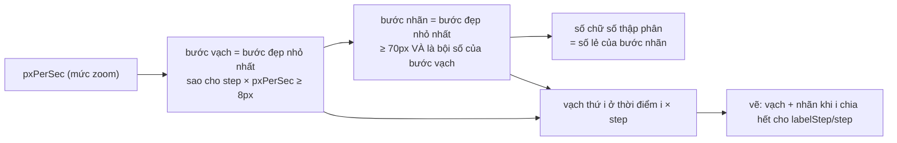

Hai bài toán nhỏ mà ai làm biểu đồ hay trình chỉnh sửa media cũng gặp:

1. **Thước thời gian có zoom.** Waveform của một podcast 1 giờ: zoom ra hết thì cả giờ nằm gọn trong 600px, zoom vào sâu thì 1 giây rộng 3.000px. Vạch chia và nhãn phải thưa dày theo mức zoom: dày quá thì nhãn đè lên nhau, thưa quá thì không biết mình đang ở giây thứ mấy.
2. **Màu cho series.** Bảng có 20 site, người dùng tick chọn site nào thì biểu đồ vẽ thêm một đường. Mỗi đường cần một màu không trùng, bỏ chọn thì trả màu về, chọn lại thì tốt nhất là đường đó lấy lại màu cũ.

Trình cắt audio của [Anchor](https://anchor.fm) (nay là Spotify for Podcasters) giải bài 1 bằng một bậc thang `if/else` theo `pxPerSec`. Similarweb giải bài 2 bằng một class `ColorStack` 30 dòng. Cả hai đều ngắn, dùng được, và đều có một chỗ đáng sửa.

> [!TIP]
> **Tóm tắt**
> - Chọn bước vạch theo **pixel trên màn hình**, không theo giây: lấy bước "đẹp" nhỏ nhất mà hai vạch vẫn cách nhau ≥ 8px, nhãn cách nhau ≥ 70px.
> - Nhãn phải là **bội số** của bước vạch, và tính thời gian bằng `i * step` (số nguyên nhân bước) chứ không cộng dồn `t += 0.1`.
> - Cấp màu bằng một pool gắn màu với **id** của series: release hai lần không hỏng, chọn lại thì lấy lại màu cũ mà không làm series khác bị trùng màu.
> - Anchor tách bước vạch và khoảng nhãn thành hai bậc thang viết tay; hai bậc thang này lệch nhau nên ở nhiều mức zoom không có nhãn chính nào lọt vào khung.

<iframe class="demo-frame" src="/demos/web-patterns/index.html?theme=dark#/ticks-colors" title="Demo ticks-colors" loading="lazy" style="height: 1060px"></iframe>

<p class="demo-links">▶ <a href="/demos/web-patterns/index.html#/ticks-colors" target="_blank" rel="noopener">Mở demo toàn màn hình ↗</a> · <a href="https://stackblitz.com/github/hunghg255/blog-hunghg/tree/master/examples/web-patterns?file=src/lib/timelineTicks.ts" target="_blank" rel="noopener">Sửa code trên StackBlitz ↗</a> · <a href="https://github.com/hunghg255/blog-hunghg/blob/master/examples/web-patterns/src/lib/timelineTicks.ts" target="_blank" rel="noopener">Xem source trên GitHub ↗</a></p>

Kéo thanh Zoom: thước trên (bản viết lại) luôn có 6–12 nhãn. Thước dưới chỉ vẽ nhãn chính theo đúng công thức của Anchor; ở khoảng 5–100 px/giây, hai nhãn chính cách nhau hàng nghìn pixel. Phần cấp màu: làm theo gợi ý trong demo, chỉ 5 series với palette 5 màu mà bản gốc vẫn cấp trùng.

## Anchor làm thế nào?

Code nằm ở [`anchor.fm/client/screens/SplitSegmentAudioModalScreen/components/Waveform/helpers/index.ts`](https://github.com/hunghg255/codebase/blob/main/anchor.fm/client/screens/SplitSegmentAudioModalScreen/components/Waveform/helpers/index.ts). Waveform dùng [wavesurfer.js](https://wavesurfer.xyz/) và plugin timeline của nó (thư viện vendored, nạp bằng `require` chỉ khi có `window` trong `WaveformPicker.tsx`). Phần Anchor tự viết là ba hàm truyền vào plugin:

```ts
export const primaryLabelInterval = (pxPerSec: number) => {
  let retval = 15;
  if (pxPerSec >= 25 * 100) retval = 100;
  else if (pxPerSec >= 25 * 40) retval = 4;
  else if (pxPerSec >= 25 * 10) retval = 10;
  else if (pxPerSec >= 25 * 4) retval = 40;
  else if (pxPerSec * 5 >= 25) retval = 80;   // timeInterval có thêm nhánh ">= 25" ngay trên dòng này
  else retval = Math.ceil(0.5 / pxPerSec) * 120;
  return retval;
};
```

`timeInterval` có cùng hình dạng: `>= 2500` → 0,01s, `>= 1000` → 0,25s, `>= 250` → 0,1s, `>= 100` → 0,5s, **`>= 25` → 1s**, `* 5 >= 25` → 10s, còn lại `Math.ceil(0.5 / pxPerSec) * 120` giây.

(Đã rút gọn khoảng trắng.) `timeInterval` trả về **số giây** giữa hai vạch. `primaryLabelInterval` trả về **số vạch** giữa hai nhãn chính: plugin timeline của wavesurfer vẽ nhãn chính ở vạch thứ `i` khi `i % primaryLabelInterval === 0`. Cấu trúc bậc thang `25 * 100`, `25 * 40`… giống các hàm mặc định của chính plugin timeline, nên có lẽ Anchor chép từ đó rồi chỉnh số.

Nhân hai giá trị với nhau sẽ ra khoảng cách giữa hai nhãn chính, tính bằng pixel:

| px/giây | bước vạch | nhãn mỗi | nhãn cách nhau |
|---|---|---|---|
| 3.000 | 0,01s | 100 vạch | 3.000px |
| 300 | 0,1s | 10 vạch | 300px |
| 50 | 1s | 80 vạch | **4.000px** |
| 10 | 10s | 80 vạch | **8.000px** |
| 1 | 120s | 120 vạch | **14.400px** |

Ở hàng 50 px/giây, `timeInterval` rơi vào nhánh `>= 25` (1 giây), nhưng `primaryLabelInterval` không có nhánh tương ứng nên rơi xuống nhánh `* 5 >= 25` (80 vạch). Hai bậc thang viết tay, sửa một quên sửa một. Plugin còn vẽ nhãn phụ theo `secondaryLabelInterval` (Anchor không truyền, nên dùng mặc định của wavesurfer), vì vậy trên màn hình thật có lẽ vẫn thấy chữ. Nhưng nhãn "chính" (đậm, dùng để định vị) gần như biến mất trong cả một dải zoom.

### Lỗi định dạng ở mức zoom sâu

```ts
secondsNum = secondsNum % 60;                    // phần giây trong phút
let secondsStr = Math.round(secondsNum).toString();
if (pxPerSec >= 25 * 20) secondsStr = seconds.toFixed(2);   // nhưng dùng TỔNG số giây
if (secondsNum < 10) secondsStr = `0${secondsStr}`;
```

Khi `pxPerSec >= 500`, nhãn dùng `seconds.toFixed(2)` thay vì `secondsNum.toFixed(2)`. Giây thứ 75,5 thành `01:75.50`, giây thứ 65,5 thành `01:065.50`. Vì sao chưa ai thấy? Có lẽ vì ở mức zoom đó người dùng thường đang cắt đoạn đầu file. Ngoài ra `Math.round(9.6)` ra `10`, cộng thêm số 0 phía trước thành `"010"`.

## Similarweb làm thế nào?

[`pro.similarweb.com/app/components/colorsStack/ColorStack.ts`](https://github.com/hunghg255/codebase/blob/main/pro.similarweb.com/app/components/colorsStack/ColorStack.ts), dùng ở khoảng chục bảng (`MultiColorSelectionTable.tsx`, `TableWidget.ts`, `WWOTopKeywords.tsx`…):

```ts
export default class ColorStack {
  constructor(colors: string[]) {
    this._colors = _.clone(colors);
    this.reset();
  }
  public reset() { this._available = _.clone(this._colors); }
  public acquire() {
    if (!this._available.length) this.reset();
    return this._available.shift();
  }
  public release(color) { this._available.unshift(color); }
}
```

Có thêm `NaiveColorStack` cùng interface nhưng luôn trả một màu, để dùng ở nơi không cần phân biệt màu (một dạng null object).

Cách dùng điển hình, trong [`MultiColorSelectionTable.tsx`](https://github.com/hunghg255/codebase/blob/main/pro.similarweb.com/app/components/React/Table/MultiColorSelectionTable.tsx):

```ts
const chartMainColors = new ColorStack(CHART_COLORS.chartMainColors); // cấp module

const onBeforeRowSelectionToggle = (row) => {
  if (row.selected) {
    chartMainColors.release(row.selectionColor);
    return row;                                   // hàng vẫn giữ selectionColor
  }
  return {
    ...row,
    selectionColor: row.selectionColor ? row.selectionColor : chartMainColors.acquire(),
  };
};
```

Đọc kỹ hai nhánh:

- Bỏ chọn: trả màu về stack, **nhưng hàng vẫn giữ `selectionColor`**.
- Chọn lại: hàng đã có `selectionColor` nên dùng lại màu đó, **không** gọi `acquire()`. Màu vẫn nằm trong danh sách màu trống của stack.

Kết quả: chọn google, youtube, facebook, tiktok (xanh dương, cam, xanh lá, hồng); bỏ chọn youtube rồi chọn lại (youtube vẫn cam, nhưng cam vẫn đang "trống" trong stack); chọn thêm wikipedia thì wikipedia nhận **cam**. Năm series, palette năm màu, vẫn trùng. Demo ở trên làm đúng chuỗi thao tác này.

Ngoài ra:

- **Màu không gắn với ai.** `release(color)` tin người gọi. Gọi hai lần với cùng một màu thì danh sách màu trống có cùng một màu hai lần.
- **Ngăn xếp, không phải hàng đợi.** Với nơi không giữ màu trên hàng, màu trả sau cùng được cấp trước tiên: bỏ chọn A (cam) rồi B (xanh lá), chọn lại A thì A nhận xanh lá.
- **Hết màu thì `reset()`**, và từ đó danh sách "màu trống" chứa cả các màu đang dùng. Bảng có `useEffect` gọi `chartMainColors.reset()` mỗi khi bộ lọc (`props.params`) đổi, để dọn lại từ đầu.

## Bên trong: "bước đẹp" và khoảng cách tính bằng pixel

Thay vì liệt kê từng mức zoom, tính ngược từ thứ người dùng nhìn thấy: **khoảng cách trên màn hình**.



"Bước đẹp" là các số người đọc quen: 0,01 · 0,02 · 0,05 · 0,1 · 0,2 · 0,25 · 0,5 · 1 · 2 · 5 · 10 · 15 · 30 giây, 1 · 2 · 5 · 10 · 15 · 30 phút, 1 giờ. Thư viện vẽ trục như d3 dùng cùng ý tưởng (bội số của 1, 2, 5 nhân lũy thừa của 10), cộng thêm các mốc của đồng hồ (15, 30, 60).

## Viết lại

### Chọn bước vạch và nhãn

```ts title=src/lib/timelineTicks.ts
export function chooseTickScale(
  pxPerSec: number,
  { minTickPx = 8, minLabelPx = 70 }: TickOptions = {},
): TickScale {
  // vạch nhỏ: bước nhỏ nhất mà 2 vạch vẫn cách nhau >= minTickPx
  const step = NICE_STEPS.find((s) => s * pxPerSec >= minTickPx) ?? NICE_STEPS[NICE_STEPS.length - 1];
  // nhãn: bước nhỏ nhất >= minLabelPx VÀ là bội số của step, để nhãn luôn nằm đúng trên vạch
  const labelStep =
    NICE_STEPS.find((s) => s >= step && s * pxPerSec >= minLabelPx && isMultiple(s, step)) ??
    // zoom ra cực xa: nhân bước lớn nhất lên cho tới khi đủ chỗ
    step * Math.ceil(minLabelPx / (step * pxPerSec));
  return { step, labelStep, decimals: decimalsOf(labelStep) };
}
```

`isMultiple` (xem file đầy đủ) loại các cặp như vạch 0,2s với nhãn 0,5s: nhãn sẽ rơi giữa hai vạch. Khi zoom ra cực xa (podcast 10 giờ trong 600px), không có bước đẹp nào đủ 70px, nên nhân bước vạch lên tới khi đủ chỗ.

### Sinh vạch

```ts title=src/lib/timelineTicks.ts
/**
 * Các vạch nằm trong đoạn [startSec, endSec] đang hiển thị.
 * Tính `i * step` từ chỉ số nguyên thay vì cộng dồn `t += step`: cộng dồn 0.1 nhiều lần thì
 * sai số tích tụ và nhãn lệch khỏi vạch. Một phép nhân vẫn có sai số nhỏ (3 * 0.1 =
 * 0.30000000000000004) nên làm tròn tới micro giây.
 */
export function buildTicks(startSec: number, endSec: number, pxPerSec: number, options?: TickOptions) {
  const scale = chooseTickScale(pxPerSec, options);
  const ticks: Tick[] = [];
  const first = Math.ceil(startSec / scale.step - 1e-9);
  const last = Math.floor(endSec / scale.step + 1e-9);
  const every = Math.round(scale.labelStep / scale.step);
  for (let i = first; i <= last; i++) {
    const time = Math.round(i * scale.step * 1e6) / 1e6;
    ticks.push({
      time,
      x: (time - startSec) * pxPerSec,
      label: i % every === 0 ? formatTime(time, scale.decimals) : undefined,
    });
  }
  return { scale, ticks };
}
```

`formatTime(seconds, decimals)` (trong file đầy đủ bên dưới) làm tròn tổng số giây theo `decimals` trước, rồi mới tách phút và giây.

## Đi qua code

- **Làm tròn trước khi tách phút/giây.** `59.999` với 2 chữ số thập phân là `60.00`. Tách trước rồi làm tròn sẽ ra `00:60.00`; làm tròn trước ra `01:00.00`.
- **`decimals` lấy từ bước nhãn**, không từ mức zoom: nhãn mỗi 0,25s cần 2 chữ số, nhãn mỗi 0,5s chỉ cần 1. Hai nhãn liền nhau không bao giờ in giống nhau.
- **`i * step` thay vì `t += step`.** Cộng dồn `0.1` hàng nghìn lần thì sai số tích tụ và nhãn lệch khỏi vạch. Một phép nhân vẫn có sai số nhỏ (`3 * 0.1` ra `0.30000000000000004`), nên làm tròn tới micro giây. Chỉ số nguyên `i` còn cho phép kiểm tra "vạch có nhãn" bằng phép chia lấy dư trên số nguyên.
- **Chỉ sinh vạch trong đoạn đang hiển thị** (`startSec`…`endSec`). Podcast 1 giờ ở mức 0,01s là 360.000 vạch; vẽ hết thì trình duyệt treo.

### Pool màu

```ts title=src/lib/colorPool.ts
  return {
    acquire(id) {
      const current = assigned.get(id);
      if (current) return current; // gọi lại cho cùng series: không cấp màu mới

      const previous = remembered.get(id);
      let color: string;
      if (previous && countOf(previous) === 0) {
        color = previous;
      } else {
        // màu ít người dùng nhất; hoà thì lấy màu đứng trước trong palette
        // (palette thường xếp theo độ dễ phân biệt giảm dần)
        color = palette.reduce((best, c) => (countOf(c) < countOf(best) ? c : best), palette[0]);
      }
      assigned.set(id, color);
      remembered.set(id, color);
      return color;
    },
```

**Khác bản gốc:**
- `acquire(id)` / `release(id)` thay cho `acquire()` / `release(color)`. Pool tự biết series nào giữ màu nào, nên release hai lần là vô hại.
- Việc "nhớ màu cũ" nằm trong pool (map `remembered`), không nằm ở hàng của bảng. Chọn lại thì pool cấp lại màu cũ **và** đánh dấu nó đang dùng, nên series sau không nhận trùng.
- Hết màu thì chọn màu đang được dùng ít nhất (đếm từ `assigned`, tức trạng thái thật), hoà thì lấy màu đứng trước trong palette.

::: spoiler Xem toàn bộ src/lib/timelineTicks.ts

```ts title=src/lib/timelineTicks.ts
/**
 * Vạch chia cho thước thời gian (timeline/waveform) có zoom.
 *
 * Ý tưởng từ anchor.fm (Waveform/helpers): chọn bước vạch theo `pxPerSec` (số pixel cho
 * 1 giây ở mức zoom hiện tại). Anchor dùng một bậc thang if/else viết tay; bản này tính
 * từ một danh sách "bước đẹp" và khoảng cách tối thiểu tính bằng pixel, nên đổi ngưỡng
 * hay thêm bước không phải sửa cả bậc thang.
 */

/** Các bước "đẹp" (giây) mà người đọc quen: 0.01s, 0.05s, 1s, 5s, 15s, 1 phút, 5 phút… */
export const NICE_STEPS = [
  0.01, 0.02, 0.05, 0.1, 0.2, 0.25, 0.5, 1, 2, 5, 10, 15, 30, 60, 120, 300, 600, 900, 1800, 3600,
];

export interface TickOptions {
  /** khoảng cách tối thiểu giữa 2 vạch nhỏ, px */
  minTickPx?: number;
  /** khoảng cách tối thiểu giữa 2 nhãn, px (đủ chỗ cho chữ "00:00.00") */
  minLabelPx?: number;
}

export interface TickScale {
  /** bước vạch nhỏ, giây */
  step: number;
  /** bước vạch có nhãn, giây (luôn là bội số của step) */
  labelStep: number;
  /** số chữ số thập phân cần để nhãn không trùng nhau */
  decimals: number;
}

/** Số chữ số thập phân của một bước, vd 0.25 -> 2, 0.1 -> 1, 5 -> 0. */
function decimalsOf(value: number) {
  for (let d = 0; d < 4; d++) {
    if (Math.abs(Math.round(value * 10 ** d) - value * 10 ** d) < 1e-9) return d;
  }
  return 3;
}

/** Bước sau là bội số nguyên của bước trước? (0.25 -> 0.5 có, 0.25 -> 1 có, 0.2 -> 0.5 không) */
function isMultiple(big: number, small: number) {
  const ratio = big / small;
  return Math.abs(ratio - Math.round(ratio)) < 1e-9;
}

export function chooseTickScale(
  pxPerSec: number,
  { minTickPx = 8, minLabelPx = 70 }: TickOptions = {},
): TickScale {
  // vạch nhỏ: bước nhỏ nhất mà 2 vạch vẫn cách nhau >= minTickPx
  const step = NICE_STEPS.find((s) => s * pxPerSec >= minTickPx) ?? NICE_STEPS[NICE_STEPS.length - 1];
  // nhãn: bước nhỏ nhất >= minLabelPx VÀ là bội số của step, để nhãn luôn nằm đúng trên vạch
  const labelStep =
    NICE_STEPS.find((s) => s >= step && s * pxPerSec >= minLabelPx && isMultiple(s, step)) ??
    // zoom ra cực xa: nhân bước lớn nhất lên cho tới khi đủ chỗ
    step * Math.ceil(minLabelPx / (step * pxPerSec));
  return { step, labelStep, decimals: decimalsOf(labelStep) };
}

/** mm:ss hoặc mm:ss.ff, phút có thể > 59 (podcast dài vài giờ vẫn đọc được). */
export function formatTime(seconds: number, decimals = 0) {
  // làm tròn trước khi tách phút/giây, để 59.999s ra "01:00" chứ không phải "00:60"
  const factor = 10 ** decimals;
  const total = Math.round(seconds * factor) / factor;
  const minutes = Math.floor(total / 60);
  const rest = total - minutes * 60;
  const [whole, frac] = rest.toFixed(decimals).split('.');
  const secondsStr = whole.padStart(2, '0') + (frac ? `.${frac}` : '');
  return `${String(minutes).padStart(2, '0')}:${secondsStr}`;
}

export interface Tick {
  time: number;
  x: number;
  label?: string;
}

/**
 * Các vạch nằm trong đoạn [startSec, endSec] đang hiển thị.
 * Tính `i * step` từ chỉ số nguyên thay vì cộng dồn `t += step`: cộng dồn 0.1 nhiều lần thì
 * sai số tích tụ và nhãn lệch khỏi vạch. Một phép nhân vẫn có sai số nhỏ (3 * 0.1 =
 * 0.30000000000000004) nên làm tròn tới micro giây.
 */
export function buildTicks(startSec: number, endSec: number, pxPerSec: number, options?: TickOptions) {
  const scale = chooseTickScale(pxPerSec, options);
  const ticks: Tick[] = [];
  const first = Math.ceil(startSec / scale.step - 1e-9);
  const last = Math.floor(endSec / scale.step + 1e-9);
  const every = Math.round(scale.labelStep / scale.step);
  for (let i = first; i <= last; i++) {
    const time = Math.round(i * scale.step * 1e6) / 1e6;
    ticks.push({
      time,
      x: (time - startSec) * pxPerSec,
      label: i % every === 0 ? formatTime(time, scale.decimals) : undefined,
    });
  }
  return { scale, ticks };
}
```

:::

::: spoiler Xem toàn bộ src/lib/colorPool.ts

```ts title=src/lib/colorPool.ts
/**
 * Cấp màu cho các series của biểu đồ khi người dùng thêm/bớt series liên tục.
 *
 * Ý tưởng từ Similarweb (components/colorsStack/ColorStack.ts): một "ngăn xếp" màu,
 * acquire() lấy màu, release() trả màu về để dùng lại. Bản này đổi 3 chỗ:
 * - gắn màu với id của series, nên release 2 lần hay release nhầm màu không làm hỏng pool
 *   (bản gốc sẽ có cùng một màu 2 lần trong danh sách màu trống);
 * - series quay lại thì pool tự trả màu cũ của nó nếu màu đó còn trống. Bảng của Similarweb
 *   tự giữ màu cũ trên hàng nhưng không lấy nó ra khỏi stack, nên màu đó bị cấp trùng sau đó;
 * - hết màu thì chọn màu đang được dùng ít nhất, tính từ trạng thái thật, thay vì reset
 *   danh sách rồi cấp lại từ màu đầu tiên.
 */
export interface ColorPool {
  acquire(id: string): string;
  release(id: string): void;
  colorOf(id: string): string | undefined;
  /** số series đang dùng mỗi màu, theo thứ tự palette */
  usage(): Array<{ color: string; count: number }>;
  reset(): void;
}

export function createColorPool(palette: readonly string[]): ColorPool {
  if (palette.length === 0) throw new Error('palette rỗng');
  const assigned = new Map<string, string>(); // id -> màu đang dùng
  const remembered = new Map<string, string>(); // id -> màu lần trước (để trả lại đúng màu cũ)

  const countOf = (color: string) => {
    let n = 0;
    for (const c of assigned.values()) if (c === color) n++;
    return n;
  };

  return {
    acquire(id) {
      const current = assigned.get(id);
      if (current) return current; // gọi lại cho cùng series: không cấp màu mới

      const previous = remembered.get(id);
      let color: string;
      if (previous && countOf(previous) === 0) {
        color = previous;
      } else {
        // màu ít người dùng nhất; hoà thì lấy màu đứng trước trong palette
        // (palette thường xếp theo độ dễ phân biệt giảm dần)
        color = palette.reduce((best, c) => (countOf(c) < countOf(best) ? c : best), palette[0]);
      }
      assigned.set(id, color);
      remembered.set(id, color);
      return color;
    },
    release(id) {
      assigned.delete(id);
    },
    colorOf: (id) => assigned.get(id),
    usage: () => palette.map((color) => ({ color, count: countOf(color) })),
    reset() {
      assigned.clear();
      remembered.clear();
    },
  };
}
```

:::

## Tại sao không làm cách khác?

- **Bậc thang `if/else` như Anchor?** Dễ đọc lúc đầu, nhưng có hai bảng phải giữ khớp nhau và mọi ngưỡng đều tính bằng `pxPerSec`, nên đổi font chữ (nhãn rộng hơn) là phải chỉnh lại cả hai. Tính theo pixel thì chỉ cần đổi `minLabelPx`.
- **Đo chiều rộng nhãn thật bằng `measureText`?** Chính xác hơn, nhưng các nhãn trên một thước có độ dài gần như bằng nhau (`00:00`, `00:00.00`). Ước lượng 70px cho font monospace 11px là đủ, và hàm vẫn thuần (pure), test được không cần DOM.
- **Sinh màu theo hash của id (`hsl(hash % 360, …)`)?** Không cần pool, màu ổn định giữa các lần tải trang. Đổi lại, hai id có thể ra hai màu rất gần nhau, và không kiểm soát được độ tương phản. Palette chọn tay (như của Similarweb) dễ đọc hơn khi có ít hơn khoảng 10 series.

## Edge case và cạm bẫy

- **Thời điểm bắt đầu không chia hết cho bước.** `Math.ceil(startSec / step - 1e-9)`: trừ một epsilon để 1,0000000001 không bị làm tròn lên thành vạch tiếp theo.
- **Phút lớn hơn 59.** Podcast 3 giờ: bản viết lại in `180:00`, không nhảy sang giờ. Nếu cần `h:mm:ss`, thêm một nhánh khi `labelStep >= 3600` hoặc khi tổng thời lượng lớn hơn 1 giờ.
- **Màu trong chế độ tối.** Palette cho nền trắng có thể quá tối trên nền đen. Giữ hai palette và đưa vào pool theo theme, đừng đổi màu của series đang hiển thị khi người dùng chuyển theme.
- **Pool sống lâu hơn biểu đồ.** Similarweb tạo `ColorStack` ở cấp module (`const chartMainColors = new ColorStack(...)` ngay đầu file), nên nó sống suốt phiên, kể cả khi rời trang rồi quay lại; bảng phải tự gọi `reset()` khi bộ lọc đổi. Tạo pool trong component (`useRef`/`useMemo`) thì vòng đời của pool trùng với biểu đồ.

## Dùng trong dự án

```tsx
import { buildTicks } from './lib/timelineTicks';

function Timeline({ start, width, pxPerSec }: { start: number; width: number; pxPerSec: number }) {
  const { ticks } = buildTicks(start, start + width / pxPerSec, pxPerSec);
  return (
    <svg width={width} height={32}>
      {ticks.map((t) => (
        <g key={t.time} transform={`translate(${t.x},0)`}>
          <line y2={t.label ? 16 : 8} stroke='currentColor' />
          {t.label && <text x={3} y={28}>{t.label}</text>}
        </g>
      ))}
    </svg>
  );
}
```

```ts
const pool = createColorPool(['#4f8cff', '#ff8a3d', '#34d399', '#f472b6', '#facc15']);
const onToggle = (site: string, selected: boolean) =>
  selected ? series.add(site, pool.acquire(site)) : (series.remove(site), pool.release(site));
```

## Kiểm thử

::: spoiler Ví dụ test (bản phác, không có trong repo)

```ts
import { describe, expect, it } from 'vitest';
import { buildTicks, chooseTickScale, formatTime } from './timelineTicks';
import { createColorPool } from './colorPool';

describe('timelineTicks', () => {
  it('nhãn luôn cách nhau ít nhất 70px và là bội số của bước vạch', () => {
    for (const px of [0.05, 0.5, 1, 7, 21, 50, 300, 1000, 3000]) {
      const { step, labelStep } = chooseTickScale(px);
      expect(labelStep * px).toBeGreaterThanOrEqual(70);
      expect(Math.abs(labelStep / step - Math.round(labelStep / step))).toBeLessThan(1e-9);
    }
  });

  it('định dạng đúng phần giây', () => {
    expect(formatTime(75.5, 2)).toBe('01:15.50');
    expect(formatTime(65.5, 2)).toBe('01:05.50');
    expect(formatTime(59.999, 2)).toBe('01:00.00');
    expect(formatTime(9.6)).toBe('00:10');
  });

  it('vạch không trôi số khi bước là 0.1', () => {
    const { scale, ticks } = buildTicks(0, 100, 300);
    expect(scale.step).toBe(0.05);
    expect(ticks[6].time).toBe(0.3); // không phải 0.30000000000000004
    expect(ticks.at(-1)!.time).toBe(100);
  });
});

describe('createColorPool', () => {
  it('chọn lại thì lấy lại màu cũ, series mới không bị trùng', () => {
    const pool = createColorPool(['a', 'b', 'c', 'd', 'e']);
    ['g', 'y', 'f', 't'].forEach((id) => pool.acquire(id)); // a b c d
    pool.release('y');
    expect(pool.acquire('y')).toBe('b');
    expect(pool.acquire('w')).toBe('e'); // bảng của Similarweb sẽ cấp b lần nữa
  });

  it('release hai lần không làm trùng màu', () => {
    const pool = createColorPool(['a', 'b']);
    pool.acquire('x');
    pool.release('x');
    pool.release('x');
    expect(new Set([pool.acquire('p'), pool.acquire('q')]).size).toBe(2);
  });
});
```

:::

## So với thư viện và chuẩn web

- [d3-scale](https://d3js.org/d3-scale/linear#linear_ticks) `scale.ticks(count)` chọn bước theo cấp số 1-2-5; `d3.scaleTime().ticks()` có thêm các mốc giây, phút, giờ, ngày. Nếu dự án đã có d3, dùng luôn. Hàm trên chỉ khác ở chỗ tính theo khoảng cách pixel thay vì "số vạch mong muốn".
- Plugin timeline của wavesurfer.js nhận `timeInterval`, `primaryLabelInterval`, `secondaryLabelInterval` dưới dạng hàm theo `pxPerSec`, như Anchor dùng. Có thể giữ plugin và chỉ thay ba hàm đó bằng `chooseTickScale`.
- Thư viện biểu đồ như ECharts, Highcharts, Recharts có palette mặc định và gán màu theo **thứ tự series**, nên ẩn một series ở giữa có thể làm các series sau đổi màu. Cố định màu theo id (như pool ở trên, hoặc một map `id → màu` lưu cùng dữ liệu) là cách tránh.

---

Bài này thuộc series **[Học từ mã nguồn các web lớn](/series/web)** (42 bài, đọc theo thứ tự).

::: spoiler Xem nhanh danh sách bài trong series

*Mở đầu*

- [Mở đầu: đọc code production của 28 trang web](/blogs/learn-from-big-web-apps)

*Phần 1: trải nghiệm người dùng*

- [#1 Dark mode không nháy (Gatsby)](/blogs/web-dark-mode-no-flash)
- [#2 useValueByMedia: giá trị theo breakpoint (Toptal)](/blogs/web-use-value-by-media)
- [#3 Đoán ý định: idle, exit-intent, lắc chuột (Toptal, InVision)](/blogs/web-user-intent-idle-exit-wiggle)
- [#4 Validate form thân thiện (Udacity, Pipedrive)](/blogs/web-form-validation-ux)
- [#5 Magic number, EXIF và dán ảnh (Ello)](/blogs/web-file-magic-number-exif-paste)
- [#6 fastSmoothScroll: cuộn xa vẫn nhanh (Telegram)](/blogs/web-telegram-fast-smooth-scroll)
- [#7 Countdown time-travel và tombstone giỏ hàng (Best Buy)](/blogs/web-countdown-time-travel-tombstone)

*Phần 2: hiệu năng và đo lường*

- [#8 Hàng đợi requestAnimationFrame 3ms (Apple)](/blogs/web-raf-queue-3ms)
- [#9 srcset cho artwork và preconnect tự động (Apple)](/blogs/web-responsive-artwork-preconnect)
- [#10 Quick-fetch: gọi API trước khi bundle tải xong (HubSpot)](/blogs/web-quick-fetch-early-requests)
- [#11 Performance span và long task (Postman, Calibre)](/blogs/web-performance-spans-long-tasks)
- [#12 Gọi Web Worker như hàm async (Telegram)](/blogs/web-worker-promise-rpc)
- [#13 Đồng hồ media: đếm giờ xem và sửa lệch (Skillshare, Simplified)](/blogs/web-media-clock-watch-time-drift)

*Phần 3: nhiều tab, phiên đăng nhập, cập nhật*

- [#14 Bầu tab chủ cho thông báo (HubSpot, Telegram)](/blogs/web-leader-tab-notifications)
- [#15 Đồng bộ đăng nhập giữa tab và giới hạn cookie (Elastic, InVision)](/blogs/web-cross-tab-auth-cookie-guard)
- [#16 SPA tự cập nhật: Trello, Zappos, Facebook, Elastic](/blogs/web-spa-self-update-strategies)

*Phần 4: kiến trúc*

- [#17 Reverse portal: di chuyển component không remount (Zappos)](/blogs/web-reverse-portal)
- [#18 Page behaviors: gắn hành vi từ CMS (Intercom)](/blogs/web-page-behaviors-cms)
- [#19 Giới hạn tần suất hiển thị bằng bitmask (Outlook)](/blogs/web-frequency-cap-bitmask)
- [#20 Chuyển REST sang GraphQL dần dần (Coursera)](/blogs/web-rest-to-graphql-hybrid-link)

*Phần 5: soạn thảo và hiển thị nội dung*

- [#21 Autocomplete tại con trỏ trong contenteditable (Ello, Telegram)](/blogs/web-caret-autocomplete-contenteditable)
- [#22 Dark mode cho email HTML bằng CIELAB (Outlook)](/blogs/web-email-dark-mode-cielab)
- [#23 Thu nhỏ bảng rộng cho vừa khung, vá font emoji (Outlook)](/blogs/web-email-wide-content-scale)
- [#24 Cảnh báo quên đính kèm file (Outlook)](/blogs/web-forgotten-attachment-warning)
- [#25 Cắt chữ nhiều dòng chính xác (Pipedrive, Apple, Toptal)](/blogs/web-multiline-truncate-measure-text)
- [#26 Parse ngày giờ gõ tay khoan dung (Outlook, Elastic)](/blogs/web-lenient-date-parser)

*Phần 6: tương tác*

- [#27 menuAim: rê chéo vào submenu không bị đóng (Udemy)](/blogs/web-menu-aim-triangle)
- [#28 Kéo, vuốt chung cho chuột và cảm ứng (Telegram)](/blogs/web-unified-pointer-gestures)
- [#29 Phím tắt theo phạm vi, IME và bàn phím phi Latinh (Trello)](/blogs/web-scoped-keyboard-shortcuts)
- [#30 Nội suy màu: đổi theme và nền theo cuộn (Telegram, Anchor)](/blogs/web-color-interpolation-theme-scroll)
- [#31 Đường gióng hút cạnh và undo/redo trên canvas (Simplified)](/blogs/web-canvas-snap-guides-undo)
- [#32 Giả lập mù màu bằng feColorMatrix (Trello)](/blogs/web-color-vision-simulator)
- **#33 Vạch thước theo mức zoom và cấp phát màu cho biểu đồ (Anchor, Similarweb)** (bài này)

*Phần 7: mạng, dữ liệu và async*

- [#34 Ô tìm kiếm chuẩn production (Similarweb, Udemy, Pipedrive)](/blogs/web-production-search-box)
- [#35 Điều phối async: latest-wins, single-flight (Glitch, Toptal)](/blogs/web-async-coordination-latest-wins)
- [#36 Polling thưa dần và debounce động (Trello)](/blogs/web-decaying-polling-dynamic-debounce)
- [#37 Cache phía client theo version (Similarweb, Telegram, Udemy)](/blogs/web-client-cache-versioned)
- [#38 Upload file lớn theo chunk (Outlook, Tribe)](/blogs/web-chunked-upload-pipeline)
- [#39 Phát video qua Service Worker bằng Range request (Telegram, Outlook)](/blogs/web-service-worker-range-streaming)

*Phần 8: hiệu năng và vận hành*

- [#40 TTI governor: hoãn việc phụ tới sau khi trang dùng được (Outlook)](/blogs/web-tti-governor)
- [#41 Tự đo LCP/CLS/TBT và phục vụ bản nhẹ cho máy yếu (Udemy)](/blogs/web-rum-adaptive-loading)

:::

Code + demo: [`examples/web-patterns`](https://github.com/hunghg255/blog-hunghg/tree/master/examples/web-patterns) · [Mở trên StackBlitz](https://stackblitz.com/github/hunghg255/blog-hunghg/tree/master/examples/web-patterns)
