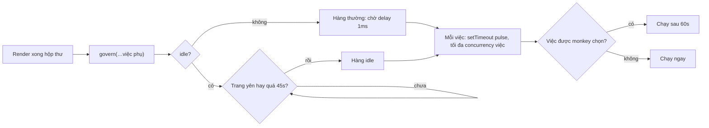

Outlook trên web vẽ xong hộp thư là mới xong phần dễ. Ngay sau đó là cả danh sách việc phụ muốn chạy: khởi tạo thông báo, tải danh sách người gửi, gợi ý cá nhân hoá, khảo sát ý kiến, thông tin tài khoản, nút OneNote, bảng lịch… Mỗi việc là một lần tải chunk JavaScript rồi khởi tạo module.

Viết theo cách tự nhiên thì mọi việc được gọi ngay sau lần render đầu. Từng việc chỉ tốn vài chục mili giây, nhưng chạy liền nhau thì thành một khối CPU nửa giây. Người dùng thấy hộp thư rồi, bấm vào thư đầu tiên và… không có gì xảy ra cho tới khi khối kia chạy xong.

Outlook giải quyết bằng một module tên `owa-tti`: một **governor** (bộ điều tiết) xếp hàng các việc phụ, cho mỗi việc một lượt riêng, và giữ những việc không gấp lại tới khi trang **tương tác được** (Time To Interactive, TTI).

> [!TIP]
> **Tóm tắt**
> - Việc phụ lúc khởi động không chạy dồn: đưa vào **hàng đợi**, mỗi việc chạy trong **một macrotask riêng** (`setTimeout`), để giữa hai việc trình duyệt kịp vẽ và xử lý click.
> - Việc không gấp đánh dấu `idle`: chờ tới khi trang **yên** (không còn long task), nhưng có **giới hạn thời gian** (Outlook: 45 giây) để không chờ mãi.
> - "Monkey": cố tình làm trễ **một việc ngẫu nhiên** ở một phần người dùng để đo xem việc đó có thật sự cần chạy sớm không.
> - Ngày nay có `scheduler.postTask` và `scheduler.yield` làm phần lớn việc này ở mức trình duyệt; ý tưởng xếp hàng + chờ trang yên + đo bằng thí nghiệm vẫn dùng được.

<iframe class="demo-frame" src="/demos/web-patterns/index.html?theme=dark#/tti-governor" title="Demo tti-governor" loading="lazy" style="height: 860px"></iframe>

<p class="demo-links">▶ <a href="/demos/web-patterns/index.html#/tti-governor" target="_blank" rel="noopener">Mở demo toàn màn hình ↗</a> · <a href="https://stackblitz.com/github/hunghg255/blog-hunghg/tree/master/examples/web-patterns?file=src/lib/ttiGovernor.ts" target="_blank" rel="noopener">Sửa code trên StackBlitz ↗</a> · <a href="https://github.com/hunghg255/blog-hunghg/blob/master/examples/web-patterns/src/lib/ttiGovernor.ts" target="_blank" rel="noopener">Xem source trên GitHub ↗</a></p>

Bấm **Khởi động** ở chế độ "Ngây thơ" rồi bấm **Bấm thử** ngay: quả bóng đứng hình khoảng 600ms và click phải chờ khoảng 500ms (đo trên Chromium trong lúc viết bài). Chuyển sang "Governor": cùng 10 việc, khung hình đứng lâu nhất chỉ còn cỡ một việc (khoảng 80–100ms), click được xử lý gần như ngay. Bốn việc `idle` chỉ bắt đầu sau khi trang yên 600ms.

## Outlook làm thế nào?

Code nằm trong hai package: [`owa-tti/src/ttiGovernor.ts`](https://github.com/hunghg255/codebase/blob/main/outlook.live.com/src/modules/owa-tti/src/ttiGovernor.ts) và hàng đợi dùng chung [`owa-task-queue/src/TaskQueue.ts`](https://github.com/hunghg255/codebase/blob/main/outlook.live.com/src/modules/owa-task-queue/src/TaskQueue.ts).

### Hồ sơ (profile) của governor

```ts
// concurrency: number of simultaneous tasks that can run in a js quanta
// delay: the delay before the governor starts processing jobs
// pulse: the delay between js quanta for jobs
const defaultProfile: GovernorProfile = { concurrency: 3, delay: 1, pulse: 1 };

const TTI_TIMEOUT = 45000;
const MONKEY_DELAY_MS = 60000;
```

Ba con số được ghi chú rõ: tối đa 3 việc, chờ 1ms trước khi bắt đầu, nghỉ 1ms giữa các việc. Cả ba đọc được từ query string (`?ttiConcurrency=…&ttiPulse=…`) khi bật cờ `fwk-devTools`, để kỹ sư thử nghiệm các bộ số khác nhau mà không cần build lại.

### Gọi governor

Nơi dùng nhiều nhất là `owa-mail-post-boot/src/setupMailModulePostRender.ts`, chạy sau lần render đầu của hộp thư (rút gọn):

```ts
lazyGovern.importAndExecute(
  { task: () => composeModule.import(), idle: true },
  initNotifications,
  { condition: isConsumer(), task: () => lazyLoadSenders.importAndExecute() },
  { task: () => lazyGetAccountInformation.importAndExecute(), idle: true },
  // … khoảng 15 việc
).then(() => {
  // enable reporting after we've queued everything
  lazyEnableGovernReport.importAndExecute();
});
```

Mỗi phần tử là một hàm, hoặc một object `{ task, condition?, idle? }`. `condition` cho phép viết cả danh sách ở một chỗ, việc nào không bật feature flag thì bỏ qua. Bản thân governor cũng được tải lười (`lazyGovern`), nên code điều tiết không làm nặng bundle chính.

### Hai hàng đợi

```ts
function getQueue(waitForIdle: boolean): Promise<TaskQueue<Task>> {
    if (waitForIdle) {
        if (!lazyIdleQueue) {
            lazyIdleQueue = createTaskPromise(
                Promise.race([lazyTti.importAndExecute(), sleep(TTI_TIMEOUT)])
            );
        }
        return lazyIdleQueue;
    }
    if (!lazyQueue) {
        lazyQueue = createTaskPromise();
    }
    return lazyQueue;
}
```

Hàng thường bắt đầu sau `delay` (1ms). Hàng `idle` bắt đầu khi `lazyTti` báo trang đã tương tác được, hoặc sau 45 giây, cái nào tới trước. `lazyTti` gọi `getFirstConsistentlyInteractive()` của [tti-polyfill](https://github.com/GoogleChromeLabs/tti-polyfill), thư viện của Google (code vendored, không phải code Outlook). Polyfill này coi trang là tương tác được khi có một khoảng 5 giây không có long task và không quá 2 request mạng đang chạy.

### Hàng đợi: mỗi việc một lượt

```ts
scheduleTask() {
    if (this.canRunMoreTasks()) {
        // Schedule the task on timer so that the JS thread is not occupied by the queue
        setTimeout(() => { this.tryRunTask(); }, this.taskDelay);
    }
}
```

`add` dùng `unshift`, `tryRunTask` dùng `pop`: vẫn là FIFO, việc thêm trước chạy trước. Điểm mấu chốt là `setTimeout`: mỗi việc chạy trong một macrotask riêng.

### Monkey

```ts
// enableGovernReport(): chọn ngẫu nhiên một việc
monkeyTaskNum = getParam(MONKEY_QUERYSTRING_KEY, Math.floor(Math.random() * numGoverned));

function runTask(task: Task): Promise<any> {
    currentTaskNum++;
    if (currentTaskNum == monkeyTaskNum) {
        setTimeout(task, MONKEY_DELAY_MS);
    } else {
        task();
    }
    if (sendReport && currentTaskNum == numGoverned - 1) {
        logStartUsage('ttiGovernEnd', { ...profileUsed, monkey: monkeyTaskNum });
        sendReport = false;
    }
    return Promise.resolve();
}
```

Khi bật cờ `fwk-tti-governor-monkey`, một việc ngẫu nhiên bị đẩy lùi **60 giây**. Sự kiện `ttiGovernEnd` ghi lại profile và số thứ tự của việc bị làm trễ. Ghép với số liệu khởi động và lỗi, nhóm Outlook có thể trả lời câu hỏi "nếu việc X chạy muộn một phút thì có gì hỏng không?" bằng dữ liệu thật, thay vì đoán. Đây là một dạng thí nghiệm gây lỗi có chủ đích (fault injection, cùng tinh thần với Chaos Monkey của Netflix) đặt ngay trong đường khởi động. Ai đặt tên "monkey" có lẽ cũng nghĩ tới Chaos Monkey (suy đoán).

### Ba chỗ chưa ổn trong bản gốc

Mình chép nguyên logic `TaskQueue` + `runTask` ra Node để chạy thử, và đọc kỹ `govern`:

1. **`concurrency: 3` gần như không có tác dụng với việc async.** `runTask` gọi `task()` rồi trả về `Promise.resolve()` ngay, không chờ promise của việc. Hàng đợi coi việc đã xong khi phần đồng bộ chạy xong, trong khi chunk vẫn đang tải. Chạy thử 10 việc async (mỗi việc chờ 100ms) với `concurrency` 3: cả **10** việc cùng đang chạy một lúc. Giới hạn thật chỉ là "mỗi việc một macrotask".
2. **Một việc ném lỗi đồng bộ chiếm vĩnh viễn một chỗ.** `tryRunTask` tăng `numberOfTasksRunning` rồi mới gọi `taskCallback`. Nếu `task()` ném lỗi đồng bộ, lỗi bay ra khỏi `setTimeout`, không ai giảm bộ đếm. Chạy thử: 3 việc ném lỗi liên tiếp, 3 việc sau **không bao giờ chạy**, `numberOfTasksRunning` kẹt ở 3. Thực tế phần lớn việc là `lazyX.importAndExecute()`, lỗi đi qua promise chứ không ném đồng bộ, nên có lẽ vì vậy lỗi này ít lộ ra.
3. **Một việc `idle` đứng đầu danh sách chặn mọi việc phía sau.** `govern` viết `let q = await getQueue(waitForIdle)` trong vòng `for`. Với việc idle, promise đó chỉ xong khi đạt TTI hoặc sau 45 giây; trong lúc chờ, vòng lặp đứng yên, các việc thường phía sau chưa được đưa vào hàng. Danh sách trong `setupMailModulePostRender.ts` mở đầu bằng đúng một việc idle (`composeModule.import()`), nên `initNotifications` và các việc thường khác thực tế cũng chờ TTI. Không rõ đây là cố ý hay không; nếu cố ý thì nhãn `idle` trên từng việc khác là thừa.

Thêm một điểm nhỏ: monkey chọn ngẫu nhiên trong **mọi** việc đã xếp hàng, kể cả việc đã chạy xong. Trúng việc đã chạy thì không có gì bị làm trễ, nhưng báo cáo vẫn ghi số thứ tự đó; phía phân tích cần tự lọc.

## Bên trong trình duyệt: vì sao "mỗi việc một macrotask" lại quan trọng

Main thread chạy theo vòng lặp sự kiện (event loop): lấy một task (callback `setTimeout`, sự kiện click, tin nhắn…), chạy **đến hết**, rồi mới tới lượt việc khác. Giữa hai task, trình duyệt có cơ hội cập nhật giao diện (khoảng 60 lần mỗi giây) và xử lý input đang chờ.

Một task chạy quá 50ms được gọi là **long task**. Trong lúc đó trình duyệt không vẽ được, click phải xếp hàng. 10 việc gọi liền trong một hàm là **một** task 600ms. Cùng 10 việc đó, mỗi việc trong một `setTimeout` riêng, thành 10 task nhỏ, và click của người dùng chen vào giữa được.



Có hai điều nên nhớ:

- **Việc có phần CPU lớn hơn 50ms vẫn là long task**, governor không chia nhỏ được. Muốn chia thì chính việc đó phải tự nhường (yield) giữa chừng, xem phần so sánh cuối bài.
- **"Trang yên" là một phỏng đoán.** TTI không phải sự kiện trình duyệt bắn ra, mà là thứ ta tự suy từ việc không thấy long task trong một khoảng thời gian. Vì thế luôn cần một giới hạn thời gian.

## Viết lại

[`src/lib/ttiGovernor.ts`](https://github.com/hunghg255/blog-hunghg/blob/master/examples/web-patterns/src/lib/ttiGovernor.ts) giữ nguyên ý tưởng và API (`govern`, `enableReport`, `{ task, condition, idle }`) và sửa ba lỗi trên.

Hàng đợi: lấy việc ra ngay khi giữ chỗ, chạy trong `setTimeout`, chờ promise của việc và bắt cả lỗi ném đồng bộ:

```ts title=src/lib/ttiGovernor.ts
  private schedule() {
    while (this.running < this.concurrency && this.tasks.length > 0) {
      // Lấy việc ra ngay khi giữ chỗ, để mỗi chỗ ứng với đúng một việc.
      const task = this.tasks.shift()!;
      this.running++;
      // Mỗi việc chạy trong một macrotask riêng: giữa hai việc, trình duyệt được vẽ
      // và xử lý click. Nếu chạy liền trong một vòng lặp thì thành một long task dài.
      setTimeout(() => {
        // Promise.resolve().then: lỗi ném ĐỒNG BỘ trong runTask cũng thành promise bị reject,
        // không làm `running` kẹt mãi (lỗi của bản gốc, xem bài viết).
        Promise.resolve()
          .then(() => this.runTask(task))
          .catch(() => {})
          .finally(() => {
            this.running--;
            this.schedule();
          });
      }, this.pulse);
    }
  }
```

`govern` không còn `await` từng việc trong vòng lặp:

```ts title=src/lib/ttiGovernor.ts
    govern(...tasks: GovernedTask[]): Promise<void> {
      const added: Promise<void>[] = [];
      for (const item of tasks) {
        const task = typeof item === 'function' ? item : item.task;
        const shouldRun = typeof item === 'function' || !('condition' in item) || !!item.condition;
        const idle = typeof item !== 'function' && !!item.idle;
        if (!shouldRun) continue;
        total++;
        // KHÔNG await từng việc: bản gốc `await getQueue(idle)` trong vòng lặp, nên một việc
        // idle đứng đầu danh sách làm mọi việc thường phía sau phải chờ tới TTI.
        added.push(getQueue(idle).then((queue) => queue.add(task)));
      }
      return Promise.all(added).then(() => {});
    },
```

Thay tti-polyfill (đã ngừng phát triển) là hàm `waitForQuietWindow`: sau sự kiện `load`, mở một `PerformanceObserver` cho long task và chờ một khoảng `quietMs` không có long task nào (xem file đầy đủ bên dưới).

::: spoiler Xem toàn bộ src/lib/ttiGovernor.ts

```ts title=src/lib/ttiGovernor.ts
/**
 * TTI governor (ý tưởng từ owa-tti của Outlook Web):
 * - Việc phụ lúc khởi động (tải module thông báo, khảo sát, gợi ý…) không chạy dồn một lúc,
 *   mà xếp hàng, mỗi việc một macrotask (setTimeout), tối đa `concurrency` việc đang chạy.
 * - Việc đánh dấu `idle: true` chờ tới khi trang "tương tác được" (TTI), có giới hạn thời gian.
 * - "Monkey": cố tình làm trễ một việc ngẫu nhiên để đo xem việc đó có thật sự cần sớm không.
 */

export type Task = () => unknown;
export type GovernedTask = Task | { task: Task; condition?: boolean; idle?: boolean };

export interface GovernorProfile {
  /** số việc được chạy cùng lúc */
  concurrency: number;
  /** chờ bao lâu (ms) trước khi bắt đầu xử lý hàng đợi thường */
  delay: number;
  /** khoảng nghỉ (ms) giữa các việc, để trình duyệt kịp vẽ và xử lý input */
  pulse: number;
}

export const DEFAULT_PROFILE: GovernorProfile = { concurrency: 3, delay: 1, pulse: 1 };

// ---- Hàng đợi FIFO giới hạn số việc chạy song song ----

export class TaskQueue {
  private tasks: Task[] = [];
  private running = 0;

  constructor(
    private readonly concurrency: number,
    private readonly pulse: number,
    private readonly runTask: (task: Task) => Promise<unknown>,
  ) {}

  add(task: Task) {
    this.tasks.push(task);
    this.schedule();
  }

  get size() {
    return this.tasks.length + this.running;
  }

  private schedule() {
    while (this.running < this.concurrency && this.tasks.length > 0) {
      // Lấy việc ra ngay khi giữ chỗ, để mỗi chỗ ứng với đúng một việc.
      const task = this.tasks.shift()!;
      this.running++;
      // Mỗi việc chạy trong một macrotask riêng: giữa hai việc, trình duyệt được vẽ
      // và xử lý click. Nếu chạy liền trong một vòng lặp thì thành một long task dài.
      setTimeout(() => {
        // Promise.resolve().then: lỗi ném ĐỒNG BỘ trong runTask cũng thành promise bị reject,
        // không làm `running` kẹt mãi (lỗi của bản gốc, xem bài viết).
        Promise.resolve()
          .then(() => this.runTask(task))
          .catch(() => {})
          .finally(() => {
            this.running--;
            this.schedule();
          });
      }, this.pulse);
    }
  }
}

// ---- Chờ trang "tương tác được" ----

/**
 * Xấp xỉ TTI: sau `load`, chờ một khoảng `quietMs` không có long task (> 50ms) nào.
 * Trình duyệt không có Long Tasks API thì chờ requestIdleCallback (hoặc setTimeout).
 * Định nghĩa TTI gốc còn đòi không quá 2 request mạng đang chạy; bản này bỏ điều kiện đó.
 */
export function waitForQuietWindow({ quietMs = 5000 }: { quietMs?: number } = {}): Promise<void> {
  return new Promise((resolve) => {
    const afterLoad = () => {
      const supportsLongTask =
        typeof PerformanceObserver !== 'undefined' &&
        PerformanceObserver.supportedEntryTypes?.includes('longtask');
      if (!supportsLongTask) {
        const idle = window.requestIdleCallback ?? ((cb: () => void) => setTimeout(cb, 1));
        idle(() => resolve());
        return;
      }
      let timer = setTimeout(done, quietMs);
      const observer = new PerformanceObserver(() => {
        // có long task mới: đếm lại khoảng yên lặng từ đầu
        clearTimeout(timer);
        timer = setTimeout(done, quietMs);
      });
      observer.observe({ type: 'longtask' });
      function done() {
        observer.disconnect();
        resolve();
      }
    };
    if (document.readyState === 'complete') afterLoad();
    else window.addEventListener('load', afterLoad, { once: true });
  });
}

const sleep = (ms: number) => new Promise<void>((resolve) => setTimeout(resolve, ms));

// ---- Governor ----

export interface GovernorReport {
  profile: GovernorProfile;
  tasks: number;
  /** vị trí của việc bị monkey làm trễ, -1 nếu không bật */
  monkey: number;
  /** từ lúc tạo governor tới khi việc cuối cùng BẮT ĐẦU chạy */
  elapsedMs: number;
}

export interface GovernorOptions {
  profile?: Partial<GovernorProfile>;
  /** promise báo trang đã tương tác được, mặc định waitForQuietWindow() */
  whenInteractive?: () => Promise<unknown>;
  /** quá thời gian này thì chạy việc `idle` dù chưa đạt TTI (Outlook: 45 giây) */
  interactiveTimeout?: number;
  /** bật monkey: làm trễ một việc ngẫu nhiên thêm `delayMs` (Outlook: 60 giây) */
  monkey?: { delayMs: number; index?: number };
  onTaskStart?: (info: { task: Task; index: number; idle: boolean; delayedByMonkey: boolean }) => void;
  onReport?: (report: GovernorReport) => void;
}

export function createGovernor({
  profile: profileOverride,
  whenInteractive = () => waitForQuietWindow(),
  interactiveTimeout = 45_000,
  monkey,
  onTaskStart,
  onReport,
}: GovernorOptions = {}) {
  const profile = { ...DEFAULT_PROFILE, ...profileOverride };
  const startedAt = performance.now();
  let total = 0;
  let started = 0;
  let monkeyIndex = -1;
  let reportEnabled = false;

  const runTask = (task: Task, idle: boolean) => {
    const index = started++;
    const delayedByMonkey = index === monkeyIndex;
    onTaskStart?.({ task, index, idle, delayedByMonkey });
    if (reportEnabled && started === total) {
      reportEnabled = false;
      onReport?.({ profile, tasks: total, monkey: monkeyIndex, elapsedMs: performance.now() - startedAt });
    }
    if (delayedByMonkey) {
      // không giữ chỗ trong hàng đợi trong lúc chờ: việc khác vẫn chạy bình thường
      setTimeout(task, monkey!.delayMs);
      return Promise.resolve();
    }
    return Promise.resolve(task());
  };

  // Hai hàng đợi tạo lười: hàng thường chờ `delay`, hàng idle chờ TTI hoặc hết thời gian.
  let normalQueue: Promise<TaskQueue> | null = null;
  let idleQueue: Promise<TaskQueue> | null = null;
  const makeQueue = (ready: Promise<unknown>, idle: boolean) =>
    ready.then(() => new TaskQueue(profile.concurrency, profile.pulse, (task) => runTask(task, idle)));

  const getQueue = (idle: boolean) => {
    if (idle) {
      idleQueue ??= makeQueue(
        Promise.race([whenInteractive().catch(() => {}), sleep(interactiveTimeout)]),
        true,
      );
      return idleQueue;
    }
    normalQueue ??= makeQueue(sleep(profile.delay), false);
    return normalQueue;
  };

  return {
    profile,
    /** Xếp hàng các việc phụ. Việc có `condition: false` bị bỏ qua. */
    govern(...tasks: GovernedTask[]): Promise<void> {
      const added: Promise<void>[] = [];
      for (const item of tasks) {
        const task = typeof item === 'function' ? item : item.task;
        const shouldRun = typeof item === 'function' || !('condition' in item) || !!item.condition;
        const idle = typeof item !== 'function' && !!item.idle;
        if (!shouldRun) continue;
        total++;
        // KHÔNG await từng việc: bản gốc `await getQueue(idle)` trong vòng lặp, nên một việc
        // idle đứng đầu danh sách làm mọi việc thường phía sau phải chờ tới TTI.
        added.push(getQueue(idle).then((queue) => queue.add(task)));
      }
      return Promise.all(added).then(() => {});
    },
    /** Gọi sau khi đã xếp hàng xong mọi việc: chọn việc cho monkey và gửi báo cáo khi xong. */
    enableReport() {
      reportEnabled = true;
      // chỉ chọn trong các việc CHƯA chạy, nếu không monkey có thể rơi vào việc đã xong
      if (monkey && total > started) {
        monkeyIndex = monkey.index ?? started + Math.floor(Math.random() * (total - started));
      }
      if (started === total && total > 0) {
        reportEnabled = false;
        onReport?.({ profile, tasks: total, monkey: monkeyIndex, elapsedMs: performance.now() - startedAt });
      }
    },
  };
}
```

:::

## Đi qua code

**`schedule()` là một vòng `while`.** Còn chỗ và còn việc thì lấy việc ra khỏi mảng **ngay** và tăng `running`. Bản đầu tiên mình viết giữ chỗ trước rồi mới lấy việc trong callback `setTimeout`, và bị lỗi ngược: số chỗ giữ có thể nhiều hơn số việc còn lại, một callback lấy ra `undefined`. Gắn việc với chỗ ngay lúc giữ chỗ thì không thể lệch.

**`Promise.resolve().then(() => this.runTask(task))`** biến mọi kiểu kết thúc thành promise: trả giá trị thường, trả promise, ném lỗi đồng bộ. `.finally` luôn trả chỗ. Đây là sửa lỗi số 2.

**`runTask` trả `Promise.resolve(task())`**: nếu việc trả promise (tải chunk), hàng đợi chờ promise đó, nên `concurrency` giới hạn đúng số việc **đang chạy**, gồm cả lúc tải mạng. Đây là sửa lỗi số 1. Việc bị monkey chọn thì trả chỗ ngay, không giữ chỗ trong 60 giây chờ.

**`govern` đẩy từng việc vào hàng bằng `getQueue(idle).then(queue => queue.add(task))`** mà không `await` trong vòng lặp. Việc thường vào hàng ngay cả khi việc idle đứng trước. Promise trả về vẫn chỉ xong khi mọi việc đã vào hàng, nên cách gọi `govern(...).then(enableReport)` của Outlook vẫn đúng nghĩa. Đây là sửa lỗi số 3.

**`waitForQuietWindow`** đặt một hẹn giờ `quietMs`; mỗi long task mới thì đặt lại hẹn giờ. Hết hẹn giờ mà không có long task nào nghĩa là trang đã yên. Trình duyệt không có Long Tasks API thì dùng `requestIdleCallback`, rồi `setTimeout`.

**`enableReport`** chọn việc cho monkey trong khoảng `[started, total)`, tức là các việc chưa bắt đầu, và báo cáo ngay nếu mọi việc đã chạy trước khi gọi.

**Khác bản gốc:**
- `concurrency` tính cả phần async của việc (bản gốc chỉ tính phần đồng bộ).
- Lỗi ném đồng bộ không làm kẹt hàng đợi.
- Việc idle không chặn việc thường phía sau.
- TTI tự đo bằng Long Tasks API thay vì tti-polyfill; bỏ điều kiện "không quá 2 request mạng".
- Monkey bật bằng option, chỉ chọn việc chưa chạy; profile truyền vào thay vì đọc query string.

## Tại sao không làm cách khác?

**`requestIdleCallback` cho mọi việc?** Callback idle chỉ chạy khi main thread rảnh trong một frame. Trang bận liên tục (animation, cập nhật dữ liệu) thì việc idle có thể chờ rất lâu, nên luôn phải truyền `timeout`. `requestIdleCallback` cũng không giới hạn số việc async đang chạy. Và nó chưa có trên mọi trình duyệt; kiểm tra [caniuse](https://caniuse.com/requestidlecallback) trước khi dựa vào (tính tới 10/2026).

**`Promise.all(modules.map(m => import(m)))` ngay sau render?** Tất cả chunk cùng tải, tranh băng thông với ảnh và API của chính hộp thư. Xong cùng lúc thì phần khởi tạo lại dồn vào nhau. Giới hạn `concurrency` trải đều cả mạng lẫn CPU.

**Chỉ tải khi cần (lazy hoàn toàn)?** Đúng với phần lớn tính năng: chỉ tải trình soạn thư khi người dùng bấm "Soạn thư". Nhưng có những việc phải chủ động chạy mà không có thao tác nào kích hoạt: đăng ký nhận thông báo, đồng bộ số thư chưa đọc. Governor dành cho nhóm này.

**Đặt `setTimeout(…, 3000)` cho từng việc?** Con số cố định thì trên máy nhanh là chờ phí, trên máy chậm vẫn chạy chồng lên lúc khởi động. Chờ "trang yên" thích ứng theo máy, giới hạn thời gian lo phần trường hợp xấu.

## Edge case và cạm bẫy

- **Thứ tự phụ thuộc**: hai việc phụ thuộc nhau thì gộp thành một việc, đừng trông vào thứ tự của hàng đợi khi `concurrency > 1`.
- **Tab nền**: tab ẩn thì trình duyệt giãn `setTimeout` (Chrome giới hạn khoảng một lần mỗi giây cho tab nền, và chặt hơn nữa sau vài phút). Mở app ở tab nền thì việc phụ chạy rất chậm; thường đó lại là điều ta muốn.
- **Trang không bao giờ yên**: trang có animation JS nặng hoặc polling liên tục có thể không bao giờ có khoảng yên. Giới hạn thời gian (`interactiveTimeout`) là bắt buộc, không phải tuỳ chọn.
- **Monkey trên production**: chỉ bật cho một phần nhỏ người dùng, và chỉ với việc có thể chạy muộn mà không làm hỏng dữ liệu. Báo cáo phải ghi việc nào bị làm trễ, nếu không số liệu vô nghĩa.
- **Việc bị gọi hai lần**: nếu một việc vừa nằm trong governor vừa được gọi trực tiếp khi người dùng bấm (vd tải trình soạn thư), hãy làm việc đó idempotent (gọi nhiều lần cũng như một), như `LazyModule` của Outlook chỉ import một lần.

## Dùng trong dự án

- App lớn có nhiều tính năng "đăng ký lúc khởi động": thông báo, chat widget, khảo sát, A/B test, analytics phụ. Gom tất cả vào một danh sách `govern(...)` sau lần render đầu.
- Script bên thứ ba (chat hỗ trợ, khảo sát): đưa vào việc `idle` để không cạnh tranh với nội dung chính.
- Đo trước và sau bằng Long Tasks hoặc INP (xem bài [#11](/blogs/web-performance-spans-long-tasks) và [#41](/blogs/web-rum-adaptive-loading)). Muốn biết việc nào thật sự cần sớm thì bật monkey cho vài phần trăm người dùng.
- Cùng họ với [hàng đợi rAF 3ms của Apple (#8)](/blogs/web-raf-queue-3ms): Apple chia việc theo **ngân sách thời gian mỗi frame**, Outlook chia theo **lượt macrotask + thời điểm khởi động**.

::: spoiler Ví dụ test (bản phác, không có trong repo)

```ts
import { afterEach, beforeEach, describe, expect, it, vi } from 'vitest';
import { createGovernor, TaskQueue } from './ttiGovernor';

beforeEach(() => vi.useFakeTimers());
afterEach(() => vi.useRealTimers());

describe('TaskQueue', () => {
  it('chạy theo thứ tự thêm vào, mỗi việc một macrotask', async () => {
    const order: string[] = [];
    const queue = new TaskQueue(1, 1, async (task) => task());
    queue.add(() => order.push('a'));
    queue.add(() => order.push('b'));
    expect(order).toEqual([]); // chưa chạy đồng bộ
    await vi.advanceTimersByTimeAsync(1);
    expect(order).toEqual(['a']);
    await vi.advanceTimersByTimeAsync(1);
    expect(order).toEqual(['a', 'b']);
  });

  it('không quá `concurrency` việc async cùng lúc', async () => {
    let inFlight = 0;
    let peak = 0;
    const queue = new TaskQueue(2, 1, (task) => Promise.resolve(task()));
    for (let i = 0; i < 5; i++) {
      queue.add(async () => {
        peak = Math.max(peak, ++inFlight);
        await new Promise((r) => setTimeout(r, 100));
        inFlight--;
      });
    }
    await vi.advanceTimersByTimeAsync(1000);
    expect(peak).toBe(2);
    expect(queue.size).toBe(0);
  });

  it('việc ném lỗi đồng bộ không làm hàng đợi kẹt', async () => {
    const done: number[] = [];
    const queue = new TaskQueue(1, 1, async (task) => task());
    queue.add(() => {
      throw new Error('boom');
    });
    queue.add(() => done.push(2));
    await vi.advanceTimersByTimeAsync(10);
    expect(done).toEqual([2]);
  });
});

describe('createGovernor', () => {
  it('việc idle chờ tới khi tương tác được, việc thường không phải chờ', async () => {
    let interactive!: () => void;
    const ran: string[] = [];
    const governor = createGovernor({
      whenInteractive: () => new Promise<void>((r) => (interactive = r)),
    });
    void governor.govern(
      { task: () => ran.push('idle'), idle: true }, // đứng đầu vẫn không chặn việc sau
      () => ran.push('normal'),
      { task: () => ran.push('skipped'), condition: false },
    );
    await vi.advanceTimersByTimeAsync(10);
    expect(ran).toEqual(['normal']);
    interactive();
    await vi.advanceTimersByTimeAsync(10);
    expect(ran).toEqual(['normal', 'idle']);
  });

  it('quá interactiveTimeout thì chạy việc idle', async () => {
    const ran: string[] = [];
    const governor = createGovernor({ whenInteractive: () => new Promise(() => {}), interactiveTimeout: 45_000 });
    void governor.govern({ task: () => ran.push('idle'), idle: true });
    await vi.advanceTimersByTimeAsync(44_000);
    expect(ran).toEqual([]);
    await vi.advanceTimersByTimeAsync(1_100);
    expect(ran).toEqual(['idle']);
  });

  it('monkey làm trễ đúng việc được chọn, báo cáo khi việc cuối bắt đầu', async () => {
    const ran: number[] = [];
    const onReport = vi.fn();
    const governor = createGovernor({
      whenInteractive: () => Promise.resolve(),
      monkey: { delayMs: 60_000, index: 1 },
      onReport,
    });
    const tasks = [0, 1, 2].map((i) => ({ task: () => ran.push(i), idle: true }));
    await governor.govern(...tasks);
    governor.enableReport();
    await vi.advanceTimersByTimeAsync(10);
    expect(ran).toEqual([0, 2]);
    expect(onReport).toHaveBeenCalledWith(expect.objectContaining({ tasks: 3, monkey: 1 }));
    await vi.advanceTimersByTimeAsync(60_000);
    expect(ran).toEqual([0, 2, 1]);
  });
});
```

:::

## So với API trình duyệt và thư viện

- **`scheduler.postTask(fn, { priority: 'background' })`** là phiên bản ở mức trình duyệt của "hàng đợi việc không gấp": ba mức ưu tiên (`user-blocking`, `user-visible`, `background`), huỷ được bằng `TaskController`, mỗi việc là một task riêng. Nó không có khái niệm "chờ TTI" hay giới hạn số việc async, nên vẫn cần lớp governor mỏng ở trên nếu muốn đủ các ý của Outlook.
- **`scheduler.yield()`** giải quyết vấn đề ngược lại: một việc dài tự nhường main thread giữa chừng rồi chạy tiếp, mà vẫn được ưu tiên hơn task mới. Dùng bên trong một việc CPU lớn hơn 50ms mà governor không chia được.
- Cả hai đều có trên Chromium; với trình duyệt khác hãy kiểm tra [caniuse: postTask](https://caniuse.com/mdn-api_scheduler_posttask) và [caniuse: yield](https://caniuse.com/mdn-api_scheduler_yield) (tính tới 10/2026). Feature-detect `'scheduler' in window` rồi lùi về `setTimeout`.
- **TTI không còn là chỉ số chính**: Lighthouse 10 đã bỏ TTI khỏi bảng điểm, tti-polyfill cũng không còn được phát triển. Ý "chờ trang yên rồi mới làm việc phụ" vẫn đúng; chỉ số để đo trải nghiệm giờ là INP và TBT.
- Next.js có `<Script strategy="lazyOnload">` cho script bên thứ ba: tải lúc trình duyệt rảnh. Đó là một trường hợp riêng (chỉ cho thẻ script) của cùng ý tưởng.

---

Bài này thuộc series **[Học từ mã nguồn các web lớn](/series/web)** (42 bài, đọc theo thứ tự).

::: spoiler Xem nhanh danh sách bài trong series

*Mở đầu*

- [Mở đầu: đọc code production của 28 trang web](/blogs/learn-from-big-web-apps)

*Phần 1: trải nghiệm người dùng*

- [#1 Dark mode không nháy (Gatsby)](/blogs/web-dark-mode-no-flash)
- [#2 useValueByMedia: giá trị theo breakpoint (Toptal)](/blogs/web-use-value-by-media)
- [#3 Đoán ý định: idle, exit-intent, lắc chuột (Toptal, InVision)](/blogs/web-user-intent-idle-exit-wiggle)
- [#4 Validate form thân thiện (Udacity, Pipedrive)](/blogs/web-form-validation-ux)
- [#5 Magic number, EXIF và dán ảnh (Ello)](/blogs/web-file-magic-number-exif-paste)
- [#6 fastSmoothScroll: cuộn xa vẫn nhanh (Telegram)](/blogs/web-telegram-fast-smooth-scroll)
- [#7 Countdown time-travel và tombstone giỏ hàng (Best Buy)](/blogs/web-countdown-time-travel-tombstone)

*Phần 2: hiệu năng và đo lường*

- [#8 Hàng đợi requestAnimationFrame 3ms (Apple)](/blogs/web-raf-queue-3ms)
- [#9 srcset cho artwork và preconnect tự động (Apple)](/blogs/web-responsive-artwork-preconnect)
- [#10 Quick-fetch: gọi API trước khi bundle tải xong (HubSpot)](/blogs/web-quick-fetch-early-requests)
- [#11 Performance span và long task (Postman, Calibre)](/blogs/web-performance-spans-long-tasks)
- [#12 Gọi Web Worker như hàm async (Telegram)](/blogs/web-worker-promise-rpc)
- [#13 Đồng hồ media: đếm giờ xem và sửa lệch (Skillshare, Simplified)](/blogs/web-media-clock-watch-time-drift)

*Phần 3: nhiều tab, phiên đăng nhập, cập nhật*

- [#14 Bầu tab chủ cho thông báo (HubSpot, Telegram)](/blogs/web-leader-tab-notifications)
- [#15 Đồng bộ đăng nhập giữa tab và giới hạn cookie (Elastic, InVision)](/blogs/web-cross-tab-auth-cookie-guard)
- [#16 SPA tự cập nhật: Trello, Zappos, Facebook, Elastic](/blogs/web-spa-self-update-strategies)

*Phần 4: kiến trúc*

- [#17 Reverse portal: di chuyển component không remount (Zappos)](/blogs/web-reverse-portal)
- [#18 Page behaviors: gắn hành vi từ CMS (Intercom)](/blogs/web-page-behaviors-cms)
- [#19 Giới hạn tần suất hiển thị bằng bitmask (Outlook)](/blogs/web-frequency-cap-bitmask)
- [#20 Chuyển REST sang GraphQL dần dần (Coursera)](/blogs/web-rest-to-graphql-hybrid-link)

*Phần 5: soạn thảo và hiển thị nội dung*

- [#21 Autocomplete tại con trỏ trong contenteditable (Ello, Telegram)](/blogs/web-caret-autocomplete-contenteditable)
- [#22 Dark mode cho email HTML bằng CIELAB (Outlook)](/blogs/web-email-dark-mode-cielab)
- [#23 Thu nhỏ bảng rộng cho vừa khung, vá font emoji (Outlook)](/blogs/web-email-wide-content-scale)
- [#24 Cảnh báo quên đính kèm file (Outlook)](/blogs/web-forgotten-attachment-warning)
- [#25 Cắt chữ nhiều dòng chính xác (Pipedrive, Apple, Toptal)](/blogs/web-multiline-truncate-measure-text)
- [#26 Parse ngày giờ gõ tay khoan dung (Outlook, Elastic)](/blogs/web-lenient-date-parser)

*Phần 6: tương tác*

- [#27 menuAim: rê chéo vào submenu không bị đóng (Udemy)](/blogs/web-menu-aim-triangle)
- [#28 Kéo, vuốt chung cho chuột và cảm ứng (Telegram)](/blogs/web-unified-pointer-gestures)
- [#29 Phím tắt theo phạm vi, IME và bàn phím phi Latinh (Trello)](/blogs/web-scoped-keyboard-shortcuts)
- [#30 Nội suy màu: đổi theme và nền theo cuộn (Telegram, Anchor)](/blogs/web-color-interpolation-theme-scroll)
- [#31 Đường gióng hút cạnh và undo/redo trên canvas (Simplified)](/blogs/web-canvas-snap-guides-undo)
- [#32 Giả lập mù màu bằng feColorMatrix (Trello)](/blogs/web-color-vision-simulator)
- [#33 Vạch thước theo mức zoom và cấp phát màu cho biểu đồ (Anchor, Similarweb)](/blogs/web-timeline-ticks-color-stack)

*Phần 7: mạng, dữ liệu và async*

- [#34 Ô tìm kiếm chuẩn production (Similarweb, Udemy, Pipedrive)](/blogs/web-production-search-box)
- [#35 Điều phối async: latest-wins, single-flight (Glitch, Toptal)](/blogs/web-async-coordination-latest-wins)
- [#36 Polling thưa dần và debounce động (Trello)](/blogs/web-decaying-polling-dynamic-debounce)
- [#37 Cache phía client theo version (Similarweb, Telegram, Udemy)](/blogs/web-client-cache-versioned)
- [#38 Upload file lớn theo chunk (Outlook, Tribe)](/blogs/web-chunked-upload-pipeline)
- [#39 Phát video qua Service Worker bằng Range request (Telegram, Outlook)](/blogs/web-service-worker-range-streaming)

*Phần 8: hiệu năng và vận hành*

- **#40 TTI governor: hoãn việc phụ tới sau khi trang dùng được (Outlook)** (bài này)
- [#41 Tự đo LCP/CLS/TBT và phục vụ bản nhẹ cho máy yếu (Udemy)](/blogs/web-rum-adaptive-loading)

:::

Code + demo: [`examples/web-patterns`](https://github.com/hunghg255/blog-hunghg/tree/master/examples/web-patterns) · [Mở trên StackBlitz](https://stackblitz.com/github/hunghg255/blog-hunghg/tree/master/examples/web-patterns)
