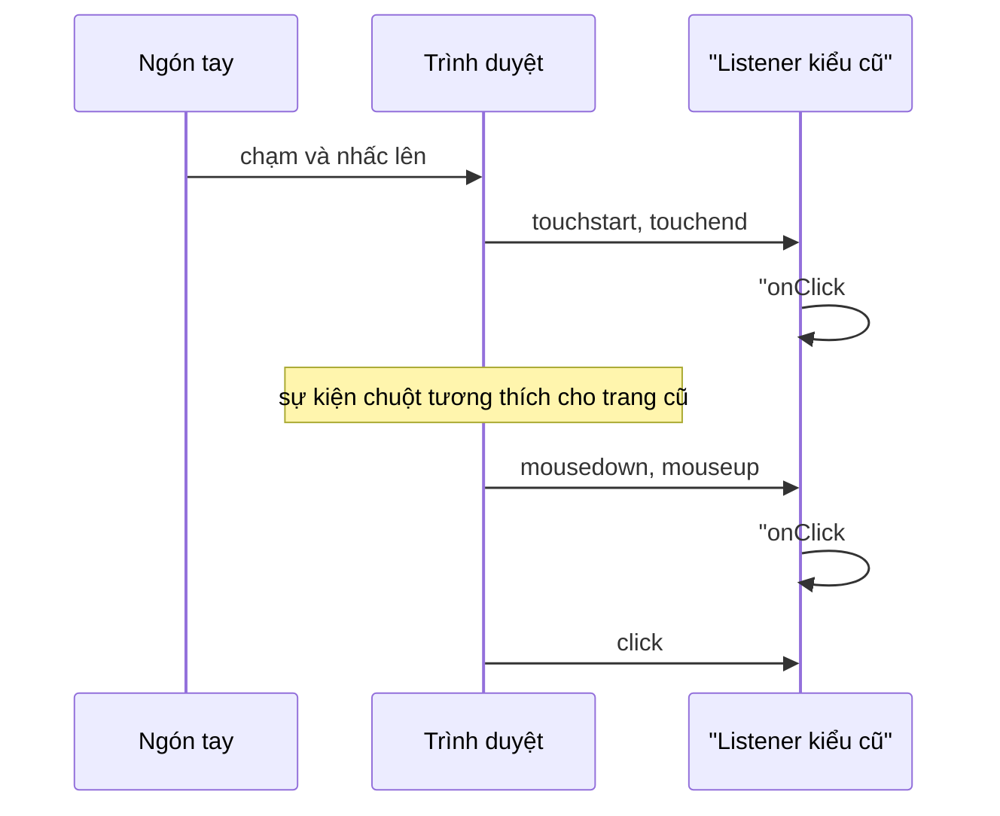

Trong Telegram Web, bạn vuốt ngang danh sách chat để chuyển giữa các thư mục, vuốt trái phải trong trình xem ảnh để sang ảnh khác, vuốt dọc để đóng ảnh, và kéo con trỏ trong bảng chọn màu nền. Tất cả phải chạy được bằng chuột trên máy tính lẫn ngón tay trên điện thoại, và phải phân biệt được ba ý định rất gần nhau:

- **Bấm** (tay hơi rung vài pixel vẫn là bấm),
- **Kéo** (đang di chuyển một thứ gì đó theo tay),
- **Vuốt** (một cú gạt theo một hướng rõ ràng).

Trình duyệt không có sự kiện "swipe". Telegram tự làm bằng một hàm khoảng 200 dòng, `captureEvents`, dùng chung cho mọi nơi. Hàm này có những con số rất đáng học, và cũng có hai lỗi kinh điển của thời "mouse + touch" mà Pointer Events đã giải quyết.

> [!TIP]
> **Tóm tắt**
> - Phân biệt bấm và kéo bằng **ngưỡng di chuyển** (Telegram: 15px). Vuốt khi đi đủ xa theo **một trục** (50px). Hai trục gần bằng nhau (tỉ lệ < 2) thì là vuốt chéo, bỏ qua.
> - **Khoá trục** khi đã xác định, để cử chỉ ngang không "trôi" thành dọc giữa chừng.
> - Nghe riêng `mousedown` và `touchstart` thì một lần chạm phát **cả hai** chuỗi sự kiện, nên `onClick` bị gọi hai lần. Pointer Events gộp chuột, cảm ứng, bút vào một chuỗi sự kiện.
> - Dùng `setPointerCapture` thay vì gắn listener lên `document`, `touch-action` thay vì `preventDefault`, và gọi `onSwipe` **một lần** cho mỗi cử chỉ.

<iframe class="demo-frame" src="/demos/web-patterns/index.html?theme=dark#/gestures" title="Demo gestures" loading="lazy" style="height: 820px"></iframe>

<p class="demo-links">▶ <a href="/demos/web-patterns/index.html#/gestures" target="_blank" rel="noopener">Mở demo toàn màn hình ↗</a> · <a href="https://stackblitz.com/github/hunghg255/blog-hunghg/tree/master/examples/web-patterns?file=src/lib/captureGestures.ts" target="_blank" rel="noopener">Sửa code trên StackBlitz ↗</a> · <a href="https://github.com/hunghg255/blog-hunghg/blob/master/examples/web-patterns/src/lib/captureGestures.ts" target="_blank" rel="noopener">Xem source trên GitHub ↗</a></p>

Kéo ngang khung ảnh để chuyển ảnh. Ở chế độ "Mouse + touch (kiểu bản gốc)", vuốt một lần bằng chuột nhảy qua nhiều ảnh, vì `onSwipe` được gọi ở mỗi lần di chuyển. Mở trang trên điện thoại (hoặc bật chế độ cảm ứng trong DevTools) và chạm một lần: bộ đếm `onClick` tăng 2.

## Telegram làm thế nào?

Code nằm ở [`web.telegram.org/src/util/captureEvents.ts`](https://github.com/hunghg255/codebase/blob/main/web.telegram.org/src/util/captureEvents.ts). Nơi dùng: trình xem ảnh (`MediaViewer.tsx`), thanh thư mục chat (`ChatFolders.tsx`), các tab trong hồ sơ (`Profile.tsx`), bảng chọn màu (`SettingsGeneralBackgroundColor.tsx`).

### Hai ngưỡng và một tỉ lệ

```ts
const MOVED_THRESHOLD = 15;
const SWIPE_THRESHOLD = 50;
```

- Di chuyển dưới **15px** theo cả hai trục: khi thả tay vẫn là **bấm** (`onClick`). Ngón tay chạm màn hình hiếm khi đứng yên tuyệt đối, ngưỡng này nuốt phần rung.
- Đi quá **50px** theo một trục: bắt đầu tính là **vuốt** theo trục đó.
- **Vuốt chéo**: nếu cả hai trục đều có độ lệch và trục dài chỉ gấp chưa tới 2 lần trục ngắn, bỏ qua lần đo này:

```ts
function onSwipe(e, dragOffsetX, dragOffsetY) {
  if (!currentSwipeAxis) {
    const xAbs = Math.abs(dragOffsetX), yAbs = Math.abs(dragOffsetY);
    if (dragOffsetX && dragOffsetY) {
      const ratio = Math.max(xAbs, yAbs) / Math.min(xAbs, yAbs);
      if (ratio < 2) return;                      // Diagonal swipe
    }
    if (xAbs >= SWIPE_THRESHOLD) currentSwipeAxis = 'x';
    else if (yAbs >= SWIPE_THRESHOLD) currentSwipeAxis = 'y';
  }
  processSwipe(e, currentSwipeAxis, dragOffsetX, dragOffsetY, options.onSwipe);
}
```

Khi đã có `currentSwipeAxis`, trục được **khoá** tới khi thả tay. Kéo ngang được 60px rồi tay trôi xuống dưới cũng không đổi thành vuốt dọc.

### Hai họ sự kiện, một hàm

```ts
element.addEventListener('mousedown', onCapture);
element.addEventListener('touchstart', onCapture, { passive: true });
```

`onCapture` gắn `mousemove`/`mouseup` hoặc `touchmove`/`touchend`/`touchcancel` **lên `document`**, để vẫn nhận được sự kiện khi chuột hay ngón tay đã ra ngoài phần tử. Vì `TouchEvent` không có `pageX`/`pageY`, Telegram tự gán từ `touches[0]` (comment dẫn một câu trả lời StackOverflow: Android không có giá trị này, iOS có nhưng chỉ đọc). Trong lúc kéo, `body` được thêm class `no-selection` (và `cursor-grabbing` nếu cần) để chữ không bị bôi đen.

### Những chỗ cần biết khi mang về

Mình viết lại logic này trong demo (file `GesturesLegacy.ts`, ghi rõ là mô phỏng) và chạy bằng Playwright với chuột lẫn cảm ứng giả lập:

1. **Chạm một lần, `onClick` chạy hai lần.** Chạm màn hình phát `touchstart` → `touchend`, rồi trình duyệt phát thêm các sự kiện chuột tương thích (`mousedown` → `mouseup` → `click`) cho các trang chỉ biết chuột. `touchstart` được gắn với `passive: true` nên không gọi được `preventDefault()` để chặn các sự kiện chuột này. Kết quả đo được: một lần chạm, log ghi `onClick (touchend)` rồi `onClick (mouseup)`. Telegram có lẽ đã biết: trình xem ảnh chỉ đóng khi bấm nếu `!IS_TOUCH_ENV`.
2. **`onSwipe` được gọi ở mọi lần di chuyển** sau khi đã khoá trục, không phải một lần. Một cú vuốt bằng chuột trong demo gọi `onSwipe` 10 lần. Code của Telegram vẫn đúng vì nơi gọi viết theo kiểu idempotent: `setActiveChatFolder(Math.min(activeChatFolder + 1, …))` với `activeChatFolder` là giá trị **cũ** bị giữ trong closure, nên gọi 10 lần vẫn chỉ tăng 1. Demo đọc giá trị mới qua ref thay vì closure, và nhảy qua 3 ảnh.
3. **`preventDefault()` trong `touchmove` có thể vô tác dụng**: listener `touchmove` gắn lên `document` mà không khai báo `passive: false`. Chrome coi listener chạm ở cấp document là passive theo mặc định, và bỏ qua `preventDefault()` trong đó. Bảng chọn màu của Telegram vẫn kéo được trên điện thoại vì CSS của nó có `touch-action: none` (`.color-picker{…touch-action:none}`). Chính CSS mới là thứ ngăn trang cuộn theo ngón tay.
4. Hàm dọn dẹp chỉ gỡ `mousedown`/`touchstart`. Nếu component unmount **giữa lúc đang kéo**, các listener trên `document` vẫn còn tới khi thả tay.

## Bên trong trình duyệt



- **Pointer Events** phát một chuỗi `pointerdown` → `pointermove` → `pointerup` cho chuột, ngón tay và bút, có `pointerType` để phân biệt và `isPrimary` để bỏ qua ngón thứ hai. Nghe `pointer*` thì không còn chuyện chạm một lần bị đếm hai lần.
- **`setPointerCapture(pointerId)`** buộc mọi sự kiện của con trỏ đó gửi về phần tử, kể cả khi con trỏ đã ra ngoài, cho tới khi thả. Không cần gắn listener lên `document`.
- **`touch-action`** cho trình duyệt biết trước cử chỉ nào nó được tự xử lý. `pan-y`: trình duyệt vẫn cuộn dọc, cử chỉ ngang để cho trang. Nếu trình duyệt bắt đầu cuộn, trang nhận `pointercancel` và không nhận thêm `pointermove` nữa.
- **`click` sau khi kéo**: nhấn và thả trên cùng một phần tử thì trình duyệt vẫn phát `click`, dù ở giữa đã kéo 200px. Carousel có link bên trong sẽ mở link sau mỗi lần kéo nếu không chặn.
- **Link và ảnh mặc định kéo được** (HTML drag and drop). Bấm giữ vào link rồi kéo sẽ bắt đầu kéo-thả của trình duyệt thay vì cử chỉ của bạn. Demo phải đặt `draggable={false}` cho link "Xem chi tiết" mới đo được hành vi click.

## Viết lại

`captureGestures(element, options)` giữ ngưỡng 15/50px và tỉ lệ 2 của Telegram, chuyển sang Pointer Events:

```ts title=src/lib/captureGestures.ts
  const onDown = (e: PointerEvent) => {
    if (!e.isPrimary || pointerId !== null) return; // bỏ ngón thứ hai, chuột phải…
    if (e.pointerType === 'mouse' && e.button !== 0) return;
    if (options.exclude && (e.target as Element).closest(options.exclude)) return;

    pointerId = e.pointerId;
    startX = e.clientX;
    startY = e.clientY;
    moved = false;
    swiped = false;
    lockedAxis = undefined;
    // mọi pointermove/pointerup sau đó đều về element này, kể cả khi con trỏ đã ra ngoài
    // (thay cho việc gắn listener lên document như bản gốc)
    element.setPointerCapture(e.pointerId);
    gesture = new AbortController();
    const signal = gesture.signal;
    element.addEventListener('pointermove', onMove, { signal });
    element.addEventListener('pointerup', onUp, { signal });
    element.addEventListener('pointercancel', onCancel, { signal });
    element.addEventListener('lostpointercapture', onCancel, { signal });
    document.body.classList.add('no-selection');
    options.onStart?.(e);
  };
```

Di chuyển: khoá trục, và chỉ gọi `onSwipe` một lần:

```ts title=src/lib/captureGestures.ts
  const onMove = (e: PointerEvent) => {
    if (e.pointerId !== pointerId) return;
    const dx = e.clientX - startX;
    const dy = e.clientY - startY;
    if (!moved && (Math.abs(dx) >= movedThreshold || Math.abs(dy) >= movedThreshold)) moved = true;
    lockedAxis ??= decideAxis(dx, dy);
    options.onDrag?.(e, { dx, dy, axis: lockedAxis });

    if (swiped || !lockedAxis || !options.onSwipe) return;
    if (allowed !== 'both' && lockedAxis !== allowed) return;
    const offset = lockedAxis === 'x' ? dx : dy;
    if (Math.abs(offset) < swipeThreshold) return;
    swiped = true;
    options.onSwipe(lockedAxis === 'x' ? (offset < 0 ? 'left' : 'right') : offset < 0 ? 'up' : 'down', e);
  };
```

Thả tay: chặn đúng một `click` nếu vừa kéo:

```ts title=src/lib/captureGestures.ts
  const onUp = (e: PointerEvent) => {
    if (e.pointerId !== pointerId) return;
    const info = { dx: e.clientX - startX, dy: e.clientY - startY, axis: lockedAxis };
    const wasMoved = moved;
    end();
    if (wasMoved) {
      options.onRelease?.(e, info);
      // trình duyệt vẫn phát `click` sau khi kéo nếu nhấn và thả trên cùng phần tử:
      // chặn đúng một click đó để link/nút bên trong không bị kích hoạt nhầm
      const swallow = (click: MouseEvent) => {
        click.preventDefault();
        click.stopPropagation();
      };
      element.addEventListener('click', swallow, { capture: true, once: true });
      setTimeout(() => element.removeEventListener('click', swallow, { capture: true }), 0);
    } else {
      options.onClick?.(e);
    }
  };
```

## Đi qua code

1. **`touch-action` theo trục**: `axis: 'x'` đặt `pan-y`, trang vẫn cuộn dọc bình thường; `'both'` đặt `none`. Giá trị cũ được trả lại khi huỷ.
2. **Chỉ nhận con trỏ chính**, nút chuột trái, và một cử chỉ tại một thời điểm (`pointerId !== null` thì bỏ qua).
3. **`setPointerCapture`** rồi gắn `pointermove`/`pointerup`/`pointercancel`/`lostpointercapture` lên chính phần tử, qua một `AbortController`. Kết thúc cử chỉ chỉ cần `abort()`.
4. **Khoá trục ở 15px** thay vì 50px như Telegram: `onDrag` biết sớm cử chỉ là ngang hay dọc (demo dùng để không kéo ảnh khi tay đang cuộn dọc). `onSwipe` vẫn đợi đủ 50px theo trục đã khoá.
5. **`swiped`** đảm bảo `onSwipe` chạy một lần mỗi cử chỉ, nên nơi gọi không phải viết kiểu idempotent.
6. **`pointercancel` và `lostpointercapture`** kết thúc cử chỉ mà không gọi `onClick`: trình duyệt đã giành cử chỉ (cuộn, zoom) thì không coi là bấm.
7. **Chặn `click` sau khi kéo** bằng một listener capture chỉ chạy một lần, tự gỡ ở tick sau.
8. **Huỷ giữa chừng**: hàm dọn dẹp gọi `end()`, nên unmount lúc đang kéo cũng gỡ hết listener.

**Khác bản gốc:** Pointer Events thay cho mouse + touch; capture thay cho listener trên `document`; `touch-action` thay cho `preventDefault`; khoá trục sớm hơn; `onSwipe` một lần; chặn `click` sau khi kéo; thêm `pointercancel`. Giữ nguyên ngưỡng 15px, 50px và tỉ lệ chéo 2.

::: spoiler Xem toàn bộ src/lib/captureGestures.ts

```ts title=src/lib/captureGestures.ts
/**
 * Kéo, vuốt, bấm dùng chung cho chuột, cảm ứng và bút (ý tưởng từ util/captureEvents.ts của
 * Telegram Web), viết lại bằng Pointer Events + setPointerCapture:
 * - phân biệt bấm và kéo bằng ngưỡng di chuyển (Telegram: 15px),
 * - vuốt khi đi đủ xa theo một trục (Telegram: 50px), bỏ qua vuốt chéo (tỉ lệ 2 trục < 2),
 * - khoá trục sau khi đã xác định để cử chỉ không "trôi" sang trục kia.
 */

export type SwipeDirection = 'left' | 'right' | 'up' | 'down';
export type Axis = 'x' | 'y';

export interface DragInfo {
  dx: number;
  dy: number;
  /** trục đã khoá (undefined khi chưa đủ xa hoặc đang đi chéo) */
  axis?: Axis;
}

export interface GestureOptions {
  /** trục được phép vuốt. 'x': trình duyệt vẫn tự cuộn dọc (touch-action: pan-y) */
  axis?: Axis | 'both';
  /** di chuyển ít hơn chừng này px thì vẫn tính là bấm */
  movedThreshold?: number;
  /** đi xa chừng này px theo trục đã khoá thì tính là vuốt */
  swipeThreshold?: number;
  /** trục dài phải gấp ít nhất chừng này lần trục ngắn, nếu không coi là vuốt chéo */
  diagonalRatio?: number;
  /** bỏ qua cử chỉ bắt đầu trong các phần tử khớp selector (nút, thanh điều khiển…) */
  exclude?: string;
  onStart?: (e: PointerEvent) => void;
  onDrag?: (e: PointerEvent, info: DragInfo) => void;
  /** gọi MỘT lần cho mỗi cử chỉ (bản Telegram gọi lại ở mỗi lần di chuyển) */
  onSwipe?: (direction: SwipeDirection, e: PointerEvent) => void;
  /** thả tay sau khi đã kéo */
  onRelease?: (e: PointerEvent, info: DragInfo) => void;
  /** bấm (không kéo) bằng nút chính */
  onClick?: (e: PointerEvent) => void;
}

export function captureGestures(element: HTMLElement, options: GestureOptions): () => void {
  const { axis: allowed = 'both', movedThreshold = 15, swipeThreshold = 50, diagonalRatio = 2 } = options;

  // Không có touch-action thì trên màn cảm ứng trình duyệt sẽ giành cử chỉ để cuộn/zoom và
  // phát pointercancel giữa chừng. Chỉ nhường lại trục mà ta KHÔNG xử lý.
  const previousTouchAction = element.style.touchAction;
  element.style.touchAction = allowed === 'x' ? 'pan-y' : allowed === 'y' ? 'pan-x' : 'none';

  let pointerId: number | null = null;
  let startX = 0;
  let startY = 0;
  let moved = false;
  let lockedAxis: Axis | undefined;
  let swiped = false;
  let gesture: AbortController | null = null;

  const end = () => {
    gesture?.abort(); // gỡ hết listener của cử chỉ hiện tại trong một lần
    gesture = null;
    pointerId = null;
    document.body.classList.remove('no-selection');
  };

  const decideAxis = (dx: number, dy: number): Axis | undefined => {
    const ax = Math.abs(dx);
    const ay = Math.abs(dy);
    if (ax && ay && Math.max(ax, ay) / Math.min(ax, ay) < diagonalRatio) return undefined; // vuốt chéo
    if (ax >= movedThreshold && ax > ay) return 'x';
    if (ay >= movedThreshold && ay > ax) return 'y';
    return undefined;
  };

  const onMove = (e: PointerEvent) => {
    if (e.pointerId !== pointerId) return;
    const dx = e.clientX - startX;
    const dy = e.clientY - startY;
    if (!moved && (Math.abs(dx) >= movedThreshold || Math.abs(dy) >= movedThreshold)) moved = true;
    lockedAxis ??= decideAxis(dx, dy);
    options.onDrag?.(e, { dx, dy, axis: lockedAxis });

    if (swiped || !lockedAxis || !options.onSwipe) return;
    if (allowed !== 'both' && lockedAxis !== allowed) return;
    const offset = lockedAxis === 'x' ? dx : dy;
    if (Math.abs(offset) < swipeThreshold) return;
    swiped = true;
    options.onSwipe(lockedAxis === 'x' ? (offset < 0 ? 'left' : 'right') : offset < 0 ? 'up' : 'down', e);
  };

  const onUp = (e: PointerEvent) => {
    if (e.pointerId !== pointerId) return;
    const info = { dx: e.clientX - startX, dy: e.clientY - startY, axis: lockedAxis };
    const wasMoved = moved;
    end();
    if (wasMoved) {
      options.onRelease?.(e, info);
      // trình duyệt vẫn phát `click` sau khi kéo nếu nhấn và thả trên cùng phần tử:
      // chặn đúng một click đó để link/nút bên trong không bị kích hoạt nhầm
      const swallow = (click: MouseEvent) => {
        click.preventDefault();
        click.stopPropagation();
      };
      element.addEventListener('click', swallow, { capture: true, once: true });
      setTimeout(() => element.removeEventListener('click', swallow, { capture: true }), 0);
    } else {
      options.onClick?.(e);
    }
  };

  const onCancel = (e: PointerEvent) => {
    // trình duyệt giành cử chỉ (cuộn trang, zoom) hoặc mất capture: huỷ, không coi là bấm
    if (e.pointerId === pointerId) end();
  };

  const onDown = (e: PointerEvent) => {
    if (!e.isPrimary || pointerId !== null) return; // bỏ ngón thứ hai, chuột phải…
    if (e.pointerType === 'mouse' && e.button !== 0) return;
    if (options.exclude && (e.target as Element).closest(options.exclude)) return;

    pointerId = e.pointerId;
    startX = e.clientX;
    startY = e.clientY;
    moved = false;
    swiped = false;
    lockedAxis = undefined;
    // mọi pointermove/pointerup sau đó đều về element này, kể cả khi con trỏ đã ra ngoài
    // (thay cho việc gắn listener lên document như bản gốc)
    element.setPointerCapture(e.pointerId);
    gesture = new AbortController();
    const signal = gesture.signal;
    element.addEventListener('pointermove', onMove, { signal });
    element.addEventListener('pointerup', onUp, { signal });
    element.addEventListener('pointercancel', onCancel, { signal });
    element.addEventListener('lostpointercapture', onCancel, { signal });
    document.body.classList.add('no-selection');
    options.onStart?.(e);
  };

  element.addEventListener('pointerdown', onDown);
  return () => {
    element.removeEventListener('pointerdown', onDown);
    end(); // khác bản gốc: huỷ luôn cử chỉ đang dở khi component unmount
    element.style.touchAction = previousTouchAction;
  };
}
```

:::

## Tại sao không làm cách khác?

**Nghe cả `touch*` lẫn `mouse*` nhưng gọi `preventDefault()` trong `touchend` để chặn sự kiện chuột tương thích?** Làm được nếu listener không passive, nhưng nó cũng chặn luôn `click` thật và focus của phần tử bên dưới, và bạn vẫn phải duy trì hai đường xử lý.

**Dùng thư viện cử chỉ (Hammer.js, @use-gesture)?** Hợp lý khi cần pinch, xoay, quán tính. Với kéo và vuốt một trục như ở đây, 140 dòng là đủ và không thêm phụ thuộc.

**Tính vuốt theo vận tốc thay vì quãng đường?** Cú gạt nhanh 30px cũng là vuốt trên điện thoại thật. Có thể thêm: đo thời gian từ `pointerdown`, nếu vận tốc lúc thả lớn hơn khoảng 0.5px/ms thì tính là vuốt. Telegram chỉ dùng quãng đường.

## Edge case và cạm bẫy

- **Cuộn trang bị chặn**: `touch-action: none` trên một khung lớn làm người dùng không cuộn được trang khi đặt tay vào đó. Chỉ chặn trục bạn thật sự xử lý.
- **Hai ngón tay**: `isPrimary` loại ngón thứ hai, nhưng pinch-zoom của trình duyệt vẫn có thể bắt đầu và phát `pointercancel` cho ngón thứ nhất. Xử lý `pointercancel` như một lần huỷ.
- **Phần tử con có nút bấm**: dùng `exclude` (Telegram: `excludedClosestSelector`) để cử chỉ không bắt đầu từ thanh điều khiển, nút đóng…
- **Chữ bị bôi đen khi kéo**: thêm `user-select: none` lúc kéo (class `no-selection` như Telegram).
- **Safari trên iOS** đã hỗ trợ Pointer Events từ lâu, nhưng thao tác vuốt từ mép màn hình là cử chỉ quay lại của hệ điều hành. Đừng đặt vùng vuốt sát mép trái nếu không muốn tranh chấp.
- **Click sau khi kéo trên link**: ngoài việc chặn `click`, nhớ `draggable="false"` cho link và ảnh trong vùng kéo.

## Dùng trong dự án

```tsx
useEffect(
  () =>
    captureGestures(trackRef.current!, {
      axis: 'x',
      exclude: 'button, [data-no-swipe]',
      onDrag: (_, { dx, axis }) => setOffset(axis === 'x' ? dx : 0),
      onSwipe: (dir) => setIndex((i) => (dir === 'left' ? Math.min(i + 1, last) : Math.max(i - 1, 0))),
      onRelease: () => setOffset(0),
      onClick: () => openLightbox(),
    }),
  [last],
);
```

::: spoiler Ví dụ test (bản phác, không có trong repo)

```ts
import { describe, expect, it, vi } from 'vitest';
import { captureGestures } from './captureGestures';

// jsdom chưa có PointerEvent/setPointerCapture: tự tạo sự kiện tối thiểu
function pointer(type: string, x: number, y: number) {
  const e = new MouseEvent(type, { clientX: x, clientY: y, button: 0, bubbles: true });
  Object.assign(e, { pointerId: 1, isPrimary: true, pointerType: 'touch' });
  return e;
}

function setup(options: Parameters<typeof captureGestures>[1]) {
  const el = document.createElement('div');
  el.setPointerCapture = vi.fn();
  document.body.append(el);
  captureGestures(el, options);
  return el;
}

describe('captureGestures', () => {
  it('chạm không di chuyển là bấm, gọi onClick đúng một lần', () => {
    const onClick = vi.fn();
    const el = setup({ onClick });
    el.dispatchEvent(pointer('pointerdown', 10, 10));
    el.dispatchEvent(pointer('pointerup', 14, 12));
    expect(onClick).toHaveBeenCalledTimes(1);
  });

  it('vuốt ngang gọi onSwipe một lần dù di chuyển nhiều lần', () => {
    const onSwipe = vi.fn();
    const el = setup({ onSwipe, axis: 'x' });
    el.dispatchEvent(pointer('pointerdown', 200, 10));
    for (let x = 190; x >= 60; x -= 10) el.dispatchEvent(pointer('pointermove', x, 12));
    el.dispatchEvent(pointer('pointerup', 60, 12));
    expect(onSwipe).toHaveBeenCalledTimes(1);
    expect(onSwipe.mock.calls[0][0]).toBe('left');
  });

  it('bỏ qua vuốt chéo', () => {
    const onSwipe = vi.fn();
    const el = setup({ onSwipe });
    el.dispatchEvent(pointer('pointerdown', 0, 0));
    for (let d = 10; d <= 100; d += 10) el.dispatchEvent(pointer('pointermove', d, d));
    expect(onSwipe).not.toHaveBeenCalled();
  });

  it('pointercancel không gọi onClick', () => {
    const onClick = vi.fn();
    const el = setup({ onClick });
    el.dispatchEvent(pointer('pointerdown', 10, 10));
    el.dispatchEvent(pointer('pointercancel', 10, 10));
    el.dispatchEvent(pointer('pointerup', 10, 10));
    expect(onClick).not.toHaveBeenCalled();
  });
});
```

:::

## So với thư viện và chuẩn web

- **Pointer Events** có trên mọi trình duyệt lớn (tính tới 10/2026). Đây là lựa chọn mặc định cho cử chỉ mới; `touch*` chỉ cần khi bạn cần dữ liệu riêng của Touch Events như `touches` với nhiều điểm chạm.
- **@use-gesture/react** cung cấp `useDrag` với `swipe` (theo vận tốc và quãng đường), `axis` để khoá trục, `filterTaps` để phân biệt bấm. Các khái niệm trùng gần hết với Telegram.
- **CSS scroll snap** (`scroll-snap-type: x mandatory`) làm carousel vuốt được mà **không cần JavaScript**, kèm quán tính tự nhiên của hệ điều hành. Nếu chỉ cần vuốt qua lại giữa các trang, hãy thử cách này trước.

---

Bài này thuộc series **[Học từ mã nguồn các web lớn](/series/web)** (65 bài, đọc theo thứ tự).

::: spoiler Xem nhanh danh sách bài trong series

*Mở đầu*

- [Mở đầu: đọc code production của 28 trang web](/blogs/learn-from-big-web-apps)

*Phần 1: trải nghiệm người dùng*

- [#1 Dark mode không nháy (Gatsby)](/blogs/web-dark-mode-no-flash)
- [#2 useValueByMedia: giá trị theo breakpoint (Toptal)](/blogs/web-use-value-by-media)
- [#3 Đoán ý định: idle, exit-intent, lắc chuột (Toptal, InVision)](/blogs/web-user-intent-idle-exit-wiggle)
- [#4 Validate form thân thiện (Udacity, Pipedrive)](/blogs/web-form-validation-ux)
- [#5 Magic number, EXIF và dán ảnh (Ello)](/blogs/web-file-magic-number-exif-paste)
- [#6 fastSmoothScroll: cuộn xa vẫn nhanh (Telegram)](/blogs/web-telegram-fast-smooth-scroll)
- [#7 Countdown time-travel và tombstone giỏ hàng (Best Buy)](/blogs/web-countdown-time-travel-tombstone)

*Phần 2: hiệu năng và đo lường*

- [#8 Hàng đợi requestAnimationFrame 3ms (Apple)](/blogs/web-raf-queue-3ms)
- [#9 srcset cho artwork và preconnect tự động (Apple)](/blogs/web-responsive-artwork-preconnect)
- [#10 Quick-fetch: gọi API trước khi bundle tải xong (HubSpot)](/blogs/web-quick-fetch-early-requests)
- [#11 Performance span và long task (Postman, Calibre)](/blogs/web-performance-spans-long-tasks)
- [#12 Gọi Web Worker như hàm async (Telegram)](/blogs/web-worker-promise-rpc)
- [#13 Đồng hồ media: đếm giờ xem và sửa lệch (Skillshare, Simplified)](/blogs/web-media-clock-watch-time-drift)

*Phần 3: nhiều tab, phiên đăng nhập, cập nhật*

- [#14 Bầu tab chủ cho thông báo (HubSpot, Telegram)](/blogs/web-leader-tab-notifications)
- [#15 Đồng bộ đăng nhập giữa tab và giới hạn cookie (Elastic, InVision)](/blogs/web-cross-tab-auth-cookie-guard)
- [#16 SPA tự cập nhật: Trello, Zappos, Facebook, Elastic](/blogs/web-spa-self-update-strategies)

*Phần 4: kiến trúc*

- [#17 Reverse portal: di chuyển component không remount (Zappos)](/blogs/web-reverse-portal)
- [#18 Page behaviors: gắn hành vi từ CMS (Intercom)](/blogs/web-page-behaviors-cms)
- [#19 Giới hạn tần suất hiển thị bằng bitmask (Outlook)](/blogs/web-frequency-cap-bitmask)
- [#20 Chuyển REST sang GraphQL dần dần (Coursera)](/blogs/web-rest-to-graphql-hybrid-link)

*Phần 5: soạn thảo và hiển thị nội dung*

- [#21 Autocomplete tại con trỏ trong contenteditable (Ello, Telegram)](/blogs/web-caret-autocomplete-contenteditable)
- [#22 Dark mode cho email HTML bằng CIELAB (Outlook)](/blogs/web-email-dark-mode-cielab)
- [#23 Thu nhỏ bảng rộng cho vừa khung, vá font emoji (Outlook)](/blogs/web-email-wide-content-scale)
- [#24 Cảnh báo quên đính kèm file (Outlook)](/blogs/web-forgotten-attachment-warning)
- [#25 Cắt chữ nhiều dòng chính xác (Pipedrive, Apple, Toptal)](/blogs/web-multiline-truncate-measure-text)
- [#26 Parse ngày giờ gõ tay khoan dung (Outlook, Elastic)](/blogs/web-lenient-date-parser)

*Phần 6: tương tác*

- [#27 menuAim: rê chéo vào submenu không bị đóng (Udemy)](/blogs/web-menu-aim-triangle)
- **#28 Kéo, vuốt chung cho chuột và cảm ứng (Telegram)** (bài này)
- [#29 Phím tắt theo phạm vi, IME và bàn phím phi Latinh (Trello)](/blogs/web-scoped-keyboard-shortcuts)
- [#30 Nội suy màu: đổi theme và nền theo cuộn (Telegram, Anchor)](/blogs/web-color-interpolation-theme-scroll)
- [#31 Đường gióng hút cạnh và undo/redo trên canvas (Simplified)](/blogs/web-canvas-snap-guides-undo)
- [#32 Giả lập mù màu bằng feColorMatrix (Trello)](/blogs/web-color-vision-simulator)
- [#33 Vạch thước theo mức zoom và cấp phát màu cho biểu đồ (Anchor, Similarweb)](/blogs/web-timeline-ticks-color-stack)

*Phần 7: mạng, dữ liệu và async*

- [#34 Ô tìm kiếm chuẩn production (Similarweb, Udemy, Pipedrive)](/blogs/web-production-search-box)
- [#35 Điều phối async: latest-wins, single-flight (Glitch, Toptal)](/blogs/web-async-coordination-latest-wins)
- [#36 Polling thưa dần và debounce động (Trello)](/blogs/web-decaying-polling-dynamic-debounce)
- [#37 Cache phía client theo version (Similarweb, Telegram, Udemy)](/blogs/web-client-cache-versioned)
- [#38 Upload file lớn theo chunk (Outlook, Tribe)](/blogs/web-chunked-upload-pipeline)
- [#39 Phát video qua Service Worker bằng Range request (Telegram, Outlook)](/blogs/web-service-worker-range-streaming)

*Phần 8: hiệu năng và vận hành*

- [#40 TTI governor: hoãn việc phụ tới sau khi trang dùng được (Outlook)](/blogs/web-tti-governor)
- [#41 Tự đo LCP/CLS/TBT và phục vụ bản nhẹ cho máy yếu (Udemy)](/blogs/web-rum-adaptive-loading)

*Phần 9: thuật toán và dữ liệu phía client*

- [#42 Three-way merge ngay trên trình duyệt (Postman)](/blogs/web-three-way-merge-client)
- [#43 Dọn cache GraphQL bằng đếm tham chiếu (Outlook)](/blogs/web-graphql-cache-refcount-gc)
- [#44 LRU cache theo 3 cách (Apple, Similarweb, Outlook)](/blogs/web-lru-cache-three-ways)
- [#45 Lọc tăng dần trong Web Worker (Similarweb)](/blogs/web-incremental-filter-worker)
- [#46 Xếp hạng gợi ý trên client, so ngầm với server (Outlook)](/blogs/web-client-side-ranking-shadow-test)
- [#47 Nối OT với editor: undo stack và chặn echo (Glitch)](/blogs/web-ot-codemirror-undo)
- [#48 Ngôn ngữ markup riêng dịch hai chiều với HTML (Coursera)](/blogs/web-custom-markup-compiler)

*Phần 10: thời gian, ngôn ngữ, định dạng*

- [#49 Xử lý giờ mùa hè không cần thư viện (Udemy, Pipedrive)](/blogs/web-dst-without-library)
- [#50 Intl thực chiến: Segmenter, số rút gọn, số nhiều, fallback locale (Apple, Outlook)](/blogs/web-intl-in-production)
- [#51 WebVTT và bôi chọn transcript (Udemy, Coursera)](/blogs/web-webvtt-transcript-selection)

*Phần 11: tương tác và giao diện*

- [#52 Kéo-thả trên lịch (Pipedrive)](/blogs/web-calendar-drag-drop)
- [#53 Focus stack cho popup lồng nhau (Outlook)](/blogs/web-focus-stack-nested-popups)
- [#54 Clipboard: copy, dán chữ thuần, dán thông minh (Trello, Anchor, Pipedrive, Tribe)](/blogs/web-clipboard-tricks)
- [#55 Khôi phục vị trí cuộn khi trang còn đang tải (Apple, Zappos)](/blogs/web-scroll-restore-wait-height)
- [#56 Lấy màu từ ảnh: gradient nền, màu chữ (Apple, Telegram, Trello)](/blogs/web-colors-from-images)
- [#57 JS đọc breakpoint từ CSS, phát hiện chế độ PWA (Ello, Apple)](/blogs/web-css-js-breakpoint-bridge)

*Phần 12: media*

- [#58 Tin nhắn thoại: ghi âm, waveform realtime, nén 5-bit (Telegram)](/blogs/web-voice-message-waveform)
- [#59 Chụp frame video thành ảnh, canvas bị taint (Coursera, Outlook)](/blogs/web-video-frame-snapshot)

*Phần 13: đo lường, bảo mật, vận hành*

- [#60 Đo lúc ảnh màn hình đầu tải xong, cả khi chuyển trang SPA (Zappos, Best Buy, Outlook)](/blogs/web-above-the-fold-image-timing)
- [#61 Buffer analytics chờ SDK, phát hiện adblock (Best Buy)](/blogs/web-analytics-buffer-adblock)
- [#62 Proof-of-work trên client để chặn API ẩn danh (Udemy)](/blogs/web-client-proof-of-work)
- [#63 Prefetch không làm lệch số liệu, nén cài đặt bằng bit (Outlook)](/blogs/web-synthetic-prefetch-bit-flags)
- [#64 Micro-frontend: AngularJS và React chung app, giao tiếp xuyên frame (Similarweb, InVision, HubSpot)](/blogs/web-micro-frontend-bridges)

:::

Code + demo: [`examples/web-patterns`](https://github.com/hunghg255/blog-hunghg/tree/master/examples/web-patterns) · [Mở trên StackBlitz](https://stackblitz.com/github/hunghg255/blog-hunghg/tree/master/examples/web-patterns)
