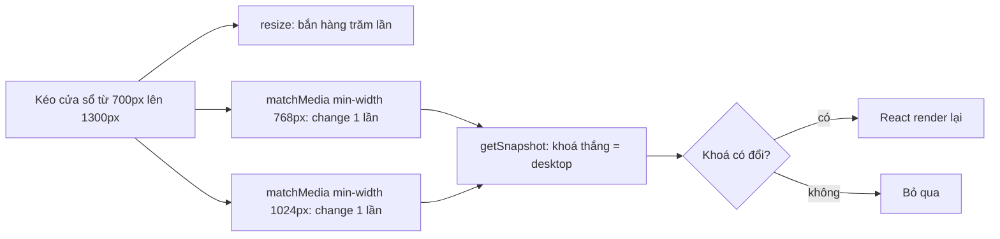

CSS lo được phần lớn việc responsive. Nhưng có những thứ CSS không quyết định được: carousel hiện **mấy thẻ mỗi trang**, danh sách lấy **bao nhiêu item** từ API, có **mount** component nặng trên mobile hay không, slider có tự chạy không. Những giá trị đó nằm trong JavaScript, và chúng cũng cần đổi theo kích thước màn hình.

Cách hay gặp nhất là đọc `window.innerWidth` rồi nghe `resize`. Cách đó render lại liên tục khi kéo cửa sổ, dễ lệch với breakpoint trong CSS, và vỡ khi render trên server (không có `window`).

> [!TIP]
> **Tóm tắt**
> - Toptal viết `useValueByMedia({ default: 1, forTablet: 2, forDesktop: 3 })`: query khớp **cuối cùng** thắng, giống CSS mobile-first, nên không cần viết dải `min-width … and max-width …`.
> - Dùng `matchMedia` thay cho `resize`: trình duyệt chỉ báo khi **vượt qua** breakpoint, không báo mỗi pixel.
> - Bản gốc gỡ rồi gắn lại listener sau **mỗi lần render** và trễ 50ms ở lần đầu. Bản viết lại dùng `useSyncExternalStore`: đồng bộ, dùng chung `MediaQueryList`, có giá trị riêng cho server.
> - Nếu chỉ cần đổi bố cục, hãy dùng CSS (media query, container query) trước.

<iframe class="demo-frame" src="/demos/web-patterns/index.html?theme=dark#/value-by-media" title="Demo value-by-media" loading="lazy" style="height: 620px"></iframe>

<p class="demo-links">▶ <a href="/demos/web-patterns/index.html#/value-by-media" target="_blank" rel="noopener">Mở demo toàn màn hình ↗</a> · <a href="https://stackblitz.com/github/hunghg255/blog-hunghg/tree/master/examples/web-patterns?file=src/lib/useValueByMedia.ts" target="_blank" rel="noopener">Sửa code trên StackBlitz ↗</a> · <a href="https://github.com/hunghg255/blog-hunghg/blob/master/examples/web-patterns/src/lib/useValueByMedia.ts" target="_blank" rel="noopener">Xem source trên GitHub ↗</a></p>

## Toptal làm thế nào?

Hook nằm ở `toptal.com-home/lib/hooks/use-value-by-media.js`, breakpoint lấy từ `lib/query-range.js`. Nó được dùng ở nhiều chỗ trên trang chủ: `Trustbar` chọn số logo mỗi nhóm, `TalentSlider` chỉ bật slider trên desktop, `use-match-heights` chỉ cân chiều cao các cột trên desktop.

```js
// components/Trustbar/index.js
const chunkSize = useValueByMedia({
  default: ChunkSize.Mobile,
  forTablet: ChunkSize.Tablet,
  forDesktop: ChunkSize.Desktop,
  forDesktopLarge: ChunkSize.DesktopLarge
})
```

### Ngữ nghĩa mobile-first

Comment trong file giải thích rõ ý đồ:

```js
/*
  - 0 if nothing matches
  - 1 if forTablet matches
  - 2 if either forDesktop or both forDesktop and forTablet matches - forDesktop
     overrides forTablet and there is no need to do `(min-width: ${Breakpoints.TABLET})
     and (max-width: calc(${Breakpoints.DESKTOP} - 1px))`
  We want these queries to behave similarly to CSS, where we usually start with mobile
  and gradually specialize CSS props as the screen grows
*/
```

`queryRange(Breakpoints.TABLET)` sinh ra `(min-width: 768px)` (con số thật lấy từ config). Ở màn hình 1200px thì cả `forTablet` lẫn `forDesktop` đều khớp, và hook lấy cái **khai báo sau cùng**. Đó chính là cách CSS hoạt động: rule viết sau đè rule viết trước. Người viết component nghĩ đúng như khi viết CSS, không phải tính các dải không chồng nhau.

Ngoài các tên có sẵn (`forTablet`, `forDesktop`, `forDesktopLarge`), khoá có thể là một media query bất kỳ: `parseQueries` đổi tên quen thuộc thành query, còn lại giữ nguyên.

### Giá trị ban đầu và SSR

```js
const [value, setValue] = useState(fallbackValue)
```

Trên server không có `matchMedia`, nên lần render đầu (cả trên server lẫn lúc hydrate) dùng `fallbackValue`, mặc định bằng `default`. Sau khi mount, effect tính giá trị thật rồi `setValue`.

### Những chỗ lãng phí

Đọc kỹ thì hook có ba điểm đáng sửa:

1. **Gắn lại listener sau mỗi render.** `valuesByQuery` và `queries` được tạo mới mỗi lần render, mà chúng nằm trong dependency của `handleMediaChange` và của effect. Kết quả: mỗi lần component render lại (vì bất kỳ lý do gì), effect gỡ toàn bộ listener rồi gắn lại. Giá trị vẫn đúng, chỉ tốn công. Trong demo, bấm "Render lại" và xem số "lần gắn listener (kiểu cũ)" tăng 3 mỗi lần.
2. **Trễ 50ms ở lần đầu.** `setValue` được bọc `debounce(…, 50)`. Kể cả trong app chỉ chạy ở client, component luôn render một lần với giá trị `default`, 50ms sau mới đổi: bố cục mobile nháy lên rồi mới thành bố cục desktop. Debounce cũng là lý do cần `useIsMounted` để tránh `setValue` sau khi unmount.
3. **API cũ.** `mediaQueryList.addListener` / `removeListener` đã bị thay bằng `addEventListener('change', …)`. Có lẽ Toptal giữ API cũ vì từng hỗ trợ Safari dưới 14 (trang này còn có `use-is-ie11.js`).

Không điểm nào là lỗi hiển thị. Nhưng hook kiểu này được gọi ở hàng chục component, và chi phí nhân lên theo.

## Bên trong trình duyệt: matchMedia khác resize thế nào?



`window.matchMedia(query)` trả về một `MediaQueryList`. Thuộc tính `matches` luôn phản ánh trạng thái hiện tại, và sự kiện `change` chỉ bắn khi kết quả **đổi từ đúng sang sai hoặc ngược lại**. Kéo cửa sổ qua 600 pixel chỉ sinh ra đúng số lần vượt breakpoint, thay vì hàng trăm sự kiện `resize`.

Media query cũng dùng **cùng cách tính** với CSS: `min-width` tính theo bề rộng viewport gồm cả thanh cuộn, `em` trong media query tính theo cỡ chữ mặc định của trình duyệt (không theo `font-size` của `html`). Tự đo trong JavaScript thì dễ lệch: `document.documentElement.clientWidth` không gồm thanh cuộn, còn breakpoint viết bằng `em` phải tự quy đổi. Lệch vài pixel đúng ở điểm breakpoint là đủ để bố cục CSS và logic JS "không cùng ý kiến". Dùng chính media query trong JavaScript thì hai bên luôn khớp.

## Viết lại

Ý tưởng chính: coi tập media query như một **store bên ngoài React** và đọc nó bằng `useSyncExternalStore`. Hook này được thiết kế cho đúng việc đó: đọc đồng bộ khi render, đăng ký nghe thay đổi, và có `getServerSnapshot` cho server.

```ts title=src/lib/useValueByMedia.ts
const SERVER = '\0server'; // khoá giả cho lần render trên server / lúc hydrate

/** Trả về KHOÁ đang thắng ('default' nếu không query nào khớp). */
export function matchMediaKey(keys: readonly string[]): string {
  let winner = 'default';
  for (const key of keys) {
    if (getMedia(toQuery(key)).matches) winner = key;
  }
  return winner;
}

export function subscribeMedia(keys: readonly string[], onChange: () => void) {
  const lists = keys.map((key) => getMedia(toQuery(key)));
  lists.forEach((list) => list.addEventListener('change', onChange));
  return () => lists.forEach((list) => list.removeEventListener('change', onChange));
}

export function useValueByMedia<T>(values: ValuesByMedia<T>, serverValue: T = values.default): T {
  const keys = Object.keys(values).filter((key) => key !== 'default');
  // Chuỗi ổn định giữa các lần render dù `values` là object mới mỗi lần: dùng làm dependency
  const signature = keys.join('|');

  const subscribe = useCallback(
    (onChange: () => void) => subscribeMedia(signature ? signature.split('|') : [], onChange),
    [signature],
  );
  // Snapshot là TÊN khoá (chuỗi), không phải giá trị: giá trị có thể là object/JSX tạo mới
  // mỗi lần render, nếu trả thẳng thì useSyncExternalStore tưởng store đổi liên tục.
  const getSnapshot = () => matchMediaKey(keys);
  const key = useSyncExternalStore(subscribe, getSnapshot, () => SERVER);

  if (key === SERVER) return serverValue;
  return (values as Record<string, T>)[key];
}
```

::: spoiler Xem toàn bộ src/lib/useValueByMedia.ts

```ts title=src/lib/useValueByMedia.ts
import { useCallback, useSyncExternalStore } from 'react';

/**
 * Chọn một giá trị JS theo kích thước màn hình, viết theo kiểu mobile-first giống CSS
 * (ý tưởng từ useValueByMedia của toptal.com):
 *
 *   const columns = useValueByMedia({ default: 1, tablet: 2, desktop: 3 });
 *
 * - `default` dùng khi không query nào khớp (và khi render trên server).
 * - Các query được xét theo THỨ TỰ KHAI BÁO; query khớp cuối cùng thắng, giống CSS viết
 *   sau đè CSS viết trước. Nhờ vậy không cần viết `(min-width: 768px) and (max-width: 1023px)`.
 */

export const BREAKPOINTS = {
  tablet: '(min-width: 768px)',
  desktop: '(min-width: 1024px)',
  wide: '(min-width: 1440px)',
} as const;

type BreakpointName = keyof typeof BREAKPOINTS;

/** Khoá là tên breakpoint có sẵn hoặc một media query bất kỳ, vd '(orientation: portrait)'. */
export type ValuesByMedia<T> = { default: T } & Partial<Record<BreakpointName | (string & {}), T>>;

const toQuery = (key: string) => (Object.hasOwn(BREAKPOINTS, key) ? BREAKPOINTS[key as BreakpointName] : key);

// Dùng chung một MediaQueryList cho mỗi query: 50 component cùng hỏi '(min-width: 768px)'
// thì trình duyệt chỉ phải theo dõi 1 query.
const mediaCache = new Map<string, MediaQueryList>();
function getMedia(query: string) {
  let media = mediaCache.get(query);
  if (!media) {
    media = window.matchMedia(query);
    mediaCache.set(query, media);
  }
  return media;
}

const SERVER = '\0server'; // khoá giả cho lần render trên server / lúc hydrate

/** Trả về KHOÁ đang thắng ('default' nếu không query nào khớp). */
export function matchMediaKey(keys: readonly string[]): string {
  let winner = 'default';
  for (const key of keys) {
    if (getMedia(toQuery(key)).matches) winner = key;
  }
  return winner;
}

export function subscribeMedia(keys: readonly string[], onChange: () => void) {
  const lists = keys.map((key) => getMedia(toQuery(key)));
  lists.forEach((list) => list.addEventListener('change', onChange));
  return () => lists.forEach((list) => list.removeEventListener('change', onChange));
}

export function useValueByMedia<T>(values: ValuesByMedia<T>, serverValue: T = values.default): T {
  const keys = Object.keys(values).filter((key) => key !== 'default');
  // Chuỗi ổn định giữa các lần render dù `values` là object mới mỗi lần: dùng làm dependency
  const signature = keys.join('|');

  const subscribe = useCallback(
    (onChange: () => void) => subscribeMedia(signature ? signature.split('|') : [], onChange),
    [signature],
  );
  // Snapshot là TÊN khoá (chuỗi), không phải giá trị: giá trị có thể là object/JSX tạo mới
  // mỗi lần render, nếu trả thẳng thì useSyncExternalStore tưởng store đổi liên tục.
  const getSnapshot = () => matchMediaKey(keys);
  const key = useSyncExternalStore(subscribe, getSnapshot, () => SERVER);

  if (key === SERVER) return serverValue;
  return (values as Record<string, T>)[key];
}

/** Bản đơn giản cho một query. */
export function useMediaQuery(query: string, serverValue = false): boolean {
  return useValueByMedia({ default: false, [query]: true }, serverValue);
}
```

:::

**Khác bản gốc:**

- Tên breakpoint là `tablet`, `desktop`, `wide` (không có tiền tố `for`); khoá vẫn có thể là media query bất kỳ.
- Không debounce, không `useIsMounted`: giá trị đúng ngay ở lần render đầu trong app chỉ chạy ở client.
- Dùng chung `MediaQueryList` cho mỗi query thông qua `mediaCache`.
- Có `useMediaQuery(query)` cho trường hợp chỉ cần đúng/sai.

## Đi qua code

**Snapshot là tên khoá, không phải giá trị.** `useSyncExternalStore` so sánh snapshot bằng `Object.is`. Nếu `getSnapshot` trả thẳng giá trị, và người dùng viết `useValueByMedia({ default: { cols: 1 }, desktop: { cols: 3 } })`, mỗi lần render tạo object mới, React sẽ tưởng store đổi liên tục và báo lỗi vòng lặp render. Trả về chuỗi `'desktop'` thì luôn ổn định; giá trị được tra ở bước cuối.

**`signature` thay cho mảng `keys` làm dependency.** `keys` là mảng mới mỗi lần render; `signature = keys.join('|')` là chuỗi, giống nhau nếu các khoá giống nhau. `subscribe` chỉ đổi khi tập khoá thật sự đổi, nên React không gỡ/gắn lại listener. Đây là cách sửa điểm lãng phí số 1.

**`getSnapshot` không cần `useCallback`.** React gọi nó mỗi lần render để so sánh; tạo hàm mới mỗi lần là bình thường, miễn kết quả ổn định.

**Thứ tự khoá.** `matchMediaKey` duyệt `Object.keys(values)` theo thứ tự khai báo và giữ khoá khớp **cuối cùng**. Với object thường (khoá là chuỗi không phải số), JavaScript đảm bảo `Object.keys` giữ đúng thứ tự thêm vào. Toptal cũng dựa vào điều này.

**`mediaCache`.** Gọi `matchMedia` với cùng chuỗi trả về các object khác nhau. Mỗi object có listener riêng, và trình duyệt phải đánh giá lại từng cái khi viewport đổi. Cache theo chuỗi query giúp 50 component cùng hỏi `(min-width: 768px)` chỉ tạo một `MediaQueryList`.

**Server và hydrate.** `getServerSnapshot` trả về khoá giả `SERVER`, hook trả `serverValue`. Khi hydrate, React dùng snapshot của server để khớp HTML, rồi tự render lại với snapshot của client. Bạn không phải tự viết `useEffect` + `useState` cho bước này.

## Tại sao không làm cách khác?

**`resize` + `window.innerWidth`.** Bắn liên tục khi kéo, cần throttle, và dễ lệch với CSS như đã nói.

**`ResizeObserver` trên phần tử.** Đây là lựa chọn đúng khi giá trị phụ thuộc **bề rộng của container** chứ không phải màn hình (component nằm trong sidebar hẹp trên màn hình rộng). Media query không biết gì về container.

**CSS container query.** Nếu thứ cần đổi chỉ là bố cục (số cột, ẩn/hiện), `@container` làm được mà không cần JavaScript, và đúng với cả nội dung render trên server. Container query đã được tất cả trình duyệt lớn hỗ trợ từ 2023 (xem [caniuse](https://caniuse.com/css-container-queries)).

**Render hai phiên bản rồi ẩn bằng CSS.** Tránh được lệch SSR, nhưng phải render (và có thể tải dữ liệu cho) cả hai. Hợp với component nhẹ, không hợp với thứ quyết định "có mount hay không".

## Edge case và cạm bẫy

- **Hydration vẫn có một lần render thừa.** Với SSR, lần render đầu ở client luôn dùng giá trị server để khớp HTML. Nếu giá trị server là "mobile" mà màn hình là desktop, người dùng vẫn thấy bố cục mobile một khoảnh khắc. Chọn `serverValue` theo đối tượng chính của trang, hoặc để CSS quyết định bố cục và chỉ dùng hook cho logic.
- **Đừng dùng để quyết định nội dung quan trọng cho SEO.** Bot nhận HTML render với `serverValue`.
- **Media query trong iframe tính theo iframe.** Viewport của iframe là bề rộng của chính iframe. Demo dùng đúng điều này để mô phỏng nhiều màn hình trong một trang.
- **Khoá trùng ý nghĩa.** `{ default: 1, desktop: 3, tablet: 2 }` (tablet đứng sau desktop) sẽ cho 2 trên màn hình desktop, vì tablet cũng khớp và đứng sau. Luôn khai báo từ nhỏ tới lớn, như CSS.
- **Query sai cú pháp.** `matchMedia('min-width: 768px')` (thiếu ngoặc) không ném lỗi mà trả `matches: false` mãi mãi. Dùng hằng `BREAKPOINTS` thay vì gõ tay.

## Dùng trong dự án

```tsx
function ProductCarousel({ items }: { items: Product[] }) {
  const perPage = useValueByMedia({ default: 1, tablet: 2, desktop: 4 });
  const autoplay = useMediaQuery('(prefers-reduced-motion: no-preference)');
  return <Carousel items={items} perPage={perPage} autoplay={autoplay} />;
}

// Không mount bản đồ nặng trên mobile
function StoreLocator() {
  const showMap = useValueByMedia({ default: false, desktop: true });
  return showMap ? <HeavyMap /> : <StoreList />;
}
```

Đồng bộ breakpoint giữa CSS và JS: giữ con số ở một chỗ (ví dụ file `breakpoints.ts`), sinh biến cho CSS lúc build, hoặc ngược lại đọc từ custom media query nếu bạn dùng PostCSS.

## Kiểm thử

::: spoiler Ví dụ test (bản phác, không có trong repo)

```tsx
// useValueByMedia.test.tsx — Vitest + @testing-library/react + jsdom
import { act, renderHook } from '@testing-library/react';
import { beforeEach, expect, test, vi } from 'vitest';

let width = 375;
const lists = new Map<string, { matches: boolean; listeners: Set<() => void> }>();

beforeEach(() => {
  vi.resetModules(); // mediaCache là biến module: nạp lại module cho mỗi test
  lists.clear();
  width = 375;
  window.matchMedia = vi.fn((query: string) => {
    const min = Number(/min-width:\s*(\d+)px/.exec(query)?.[1] ?? 0);
    const entry = { matches: width >= min, listeners: new Set<() => void>() };
    lists.set(query, entry);
    return {
      media: query,
      get matches() { return width >= min; },
      addEventListener: (_: string, fn: () => void) => entry.listeners.add(fn),
      removeEventListener: (_: string, fn: () => void) => entry.listeners.delete(fn),
    } as unknown as MediaQueryList;
  });
});

function resizeTo(next: number) {
  width = next;
  act(() => lists.forEach((l) => l.listeners.forEach((fn) => fn())));
}

test('query khớp cuối cùng thắng', async () => {
  const { useValueByMedia } = await import('./useValueByMedia');
  const { result } = renderHook(() => useValueByMedia({ default: 1, tablet: 2, desktop: 3 }));
  expect(result.current).toBe(1);
  resizeTo(800);
  expect(result.current).toBe(2);
  resizeTo(1300);
  expect(result.current).toBe(3);
});

test('render lại không gắn thêm listener', async () => {
  const { useValueByMedia } = await import('./useValueByMedia');
  const { rerender } = renderHook(() => useValueByMedia({ default: 1, tablet: 2 }));
  rerender();
  rerender();
  expect(lists.get('(min-width: 768px)')!.listeners.size).toBe(1);
});
```

:::

---

Bài này thuộc series **[Học từ mã nguồn các web lớn](/series/web)** (65 bài, đọc theo thứ tự).

::: spoiler Xem nhanh danh sách bài trong series

*Mở đầu*

- [Mở đầu: đọc code production của 28 trang web](/blogs/learn-from-big-web-apps)

*Phần 1: trải nghiệm người dùng*

- [#1 Dark mode không nháy (Gatsby)](/blogs/web-dark-mode-no-flash)
- **#2 useValueByMedia: giá trị theo breakpoint (Toptal)** (bài này)
- [#3 Đoán ý định: idle, exit-intent, lắc chuột (Toptal, InVision)](/blogs/web-user-intent-idle-exit-wiggle)
- [#4 Validate form thân thiện (Udacity, Pipedrive)](/blogs/web-form-validation-ux)
- [#5 Magic number, EXIF và dán ảnh (Ello)](/blogs/web-file-magic-number-exif-paste)
- [#6 fastSmoothScroll: cuộn xa vẫn nhanh (Telegram)](/blogs/web-telegram-fast-smooth-scroll)
- [#7 Countdown time-travel và tombstone giỏ hàng (Best Buy)](/blogs/web-countdown-time-travel-tombstone)

*Phần 2: hiệu năng và đo lường*

- [#8 Hàng đợi requestAnimationFrame 3ms (Apple)](/blogs/web-raf-queue-3ms)
- [#9 srcset cho artwork và preconnect tự động (Apple)](/blogs/web-responsive-artwork-preconnect)
- [#10 Quick-fetch: gọi API trước khi bundle tải xong (HubSpot)](/blogs/web-quick-fetch-early-requests)
- [#11 Performance span và long task (Postman, Calibre)](/blogs/web-performance-spans-long-tasks)
- [#12 Gọi Web Worker như hàm async (Telegram)](/blogs/web-worker-promise-rpc)
- [#13 Đồng hồ media: đếm giờ xem và sửa lệch (Skillshare, Simplified)](/blogs/web-media-clock-watch-time-drift)

*Phần 3: nhiều tab, phiên đăng nhập, cập nhật*

- [#14 Bầu tab chủ cho thông báo (HubSpot, Telegram)](/blogs/web-leader-tab-notifications)
- [#15 Đồng bộ đăng nhập giữa tab và giới hạn cookie (Elastic, InVision)](/blogs/web-cross-tab-auth-cookie-guard)
- [#16 SPA tự cập nhật: Trello, Zappos, Facebook, Elastic](/blogs/web-spa-self-update-strategies)

*Phần 4: kiến trúc*

- [#17 Reverse portal: di chuyển component không remount (Zappos)](/blogs/web-reverse-portal)
- [#18 Page behaviors: gắn hành vi từ CMS (Intercom)](/blogs/web-page-behaviors-cms)
- [#19 Giới hạn tần suất hiển thị bằng bitmask (Outlook)](/blogs/web-frequency-cap-bitmask)
- [#20 Chuyển REST sang GraphQL dần dần (Coursera)](/blogs/web-rest-to-graphql-hybrid-link)

*Phần 5: soạn thảo và hiển thị nội dung*

- [#21 Autocomplete tại con trỏ trong contenteditable (Ello, Telegram)](/blogs/web-caret-autocomplete-contenteditable)
- [#22 Dark mode cho email HTML bằng CIELAB (Outlook)](/blogs/web-email-dark-mode-cielab)
- [#23 Thu nhỏ bảng rộng cho vừa khung, vá font emoji (Outlook)](/blogs/web-email-wide-content-scale)
- [#24 Cảnh báo quên đính kèm file (Outlook)](/blogs/web-forgotten-attachment-warning)
- [#25 Cắt chữ nhiều dòng chính xác (Pipedrive, Apple, Toptal)](/blogs/web-multiline-truncate-measure-text)
- [#26 Parse ngày giờ gõ tay khoan dung (Outlook, Elastic)](/blogs/web-lenient-date-parser)

*Phần 6: tương tác*

- [#27 menuAim: rê chéo vào submenu không bị đóng (Udemy)](/blogs/web-menu-aim-triangle)
- [#28 Kéo, vuốt chung cho chuột và cảm ứng (Telegram)](/blogs/web-unified-pointer-gestures)
- [#29 Phím tắt theo phạm vi, IME và bàn phím phi Latinh (Trello)](/blogs/web-scoped-keyboard-shortcuts)
- [#30 Nội suy màu: đổi theme và nền theo cuộn (Telegram, Anchor)](/blogs/web-color-interpolation-theme-scroll)
- [#31 Đường gióng hút cạnh và undo/redo trên canvas (Simplified)](/blogs/web-canvas-snap-guides-undo)
- [#32 Giả lập mù màu bằng feColorMatrix (Trello)](/blogs/web-color-vision-simulator)
- [#33 Vạch thước theo mức zoom và cấp phát màu cho biểu đồ (Anchor, Similarweb)](/blogs/web-timeline-ticks-color-stack)

*Phần 7: mạng, dữ liệu và async*

- [#34 Ô tìm kiếm chuẩn production (Similarweb, Udemy, Pipedrive)](/blogs/web-production-search-box)
- [#35 Điều phối async: latest-wins, single-flight (Glitch, Toptal)](/blogs/web-async-coordination-latest-wins)
- [#36 Polling thưa dần và debounce động (Trello)](/blogs/web-decaying-polling-dynamic-debounce)
- [#37 Cache phía client theo version (Similarweb, Telegram, Udemy)](/blogs/web-client-cache-versioned)
- [#38 Upload file lớn theo chunk (Outlook, Tribe)](/blogs/web-chunked-upload-pipeline)
- [#39 Phát video qua Service Worker bằng Range request (Telegram, Outlook)](/blogs/web-service-worker-range-streaming)

*Phần 8: hiệu năng và vận hành*

- [#40 TTI governor: hoãn việc phụ tới sau khi trang dùng được (Outlook)](/blogs/web-tti-governor)
- [#41 Tự đo LCP/CLS/TBT và phục vụ bản nhẹ cho máy yếu (Udemy)](/blogs/web-rum-adaptive-loading)

*Phần 9: thuật toán và dữ liệu phía client*

- [#42 Three-way merge ngay trên trình duyệt (Postman)](/blogs/web-three-way-merge-client)
- [#43 Dọn cache GraphQL bằng đếm tham chiếu (Outlook)](/blogs/web-graphql-cache-refcount-gc)
- [#44 LRU cache theo 3 cách (Apple, Similarweb, Outlook)](/blogs/web-lru-cache-three-ways)
- [#45 Lọc tăng dần trong Web Worker (Similarweb)](/blogs/web-incremental-filter-worker)
- [#46 Xếp hạng gợi ý trên client, so ngầm với server (Outlook)](/blogs/web-client-side-ranking-shadow-test)
- [#47 Nối OT với editor: undo stack và chặn echo (Glitch)](/blogs/web-ot-codemirror-undo)
- [#48 Ngôn ngữ markup riêng dịch hai chiều với HTML (Coursera)](/blogs/web-custom-markup-compiler)

*Phần 10: thời gian, ngôn ngữ, định dạng*

- [#49 Xử lý giờ mùa hè không cần thư viện (Udemy, Pipedrive)](/blogs/web-dst-without-library)
- [#50 Intl thực chiến: Segmenter, số rút gọn, số nhiều, fallback locale (Apple, Outlook)](/blogs/web-intl-in-production)
- [#51 WebVTT và bôi chọn transcript (Udemy, Coursera)](/blogs/web-webvtt-transcript-selection)

*Phần 11: tương tác và giao diện*

- [#52 Kéo-thả trên lịch (Pipedrive)](/blogs/web-calendar-drag-drop)
- [#53 Focus stack cho popup lồng nhau (Outlook)](/blogs/web-focus-stack-nested-popups)
- [#54 Clipboard: copy, dán chữ thuần, dán thông minh (Trello, Anchor, Pipedrive, Tribe)](/blogs/web-clipboard-tricks)
- [#55 Khôi phục vị trí cuộn khi trang còn đang tải (Apple, Zappos)](/blogs/web-scroll-restore-wait-height)
- [#56 Lấy màu từ ảnh: gradient nền, màu chữ (Apple, Telegram, Trello)](/blogs/web-colors-from-images)
- [#57 JS đọc breakpoint từ CSS, phát hiện chế độ PWA (Ello, Apple)](/blogs/web-css-js-breakpoint-bridge)

*Phần 12: media*

- [#58 Tin nhắn thoại: ghi âm, waveform realtime, nén 5-bit (Telegram)](/blogs/web-voice-message-waveform)
- [#59 Chụp frame video thành ảnh, canvas bị taint (Coursera, Outlook)](/blogs/web-video-frame-snapshot)

*Phần 13: đo lường, bảo mật, vận hành*

- [#60 Đo lúc ảnh màn hình đầu tải xong, cả khi chuyển trang SPA (Zappos, Best Buy, Outlook)](/blogs/web-above-the-fold-image-timing)
- [#61 Buffer analytics chờ SDK, phát hiện adblock (Best Buy)](/blogs/web-analytics-buffer-adblock)
- [#62 Proof-of-work trên client để chặn API ẩn danh (Udemy)](/blogs/web-client-proof-of-work)
- [#63 Prefetch không làm lệch số liệu, nén cài đặt bằng bit (Outlook)](/blogs/web-synthetic-prefetch-bit-flags)
- [#64 Micro-frontend: AngularJS và React chung app, giao tiếp xuyên frame (Similarweb, InVision, HubSpot)](/blogs/web-micro-frontend-bridges)

:::

Code + demo: [`examples/web-patterns`](https://github.com/hunghg255/blog-hunghg/tree/master/examples/web-patterns) · [Mở trên StackBlitz](https://stackblitz.com/github/hunghg255/blog-hunghg/tree/master/examples/web-patterns)
