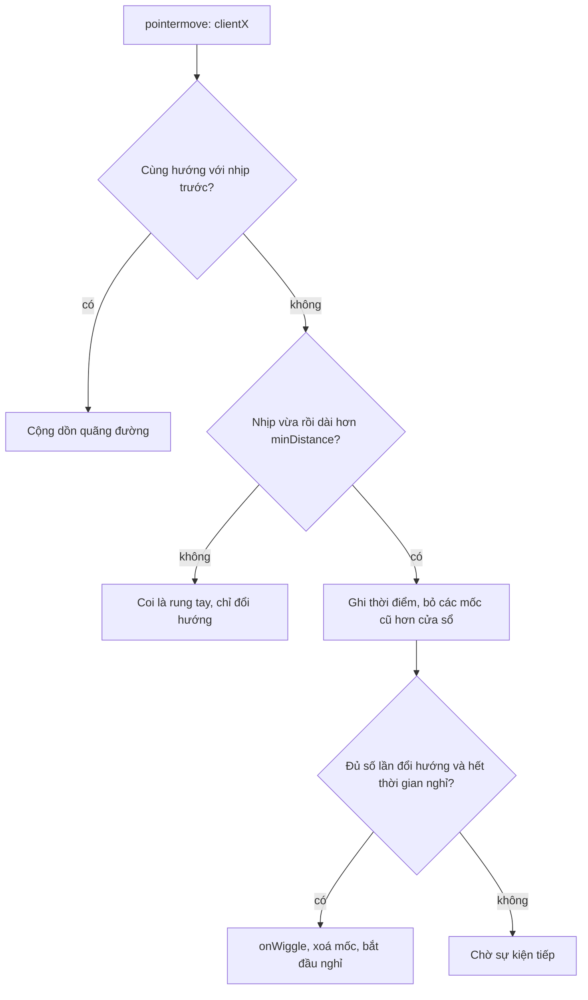

Trình duyệt không cho biết người dùng đang **nghĩ gì**. Nhưng chuột và bàn phím để lộ khá nhiều:

- Không động vào gì suốt một phút: có lẽ họ đã sang tab khác, hoặc đang phân vân.
- Chuột lao vút lên mép trên cửa sổ, nơi có thanh tab và nút đóng: có lẽ họ sắp rời đi.
- Chuột lắc qua lại liên tục: có lẽ họ đang tìm con trỏ, hoặc đang bực vì thứ gì đó không phản hồi.

Toptal dùng hai tín hiệu đầu cho **bounce modal** (hộp thoại "khoan đã" hiện khi bạn sắp rời trang). InVision có một hook riêng cho tín hiệu thứ ba. Cả ba đều ngắn, và cả ba đều có những lỗi nhỏ đáng học.

> [!TIP]
> **Tóm tắt**
> - **Idle:** ghi lại thời điểm thao tác cuối, chỉ kiểm tra khi timer hết hạn. Đừng debounce sự kiện hoạt động: Toptal debounce 300ms nên người dùng di chuột liên tục lại bị coi là rảnh.
> - **Exit-intent:** `mouseout` với `relatedTarget === null` và `clientY` gần 0 nghĩa là chuột rời cửa sổ qua mép trên. Bỏ qua vài giây đầu và chỉ hiện một lần.
> - **Lắc chuột:** đếm số lần đổi hướng ngang trong một **cửa sổ trượt**, bỏ qua nhịp quá ngắn (rung tay). InVision đếm cả nhịp 1px và render lại ở mỗi lần đổi hướng.
> - Viết detector thành hàm thuần trả về `stop()`, hook React chỉ là lớp mỏng bên ngoài.

<iframe class="demo-frame" src="/demos/web-patterns/index.html?theme=dark#/user-intent" title="Demo user-intent" loading="lazy" style="height: 560px"></iframe>

<p class="demo-links">▶ <a href="/demos/web-patterns/index.html#/user-intent" target="_blank" rel="noopener">Mở demo toàn màn hình ↗</a> · <a href="https://stackblitz.com/github/hunghg255/blog-hunghg/tree/master/examples/web-patterns?file=src/lib/userIntent.ts" target="_blank" rel="noopener">Sửa code trên StackBlitz ↗</a> · <a href="https://github.com/hunghg255/blog-hunghg/blob/master/examples/web-patterns/src/lib/userIntent.ts" target="_blank" rel="noopener">Xem source trên GitHub ↗</a></p>

## Toptal làm thế nào?

### useIdle: debounce sự kiện hoạt động

File `toptal.com-home/lib/hooks/use-idle.js`:

```js
const DEFAULT_EVENTS = ['click', 'keypress', 'keydown', 'load', 'mousemove', 'scroll', 'touchmove', 'touchstart']
const DEBOUNCE_PROLONG = 300

export function useIdle(ms, events = DEFAULT_EVENTS) {
  const [idle, setIdle] = useState(false)
  const timeout = useRef(null)

  useEffect(() => {
    timeout.current = setTimeout(() => setIdle(true), ms)
    return () => clearTimeout(timeout.current)
  }, [ms, timeout])

  const handleProlong = useCallback(
    debounce(() => {
      setIdle(false)
      clearTimeout(timeout.current)
      timeout.current = setTimeout(() => setIdle(true), ms)
    }, DEBOUNCE_PROLONG), [setIdle, timeout]
  )
  // ... gắn handleProlong cho từng event trên document
}
```

Ý đồ dễ hiểu: `mousemove` bắn mấy chục lần mỗi giây, đặt lại timer mỗi lần thì phí, nên gom lại bằng debounce. Vấn đề là **debounce chỉ chạy khi chuỗi sự kiện dừng lại 300ms**. Người dùng di chuột liên tục (đọc bài và kéo chuột theo dòng, kéo thanh trượt, vẽ) thì `handleProlong` không chạy lần nào, timer cũ hết hạn và `idle` thành `true` ngay trong lúc họ đang thao tác. Ngược lại, khi đã idle mà người dùng quay lại và di chuột liên tục, hook không nhận ra cho tới khi họ dừng tay.

Với timeout 60 giây của bounce modal, trường hợp "di chuột liên tục 60 giây" hiếm, nên lỗi khó thấy trên Toptal. Với timeout ngắn (tự đăng xuất sau 5 phút, tắt video preview sau 3 giây) thì lỗi lộ ra ngay. Demo đặt timeout 3 giây để bạn thấy.

Hai chi tiết nhỏ khác: `handleProlong` không có `ms` trong dependency nên đổi `ms` không có tác dụng với timer đặt lại sau đó, và sự kiện `load` không bắn trên `document` (nó bắn trên `window`), nên có trong danh sách cũng không làm gì.

### usePageLeave: exit-intent

File `lib/hooks/use-page-leave.js` gọn gàng:

```js
const SENSITIVITY = 20

export function usePageLeave(onPageLeave) {
  const handler = useCallback(e => {
    if (e.clientY <= SENSITIVITY && e.relatedTarget === null) {
      onPageLeave()
    }
  }, [onPageLeave])

  useEffect(() => {
    if (!isBrowser()) return
    document.addEventListener('mouseout', handler)
    return () => document.removeEventListener('mouseout', handler)
  }, [handler])
}
```

`mouseout` bắn mỗi khi chuột rời một phần tử. `relatedTarget` là phần tử chuột **đi vào**. Khi chuột rời khỏi cả cửa sổ, không có phần tử nào để đi vào, nên `relatedTarget` là `null`. Kết hợp `clientY <= 20`: chuột rời qua **mép trên**, hướng của thanh địa chỉ, tab và nút đóng.

### useBounce: ghép hai tín hiệu

`components/BounceModal/use-bounce.js` kết hợp cả hai, cùng vài quy tắc lịch sự:

```js
const MODAL_COOKIE_MAX_AGE = 90 * 24 * 60 * 60 // 90 ngày
const IDLE_TIMEOUT = 60000
const DELAY_TIMEOUT = 3000

const [viewed, setViewed] = useState(true)          // mặc định coi như đã xem
useEffect(() => {
  setTimeout(() => setViewed(!!getCookie(VIEWED_COOKIE_KEY)), DELAY_TIMEOUT)
}, [])
// ...
usePageLeave(handleShow('time_on_site'))
useEffect(() => { idle && handleShow('inactivity')() }, [viewed, idle, handleShow])
```

- `viewed` khởi tạo là `true` và chỉ đọc cookie sau 3 giây: modal **không thể** hiện trong 3 giây đầu, kể cả khi chuột vô tình chạm mép trên lúc trang vừa tải.
- Đã hiện thì đặt cookie 90 ngày: mỗi người chỉ thấy một lần mỗi quý.

Một chi tiết lãng phí: `handleShow('time_on_site')` tạo hàm mới ở mỗi lần render, nên `handler` trong `usePageLeave` cũng mới, và listener `mouseout` bị gỡ rồi gắn lại sau mỗi render. Tham số `triggerName` cũng không được dùng tới (sự kiện analytics chỉ gửi `type`), nên không phân biệt được modal hiện vì sắp rời trang hay vì rảnh tay.

## InVision làm thế nào?

Hook nằm ở `invisionapp.com(dashboard)/src/hooks/useWiggle/index.tsx`, dùng trong component `Wiggler` (`src/components/Wiggler/index.tsx`, class `hds-wiggle`, có lẽ thuộc design system của InVision). Comment của component rất thật thà: *"Wigglers are utility components to allow users to wiggle their mouse and magic can happen."*

Cấu hình mặc định: **10 lần đổi hướng** trong **1000ms**, sau khi bắn thì nghỉ **2500ms**. Phần phát hiện:

```ts
function detectWiggle(e: MouseEvent) {
  const deltaX = lastPositions.current.x - e.clientX
  // đổi hướng ngang: dấu của delta trước và delta này ngược nhau
  if (Math.sign(lastDeltaX) + Math.sign(deltaX) === 0 && deltaX !== 0) {
    setWiggleDirectionChanges(c => c + 1)
  }
  // ... lưu x, y, deltaX (chỉ khi khác 0)
}
document.addEventListener('mousemove', detectWiggle)
```

Một effect khác theo dõi `wiggleDirectionChanges`: lần đổi hướng đầu tiên thì hẹn giờ `wiggleCaptureDuration` để xoá bộ đếm, đủ `wiggleAmount` thì gọi `onWiggle` rồi khoá trong `wiggleGraceDuration`.

Ý tưởng "đếm số lần đổi dấu của deltaX" là cốt lõi đúng. Các điểm có thể làm tốt hơn:

1. **Mỗi lần đổi hướng là một lần `setState`.** Lắc 10 lần là 10 lần render component `Wiggler` và toàn bộ con của nó (render prop nhận `wiggleDirectionChanges`). Bộ đếm không cần nằm trong state của React.
2. **Không có ngưỡng khoảng cách.** Rung tay 1px trái rồi 1px phải cũng là một lần đổi hướng. Trên trackpad, chuột "đứng yên" vẫn có thể sinh ra các delta ±1 như vậy.
3. **Cửa sổ cố định bắt đầu từ lần đổi hướng đầu.** Bộ đếm reset sau 1000ms tính từ lần đổi hướng đầu tiên, không phải cửa sổ trượt. Lắc bắt đầu muộn trong cửa sổ có thể bị cắt làm đôi.
4. **Code chết.** `lastPositions` khởi tạo bằng `0`, nên nhánh `if (lastX == null && …)` dành cho sự kiện đầu tiên không bao giờ chạy.
5. **Nghe trên `document`**, dù component bọc một `div`: lắc ở bất kỳ đâu trên trang cũng tính. Timer của thời gian nghỉ cũng không được huỷ khi unmount.

## Bên trong trình duyệt



Vài điều về sự kiện đáng nhớ khi viết các detector này:

- **`pointermove` thay cho `mousemove`.** Pointer Events gộp chuột, bút và cảm ứng. `mousemove` vẫn bắn trên mobile nhưng chỉ là sự kiện giả lập sau khi chạm.
- **Listener `passive`.** Detector không bao giờ gọi `preventDefault`, nên khai báo `{ passive: true }` để trình duyệt không phải chờ handler trước khi cuộn.
- **`scroll` không nổi bọt (bubble).** Cuộn trong một `div` có `overflow: auto` không bắn `scroll` lên `document`. Muốn bắt mọi lần cuộn thì nghe ở **pha capture** (`{ capture: true }`), vì pha capture đi từ `document` xuống phần tử đích.
- **`event.timeStamp`** là thời điểm sự kiện xảy ra (cùng gốc thời gian với `performance.now()`), chính xác hơn gọi `Date.now()` trong handler khi main thread đang bận.

## Viết lại

Cả ba detector đều là hàm thuần nhận callback và trả về hàm `stop()`. Hook React chỉ gói chúng lại. Viết như vậy thì dùng được ở cả code không có React (widget nhúng, script analytics), và test không cần render component.

### Idle: ghi thời điểm, kiểm tra lười

```ts title=src/lib/userIntent.ts
export function watchIdle({ timeout, onIdle, onActive, events = ACTIVITY_EVENTS, target = document }: IdleOptions) {
  let lastActivity = performance.now();
  let idle = false;
  let timer: ReturnType<typeof setTimeout> | undefined;

  // Không đặt lại timer ở MỖI sự kiện (pointermove bắn ~60 lần/giây): chỉ ghi lại thời điểm.
  // Khi timer hết hạn mới kiểm tra: còn thiếu bao lâu thì hẹn tiếp chừng đó.
  const check = () => {
    const remaining = lastActivity + timeout - performance.now();
    if (remaining > 0) {
      timer = setTimeout(check, remaining);
      return;
    }
    timer = undefined;
    idle = true;
    onIdle();
  };

  const onActivity = () => {
    lastActivity = performance.now();
    if (idle) {
      idle = false;
      onActive?.();
    }
    if (timer === undefined) timer = setTimeout(check, timeout);
  };

  events.forEach((name) => target.addEventListener(name, onActivity, { passive: true, capture: true }));
  timer = setTimeout(check, timeout);

  return () => {
    clearTimeout(timer);
    events.forEach((name) => target.removeEventListener(name, onActivity, { capture: true }));
  };
}
```

Mỗi sự kiện hoạt động chỉ làm một phép gán `lastActivity = performance.now()`. Timer không bị huỷ và đặt lại liên tục; khi hết hạn, `check` tính còn thiếu bao lâu tới mốc idle thật, nếu chưa tới thì hẹn tiếp đúng khoảng đó. Di chuột liên tục 10 phút cũng chỉ sinh ra vài lần `setTimeout`, và trạng thái idle luôn đúng tới vài mili giây.

### Exit-intent: thêm ngưỡng thời gian

```ts title=src/lib/userIntent.ts
export function watchExitIntent({ onExit, sensitivity = 20, minTimeOnPage = 3000, target = document }: ExitIntentOptions) {
  const start = performance.now();
  const onMouseOut = (event: MouseEvent) => {
    // relatedTarget === null: chuột không sang phần tử nào khác trong trang, tức là ra khỏi cửa sổ
    if (event.relatedTarget !== null) return;
    if (event.clientY > sensitivity) return; // ra cạnh trái/phải/dưới thì thường không phải định đóng tab
    if (performance.now() - start < minTimeOnPage) return;
    onExit();
  };
  target.addEventListener('mouseout', onMouseOut);
  return () => target.removeEventListener('mouseout', onMouseOut);
}
```

Giữ nguyên điều kiện của Toptal, đưa luật "bỏ qua 3 giây đầu" vào trong detector thay vì để ở component. Luật "chỉ hiện một lần" (cookie, `localStorage`) để bên ngoài, vì mỗi sản phẩm lưu theo cách riêng.

### Lắc chuột: cửa sổ trượt và ngưỡng khoảng cách

```ts title=src/lib/userIntent.ts
export function watchWiggle({
  onWiggle,
  reversals = 6,
  window: windowMs = 800,
  minDistance = 24,
  cooldown = 2000,
  target = document,
}: WiggleOptions) {
  let lastX: number | null = null;
  let direction = 0; // -1 trái, 1 phải
  let travelled = 0; // quãng đường đã đi theo hướng hiện tại
  let times: number[] = []; // thời điểm các lần đổi hướng, chỉ giữ trong cửa sổ trượt
  let quietUntil = 0;

  const onMove = (event: Event) => {
    const { clientX, timeStamp: now } = event as PointerEvent;
    if (lastX === null) {
      lastX = clientX;
      return;
    }
    const dx = clientX - lastX;
    lastX = clientX;
    if (dx === 0) return;
    const dir = Math.sign(dx);
    if (dir === direction) {
      travelled += Math.abs(dx);
      return;
    }
    // Đổi hướng: chỉ tính nếu nhịp vừa rồi đủ dài
    if (direction !== 0 && travelled >= minDistance) {
      times.push(now);
      times = times.filter((t) => now - t <= windowMs);
      if (times.length >= reversals && now >= quietUntil) {
        times = [];
        quietUntil = now + cooldown;
        onWiggle();
      }
    }
    direction = dir;
    travelled = Math.abs(dx);
  };

  target.addEventListener('pointermove', onMove, { passive: true });
  return () => target.removeEventListener('pointermove', onMove);
}
```

::: spoiler Xem toàn bộ src/lib/userIntent.ts

```ts title=src/lib/userIntent.ts
import { useEffect, useLayoutEffect, useRef } from 'react';

/**
 * Đoán ý định người dùng từ chuột/bàn phím:
 * - idle: không thao tác gì trong `timeout` ms (ý tưởng từ useIdle của toptal.com)
 * - exit-intent: chuột lao ra mép trên cửa sổ, nơi có thanh tab/nút đóng (usePageLeave của toptal.com)
 * - wiggle: lắc chuột qua lại nhanh (useWiggle của InVision)
 * Mỗi detector là hàm thuần trả về `stop()`, kèm hook React mỏng bên dưới.
 */

// ---------- Idle ----------

export interface IdleOptions {
  timeout: number;
  onIdle: () => void;
  onActive?: () => void;
  events?: readonly string[];
  target?: Document;
}

const ACTIVITY_EVENTS = ['pointerdown', 'pointermove', 'keydown', 'wheel', 'scroll', 'touchstart'] as const;

export function watchIdle({ timeout, onIdle, onActive, events = ACTIVITY_EVENTS, target = document }: IdleOptions) {
  let lastActivity = performance.now();
  let idle = false;
  let timer: ReturnType<typeof setTimeout> | undefined;

  // Không đặt lại timer ở MỖI sự kiện (pointermove bắn ~60 lần/giây): chỉ ghi lại thời điểm.
  // Khi timer hết hạn mới kiểm tra: còn thiếu bao lâu thì hẹn tiếp chừng đó.
  const check = () => {
    const remaining = lastActivity + timeout - performance.now();
    if (remaining > 0) {
      timer = setTimeout(check, remaining);
      return;
    }
    timer = undefined;
    idle = true;
    onIdle();
  };

  const onActivity = () => {
    lastActivity = performance.now();
    if (idle) {
      idle = false;
      onActive?.();
    }
    if (timer === undefined) timer = setTimeout(check, timeout);
  };

  events.forEach((name) => target.addEventListener(name, onActivity, { passive: true, capture: true }));
  timer = setTimeout(check, timeout);

  return () => {
    clearTimeout(timer);
    events.forEach((name) => target.removeEventListener(name, onActivity, { capture: true }));
  };
}

// ---------- Exit intent ----------

export interface ExitIntentOptions {
  onExit: () => void;
  /** chuột rời trang khi còn cách mép trên ≤ sensitivity px mới tính, mặc định 20 */
  sensitivity?: number;
  /** bỏ qua trong vài giây đầu: người dùng vừa vào trang chưa thể "định bỏ đi", mặc định 3000 */
  minTimeOnPage?: number;
  target?: Document;
}

export function watchExitIntent({ onExit, sensitivity = 20, minTimeOnPage = 3000, target = document }: ExitIntentOptions) {
  const start = performance.now();
  const onMouseOut = (event: MouseEvent) => {
    // relatedTarget === null: chuột không sang phần tử nào khác trong trang, tức là ra khỏi cửa sổ
    if (event.relatedTarget !== null) return;
    if (event.clientY > sensitivity) return; // ra cạnh trái/phải/dưới thì thường không phải định đóng tab
    if (performance.now() - start < minTimeOnPage) return;
    onExit();
  };
  target.addEventListener('mouseout', onMouseOut);
  return () => target.removeEventListener('mouseout', onMouseOut);
}

// ---------- Wiggle (lắc chuột) ----------

export interface WiggleOptions {
  onWiggle: () => void;
  /** số lần đổi hướng ngang cần có, mặc định 6 */
  reversals?: number;
  /** trong khoảng thời gian (ms), mặc định 800 */
  window?: number;
  /** mỗi nhịp phải đi được ít nhất bấy nhiêu px, để rung tay không bị tính, mặc định 24 */
  minDistance?: number;
  /** sau khi bắn thì nghỉ bao lâu, mặc định 2000 */
  cooldown?: number;
  target?: EventTarget;
}

export function watchWiggle({
  onWiggle,
  reversals = 6,
  window: windowMs = 800,
  minDistance = 24,
  cooldown = 2000,
  target = document,
}: WiggleOptions) {
  let lastX: number | null = null;
  let direction = 0; // -1 trái, 1 phải
  let travelled = 0; // quãng đường đã đi theo hướng hiện tại
  let times: number[] = []; // thời điểm các lần đổi hướng, chỉ giữ trong cửa sổ trượt
  let quietUntil = 0;

  const onMove = (event: Event) => {
    const { clientX, timeStamp: now } = event as PointerEvent;
    if (lastX === null) {
      lastX = clientX;
      return;
    }
    const dx = clientX - lastX;
    lastX = clientX;
    if (dx === 0) return;
    const dir = Math.sign(dx);
    if (dir === direction) {
      travelled += Math.abs(dx);
      return;
    }
    // Đổi hướng: chỉ tính nếu nhịp vừa rồi đủ dài
    if (direction !== 0 && travelled >= minDistance) {
      times.push(now);
      times = times.filter((t) => now - t <= windowMs);
      if (times.length >= reversals && now >= quietUntil) {
        times = [];
        quietUntil = now + cooldown;
        onWiggle();
      }
    }
    direction = dir;
    travelled = Math.abs(dx);
  };

  target.addEventListener('pointermove', onMove, { passive: true });
  return () => target.removeEventListener('pointermove', onMove);
}

// ---------- React ----------

/** Giữ callback mới nhất trong ref để effect không phải gắn lại listener mỗi lần render. */
function useLatest<T>(value: T) {
  const ref = useRef(value);
  useLayoutEffect(() => {
    ref.current = value;
  });
  return ref;
}

export function useIdle(timeout: number, onIdle: () => void, onActive?: () => void) {
  const idleRef = useLatest(onIdle);
  const activeRef = useLatest(onActive);
  useEffect(
    () => watchIdle({ timeout, onIdle: () => idleRef.current(), onActive: () => activeRef.current?.() }),
    [timeout, idleRef, activeRef],
  );
}

export function useExitIntent(onExit: () => void, options: Omit<ExitIntentOptions, 'onExit'> = {}) {
  const exitRef = useLatest(onExit);
  const { sensitivity, minTimeOnPage } = options;
  useEffect(
    () => watchExitIntent({ onExit: () => exitRef.current(), sensitivity, minTimeOnPage }),
    [sensitivity, minTimeOnPage, exitRef],
  );
}

export function useWiggle(onWiggle: () => void, options: Omit<WiggleOptions, 'onWiggle'> = {}) {
  const wiggleRef = useLatest(onWiggle);
  const { reversals, window: windowMs, minDistance, cooldown, target } = options;
  useEffect(
    () => watchWiggle({ onWiggle: () => wiggleRef.current(), reversals, window: windowMs, minDistance, cooldown, target }),
    [reversals, windowMs, minDistance, cooldown, target, wiggleRef],
  );
}
```

:::

**Khác bản gốc:**

- Idle không debounce; bắt `scroll` ở pha capture; dùng `pointer*` thay cho `mouse*` và `touch*`.
- Exit-intent có `minTimeOnPage` ngay trong detector.
- Wiggle mặc định 6 lần đổi hướng trong 800ms, mỗi nhịp tối thiểu 24px; giữ mốc thời gian trong mảng (cửa sổ trượt) thay vì state React; nghe trên phần tử bất kỳ qua `target`.

## Đi qua code

**`travelled` trong wiggle.** Mỗi khi đổi hướng, ta xem nhịp vừa kết thúc đã đi bao xa. Dưới `minDistance` thì coi là rung tay: vẫn ghi nhận hướng mới, nhưng không tính là một lần lắc. Đây là phần quan trọng nhất để detector không bắn nhầm. Thử trong demo: rung chuột vài pixel không kích hoạt gì.

**Cửa sổ trượt.** `times` chỉ giữ các mốc trong `windowMs` gần nhất. Đủ `reversals` mốc là bắn, bất kể cú lắc bắt đầu lúc nào. Mảng không bao giờ dài hơn vài phần tử, nên `filter` mỗi lần đổi hướng là đủ rẻ.

**`quietUntil`.** Sau khi bắn, bỏ qua trong `cooldown` ms để một cú lắc dài không bắn liên tục. Dùng mốc thời gian thay vì `setTimeout`, nên không có timer nào phải huỷ khi `stop()`.

**`useLatest`.** Callback người dùng truyền vào thường là arrow function mới mỗi render. Giữ nó trong ref (cập nhật trong `useLayoutEffect`) để effect chỉ phụ thuộc vào các tuỳ chọn số. Listener được gắn một lần, không gỡ/gắn lại sau mỗi render như `usePageLeave` + `useBounce` của Toptal.

## Tại sao không làm cách khác?

**Throttle thay cho debounce trong idle.** Throttle (chạy tối đa một lần mỗi 300ms) sửa được lỗi "di liên tục bị coi là rảnh", vì handler vẫn chạy đều đặn. Nhưng vẫn huỷ và đặt lại timer vài lần mỗi giây. Ghi thời điểm rồi kiểm tra lười đơn giản hơn và không cần thư viện.

**Idle Detection API** (`IdleDetector`) báo cả khi người dùng rời **máy tính** hoặc khoá màn hình, không chỉ rời trang. Nhưng cần xin quyền, chỉ có trên trình duyệt nhân Chromium (tính tới 10/2026), và dành cho ứng dụng kiểu chat cần trạng thái "vắng mặt". Cho bounce modal thì quá tay.

**`visibilitychange` cho exit-intent.** `document.visibilityState === 'hidden'` cho biết người dùng **đã** rời tab (chuyển tab, thu nhỏ, khoá màn hình). Đó là lúc gửi analytics (xem bài [gom log theo lô](/blogs/facebook-batch-logger)), không phải lúc hiện modal, vì họ không còn nhìn thấy trang.

**`beforeunload`.** Chỉ hiện được hộp thoại xác nhận chuẩn của trình duyệt, không tuỳ biến được nội dung, và trình duyệt chỉ hiện nếu người dùng đã tương tác với trang. Dùng cho "bạn có thay đổi chưa lưu", không dùng cho marketing.

## Edge case và cạm bẫy

- **Không có chuột thì không có exit-intent.** Trên điện thoại không có "chuột lao lên mép trên". Đừng thay bằng heuristic kiểu "cuộn lên nhanh" rồi bật modal: người dùng mobile cuộn lên để đọc lại, không phải để rời đi.
- **Exit-intent trong iframe.** Detector chỉ thấy chuột rời **khung của iframe**, không phải cửa sổ trình duyệt. Demo trong bài này chạy trong iframe, nên "mép trên" là mép trên của khung demo.
- **Tab ẩn.** Timer bị trình duyệt làm chậm khi tab ẩn (Chrome giới hạn còn khoảng một lần mỗi phút sau một thời gian ẩn). `check` dựa vào `performance.now()` nên vẫn đúng khi cuối cùng chạy, chỉ bắn muộn. Nếu cần biết "rảnh" ngay khi tab bị ẩn, nghe thêm `visibilitychange`.
- **Trợ năng.** Đừng chỉ dựa vào chuột cho chức năng quan trọng: người dùng bàn phím và trình đọc màn hình không bao giờ "lắc". Wiggle hợp với tính năng phụ (phóng to con trỏ, easter egg), không hợp với thứ bắt buộc.
- **Lịch sự với người dùng.** Modal exit-intent hiện nhiều lần, hoặc chặn cả trang, là cách nhanh nhất để người dùng rời đi thật. Toptal giới hạn một lần mỗi 90 ngày, bỏ qua 3 giây đầu, và có đóng bằng click ra ngoài. Hãy làm ít nhất như vậy.

## Dùng trong dự án

```tsx
// Bounce modal: một lần mỗi 90 ngày, cho cả hai tín hiệu
function useBounceModal() {
  const [open, setOpen] = useState(false);
  const show = useCallback((reason: 'exit' | 'idle') => {
    if (localStorage.getItem('bounce-seen')) return;
    localStorage.setItem('bounce-seen', String(Date.now()));
    analytics.track('bounce_modal_view', { reason }); // nhớ gửi cả lý do
    setOpen(true);
  }, []);
  useExitIntent(() => show('exit'));
  useIdle(60_000, () => show('idle'));
  return [open, () => setOpen(false)] as const;
}

// Tự đăng xuất sau 15 phút không thao tác, kể cả code không dùng React
const stop = watchIdle({ timeout: 15 * 60_000, onIdle: () => auth.logout('idle') });
```

Wiggle cũng là một tín hiệu analytics hay: người dùng lắc chuột trên một nút không phản hồi thường là đang bực. Một số công cụ session replay gọi đó là "frustration signal", cùng nhóm với rage click (bấm liên tục một chỗ).

## Kiểm thử

::: spoiler Ví dụ test (bản phác, không có trong repo)

```ts
// userIntent.test.ts — Vitest + jsdom, dùng fake timer
import { afterEach, beforeEach, expect, test, vi } from 'vitest';
import { watchIdle, watchWiggle } from './userIntent';

// watchIdle dùng performance.now(): yêu cầu fake timer giả lập cả nó
beforeEach(() => vi.useFakeTimers({ toFake: ['setTimeout', 'clearTimeout', 'performance'] }));
afterEach(() => vi.useRealTimers());

test('di chuột liên tục không bị coi là idle', () => {
  const onIdle = vi.fn();
  const stop = watchIdle({ timeout: 3000, onIdle });
  for (let t = 0; t < 10_000; t += 50) {
    document.dispatchEvent(new Event('pointermove'));
    vi.advanceTimersByTime(50);
  }
  expect(onIdle).not.toHaveBeenCalled();
  vi.advanceTimersByTime(3000);
  expect(onIdle).toHaveBeenCalledTimes(1);
  stop();
});

function move(x: number, timeStamp: number) {
  const event = new Event('pointermove');
  Object.defineProperties(event, { clientX: { value: x }, timeStamp: { value: timeStamp } });
  document.dispatchEvent(event);
}

test('rung tay không tính, lắc thật thì bắn', () => {
  const onWiggle = vi.fn();
  const stop = watchWiggle({ onWiggle, reversals: 6, window: 800, minDistance: 24 });
  let t = 0;
  for (let i = 0; i < 20; i++) move(100 + (i % 2) * 3, (t += 20)); // ±3px
  expect(onWiggle).not.toHaveBeenCalled();
  for (let i = 0; i < 8; i++) move(100 + (i % 2) * 80, (t += 40)); // ±80px
  expect(onWiggle).toHaveBeenCalledTimes(1);
  stop();
});
```

:::

---

Bài này thuộc series **[Học từ mã nguồn các web lớn](/series/web)** (65 bài, đọc theo thứ tự).

::: spoiler Xem nhanh danh sách bài trong series

*Mở đầu*

- [Mở đầu: đọc code production của 28 trang web](/blogs/learn-from-big-web-apps)

*Phần 1: trải nghiệm người dùng*

- [#1 Dark mode không nháy (Gatsby)](/blogs/web-dark-mode-no-flash)
- [#2 useValueByMedia: giá trị theo breakpoint (Toptal)](/blogs/web-use-value-by-media)
- **#3 Đoán ý định: idle, exit-intent, lắc chuột (Toptal, InVision)** (bài này)
- [#4 Validate form thân thiện (Udacity, Pipedrive)](/blogs/web-form-validation-ux)
- [#5 Magic number, EXIF và dán ảnh (Ello)](/blogs/web-file-magic-number-exif-paste)
- [#6 fastSmoothScroll: cuộn xa vẫn nhanh (Telegram)](/blogs/web-telegram-fast-smooth-scroll)
- [#7 Countdown time-travel và tombstone giỏ hàng (Best Buy)](/blogs/web-countdown-time-travel-tombstone)

*Phần 2: hiệu năng và đo lường*

- [#8 Hàng đợi requestAnimationFrame 3ms (Apple)](/blogs/web-raf-queue-3ms)
- [#9 srcset cho artwork và preconnect tự động (Apple)](/blogs/web-responsive-artwork-preconnect)
- [#10 Quick-fetch: gọi API trước khi bundle tải xong (HubSpot)](/blogs/web-quick-fetch-early-requests)
- [#11 Performance span và long task (Postman, Calibre)](/blogs/web-performance-spans-long-tasks)
- [#12 Gọi Web Worker như hàm async (Telegram)](/blogs/web-worker-promise-rpc)
- [#13 Đồng hồ media: đếm giờ xem và sửa lệch (Skillshare, Simplified)](/blogs/web-media-clock-watch-time-drift)

*Phần 3: nhiều tab, phiên đăng nhập, cập nhật*

- [#14 Bầu tab chủ cho thông báo (HubSpot, Telegram)](/blogs/web-leader-tab-notifications)
- [#15 Đồng bộ đăng nhập giữa tab và giới hạn cookie (Elastic, InVision)](/blogs/web-cross-tab-auth-cookie-guard)
- [#16 SPA tự cập nhật: Trello, Zappos, Facebook, Elastic](/blogs/web-spa-self-update-strategies)

*Phần 4: kiến trúc*

- [#17 Reverse portal: di chuyển component không remount (Zappos)](/blogs/web-reverse-portal)
- [#18 Page behaviors: gắn hành vi từ CMS (Intercom)](/blogs/web-page-behaviors-cms)
- [#19 Giới hạn tần suất hiển thị bằng bitmask (Outlook)](/blogs/web-frequency-cap-bitmask)
- [#20 Chuyển REST sang GraphQL dần dần (Coursera)](/blogs/web-rest-to-graphql-hybrid-link)

*Phần 5: soạn thảo và hiển thị nội dung*

- [#21 Autocomplete tại con trỏ trong contenteditable (Ello, Telegram)](/blogs/web-caret-autocomplete-contenteditable)
- [#22 Dark mode cho email HTML bằng CIELAB (Outlook)](/blogs/web-email-dark-mode-cielab)
- [#23 Thu nhỏ bảng rộng cho vừa khung, vá font emoji (Outlook)](/blogs/web-email-wide-content-scale)
- [#24 Cảnh báo quên đính kèm file (Outlook)](/blogs/web-forgotten-attachment-warning)
- [#25 Cắt chữ nhiều dòng chính xác (Pipedrive, Apple, Toptal)](/blogs/web-multiline-truncate-measure-text)
- [#26 Parse ngày giờ gõ tay khoan dung (Outlook, Elastic)](/blogs/web-lenient-date-parser)

*Phần 6: tương tác*

- [#27 menuAim: rê chéo vào submenu không bị đóng (Udemy)](/blogs/web-menu-aim-triangle)
- [#28 Kéo, vuốt chung cho chuột và cảm ứng (Telegram)](/blogs/web-unified-pointer-gestures)
- [#29 Phím tắt theo phạm vi, IME và bàn phím phi Latinh (Trello)](/blogs/web-scoped-keyboard-shortcuts)
- [#30 Nội suy màu: đổi theme và nền theo cuộn (Telegram, Anchor)](/blogs/web-color-interpolation-theme-scroll)
- [#31 Đường gióng hút cạnh và undo/redo trên canvas (Simplified)](/blogs/web-canvas-snap-guides-undo)
- [#32 Giả lập mù màu bằng feColorMatrix (Trello)](/blogs/web-color-vision-simulator)
- [#33 Vạch thước theo mức zoom và cấp phát màu cho biểu đồ (Anchor, Similarweb)](/blogs/web-timeline-ticks-color-stack)

*Phần 7: mạng, dữ liệu và async*

- [#34 Ô tìm kiếm chuẩn production (Similarweb, Udemy, Pipedrive)](/blogs/web-production-search-box)
- [#35 Điều phối async: latest-wins, single-flight (Glitch, Toptal)](/blogs/web-async-coordination-latest-wins)
- [#36 Polling thưa dần và debounce động (Trello)](/blogs/web-decaying-polling-dynamic-debounce)
- [#37 Cache phía client theo version (Similarweb, Telegram, Udemy)](/blogs/web-client-cache-versioned)
- [#38 Upload file lớn theo chunk (Outlook, Tribe)](/blogs/web-chunked-upload-pipeline)
- [#39 Phát video qua Service Worker bằng Range request (Telegram, Outlook)](/blogs/web-service-worker-range-streaming)

*Phần 8: hiệu năng và vận hành*

- [#40 TTI governor: hoãn việc phụ tới sau khi trang dùng được (Outlook)](/blogs/web-tti-governor)
- [#41 Tự đo LCP/CLS/TBT và phục vụ bản nhẹ cho máy yếu (Udemy)](/blogs/web-rum-adaptive-loading)

*Phần 9: thuật toán và dữ liệu phía client*

- [#42 Three-way merge ngay trên trình duyệt (Postman)](/blogs/web-three-way-merge-client)
- [#43 Dọn cache GraphQL bằng đếm tham chiếu (Outlook)](/blogs/web-graphql-cache-refcount-gc)
- [#44 LRU cache theo 3 cách (Apple, Similarweb, Outlook)](/blogs/web-lru-cache-three-ways)
- [#45 Lọc tăng dần trong Web Worker (Similarweb)](/blogs/web-incremental-filter-worker)
- [#46 Xếp hạng gợi ý trên client, so ngầm với server (Outlook)](/blogs/web-client-side-ranking-shadow-test)
- [#47 Nối OT với editor: undo stack và chặn echo (Glitch)](/blogs/web-ot-codemirror-undo)
- [#48 Ngôn ngữ markup riêng dịch hai chiều với HTML (Coursera)](/blogs/web-custom-markup-compiler)

*Phần 10: thời gian, ngôn ngữ, định dạng*

- [#49 Xử lý giờ mùa hè không cần thư viện (Udemy, Pipedrive)](/blogs/web-dst-without-library)
- [#50 Intl thực chiến: Segmenter, số rút gọn, số nhiều, fallback locale (Apple, Outlook)](/blogs/web-intl-in-production)
- [#51 WebVTT và bôi chọn transcript (Udemy, Coursera)](/blogs/web-webvtt-transcript-selection)

*Phần 11: tương tác và giao diện*

- [#52 Kéo-thả trên lịch (Pipedrive)](/blogs/web-calendar-drag-drop)
- [#53 Focus stack cho popup lồng nhau (Outlook)](/blogs/web-focus-stack-nested-popups)
- [#54 Clipboard: copy, dán chữ thuần, dán thông minh (Trello, Anchor, Pipedrive, Tribe)](/blogs/web-clipboard-tricks)
- [#55 Khôi phục vị trí cuộn khi trang còn đang tải (Apple, Zappos)](/blogs/web-scroll-restore-wait-height)
- [#56 Lấy màu từ ảnh: gradient nền, màu chữ (Apple, Telegram, Trello)](/blogs/web-colors-from-images)
- [#57 JS đọc breakpoint từ CSS, phát hiện chế độ PWA (Ello, Apple)](/blogs/web-css-js-breakpoint-bridge)

*Phần 12: media*

- [#58 Tin nhắn thoại: ghi âm, waveform realtime, nén 5-bit (Telegram)](/blogs/web-voice-message-waveform)
- [#59 Chụp frame video thành ảnh, canvas bị taint (Coursera, Outlook)](/blogs/web-video-frame-snapshot)

*Phần 13: đo lường, bảo mật, vận hành*

- [#60 Đo lúc ảnh màn hình đầu tải xong, cả khi chuyển trang SPA (Zappos, Best Buy, Outlook)](/blogs/web-above-the-fold-image-timing)
- [#61 Buffer analytics chờ SDK, phát hiện adblock (Best Buy)](/blogs/web-analytics-buffer-adblock)
- [#62 Proof-of-work trên client để chặn API ẩn danh (Udemy)](/blogs/web-client-proof-of-work)
- [#63 Prefetch không làm lệch số liệu, nén cài đặt bằng bit (Outlook)](/blogs/web-synthetic-prefetch-bit-flags)
- [#64 Micro-frontend: AngularJS và React chung app, giao tiếp xuyên frame (Similarweb, InVision, HubSpot)](/blogs/web-micro-frontend-bridges)

:::

Code + demo: [`examples/web-patterns`](https://github.com/hunghg255/blog-hunghg/tree/master/examples/web-patterns) · [Mở trên StackBlitz](https://stackblitz.com/github/hunghg255/blog-hunghg/tree/master/examples/web-patterns)
