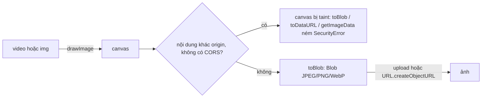

Trên Coursera, khi bạn bôi một đoạn transcript để tạo ghi chú, ghi chú đó kèm luôn một **ảnh chụp khung hình bài giảng** ở đúng thời điểm ấy. Không có server nào chụp hộ: trình duyệt tự vẽ frame video hiện tại lên canvas, đổi thành ảnh rồi upload.

Outlook làm một việc cùng họ: khi bạn copy một email có ảnh đính kèm, ảnh được đổi thành **data URL** ngay trước khi vào clipboard. Ảnh đính kèm nằm sau đăng nhập; dán sang Word hay Gmail mà vẫn là link gốc thì chỉ ra ô vỡ.

Cả hai đều dựa vào một thao tác: vẽ một `<video>` hoặc `` lên canvas rồi đọc ngược ra. Thao tác này có ba cái bẫy: **méo tỉ lệ**, **chặn main thread**, và **canvas bị "taint"** khi nội dung đến từ origin khác.

> [!TIP]
> **Tóm tắt**
> - `drawImage(video, …)` vẽ frame đang hiển thị lên canvas. Lấy kích thước canvas từ `videoWidth/videoHeight` để giữ tỉ lệ; Coursera cố định 960×540 nên video 4:3 bị kéo giãn.
> - Dùng `canvas.toBlob()` (bất đồng bộ, ra nhị phân) thay vì `toDataURL()` rồi đổi base64 ngược về `Blob`: base64 dài hơn khoảng 33% và `toDataURL` mã hoá ngay trên main thread.
> - Vẽ nội dung khác origin không có CORS làm canvas bị **taint**: vẫn hiển thị được nhưng `toBlob`, `toDataURL`, `getImageData` đều ném `SecurityError`. Cần `crossOrigin="anonymous"` **và** header `Access-Control-Allow-Origin` từ server.
> - Đợi `readyState >= HAVE_CURRENT_DATA` trước khi vẽ, nếu không sẽ ra ảnh đen.

<iframe class="demo-frame" src="/demos/web-patterns/index.html?theme=dark#/video-snapshot" title="Demo video-snapshot" loading="lazy" style="height: 1300px"></iframe>

<p class="demo-links">▶ <a href="/demos/web-patterns/index.html#/video-snapshot" target="_blank" rel="noopener">Mở demo toàn màn hình ↗</a> · <a href="https://stackblitz.com/github/hunghg255/blog-hunghg/tree/master/examples/web-patterns?file=src/lib/videoSnapshot.ts" target="_blank" rel="noopener">Sửa code trên StackBlitz ↗</a> · <a href="https://github.com/hunghg255/blog-hunghg/blob/master/examples/web-patterns/src/lib/videoSnapshot.ts" target="_blank" rel="noopener">Xem source trên GitHub ↗</a></p>

"Video" trong demo được vẽ bằng canvas rồi phát qua `captureStream()`, nên không cần tải file nào. Chọn **Video 4:3** rồi bấm cả hai nút chụp: ảnh kiểu Coursera biến các vòng tròn thành hình bầu dục. Phần cuối thử vẽ một ảnh từ `raw.githubusercontent.com` (cần mạng) có và không có `crossOrigin`.

## Coursera làm thế nào?

Toàn bộ code chụp nằm trong [`static/bundles/video-highlighting/utils/createSnapshot.ts`](https://github.com/hunghg255/codebase/blob/main/coursera.org/static/bundles/video-highlighting/utils/createSnapshot.ts):

```ts
export default (videoPlayer: VideoPlayer): string => {
  const canvas = document.createElement('canvas');
  canvas.width = 960;
  canvas.height = 540;
  const mediaElement = videoPlayer.el().querySelector('video');
  const context = canvas.getContext('2d');
  if (context && mediaElement) {
    context.drawImage(mediaElement, 0, 0, canvas.width, canvas.height);
  }
  return canvas.toDataURL('image/jpeg');
};
```

Hàm được gọi đồng bộ ngay lúc tạo ghi chú (`highlightUtils.ts`), kết quả data URL được lưu vào bản nháp. Khi ghi chú được lưu, `highlightAPIUtils.ts` xin server một URL upload (`getScreenShotUploadUrl`), đổi data URL về `Blob` bằng `getBlobFromDataURI` (chép từ một câu trả lời StackOverflow, có link trong chú thích), rồi `PUT` lên S3:

```ts
const blob = getBlobFromDataURI(snapshotDataUrl);
api.put('', { contentType: 'image/png', data: blob, processData: false }).then(() => { /* ... */ });
```

Một chi tiết quan trọng nằm ở chỗ khác: thẻ `<video>` trong `video-player/components/video/VideoPlayer.tsx` có `crossOrigin="anonymous"`. Video bài giảng nằm trên CDN, khác origin với trang. Thiếu thuộc tính này thì `drawImage` vẫn vẽ được nhưng `toDataURL` sẽ ném lỗi.

### Những chỗ chưa ổn

- **Khung cố định 960×540.** Video 16:9 thì ổn; video 4:3 hay video dọc thì bị kéo giãn.
- **Khai báo sai định dạng.** Ảnh là JPEG (`toDataURL('image/jpeg')`) nhưng upload với `contentType: 'image/png'`. Trình duyệt thường vẫn hiện được vì đọc byte đầu file, nhưng công cụ nào tin vào header sẽ xử lý sai.
- **Đi đường vòng qua base64.** `toDataURL` mã hoá ảnh **đồng bộ** trên main thread, ra chuỗi base64 dài hơn dữ liệu gốc khoảng 33%, rồi `getBlobFromDataURI` lại giải base64 bằng một vòng lặp từng byte. `canvas.toBlob()` cho thẳng `Blob`.
- **Lỗi upload bị nuốt.** `uploadSnapshot` bọc trong `Q.Promise` chỉ có `resolve`: request lỗi thì promise treo mãi, ghi chú không bao giờ có ảnh mà cũng không báo gì.
- **Không kiểm tra video đã có frame chưa.** Nếu video chưa tải tới frame nào, ảnh ra màu đen.

## Outlook làm thế nào?

[`owa-inline-image-loader/src/utils/tryCreateDataURIFromImage.ts`](https://github.com/hunghg255/codebase/blob/main/outlook.live.com/src/modules/owa-inline-image-loader/src/utils/tryCreateDataURIFromImage.ts):

```ts
let width = imgElement.naturalWidth;
let height = imgElement.naturalHeight;
if (!(width > 0 && height > 0)) { /* log rồi dùng imgElement.width / height */ }
canvas.width = width;
canvas.height = height;
canvas.getContext('2d').drawImage(imgElement, 0, 0);
return canvas.toDataURL('image/png'); // cả hàm nằm trong try/catch, lỗi thì trả null
```

Hàm này được `ImageCopyHandler.ts` gọi khi người dùng copy. Với mỗi ảnh có `src` bắt đầu bằng địa chỉ tải file đính kèm (hoặc origin của Outlook), nó lấy data URL đã lưu sẵn trong store, không có thì tạo bằng hàm trên, rồi **thay luôn `src` của ảnh** bằng data URL để clipboard chụp lại bản tự chứa. Ảnh GIF bị đổi `src` sẽ đứng hình, nên handler lưu `src` cũ và trả lại sau 500ms. Trên Firefox, ảnh có `user-select: none` không được copy, nên handler tạm đổi thành `all` rồi cũng trả lại sau 500ms.

Ảnh đính kèm cùng origin với Outlook nên canvas không bị taint. Toàn bộ thân hàm vẫn được bọc `try/catch`, lỗi thì trả `null` và copy như bình thường.

Một chỗ nhỏ: khi `naturalWidth` bằng 0 (thường gặp với SVG không khai báo kích thước), hàm dùng kích thước hiển thị làm khung canvas, nhưng `drawImage(img, 0, 0)` không truyền kích thước, nên trình duyệt tự chọn kích thước vẽ, không chắc khớp với khung. Truyền thêm `width, height` cho `drawImage` thì ảnh luôn lấp đúng khung.

## Bên trong trình duyệt



- **Frame nào được vẽ?** `drawImage(video, …)` vẽ frame đang hiển thị. `readyState` phải ít nhất là `HAVE_CURRENT_DATA` (2); trước đó `videoWidth` bằng 0 và ảnh ra rỗng hoặc đen. Ngay sau khi tua (`currentTime = t`), đợi sự kiện `seeked`; trình duyệt có `requestVideoFrameCallback` thì đợi thêm callback đó để chắc frame mới đã được hiển thị.
- **Taint.** Mỗi canvas có cờ "origin-clean". Vẽ một ảnh hay video từ origin khác mà không qua CORS là cờ này tắt vĩnh viễn với canvas đó. Từ đó mọi API đọc ngược pixel đều ném `SecurityError`. Đây là cơ chế chống đọc trộm: nếu không có nó, trang độc hại có thể vẽ ảnh từ một trang bạn đang đăng nhập rồi đọc ra.
- **`crossOrigin="anonymous"`** làm trình duyệt tải ảnh/video ở chế độ CORS. Server trả `Access-Control-Allow-Origin` phù hợp thì canvas không bị taint; server không trả thì ảnh **không tải được luôn**, chứ không phải tải được mà bị taint.
- **`toDataURL` vs `toBlob`:** cả hai đều mã hoá ảnh. `toDataURL` trả chuỗi ngay nên phải mã hoá đồng bộ; `toBlob` trả kết quả qua callback, trình duyệt có thể mã hoá ở luồng khác.

## Viết lại

```ts title=src/lib/videoSnapshot.ts
function canvasToBlob(canvas: HTMLCanvasElement, type: string, quality?: number): Promise<Blob> {
  return new Promise((resolve, reject) => {
    try {
      canvas.toBlob((blob) => (blob ? resolve(blob) : reject(new Error('toBlob trả về null'))), type, quality);
    } catch (error) {
      // canvas bị taint: toBlob ném SecurityError ngay lúc gọi
      reject(error instanceof DOMException && error.name === 'SecurityError' ? new TaintedCanvasError() : error);
    }
  });
}

export async function captureVideoFrame(
  video: HTMLVideoElement,
  { maxWidth = 960, type = 'image/jpeg', quality = 0.85 }: SnapshotOptions = {},
): Promise<Blob> {
  await waitForFrame(video);
  const { width, height } = fitSize(video.videoWidth, video.videoHeight, maxWidth);
  const canvas = document.createElement('canvas');
  canvas.width = width;
  canvas.height = height;
  canvas.getContext('2d')!.drawImage(video, 0, 0, width, height);
  return canvasToBlob(canvas, type, quality);
}
```

Bản sửa của hàm Outlook (`imageToDataUrl`) và `dataUrlToBlob` nằm trong file đầy đủ:

::: spoiler Xem toàn bộ src/lib/videoSnapshot.ts

```ts title=src/lib/videoSnapshot.ts
/**
 * Chụp frame video / ảnh thành file (ý tưởng từ coursera.org: video-highlighting/utils/createSnapshot.ts
 * và outlook.live.com: owa-inline-image-loader/utils/tryCreateDataURIFromImage.ts).
 *
 * - Giữ đúng tỉ lệ khung hình của video, chỉ giới hạn chiều rộng.
 * - Đợi video có frame hiện tại (readyState >= HAVE_CURRENT_DATA) rồi mới vẽ.
 * - Dùng canvas.toBlob (bất đồng bộ, ra nhị phân) thay vì toDataURL rồi đổi base64 ngược lại.
 * - Canvas bị "taint" (vẽ nội dung khác origin không có CORS) thì báo lỗi rõ ràng.
 */

export class TaintedCanvasError extends Error {
  constructor() {
    super(
      'Canvas đã vẽ nội dung khác origin mà không có CORS nên không đọc ra được. ' +
        'Thêm crossOrigin="anonymous" cho <video>/ và header Access-Control-Allow-Origin ở server.',
    );
    this.name = 'TaintedCanvasError';
  }
}

export interface SnapshotOptions {
  /** chiều rộng tối đa của ảnh, chiều cao tính theo tỉ lệ của video */
  maxWidth?: number;
  type?: 'image/jpeg' | 'image/png' | 'image/webp';
  /** chất lượng 0..1, chỉ áp dụng cho jpeg/webp */
  quality?: number;
}

const HAVE_CURRENT_DATA = 2;

/** Đợi video có ít nhất một frame để vẽ. */
export function waitForFrame(video: HTMLVideoElement): Promise<void> {
  if (video.readyState >= HAVE_CURRENT_DATA && video.videoWidth > 0) return Promise.resolve();
  return new Promise((resolve, reject) => {
    const done = () => {
      video.removeEventListener('loadeddata', done);
      video.removeEventListener('error', fail);
      resolve();
    };
    const fail = () => {
      video.removeEventListener('loadeddata', done);
      video.removeEventListener('error', fail);
      reject(new Error('Video không tải được'));
    };
    video.addEventListener('loadeddata', done);
    video.addEventListener('error', fail);
  });
}

/** Kích thước ảnh giữ tỉ lệ của nguồn, không phóng to quá kích thước gốc. */
export function fitSize(sourceWidth: number, sourceHeight: number, maxWidth: number) {
  const width = Math.min(maxWidth, sourceWidth);
  return { width, height: Math.round((width * sourceHeight) / sourceWidth) };
}

function canvasToBlob(canvas: HTMLCanvasElement, type: string, quality?: number): Promise<Blob> {
  return new Promise((resolve, reject) => {
    try {
      canvas.toBlob((blob) => (blob ? resolve(blob) : reject(new Error('toBlob trả về null'))), type, quality);
    } catch (error) {
      // canvas bị taint: toBlob ném SecurityError ngay lúc gọi
      reject(error instanceof DOMException && error.name === 'SecurityError' ? new TaintedCanvasError() : error);
    }
  });
}

export async function captureVideoFrame(
  video: HTMLVideoElement,
  { maxWidth = 960, type = 'image/jpeg', quality = 0.85 }: SnapshotOptions = {},
): Promise<Blob> {
  await waitForFrame(video);
  const { width, height } = fitSize(video.videoWidth, video.videoHeight, maxWidth);
  const canvas = document.createElement('canvas');
  canvas.width = width;
  canvas.height = height;
  canvas.getContext('2d')!.drawImage(video, 0, 0, width, height);
  return canvasToBlob(canvas, type, quality);
}

/**
 * Ảnh trên trang → data URL (Outlook dùng khi copy: ảnh đính kèm cần đăng nhập mới xem được,
 * đổi sang data URL thì dán vào app khác vẫn hiện). Trả về null nếu không làm được.
 */
export function imageToDataUrl(img: HTMLImageElement, type = 'image/png'): string | null {
  let width = img.naturalWidth;
  let height = img.naturalHeight;
  if (!(width > 0 && height > 0)) {
    // vd SVG không khai báo kích thước: dùng kích thước đang hiển thị
    width = img.width;
    height = img.height;
  }
  if (!(width > 0 && height > 0)) return null;
  const canvas = document.createElement('canvas');
  canvas.width = width;
  canvas.height = height;
  // truyền width/height: drawImage(img, 0, 0) vẽ theo kích thước gốc, sai khi đang dùng kích thước hiển thị
  canvas.getContext('2d')!.drawImage(img, 0, 0, width, height);
  try {
    return canvas.toDataURL(type);
  } catch {
    return null; // canvas bị taint
  }
}

/** data URL → Blob. Có sẵn `fetch(dataUrl).then(r => r.blob())`; bản vòng lặp này chạy cả ở nơi chặn fetch data:. */
export function dataUrlToBlob(dataUrl: string): Blob {
  const [header, base64] = dataUrl.split(',');
  const mime = header.slice(header.indexOf(':') + 1, header.indexOf(';'));
  const binary = atob(base64);
  const bytes = new Uint8Array(binary.length);
  for (let i = 0; i < binary.length; i++) bytes[i] = binary.charCodeAt(i);
  return new Blob([bytes], { type: mime });
}

/** Canvas đã bị taint chưa: thử đọc 1 pixel. */
export function isTainted(canvas: HTMLCanvasElement) {
  try {
    canvas.getContext('2d')!.getImageData(0, 0, 1, 1);
    return false;
  } catch {
    return true;
  }
}
```

:::

## Đi qua code

- **`waitForFrame`** trả về ngay nếu video đã có frame, không thì đợi `loadeddata` (frame đầu tiên đã sẵn sàng) hoặc `error`. Cả hai listener đều được gỡ khi một trong hai xảy ra.
- **`fitSize`** giữ tỉ lệ của video và chỉ thu nhỏ: video 480×360 cho ảnh 480×360, video 1920×1080 với `maxWidth: 960` cho 960×540.
- **`canvasToBlob`** bọc `toBlob` thành promise. `toBlob` ném `SecurityError` **đồng bộ** ngay lúc gọi nếu canvas bị taint, nên phải bọc `try/catch` bên trong executor rồi đổi thành `TaintedCanvasError` có thông điệp chỉ cách sửa. Callback nhận `null` khi mã hoá thất bại (vd canvas kích thước 0).
- **`imageToDataUrl`** giữ cách lấy kích thước của Outlook nhưng truyền kích thước cho `drawImage`, và chỉ bọc `try/catch` quanh bước đọc ra (bước duy nhất có thể ném vì taint).
- **`dataUrlToBlob`** giữ lại cho chỗ nào lỡ có data URL (từ clipboard, từ API cũ). Trong trình duyệt hiện đại, `await (await fetch(dataUrl)).blob()` gọn hơn; trừ khi CSP chặn `connect-src data:`.

**Khác bản gốc:** giữ tỉ lệ thay vì cố định 960×540, dùng `toBlob`, đợi frame, báo lỗi taint rõ ràng. Phần upload không viết lại; khi viết, nhớ gửi `Content-Type` khớp với `blob.type` và có nhánh `reject`.

## Tại sao không làm cách khác?

**Để server chụp từ file video?** Server phải giải mã video (ffmpeg) và biết chính xác thời điểm người dùng đang xem. Phía client đã có sẵn frame đang hiển thị, chụp gần như miễn phí.

**`ImageCapture.grabFrame()`?** API này lấy frame từ một `MediaStreamTrack` (camera, màn hình), không dùng cho `<video>` phát file thường, và chưa có trên mọi trình duyệt.

**`createImageBitmap(video)` + `OffscreenCanvas`?** Hợp khi muốn xử lý trong Web Worker: `createImageBitmap` cắt frame ở main thread, chuyển `ImageBitmap` sang worker, vẽ lên `OffscreenCanvas` rồi `convertToBlob()`. Quy tắc taint vẫn y hệt.

## Edge case và cạm bẫy

- **Video DRM** (Encrypted Media Extensions): frame được giải mã ngoài tầm JavaScript, vẽ lên canvas thường ra màu đen hoặc ném lỗi. Không có cách hợp lệ nào vượt qua.
- **Cache của ảnh không CORS:** đã tải một ảnh không có `crossOrigin`, sau đó tải lại cùng URL với `crossOrigin` thì có thể nhận lại bản cache không có header CORS và lỗi. Demo thêm query khác nhau cho hai lần tải để tránh.
- **`crossOrigin` phải đặt trước `src`.** Đặt sau thì request đầu tiên đã đi ở chế độ không CORS.
- **Màn hình mật độ cao:** ảnh chụp có kích thước theo `videoWidth`, không theo kích thước hiển thị. Muốn ảnh nhỏ cho thumbnail thì giảm `maxWidth`.
- **Video dọc trên điện thoại:** `videoWidth < videoHeight` là bình thường, `fitSize` vẫn đúng; đừng giả định chiều ngang luôn lớn hơn.
- **Chất lượng JPEG:** 0.85 thường đủ cho thumbnail. Ảnh có chữ (slide bài giảng) dùng PNG hoặc WebP sẽ nét hơn.

## Dùng trong dự án

```ts
const video = document.querySelector('video')!; // nhớ crossOrigin="anonymous" nếu video ở CDN
try {
  const blob = await captureVideoFrame(video, { maxWidth: 640, type: 'image/webp', quality: 0.8 });
  await fetch(uploadUrl, { method: 'PUT', body: blob, headers: { 'Content-Type': blob.type } });
} catch (error) {
  if (error instanceof TaintedCanvasError) showToast('Video này không cho phép chụp ảnh');
  else throw error;
}
```

::: spoiler Ví dụ test (bản phác, không có trong repo)

```ts
// @vitest-environment node
import { describe, expect, it } from 'vitest';
import { dataUrlToBlob, fitSize } from './videoSnapshot';

describe('fitSize', () => {
  it('giữ tỉ lệ 4:3 khi giới hạn chiều rộng', () => {
    expect(fitSize(1440, 1080, 960)).toEqual({ width: 960, height: 720 });
  });
  it('không phóng to video nhỏ hơn giới hạn', () => {
    expect(fitSize(640, 360, 960)).toEqual({ width: 640, height: 360 });
  });
});

describe('dataUrlToBlob', () => {
  it('đọc đúng mime và byte', async () => {
    const blob = dataUrlToBlob('data:image/jpeg;base64,/9j/4A==');
    expect(blob.type).toBe('image/jpeg');
    expect(Array.from(new Uint8Array(await blob.arrayBuffer()))).toEqual([0xff, 0xd8, 0xff, 0xe0]);
  });
});
```

Phần chụp frame và taint cần trình duyệt thật (jsdom không có canvas). Demo phía trên kiểm tra phần đó bằng Playwright, giả lập server khác origin bằng `page.route`.

:::

## So với thư viện và chuẩn web

- `canvas.toBlob` và `crossOrigin` có trên mọi trình duyệt chính từ lâu. `requestVideoFrameCallback` thì chưa đồng đều, xem [caniuse](https://caniuse.com/mdn-api_htmlvideoelement_requestvideoframecallback) (tính tới 10/2026).
- Thư viện như html2canvas "chụp" cả một vùng DOM bằng cách vẽ lại từng phần tử, và cũng vướng đúng quy tắc taint với ảnh khác origin.
- Liên quan trong series: [magic number để nhận đúng loại file trước khi upload](/blogs/web-file-magic-number-exif-paste), [upload file lớn theo chunk](/blogs/web-chunked-upload-pipeline), [clipboard](/blogs/web-clipboard-tricks).

---

Bài này thuộc series **[Học từ mã nguồn các web lớn](/series/web)** (65 bài, đọc theo thứ tự).

::: spoiler Xem nhanh danh sách bài trong series

*Mở đầu*

- [Mở đầu: đọc code production của 28 trang web](/blogs/learn-from-big-web-apps)

*Phần 1: trải nghiệm người dùng*

- [#1 Dark mode không nháy (Gatsby)](/blogs/web-dark-mode-no-flash)
- [#2 useValueByMedia: giá trị theo breakpoint (Toptal)](/blogs/web-use-value-by-media)
- [#3 Đoán ý định: idle, exit-intent, lắc chuột (Toptal, InVision)](/blogs/web-user-intent-idle-exit-wiggle)
- [#4 Validate form thân thiện (Udacity, Pipedrive)](/blogs/web-form-validation-ux)
- [#5 Magic number, EXIF và dán ảnh (Ello)](/blogs/web-file-magic-number-exif-paste)
- [#6 fastSmoothScroll: cuộn xa vẫn nhanh (Telegram)](/blogs/web-telegram-fast-smooth-scroll)
- [#7 Countdown time-travel và tombstone giỏ hàng (Best Buy)](/blogs/web-countdown-time-travel-tombstone)

*Phần 2: hiệu năng và đo lường*

- [#8 Hàng đợi requestAnimationFrame 3ms (Apple)](/blogs/web-raf-queue-3ms)
- [#9 srcset cho artwork và preconnect tự động (Apple)](/blogs/web-responsive-artwork-preconnect)
- [#10 Quick-fetch: gọi API trước khi bundle tải xong (HubSpot)](/blogs/web-quick-fetch-early-requests)
- [#11 Performance span và long task (Postman, Calibre)](/blogs/web-performance-spans-long-tasks)
- [#12 Gọi Web Worker như hàm async (Telegram)](/blogs/web-worker-promise-rpc)
- [#13 Đồng hồ media: đếm giờ xem và sửa lệch (Skillshare, Simplified)](/blogs/web-media-clock-watch-time-drift)

*Phần 3: nhiều tab, phiên đăng nhập, cập nhật*

- [#14 Bầu tab chủ cho thông báo (HubSpot, Telegram)](/blogs/web-leader-tab-notifications)
- [#15 Đồng bộ đăng nhập giữa tab và giới hạn cookie (Elastic, InVision)](/blogs/web-cross-tab-auth-cookie-guard)
- [#16 SPA tự cập nhật: Trello, Zappos, Facebook, Elastic](/blogs/web-spa-self-update-strategies)

*Phần 4: kiến trúc*

- [#17 Reverse portal: di chuyển component không remount (Zappos)](/blogs/web-reverse-portal)
- [#18 Page behaviors: gắn hành vi từ CMS (Intercom)](/blogs/web-page-behaviors-cms)
- [#19 Giới hạn tần suất hiển thị bằng bitmask (Outlook)](/blogs/web-frequency-cap-bitmask)
- [#20 Chuyển REST sang GraphQL dần dần (Coursera)](/blogs/web-rest-to-graphql-hybrid-link)

*Phần 5: soạn thảo và hiển thị nội dung*

- [#21 Autocomplete tại con trỏ trong contenteditable (Ello, Telegram)](/blogs/web-caret-autocomplete-contenteditable)
- [#22 Dark mode cho email HTML bằng CIELAB (Outlook)](/blogs/web-email-dark-mode-cielab)
- [#23 Thu nhỏ bảng rộng cho vừa khung, vá font emoji (Outlook)](/blogs/web-email-wide-content-scale)
- [#24 Cảnh báo quên đính kèm file (Outlook)](/blogs/web-forgotten-attachment-warning)
- [#25 Cắt chữ nhiều dòng chính xác (Pipedrive, Apple, Toptal)](/blogs/web-multiline-truncate-measure-text)
- [#26 Parse ngày giờ gõ tay khoan dung (Outlook, Elastic)](/blogs/web-lenient-date-parser)

*Phần 6: tương tác*

- [#27 menuAim: rê chéo vào submenu không bị đóng (Udemy)](/blogs/web-menu-aim-triangle)
- [#28 Kéo, vuốt chung cho chuột và cảm ứng (Telegram)](/blogs/web-unified-pointer-gestures)
- [#29 Phím tắt theo phạm vi, IME và bàn phím phi Latinh (Trello)](/blogs/web-scoped-keyboard-shortcuts)
- [#30 Nội suy màu: đổi theme và nền theo cuộn (Telegram, Anchor)](/blogs/web-color-interpolation-theme-scroll)
- [#31 Đường gióng hút cạnh và undo/redo trên canvas (Simplified)](/blogs/web-canvas-snap-guides-undo)
- [#32 Giả lập mù màu bằng feColorMatrix (Trello)](/blogs/web-color-vision-simulator)
- [#33 Vạch thước theo mức zoom và cấp phát màu cho biểu đồ (Anchor, Similarweb)](/blogs/web-timeline-ticks-color-stack)

*Phần 7: mạng, dữ liệu và async*

- [#34 Ô tìm kiếm chuẩn production (Similarweb, Udemy, Pipedrive)](/blogs/web-production-search-box)
- [#35 Điều phối async: latest-wins, single-flight (Glitch, Toptal)](/blogs/web-async-coordination-latest-wins)
- [#36 Polling thưa dần và debounce động (Trello)](/blogs/web-decaying-polling-dynamic-debounce)
- [#37 Cache phía client theo version (Similarweb, Telegram, Udemy)](/blogs/web-client-cache-versioned)
- [#38 Upload file lớn theo chunk (Outlook, Tribe)](/blogs/web-chunked-upload-pipeline)
- [#39 Phát video qua Service Worker bằng Range request (Telegram, Outlook)](/blogs/web-service-worker-range-streaming)

*Phần 8: hiệu năng và vận hành*

- [#40 TTI governor: hoãn việc phụ tới sau khi trang dùng được (Outlook)](/blogs/web-tti-governor)
- [#41 Tự đo LCP/CLS/TBT và phục vụ bản nhẹ cho máy yếu (Udemy)](/blogs/web-rum-adaptive-loading)

*Phần 9: thuật toán và dữ liệu phía client*

- [#42 Three-way merge ngay trên trình duyệt (Postman)](/blogs/web-three-way-merge-client)
- [#43 Dọn cache GraphQL bằng đếm tham chiếu (Outlook)](/blogs/web-graphql-cache-refcount-gc)
- [#44 LRU cache theo 3 cách (Apple, Similarweb, Outlook)](/blogs/web-lru-cache-three-ways)
- [#45 Lọc tăng dần trong Web Worker (Similarweb)](/blogs/web-incremental-filter-worker)
- [#46 Xếp hạng gợi ý trên client, so ngầm với server (Outlook)](/blogs/web-client-side-ranking-shadow-test)
- [#47 Nối OT với editor: undo stack và chặn echo (Glitch)](/blogs/web-ot-codemirror-undo)
- [#48 Ngôn ngữ markup riêng dịch hai chiều với HTML (Coursera)](/blogs/web-custom-markup-compiler)

*Phần 10: thời gian, ngôn ngữ, định dạng*

- [#49 Xử lý giờ mùa hè không cần thư viện (Udemy, Pipedrive)](/blogs/web-dst-without-library)
- [#50 Intl thực chiến: Segmenter, số rút gọn, số nhiều, fallback locale (Apple, Outlook)](/blogs/web-intl-in-production)
- [#51 WebVTT và bôi chọn transcript (Udemy, Coursera)](/blogs/web-webvtt-transcript-selection)

*Phần 11: tương tác và giao diện*

- [#52 Kéo-thả trên lịch (Pipedrive)](/blogs/web-calendar-drag-drop)
- [#53 Focus stack cho popup lồng nhau (Outlook)](/blogs/web-focus-stack-nested-popups)
- [#54 Clipboard: copy, dán chữ thuần, dán thông minh (Trello, Anchor, Pipedrive, Tribe)](/blogs/web-clipboard-tricks)
- [#55 Khôi phục vị trí cuộn khi trang còn đang tải (Apple, Zappos)](/blogs/web-scroll-restore-wait-height)
- [#56 Lấy màu từ ảnh: gradient nền, màu chữ (Apple, Telegram, Trello)](/blogs/web-colors-from-images)
- [#57 JS đọc breakpoint từ CSS, phát hiện chế độ PWA (Ello, Apple)](/blogs/web-css-js-breakpoint-bridge)

*Phần 12: media*

- [#58 Tin nhắn thoại: ghi âm, waveform realtime, nén 5-bit (Telegram)](/blogs/web-voice-message-waveform)
- **#59 Chụp frame video thành ảnh, canvas bị taint (Coursera, Outlook)** (bài này)

*Phần 13: đo lường, bảo mật, vận hành*

- [#60 Đo lúc ảnh màn hình đầu tải xong, cả khi chuyển trang SPA (Zappos, Best Buy, Outlook)](/blogs/web-above-the-fold-image-timing)
- [#61 Buffer analytics chờ SDK, phát hiện adblock (Best Buy)](/blogs/web-analytics-buffer-adblock)
- [#62 Proof-of-work trên client để chặn API ẩn danh (Udemy)](/blogs/web-client-proof-of-work)
- [#63 Prefetch không làm lệch số liệu, nén cài đặt bằng bit (Outlook)](/blogs/web-synthetic-prefetch-bit-flags)
- [#64 Micro-frontend: AngularJS và React chung app, giao tiếp xuyên frame (Similarweb, InVision, HubSpot)](/blogs/web-micro-frontend-bridges)

:::

Code + demo: [`examples/web-patterns`](https://github.com/hunghg255/blog-hunghg/tree/master/examples/web-patterns) · [Mở trên StackBlitz](https://stackblitz.com/github/hunghg255/blog-hunghg/tree/master/examples/web-patterns)
