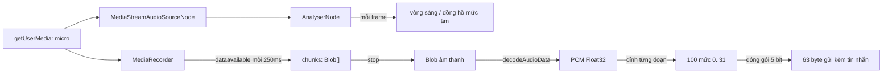

Nút micro trong khung chat trông đơn giản: giữ để nói, thả ra để gửi. Nhưng một tin nhắn thoại "đàng hoàng" cần nhiều thứ hơn một file âm thanh:

1. Trong lúc ghi, nút phải **nhấp nháy theo giọng nói** để người dùng biết micro đang nghe.
2. Bấm nhầm rồi thả ngay thì không được gửi đi một file 0,2 giây vô nghĩa.
3. Tin nhắn hiện ra kèm **waveform**: hàng cột cao thấp cho biết chỗ nào nói, chỗ nào im. Waveform phải có ngay, trước khi người nhận tải file âm thanh.
4. Waveform đó đi kèm mỗi tin nhắn, nên phải **nhỏ**: Telegram chỉ dành cho nó 63 byte.

Telegram Web làm đủ bốn việc trong hai file nhỏ. Bài này đọc hai file đó, chỉ ra một chỗ có lẽ là lỗi ở bước gửi waveform, rồi viết lại bằng các API có sẵn của trình duyệt.

> [!TIP]
> **Tóm tắt**
> - Ghi bằng `MediaRecorder`, song song dùng một `AnalyserNode` đọc mức âm lượng mỗi frame để vẽ hiệu ứng. Bấm dừng sớm thì **hoãn lệnh dừng** cho đủ 1 giây.
> - Waveform gửi đi là **100 mức, mỗi mức 5 bit (0..31)**, đóng gói liền nhau thành 63 byte. Bên nhận đọc lại từng nhóm 5 bit.
> - Bản Telegram Web trong bản dump resample về 63 giá trị 0..255 rồi gửi thẳng, **không đóng gói**: bên nhận đọc 5 bit một nên ra hình khác.
> - Tính waveform cuối cùng từ chính file âm thanh (giải mã lại thành PCM) thay vì từ số frame đã vẽ, và thu nhỏ bằng **đỉnh từng đoạn** để không mất tiếng ngắn.

<iframe class="demo-frame" src="/demos/web-patterns/index.html?theme=dark#/voice-recorder" title="Demo voice-recorder" loading="lazy" style="height: 980px"></iframe>

<p class="demo-links">▶ <a href="/demos/web-patterns/index.html#/voice-recorder" target="_blank" rel="noopener">Mở demo toàn màn hình ↗</a> · <a href="https://stackblitz.com/github/hunghg255/blog-hunghg/tree/master/examples/web-patterns?file=src/lib/voiceRecorder.ts" target="_blank" rel="noopener">Sửa code trên StackBlitz ↗</a> · <a href="https://github.com/hunghg255/blog-hunghg/blob/master/examples/web-patterns/src/lib/voiceRecorder.ts" target="_blank" rel="noopener">Xem source trên GitHub ↗</a></p>

Bấm **Ghi giả lập** (nguồn âm tự tạo, không cần micro), đợi vài giây rồi **Dừng**. Khung thứ hai so waveform đóng gói đúng với waveform "gửi thẳng 63 byte"; khung thứ ba so hai cách thu nhỏ. Thử bấm **Dừng** ngay sau khi bấm ghi: log báo lệnh dừng bị hoãn tới đủ 1 giây.

## Telegram làm thế nào?

Code nằm trong [`web.telegram.org/src/util/voiceRecording.ts`](https://github.com/hunghg255/codebase/blob/main/web.telegram.org/src/util/voiceRecording.ts) và [`src/util/waveform.ts`](https://github.com/hunghg255/codebase/blob/main/web.telegram.org/src/util/waveform.ts). Hook dùng chúng là `components/middle/composer/hooks/useVoiceRecording.ts`, phần hiển thị nằm ở `components/common/Audio.tsx` và `components/common/helpers/waveform.ts`.

### Ghi âm: opus-recorder và hàng loạt hằng số

```ts
const MIN_RECORDING_TIME = 1000;
const BLOB_PARAMS = { type: 'audio/ogg' };
const FFT_SIZE = 64;
const MIN_VOLUME = 0.1;
// init(): opusRecorderPromise = import('opus-recorder') rồi new OpusRecorder({ encoderPath, reuseWorker: true })
```

Telegram không dùng `MediaRecorder` của trình duyệt mà nạp lười (lazy import) thư viện `opus-recorder`, chạy bộ mã hoá Opus trong một Web Worker riêng. Lý do có lẽ là định dạng: tin nhắn thoại của Telegram là OGG/Opus, trong khi `MediaRecorder` của mỗi trình duyệt ra một kiểu khác nhau (Chrome mặc định ra WebM, Safari ra MP4). Tự mã hoá thì file ra giống hệt nhau trên mọi trình duyệt.

Hook `useVoiceRecording` còn gọi `init()` sớm trên iOS, kèm một dòng chú thích đáng chép lại: *"Preloading worker fixes silent first record on iOS"* (nạp worker trước thì bản ghi đầu tiên trên iOS mới có tiếng).

Hàm `start` làm ba việc:

```ts
const releaseAnalyzer = subscribeToAnalyzer(mediaRecorder, (volume: number) => {
  waveform.push(volume * 255);
  analyzerCallback(volume);
});

return {
  stop: () => new Promise<Result>((resolve, reject) => {
    // ...
    const delayStop = Math.max(0, startedAt + MIN_RECORDING_TIME - Date.now());
    setTimeout(() => {
      mediaRecorder.stop();
      releaseAnalyzer();
    }, delayStop);
  }),
```

1. Gom các đoạn dữ liệu Opus vào mảng `chunks`, lúc dừng ghép thành một `Blob` kiểu `audio/ogg`.
2. Gắn một `AnalyserNode` vào nguồn micro. Mỗi frame (`requestAnimationFrame`) đọc `getByteFrequencyData`, lấy trung bình 32 dải tần, chia 255 ra mức âm lượng 0..1. Dưới `MIN_VOLUME = 0.1` thì coi là 0. Mỗi giá trị vừa được đẩy vào mảng `waveform` (nhân 255), vừa được báo cho giao diện để vẽ vòng sáng quanh nút micro.
3. Lệnh dừng bị **hoãn** cho tới khi bản ghi dài ít nhất `MIN_RECORDING_TIME = 1000`ms.

Bên giao diện, hook cập nhật vòng sáng bằng `box-shadow` với một cách giảm tần suất khá lạ: `if (Date.now() % 4 === 0)`, tức là chỉ khi mili giây hiện tại chia hết cho 4. Trung bình một phần tư số frame được vẽ, nhưng hoàn toàn ngẫu nhiên.

### Waveform: 100 mức × 5 bit

Phía hiển thị dùng `decodeWaveform`, chép từ Telegram Desktop (có link tới `data_document.cpp` trong chú thích):

```ts
export function decodeWaveform(encoded5bit: Uint8Array) {
  const bitsCount = encoded5bit.length * 8;
  const valuesCount = Math.floor(bitsCount / 5);
  // ...
  for (let i = 0, l = valuesCount - 1; i !== l; ++i) {
    const byteIndex = Math.floor((i * 5) / 8);
    const bitShift = Math.floor((i * 5) % 8);
    const value = bitsData[byteIndex] + (bitsData[byteIndex + 1] << 8);
    result[i] = ((value >> bitShift) & 0x1F);
  }
```

Mỗi mức chiếm 5 bit, các mức nằm sát nhau trong chuỗi byte. Muốn đọc mức thứ `i` thì tìm byte chứa bit đầu tiên của nó (`i*5/8`), đọc 16 bit từ byte đó (vì 5 bit có thể vắt qua hai byte), dịch phải rồi lấy 5 bit thấp. Giá trị cuối được tách riêng để không đọc quá cuối mảng.

63 byte = 504 bit, đủ cho 100 mức. Đó là lý do có hằng số `INPUT_WAVEFORM_LENGTH = 63` trong `api/gramjs/methods/messages.ts`.

Khi hiển thị, `Audio.tsx` chọn số cột theo thời lượng: 25 cột cho tin ngắn, tăng dần tới 75 cột cho tin từ 30 giây trở lên (20 và 50 trên màn hình hẹp). `interpolateArray` co giãn 100 mức về đúng số cột đó, rồi `renderWaveformToDataUri` vẽ lên một canvas gấp đôi kích thước (cho màn hình mật độ cao), xuất `toDataURL()` và gắn vào một thẻ ``.

### Những chỗ chưa ổn trong bản gốc

**Waveform gửi đi không được đóng gói.** Đây là đoạn tạo tin nhắn thoại trước khi gửi:

```ts
const { duration, waveform } = voice;
const { data: inputWaveform } = interpolateArray(waveform, INPUT_WAVEFORM_LENGTH);
attributes.push(new GramJs.DocumentAttributeAudio({
  voice: true,
  duration,
  waveform: Buffer.from(inputWaveform),
}));
```

`waveform` lúc này là mảng mức âm lượng 0..255 đo theo từng frame. Code co nó về 63 phần tử rồi `Buffer.from` thẳng thành 63 byte. Không có bước nào đổi về 0..31 và đóng gói 5 bit. Bên nhận (kể cả chính `Audio.tsx` khi hiện tin nhắn vừa gửi) lại chạy `decodeWaveform` trên 63 byte này, tức đọc 100 nhóm 5 bit từ dữ liệu không được ghi theo cách đó. Kết quả là một hình "trông giống waveform" nhưng không khớp với âm thanh. Khung thứ hai của demo tái hiện đúng việc này. Mình không tìm thấy hàm đóng gói nào khác trong bản dump; có thể bản Telegram Web mới hơn đã sửa.

**Waveform phụ thuộc tốc độ khung hình.** Mỗi frame thêm một giá trị: màn hình 120Hz cho gấp đôi số giá trị so với 60Hz. Tệ hơn, `requestAnimationFrame` **dừng hẳn** khi tab bị ẩn, trong khi micro vẫn ghi. Người dùng ghi 10 giây nhưng có 5 giây chuyển sang tab khác thì waveform chỉ còn phần lúc tab đang hiện, bị kéo dãn ra cả bản ghi.

**Thu nhỏ làm mất tiếng ngắn.** `interpolateArray` lấy mẫu tại một chỉ số rồi trung bình 3 phần tử quanh đó. Khi co 600 giá trị về 63, cứ khoảng 10 giá trị mới đọc 3. Một tiếng "tách" ngắn rơi vào khoảng không được đọc sẽ biến mất.

**Đo âm lượng bằng phổ tần.** Trung bình của `getByteFrequencyData` chạy được với giọng nói (năng lượng trải ra nhiều dải tần), nhưng một âm đơn chỉ rơi vào 1–2 trong 32 dải, nên trung bình rất thấp dù âm rất to.

## Bên trong trình duyệt



- **`MediaRecorder`** nhận một `MediaStream` và tự mã hoá. Định dạng ra tuỳ trình duyệt; hỏi trước bằng `MediaRecorder.isTypeSupported('audio/webm;codecs=opus')`. Gọi `start(250)` thì cứ 250ms trình duyệt trả một đoạn qua `dataavailable`, thay vì giữ tất cả tới lúc dừng.
- **`AnalyserNode`** là một nút trong đồ thị Web Audio, không làm thay đổi âm thanh, chỉ cho đọc dữ liệu tại thời điểm gọi: `getFloatTimeDomainData` cho dạng sóng (mỗi mẫu -1..1), `getByteFrequencyData` cho phổ tần đã đổi sang thang dB rồi ép về 0..255 (mặc định từ -100dB tới -30dB). `fftSize` quyết định số mẫu một lần đọc.
- **`decodeAudioData`** giải mã file nén (WebM, MP4, OGG…) thành PCM thô. Dùng `OfflineAudioContext` để giải mã thì không cần mở thiết bị âm thanh và không bị chính sách tự phát (autoplay) chặn.
- **Tab bị ẩn:** `requestAnimationFrame` không chạy; `setTimeout` bị giãn ra tối thiểu 1 giây (Chrome còn giãn mạnh hơn sau vài phút). Ghi âm và mã hoá thì vẫn chạy bình thường.

## Viết lại

Hai file: `voiceRecorder.ts` lo ghi âm, `voiceRecorderWaveform.ts` lo thu nhỏ, đóng gói và vẽ waveform. Lõi của lệnh dừng:

```ts title=src/lib/voiceRecorder.ts
  return {
    stop: () =>
      new Promise<VoiceRecording>((resolve, reject) => {
        recorder.onerror = (event) => {
          release();
          reject((event as ErrorEvent).error ?? new Error('MediaRecorder error'));
        };
        recorder.onstop = async () => {
          const durationMs = performance.now() - startedAt;
          release();
          const type = recorder.mimeType || mimeType || 'audio/webm';
          const blob = new Blob(chunks, { type });
          const waveform = await waveformFromBlob(blob).catch(() => liveLevels);
          resolve({ blob, mimeType: type, durationMs, waveform, liveLevels });
        };
        // Bấm dừng ngay sau khi bấm ghi: đợi cho đủ thời lượng tối thiểu rồi mới dừng.
        // Bản ghi vài trăm mili giây gần như không dùng được (có lẽ đó là lý do Telegram đặt mức 1 giây).
        const wait = Math.max(0, startedAt + minDurationMs - performance.now());
        setTimeout(() => {
          if (recorder.state !== 'inactive') recorder.stop();
        }, wait);
      }),
```

Waveform cuối cùng tính từ file đã ghi (`waveformFromBlob`) và thu nhỏ bằng đỉnh từng đoạn (`resampleByPeak`), xem trong file đầy đủ bên dưới. Đóng gói và giải nén 5 bit:

```ts title=src/lib/voiceRecorderWaveform.ts
/** Đóng gói các giá trị 0..31 thành chuỗi bit 5 bit/giá trị (bit thấp trước). */
export function encodeWaveform(levels: number[]): Uint8Array {
  const bytes = new Uint8Array(Math.ceil((levels.length * 5) / 8));
  levels.forEach((level, i) => {
    const bit = i * 5;
    const byteIndex = bit >> 3;
    const shifted = (level & 0x1f) << (bit & 7);
    // 5 bit có thể vắt qua 2 byte: ghi phần thấp vào byte này, phần cao vào byte sau
    bytes[byteIndex] |= shifted & 0xff;
    if (byteIndex + 1 < bytes.length) bytes[byteIndex + 1] |= shifted >> 8;
  });
  return bytes;
}

/** Giải nén: đọc 16 bit bắt đầu từ byte chứa giá trị, dịch rồi lấy 5 bit (như decodeWaveform của Telegram). */
export function decodeWaveform(bytes: Uint8Array): number[] {
  const count = Math.floor((bytes.length * 8) / 5);
  const result: number[] = [];
  for (let i = 0; i < count; i++) {
    const bit = i * 5;
    const byteIndex = bit >> 3;
    // byte cuối không có byte kế tiếp: coi như 0 thay vì đọc ra ngoài mảng
    const word = bytes[byteIndex] | ((bytes[byteIndex + 1] ?? 0) << 8);
    result.push((word >> (bit & 7)) & 0x1f);
  }
  return result;
}
```

::: spoiler Xem toàn bộ src/lib/voiceRecorder.ts

```ts title=src/lib/voiceRecorder.ts
/**
 * Ghi tin nhắn thoại + waveform (ý tưởng từ web.telegram.org: util/voiceRecording.ts, util/waveform.ts).
 *
 * - Ghi bằng MediaRecorder có sẵn của trình duyệt (Telegram dùng opus-recorder để ra file .ogg).
 * - Trong lúc ghi: AnalyserNode đo âm lượng mỗi frame để vẽ đồng hồ mức âm.
 * - Ghi ít nhất 1 giây: bấm dừng sớm thì hoãn lệnh stop cho đủ.
 * - Lúc dừng: tính waveform từ chính file âm thanh (giải mã lại), không phụ thuộc số frame đã vẽ.
 */

/** Ghi ngắn hơn mức này thì hoãn lệnh dừng (Telegram: MIN_RECORDING_TIME = 1000). */
export const MIN_RECORDING_MS = 1000;
/** Âm lượng dưới ngưỡng này coi như im lặng (Telegram: MIN_VOLUME = 0.1). */
export const MIN_VOLUME = 0.1;

export interface VoiceRecording {
  blob: Blob;
  mimeType: string;
  durationMs: number;
  /** waveform tính từ dữ liệu âm thanh, mỗi phần tử 0..1 */
  waveform: number[];
  /** mức âm lượng đã đo trong lúc ghi (mỗi frame một giá trị), giống mảng waveform của Telegram */
  liveLevels: number[];
}

export interface RecorderHandle {
  stop(): Promise<VoiceRecording>;
  cancel(): void;
}

/** Chọn định dạng đầu tiên trình duyệt hỗ trợ: Chrome/Firefox ra Opus, Safari ra AAC trong mp4. */
export function pickMimeType(): string {
  const candidates = ['audio/ogg;codecs=opus', 'audio/webm;codecs=opus', 'audio/mp4', 'audio/webm'];
  if (typeof MediaRecorder === 'undefined') return '';
  return candidates.find((type) => MediaRecorder.isTypeSupported(type)) ?? '';
}

/**
 * Mức âm lượng 0..1 của khung âm thanh hiện tại: căn bậc hai trung bình bình phương (RMS) của dạng sóng.
 * Telegram lấy trung bình getByteFrequencyData (độ lớn theo dB của 32 dải tần), cũng chạy được nhưng
 * một âm đơn tần chỉ rơi vào 1–2 dải nên trung bình rất thấp.
 */
export function readLevel(analyser: AnalyserNode, buffer: Float32Array<ArrayBuffer>) {
  analyser.getFloatTimeDomainData(buffer);
  let sum = 0;
  for (let i = 0; i < buffer.length; i++) sum += buffer[i] * buffer[i];
  // RMS của giọng nói thường dưới 0.3, nhân 3 cho dễ nhìn rồi chặn ở 1
  const level = Math.min(1, Math.sqrt(sum / buffer.length) * 3);
  return level < MIN_VOLUME ? 0 : level;
}

export function startRecording(
  stream: MediaStream,
  onLevel: (level: number) => void,
  { minDurationMs = MIN_RECORDING_MS }: { minDurationMs?: number } = {},
): RecorderHandle {
  const mimeType = pickMimeType();
  const recorder = new MediaRecorder(stream, mimeType ? { mimeType } : undefined);
  const chunks: Blob[] = [];
  recorder.ondataavailable = (event) => {
    if (event.data.size > 0) chunks.push(event.data);
  };

  // Analyser riêng cho đồng hồ mức âm, không ảnh hưởng tới file ghi
  const audioContext = new AudioContext();
  const source = audioContext.createMediaStreamSource(stream);
  const analyser = audioContext.createAnalyser();
  analyser.fftSize = 1024;
  source.connect(analyser);
  const buffer = new Float32Array(analyser.fftSize);
  const liveLevels: number[] = [];

  let frame = 0;
  const tick = () => {
    const level = readLevel(analyser, buffer);
    liveLevels.push(level);
    onLevel(level);
    frame = requestAnimationFrame(tick);
  };
  frame = requestAnimationFrame(tick);

  const startedAt = performance.now();
  recorder.start(250); // nhận dữ liệu mỗi 250ms, lỡ trình duyệt treo vẫn còn phần đã ghi

  let released = false;
  const release = () => {
    if (released) return;
    released = true;
    cancelAnimationFrame(frame);
    source.disconnect();
    void audioContext.close();
  };

  return {
    stop: () =>
      new Promise<VoiceRecording>((resolve, reject) => {
        recorder.onerror = (event) => {
          release();
          reject((event as ErrorEvent).error ?? new Error('MediaRecorder error'));
        };
        recorder.onstop = async () => {
          const durationMs = performance.now() - startedAt;
          release();
          const type = recorder.mimeType || mimeType || 'audio/webm';
          const blob = new Blob(chunks, { type });
          const waveform = await waveformFromBlob(blob).catch(() => liveLevels);
          resolve({ blob, mimeType: type, durationMs, waveform, liveLevels });
        };
        // Bấm dừng ngay sau khi bấm ghi: đợi cho đủ thời lượng tối thiểu rồi mới dừng.
        // Bản ghi vài trăm mili giây gần như không dùng được (có lẽ đó là lý do Telegram đặt mức 1 giây).
        const wait = Math.max(0, startedAt + minDurationMs - performance.now());
        setTimeout(() => {
          if (recorder.state !== 'inactive') recorder.stop();
        }, wait);
      }),
    cancel: () => {
      recorder.onstop = null;
      if (recorder.state !== 'inactive') recorder.stop();
      release();
    },
  };
}

/**
 * Waveform từ chính file âm thanh: giải mã thành PCM rồi lấy đỉnh của từng đoạn.
 * Không phụ thuộc tốc độ khung hình (60 hay 120Hz) và không bị hụt khi tab bị ẩn
 * (requestAnimationFrame dừng hẳn ở tab ẩn, MediaRecorder thì vẫn ghi).
 */
export async function waveformFromBlob(blob: Blob, buckets = 200): Promise<number[]> {
  const context = new OfflineAudioContext(1, 1, 44100);
  const audio = await context.decodeAudioData(await blob.arrayBuffer());
  const data = audio.getChannelData(0);
  const size = Math.max(1, Math.floor(data.length / buckets));
  const result: number[] = [];
  for (let start = 0; start + size <= data.length; start += size) {
    let peak = 0;
    for (let i = start; i < start + size; i++) {
      const value = Math.abs(data[i]);
      if (value > peak) peak = value;
    }
    result.push(peak);
  }
  return result;
}
```

:::

::: spoiler Xem toàn bộ src/lib/voiceRecorderWaveform.ts

```ts title=src/lib/voiceRecorderWaveform.ts
/**
 * Waveform của tin nhắn thoại: thu nhỏ, đóng gói 5 bit, giải nén (ý tưởng từ web.telegram.org: util/waveform.ts,
 * vốn chép từ Telegram Desktop). Telegram lưu 100 mức âm lượng, mỗi mức 0..31 (5 bit), tổng cộng 63 byte.
 */

/** Số mức trong waveform gửi lên server. */
export const WAVEFORM_VALUES = 100;
/** 100 giá trị × 5 bit = 500 bit, làm tròn lên 63 byte. */
export const WAVEFORM_BYTES = Math.ceil((WAVEFORM_VALUES * 5) / 8);

/**
 * Thu nhỏ (hoặc kéo giãn) mảng về đúng `count` phần tử bằng cách lấy ĐỈNH của từng đoạn.
 * Một tiếng "tách" ngắn vẫn còn sau khi thu nhỏ.
 */
export function resampleByPeak(data: number[], count: number): number[] {
  if (data.length === 0) return new Array(count).fill(0);
  const result: number[] = [];
  for (let i = 0; i < count; i++) {
    const start = Math.floor((i * data.length) / count);
    // khi dữ liệu ít hơn số cột, end có thể bằng start: lấy ít nhất 1 phần tử
    const end = Math.max(start + 1, Math.floor(((i + 1) * data.length) / count));
    let peak = 0;
    for (let j = start; j < end; j++) peak = Math.max(peak, data[j]);
    result.push(peak);
  }
  return result;
}

/**
 * Cách Telegram (interpolateArray): mỗi cột chỉ lấy trung bình 3 phần tử quanh một chỉ số mẫu.
 * Khi thu nhỏ mạnh (vd 600 → 63) phần lớn dữ liệu bị bỏ qua, đỉnh ngắn có thể biến mất.
 */
export function resampleLikeTelegram(data: number[], count: number): number[] {
  const step = data.length / count;
  const left = data[0];
  const right = data[data.length - 1];
  const result: number[] = [];
  for (let i = 0; i < count; i++) {
    const idx = Math.floor(i * step);
    result.push(((data[idx - 1] ?? left) + (data[idx] ?? left) + (data[idx + 1] ?? right)) / 3);
  }
  return result;
}

/** Quy mảng 0..1 về số nguyên 0..31, chia theo đỉnh để bản ghi nói nhỏ vẫn có waveform rõ. */
export function toLevels(data: number[]): number[] {
  const peak = Math.max(...data, 1e-6);
  return data.map((value) => Math.round((value / peak) * 31));
}

/** Đóng gói các giá trị 0..31 thành chuỗi bit 5 bit/giá trị (bit thấp trước). */
export function encodeWaveform(levels: number[]): Uint8Array {
  const bytes = new Uint8Array(Math.ceil((levels.length * 5) / 8));
  levels.forEach((level, i) => {
    const bit = i * 5;
    const byteIndex = bit >> 3;
    const shifted = (level & 0x1f) << (bit & 7);
    // 5 bit có thể vắt qua 2 byte: ghi phần thấp vào byte này, phần cao vào byte sau
    bytes[byteIndex] |= shifted & 0xff;
    if (byteIndex + 1 < bytes.length) bytes[byteIndex + 1] |= shifted >> 8;
  });
  return bytes;
}

/** Giải nén: đọc 16 bit bắt đầu từ byte chứa giá trị, dịch rồi lấy 5 bit (như decodeWaveform của Telegram). */
export function decodeWaveform(bytes: Uint8Array): number[] {
  const count = Math.floor((bytes.length * 8) / 5);
  const result: number[] = [];
  for (let i = 0; i < count; i++) {
    const bit = i * 5;
    const byteIndex = bit >> 3;
    // byte cuối không có byte kế tiếp: coi như 0 thay vì đọc ra ngoài mảng
    const word = bytes[byteIndex] | ((bytes[byteIndex + 1] ?? 0) << 8);
    result.push((word >> (bit & 7)) & 0x1f);
  }
  return result;
}

export interface DrawOptions {
  progress?: number;
  color: string;
  progressColor: string;
  barWidth?: number;
  gap?: number;
}

/** Vẽ waveform dạng cột bo tròn lên canvas, phần đã phát tô màu khác. Giá trị đầu vào 0..31. */
export function drawWaveform(canvas: HTMLCanvasElement, levels: number[], options: DrawOptions) {
  const { progress = 0, color, progressColor, barWidth = 2, gap = 2 } = options;
  const dpr = window.devicePixelRatio || 1;
  const width = levels.length * (barWidth + gap);
  const height = canvas.clientHeight || 32;
  canvas.width = width * dpr;
  canvas.height = height * dpr;
  canvas.style.width = `${width}px`;
  const ctx = canvas.getContext('2d')!;
  ctx.scale(dpr, dpr);
  levels.forEach((level, i) => {
    const barHeight = Math.max(2, (height * level) / 31);
    ctx.fillStyle = i / levels.length < progress ? progressColor : color;
    ctx.beginPath();
    ctx.roundRect(i * (barWidth + gap), height - barHeight, barWidth, barHeight, barWidth / 2);
    ctx.fill();
  });
}
```

:::

## Đi qua code

**Hoãn lệnh dừng.** `wait = max(0, startedAt + 1000 - now)`: bấm dừng sau 300ms thì đợi thêm 700ms, sau 3 giây thì dừng ngay. Promise trả về chỉ resolve trong `onstop`, lúc `MediaRecorder` đã đẩy đoạn dữ liệu cuối qua `dataavailable`. Gọi `recorder.stop()` rồi đọc `chunks` ngay lập tức là sai: đoạn cuối chưa tới.

**`release` chạy đúng một lần.** Dừng bình thường, lỗi, huỷ, component bị gỡ: cả bốn đường đều gọi `release`. Cờ `released` để không `close()` một `AudioContext` đã đóng (trình duyệt sẽ ném lỗi).

**`waveformFromBlob`** giải mã file vừa ghi, chia PCM thành 200 đoạn, lấy giá trị tuyệt đối lớn nhất của mỗi đoạn. Kết quả có độ phân giải theo **thời gian**, không theo frame. Giải mã lỗi (trình duyệt không giải mã được định dạng chính nó vừa ghi, hiếm nhưng có) thì quay về mảng `liveLevels` đo trong lúc ghi.

**`resampleByPeak`** chia mảng nguồn thành `count` đoạn bằng nhau và lấy max mỗi đoạn. Khi nguồn ngắn hơn số cột (bản ghi 1 giây, 20 giá trị, cần 100 cột), mỗi đoạn có ít nhất một phần tử nên giá trị được lặp lại thay vì để trống.

**`toLevels`** chia theo đỉnh của chính bản ghi: người nói nhỏ vẫn có waveform cao thấp rõ ràng. Telegram cũng chuẩn hoá theo đỉnh (`peak` trả về từ `interpolateArray`).

**`encodeWaveform`** đặt giá trị thứ `i` vào bit `i*5`. Dịch giá trị sang trái `bit & 7` vị trí, phần thấp OR vào byte `bit >> 3`, phần tràn (nếu có) OR vào byte sau. `decodeWaveform` làm ngược lại và coi byte ngoài mảng là 0, nên không cần tách riêng giá trị cuối như bản gốc.

**Khác bản gốc:**
- Dùng `MediaRecorder` có sẵn thay cho opus-recorder: file ra là WebM/Opus (Chrome, Firefox) hoặc MP4/AAC (Safari), không phải OGG. Ứng dụng cần đúng một định dạng thì phải tự mã hoá như Telegram hoặc chuyển đổi ở server.
- Đo mức âm bằng RMS của dạng sóng thay vì trung bình phổ tần.
- Waveform cuối tính từ file đã ghi; thu nhỏ bằng đỉnh; đóng gói 5 bit trước khi gửi.

## Tại sao không làm cách khác?

**Tự ghi PCM bằng `ScriptProcessorNode` rồi xuất WAV?** Không cần thư viện, nhưng `ScriptProcessorNode` đã bị đánh dấu lỗi thời và chạy trên main thread; bản thay thế là `AudioWorklet`. File WAV lại không nén: 1 phút mono 48kHz 16 bit là khoảng 5,5MB, so với vài trăm KB của Opus.

**Lưu waveform 0..255 thay vì 0..31?** Waveform chỉ để vẽ khoảng 25–75 cột cao vài chục pixel. 32 mức là đủ mịn, và tiết kiệm 3/8 dung lượng so với 1 byte mỗi mức.

**Tính waveform ở server?** Được, và server có file gốc. Nhưng tin nhắn hiện lên ngay ở máy người gửi trước khi upload xong, nên waveform phải có sẵn ở client.

## Edge case và cạm bẫy

- **Người dùng từ chối quyền micro:** `getUserMedia` ném `NotAllowedError`. Báo rõ cách bật lại trong cài đặt trình duyệt, đừng thử lại liên tục.
- **`AudioContext` bị treo (`suspended`)** khi tạo ngoài một thao tác của người dùng: tạo nó trong chính handler của nút ghi, hoặc gọi `resume()` lúc đó.
- **Nhớ dừng track của micro** (`stream.getTracks().forEach(t => t.stop())`) sau khi ghi xong, nếu không trình duyệt vẫn hiện biểu tượng "đang dùng micro".
- **Bản ghi rất dài:** `decodeAudioData` giải mã toàn bộ file vào bộ nhớ (1 giờ mono 48kHz Float32 là khoảng 690MB). Với bản ghi dài, giữ cách đo theo thời gian thực nhưng lấy mẫu theo đồng hồ (`performance.now()`) thay vì theo frame, hoặc giải mã từng đoạn.
- **Tab bị ẩn giữa chừng:** nếu vẫn dùng mức âm đo theo frame thì đánh dấu thời điểm mỗi giá trị và chia theo thời gian, đừng chia theo chỉ số.
- **Safari và audio phát dần (progressive):** Telegram còn có `patchSafariProgressiveAudio.ts`: lần phát đầu, khi có dữ liệu thì tua tới `duration - 1` rồi tua về, có lẽ để Safari tính đúng thời lượng của file phát qua service worker. Xem thêm [bài #39](/blogs/web-service-worker-range-streaming).

## Dùng trong dự án

```ts
const stream = await navigator.mediaDevices.getUserMedia({ audio: true });
const handle = startRecording(stream, (level) => meter.style.transform = `scaleX(${level})`);

// người dùng thả nút
const { blob, durationMs, waveform } = await handle.stop();
stream.getTracks().forEach((track) => track.stop());

const levels = toLevels(resampleByPeak(waveform, 100));
await sendVoice({ file: blob, duration: Math.round(durationMs / 1000), waveform: encodeWaveform(levels) });
```

Phía hiển thị: `decodeWaveform(bytes)` ra 100 mức, `resampleByPeak` về số cột muốn vẽ, rồi `drawWaveform`.

::: spoiler Ví dụ test (bản phác, không có trong repo)

```ts
import { describe, expect, it } from 'vitest';
import { decodeWaveform, encodeWaveform, resampleByPeak, resampleLikeTelegram, toLevels } from './voiceRecorderWaveform';

describe('waveform 5 bit', () => {
  it('100 mức đóng gói vừa 63 byte và giải nén ra đúng như cũ', () => {
    const levels = Array.from({ length: 100 }, (_, i) => (i * 7) % 32);
    const bytes = encodeWaveform(levels);
    expect(bytes.length).toBe(63);
    expect(decodeWaveform(bytes)).toEqual(levels);
  });

  it('byte thô 0..255 (không đóng gói) bị đọc thành giá trị khác', () => {
    const raw = Uint8Array.from({ length: 63 }, (_, i) => (i * 4) % 256);
    const decoded = decodeWaveform(raw);
    expect(decoded).toHaveLength(100);
    expect(decoded.slice(0, 63)).not.toEqual(Array.from(raw, (b) => Math.round((b / 255) * 31)));
  });
});

describe('thu nhỏ waveform', () => {
  // 600 mẫu yên lặng, một tiếng "tách" duy nhất ở vị trí 301
  const data = Array.from({ length: 600 }, (_, i) => (i === 301 ? 1 : 0.1));

  it('lấy đỉnh từng đoạn: vẫn còn tiếng tách', () => {
    expect(Math.max(...resampleByPeak(data, 63))).toBe(1);
  });

  it('trung bình 3 điểm quanh mẫu: tiếng tách bị bỏ qua hoặc san phẳng', () => {
    expect(Math.max(...resampleLikeTelegram(data, 63))).toBeLessThan(0.5);
  });

  it('dữ liệu ít hơn số cột vẫn ra đủ cột', () => {
    expect(resampleByPeak([0.2, 0.8], 5)).toEqual([0.2, 0.2, 0.2, 0.8, 0.8]);
  });

  it('toLevels quy về 0..31 theo đỉnh', () => {
    expect(toLevels([0, 0.5, 1])).toEqual([0, 16, 31]);
  });
});
```

:::

## So với thư viện và chuẩn web

- **`MediaRecorder`** có trên các trình duyệt chính (Safari từ bản 14.1). Danh sách định dạng khác nhau giữa các trình duyệt, xem [caniuse](https://caniuse.com/mediarecorder) và luôn kiểm tra `isTypeSupported`.
- **opus-recorder** (thư viện Telegram dùng) mã hoá Opus bằng WebAssembly trong worker, cho file OGG giống nhau trên mọi trình duyệt. Đáng dùng khi server chỉ nhận một định dạng.
- **wavesurfer.js** vẽ và tương tác với waveform đầy đủ (zoom, chọn đoạn, plugin ghi âm). Nặng hơn nhiều so với vài chục dòng canvas nếu chỉ cần hàng cột như tin nhắn thoại.
- Các mẹo khác của Telegram trong series: [cuộn xa vẫn nhanh](/blogs/web-telegram-fast-smooth-scroll), [gọi Web Worker như hàm async](/blogs/web-worker-promise-rpc).

---

Bài này thuộc series **[Học từ mã nguồn các web lớn](/series/web)** (65 bài, đọc theo thứ tự).

::: spoiler Xem nhanh danh sách bài trong series

*Mở đầu*

- [Mở đầu: đọc code production của 28 trang web](/blogs/learn-from-big-web-apps)

*Phần 1: trải nghiệm người dùng*

- [#1 Dark mode không nháy (Gatsby)](/blogs/web-dark-mode-no-flash)
- [#2 useValueByMedia: giá trị theo breakpoint (Toptal)](/blogs/web-use-value-by-media)
- [#3 Đoán ý định: idle, exit-intent, lắc chuột (Toptal, InVision)](/blogs/web-user-intent-idle-exit-wiggle)
- [#4 Validate form thân thiện (Udacity, Pipedrive)](/blogs/web-form-validation-ux)
- [#5 Magic number, EXIF và dán ảnh (Ello)](/blogs/web-file-magic-number-exif-paste)
- [#6 fastSmoothScroll: cuộn xa vẫn nhanh (Telegram)](/blogs/web-telegram-fast-smooth-scroll)
- [#7 Countdown time-travel và tombstone giỏ hàng (Best Buy)](/blogs/web-countdown-time-travel-tombstone)

*Phần 2: hiệu năng và đo lường*

- [#8 Hàng đợi requestAnimationFrame 3ms (Apple)](/blogs/web-raf-queue-3ms)
- [#9 srcset cho artwork và preconnect tự động (Apple)](/blogs/web-responsive-artwork-preconnect)
- [#10 Quick-fetch: gọi API trước khi bundle tải xong (HubSpot)](/blogs/web-quick-fetch-early-requests)
- [#11 Performance span và long task (Postman, Calibre)](/blogs/web-performance-spans-long-tasks)
- [#12 Gọi Web Worker như hàm async (Telegram)](/blogs/web-worker-promise-rpc)
- [#13 Đồng hồ media: đếm giờ xem và sửa lệch (Skillshare, Simplified)](/blogs/web-media-clock-watch-time-drift)

*Phần 3: nhiều tab, phiên đăng nhập, cập nhật*

- [#14 Bầu tab chủ cho thông báo (HubSpot, Telegram)](/blogs/web-leader-tab-notifications)
- [#15 Đồng bộ đăng nhập giữa tab và giới hạn cookie (Elastic, InVision)](/blogs/web-cross-tab-auth-cookie-guard)
- [#16 SPA tự cập nhật: Trello, Zappos, Facebook, Elastic](/blogs/web-spa-self-update-strategies)

*Phần 4: kiến trúc*

- [#17 Reverse portal: di chuyển component không remount (Zappos)](/blogs/web-reverse-portal)
- [#18 Page behaviors: gắn hành vi từ CMS (Intercom)](/blogs/web-page-behaviors-cms)
- [#19 Giới hạn tần suất hiển thị bằng bitmask (Outlook)](/blogs/web-frequency-cap-bitmask)
- [#20 Chuyển REST sang GraphQL dần dần (Coursera)](/blogs/web-rest-to-graphql-hybrid-link)

*Phần 5: soạn thảo và hiển thị nội dung*

- [#21 Autocomplete tại con trỏ trong contenteditable (Ello, Telegram)](/blogs/web-caret-autocomplete-contenteditable)
- [#22 Dark mode cho email HTML bằng CIELAB (Outlook)](/blogs/web-email-dark-mode-cielab)
- [#23 Thu nhỏ bảng rộng cho vừa khung, vá font emoji (Outlook)](/blogs/web-email-wide-content-scale)
- [#24 Cảnh báo quên đính kèm file (Outlook)](/blogs/web-forgotten-attachment-warning)
- [#25 Cắt chữ nhiều dòng chính xác (Pipedrive, Apple, Toptal)](/blogs/web-multiline-truncate-measure-text)
- [#26 Parse ngày giờ gõ tay khoan dung (Outlook, Elastic)](/blogs/web-lenient-date-parser)

*Phần 6: tương tác*

- [#27 menuAim: rê chéo vào submenu không bị đóng (Udemy)](/blogs/web-menu-aim-triangle)
- [#28 Kéo, vuốt chung cho chuột và cảm ứng (Telegram)](/blogs/web-unified-pointer-gestures)
- [#29 Phím tắt theo phạm vi, IME và bàn phím phi Latinh (Trello)](/blogs/web-scoped-keyboard-shortcuts)
- [#30 Nội suy màu: đổi theme và nền theo cuộn (Telegram, Anchor)](/blogs/web-color-interpolation-theme-scroll)
- [#31 Đường gióng hút cạnh và undo/redo trên canvas (Simplified)](/blogs/web-canvas-snap-guides-undo)
- [#32 Giả lập mù màu bằng feColorMatrix (Trello)](/blogs/web-color-vision-simulator)
- [#33 Vạch thước theo mức zoom và cấp phát màu cho biểu đồ (Anchor, Similarweb)](/blogs/web-timeline-ticks-color-stack)

*Phần 7: mạng, dữ liệu và async*

- [#34 Ô tìm kiếm chuẩn production (Similarweb, Udemy, Pipedrive)](/blogs/web-production-search-box)
- [#35 Điều phối async: latest-wins, single-flight (Glitch, Toptal)](/blogs/web-async-coordination-latest-wins)
- [#36 Polling thưa dần và debounce động (Trello)](/blogs/web-decaying-polling-dynamic-debounce)
- [#37 Cache phía client theo version (Similarweb, Telegram, Udemy)](/blogs/web-client-cache-versioned)
- [#38 Upload file lớn theo chunk (Outlook, Tribe)](/blogs/web-chunked-upload-pipeline)
- [#39 Phát video qua Service Worker bằng Range request (Telegram, Outlook)](/blogs/web-service-worker-range-streaming)

*Phần 8: hiệu năng và vận hành*

- [#40 TTI governor: hoãn việc phụ tới sau khi trang dùng được (Outlook)](/blogs/web-tti-governor)
- [#41 Tự đo LCP/CLS/TBT và phục vụ bản nhẹ cho máy yếu (Udemy)](/blogs/web-rum-adaptive-loading)

*Phần 9: thuật toán và dữ liệu phía client*

- [#42 Three-way merge ngay trên trình duyệt (Postman)](/blogs/web-three-way-merge-client)
- [#43 Dọn cache GraphQL bằng đếm tham chiếu (Outlook)](/blogs/web-graphql-cache-refcount-gc)
- [#44 LRU cache theo 3 cách (Apple, Similarweb, Outlook)](/blogs/web-lru-cache-three-ways)
- [#45 Lọc tăng dần trong Web Worker (Similarweb)](/blogs/web-incremental-filter-worker)
- [#46 Xếp hạng gợi ý trên client, so ngầm với server (Outlook)](/blogs/web-client-side-ranking-shadow-test)
- [#47 Nối OT với editor: undo stack và chặn echo (Glitch)](/blogs/web-ot-codemirror-undo)
- [#48 Ngôn ngữ markup riêng dịch hai chiều với HTML (Coursera)](/blogs/web-custom-markup-compiler)

*Phần 10: thời gian, ngôn ngữ, định dạng*

- [#49 Xử lý giờ mùa hè không cần thư viện (Udemy, Pipedrive)](/blogs/web-dst-without-library)
- [#50 Intl thực chiến: Segmenter, số rút gọn, số nhiều, fallback locale (Apple, Outlook)](/blogs/web-intl-in-production)
- [#51 WebVTT và bôi chọn transcript (Udemy, Coursera)](/blogs/web-webvtt-transcript-selection)

*Phần 11: tương tác và giao diện*

- [#52 Kéo-thả trên lịch (Pipedrive)](/blogs/web-calendar-drag-drop)
- [#53 Focus stack cho popup lồng nhau (Outlook)](/blogs/web-focus-stack-nested-popups)
- [#54 Clipboard: copy, dán chữ thuần, dán thông minh (Trello, Anchor, Pipedrive, Tribe)](/blogs/web-clipboard-tricks)
- [#55 Khôi phục vị trí cuộn khi trang còn đang tải (Apple, Zappos)](/blogs/web-scroll-restore-wait-height)
- [#56 Lấy màu từ ảnh: gradient nền, màu chữ (Apple, Telegram, Trello)](/blogs/web-colors-from-images)
- [#57 JS đọc breakpoint từ CSS, phát hiện chế độ PWA (Ello, Apple)](/blogs/web-css-js-breakpoint-bridge)

*Phần 12: media*

- **#58 Tin nhắn thoại: ghi âm, waveform realtime, nén 5-bit (Telegram)** (bài này)
- [#59 Chụp frame video thành ảnh, canvas bị taint (Coursera, Outlook)](/blogs/web-video-frame-snapshot)

*Phần 13: đo lường, bảo mật, vận hành*

- [#60 Đo lúc ảnh màn hình đầu tải xong, cả khi chuyển trang SPA (Zappos, Best Buy, Outlook)](/blogs/web-above-the-fold-image-timing)
- [#61 Buffer analytics chờ SDK, phát hiện adblock (Best Buy)](/blogs/web-analytics-buffer-adblock)
- [#62 Proof-of-work trên client để chặn API ẩn danh (Udemy)](/blogs/web-client-proof-of-work)
- [#63 Prefetch không làm lệch số liệu, nén cài đặt bằng bit (Outlook)](/blogs/web-synthetic-prefetch-bit-flags)
- [#64 Micro-frontend: AngularJS và React chung app, giao tiếp xuyên frame (Similarweb, InVision, HubSpot)](/blogs/web-micro-frontend-bridges)

:::

Code + demo: [`examples/web-patterns`](https://github.com/hunghg255/blog-hunghg/tree/master/examples/web-patterns) · [Mở trên StackBlitz](https://stackblitz.com/github/hunghg255/blog-hunghg/tree/master/examples/web-patterns)
