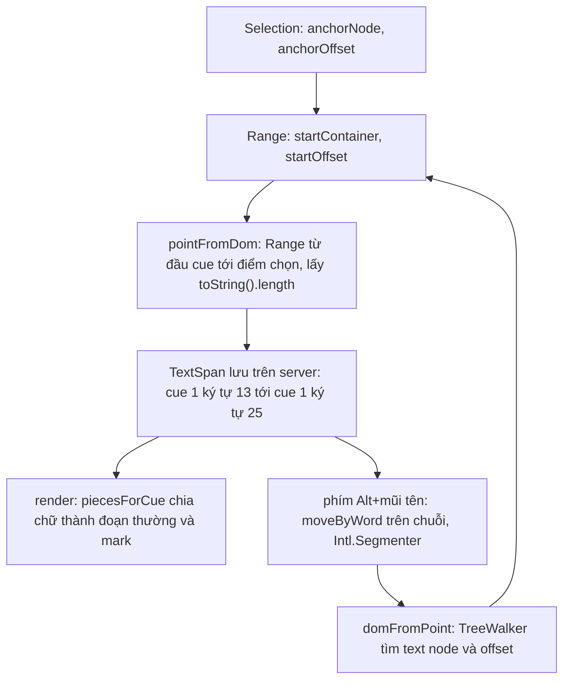

Video học trực tuyến luôn đi kèm phụ đề và transcript. Hai việc nghe đơn giản nhưng có nhiều chỗ để sai:

- **Giảng viên upload file phụ đề `.vtt`.** File gõ tay thường có lỗi: thời gian kết thúc trước thời gian bắt đầu, giây ghi "75", quên dòng `WEBVTT`. Để server phát hiện thì phải upload xong mới biết, còn trình phát video gặp file hỏng thì lặng lẽ bỏ qua cue lỗi.
- **Học viên bôi vàng một đoạn transcript** để ôn lại. Vùng bôi có thể trải qua nhiều câu, mỗi câu là một phần tử DOM riêng, và phải lưu lên server để lần sau mở lại vẫn thấy.

**Udemy** kiểm tra file `.vtt` ngay trên trình duyệt trước khi đẩy lên S3. **Coursera** có transcript tương tác: bấm vào câu để tua video, bôi chọn để lưu ghi chú, mở rộng vùng chọn bằng bàn phím cho người dùng trình đọc màn hình.

> [!TIP]
> **Tóm tắt**
> - Kiểm tra WebVTT phía client cho phản hồi ngay, nhưng nên báo **tất cả** lỗi kèm số dòng. Bản của Udemy dừng ở lỗi đầu tiên, và một regex thiếu ngoặc làm mọi cue có chữ "STYLE" bị bỏ qua.
> - Lưu vùng chọn theo **toạ độ của dữ liệu** (`{ cueIndex, offset }`), không theo DOM node. Nhờ vậy highlight sống sót qua re-render, và server không phải biết cấu trúc HTML.
> - `anchorOffset` của Selection tính trong **từng text node**. Khi câu đã có `<mark>`, chữ bị chia thành nhiều node: phải đo từ đầu câu bằng `Range.toString().length`.
> - Mở rộng vùng chọn theo từ: dùng `Intl.Segmenter` trên chuỗi dữ liệu, rồi đổi ngược ra `Range`. Cách này đơn giản hơn tự đi cây DOM như Coursera.

<iframe class="demo-frame" src="/demos/web-patterns/index.html?theme=dark#/transcript" title="Demo transcript" loading="lazy" style="height: 880px"></iframe>

<p class="demo-links">▶ <a href="/demos/web-patterns/index.html#/transcript" target="_blank" rel="noopener">Mở demo toàn màn hình ↗</a> · <a href="https://stackblitz.com/github/hunghg255/blog-hunghg/tree/master/examples/web-patterns?file=src/lib/transcript.ts" target="_blank" rel="noopener">Sửa code trên StackBlitz ↗</a> · <a href="https://github.com/hunghg255/blog-hunghg/blob/master/examples/web-patterns/src/lib/transcript.ts" target="_blank" rel="noopener">Xem source trên GitHub ↗</a></p>

Bấm **Lỗi bị bỏ sót**: cột "Kiểu Udemy" báo **OK**, trong khi file có chữ `-->` trong phụ đề và một mốc thời gian "01:75". Ở phần transcript, bôi "Hôm nay" rồi bôi tiếp một đoạn sau đó trong cùng câu: dòng trạng thái cho thấy offset thô của trình duyệt (5) khác hẳn vị trí thật trong câu (13).

## Udemy làm thế nào?

[`udemy.com/webpack---/src/udemy/js/caption/vtt-file-validator.js`](https://github.com/hunghg255/codebase/blob/main/udemy.com/webpack---/src/udemy/js/caption/vtt-file-validator.js) mở đầu bằng comment "front end file format validation before uploading to S3". File `s3-uploader.js` cùng thư mục đọc file bằng `FileReader.readAsText`, gọi validator, và chỉ cho fine-uploader đẩy lên S3 khi không có lỗi.

Mỗi lỗi là một `ValidationError` có `code`, thông điệp tiếng Anh (cho log) và thông điệp đã dịch (cho người dùng), kèm nguyên block lỗi để hiện ra:

```js
export class ValidationError extends Error {
  constructor(message, translatedMessage, code, block) { /* … */ }
  static getErrorForCode(errorCode, block = '') {
    const [message, translatedMessage] = errorStrings[errorCode];
    return new ValidationError(message, translatedMessage, errorCode, block);
  }
}
```

Một mẹo bảo mật nhỏ:

```js
const containsAlphaRegex = /[a-z]/i;
function saferParseFloat(string) {
  // Returns NaN if alpha characters exist so that hexadecimal notation can't be used.
  if (containsAlphaRegex.test(string)) return NaN;
  return Number(string);
}
```

`Number('0x1F')` là 31 và `Number('1e3')` là 1000. Chặn mọi chữ cái trước khi gọi `Number` thì "00:0x1F.000" không lọt qua.

Phần chính tách file thành block theo dòng trống, coi block đầu là header, rồi kiểm từng block:

```js
const blockRegexp = /(?:\r\n|\n){2,}/;   // comment ghi "CRLF, CR or LF" nhưng không có \r đứng riêng
const [headerBlock, ...bodyBlocks] = fileContents.split(blockRegexp);
bodyBlocks.forEach((bodyBlock) => {
  if (/^NOTE|STYLE|REGION/.test(bodyBlock)) return;   // không phải cue
  // … tìm dòng timing ở dòng 0 hoặc dòng 1 (dòng 0 là id của cue)
  if (!timings) throw ValidationError.getErrorForCode('MISSING_TIMINGS', bodyBlock);
  // … startOffset >= endOffset thì SINGLE_TIMING_END_BEFORE_START
});
```

Đọc kỹ có mấy lỗi:

- **`/^NOTE|STYLE|REGION/` thiếu ngoặc.** Toán tử `|` có độ ưu tiên thấp nhất, nên regex này nghĩa là "bắt đầu bằng NOTE" **hoặc** "có chữ STYLE ở bất kỳ đâu" **hoặc** "có chữ REGION ở bất kỳ đâu". Một cue tiếng Anh nói về "CSS STYLE" bị coi là block STYLE và không được kiểm tra gì. Đúng phải là `/^(?:NOTE|STYLE|REGION)\b/`.
- **Giây không bị giới hạn.** Phút được kiểm 0–59, giây thì không: "00:01:75.000" được chấp nhận thành 1 phút 75 giây. Spec yêu cầu phút và giây đúng hai chữ số, từ 00 tới 59.
- **Dừng ở lỗi đầu tiên** (dùng `throw`). File 300 cue có 5 lỗi thì giảng viên phải upload 5 lần.
- **Không kiểm thứ tự.** Spec WebVTT yêu cầu thời điểm bắt đầu của các cue không giảm dần. Code chỉ so `start >= end` trong từng cue.
- **`NO_CUE_BLOCKS` có thông điệp nhưng không bao giờ được ném**, nên file chỉ có dòng `WEBVTT` vẫn hợp lệ.
- Regex header `/^?WEBVTT(:?$|[ \t])/` có lẽ định viết `(?:` (nhóm không bắt) nhưng gõ thành `(:?` (dấu hai chấm tuỳ chọn). Hậu quả nhỏ: "WEBVTT:" cũng được chấp nhận.

## Coursera làm thế nào?

[`coursera.org/static/bundles/interactive-transcript/utils/TranscriptHighlighterUtils.ts`](https://github.com/hunghg255/codebase/blob/main/coursera.org/static/bundles/interactive-transcript/utils/TranscriptHighlighterUtils.ts). Mỗi câu (cue) render thành `<div class="rc-Phrase" data-cue-index="3">`, có `tabIndex=0` và `role="button"` để bấm vào thì tua video.

### Lưu vùng chọn theo cue

```ts
export const getTranscriptSelection = () => {
  const { anchorNode, anchorOffset, focusNode, focusOffset } = window.getSelection();
  const focusCueIndex = getCueIndexFromText(focusNode as Text);   // closest('.rc-Phrase')
  const anchorCueIndex = getCueIndexFromText(anchorNode as Text);
  if (anchorCueIndex < focusCueIndex) {
    transcriptTextStartIndex = { cueIndex: anchorCueIndex, textIndex: anchorOffset };
    transcriptTextEndIndex   = { cueIndex: focusCueIndex,  textIndex: focusOffset - 1 };
  } else if (anchorCueIndex === focusCueIndex) { /* min/max của hai offset */ }
  else { /* người dùng kéo ngược: đổi chỗ anchor và focus */ }
  return { transcriptTextStartIndex, transcriptTextEndIndex };
};
```

Ý tưởng chính đáng học: highlight lưu là `{ cueIndex, textIndex }`, **toạ độ trong dữ liệu transcript**, không phải XPath hay đường dẫn DOM. Khi render lại, `getHighlightedTextIndicesForCue` tính đoạn nào của câu cần bôi, và component dùng thư viện `react-highlight-words` với `findChunks` trả về chính các đoạn đó.

Chỗ yếu: `textIndex` lấy thẳng từ `anchorOffset`. Offset của Selection tính trong **text node chứa nó**, không phải trong cả câu. Câu chưa có highlight thì chỉ có một text node, hai giá trị trùng nhau. Nhưng câu đã có một đoạn bôi thì `react-highlight-words` chia chữ thành `[text][<mark>text</mark>][text]`. Chọn tiếp ở phần sau `<mark>` thì `anchorOffset` tính từ đầu text node thứ ba, nên highlight mới bị lưu lệch về đầu câu. Demo cho thấy đúng hiện tượng này: "offset thô: 5", vị trí thật là 13.

### Mở rộng vùng chọn bằng bàn phím

Người dùng trình đọc màn hình khó kéo chuột để chọn chữ. Coursera thêm phím tắt (`Ctrl`/`⌘` + mũi tên hoặc `h j k l`) gọi `expandSelection` và `contractSelection`:

```ts
const range = selection.getRangeAt(0);
const offsetAtBoundary = direction === 'left'
  ? targetOffset === 0
  : targetOffset >= targetContainer.length - 1;
// tới mép text node thì đi tìm text node kế bên trong cây DOM
const newContainer = offsetAtBoundary ? getAdjacentTextNode(targetContainer, direction) : targetContainer;
const wordStartingOffsets = getTextNodeWordStartingOffsets(newContainer); // split(' ') rồi cộng dồn độ dài
range.setEnd(newContainer, /* offset của từ kế tiếp */);
```

`getAdjacentTextNode` đi ngang anh em, leo lên cha, rồi đi xuống con để tìm text node gần nhất. Comment trong code có cả sơ đồ duyệt cây. Hàm `getTextNodesFromPhrase` thì ghi thẳng: "O(n²) nhưng cây chỉ có khoảng 5 node nên chấp nhận được".

Cách này chạy được nhưng gắn chặt với cấu trúc DOM: tách từ bằng `split(' ')` (không biết dấu câu, không biết tiếng không có dấu cách), dùng `length - 1` vì component render chữ kèm một dấu cách thừa ở cuối (`` `${cue.text} ` ``), và vòng `while` leo cây sẽ ném lỗi nếu chạm tới gốc tài liệu mà không tìm thấy anh em nào.

## Bên trong trình duyệt



- **Selection và Range.** `window.getSelection()` cho biết điểm neo (anchor, nơi bắt đầu kéo) và điểm focus (nơi đang dừng); người dùng kéo ngược thì focus đứng trước anchor. `selection.getRangeAt(0)` trả về `Range` luôn có `start` trước `end`, nên dùng Range khỏi phải tự so thứ tự như Coursera.
- **Offset tính theo container.** Nếu container là text node, offset là số code unit UTF-16 tính từ đầu node. Nếu container là element, offset là **chỉ số node con**. Vì vậy hai điểm "nhìn thấy giống nhau" có thể có cặp (node, offset) khác nhau.
- **`Range.toString()`** trả về chữ nằm giữa hai điểm, gom qua mọi text node bên trong. Đo độ dài từ đầu cue tới điểm chọn là cách đơn giản để đổi (node, offset) thành offset trong câu.
- **`TreeWalker` với `NodeFilter.SHOW_TEXT`** duyệt lần lượt các text node theo thứ tự tài liệu. Đây là cách đổi ngược từ offset trong câu ra (node, offset).

## Viết lại

`transcript.ts` có hai phần. Phần WebVTT báo đủ lỗi kèm số dòng. Định dạng thời gian được kiểm bằng một regex chỉ nhận chữ số, `/^(?:(\d{2,}):)?(\d{2}):(\d{2})\.(\d{3})$/`, rồi kiểm phút và giây ≤ 59, nên không cần `saferParseFloat`. Vòng kiểm từng block, với regex NOTE/STYLE/REGION đã có ngoặc:

```ts title=src/lib/transcript.ts
  let previousStart = -1;
  // block đầu tiên là header (WEBVTT + metadata), bỏ qua
  for (const block of blocks.slice(1)) {
    // NOTE/STYLE/REGION phải nằm ở ĐẦU block. Bản gốc viết /^NOTE|STYLE|REGION/ nên một cue có
    // chữ "STYLE" ở bất kỳ đâu cũng bị bỏ qua, không được kiểm tra.
    if (/^(?:NOTE|STYLE|REGION)(?:$|[ \t])/.test(block.lines[0])) continue;

    const timingAt = block.lines[0].includes('-->') ? 0 : block.lines[1]?.includes('-->') ? 1 : -1;
    if (timingAt === -1) {
      report('MISSING_TIMINGS', block.start);
      continue;
    }
    const timingLine = block.start + timingAt;
    const [rawStart, rest = ''] = block.lines[timingAt].split(/[ \t]+-->[ \t]+/);
    const start = parseTimestamp(rawStart);
    // sau thời điểm kết thúc có thể có cue settings: "00:01.000 --> 00:02.000 align:start"
    const end = parseTimestamp(rest.split(/[ \t]/)[0] ?? '');
    const payload = block.lines.slice(timingAt + 1);

    if (start === null || end === null) {
      report('BAD_TIMESTAMP', timingLine);
      continue;
    }
    if (end <= start) report('END_BEFORE_START', timingLine);
    if (start < previousStart) report('OUT_OF_ORDER', timingLine);
    if (videoLength !== undefined && start > videoLength * 1000) report('START_AFTER_VIDEO_END', timingLine);

    if (payload.length === 0) report('MISSING_TEXT', timingLine);
    else if (payload.some((l) => l.includes('-->'))) report('SEPARATOR_IN_TEXT', timingLine + 1);
    else if (cueTextToPlain(payload.join('\n')).trim() === '') report('EMPTY_TEXT', timingLine + 1);

    previousStart = Math.max(previousStart, start);
    cues.push({
      index: cues.length,
      id: timingAt === 1 ? block.lines[0] : undefined,
      start,
      end,
      text: cueTextToPlain(payload.join(' ')),
      line: timingLine,
    });
  }
```

Phần vùng chọn đổi qua lại giữa (node, offset) và `{ cueIndex, offset }`:

```ts title=src/lib/transcript.ts
/**
 * Đổi (node, offset) của trình duyệt thành toạ độ của cue. Offset của Selection tính trong
 * TỪNG text node; nếu cue đã có <mark> thì chữ bị chia thành nhiều text node, nên phải đo
 * độ dài từ đầu cue tới điểm đó (Range.toString), không dùng thẳng anchorOffset.
 */
export function pointFromDom(node: Node, offset: number, root: HTMLElement): TextPoint | null {
  const cueEl = cueElementOf(node, root);
  if (!cueEl) return null;
  const range = document.createRange();
  range.setStart(cueEl, 0);
  range.setEnd(node, offset);
  return { cueIndex: Number(cueEl.getAttribute(CUE_ATTR)), offset: range.toString().length };
}

export function spanFromSelection(selection: Selection | null, root: HTMLElement): TextSpan | null {
  if (!selection || selection.rangeCount === 0 || selection.isCollapsed) return null;
  const range = selection.getRangeAt(0); // Range luôn có start trước end, dù người dùng kéo ngược
  const start = pointFromDom(range.startContainer, range.startOffset, root);
  const end = pointFromDom(range.endContainer, range.endOffset, root);
  if (!start || !end || comparePoints(start, end) >= 0) return null;
  return { start, end };
}
```

## Đi qua code

1. **Gom block theo từng dòng** (thay vì `split` theo regex) để nhớ số dòng bắt đầu của mỗi block, báo lỗi kiểu "dòng 14". Chuẩn hoá `\r\n` và `\r` về `\n` trước, nên file soạn trên Mac cổ (CR) cũng đúng.
2. **`issues` là một mảng.** Mọi lỗi đều được ghi, block lỗi vẫn được parse tiếp nếu có thể (thiếu chữ vẫn có thời gian để kiểm thứ tự).
3. **`OUT_OF_ORDER`** so với thời điểm bắt đầu lớn nhất đã gặp. `START_AFTER_VIDEO_END` kiểm mọi cue chứ không riêng cue cuối.
4. **`cueTextToPlain`** bỏ thẻ (`<b>`, `<v Tên>`, mốc thời gian karaoke `<00:00:01.000>`) và entity bằng regex, nên lib chạy được trong Node và trong Web Worker. Udemy dùng `convertCueToDOMTree` của videojs-vtt, cần `window`.
5. **`pointFromDom`** tạo một Range từ đầu phần tử cue tới điểm chọn rồi lấy độ dài chữ, đúng dù cue có bao nhiêu `<mark>`.
6. **`moveByWord`** làm trên **chuỗi** của từng cue: lấy biên từ bằng `Intl.Segmenter` (`isWordLike` bỏ qua dấu câu và khoảng trắng), hết từ thì nhảy sang cue kế. Không đi cây DOM. Sau đó `applySpanToSelection` đổi ngược ra Range.
7. **`piecesForCue`** chia chữ thành đoạn thường và đoạn bôi, xử lý cả highlight chồng nhau. Render bằng React thuần, không cần `react-highlight-words`.

**Khác bản gốc:** Udemy ném lỗi đầu tiên, bản viết lại trả về mảng lỗi. Coursera đi cây DOM để mở rộng vùng chọn và lưu `textIndex` là chỉ số ký tự cuối (bao gồm), bản viết lại làm trên chuỗi và dùng `end` không bao gồm (giống `String.slice`). Phím tắt trong demo là `Alt` + mũi tên, vì `Ctrl`/`⌘` + mũi tên đã là phím di chuyển con trỏ theo từ của hệ điều hành.

::: spoiler Xem toàn bộ src/lib/transcript.ts

```ts title=src/lib/transcript.ts
/**
 * Phụ đề và transcript tương tác.
 *
 * Phần 1 - kiểm tra file WebVTT trước khi upload (ý tưởng từ caption/vtt-file-validator.js của
 * Udemy): báo TẤT CẢ lỗi kèm số dòng thay vì dừng ở lỗi đầu, sửa vài chỗ bản gốc bỏ sót.
 *
 * Phần 2 - bôi chọn trên transcript (ý tưởng từ TranscriptHighlighterUtils của Coursera): lưu
 * vùng chọn theo toạ độ { cueIndex, offset } thay vì theo DOM node, nên highlight sống sót qua
 * re-render; đổi qua lại giữa toạ độ này và Selection/Range của trình duyệt.
 */

// ======================= Phần 1: WebVTT =======================

export interface Cue {
  index: number;
  id?: string;
  /** mili giây */
  start: number;
  end: number;
  text: string;
  /** dòng (bắt đầu từ 1) của dòng timing trong file */
  line: number;
}

export type VttErrorCode =
  | 'NO_CONTENT'
  | 'MISSING_HEADER'
  | 'MISSING_TIMINGS'
  | 'BAD_TIMESTAMP'
  | 'END_BEFORE_START'
  | 'MISSING_TEXT'
  | 'EMPTY_TEXT'
  | 'SEPARATOR_IN_TEXT'
  | 'OUT_OF_ORDER'
  | 'START_AFTER_VIDEO_END'
  | 'NO_CUES';

export interface VttIssue {
  code: VttErrorCode;
  line: number;
  message: string;
}

const MESSAGES: Record<VttErrorCode, string> = {
  NO_CONTENT: 'File rỗng.',
  MISSING_HEADER: 'Dòng đầu phải là WEBVTT.',
  MISSING_TIMINGS: 'Có chữ nhưng thiếu dòng thời gian "00:00:01.000 --> 00:00:03.000".',
  BAD_TIMESTAMP: 'Thời gian sai định dạng (cần [hh:]mm:ss.ttt, phút và giây từ 00 tới 59).',
  END_BEFORE_START: 'Thời điểm kết thúc phải sau thời điểm bắt đầu.',
  MISSING_TEXT: 'Có thời gian nhưng không có chữ.',
  EMPTY_TEXT: 'Chỉ có thẻ định dạng, không có chữ.',
  SEPARATOR_IN_TEXT: 'Chữ phụ đề không được chứa "-->".',
  OUT_OF_ORDER: 'Thời điểm bắt đầu nhỏ hơn cue phía trên (cue phải xếp theo thời gian).',
  START_AFTER_VIDEO_END: 'Cue bắt đầu sau khi video đã hết.',
  NO_CUES: 'Không có cue nào.',
};

// [hh:]mm:ss.ttt theo spec: giờ ≥ 2 chữ số, phút/giây đúng 2 chữ số, mili giây đúng 3 chữ số
const TIMESTAMP = /^(?:(\d{2,}):)?(\d{2}):(\d{2})\.(\d{3})$/;

/** "01:02:03.456" -> 3723456 (ms). Trả null nếu sai định dạng. Regex chỉ nhận chữ số nên không lọt "0x1f" hay "1e3". */
export function parseTimestamp(value: string): number | null {
  const m = TIMESTAMP.exec(value.trim());
  if (!m) return null;
  const [, h = '0', mm, ss, ms] = m;
  const minutes = Number(mm);
  const seconds = Number(ss);
  if (minutes > 59 || seconds > 59) return null;
  return ((Number(h) * 60 + minutes) * 60 + seconds) * 1000 + Number(ms);
}

export function formatTimestamp(ms: number): string {
  const pad = (n: number, w = 2) => String(Math.floor(n)).padStart(w, '0');
  return `${pad(ms / 3_600_000)}:${pad((ms / 60_000) % 60)}:${pad((ms / 1000) % 60)}.${pad(ms % 1000, 3)}`;
}

const ENTITIES: Record<string, string> = { '&amp;': '&', '&lt;': '<', '&gt;': '>', '&nbsp;': ' ', '&lrm;': '', '&rlm;': '' };

/** Bỏ thẻ <b>, <v Tên>, <00:00:01.000>… và entity, còn lại là chữ người xem thấy. */
export function cueTextToPlain(text: string): string {
  return text.replace(/<[^>]*>/g, '').replace(/&(?:amp|lt|gt|nbsp|lrm|rlm);/g, (e) => ENTITIES[e]);
}

export interface ValidateOptions {
  /** độ dài video (giây), nếu biết */
  videoLength?: number;
}

export function validateWebVTT(input: string, { videoLength }: ValidateOptions = {}) {
  const issues: VttIssue[] = [];
  const cues: Cue[] = [];
  const report = (code: VttErrorCode, line: number) => issues.push({ code, line, message: MESSAGES[code] });

  if (input.trim().length === 0) {
    report('NO_CONTENT', 1);
    return { cues, issues };
  }

  // spec cho phép CRLF, LF và CR đứng một mình
  const lines = input.replace(/\r\n?/g, '\n').split('\n');
  if (!/^?WEBVTT(?:$|[ \t])/.test(lines[0])) report('MISSING_HEADER', 1);

  // gom các dòng thành block, ngăn cách bởi dòng trống; nhớ số dòng bắt đầu của block
  const blocks: Array<{ start: number; lines: string[] }> = [];
  let current: { start: number; lines: string[] } | null = null;
  lines.forEach((line, i) => {
    if (line.trim() === '') {
      current = null;
      return;
    }
    if (!current) {
      current = { start: i + 1, lines: [] };
      blocks.push(current);
    }
    current.lines.push(line);
  });

  let previousStart = -1;
  // block đầu tiên là header (WEBVTT + metadata), bỏ qua
  for (const block of blocks.slice(1)) {
    // NOTE/STYLE/REGION phải nằm ở ĐẦU block. Bản gốc viết /^NOTE|STYLE|REGION/ nên một cue có
    // chữ "STYLE" ở bất kỳ đâu cũng bị bỏ qua, không được kiểm tra.
    if (/^(?:NOTE|STYLE|REGION)(?:$|[ \t])/.test(block.lines[0])) continue;

    const timingAt = block.lines[0].includes('-->') ? 0 : block.lines[1]?.includes('-->') ? 1 : -1;
    if (timingAt === -1) {
      report('MISSING_TIMINGS', block.start);
      continue;
    }
    const timingLine = block.start + timingAt;
    const [rawStart, rest = ''] = block.lines[timingAt].split(/[ \t]+-->[ \t]+/);
    const start = parseTimestamp(rawStart);
    // sau thời điểm kết thúc có thể có cue settings: "00:01.000 --> 00:02.000 align:start"
    const end = parseTimestamp(rest.split(/[ \t]/)[0] ?? '');
    const payload = block.lines.slice(timingAt + 1);

    if (start === null || end === null) {
      report('BAD_TIMESTAMP', timingLine);
      continue;
    }
    if (end <= start) report('END_BEFORE_START', timingLine);
    if (start < previousStart) report('OUT_OF_ORDER', timingLine);
    if (videoLength !== undefined && start > videoLength * 1000) report('START_AFTER_VIDEO_END', timingLine);

    if (payload.length === 0) report('MISSING_TEXT', timingLine);
    else if (payload.some((l) => l.includes('-->'))) report('SEPARATOR_IN_TEXT', timingLine + 1);
    else if (cueTextToPlain(payload.join('\n')).trim() === '') report('EMPTY_TEXT', timingLine + 1);

    previousStart = Math.max(previousStart, start);
    cues.push({
      index: cues.length,
      id: timingAt === 1 ? block.lines[0] : undefined,
      start,
      end,
      text: cueTextToPlain(payload.join(' ')),
      line: timingLine,
    });
  }

  if (cues.length === 0 && !issues.some((i) => i.code !== 'MISSING_HEADER')) report('NO_CUES', lines.length);
  return { cues, issues };
}

// ======================= Phần 2: vùng chọn trên transcript =======================

/** Một điểm trong transcript: cue thứ mấy, ký tự thứ mấy trong chữ của cue đó. */
export interface TextPoint {
  cueIndex: number;
  offset: number;
}

/** Vùng chọn, `end` không tính (giống String.slice). */
export interface TextSpan {
  start: TextPoint;
  end: TextPoint;
}

export const CUE_ATTR = 'data-cue-index';

export function comparePoints(a: TextPoint, b: TextPoint): number {
  return a.cueIndex - b.cueIndex || a.offset - b.offset;
}

function cueElementOf(node: Node, root: HTMLElement): HTMLElement | null {
  const el = node.nodeType === Node.ELEMENT_NODE ? (node as Element) : node.parentElement;
  const cue = el?.closest<HTMLElement>(`[${CUE_ATTR}]`) ?? null;
  return cue && root.contains(cue) ? cue : null;
}

/**
 * Đổi (node, offset) của trình duyệt thành toạ độ của cue. Offset của Selection tính trong
 * TỪNG text node; nếu cue đã có <mark> thì chữ bị chia thành nhiều text node, nên phải đo
 * độ dài từ đầu cue tới điểm đó (Range.toString), không dùng thẳng anchorOffset.
 */
export function pointFromDom(node: Node, offset: number, root: HTMLElement): TextPoint | null {
  const cueEl = cueElementOf(node, root);
  if (!cueEl) return null;
  const range = document.createRange();
  range.setStart(cueEl, 0);
  range.setEnd(node, offset);
  return { cueIndex: Number(cueEl.getAttribute(CUE_ATTR)), offset: range.toString().length };
}

export function spanFromSelection(selection: Selection | null, root: HTMLElement): TextSpan | null {
  if (!selection || selection.rangeCount === 0 || selection.isCollapsed) return null;
  const range = selection.getRangeAt(0); // Range luôn có start trước end, dù người dùng kéo ngược
  const start = pointFromDom(range.startContainer, range.startOffset, root);
  const end = pointFromDom(range.endContainer, range.endOffset, root);
  if (!start || !end || comparePoints(start, end) >= 0) return null;
  return { start, end };
}

/** Ngược lại: từ toạ độ cue tìm text node và offset trong node đó. */
export function domFromPoint(point: TextPoint, root: HTMLElement): { node: Node; offset: number } | null {
  const cueEl = root.querySelector(`[${CUE_ATTR}="${point.cueIndex}"]`);
  if (!cueEl) return null;
  const walker = document.createTreeWalker(cueEl, NodeFilter.SHOW_TEXT);
  let remaining = point.offset;
  let last: Text | null = null;
  for (let node = walker.nextNode() as Text | null; node; node = walker.nextNode() as Text | null) {
    if (remaining <= node.length) return { node, offset: remaining };
    remaining -= node.length;
    last = node;
  }
  return last ? { node: last, offset: last.length } : { node: cueEl, offset: 0 };
}

export function applySpanToSelection(span: TextSpan, root: HTMLElement, selection = window.getSelection()) {
  const a = domFromPoint(span.start, root);
  const b = domFromPoint(span.end, root);
  if (!a || !b || !selection) return;
  const range = document.createRange();
  range.setStart(a.node, a.offset);
  range.setEnd(b.node, b.offset);
  selection.removeAllRanges();
  selection.addRange(range);
}

/** Vị trí đầu và cuối các "từ" trong chữ, theo Intl.Segmenter (đúng cả tiếng Việt, Nhật…). */
export function wordEdges(text: string, locale = 'vi'): { starts: number[]; ends: number[] } {
  const starts: number[] = [];
  const ends: number[] = [];
  for (const s of new Intl.Segmenter(locale, { granularity: 'word' }).segment(text)) {
    if (!s.isWordLike) continue;
    starts.push(s.index);
    ends.push(s.index + s.segment.length);
  }
  return { starts, ends };
}

/**
 * Dịch một điểm sang từ kế tiếp (sang phải: tới CUỐI từ tiếp theo; sang trái: về ĐẦU từ trước),
 * nhảy qua cue bên cạnh khi đã ở mép. Làm trên chuỗi chữ của cue nên không phải đi cây DOM.
 */
export function moveByWord(point: TextPoint, direction: 'left' | 'right', cues: readonly string[], locale = 'vi'): TextPoint {
  let { cueIndex, offset } = point;
  for (;;) {
    const { starts, ends } = wordEdges(cues[cueIndex] ?? '', locale);
    if (direction === 'right') {
      const next = ends.find((e) => e > offset);
      if (next !== undefined) return { cueIndex, offset: next };
      if (cueIndex >= cues.length - 1) return { cueIndex, offset: (cues[cueIndex] ?? '').length };
      cueIndex += 1;
      offset = 0;
    } else {
      const prev = [...starts].reverse().find((s) => s < offset);
      if (prev !== undefined) return { cueIndex, offset: prev };
      if (cueIndex <= 0) return { cueIndex: 0, offset: 0 };
      cueIndex -= 1;
      offset = (cues[cueIndex] ?? '').length;
    }
  }
}

/** Dịch một điểm tới đầu/cuối cue (kiểu "phrase" của Coursera). */
export function moveByCue(point: TextPoint, direction: 'left' | 'right', cues: readonly string[]): TextPoint {
  const len = (i: number) => (cues[i] ?? '').length;
  if (direction === 'right') {
    if (point.offset < len(point.cueIndex)) return { cueIndex: point.cueIndex, offset: len(point.cueIndex) };
    const next = Math.min(point.cueIndex + 1, cues.length - 1);
    return { cueIndex: next, offset: len(next) };
  }
  if (point.offset > 0) return { cueIndex: point.cueIndex, offset: 0 };
  return { cueIndex: Math.max(point.cueIndex - 1, 0), offset: 0 };
}

export interface Piece {
  text: string;
  highlightId?: string;
}

/** Cắt chữ một cue thành các đoạn thường / đoạn được bôi, để render <mark>. */
export function piecesForCue(cueIndex: number, text: string, highlights: ReadonlyArray<TextSpan & { id: string }>): Piece[] {
  const marks = highlights
    .filter((h) => h.start.cueIndex <= cueIndex && h.end.cueIndex >= cueIndex)
    .map((h) => ({
      id: h.id,
      from: h.start.cueIndex === cueIndex ? h.start.offset : 0,
      to: h.end.cueIndex === cueIndex ? h.end.offset : text.length,
    }))
    .filter((m) => m.to > m.from)
    .sort((a, b) => a.from - b.from);

  const pieces: Piece[] = [];
  let cursor = 0;
  for (const m of marks) {
    const from = Math.max(m.from, cursor); // các highlight chồng nhau: đoạn sau bắt đầu từ chỗ đoạn trước dừng
    if (from > cursor) pieces.push({ text: text.slice(cursor, from) });
    if (m.to > from) pieces.push({ text: text.slice(from, m.to), highlightId: m.id });
    cursor = Math.max(cursor, m.to);
  }
  if (cursor < text.length) pieces.push({ text: text.slice(cursor) });
  return pieces;
}
```

:::

## Tại sao không làm cách khác?

**Để `<track>` của trình duyệt tự parse rồi đọc `track.cues`?** Trình duyệt bỏ qua cue lỗi mà không báo gì, nên không biết lỗi ở dòng nào. Chỉ dùng được để biết "parse ra bao nhiêu cue".

**Lưu highlight bằng XPath hoặc chuỗi CSS selector tới text node?** Phụ thuộc HTML: đổi component, thêm một `<span>` là mọi highlight cũ trỏ sai chỗ. Toạ độ theo dữ liệu (cue thứ mấy, ký tự thứ mấy) chỉ đổi khi chính transcript đổi.

**Dùng `selection.modify('extend', 'forward', 'word')`?** API này không có trong spec nhưng Chromium, Firefox và Safari đều hỗ trợ, và tách từ theo dữ liệu ICU của trình duyệt. Đáng dùng nếu chỉ cần mở rộng vùng chọn. Bản viết lại tự làm vì cần điều khiển chính xác (dừng ở cuối từ, nhảy theo cue) và test được trong Node.

**CSS Custom Highlight API** (`CSS.highlights` + `::highlight()`) vẽ highlight từ các `Range` mà không chèn `<mark>` vào DOM, nên không chia text node và không làm lệch offset. Nó hợp với highlight tạm (kết quả tìm kiếm). Với highlight lưu lâu dài, vẫn cần lưu toạ độ dữ liệu như trên, chỉ thay phần render.

## Edge case và cạm bẫy

- **Offset tính theo code unit UTF-16.** Emoji chiếm 2 code unit (hoặc hơn), chữ tiếng Việt dạng tổ hợp (NFD) có dấu là ký tự riêng. Server và client phải cùng một cách đếm, và nên chuẩn hoá NFC trước khi lưu transcript.
- **Khoảng trắng giữa các cue** nằm ngoài phần tử cue. Vùng chọn bắt đầu đúng vào khoảng trắng đó thì `pointFromDom` trả `null`. Có thể kẹp về cue gần nhất nếu muốn chấp nhận.
- **Transcript đổi sau khi đã có highlight** (giảng viên sửa phụ đề): offset cũ không còn đúng. Lưu kèm đoạn chữ được bôi (`text`) để phát hiện lệch, và thử tìm lại bằng chuỗi.
- **Bấm vào câu để tua** dễ đá nhau với việc chọn chữ: kéo chọn xong nhả chuột cũng sinh `click`. Demo bỏ qua click khi `selection.isCollapsed === false`. Coursera xoá vùng chọn cũ trong `mousedown`.
- **`<track>` hiển thị trực tiếp file đã kiểm.** Cue settings như `align:start`, `line:0` phải được giữ lại khi parse, đừng cắt bỏ khi lưu.
- **File lớn**: kiểm tra chạy đồng bộ. Phụ đề vài nghìn cue vẫn nhanh, nhưng nếu muốn kiểm khi người dùng đang gõ trong editor thì nên debounce hoặc đưa vào Web Worker.

## Dùng trong dự án

```ts
import { validateWebVTT } from './transcript';

input.addEventListener('change', async () => {
  const file = input.files?.[0];
  if (!file) return;
  const { issues, cues } = validateWebVTT(await file.text(), { videoLength: video.duration });
  if (issues.length) return showErrors(issues); // "dòng 14: Chữ phụ đề không được chứa -->"
  await upload(file);
  console.log(`${cues.length} cue hợp lệ`);
});
```

Lưu highlight:

```ts
const span = spanFromSelection(window.getSelection(), transcriptEl);
if (span) await api.saveHighlight({ lectureId, ...span }); // { start: { cueIndex, offset }, end: {…} }
```

::: spoiler Ví dụ test (bản phác, không có trong repo)

```ts
// @vitest-environment jsdom
import { describe, expect, it } from 'vitest';
import { moveByWord, parseTimestamp, piecesForCue, pointFromDom, validateWebVTT } from './transcript';

describe('validateWebVTT', () => {
  it('báo đủ lỗi kèm số dòng', () => {
    const file = ['WEBVTT', '', '00:00:02.000 --> 00:00:01.000', 'Ngược', '', '00:00:03.000 --> 00:00:04.000', 'MY STYLE --> X'].join('\n');
    const { issues } = validateWebVTT(file);
    expect(issues.map((i) => [i.code, i.line])).toEqual([
      ['END_BEFORE_START', 3],
      ['SEPARATOR_IN_TEXT', 7],
    ]);
  });
  it('NOTE chỉ được nhận ở đầu block', () => {
    const { cues } = validateWebVTT('WEBVTT\n\nNOTE ghi chú\n\n00:01.000 --> 00:02.000\nCSS STYLE');
    expect(cues).toHaveLength(1);
  });
  it('chấp nhận CR đứng một mình', () => {
    expect(validateWebVTT('WEBVTT\r\r00:01.000 --> 00:02.000\rXin chào').issues).toEqual([]);
  });
  it('timestamp', () => {
    expect(parseTimestamp('01:02:03.456')).toBe(3723456);
    expect(parseTimestamp('00:01:75.000')).toBeNull();
    expect(parseTimestamp('00:0x1F.000')).toBeNull();
  });
});

describe('vùng chọn', () => {
  it('offset tính trong cả cue, kể cả khi cue có <mark>', () => {
    document.body.innerHTML = '<div id="t"><span data-cue-index="0">Xin <mark>chào</mark> các bạn</span></div>';
    const root = document.getElementById('t')!;
    const lastText = root.querySelector('span')!.lastChild!; // " các bạn"
    expect(pointFromDom(lastText, 1, root)).toEqual({ cueIndex: 0, offset: 9 }); // "Xin chào " = 9 ký tự
  });
  it('moveByWord nhảy sang cue kế', () => {
    const cues = ['Xin chào', 'các bạn'];
    expect(moveByWord({ cueIndex: 0, offset: 8 }, 'right', cues)).toEqual({ cueIndex: 1, offset: 3 });
    expect(moveByWord({ cueIndex: 1, offset: 0 }, 'left', cues)).toEqual({ cueIndex: 0, offset: 4 });
  });
  it('piecesForCue với highlight trải qua nhiều cue', () => {
    const h = [{ id: 'a', start: { cueIndex: 0, offset: 4 }, end: { cueIndex: 1, offset: 3 } }];
    expect(piecesForCue(1, 'các bạn', h)).toEqual([{ text: 'các', highlightId: 'a' }, { text: ' bạn' }]);
  });
});
```

:::

## So với chuẩn web và thư viện

- **Spec WebVTT** ([W3C](https://www.w3.org/TR/webvtt1/)) mô tả thuật toán parse đầy đủ: cue settings, `REGION`, `STYLE` (CSS cho `::cue`), thẻ `<v>`, `<c>`, `<ruby>`. Validator trong bài kiểm những lỗi hay gặp nhất khi gõ tay, không thay được parser đầy đủ.
- Thư viện **`vtt.js`** (Mozilla, dùng trong video.js) và **`webvtt-parser`** parse theo spec. Coursera có một bản copy của `node-webvtt` trong `webvttParser.ts`.
- **CSS Custom Highlight API** đã có ở Chromium và Safari; Firefox thêm gần đây hơn (xem [caniuse](https://caniuse.com/mdn-api_highlight)). Khi dùng được, nó thay phần `piecesForCue`/`<mark>` mà vẫn giữ nguyên cách lưu `{ cueIndex, offset }`.

---

Bài này thuộc series **[Học từ mã nguồn các web lớn](/series/web)** (65 bài, đọc theo thứ tự).

::: spoiler Xem nhanh danh sách bài trong series

*Mở đầu*

- [Mở đầu: đọc code production của 28 trang web](/blogs/learn-from-big-web-apps)

*Phần 1: trải nghiệm người dùng*

- [#1 Dark mode không nháy (Gatsby)](/blogs/web-dark-mode-no-flash)
- [#2 useValueByMedia: giá trị theo breakpoint (Toptal)](/blogs/web-use-value-by-media)
- [#3 Đoán ý định: idle, exit-intent, lắc chuột (Toptal, InVision)](/blogs/web-user-intent-idle-exit-wiggle)
- [#4 Validate form thân thiện (Udacity, Pipedrive)](/blogs/web-form-validation-ux)
- [#5 Magic number, EXIF và dán ảnh (Ello)](/blogs/web-file-magic-number-exif-paste)
- [#6 fastSmoothScroll: cuộn xa vẫn nhanh (Telegram)](/blogs/web-telegram-fast-smooth-scroll)
- [#7 Countdown time-travel và tombstone giỏ hàng (Best Buy)](/blogs/web-countdown-time-travel-tombstone)

*Phần 2: hiệu năng và đo lường*

- [#8 Hàng đợi requestAnimationFrame 3ms (Apple)](/blogs/web-raf-queue-3ms)
- [#9 srcset cho artwork và preconnect tự động (Apple)](/blogs/web-responsive-artwork-preconnect)
- [#10 Quick-fetch: gọi API trước khi bundle tải xong (HubSpot)](/blogs/web-quick-fetch-early-requests)
- [#11 Performance span và long task (Postman, Calibre)](/blogs/web-performance-spans-long-tasks)
- [#12 Gọi Web Worker như hàm async (Telegram)](/blogs/web-worker-promise-rpc)
- [#13 Đồng hồ media: đếm giờ xem và sửa lệch (Skillshare, Simplified)](/blogs/web-media-clock-watch-time-drift)

*Phần 3: nhiều tab, phiên đăng nhập, cập nhật*

- [#14 Bầu tab chủ cho thông báo (HubSpot, Telegram)](/blogs/web-leader-tab-notifications)
- [#15 Đồng bộ đăng nhập giữa tab và giới hạn cookie (Elastic, InVision)](/blogs/web-cross-tab-auth-cookie-guard)
- [#16 SPA tự cập nhật: Trello, Zappos, Facebook, Elastic](/blogs/web-spa-self-update-strategies)

*Phần 4: kiến trúc*

- [#17 Reverse portal: di chuyển component không remount (Zappos)](/blogs/web-reverse-portal)
- [#18 Page behaviors: gắn hành vi từ CMS (Intercom)](/blogs/web-page-behaviors-cms)
- [#19 Giới hạn tần suất hiển thị bằng bitmask (Outlook)](/blogs/web-frequency-cap-bitmask)
- [#20 Chuyển REST sang GraphQL dần dần (Coursera)](/blogs/web-rest-to-graphql-hybrid-link)

*Phần 5: soạn thảo và hiển thị nội dung*

- [#21 Autocomplete tại con trỏ trong contenteditable (Ello, Telegram)](/blogs/web-caret-autocomplete-contenteditable)
- [#22 Dark mode cho email HTML bằng CIELAB (Outlook)](/blogs/web-email-dark-mode-cielab)
- [#23 Thu nhỏ bảng rộng cho vừa khung, vá font emoji (Outlook)](/blogs/web-email-wide-content-scale)
- [#24 Cảnh báo quên đính kèm file (Outlook)](/blogs/web-forgotten-attachment-warning)
- [#25 Cắt chữ nhiều dòng chính xác (Pipedrive, Apple, Toptal)](/blogs/web-multiline-truncate-measure-text)
- [#26 Parse ngày giờ gõ tay khoan dung (Outlook, Elastic)](/blogs/web-lenient-date-parser)

*Phần 6: tương tác*

- [#27 menuAim: rê chéo vào submenu không bị đóng (Udemy)](/blogs/web-menu-aim-triangle)
- [#28 Kéo, vuốt chung cho chuột và cảm ứng (Telegram)](/blogs/web-unified-pointer-gestures)
- [#29 Phím tắt theo phạm vi, IME và bàn phím phi Latinh (Trello)](/blogs/web-scoped-keyboard-shortcuts)
- [#30 Nội suy màu: đổi theme và nền theo cuộn (Telegram, Anchor)](/blogs/web-color-interpolation-theme-scroll)
- [#31 Đường gióng hút cạnh và undo/redo trên canvas (Simplified)](/blogs/web-canvas-snap-guides-undo)
- [#32 Giả lập mù màu bằng feColorMatrix (Trello)](/blogs/web-color-vision-simulator)
- [#33 Vạch thước theo mức zoom và cấp phát màu cho biểu đồ (Anchor, Similarweb)](/blogs/web-timeline-ticks-color-stack)

*Phần 7: mạng, dữ liệu và async*

- [#34 Ô tìm kiếm chuẩn production (Similarweb, Udemy, Pipedrive)](/blogs/web-production-search-box)
- [#35 Điều phối async: latest-wins, single-flight (Glitch, Toptal)](/blogs/web-async-coordination-latest-wins)
- [#36 Polling thưa dần và debounce động (Trello)](/blogs/web-decaying-polling-dynamic-debounce)
- [#37 Cache phía client theo version (Similarweb, Telegram, Udemy)](/blogs/web-client-cache-versioned)
- [#38 Upload file lớn theo chunk (Outlook, Tribe)](/blogs/web-chunked-upload-pipeline)
- [#39 Phát video qua Service Worker bằng Range request (Telegram, Outlook)](/blogs/web-service-worker-range-streaming)

*Phần 8: hiệu năng và vận hành*

- [#40 TTI governor: hoãn việc phụ tới sau khi trang dùng được (Outlook)](/blogs/web-tti-governor)
- [#41 Tự đo LCP/CLS/TBT và phục vụ bản nhẹ cho máy yếu (Udemy)](/blogs/web-rum-adaptive-loading)

*Phần 9: thuật toán và dữ liệu phía client*

- [#42 Three-way merge ngay trên trình duyệt (Postman)](/blogs/web-three-way-merge-client)
- [#43 Dọn cache GraphQL bằng đếm tham chiếu (Outlook)](/blogs/web-graphql-cache-refcount-gc)
- [#44 LRU cache theo 3 cách (Apple, Similarweb, Outlook)](/blogs/web-lru-cache-three-ways)
- [#45 Lọc tăng dần trong Web Worker (Similarweb)](/blogs/web-incremental-filter-worker)
- [#46 Xếp hạng gợi ý trên client, so ngầm với server (Outlook)](/blogs/web-client-side-ranking-shadow-test)
- [#47 Nối OT với editor: undo stack và chặn echo (Glitch)](/blogs/web-ot-codemirror-undo)
- [#48 Ngôn ngữ markup riêng dịch hai chiều với HTML (Coursera)](/blogs/web-custom-markup-compiler)

*Phần 10: thời gian, ngôn ngữ, định dạng*

- [#49 Xử lý giờ mùa hè không cần thư viện (Udemy, Pipedrive)](/blogs/web-dst-without-library)
- [#50 Intl thực chiến: Segmenter, số rút gọn, số nhiều, fallback locale (Apple, Outlook)](/blogs/web-intl-in-production)
- **#51 WebVTT và bôi chọn transcript (Udemy, Coursera)** (bài này)

*Phần 11: tương tác và giao diện*

- [#52 Kéo-thả trên lịch (Pipedrive)](/blogs/web-calendar-drag-drop)
- [#53 Focus stack cho popup lồng nhau (Outlook)](/blogs/web-focus-stack-nested-popups)
- [#54 Clipboard: copy, dán chữ thuần, dán thông minh (Trello, Anchor, Pipedrive, Tribe)](/blogs/web-clipboard-tricks)
- [#55 Khôi phục vị trí cuộn khi trang còn đang tải (Apple, Zappos)](/blogs/web-scroll-restore-wait-height)
- [#56 Lấy màu từ ảnh: gradient nền, màu chữ (Apple, Telegram, Trello)](/blogs/web-colors-from-images)
- [#57 JS đọc breakpoint từ CSS, phát hiện chế độ PWA (Ello, Apple)](/blogs/web-css-js-breakpoint-bridge)

*Phần 12: media*

- [#58 Tin nhắn thoại: ghi âm, waveform realtime, nén 5-bit (Telegram)](/blogs/web-voice-message-waveform)
- [#59 Chụp frame video thành ảnh, canvas bị taint (Coursera, Outlook)](/blogs/web-video-frame-snapshot)

*Phần 13: đo lường, bảo mật, vận hành*

- [#60 Đo lúc ảnh màn hình đầu tải xong, cả khi chuyển trang SPA (Zappos, Best Buy, Outlook)](/blogs/web-above-the-fold-image-timing)
- [#61 Buffer analytics chờ SDK, phát hiện adblock (Best Buy)](/blogs/web-analytics-buffer-adblock)
- [#62 Proof-of-work trên client để chặn API ẩn danh (Udemy)](/blogs/web-client-proof-of-work)
- [#63 Prefetch không làm lệch số liệu, nén cài đặt bằng bit (Outlook)](/blogs/web-synthetic-prefetch-bit-flags)
- [#64 Micro-frontend: AngularJS và React chung app, giao tiếp xuyên frame (Similarweb, InVision, HubSpot)](/blogs/web-micro-frontend-bridges)

:::

Code + demo: [`examples/web-patterns`](https://github.com/hunghg255/blog-hunghg/tree/master/examples/web-patterns) · [Mở trên StackBlitz](https://stackblitz.com/github/hunghg255/blog-hunghg/tree/master/examples/web-patterns)
