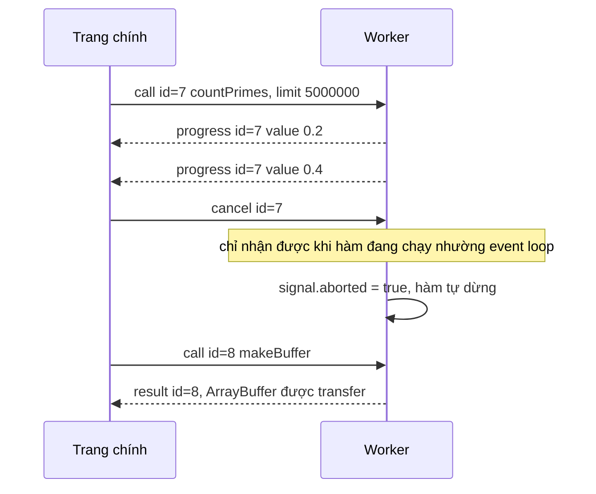

Web Worker cho phép chạy JavaScript trên một luồng khác, để việc nặng (giải mã, nén, parse file lớn, tính toán) không làm đứng giao diện. Nhưng API gốc rất thô: hai bên chỉ có `postMessage` và sự kiện `message`. Muốn "gọi hàm `countPrimes(5_000_000)` trong worker và nhận kết quả" thì bạn phải tự đặt id cho từng lời gọi, tự ghép câu trả lời với đúng lời gọi, tự chuyển lỗi về, tự lo tiến độ và việc huỷ.

Telegram Web (bản web.telegram.org/a) chạy cả thư viện MTProto (giao thức của Telegram) lẫn bộ render sticker động RLottie trong worker. Lớp nối hai bên của họ chỉ khoảng 240 dòng chia hai file, và đáng học vì nó trả lời gọn những câu hỏi trên.

> [!TIP]
> **Tóm tắt**
> - Mỗi lời gọi một id; trang chính giữ `Map<id, { resolve, reject }>`, worker trả về `{ id, response | error }`.
> - Tiến độ: callback cuối cùng của lời gọi được thay bằng tin nhắn `progress` mang cùng id.
> - Huỷ là **hợp tác**: chỉ bật một cờ, hàm trong worker phải tự kiểm tra cờ đó, và phải nhường event loop thì mới nhận được lệnh huỷ.
> - Dữ liệu lớn (ArrayBuffer) thì chuyển quyền sở hữu (transfer) thay vì sao chép. Worker sập thì phải từ chối mọi lời gọi đang chờ.

<iframe class="demo-frame" src="/demos/web-patterns/index.html?theme=dark#/worker-rpc" title="Demo worker-rpc" loading="lazy" style="height: 760px"></iframe>

<p class="demo-links">▶ <a href="/demos/web-patterns/index.html#/worker-rpc" target="_blank" rel="noopener">Mở demo toàn màn hình ↗</a> · <a href="https://stackblitz.com/github/hunghg255/blog-hunghg/tree/master/examples/web-patterns?file=src/lib/workerRpc.ts" target="_blank" rel="noopener">Sửa code trên StackBlitz ↗</a> · <a href="https://github.com/hunghg255/blog-hunghg/blob/master/examples/web-patterns/src/lib/workerRpc.ts" target="_blank" rel="noopener">Xem source trên GitHub ↗</a></p>

Bấm "Đếm trên main thread": ô vuông đứng hình khoảng 1,5 giây, chỉ số "khung hình dài nhất" nhảy lên hơn 1.000ms. Cùng việc đó chạy trong worker: ô vuông vẫn chạy đều, khung dài nhất khoảng 16–30ms.

## Bên trong trình duyệt: postMessage, structured clone và transfer



- **Structured clone**: `postMessage` sao chép sâu dữ liệu (object, mảng, Map, Date, ArrayBuffer…). Không gửi được hàm, DOM node, hay class instance với prototype của nó (đến nơi chỉ còn object thường). Vì vậy callback tiến độ không thể "gửi sang" worker, phải giả lập bằng tin nhắn.
- **Transfer**: `postMessage(msg, [buffer])` chuyển hẳn quyền sở hữu `ArrayBuffer` sang bên kia, gần như tức thì bất kể kích thước. Bên gửi mất buffer: `byteLength` thành 0. Nút "Nhận 64MB (transfer)" trong demo mất vài chục mili giây, phần lớn là thời gian worker tạo và điền buffer.
- **Một luồng, một hàng đợi**: worker cũng có event loop riêng. Khi một hàm đồng bộ đang chạy, tin nhắn mới (kể cả `cancel`) nằm chờ cho tới khi hàm đó trả quyền điều khiển.

## Telegram làm thế nào?

### 1. Phía trang chính: `WorkerConnector`

[`web.telegram.org/src/util/WorkerConnector.ts`](https://github.com/hunghg255/codebase/blob/main/web.telegram.org/src/util/WorkerConnector.ts) là một class bọc `Worker`:

```ts
request(messageData: { name: string; args: any }) {
  const messageId = generateIdFor(requestStates);
  const payload: CallMethodData = { type: 'callMethod', messageId, ...messageData };
  const requestState = { messageId } as RequestStates;
  const promise: Promise<any> = new Promise((resolve, reject) => {
    Object.assign(requestState, { resolve, reject });
  });
  if (typeof payload.args[payload.args.length - 1] === 'function') {
    const callback = payload.args.pop() as AnyToVoidFunction;
    requestState.callback = callback;
    requestStatesByCallback.set(callback, requestState);
  }
  // … requestStates.set, xoá khỏi hai Map khi promise xong …
  worker.postMessage(payload);
  return promise;
}
```

Quy ước đơn giản: **nếu đối số cuối là hàm thì đó là callback tiến độ**. Hàm bị gỡ khỏi `args` (vì không clone được), giữ lại ở trang chính, và còn được đánh chỉ mục ngược `callback → request` để huỷ theo callback: `cancelCallback(progressCallback)` bật `progressCallback.isCanceled = true` rồi gửi `{ type: 'cancelProgress', messageId }`.

Bộ lắng nghe xử lý ba loại tin: `methodResponse` (resolve/reject), `methodCallback` (gọi callback với `callbackArgs`), `unhandledError` (ném lỗi ra).

### 2. Phía worker: `createWorkerInterface`

[`src/util/createWorkerInterface.ts`](https://github.com/hunghg255/codebase/blob/main/web.telegram.org/src/util/createWorkerInterface.ts) nhận một object API và gắn `onmessage`:

```ts
const callback = (...callbackArgs: any[]) => {
  const lastArg = callbackArgs[callbackArgs.length - 1];
  sendToOrigin({ type: 'methodCallback', messageId, callbackArgs },
    lastArg instanceof ArrayBuffer ? [lastArg] : undefined);
};
callbackState.set(messageId, callback);
args.push(callback);
const [response, arrayBuffers] = (await api[name](...args)) || [];
```

Mỗi lời gọi được gắn một callback "giả" ở cuối `args`: hàm trong worker gọi nó như gọi callback thật, nó gửi tin `methodCallback` về. Đối số cuối là `ArrayBuffer` thì transfer luôn (RLottie gửi từng khung hình đã render theo cách này: lời gọi `renderFrames` có callback `onFrameLoad(frameIndex, arrayBuffer)`). Hàm API trả về một tuple `[response, arrayBuffers]` để chỉ định buffer nào được transfer trong kết quả.

Khi nhận `cancelProgress`, worker chỉ bật `callback.isCanceled = true`. Việc dừng thật nằm trong code nghiệp vụ, vd vòng tải file của gramjs (`src/lib/gramjs/client/downloadFile.ts`):

```ts
if (progressCallback.isCanceled) {
  throw new Error('USER_CANCELED');
}
```

Đây là huỷ hợp tác: vòng tải kiểm tra cờ sau mỗi phần (chunk) tải về. Nhờ mỗi phần là một `await` mạng, worker luôn có dịp nhận tin `cancelProgress`.

`handleErrors()` bắt `self.onerror` và `unhandledrejection`, gửi `unhandledError` về trang chính.

### 3. Ai dùng?

- `src/lib/rlottie/RLottie.ts` tạo sẵn `MAX_WORKERS` worker, mỗi cái một `WorkerConnector`, và chia sticker cho chúng theo vòng tròn (`cycleRestrict(MAX_WORKERS, ++lastWorkerIndex)`). Callback `onRendererInit` báo số khung hình khi worker khởi tạo xong.
- `src/api/gramjs/worker/provider.ts` có một bản sao cùng giao thức (`makeRequest`, `cancelApiProgress`) cho worker MTProto, thêm loại tin `update` để worker đẩy sự kiện realtime (tin nhắn mới…) về giao diện.

### 4. Chỗ nên làm khác

- **`generateIdFor` không làm đúng tên của nó.** File `src/util/generateIdFor.ts` bỏ qua tham số, sinh id ngẫu nhiên và lưu vào một `Map` dùng chung, rồi kiểm tra trùng bằng `store.hasOwnProperty(id)`. `hasOwnProperty` trên `Map` luôn `false` (entry của Map không phải property), nên vòng `do…while` chạy đúng một lần, còn `Map` thì lớn dần theo số lời gọi, không bao giờ được dọn. Xác suất trùng id ngẫu nhiên rất thấp nên lỗi này vô hại trong thực tế, nhưng một bộ đếm tăng dần là đủ và đơn giản hơn.
- **`unhandledError` bị `throw` trong listener**: lỗi xuất hiện trong console, nhưng các promise đang chờ không bao giờ settle. Lời gọi nào đang `await` sẽ treo.
- **Huỷ chỉ hoạt động khi biết đúng hàm callback**: lời gọi không có callback tiến độ thì không huỷ được.
- **Kiểu**: `args: any`, `response: any` (chính file có `// TODO Replace any with proper generics`).

## Viết lại

Thay đổi chính: API trong worker có dạng `(input, ctx)` với `ctx = { progress, signal, transfer }`; huỷ bằng `AbortSignal` chuẩn; kiểu của input, progress và kết quả suy ra từ chính object API trong worker.

### Phía trang chính

```ts title=src/lib/workerRpc.ts
  function call<K extends keyof Api & string>(
    name: K,
    input: InputOf<Api[K]>,
    { onProgress, signal, transfer = [] }: CallOptions<ProgressOf<Api[K]>> = {},
  ): Promise<ResultOf<Api[K]>> {
    if (signal?.aborted) return Promise.reject(signal.reason);
    const id = nextId++;
    return new Promise((resolve, reject) => {
      const onAbort = () => {
        pending.delete(id);
        worker.postMessage({ type: 'cancel', id } satisfies CancelMessage);
        reject(signal!.reason);
      };
      signal?.addEventListener('abort', onAbort, { once: true });
      pending.set(id, {
        resolve: resolve as (value: unknown) => void,
        reject,
        onProgress: onProgress as ((value: unknown) => void) | undefined,
        cleanup: () => signal?.removeEventListener('abort', onAbort),
      });
      worker.postMessage({ type: 'call', id, name, input } satisfies CallMessage, transfer);
    });
  }
```

Huỷ: trang chính **từ chối ngay** (UI không phải chờ), xoá id khỏi `pending` để mọi tin đến muộn bị bỏ qua, và gửi `cancel` cho worker.

Bộ lắng nghe tin nhắn tra `pending.get(id)`: không thấy (đã huỷ, đã xong) thì bỏ qua; `progress` gọi `onProgress`; `result`/`error` thì resolve/reject rồi xoá. Hàm `failAll` từ chối mọi lời gọi đang chờ; nó chạy khi worker báo `fatal`, khi file worker không tải được (sự kiện `error` trên đối tượng `Worker`) và khi `terminate()`.

### Phía worker

```ts title=src/lib/workerRpcHost.ts
    const { id, name, input } = data;
    const controller = new AbortController();
    running.set(id, controller);
    const transfer: ArrayBuffer[] = [];
    const ctx: CallContext<unknown> = {
      signal: controller.signal,
      progress: (value) => {
        if (!controller.signal.aborted) post({ type: 'progress', id, value });
      },
      transfer: (...buffers) => transfer.push(...buffers),
    };

    try {
      const fn = api[name];
      if (!fn) throw new Error(`Không có hàm "${name}" trong worker`);
      const value = await fn(input as never, ctx as CallContext<never>);
      // đã huỷ thì phía trang chính không chờ nữa, khỏi gửi
      if (!controller.signal.aborted) post({ type: 'result', id, value }, transfer);
    } catch (error) {
      // throw 'chuỗi' hay throw null cũng phải ra một lỗi gửi được
      const err = error instanceof Error ? error : new Error(String(error));
      if (!controller.signal.aborted) post({ type: 'error', id, error: { name: err.name, message: err.message } });
    } finally {
      running.delete(id);
    }
  });
```

Hàm trong worker nhận một `AbortSignal` thật: dùng `signal.throwIfAborted()` trong vòng lặp, hoặc truyền thẳng vào `fetch(url, { signal })`.

::: spoiler Xem toàn bộ src/lib/workerRpc.ts

```ts title=src/lib/workerRpc.ts
/**
 * Gọi hàm trong Web Worker như gọi một hàm async: có Promise, có tiến độ (progress) và huỷ
 * được. Ý tưởng từ WorkerConnector + createWorkerInterface của web.telegram.org
 * (src/util/WorkerConnector.ts, src/util/createWorkerInterface.ts).
 *
 * File này là phía trang chính. Phía worker: xem workerRpcHost.ts.
 */

// ---- Giao thức (hai phía dùng chung) ----

export type CallMessage = { type: 'call'; id: number; name: string; input: unknown };
export type CancelMessage = { type: 'cancel'; id: number };
export type ToWorker = CallMessage | CancelMessage;

export type FromWorker =
  | { type: 'result'; id: number; value: unknown }
  | { type: 'error'; id: number; error: { name: string; message: string } }
  | { type: 'progress'; id: number; value: unknown }
  | { type: 'fatal'; error: { message: string } };

/** Ngữ cảnh worker truyền cho mỗi hàm: báo tiến độ, biết khi nào bị huỷ, chuyển buffer. */
export interface CallContext<P = unknown> {
  progress(value: P): void;
  signal: AbortSignal;
  /** đánh dấu ArrayBuffer trong kết quả để CHUYỂN (transfer) thay vì sao chép */
  transfer(...buffers: ArrayBuffer[]): void;
}

/** Kiểu của một API trong worker: mỗi hàm nhận (input, ctx). */
export type WorkerApi = Record<string, (input: never, ctx: CallContext<never>) => unknown>;

type InputOf<F> = F extends (input: infer I, ctx: never) => unknown ? I : never;
type ProgressOf<F> = F extends (input: never, ctx: CallContext<infer P>) => unknown ? P : never;
type ResultOf<F> = F extends (...args: never[]) => infer R ? Awaited<R> : never;

export interface CallOptions<P> {
  onProgress?: (value: P) => void;
  signal?: AbortSignal;
  /** buffer trong `input` cần chuyển hẳn sang worker (trang chính mất quyền dùng) */
  transfer?: Transferable[];
}

interface Pending {
  resolve: (value: unknown) => void;
  reject: (reason: unknown) => void;
  onProgress?: (value: unknown) => void;
  cleanup: () => void;
}

export class WorkerCrashedError extends Error {
  name = 'WorkerCrashedError';
}

export function createWorkerClient<Api extends WorkerApi>(worker: Worker) {
  // id tăng dần là đủ duy nhất trong phạm vi một worker
  let nextId = 1;
  const pending = new Map<number, Pending>();

  const failAll = (reason: unknown) => {
    for (const p of pending.values()) {
      p.cleanup();
      p.reject(reason);
    }
    pending.clear();
  };

  worker.addEventListener('message', (event: MessageEvent<FromWorker>) => {
    const data = event.data;
    if (data.type === 'fatal') {
      // Telegram ném lỗi ra ở đây, các promise đang chờ thì treo mãi. Ta từ chối tất cả.
      failAll(new WorkerCrashedError(data.error.message));
      return;
    }
    const p = pending.get(data.id);
    if (!p) return; // đã huỷ hoặc đã xong: bỏ qua tin nhắn đến muộn
    if (data.type === 'progress') {
      p.onProgress?.(data.value);
      return;
    }
    pending.delete(data.id);
    p.cleanup();
    if (data.type === 'result') p.resolve(data.value);
    else p.reject(Object.assign(new Error(data.error.message), { name: data.error.name }));
  });

  // Lỗi khi tải/parse file worker: không còn gì để chờ nữa
  worker.addEventListener('error', (event) => failAll(new WorkerCrashedError(event.message || 'worker error')));

  function call<K extends keyof Api & string>(
    name: K,
    input: InputOf<Api[K]>,
    { onProgress, signal, transfer = [] }: CallOptions<ProgressOf<Api[K]>> = {},
  ): Promise<ResultOf<Api[K]>> {
    if (signal?.aborted) return Promise.reject(signal.reason);
    const id = nextId++;
    return new Promise((resolve, reject) => {
      const onAbort = () => {
        pending.delete(id);
        worker.postMessage({ type: 'cancel', id } satisfies CancelMessage);
        reject(signal!.reason);
      };
      signal?.addEventListener('abort', onAbort, { once: true });
      pending.set(id, {
        resolve: resolve as (value: unknown) => void,
        reject,
        onProgress: onProgress as ((value: unknown) => void) | undefined,
        cleanup: () => signal?.removeEventListener('abort', onAbort),
      });
      worker.postMessage({ type: 'call', id, name, input } satisfies CallMessage, transfer);
    });
  }

  return {
    call,
    get pendingCount() {
      return pending.size;
    },
    terminate() {
      worker.terminate();
      failAll(new WorkerCrashedError('worker đã bị terminate'));
    },
  };
}

export type WorkerClient<Api extends WorkerApi> = ReturnType<typeof createWorkerClient<Api>>;

/**
 * Nhiều worker cho việc nặng (Telegram tạo sẵn vài worker cho RLottie và chia vòng tròn).
 * Ở đây chọn worker đang ít việc nhất.
 */
export function createWorkerPool<Api extends WorkerApi>(size: number, makeWorker: () => Worker) {
  const clients = Array.from({ length: size }, () => createWorkerClient<Api>(makeWorker()));
  return {
    call: ((...args: Parameters<WorkerClient<Api>['call']>) => {
      const client = clients.reduce((a, b) => (b.pendingCount < a.pendingCount ? b : a));
      return client.call(...args);
    }) as WorkerClient<Api>['call'],
    terminate: () => clients.forEach((c) => c.terminate()),
  };
}
```

:::

::: spoiler Xem toàn bộ src/lib/workerRpcHost.ts và worker của demo

```ts title=src/lib/workerRpcHost.ts
/**
 * Phía worker của workerRpc.ts: nhận lời gọi, chạy hàm, gửi tiến độ / kết quả / lỗi về.
 * Tương đương createWorkerInterface.ts của Telegram.
 */
import type { CallContext, FromWorker, ToWorker, WorkerApi } from './workerRpc';

const post = (message: FromWorker, transfer: Transferable[] = []) => self.postMessage(message, { transfer });

export function expose(api: WorkerApi) {
  const running = new Map<number, AbortController>();

  self.addEventListener('message', async (event: MessageEvent<ToWorker>) => {
    const data = event.data;
    if (data.type === 'cancel') {
      // chỉ BẬT CỜ: hàm đang chạy phải tự kiểm tra ctx.signal (huỷ kiểu hợp tác)
      running.get(data.id)?.abort(new DOMException('cancelled', 'AbortError'));
      return;
    }

    const { id, name, input } = data;
    const controller = new AbortController();
    running.set(id, controller);
    const transfer: ArrayBuffer[] = [];
    const ctx: CallContext<unknown> = {
      signal: controller.signal,
      progress: (value) => {
        if (!controller.signal.aborted) post({ type: 'progress', id, value });
      },
      transfer: (...buffers) => transfer.push(...buffers),
    };

    try {
      const fn = api[name];
      if (!fn) throw new Error(`Không có hàm "${name}" trong worker`);
      const value = await fn(input as never, ctx as CallContext<never>);
      // đã huỷ thì phía trang chính không chờ nữa, khỏi gửi
      if (!controller.signal.aborted) post({ type: 'result', id, value }, transfer);
    } catch (error) {
      // throw 'chuỗi' hay throw null cũng phải ra một lỗi gửi được
      const err = error instanceof Error ? error : new Error(String(error));
      if (!controller.signal.aborted) post({ type: 'error', id, error: { name: err.name, message: err.message } });
    } finally {
      running.delete(id);
    }
  });

  // Lỗi không ai bắt (vd trong setTimeout): báo về để trang chính từ chối mọi lời gọi đang chờ
  self.addEventListener('error', (event) => post({ type: 'fatal', error: { message: event.message } }));
  self.addEventListener('unhandledrejection', (event) =>
    post({ type: 'fatal', error: { message: String((event.reason as Error)?.message ?? event.reason) } }),
  );
}
```

```ts title=src/lib/workerRpc.worker.ts
/**
 * Worker cho demo workerRpc: vài hàm nặng để thấy Promise, tiến độ và huỷ hoạt động.
 */
import type { CallContext } from './workerRpc';
import { expose } from './workerRpcHost';

const yieldToEventLoop = () => new Promise<void>((resolve) => setTimeout(resolve, 0));

function isPrime(n: number) {
  if (n < 2) return false;
  for (let d = 2; d * d <= n; d++) if (n % d === 0) return false;
  return true;
}

const api = {
  /** Đếm số nguyên tố ≤ limit, báo tiến độ theo từng phần, nhường event loop để nhận lệnh huỷ. */
  async countPrimes({ limit, chunk = 200_000 }: { limit: number; chunk?: number }, ctx: CallContext<number>) {
    let count = 0;
    for (let start = 0; start <= limit; start += chunk) {
      ctx.signal.throwIfAborted();
      const end = Math.min(limit, start + chunk - 1);
      for (let n = start; n <= end; n++) if (isPrime(n)) count++;
      ctx.progress(end / limit);
      // không có dòng này thì tin nhắn 'cancel' nằm chờ trong hàng đợi tới khi vòng lặp xong
      await yieldToEventLoop();
    }
    return count;
  },

  /** Cùng việc nhưng KHÔNG nhường event loop: huỷ không có tác dụng cho tới khi xong. */
  countPrimesBlocking({ limit }: { limit: number }, ctx: CallContext<number>) {
    let count = 0;
    for (let n = 0; n <= limit; n++) if (isPrime(n)) count++;
    ctx.progress(1);
    return count;
  },

  /** Trả về một ArrayBuffer lớn bằng transfer: không tốn thời gian sao chép. */
  makeBuffer({ mb }: { mb: number }, ctx: CallContext<never>) {
    const buffer = new ArrayBuffer(mb * 1024 * 1024);
    new Uint8Array(buffer).fill(7);
    ctx.transfer(buffer);
    return buffer;
  },

  fail() {
    throw new RangeError('Hàm trong worker ném lỗi');
  },

  /** Lỗi xảy ra ngoài lời gọi (trong setTimeout): không gắn được với id nào. */
  crash() {
    setTimeout(() => {
      throw new Error('worker sập ngoài luồng xử lý');
    });
    return new Promise(() => {}); // không bao giờ xong
  },
};

export type DemoWorkerApi = typeof api;

expose(api);
```

:::

**Khác bản gốc:** id tăng dần thay cho id ngẫu nhiên; `AbortSignal` thay cho cờ `isCanceled` gắn lên hàm callback; lời gọi nào cũng huỷ được, không cần callback; worker sập thì mọi lời gọi đang chờ bị từ chối với `WorkerCrashedError`; kiểu được suy ra tự động (`client.call('countPrimes', { limit })` báo lỗi nếu thiếu `limit`, và `onProgress` nhận đúng kiểu `number`); chọn buffer cần transfer qua `ctx.transfer()` thay vì tuple `[response, buffers]`.

## Đi qua code

**Vì sao phải nhường event loop?** Bấm "Worker không nhường event loop" rồi bấm Huỷ ngay, sau đó "Gọi thêm 1 việc nhỏ". Trang chính báo huỷ ngay lập tức, nhưng việc nhỏ phải chờ khoảng 1,5 giây: worker vẫn đang chạy nốt vòng lặp, tin `cancel` và tin gọi mới nằm trong hàng đợi. Hàm `countPrimes` bình thường chia việc thành từng phần 200.000 số và `await setTimeout(0)` giữa các phần, nên lệnh huỷ có tác dụng trong vài chục mili giây.

**Vì sao tiến độ chỉ gửi khi chưa huỷ?** Sau khi huỷ, trang chính không còn quan tâm. Gửi tiếp chỉ tốn công clone và xử lý tin.

**`import type { DemoWorkerApi } from './workerRpc.worker'`** ở trang chính chỉ lấy kiểu, bị xoá khi build, nên code worker không lọt vào bundle chính. Đây là cách giữ hai phía đồng bộ kiểu mà không cần sinh code.

## Tại sao không làm cách khác?

**Comlink** (thư viện của Google Chrome Labs) làm việc này bằng `Proxy`: `await api.countPrimes(5e6)` như gọi hàm thường, callback truyền qua `Comlink.proxy(fn)`, transfer qua `Comlink.transfer(value, [buffer])`. Rất tiện; nếu không muốn tự viết thì dùng Comlink. Cái giá là mỗi callback proxy mở một `MessageChannel` riêng và phải `releaseProxy` để tránh rò bộ nhớ, còn huỷ thì vẫn phải tự làm. Lớp 150 dòng ở đây cho bạn toàn quyền với giao thức, giống lựa chọn của Telegram.

**Một worker mới cho mỗi việc.** Khởi tạo worker có thể tốn hàng chục mili giây (tải, parse file) và bộ nhớ. Telegram giữ worker sống suốt phiên và tái sử dụng.

**`SharedArrayBuffer` + `Atomics`.** Chia sẻ bộ nhớ thật, không cần sao chép, nhưng yêu cầu trang cross-origin isolated (header COOP/COEP) và lập trình đồng bộ hoá thủ công. Chỉ đáng khi cần trao đổi dữ liệu liên tục ở tần suất cao.

## Edge case và cạm bẫy

- **Tin đến sau khi huỷ hoặc sau khi xong** phải bị bỏ qua. `pending.get(id)` trả `undefined` là xong.
- **Worker sập ngoài lời gọi** (lỗi trong `setTimeout`, promise bị reject không ai bắt): không gắn được với id nào, nên cách an toàn là coi worker hỏng, từ chối hết và tạo worker mới. Demo nút "Worker sập" làm đúng như vậy.
- **Lỗi không clone được.** Ném một object có hàm bên trong sẽ làm `postMessage` lỗi lần nữa. Chỉ gửi `{ name, message }`.
- **Buffer đã transfer.** Sau `call('process', { buffer }, { transfer: [buffer] })`, đọc `buffer` ở trang chính sẽ thấy rỗng. Cần dùng tiếp thì sao chép trước (`buffer.slice(0)`).
- **Vite và đường dẫn worker.** Phải viết đúng dạng `new Worker(new URL('./x.worker.ts', import.meta.url), { type: 'module' })` để Vite nhận ra và build worker thành file riêng.
- **StrictMode** chạy effect hai lần: tạo worker trong `useEffect` thì cleanup phải `terminate()`, nếu không sẽ có hai worker.

## Dùng trong dự án

Ví dụ thu nhỏ ảnh trong worker bằng `OffscreenCanvas`, kiểu của hàm được suy ra ở trang chính:

::: spoiler Xem ví dụ image.worker.ts + main.ts

```ts
// image.worker.ts
import { expose } from './lib/workerRpcHost';
const api = {
  async resize({ bitmap, width }: { bitmap: ImageBitmap; width: number }, ctx: CallContext<number>) {
    const canvas = new OffscreenCanvas(width, Math.round((bitmap.height * width) / bitmap.width));
    canvas.getContext('2d')!.drawImage(bitmap, 0, 0, canvas.width, canvas.height);
    ctx.progress(1);
    return canvas.convertToBlob({ type: 'image/webp' });
  },
};
export type ImageApi = typeof api;
expose(api);

// main.ts
const images = createWorkerClient<ImageApi>(new Worker(new URL('./image.worker.ts', import.meta.url), { type: 'module' }));
const bitmap = await createImageBitmap(file);
const blob = await images.call('resize', { bitmap, width: 800 }, { transfer: [bitmap], signal });
```

:::

Việc nặng mà chia được thành nhiều phần độc lập (nhiều ảnh, nhiều file) thì dùng `createWorkerPool(navigator.hardwareConcurrency - 1, makeWorker)`.

## Kiểm thử

::: spoiler Ví dụ test (bản phác, không có trong repo)

```ts
import { describe, expect, it } from 'vitest';
import { createWorkerClient, WorkerCrashedError } from './workerRpc';

/** Worker giả: hai đầu của một MessageChannel, worker "chạy" trong cùng luồng. */
function fakeWorker(handle: (msg: any, reply: (m: any) => void) => void) {
  const { port1, port2 } = new MessageChannel();
  port2.onmessage = (e) => handle(e.data, (m) => port2.postMessage(m));
  const worker = Object.assign(port1, { terminate: () => port1.close() }) as unknown as Worker;
  port1.start();
  return worker;
}

describe('workerRpc', () => {
  it('ghép đúng kết quả với lời gọi và chuyển tiếp tiến độ', async () => {
    const w = fakeWorker((msg, reply) => {
      if (msg.type !== 'call') return;
      reply({ type: 'progress', id: msg.id, value: 0.5 });
      setTimeout(() => reply({ type: 'result', id: msg.id, value: msg.input.n * 2 }), msg.input.delay);
    });
    const client = createWorkerClient<{ double: (i: { n: number; delay: number }, ctx: any) => number }>(w);
    const seen: number[] = [];
    const [a, b] = await Promise.all([
      client.call('double', { n: 1, delay: 30 }, { onProgress: (p) => seen.push(p) }),
      client.call('double', { n: 5, delay: 0 }),
    ]);
    expect([a, b]).toEqual([2, 10]);
    expect(seen).toEqual([0.5]);
  });

  it('huỷ thì từ chối ngay và báo cho worker', async () => {
    const received: string[] = [];
    const w = fakeWorker((msg) => received.push(msg.type));
    const client = createWorkerClient<{ slow: (i: void, ctx: any) => void }>(w);
    const controller = new AbortController();
    const p = client.call('slow', undefined, { signal: controller.signal });
    controller.abort(new DOMException('stop', 'AbortError'));
    await expect(p).rejects.toThrow('stop');
    await new Promise((r) => setTimeout(r, 10));
    expect(received).toEqual(['call', 'cancel']);
  });

  it('worker báo fatal thì mọi lời gọi đang chờ bị từ chối', async () => {
    const w = fakeWorker((msg, reply) => msg.type === 'call' && reply({ type: 'fatal', error: { message: 'boom' } }));
    const client = createWorkerClient<{ f: (i: void, ctx: any) => void }>(w);
    await expect(client.call('f', undefined)).rejects.toBeInstanceOf(WorkerCrashedError);
    expect(client.pendingCount).toBe(0);
  });
});
```

:::

## So sánh với thư viện và chuẩn web

- **Comlink**: như trên, tiện nhất nếu chấp nhận Proxy và tự lo huỷ.
- **`AbortSignal`** bản thân không gửi qua `postMessage` được (không clone được), nên mọi thư viện RPC đều phải tự chuyển "huỷ" thành một tin nhắn như ở đây.
- **`scheduler.yield()`** là cách nhường event loop gọn hơn `setTimeout(0)`. Đã có trên Chromium, các trình duyệt khác chưa đồng đều (tính tới 10/2026, xem [caniuse](https://caniuse.com/?search=scheduler.yield)); có thì dùng, không có thì quay về `setTimeout`.
- **OffscreenCanvas** cho phép vẽ canvas ngay trong worker (ví dụ ở mục "Dùng trong dự án"). RLottie của Telegram chọn cách khác: worker render ra mảng pixel, transfer `ArrayBuffer` về, trang chính tự vẽ lên canvas.

---

Bài này thuộc series **[Học từ mã nguồn các web lớn](/series/web)** (42 bài, đọc theo thứ tự).

::: spoiler Xem nhanh danh sách bài trong series

*Mở đầu*

- [Mở đầu: đọc code production của 28 trang web](/blogs/learn-from-big-web-apps)

*Phần 1: trải nghiệm người dùng*

- [#1 Dark mode không nháy (Gatsby)](/blogs/web-dark-mode-no-flash)
- [#2 useValueByMedia: giá trị theo breakpoint (Toptal)](/blogs/web-use-value-by-media)
- [#3 Đoán ý định: idle, exit-intent, lắc chuột (Toptal, InVision)](/blogs/web-user-intent-idle-exit-wiggle)
- [#4 Validate form thân thiện (Udacity, Pipedrive)](/blogs/web-form-validation-ux)
- [#5 Magic number, EXIF và dán ảnh (Ello)](/blogs/web-file-magic-number-exif-paste)
- [#6 fastSmoothScroll: cuộn xa vẫn nhanh (Telegram)](/blogs/web-telegram-fast-smooth-scroll)
- [#7 Countdown time-travel và tombstone giỏ hàng (Best Buy)](/blogs/web-countdown-time-travel-tombstone)

*Phần 2: hiệu năng và đo lường*

- [#8 Hàng đợi requestAnimationFrame 3ms (Apple)](/blogs/web-raf-queue-3ms)
- [#9 srcset cho artwork và preconnect tự động (Apple)](/blogs/web-responsive-artwork-preconnect)
- [#10 Quick-fetch: gọi API trước khi bundle tải xong (HubSpot)](/blogs/web-quick-fetch-early-requests)
- [#11 Performance span và long task (Postman, Calibre)](/blogs/web-performance-spans-long-tasks)
- **#12 Gọi Web Worker như hàm async (Telegram)** (bài này)
- [#13 Đồng hồ media: đếm giờ xem và sửa lệch (Skillshare, Simplified)](/blogs/web-media-clock-watch-time-drift)

*Phần 3: nhiều tab, phiên đăng nhập, cập nhật*

- [#14 Bầu tab chủ cho thông báo (HubSpot, Telegram)](/blogs/web-leader-tab-notifications)
- [#15 Đồng bộ đăng nhập giữa tab và giới hạn cookie (Elastic, InVision)](/blogs/web-cross-tab-auth-cookie-guard)
- [#16 SPA tự cập nhật: Trello, Zappos, Facebook, Elastic](/blogs/web-spa-self-update-strategies)

*Phần 4: kiến trúc*

- [#17 Reverse portal: di chuyển component không remount (Zappos)](/blogs/web-reverse-portal)
- [#18 Page behaviors: gắn hành vi từ CMS (Intercom)](/blogs/web-page-behaviors-cms)
- [#19 Giới hạn tần suất hiển thị bằng bitmask (Outlook)](/blogs/web-frequency-cap-bitmask)
- [#20 Chuyển REST sang GraphQL dần dần (Coursera)](/blogs/web-rest-to-graphql-hybrid-link)

*Phần 5: soạn thảo và hiển thị nội dung*

- [#21 Autocomplete tại con trỏ trong contenteditable (Ello, Telegram)](/blogs/web-caret-autocomplete-contenteditable)
- [#22 Dark mode cho email HTML bằng CIELAB (Outlook)](/blogs/web-email-dark-mode-cielab)
- [#23 Thu nhỏ bảng rộng cho vừa khung, vá font emoji (Outlook)](/blogs/web-email-wide-content-scale)
- [#24 Cảnh báo quên đính kèm file (Outlook)](/blogs/web-forgotten-attachment-warning)
- [#25 Cắt chữ nhiều dòng chính xác (Pipedrive, Apple, Toptal)](/blogs/web-multiline-truncate-measure-text)
- [#26 Parse ngày giờ gõ tay khoan dung (Outlook, Elastic)](/blogs/web-lenient-date-parser)

*Phần 6: tương tác*

- [#27 menuAim: rê chéo vào submenu không bị đóng (Udemy)](/blogs/web-menu-aim-triangle)
- [#28 Kéo, vuốt chung cho chuột và cảm ứng (Telegram)](/blogs/web-unified-pointer-gestures)
- [#29 Phím tắt theo phạm vi, IME và bàn phím phi Latinh (Trello)](/blogs/web-scoped-keyboard-shortcuts)
- [#30 Nội suy màu: đổi theme và nền theo cuộn (Telegram, Anchor)](/blogs/web-color-interpolation-theme-scroll)
- [#31 Đường gióng hút cạnh và undo/redo trên canvas (Simplified)](/blogs/web-canvas-snap-guides-undo)
- [#32 Giả lập mù màu bằng feColorMatrix (Trello)](/blogs/web-color-vision-simulator)
- [#33 Vạch thước theo mức zoom và cấp phát màu cho biểu đồ (Anchor, Similarweb)](/blogs/web-timeline-ticks-color-stack)

*Phần 7: mạng, dữ liệu và async*

- [#34 Ô tìm kiếm chuẩn production (Similarweb, Udemy, Pipedrive)](/blogs/web-production-search-box)
- [#35 Điều phối async: latest-wins, single-flight (Glitch, Toptal)](/blogs/web-async-coordination-latest-wins)
- [#36 Polling thưa dần và debounce động (Trello)](/blogs/web-decaying-polling-dynamic-debounce)
- [#37 Cache phía client theo version (Similarweb, Telegram, Udemy)](/blogs/web-client-cache-versioned)
- [#38 Upload file lớn theo chunk (Outlook, Tribe)](/blogs/web-chunked-upload-pipeline)
- [#39 Phát video qua Service Worker bằng Range request (Telegram, Outlook)](/blogs/web-service-worker-range-streaming)

*Phần 8: hiệu năng và vận hành*

- [#40 TTI governor: hoãn việc phụ tới sau khi trang dùng được (Outlook)](/blogs/web-tti-governor)
- [#41 Tự đo LCP/CLS/TBT và phục vụ bản nhẹ cho máy yếu (Udemy)](/blogs/web-rum-adaptive-loading)

:::

Code + demo: [`examples/web-patterns`](https://github.com/hunghg255/blog-hunghg/tree/master/examples/web-patterns) · [Mở trên StackBlitz](https://stackblitz.com/github/hunghg255/blog-hunghg/tree/master/examples/web-patterns)
