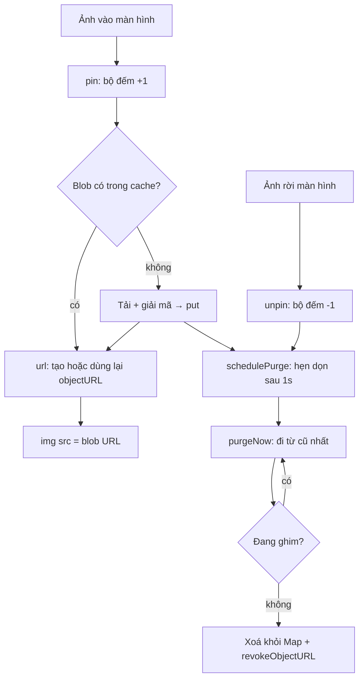

Mở một nhóm chat nhiều ảnh trên WhatsApp Web rồi cuộn lên vài trăm tin: mỗi ảnh đều được tải về, giải mã (media của WhatsApp được mã hoá đầu-cuối, xem [bài #1](/blogs/whatsapp-progressive-jpeg-hmac)) rồi mới hiển thị. Kết quả giải mã là một `Blob` nằm trong RAM, và muốn đưa nó vào thẻ `` thì phải tạo một `blob:` URL bằng `URL.createObjectURL`. Nếu không ai dọn, tab sẽ giữ hàng trăm MB ảnh mà người dùng đã cuộn qua từ lâu.

Bỏ blob đi ngay khi ảnh rời màn hình cũng không ổn: cuộn ngược lại một chút là phải giải mã lại (hoặc đọc lại từ IndexedDB, xem [bài #5](/blogs/whatsapp-quota-aware-media-lru)). WhatsApp Web 2020 chọn đường giữa: một **cache LRU tính theo dung lượng byte**, với **bộ đếm ghim (refcount)** cho ảnh đang hiện và **một objectURL dùng chung** cho mỗi blob.

> [!TIP]
> **Tóm tắt**
> - LRU tính theo tổng `blob.size` (mặc định 250MB), không theo số phần tử. Blob lớn hơn cả giới hạn thì không cache.
> - Ảnh đang hiện được ghim bằng bộ đếm (`increaseUsageCount`/`decreaseUsageCount`). Blob đang ghim không bao giờ bị đẩy ra, kể cả khi cache vượt giới hạn.
> - Mỗi blob có đúng một objectURL dùng chung, và URL bị `revokeObjectURL` đúng lúc blob rời cache. Việc dọn được gom: tối đa một lần mỗi giây.
> - Bản gốc có ba lỗi nhỏ: put đè cùng key vẫn trả URL của blob cũ, bỏ ghim không hẹn dọn, và hook `onClear` không bao giờ được gán. Bản viết lại sửa cả ba.

<iframe class="demo-frame" src="/demos/web-patterns/index.html?theme=dark#/wa-blob-cache" title="Demo wa-blob-cache" loading="lazy" style="height: 1000px"></iframe>

<p class="demo-links">▶ <a href="/demos/web-patterns/index.html#/wa-blob-cache" target="_blank" rel="noopener">Mở demo toàn màn hình ↗</a> · <a href="https://stackblitz.com/github/hunghg255/blog-hunghg/tree/master/examples/web-patterns?file=src/lib/waBlobCache.ts" target="_blank" rel="noopener">Sửa code trên StackBlitz ↗</a> · <a href="https://github.com/hunghg255/blog-hunghg/blob/master/examples/web-patterns/src/lib/waBlobCache.ts" target="_blank" rel="noopener">Xem source trên GitHub ↗</a></p>

Cuộn khung ảnh xuống rồi dừng lại. Ô đang hiện được ghim, ô vừa khuất bị bỏ ghim, và cache đẩy ảnh cũ nhất ra cho tới khi về dưới giới hạn. Ô nào đã bị đẩy ra mà cuộn lại thì phải "tải" lại, nên số "lần tải" tăng. Bấm "Thay ảnh #1 bằng bản mới" ở cả hai chế độ: bản viết lại hiện ngay "bản 2", còn kiểu WhatsApp 2020 vẫn hiện "bản 1".

## WhatsApp làm thế nào?

Code nằm trong bundle `all.js` của WhatsApp Web bản 2020 (webpack, tên module là hash). Hai module liên quan:

- `cbjgeibhdg`: một LRU tổng quát dùng danh sách liên kết đôi, có `sizeLimit`, `getSize`, `shouldEvict` và các hook `onAdd`, `onDelete`, `onEvict`, `onClear`.
- `eceibhbeff`: singleton bọc LRU trên cho media, thêm bộ đếm sử dụng, bảng `_filehashToUrl` và metric.

Đây là bản 2020 nên có thể đã đổi nhiều. Phần dưới chỉ phân tích những gì code cho thấy.

### LRU theo byte, dọn theo nhịp

Constructor của singleton nhận giới hạn mặc định `25e7` (250MB) và nối LRU với ba quy tắc:

```js
this._lruCache = new LRU({
  sizeLimit: e,
  getSize: (blob) => blob.size,
  shouldEvict: (key) => this._getUsageCount(key) === 0,
  onEvict: (key) => { /* revoke URL, đặt lại trạng thái tải của media */ },
  // onAdd, onDelete, onClear: cập nhật metric
});
```

Trong LRU, `put` bỏ qua blob lớn hơn cả giới hạn (chỉ ghi log), xoá node cũ của cùng key, thêm node mới vào đầu danh sách rồi gọi `schedulePurge`. Hàm này là `throttle(purgeNow, 1000, { leading: false })` (module tiện ích nằm ở chunk khác, nhưng cùng hàm đó được `ConversationMsgs` dùng cho `onResizeThrottle`): lần put đầu hẹn một lần dọn sau 1 giây, các put tiếp theo trong giây đó không tạo thêm lần dọn. Khác với debounce, cuộn liên tục và ảnh về liên tục không làm lần dọn bị dời mãi. `purgeNow` đi từ đuôi (cũ nhất) lên đầu, bỏ qua key mà `shouldEvict` trả false, và dừng khi tổng dung lượng về dưới giới hạn.

Một chi tiết thú vị: `put` bắt đầu bằng `0 !== this._sizeLimit && …`. Đặt giới hạn bằng 0 nghĩa là tắt hẳn cache, không phải "cache rỗng".

### Một objectURL dùng chung cho mỗi blob

```js
getOrCreateURL = (filehash) => {
  if (this._filehashToUrl[filehash]) return this.touch(filehash), this._filehashToUrl[filehash];
  const blob = this.get(filehash);
  if (!blob) throw new Error(`There is no blob matching filehash: ${filehash}.`);
  const url = URL.createObjectURL(blob);
  return (this._filehashToUrl[filehash] = url), url;
};
```

Ba bong bóng cùng hiện một ảnh (ảnh gốc, ảnh được trả lời, ảnh trong panel media) dùng chung một URL. `touch` đưa blob lên đầu LRU mỗi lần URL được hỏi lại. `onEvict` chỉ revoke khi bộ đếm bằng 0, nên ảnh đang hiện không bao giờ bị mất URL dưới chân.

### Ba lỗi nhỏ

Đọc kỹ thì có ba chỗ không khớp với ý đồ:

1. **Put đè cùng key giữ URL cũ.** `put` gọi `this.delete(key)` của LRU, và `onDelete` của singleton chỉ giảm metric. `_filehashToUrl[key]` vẫn trỏ tới URL của blob cũ, nên `getOrCreateURL` tiếp tục trả URL đó. Ảnh hiện bản cũ, và blob cũ bị URL giữ lại trong RAM mà không còn được tính vào `_currentSize`.
2. **Bỏ ghim không hẹn dọn.** `decreaseUsageCount` chỉ trừ bộ đếm. Nếu lần dọn gần nhất phải bỏ qua nhiều ảnh đang ghim, cache nằm quá giới hạn cho tới lần `put` kế tiếp. Trong lúc người dùng chỉ đọc mà không cuộn, có thể là rất lâu.
3. **`onClear` không bao giờ được gán.** Constructor của LRU gán `_onEvict`, `_onAdd`, `_onDelete` nhưng bỏ sót `_onClear`, nên `clear()` không reset metric (itemCount, purgesSoFar) như singleton mong đợi.

Cả ba đều nhỏ, nhưng lỗi thứ nhất là loại khó tìm: ảnh đã đổi mà màn hình vẫn đúng ảnh cũ.

## Bên trong trình duyệt: Blob, objectURL và bộ nhớ

`Blob` là một tham chiếu tới dữ liệu nhị phân bất biến. Trình duyệt có thể giữ nó trong RAM của renderer, hoặc đẩy xuống đĩa nếu lớn. Khi gọi `URL.createObjectURL(blob)`, trình duyệt ghi vào **blob URL store** của document một dòng `blob:https://web.whatsapp.com/<uuid> → blob`. Chừng nào dòng đó còn, blob không thể bị thu gom, kể cả khi JS đã bỏ mọi biến trỏ tới nó. Chỉ `URL.revokeObjectURL` (hoặc đóng document) mới xoá dòng đó.

Vì vậy cache blob phải quản lý **hai** thứ: tham chiếu JS tới blob (Map trong cache) và tham chiếu trong blob URL store (objectURL). Quên một trong hai là rò bộ nhớ.

Một chi tiết nữa: revoke một URL đang được `` dùng không làm ảnh biến mất. Ảnh đã giải mã nằm trong cache ảnh của trình duyệt. Nhưng lần sau gán lại `src` đó (vd React render lại, hoặc ảnh bị bỏ khỏi cache ảnh) thì tải thất bại. Đó là lý do phải ghim ảnh đang hiện.



## Viết lại

Bản viết lại giữ ý tưởng nhưng gọn hơn: `Map` của JS giữ thứ tự chèn, nên "đưa lên đầu LRU" chỉ là `delete` rồi `set` lại, và phần tử đầu tiên khi duyệt là phần tử lâu nhất chưa dùng. Không cần danh sách liên kết tự viết.

Phần ghi và đọc:

```ts title=src/lib/waBlobCache.ts
export class BlobCache {
  /** Map giữ thứ tự chèn: phần tử đầu là phần tử lâu nhất chưa dùng */
  private entries = new Map<string, Blob>();
  private pins = new Map<string, number>();
  private urls = new Map<string, string>();
  private currentSize = 0;
  private evictions = 0;
  private purgeTimer: ReturnType<typeof setTimeout> | undefined;
  private readonly sizeLimit: number;
  private readonly purgeDelay: number;
  private readonly urlFactory: UrlFactory;
  private readonly onEvict?: (key: string, blob: Blob) => void;

  constructor({ sizeLimit, purgeDelay = 1000, urls = browserUrls, onEvict }: BlobCacheOptions) {
    if (sizeLimit < 0) throw new RangeError('sizeLimit phải ≥ 0');
    this.sizeLimit = sizeLimit;
    this.purgeDelay = purgeDelay;
    this.urlFactory = urls;
    this.onEvict = onEvict;
  }

  /** Thêm hoặc thay blob. Blob lớn hơn cả giới hạn thì bỏ qua (trả false). */
  put(key: string, blob: Blob): boolean {
    if (blob.size > this.sizeLimit) return false;
    this.remove(key);
    this.entries.set(key, blob);
    this.currentSize += blob.size;
    this.schedulePurge();
    return true;
  }

  /** Lấy blob và đánh dấu "vừa dùng" (chuyển xuống cuối Map). */
  get(key: string): Blob | undefined {
    const blob = this.entries.get(key);
    if (blob === undefined) return undefined;
    this.entries.delete(key);
    this.entries.set(key, blob);
    return blob;
  }

  has(key: string) {
    return this.entries.has(key);
  }

  /** objectURL dùng chung cho key; tạo khi cần. */
  url(key: string): string {
    const existing = this.urls.get(key);
    if (existing) {
      this.get(key);
      return existing;
    }
    const blob = this.get(key);
    if (!blob) throw new Error(`Không có blob cho key ${key}`);
    const url = this.urlFactory.create(blob);
    this.urls.set(key, url);
    return url;
  }
```

Phần ghim, xoá và dọn:

```ts title=src/lib/waBlobCache.ts
  /** Ghim: blob đang hiện trên màn hình thì không được đẩy ra. */
  pin(key: string) {
    this.pins.set(key, (this.pins.get(key) ?? 0) + 1);
  }

  unpin(key: string) {
    const count = this.pins.get(key) ?? 0;
    if (count <= 0) throw new Error(`Bỏ ghim ${key} nhiều hơn số lần ghim`);
    if (count === 1) {
      this.pins.delete(key);
      // Bản gốc không hẹn dọn ở đây, nên cache có thể nằm quá giới hạn tới lần put kế tiếp.
      this.schedulePurge();
    } else {
      this.pins.set(key, count - 1);
    }
  }

  /** Xoá một key và revoke URL của nó (nếu có). */
  remove(key: string) {
    const blob = this.entries.get(key);
    if (blob === undefined) return;
    this.entries.delete(key);
    this.currentSize -= blob.size;
    this.revoke(key);
  }

  /** Đẩy blob cũ nhất ra cho tới khi về dưới giới hạn, bỏ qua blob đang ghim. */
  purgeNow() {
    clearTimeout(this.purgeTimer);
    this.purgeTimer = undefined;
    for (const [key, blob] of this.entries) {
      if (this.currentSize <= this.sizeLimit) break;
      if (this.pins.has(key)) continue;
      this.remove(key);
      this.evictions++;
      this.onEvict?.(key, blob);
    }
  }
```

::: spoiler Xem toàn bộ src/lib/waBlobCache.ts
```ts title=src/lib/waBlobCache.ts
/**
 * Cache blob trong RAM có giới hạn dung lượng, kiểu WhatsApp Web (module `eceibhbeff` + `cbjgeibhdg`).
 *
 * - LRU theo tổng `blob.size`, không theo số phần tử.
 * - Blob đang được dùng (đang hiện trên màn hình) được "ghim" bằng bộ đếm, không bao giờ bị đẩy ra.
 * - Mỗi key có đúng một objectURL dùng chung; URL bị revoke khi blob rời cache.
 * - Dọn dẹp được gom lại: lần put đầu hẹn một lần dọn sau `purgeDelay`, các put tiếp theo không dời lịch.
 *
 * Khác bản gốc: dùng thứ tự chèn của Map thay cho danh sách liên kết đôi, revoke URL cũ khi put đè
 * cùng key, và hẹn dọn lại khi bỏ ghim.
 */

export interface UrlFactory {
  create(blob: Blob): string;
  revoke(url: string): void;
}

const browserUrls: UrlFactory = {
  create: (blob) => URL.createObjectURL(blob),
  revoke: (url) => URL.revokeObjectURL(url),
};

export interface BlobCacheOptions {
  /** tổng dung lượng tối đa (byte) của các blob không bị ghim */
  sizeLimit: number;
  /** dọn sau lần put/bỏ ghim đầu tiên bao lâu (ms); các lần sau trong khoảng đó không dời lịch */
  purgeDelay?: number;
  urls?: UrlFactory;
  onEvict?: (key: string, blob: Blob) => void;
}

export interface BlobCacheStats {
  count: number;
  size: number;
  pinned: number;
  urls: number;
  evictions: number;
}

export class BlobCache {
  /** Map giữ thứ tự chèn: phần tử đầu là phần tử lâu nhất chưa dùng */
  private entries = new Map<string, Blob>();
  private pins = new Map<string, number>();
  private urls = new Map<string, string>();
  private currentSize = 0;
  private evictions = 0;
  private purgeTimer: ReturnType<typeof setTimeout> | undefined;
  private readonly sizeLimit: number;
  private readonly purgeDelay: number;
  private readonly urlFactory: UrlFactory;
  private readonly onEvict?: (key: string, blob: Blob) => void;

  constructor({ sizeLimit, purgeDelay = 1000, urls = browserUrls, onEvict }: BlobCacheOptions) {
    if (sizeLimit < 0) throw new RangeError('sizeLimit phải ≥ 0');
    this.sizeLimit = sizeLimit;
    this.purgeDelay = purgeDelay;
    this.urlFactory = urls;
    this.onEvict = onEvict;
  }

  /** Thêm hoặc thay blob. Blob lớn hơn cả giới hạn thì bỏ qua (trả false). */
  put(key: string, blob: Blob): boolean {
    if (blob.size > this.sizeLimit) return false;
    this.remove(key);
    this.entries.set(key, blob);
    this.currentSize += blob.size;
    this.schedulePurge();
    return true;
  }

  /** Lấy blob và đánh dấu "vừa dùng" (chuyển xuống cuối Map). */
  get(key: string): Blob | undefined {
    const blob = this.entries.get(key);
    if (blob === undefined) return undefined;
    this.entries.delete(key);
    this.entries.set(key, blob);
    return blob;
  }

  has(key: string) {
    return this.entries.has(key);
  }

  /** objectURL dùng chung cho key; tạo khi cần. */
  url(key: string): string {
    const existing = this.urls.get(key);
    if (existing) {
      this.get(key);
      return existing;
    }
    const blob = this.get(key);
    if (!blob) throw new Error(`Không có blob cho key ${key}`);
    const url = this.urlFactory.create(blob);
    this.urls.set(key, url);
    return url;
  }

  /** Ghim: blob đang hiện trên màn hình thì không được đẩy ra. */
  pin(key: string) {
    this.pins.set(key, (this.pins.get(key) ?? 0) + 1);
  }

  unpin(key: string) {
    const count = this.pins.get(key) ?? 0;
    if (count <= 0) throw new Error(`Bỏ ghim ${key} nhiều hơn số lần ghim`);
    if (count === 1) {
      this.pins.delete(key);
      // Bản gốc không hẹn dọn ở đây, nên cache có thể nằm quá giới hạn tới lần put kế tiếp.
      this.schedulePurge();
    } else {
      this.pins.set(key, count - 1);
    }
  }

  /** Xoá một key và revoke URL của nó (nếu có). */
  remove(key: string) {
    const blob = this.entries.get(key);
    if (blob === undefined) return;
    this.entries.delete(key);
    this.currentSize -= blob.size;
    this.revoke(key);
  }

  /** Đẩy blob cũ nhất ra cho tới khi về dưới giới hạn, bỏ qua blob đang ghim. */
  purgeNow() {
    clearTimeout(this.purgeTimer);
    this.purgeTimer = undefined;
    for (const [key, blob] of this.entries) {
      if (this.currentSize <= this.sizeLimit) break;
      if (this.pins.has(key)) continue;
      this.remove(key);
      this.evictions++;
      this.onEvict?.(key, blob);
    }
  }

  clear() {
    for (const key of [...this.entries.keys()]) this.remove(key);
    this.pins.clear();
  }

  stats(): BlobCacheStats {
    return {
      count: this.entries.size,
      size: this.currentSize,
      pinned: this.pins.size,
      urls: this.urls.size,
      evictions: this.evictions,
    };
  }

  dispose() {
    clearTimeout(this.purgeTimer);
    this.clear();
  }

  private revoke(key: string) {
    const url = this.urls.get(key);
    if (url) {
      this.urls.delete(key);
      this.urlFactory.revoke(url);
    }
  }

  /** Như throttle không chạy ngay: put liên tục khi cuộn không đẩy lần dọn ra xa mãi. */
  private schedulePurge() {
    if (this.purgeTimer === undefined) this.purgeTimer = setTimeout(() => this.purgeNow(), this.purgeDelay);
  }
}
```
:::

## Đi qua code

- `put` gọi `this.remove(key)` trước khi thêm. `remove` vừa trừ dung lượng vừa revoke URL của blob cũ, nên lần `url(key)` kế tiếp tạo URL mới cho blob mới. Đây là chỗ sửa lỗi thứ nhất.
- `get` làm "touch" bằng `delete` + `set`. Duyệt Map trong `purgeNow` đi từ phần tử chèn sớm nhất, đúng thứ tự LRU.
- `url(key)` gọi `this.get(key)` cả khi URL đã có, để blob đang được dùng không trôi về cuối LRU.
- `pin`/`unpin` dùng Map đếm. Bỏ ghim lần cuối thì gọi `schedulePurge()`: sửa lỗi thứ hai. Bỏ ghim nhiều hơn số lần ghim thì ném lỗi, như bản gốc, vì đó luôn là bug của component gọi.
- `purgeNow` dừng ngay khi `currentSize <= sizeLimit`, bỏ qua key đang ghim. Nếu mọi blob đều ghim thì cache cứ việc vượt giới hạn: hiển thị đúng quan trọng hơn con số.
- `UrlFactory` được tiêm vào để test chạy trong Node (không có `URL.createObjectURL` thật) và để demo đếm được số URL còn sống.
- `onEvict` là tuỳ chọn ở cấp cache, thay cho việc gắn chặt với "media object" như bản gốc. Ứng dụng có thể dùng nó để đặt lại trạng thái tải của ảnh.

**Khác bản gốc:** dùng `Map` thay cho danh sách liên kết đôi; revoke URL cũ khi put đè cùng key; hẹn dọn khi bỏ ghim; bỏ phần metric (và vì thế không còn hook `onClear` bị quên).

Trong demo, component `Tile` dùng `IntersectionObserver` với `root` là khung cuộn: vào màn hình thì `ensure` (tải nếu thiếu), `pin`, rồi đặt `src = cache.url(key)`. Rời màn hình thì cleanup của effect gọi `unpin`. Chế độ "Kiểu WhatsApp 2020" dùng một lớp mô phỏng ([`WaBlobCacheWhatsAppStyle.ts`](https://github.com/hunghg255/blog-hunghg/blob/master/examples/web-patterns/src/demos/WaBlobCacheWhatsAppStyle.ts)) giữ đúng hai hành vi: put không revoke, unpin không dọn.

## Tại sao không làm cách khác?

**Tạo objectURL mỗi lần render, revoke trong cleanup.** Đơn giản, nhưng ba chỗ hiện cùng một ảnh tạo ba URL, và mỗi lần React render lại là một vòng create/revoke. Revoke trong cleanup còn có thể chạy trước khi `` mới kịp tải.

**Dùng data URL (`FileReader.readAsDataURL`).** Không cần revoke, nhưng chuỗi base64 to hơn dữ liệu gốc khoảng 33%, nằm trong heap JS, và thường phải sao chép mỗi lần gán vào DOM. Với ảnh vài trăm KB thì tệ hơn hẳn.

**`WeakMap` hoặc `FinalizationRegistry`.** Thu gom rác không biết blob nào nặng, không có giới hạn byte, và không hứa thời điểm chạy. Không thay được LRU theo dung lượng.

**Đếm theo số phần tử thay vì byte.** Một sticker 20KB và một ảnh 4MB có chi phí khác nhau 200 lần. Giới hạn "200 ảnh" vô nghĩa khi người dùng mở một album ảnh gốc.

**Cache API hoặc IndexedDB.** Đó là tầng lưu bền ([bài #5](/blogs/whatsapp-quota-aware-media-lru) và [Facebook: lưu trữ theo quota](/blogs/facebook-quota-aware-storage)). Cache trong RAM ở đây nằm phía trên, để tránh đọc đĩa và giải mã lại khi cuộn qua lại.

## Edge case và cạm bẫy

- **Blob lớn hơn giới hạn.** `put` trả `false` và không cache. Component phải tự tạo URL tạm và tự revoke, hoặc hiển thị bản thumbnail.
- **Ghim nhưng chưa có blob.** Ghim một key chưa `put` vẫn được (bộ đếm độc lập), nên thứ tự "ghim rồi mới tải xong" không gây lỗi. Nhưng `url(key)` sẽ ném lỗi nếu blob chưa có.
- **StrictMode.** React chạy effect, cleanup, rồi effect lại khi dev. Với cặp pin/unpin đối xứng thì không sao. Đừng revoke trong cleanup của component, vì việc đó thuộc về cache.
- **Revoke khi `` vẫn trỏ tới.** Chỉ xảy ra nếu ai đó gọi `remove` cho key đang ghim. Bản viết lại vẫn cho phép (đôi khi cần xoá thật, vd tin bị thu hồi), nên ứng dụng nên bỏ `src` trước.
- **Dung lượng thật lớn hơn `blob.size`.** Ảnh đã giải mã thành bitmap tốn `rộng × cao × 4` byte trong cache ảnh của trình duyệt, nằm ngoài tầm kiểm soát của cache này. Giới hạn 250MB của WhatsApp là cho blob nén.
- **Hẹn giờ trong tab nền.** Timer bị trình duyệt kìm lại khi tab ẩn, nên lần dọn có thể trễ hơn 1 giây. Không ảnh hưởng tính đúng.

## Dùng trong dự án

```ts
const images = new BlobCache({ sizeLimit: 150 * 1024 * 1024 });

function useBlobUrl(key: string, load: () => Promise<Blob>) {
  const [src, setSrc] = useState<string>();
  useEffect(() => {
    let alive = true;
    images.pin(key);
    (images.has(key) ? Promise.resolve() : load().then((b) => void images.put(key, b))).then(() => {
      if (alive && images.has(key)) setSrc(images.url(key));
    });
    return () => {
      alive = false;
      images.unpin(key);
    };
  }, [key]);
  return src;
}
```

Gọi `pin` trước khi tải để blob vừa về không bị lần dọn kế tiếp đẩy ra ngay. Khi người dùng đăng xuất thì gọi `images.clear()` để revoke mọi URL.

::: spoiler Ví dụ test (bản phác, không có trong repo)
```ts
import { describe, expect, it, vi } from 'vitest';
import { BlobCache } from '../src/lib/waBlobCache';

const fakeUrls = () => {
  let n = 0;
  const live = new Set<string>();
  return {
    live,
    create: () => {
      const u = `blob:${++n}`;
      live.add(u);
      return u;
    },
    revoke: (u: string) => void live.delete(u),
  };
};
const blob = (size: number) => new Blob([new Uint8Array(size)]);

describe('BlobCache', () => {
  it('đẩy blob cũ nhất ra và revoke URL của nó', () => {
    const urls = fakeUrls();
    const c = new BlobCache({ sizeLimit: 100, urls });
    c.put('a', blob(60));
    const ua = c.url('a');
    c.put('b', blob(60));
    c.purgeNow();
    expect(c.has('a')).toBe(false);
    expect(urls.live.has(ua)).toBe(false);
  });

  it('không đẩy blob đang ghim, bỏ ghim thì hẹn dọn', () => {
    vi.useFakeTimers();
    const c = new BlobCache({ sizeLimit: 100, purgeDelay: 50, urls: fakeUrls() });
    c.put('a', blob(60));
    c.pin('a');
    c.put('b', blob(60));
    c.get('a');
    c.purgeNow();
    expect(c.has('a') && !c.has('b')).toBe(true);
    c.put('b', blob(60));
    c.pin('b');
    c.purgeNow();
    expect(c.stats().size).toBe(120);
    c.unpin('a');
    vi.advanceTimersByTime(60);
    expect(c.has('a')).toBe(false);
    vi.useRealTimers();
  });

  it('put đè cùng key thì URL mới', () => {
    const c = new BlobCache({ sizeLimit: 100, urls: fakeUrls() });
    c.put('a', blob(10));
    const first = c.url('a');
    c.put('a', blob(20));
    expect(c.url('a')).not.toBe(first);
    expect(c.stats().size).toBe(20);
  });
});
```
:::

## So với thư viện và chuẩn web

- **`lru-cache` (npm)** hỗ trợ `maxSize` + `sizeCalculation` và hook `dispose`, đủ để làm phần LRU theo byte và revoke trong `dispose`. Nó không có khái niệm "ghim": phải tự viết, hoặc đặt lại blob đang ghim vào cache sau khi bị đẩy.
- **`URL.createObjectURL` / `revokeObjectURL`** có ở mọi trình duyệt hiện đại (tính tới 10/2026). Riêng Service Worker không có `createObjectURL`.
- **`img.decode()`** giúp chờ ảnh giải mã xong trước khi chèn vào DOM, nhưng không thay đổi vòng đời của blob URL.
- **Không có API chuẩn** nào báo "blob này đang chiếm bao nhiêu RAM". `performance.measureUserAgentSpecificMemory()` chỉ đo cả trang và cần cross-origin isolation.

---

Bài này thuộc series **[Học từ mã nguồn WhatsApp Web](/series/whatsapp)** (19 bài, đọc theo thứ tự).

::: spoiler Xem nhanh danh sách bài trong series

*Mở đầu*

- [Mở đầu: đọc bundle WhatsApp Web 2020](/blogs/learn-from-whatsapp-web-source-code)

*Phần 1: media và mã hoá*

- [#1 Giải mã JPEG progressive theo từng scan, kiểm HMAC](/blogs/whatsapp-progressive-jpeg-hmac)
- [#2 Ghép khoảng byte cho video streaming](/blogs/whatsapp-byte-range-merge)
- [#3 Xoá EXIF không re-encode, thumbnail theo ngân sách byte](/blogs/whatsapp-jpeg-strip-thumb-budget)
- [#4 Đọc metadata sticker WebP động](/blogs/whatsapp-webp-sticker-metadata)

*Phần 2: lưu trữ trên trình duyệt*

- [#5 Kho media LRU tự co theo quota](/blogs/whatsapp-quota-aware-media-lru)
- **#6 Cache blob trong RAM có refcount, tự revoke objectURL** (bài này)
- [#7 Khoá IndexedDB giữ đúng thứ tự từ điển](/blogs/whatsapp-indexeddb-ordered-keys)

*Phần 3: danh sách tin nhắn*

- [#8 Render tin nhắn theo cửa sổ chiều cao ước lượng](/blogs/whatsapp-render-cursor-window)
- [#9 Theo dõi viewport tin nhắn: binary search, ngày dính](/blogs/whatsapp-message-viewport-tracking)
- [#10 FlatList tái dùng key React, overscan bất đối xứng](/blogs/whatsapp-flatlist-key-reuse)

*Phần 4: soạn tin và chữ*

- [#11 Emoticon thành emoji bằng trie đọc ngược, tìm emoji](/blogs/whatsapp-emoticon-trie-emoji-search)
- [#12 Mention bằng token zero-width, giới hạn theo code point](/blogs/whatsapp-mention-zero-width-input)
- [#13 Xác định hướng chữ bằng bảng delta nén](/blogs/whatsapp-text-direction-table)
- [#14 Phát hiện homograph trong link, chặn giả đuôi file RTLO](/blogs/whatsapp-homograph-rtlo-guard)

*Phần 5: realtime và tiện ích*

- [#15 Presence, "đang gõ" và thông báo theo kích thước group](/blogs/whatsapp-presence-typing-notifications)
- [#16 Đo FPS phát hiện UI đóng băng, idle monitor](/blogs/whatsapp-fps-freeze-idle)
- [#17 Cửa sổ PiP: resize 8 hướng, khoá tỉ lệ, né vật cản](/blogs/whatsapp-pip-resize-avoid)
- [#18 Parse giá tiền theo locale bằng Intl](/blogs/whatsapp-locale-price-parse)

:::

Code + demo: [`examples/web-patterns`](https://github.com/hunghg255/blog-hunghg/tree/master/examples/web-patterns) · [Mở trên StackBlitz](https://stackblitz.com/github/hunghg255/blog-hunghg/tree/master/examples/web-patterns)
