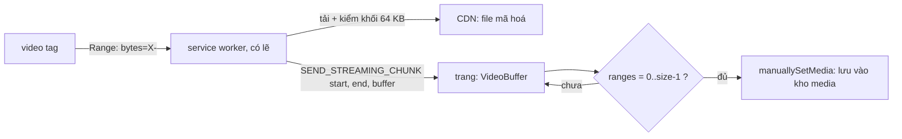

Với video, chờ tải hết rồi mới phát là không chấp nhận được: một clip 16 MB trên mạng chậm mất cả phút. Trình duyệt giải quyết bằng HTTP Range: thẻ `<video>` xin từng khoảng byte (`Range: bytes=0-`), tua tới đâu xin tiếp tới đó. Nhưng video trong WhatsApp đã mã hoá, phải giải mã và kiểm toàn vẹn trước khi đưa cho player. Thêm nữa, khi người dùng đã xem gần hết, sẽ tiếc nếu lần sau mở lại phải tải lại từ đầu.

Bài #1 xử lý ảnh, nơi các đoạn tới theo thứ tự. Video thì khác: player nhảy lung tung, nhiều request chạy song song, có đoạn bị xin hai lần. Bài này xem cách WhatsApp Web ghép các mảnh đó lại và kiểm chúng theo khối.

> [!TIP]
> **Tóm tắt**
> - Bên gửi ký HMAC cho **từng khối 64 KB** của file mã hoá (gồm 16 byte trước khối làm iv). Bên nhận có một Range bất kỳ là kiểm được các khối nằm trọn trong đó, không cần phần đầu file.
> - Các mảnh tải về được ghi vào một **tập khoảng** (range set) tự gộp chỗ chồng lấn và chỗ kề nhau. Khi tập khoảng chỉ còn một khoảng `[0, size-1]` là đủ file, lưu vào kho media để lần sau khỏi tải.
> - Bản gốc giữ **mọi mảnh** trong một mảng rồi mới chép vào bộ đệm cuối: bộ nhớ đỉnh gấp hơn 2 lần kích thước file, và bộ đệm của video xem dở không bao giờ được giải phóng.
> - Bản viết lại cấp phát đúng một bộ đệm, chép mảnh vào chỗ ngay khi tới, và dùng chính tập khoảng để tính phần còn thiếu.

<iframe class="demo-frame" src="/demos/web-patterns/index.html?theme=dark#/wa-range-merge" title="Demo wa-range-merge" loading="lazy" style="height: 900px"></iframe>

<p class="demo-links">▶ <a href="/demos/web-patterns/index.html#/wa-range-merge" target="_blank" rel="noopener">Mở demo toàn màn hình ↗</a> · <a href="https://stackblitz.com/github/hunghg255/blog-hunghg/tree/master/examples/web-patterns?file=src/lib/waRangeMerge.ts" target="_blank" rel="noopener">Sửa code trên StackBlitz ↗</a> · <a href="https://github.com/hunghg255/blog-hunghg/blob/master/examples/web-patterns/src/lib/waRangeMerge.ts" target="_blank" rel="noopener">Xem source trên GitHub ↗</a></p>

Bấm **Phát video**: một "video" 1,2 MB được mã hoá bằng khoá tự sinh, hai request 96 KB chạy song song với độ trễ ngẫu nhiên. Thanh xanh là các khoảng đã có, sọc vàng là request đang bay, lưới số là 20 khối 64 KB. Bấm **Tua tới 60%** giữa chừng: request mới lùi 40 KB trước điểm tua và chồng lên phần đã có. Khối 9 bị hỏng 1 byte ở lần tải đầu, bị phát hiện, bỏ đi và tải lại. So hai ô RAM: kiểu gốc tốn khoảng gấp đôi.

## WhatsApp Web làm thế nào?

Hai module chính: `cggdahefjh` tính sidecar khi gửi, `edgfejedb` ghép mảnh khi nhận. Bundle là bản 2020, tên module là hash webpack, biến đã đổi tên cho dễ đọc.

### Sidecar streaming: một MAC cho mỗi 64 KB

Khi gửi video hoặc audio, module mã hoá (`cfjbaecadg`) gọi `cggdahefjh` với chuỗi `iv ‖ ciphertext ‖ mac`:

```js
// cggdahefjh
const count = Math.ceil((bytes.byteLength - 16) / 65536);
const macs = range(count, i => hmac.sign(bytes.slice(65536 * i, 65536 * i + 16 + 65536), 10));
return Promise.all(macs).then(parts => concat(...parts));
// IV_LENGTH = 16, HMAC_LENGTH = 10
```

Khối `i` ký `65536 + 16` byte bắt đầu từ vị trí `65536 * i` của chuỗi có `iv` ở đầu. Đổi sang toạ độ của file trên server (không có `iv`), khối `i` phủ từ byte `65536·i − 16` tới `65536·(i+1) − 1`: đúng 16 byte ciphertext đứng trước khối, chính là iv để giải mã khối đó theo AES-CBC. Một Range `[65536·i − 16, 65536·(i+1))` vì thế đủ để **vừa kiểm vừa giải mã** khối `i` mà không cần byte nào khác. File 16 MB có 256 khối, sidecar 2 560 byte.

Sticker thì có thêm `firstFrameSidecar` (module `bcdhbefeei`) chỉ cho phần frame đầu, sẽ gặp lại ở bài #4.

### Bộ ghép mảnh

Phía nhận, `handleVideoStreamingRequest` trong `edgfejedb` xử lý bốn loại thông điệp. Nơi gửi thông điệp không nằm trong bundle này, có lẽ là service worker đứng giữa thẻ `<video>` và mạng (giống kỹ thuật trong bài [service worker phục vụ Range](/blogs/web-service-worker-range-streaming)). Nhánh nhận mảnh:

```js
case SEND_STREAMING_CHUNK: // key = message.msgKey.toString()
  const msg = MsgCollection.get(key);
  if (!msg) return void delete buffers[key];
  const buf = (buffers[key] ??= new VideoBuffer(msg.size)); // bản gốc: hasOwnProperty rồi gán
  buf.push(message.data);           // { start, end, buffer }
  if (buf.isComplete()) {
    manuallySetMedia({ msg, media: buf.serialize(), rmrReason: VIDEO_STREAMING });
    delete buffers[message.msgKey.toString()];
  }
```

Lớp `VideoBuffer` giữ hai thứ: `ranges` (danh sách khoảng đã có) và `buffer` (mảng mọi mảnh đã nhận). `isComplete()` đúng khi `ranges` chỉ còn `[[0, size - 1]]`. `serialize()` cấp phát `Uint8Array(size)` rồi chép từng mảnh vào vị trí `start` của nó.

Hàm `add(start, end)` gộp khoảng mới vào danh sách đã sắp xếp: bỏ qua các khoảng nằm hẳn bên trái, chèn nếu khoảng mới nằm hẳn bên trái khoảng đang xét, nếu không thì nuốt dần các khoảng kế tiếp còn chạm hoặc kề (`end + 1 >= start kế`). Mình chạy thử 20 000 chuỗi thêm ngẫu nhiên và so với một bitmap đánh dấu từng byte: kết quả khớp hoàn toàn, phần gộp khoảng của bản gốc đúng.

Nhánh `EXP_BACKOFF` thì chờ `expDelaySec(generation, 60)` rồi `waitIfOffline()`: lùi thời gian theo cấp số nhân, tối đa 60 giây, và nếu mất mạng thì chờ tới khi có mạng lại.

## Bên trong trình duyệt: Range, bộ nhớ và GC

`<video>` tự quyết định xin byte nào. Thường nó xin `bytes=0-` (từ đầu tới hết), đọc được một ít thì huỷ, nhảy tới cuối file để đọc chỉ mục (với MP4 có `moov` ở cuối), rồi quay lại. Khi tua, nó huỷ request cũ và xin `bytes=X-`. Vì thế các mảnh **chồng nhau** là chuyện bình thường, không phải lỗi.

Về bộ nhớ: một `ArrayBuffer` chỉ được thu hồi khi không còn ai tham chiếu. Mảng `buffer` của bản gốc giữ tham chiếu tới mọi mảnh, kể cả mảnh đã bị mảnh sau phủ lên. Tới lúc `serialize()`, trình duyệt phải giữ cùng lúc mọi mảnh **và** bộ đệm `size` byte mới. Với video 16 MB có 30% byte trùng, đỉnh bộ nhớ khoảng 16 × 1,3 + 16 ≈ 37 MB cho một video.

Còn object `buffers` toàn cục chỉ xoá entry khi đủ file hoặc khi tin nhắn biến mất khỏi bộ nhớ. Xem 40% video rồi đóng: entry đó, cùng mọi mảnh trong nó, nằm lại tới khi đóng tab (trừ trường hợp hiếm là có mảnh mới tới đúng lúc tin nhắn đã bị gỡ khỏi bộ nhớ).



## Viết lại

`src/lib/waRangeMerge.ts` tách hai việc. `RangeSet` chỉ lo tập khoảng: thêm, bớt, hỏi phần còn thiếu. `RangeBuffer` cấp phát đúng một lần và chép mảnh vào chỗ ngay khi nhận.

```ts title=src/lib/waRangeMerge.ts
/** Tập khoảng [start, end] (gồm cả end), luôn sắp xếp, không chồng lấn, không kề nhau. */
export class RangeSet {
  readonly ranges: [number, number][] = [];

  /** Thêm khoảng, gộp với các khoảng chồng lấn hoặc kề; trả về số byte mới được phủ. */
  add(start: number, end: number): number {
    if (end < start) return 0;
    const r = this.ranges;
    let i = 0;
    while (i < r.length && r[i][1] + 1 < start) i++;
    let s = start;
    let e = end;
    let already = 0;
    let j = i;
    for (; j < r.length && r[j][0] <= end + 1; j++) {
      already += Math.max(0, Math.min(end, r[j][1]) - Math.max(start, r[j][0]) + 1);
      s = Math.min(s, r[j][0]);
      e = Math.max(e, r[j][1]);
    }
    r.splice(i, j - i, [s, e]);
    return end - start + 1 - already;
  }
```

`add` trả về số byte **mới** được phủ, nên đếm được byte trùng mà không cần bitmap. Ba hàm còn lại của `RangeSet` đều chỉ vài dòng: `missing(size)` đi một lượt qua danh sách và trả các lỗ giữa các khoảng, đúng danh sách Range cần xin tiếp; `covers(s, e)` hỏi một khoảng đã có đủ chưa; `remove(s, e)` cắt một khoảng ra (khoảng nào bị cắt giữa thì tách đôi), dùng khi một khối sai MAC để lần quét `missing` sau tự xin lại. `RangeBuffer` bọc `RangeSet` cùng một `Uint8Array(size)`: `write(start, data)` gọi `bytes.set(data, start)` rồi `ranges.add`, `complete` là "chỉ còn một khoảng `[0, size - 1]`".

Phần kiểm theo khối dựa trên `RangeBuffer`. Phía gửi (`buildStreamingSidecar`) chỉ là vòng lặp ký từng khối như `cggdahefjh`, phía nhận thì:

```ts title=src/lib/waRangeMerge.ts
/** Khoảng byte của file (ciphertext ‖ mac) cần có để kiểm khối k. */
export function blockSpan(k: number, size: number): [number, number] {
  return [Math.max(0, k * STREAM_BLOCK - IV_LENGTH), Math.min(size, (k + 1) * STREAM_BLOCK) - 1];
}

/** Các khối đã đủ byte để kiểm. */
export function readyBlocks(buf: RangeBuffer): number[] {
  const out: number[] = [];
  const count = Math.ceil(buf.size / STREAM_BLOCK);
  for (let k = 0; k < count; k++) if (buf.ranges.covers(...blockSpan(k, buf.size))) out.push(k);
  return out;
}

export async function verifyBlock(buf: RangeBuffer, k: number, iv: Bytes, sidecar: Bytes, macKey: CryptoKey) {
  const [s, e] = blockSpan(k, buf.size);
  if (!buf.ranges.covers(s, e)) throw new Error(`khối ${k} chưa tải đủ`);
  const head = k === 0 ? iv : new Uint8Array(0);
  const mac = await hmac10(macKey, concat(head, buf.bytes.subarray(s, e + 1)));
  return timingSafeEqual(mac, sidecar.subarray(k * MAC_LENGTH, (k + 1) * MAC_LENGTH));
}
```

::: spoiler Xem toàn bộ src/lib/waRangeMerge.ts
```ts title=src/lib/waRangeMerge.ts
// Ghép các khoảng byte tải về không theo thứ tự (video streaming) và kiểm HMAC theo khối 64 KB.
// Viết lại từ edgfejedb (bộ đệm video streaming) và cggdahefjh (sidecar streaming)
// của WhatsApp Web bản 2020.

import { concat, hmac10, MAC_LENGTH, timingSafeEqual, type Bytes } from './waProgressiveJpeg';

export const STREAM_BLOCK = 64 * 1024;
const IV_LENGTH = 16;

/** Tập khoảng [start, end] (gồm cả end), luôn sắp xếp, không chồng lấn, không kề nhau. */
export class RangeSet {
  readonly ranges: [number, number][] = [];

  /** Thêm khoảng, gộp với các khoảng chồng lấn hoặc kề; trả về số byte mới được phủ. */
  add(start: number, end: number): number {
    if (end < start) return 0;
    const r = this.ranges;
    let i = 0;
    while (i < r.length && r[i][1] + 1 < start) i++;
    let s = start;
    let e = end;
    let already = 0;
    let j = i;
    for (; j < r.length && r[j][0] <= end + 1; j++) {
      already += Math.max(0, Math.min(end, r[j][1]) - Math.max(start, r[j][0]) + 1);
      s = Math.min(s, r[j][0]);
      e = Math.max(e, r[j][1]);
    }
    r.splice(i, j - i, [s, e]);
    return end - start + 1 - already;
  }

  /** Bỏ một khoảng (vd khối sai MAC) để xin tải lại. */
  remove(start: number, end: number): void {
    const out: [number, number][] = [];
    for (const [s, e] of this.ranges) {
      if (e < start || s > end) out.push([s, e]);
      else {
        if (s < start) out.push([s, start - 1]);
        if (e > end) out.push([end + 1, e]);
      }
    }
    this.ranges.splice(0, this.ranges.length, ...out);
  }

  covers(start: number, end: number): boolean {
    return this.ranges.some(([s, e]) => s <= start && end <= e);
  }

  get covered(): number {
    return this.ranges.reduce((n, [s, e]) => n + e - s + 1, 0);
  }

  /** Các lỗ còn thiếu trong [0, size - 1]: đúng những Range cần xin tiếp. */
  missing(size: number): [number, number][] {
    const out: [number, number][] = [];
    let at = 0;
    for (const [s, e] of this.ranges) {
      if (s > at) out.push([at, s - 1]);
      at = e + 1;
    }
    if (at < size) out.push([at, size - 1]);
    return out;
  }
}

/** Bộ đệm cấp phát đúng một lần: mỗi đoạn tải về chép thẳng vào vị trí của nó. */
export class RangeBuffer {
  readonly bytes: Bytes;
  readonly ranges = new RangeSet();
  /** tổng byte nhận qua mạng, kể cả phần trùng */
  received = 0;

  constructor(readonly size: number) {
    if (!(size > 0)) throw new Error(`kích thước không hợp lệ: ${size}`);
    this.bytes = new Uint8Array(size);
  }

  write(start: number, data: Uint8Array): number {
    if (start < 0 || start + data.byteLength > this.size) throw new Error('đoạn nằm ngoài file');
    this.bytes.set(data, start);
    this.received += data.byteLength;
    return this.ranges.add(start, start + data.byteLength - 1);
  }

  get complete(): boolean {
    const r = this.ranges.ranges;
    return r.length === 1 && r[0][0] === 0 && r[0][1] === this.size - 1;
  }
}

/**
 * Bên gửi: chuỗi ký là iv ‖ ciphertext ‖ mac. Khối k phủ 16 byte trước nó (iv của khối) + 64 KB,
 * nên khi tải một Range giữa file vẫn kiểm (và giải mã) được mà không cần phần trước.
 */
export async function buildStreamingSidecar(iv: Bytes, file: Bytes, macKey: CryptoKey): Promise<Bytes> {
  const signed = concat(iv, file);
  const count = Math.ceil(file.byteLength / STREAM_BLOCK);
  const macs: Bytes[] = [];
  for (let k = 0; k < count; k++)
    macs.push(await hmac10(macKey, signed.subarray(k * STREAM_BLOCK, k * STREAM_BLOCK + IV_LENGTH + STREAM_BLOCK)));
  return concat(...macs);
}

/** Khoảng byte của file (ciphertext ‖ mac) cần có để kiểm khối k. */
export function blockSpan(k: number, size: number): [number, number] {
  return [Math.max(0, k * STREAM_BLOCK - IV_LENGTH), Math.min(size, (k + 1) * STREAM_BLOCK) - 1];
}

/** Các khối đã đủ byte để kiểm. */
export function readyBlocks(buf: RangeBuffer): number[] {
  const out: number[] = [];
  const count = Math.ceil(buf.size / STREAM_BLOCK);
  for (let k = 0; k < count; k++) if (buf.ranges.covers(...blockSpan(k, buf.size))) out.push(k);
  return out;
}

export async function verifyBlock(buf: RangeBuffer, k: number, iv: Bytes, sidecar: Bytes, macKey: CryptoKey) {
  const [s, e] = blockSpan(k, buf.size);
  if (!buf.ranges.covers(s, e)) throw new Error(`khối ${k} chưa tải đủ`);
  const head = k === 0 ? iv : new Uint8Array(0);
  const mac = await hmac10(macKey, concat(head, buf.bytes.subarray(s, e + 1)));
  return timingSafeEqual(mac, sidecar.subarray(k * MAC_LENGTH, (k + 1) * MAC_LENGTH));
}
```
:::

## Đi qua code

- `RangeSet.add` tìm vị trí `i` đầu tiên có thể chạm khoảng mới (`r[i][1] + 1 >= start`), rồi nuốt mọi khoảng từ `i` tới `j` còn chạm (`r[j][0] <= end + 1`) và thay cả nhóm bằng một khoảng bằng `splice`. Hai vòng lặp, không có trường hợp đặc biệt, dễ kiểm hơn bản gốc dù cùng kết quả.
- `RangeBuffer.write` chép vào `bytes` bằng `set` (memcpy trong engine), mảnh vừa nhận không còn ai giữ nên GC thu được ngay.
- `blockSpan(k)` tính khoảng byte của file cần cho khối `k`: 16 byte trước khối và nội dung khối, khối 0 dùng `iv` của file. `readyBlocks` chỉ trả các khối mà khoảng đó đã được phủ trọn.
- `verifyBlock` dựng lại đúng chuỗi mà bên gửi đã ký (`iv ‖ khối 0` hoặc `16 byte trước ‖ khối k`) rồi so bằng `timingSafeEqual` từ bài #1.
- Demo (`WaRangeMergeDemo.tsx`) có hai "worker" lấy việc từ `requested.missing()`, tức là phần chưa có **và** chưa ai đang tải, bắt đầu từ con trỏ phát hiện tại.

**Khác bản gốc:**

- Không giữ danh sách mảnh. Bộ nhớ là `size` byte từ đầu tới cuối, thay vì `tổng byte nhận + size` lúc `serialize`.
- `size` không hợp lệ thì ném lỗi ngay. Bản gốc chỉ ghi log `"video buffer falsy size"` rồi tạo bộ đệm mà `isComplete()` luôn sai, entry nằm mãi trong `buffers`.
- Có `remove` cho khối hỏng, có `missing` để biết xin gì tiếp. Ở bản gốc việc này có lẽ nằm phía service worker.
- Bản gốc không có đường giải phóng entry của video xem dở. Khi dùng `RangeBuffer`, nên giữ nó trong `Map` có giới hạn hoặc xoá khi người dùng rời khỏi cuộc trò chuyện (xem phần "Dùng trong dự án").

## Tại sao không làm cách khác?

- **Một MAC cho cả file** (như ảnh không có sidecar): phải tải hết mới kiểm được, nghĩa là không thể đưa byte nào cho player trước đó. Video thì không chờ được.
- **MAC cho mỗi Range thực tế**: Range do player quyết định lúc chạy, bên gửi không biết trước. Chia khối cố định 64 KB là cách duy nhất để bên gửi ký trước được.
- **Khối nhỏ hơn**: kiểm sớm hơn nhưng sidecar to hơn và nhiều lần gọi HMAC hơn. 64 KB với 10 byte MAC, chi phí sidecar khoảng 0,015% kích thước file.
- **Dùng `SourceBuffer` của Media Source Extensions**: MSE cho phép trang tự nạp dữ liệu cho `<video>`, nhưng đòi định dạng phân mảnh (fMP4) và tự quản lý nhiều thứ. Đi qua service worker thì `<video>` vẫn tưởng mình đang đọc file thường.
- **Bitmap theo byte hay theo khối** thay cho danh sách khoảng: bitmap theo byte tốn 1 bit mỗi byte (2 MB cho video 16 MB), bitmap theo khối thì mất thông tin khi mảnh không thẳng hàng khối. Danh sách khoảng thường chỉ vài phần tử.

## Edge case và cạm bẫy

- **Mảnh kề nhau phải gộp**: `[0, 99]` và `[100, 199]` không chồng nhau nhưng phải thành `[0, 199]`, nếu không `isComplete()` không bao giờ đúng. Cả bản gốc lẫn bản viết lại đều so với `end + 1`.
- **Khoảng đóng hay nửa mở**: header `Content-Range: bytes 0-99/1000` dùng khoảng **đóng** (gồm byte 99). Trộn với `slice(start, end)` (nửa mở) là nguồn lỗi lệch 1 kinh điển. Tập khoảng ở đây dùng khoảng đóng như HTTP.
- **Khối cuối ngắn hơn 64 KB**: khối cuối kết thúc ở cuối file và chứa luôn 10 byte MAC cả file. `blockSpan` kẹp bằng `Math.min(size, …)`.
- **Khối hỏng ở 16 byte đầu**: 16 byte đó thuộc nội dung khối `k-1` và là iv của khối `k`, nên cả hai khối cùng sai MAC. Bỏ phần nội dung của cả hai là đủ, tải lại sẽ sửa cả hai.
- **Lưu file khi đủ**: bản gốc gọi `manuallySetMedia` ngay khi đủ byte. Nếu kho media đầy hoặc file quá lớn, có lẽ việc lưu thất bại âm thầm (xem bài #5 về giới hạn 30 MB).

## Dùng trong dự án

Bất cứ chỗ nào tải song song nhiều phần của một file: tải lại file lớn sau khi mất mạng, tải nhiều kết nối, hoặc tự làm player với `fetch` + Range.

```ts
const buf = new RangeBuffer(size);
for (const [s, e] of buf.ranges.missing(size)) {
  const res = await fetch(url, { headers: { Range: `bytes=${s}-${e}` } });
  buf.write(s, new Uint8Array(await res.arrayBuffer()));
}
if (buf.complete) await cache.put(url, new Response(buf.bytes));
```

Nhớ giới hạn số `RangeBuffer` đang mở cùng lúc, ví dụ một `Map` chỉ giữ 3 video gần nhất. Kho lưu lâu dài thì xem bài #5; cách version hoá kho cache ở [bài cache phía client](/blogs/web-client-cache-versioned).

## Kiểm thử

::: spoiler Ví dụ test (bản phác, không có trong repo)
```ts
import { describe, it, expect } from 'vitest';
import { RangeSet, RangeBuffer, buildStreamingSidecar, readyBlocks, verifyBlock, STREAM_BLOCK } from '../src/lib/waRangeMerge';
import { deriveMediaKeys, encryptMedia } from '../src/lib/waProgressiveJpeg';

describe('RangeSet', () => {
  it('gộp chồng lấn và kề nhau, đếm byte mới', () => {
    const r = new RangeSet();
    expect(r.add(10, 19)).toBe(10);
    expect(r.add(30, 39)).toBe(10);
    expect(r.add(20, 29)).toBe(10); // kề cả hai bên
    expect(r.ranges).toEqual([[10, 39]]);
    expect(r.add(0, 15)).toBe(10);
    expect(r.add(5, 8)).toBe(0);
    expect(r.missing(50)).toEqual([[40, 49]]);
  });

  it('khớp bitmap tham chiếu khi thêm ngẫu nhiên', () => {
    for (let t = 0; t < 2000; t++) {
      const N = 50, bits = new Array(N).fill(false), r = new RangeSet();
      for (let k = 0; k < 6; k++) {
        const a = Math.floor(Math.random() * N), b = Math.min(N - 1, a + Math.floor(Math.random() * 12));
        expect(r.add(a, b)).toBe(bits.slice(a, b + 1).filter((x) => !x).length);
        bits.fill(true, a, b + 1);
      }
      expect(r.covered).toBe(bits.filter(Boolean).length);
    }
  });
});

describe('streaming sidecar', () => {
  it('kiểm khối theo thứ tự tải bất kỳ, phát hiện khối hỏng', async () => {
    const keys = await deriveMediaKeys(crypto.getRandomValues(new Uint8Array(32)), 'WhatsApp Video Keys');
    const plain = new Uint8Array(3 * STREAM_BLOCK + 1234).map((_, i) => (i * 7) & 255);
    const file = await encryptMedia(plain, keys);
    const sidecar = await buildStreamingSidecar(keys.iv, file, keys.macKey);
    const bad = file.slice();
    bad[2 * STREAM_BLOCK + 50] ^= 1;
    const buf = new RangeBuffer(file.byteLength);
    buf.write(2 * STREAM_BLOCK - 16, bad.subarray(2 * STREAM_BLOCK - 16, 3 * STREAM_BLOCK));
    expect(readyBlocks(buf)).toEqual([2]);
    expect(await verifyBlock(buf, 2, keys.iv, sidecar, keys.macKey)).toBe(false);
    buf.write(0, file.subarray(0, 3 * STREAM_BLOCK));
    buf.write(3 * STREAM_BLOCK, file.subarray(3 * STREAM_BLOCK));
    for (const k of [0, 1, 2, 3]) expect(await verifyBlock(buf, k, keys.iv, sidecar, keys.macKey)).toBe(true);
    expect(buf.complete).toBe(true);
    expect(buf.bytes).toEqual(file);
  });
});
```
:::

## So với chuẩn web và thư viện

- **HTTP Range** ([RFC 9110 §14](https://www.rfc-editor.org/rfc/rfc9110#section-14)): mọi trình duyệt dùng cho `<video>`/`<audio>`. Response `206 Partial Content` kèm `Content-Range` khoảng đóng. Một request có thể xin nhiều khoảng (`multipart/byteranges`) nhưng ít CDN hỗ trợ, nên thực tế vẫn là nhiều request.
- **Service worker trả lời Range**: service worker có thể tự dựng response 206 cho `<video>`, cách làm chi tiết ở bài [Range streaming qua service worker](/blogs/web-service-worker-range-streaming).
- **Media Source Extensions** có ở mọi trình duyệt desktop; trên iPhone là Managed Media Source từ iOS 17.1 (tính tới 10/2026). Thích hợp khi tự làm player, nhưng nặng hơn cho trường hợp "phát một file MP4".
- Thư viện tải nhiều phần (như các trình quản lý tải xuống) thường dùng đúng cấu trúc tập khoảng này. Không có API chuẩn nào của trình duyệt cho "bộ đệm khoảng", nên mỗi app tự viết.

---

Bài này thuộc series **[Học từ mã nguồn WhatsApp Web](/series/whatsapp)** (19 bài, đọc theo thứ tự).

::: spoiler Xem nhanh danh sách bài trong series

*Mở đầu*

- [Mở đầu: đọc bundle WhatsApp Web 2020](/blogs/learn-from-whatsapp-web-source-code)

*Phần 1: media và mã hoá*

- [#1 Giải mã JPEG progressive theo từng scan, kiểm HMAC](/blogs/whatsapp-progressive-jpeg-hmac)
- **#2 Ghép khoảng byte cho video streaming** (bài này)
- [#3 Xoá EXIF không re-encode, thumbnail theo ngân sách byte](/blogs/whatsapp-jpeg-strip-thumb-budget)
- [#4 Đọc metadata sticker WebP động](/blogs/whatsapp-webp-sticker-metadata)

*Phần 2: lưu trữ trên trình duyệt*

- [#5 Kho media LRU tự co theo quota](/blogs/whatsapp-quota-aware-media-lru)
- [#6 Cache blob trong RAM có refcount, tự revoke objectURL](/blogs/whatsapp-blob-cache-refcount)
- [#7 Khoá IndexedDB giữ đúng thứ tự từ điển](/blogs/whatsapp-indexeddb-ordered-keys)

*Phần 3: danh sách tin nhắn*

- [#8 Render tin nhắn theo cửa sổ chiều cao ước lượng](/blogs/whatsapp-render-cursor-window)
- [#9 Theo dõi viewport tin nhắn: binary search, ngày dính](/blogs/whatsapp-message-viewport-tracking)
- [#10 FlatList tái dùng key React, overscan bất đối xứng](/blogs/whatsapp-flatlist-key-reuse)

*Phần 4: soạn tin và chữ*

- [#11 Emoticon thành emoji bằng trie đọc ngược, tìm emoji](/blogs/whatsapp-emoticon-trie-emoji-search)
- [#12 Mention bằng token zero-width, giới hạn theo code point](/blogs/whatsapp-mention-zero-width-input)
- [#13 Xác định hướng chữ bằng bảng delta nén](/blogs/whatsapp-text-direction-table)
- [#14 Phát hiện homograph trong link, chặn giả đuôi file RTLO](/blogs/whatsapp-homograph-rtlo-guard)

*Phần 5: realtime và tiện ích*

- [#15 Presence, "đang gõ" và thông báo theo kích thước group](/blogs/whatsapp-presence-typing-notifications)
- [#16 Đo FPS phát hiện UI đóng băng, idle monitor](/blogs/whatsapp-fps-freeze-idle)
- [#17 Cửa sổ PiP: resize 8 hướng, khoá tỉ lệ, né vật cản](/blogs/whatsapp-pip-resize-avoid)
- [#18 Parse giá tiền theo locale bằng Intl](/blogs/whatsapp-locale-price-parse)

:::

Code + demo: [`examples/web-patterns`](https://github.com/hunghg255/blog-hunghg/tree/master/examples/web-patterns) · [Mở trên StackBlitz](https://stackblitz.com/github/hunghg255/blog-hunghg/tree/master/examples/web-patterns)
