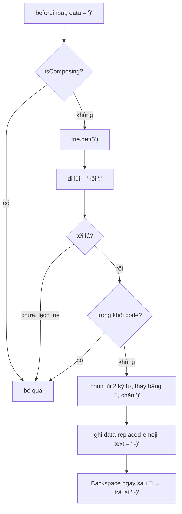

Gõ `:-)` trong ô soạn tin của WhatsApp Web, đúng lúc phím `)` được nhấn thì ba ký tự biến thành 🙂. Gõ `(y)` ra 👍, `<3` ra ❤️. Lỡ tay không muốn đổi? Bấm Backspace một lần, chữ gốc quay lại.

Nghe đơn giản, nhưng làm ngây thơ thì dễ hỏng: chạy regex trên toàn bộ ô soạn tin sau mỗi phím (tin dài vài nghìn ký tự thì mỗi phím đều quét lại), thay luôn cả `:-)` nằm trong khối code, hoặc thay xong làm con trỏ nhảy về cuối. WhatsApp chỉ nhìn **vài ký tự ngay trước con trỏ**, bằng một cấu trúc rất cũ: trie (cây tiền tố), nhưng chèn khoá theo chiều ngược.

Cùng nhóm module còn có ô tìm emoji ("cười", "tim", "cat"): cũng là trie, nhưng chỉ lưu **5 ký tự đầu** của từ khoá.

> [!TIP]
> **Tóm tắt**
> - Thay emoticon khi gõ: chèn khoá vào trie theo thứ tự **ngược** (`)` → `-` → `:`), mỗi phím chỉ đi lùi từ con trỏ vài bước, không quét lại cả tin nhắn.
> - Chạy ở `beforeinput` (ký tự chưa được chèn), bỏ qua khi đang gõ IME (`isComposing`) và khi con trỏ đang trong khối ` ``` ` chưa đóng.
> - Backspace ngay sau emoji vừa thay thì trả lại chữ gốc. Bản gốc dùng mẹo chèn thêm một dấu cách để Backspace của trình duyệt tự xoá.
> - Tìm emoji: trie chỉ chứa 5 ký tự đầu của từ khoá (ít nút hơn một nửa), phần còn lại lọc bằng `startsWith`, xếp hạng: khớp đúng và hay dùng → khớp đúng → gần đây → phổ biến → theo nhóm.

<iframe class="demo-frame" src="/demos/web-patterns/index.html?theme=dark#/wa-emoji-trie" title="Demo wa-emoji-trie" loading="lazy" style="height: 1080px"></iframe>

<p class="demo-links">▶ <a href="/demos/web-patterns/index.html#/wa-emoji-trie" target="_blank" rel="noopener">Mở demo toàn màn hình ↗</a> · <a href="https://stackblitz.com/github/hunghg255/blog-hunghg/tree/master/examples/web-patterns?file=src/lib/waEmojiTrie.ts" target="_blank" rel="noopener">Sửa code trên StackBlitz ↗</a> · <a href="https://github.com/hunghg255/blog-hunghg/blob/master/examples/web-patterns/src/lib/waEmojiTrie.ts" target="_blank" rel="noopener">Xem source trên GitHub ↗</a></p>

## WhatsApp làm thế nào?

Mã nguồn là bundle WhatsApp Web năm 2020 (`0 Whatapp list/all.js` trong repo [facebook-codebase](https://github.com/hunghg255/facebook-codebase)), đã qua webpack nên tên module là chuỗi hash. Bản hiện tại có lẽ đã khác. Các module liên quan:

| Module | Vai trò |
| --- | --- |
| `eajcbddhd` | Bảng 17 emoticon → emoji và trie `fromBackwardsStrings` |
| `ddajgjdcjb` | Xử lý `beforeinput`: đi lùi từ con trỏ trên trie, thay bằng emoji |
| `ccdccbedad` | Duyệt ngược qua các text node và ảnh emoji trong ô soạn tin, dừng ở `\n` |
| `ccgeihgjja` | Backspace sau emoji vừa thay → trả lại chữ gốc |
| `dacicgjcai` | `isInsideCodeBlock`: con trỏ có nằm trong khối ` ``` ` không |
| `dideejhcch` | Tìm emoji theo từ khoá, trie 5 ký tự, xếp hạng |

### Bảng emoticon và trie đọc ngược

`eajcbddhd` chỉ có 17 cặp: `(y)`, `(Y)` → 👍; `(n)`, `(N)` → 👎; `:-)` → 🙂; `:-(` → 🙁; `:-p`, `:-P` → 😛; `:-|`, `:-\`, `:-D`, `:-*`, `:-o`, `<3`, `^_^`, `>_<`, `;-)`. Không có `:)` (thiếu gạch ngang), có lẽ để tránh thay nhầm trong văn bản thường như "(xem mục 2:)".

Các khoá được đưa vào trie bằng `fromBackwardsStrings`: khoá `:-)` thành đường đi `)` → `-` → `:`. Lý do: khi người dùng vừa gõ `)`, ta biết **ký tự cuối** của emoticon, còn phần đầu nằm ở đâu đó phía trước. Đi từ gốc trie theo `)` rồi lùi dần về trước là cách tự nhiên nhất.

### Chạy trước khi ký tự được chèn

`ddajgjdcjb` được gọi với sự kiện có `e.data` là ký tự sắp chèn (giai đoạn "before input"); trước đó nó cũng thoát nếu không có `selection.modify`, có nhiều hơn một vùng chọn hoặc vùng chọn không thu gọn. Phần lõi, rút gọn và đặt lại tên:

```js
if (e.isComposing) return false;                 // đang gõ IME (Telex, tiếng Nhật…)
let node = backwardsTrie.get(e.data || '');      // bắt đầu từ ký tự SẮP gõ
walkBackward(composer, sel, (ch, i, chunk) => {
  if (!(node = node.get(ch))) return true;       // lệch khỏi trie: dừng
  if (node.hasChildren()) return;                // đi tiếp về trước
  text = chunk.slice(i) + text;                  // tới lá: có emoticon hoàn chỉnh
  if ((emoji = lookup(text))) found = text;
  return true;
});
if (!found || isInsideCodeBlock(textBeforeCursor)) return false;
extendSelectionBackward(sel, found.length - 1);  // ":-" đã có trong ô soạn tin
composer.replaceSelection(emoji);                // rồi chặn việc chèn ")"
```

Vài điểm đáng chú ý:

- **`found.length - 1`**: ký tự cuối (`)`) chưa có trong DOM, nên chỉ cần chọn lùi 2 ký tự `:-` rồi thay vùng chọn bằng emoji và chặn việc chèn `)`.
- **`selection.modify('extend', 'backward', 'character')`** (module `bhccfhjdga`) được gọi trong vòng lặp để mở rộng vùng chọn. Đây là API không chuẩn nhưng mọi trình duyệt lớn đều có; nó đi theo "ký tự người dùng thấy" nên không cắt đôi emoji.
- **Duyệt qua cả ảnh emoji**: trong ô soạn tin của WhatsApp, emoji là phần tử ``. `ccdccbedad` đổi phần tử đó về chuỗi emoji khi duyệt, và dừng ở `\n` (emoticon không vắt qua hai dòng).
- **Không kiểm ranh giới từ**: `abc(y)` cũng thành `abc👍`. Trong bản viết lại tôi thêm tuỳ chọn `requireBoundary`.
- Trie dừng ở **lá đầu tiên** gặp được. Nếu có hai khoá mà khoá này là phần cuối của khoá kia (ví dụ `:-)` và `8:-)`), khoá ngắn luôn thắng. Với 17 khoá hiện tại thì không có trường hợp này.

### Backspace trả lại chữ gốc

`ccgeihgjja` bắt phím Backspace (`keyCode === 8`). Nếu node ngay trước con trỏ là emoji có `data-replaced-emoji-text`:

```js
// trước đó: thu con trỏ về ngay TRƯỚC emoji bằng selection.modify
const original = emojiNode.dataset.replacedEmojiText;      // ":-)"
emojiNode.parentNode.replaceChild(document.createTextNode(original + ' '), emojiNode);
for (let i = 0; i < original.length + 1; i++) sel.modify('move', 'forward', 'character');
return false; // KHÔNG chặn Backspace
```

Mẹo ở đây: thay emoji bằng `":-) "` (thừa một dấu cách), đặt con trỏ sau dấu cách, rồi **để Backspace mặc định của trình duyệt chạy**: nó xoá dấu cách thừa. Kết quả là `:-)` với con trỏ ngay sau. Vì Backspace thật vẫn chạy, các sự kiện `input` và trạng thái ô soạn tin vẫn đi đúng luồng bình thường, không cần tự phát sự kiện giả.

### Con trỏ trong khối code

`dacicgjcai` dùng regex `/```([\s\S]*?\S[\s\S]*?)```/g` để tách các khối code đã đóng, rồi xem phần cuối (sau khối đóng cuối cùng) có chứa ` ``` ` không. Có nghĩa là người dùng đang mở một khối code chưa đóng, và `:-)` ở đó là code, không phải mặt cười.

### Tìm emoji: trie 5 ký tự

`dideejhcch` nhận từ điển "từ khoá → emoji" theo locale (có thể 2 dict: tiếng Anh và ngôn ngữ của người dùng, dict sau ghi đè). Mỗi từ khoá được đổi thành `{ value: emoji, keyword, shortKeyword: keyword.substring(0, 5) }` và trie được dựng trên `shortKeyword`:

```js
function getMatches(query, trie) {
  if (query.length <= 5) return trie.getMatches(query);            // lấy cả cây con
  const head = query.substring(0, 5).trim();
  return trie.getMatches(head).filter((m) => m.keyword.startsWith(query));
}
```

Trie chỉ sâu tối đa 5 tầng nên ít nút hơn nhiều; truy vấn dài hơn thì lấy ứng viên theo 5 ký tự đầu rồi lọc lại. Người dùng gõ "smiling" thì 5 ký tự "smili" đã thu hẹp còn vài chục ứng viên, lọc `startsWith` trên vài chục chuỗi là không đáng kể.

Xếp hạng (`o.default` là hợp không trùng lặp, `d.default` là giao):

```js
const top = intersect(union(recent, popular), exact); // popular: 50 emoji cố định 😂 😍 😘 🤣 …
return uniq(union(top, sortByCategory(exact), recent, popular, sortByCategory(all)));
```

Trong đó `all` là mọi emoji khớp, `exact` là emoji có từ khoá trùng hẳn truy vấn, `recent` và `popular` đã được giao với `all`.

`sortByCategory` xếp theo vị trí trong bảng chọn emoji (mặt cười → động vật → đồ ăn → … → cờ), để kết quả quen mắt với người hay dùng bảng chọn.



## Bên trong trình duyệt: `beforeinput` và IME

`beforeinput` chạy **trước** khi trình duyệt sửa nội dung, có `inputType` (`insertText`, `insertFromPaste`, `deleteContentBackward`…) và `data`. Gọi `preventDefault()` thì nội dung không đổi. Đó là chỗ đúng để "đổi ký tự sắp chèn thành thứ khác". Nếu làm ở sự kiện `input` (sau khi chèn) thì phải xoá rồi chèn lại, dễ làm hỏng lịch sử hoàn tác và vị trí con trỏ.

Với bộ gõ (IME) như Telex hay tiếng Nhật, chữ đang soạn chưa phải chữ cuối cùng: `isComposing === true`. Đụng vào DOM lúc đó làm bộ gõ mất trạng thái, nên cả hai module đều thoát sớm.

`beforeinput` có trên Chrome, Edge, Safari và Firefox (Firefox từ bản 87), tính tới 10/2026. Một lưu ý cho React: `onBeforeInput` của React được dựng từ sự kiện `textInput`/`keypress` cũ, không có `inputType`. Demo của bài này gắn listener `beforeinput` gốc bằng `addEventListener`.

## Viết lại

Bản viết lại tách phần logic thuần (không đụng DOM) để dễ kiểm thử, demo dùng `<textarea>` thay cho contentEditable.

### Trie đọc ngược

`TrieNode` dùng `Map` cho cạnh con và mảng `values` cho các khoá kết thúc tại nút; cùng một lớp dùng cho cả trie đọc ngược (giá trị là emoji) lẫn trie tìm kiếm (giá trị là `{ emoji, keyword }`).

```ts title=src/lib/waEmojiTrie.ts
/** Khoá được chèn NGƯỢC: ký tự cuối của emoticon là cạnh đầu tiên từ gốc. */
export function buildBackwardTrie(map: Record<string, string>): TrieNode<string> {
  const root = new TrieNode<string>();
  for (const [key, emoji] of Object.entries(map)) {
    let node = root;
    for (let i = key.length - 1; i >= 0; i--) node = node.child(key[i]);
    node.values.push(emoji);
  }
  return root;
}
```

### Khớp emoticon trước con trỏ

```ts title=src/lib/waEmojiTrie.ts
export function matchEmoticon(
  trie: TrieNode<string>,
  textBefore: string,
  typed: string,
  { requireBoundary = true, longest = true }: MatchOptions = {},
): EmoticonMatch | null {
  const s = textBefore + typed;
  let node: TrieNode<string> | undefined = trie;
  let best: EmoticonMatch | null = null;
  for (let i = s.length - 1; i >= 0 && s[i] !== '\n'; i--) {
    node = node.children.get(s[i]);
    if (!node) break;
    if (node.values.length) {
      const boundaryOk = !requireBoundary || i === 0 || /\s/.test(s[i - 1]);
      if (boundaryOk) best = { start: i, original: s.slice(i), emoji: node.values[0] };
      if (!longest) break;
    }
  }
  if (!best || isInsideCodeBlock(textBefore)) return null;
  return best;
}
```

`undoReplacement` (dòng 104–115) chỉ kiểm con trỏ có đứng đúng sau emoji vừa thay không, rồi ghép lại chuỗi với chữ gốc.

### Chỉ mục tìm emoji

```ts title=src/lib/waEmojiTrie.ts
  matches(query: string): KeywordEntry[] {
    const q = this.fold(query);
    if (!q) return [];
    let node: TrieNode<KeywordEntry> | undefined = this.root;
    for (const ch of q.slice(0, this.prefixLength)) {
      node = node.children.get(ch);
      if (!node) return [];
    }
    const found = node.collect();
    return q.length > this.prefixLength ? found.filter((e) => e.keyword.startsWith(q)) : found;
  }
```

Phần xếp hạng (`search`) giữ nguyên thứ tự ưu tiên của bản gốc, xem trong file đầy đủ.

::: spoiler Xem toàn bộ src/lib/waEmojiTrie.ts
```ts title=src/lib/waEmojiTrie.ts
/**
 * Emoticon → emoji khi gõ (trie đọc ngược) và tìm emoji theo từ khoá (trie tiền tố 5 ký tự).
 * Viết lại từ ý tưởng của WhatsApp Web 2020 (module eajcbddhd, ddajgjdcjb, ccgeihgjja, dideejhcch).
 */

/** Nút trie dùng chung cho cả hai việc. */
export class TrieNode<V> {
  readonly children = new Map<string, TrieNode<V>>();
  /** Giá trị của các khoá kết thúc đúng tại nút này. */
  readonly values: V[] = [];

  child(ch: string): TrieNode<V> {
    let next = this.children.get(ch);
    if (!next) this.children.set(ch, (next = new TrieNode<V>()));
    return next;
  }

  /** Mọi giá trị trong cây con, theo thứ tự chèn của từng nút (DFS). */
  collect(out: V[] = []): V[] {
    out.push(...this.values);
    for (const c of this.children.values()) c.collect(out);
    return out;
  }

  size(): number {
    let n = 1;
    for (const c of this.children.values()) n += c.size();
    return n;
  }
}

/** Cùng 17 emoticon như bản gốc. */
export const EMOTICONS: Record<string, string> = {
  '(y)': '👍', '(Y)': '👍', '(n)': '👎', '(N)': '👎',
  ':-)': '🙂', ':-(': '🙁', ':-p': '😛', ':-P': '😛',
  ':-|': '😐', ':-\\': '😕', ':-D': '😀', ':-*': '😘',
  ':-o': '😮', '<3': '❤️', '^_^': '😁', '>_<': '😆', ';-)': '😉',
};

/** Khoá được chèn NGƯỢC: ký tự cuối của emoticon là cạnh đầu tiên từ gốc. */
export function buildBackwardTrie(map: Record<string, string>): TrieNode<string> {
  const root = new TrieNode<string>();
  for (const [key, emoji] of Object.entries(map)) {
    let node = root;
    for (let i = key.length - 1; i >= 0; i--) node = node.child(key[i]);
    node.values.push(emoji);
  }
  return root;
}

/** Đang ở trong khối ``` chưa đóng? (số dấu ``` phía trước con trỏ là số lẻ) */
export function isInsideCodeBlock(textBefore: string): boolean {
  return (textBefore.split('```').length - 1) % 2 === 1;
}

export interface EmoticonMatch {
  /** Vị trí bắt đầu emoticon trong `textBefore + typed`. */
  start: number;
  original: string;
  emoji: string;
}

export interface MatchOptions {
  /** Chỉ thay khi trước emoticon là đầu dòng/khoảng trắng (bản gốc không kiểm, "abc(y)" cũng bị thay). */
  requireBoundary?: boolean;
  /** Lấy khớp dài nhất (bản gốc dừng ở lá đầu tiên, không hỗ trợ khoá là tiền tố của khoá khác). */
  longest?: boolean;
}

/**
 * Gọi TRƯỚC khi ký tự `typed` được chèn (sự kiện beforeinput): chỉ cần đi lùi từ `typed`
 * qua vài ký tự phía trước, không quét lại cả ô soạn tin.
 */
export function matchEmoticon(
  trie: TrieNode<string>,
  textBefore: string,
  typed: string,
  { requireBoundary = true, longest = true }: MatchOptions = {},
): EmoticonMatch | null {
  const s = textBefore + typed;
  let node: TrieNode<string> | undefined = trie;
  let best: EmoticonMatch | null = null;
  for (let i = s.length - 1; i >= 0 && s[i] !== '\n'; i--) {
    node = node.children.get(s[i]);
    if (!node) break;
    if (node.values.length) {
      const boundaryOk = !requireBoundary || i === 0 || /\s/.test(s[i - 1]);
      if (boundaryOk) best = { start: i, original: s.slice(i), emoji: node.values[0] };
      if (!longest) break;
    }
  }
  if (!best || isInsideCodeBlock(textBefore)) return null;
  return best;
}

/** Bản ghi để Backspace ngay sau emoji trả lại emoticon. */
export interface Replacement {
  start: number;
  emoji: string;
  original: string;
}

/** Backspace ngay sau emoji vừa thay → khôi phục chữ gốc (null nếu con trỏ không ở đó). */
export function undoReplacement(
  text: string,
  caret: number,
  rec: Replacement | null,
): { text: string; caret: number } | null {
  if (!rec || caret !== rec.start + rec.emoji.length) return null;
  if (text.slice(rec.start, caret) !== rec.emoji) return null;
  return {
    text: text.slice(0, rec.start) + rec.original + text.slice(caret),
    caret: rec.start + rec.original.length,
  };
}

/** Bản gốc áp màu da đã chọn cho emoji nhận màu da (ở đây chỉ 👍 👎). */
const SKIN_TONE_BASES = new Set(['👍', '👎']);
export function applySkinTone(emoji: string, tone: string | null): string {
  return tone && SKIN_TONE_BASES.has(emoji) ? emoji + tone : emoji;
}

// ---------------- Tìm emoji theo từ khoá ----------------

export interface KeywordEntry {
  emoji: string;
  keyword: string;
}

export interface RankContext {
  recent?: string[];
  popular?: string[];
  /** emoji → thứ tự trong bảng chọn (nhóm mặt cười trước, cờ sau). */
  categoryOrder?: Map<string, number>;
}

/** Chữ thường, bỏ dấu: "Mèo Đen" → "meo den" (bản gốc chỉ toLowerCase). */
export function foldKeyword(s: string): string {
  return s.toLowerCase().normalize('NFD').replace(/\p{M}/gu, '').replace(/đ/g, 'd').trim();
}

export class EmojiSearchIndex {
  private readonly root = new TrieNode<KeywordEntry>();
  readonly entries: KeywordEntry[];

  /** `dicts`: từ khoá → emoji theo từng locale; dict sau ghi đè dict trước (vd en rồi vi). */
  constructor(
    dicts: Record<string, string>[],
    readonly prefixLength = 5,
    private readonly fold: (s: string) => string = foldKeyword,
  ) {
    const merged: Record<string, string> = Object.assign({}, ...dicts);
    this.entries = Object.entries(merged).map(([k, emoji]) => ({ emoji, keyword: fold(k) }));
    for (const entry of this.entries) {
      let node = this.root;
      for (const ch of entry.keyword.slice(0, prefixLength)) node = node.child(ch);
      node.values.push(entry);
    }
  }

  get nodeCount(): number {
    return this.root.size();
  }

  /** Ứng viên: đi tới nút của tiền tố (tối đa prefixLength ký tự), lấy cả cây con, lọc phần còn lại. */
  matches(query: string): KeywordEntry[] {
    const q = this.fold(query);
    if (!q) return [];
    let node: TrieNode<KeywordEntry> | undefined = this.root;
    for (const ch of q.slice(0, this.prefixLength)) {
      node = node.children.get(ch);
      if (!node) return [];
    }
    const found = node.collect();
    return q.length > this.prefixLength ? found.filter((e) => e.keyword.startsWith(q)) : found;
  }

  /** Xếp hạng như bản gốc: khớp đúng + hay dùng → khớp đúng → gần đây → phổ biến → còn lại. */
  search(query: string, { recent = [], popular = [], categoryOrder }: RankContext = {}): string[] {
    const q = this.fold(query);
    const found = this.matches(q);
    const all = new Set(found.map((e) => e.emoji));
    const exact = new Set(found.filter((e) => e.keyword === q).map((e) => e.emoji));
    const byCategory = (set: Iterable<string>) =>
      [...set].sort(
        (a, b) =>
          (categoryOrder?.get(a) ?? Number.MAX_SAFE_INTEGER) - (categoryOrder?.get(b) ?? Number.MAX_SAFE_INTEGER),
      );
    const recentHit = recent.filter((e) => all.has(e));
    const popularHit = popular.filter((e) => all.has(e));
    const exactFavorite = [...recentHit, ...popularHit].filter((e) => exact.has(e));
    return [...new Set([...exactFavorite, ...byCategory(exact), ...recentHit, ...popularHit, ...byCategory(all)])];
  }
}
```
:::

## Đi qua code

1. `buildBackwardTrie` chèn từng khoá từ ký tự cuối về đầu. 17 khoá tạo ra 45 nút (con số hiện trong demo).
2. Khi người dùng gõ một ký tự, demo gọi `matchEmoticon(trie, textBefore, typed)`. Vòng lặp bắt đầu từ ký tự vừa gõ (`s.length - 1`) và đi lùi; ra khỏi trie thì dừng ngay. Với `:-)` chỉ có 3 bước, dù ô soạn tin dài bao nhiêu.
3. Khi tới nút có giá trị, kiểm tra ranh giới (ký tự trước phải là khoảng trắng hoặc đầu chuỗi) rồi ghi nhận khớp. Không dừng ngay mà đi tiếp để lấy **khớp dài nhất**.
4. Cuối cùng kiểm tra khối code: đếm số dấu ` ``` ` phía trước, số lẻ nghĩa là đang ở trong khối chưa đóng.
5. Demo gọi `preventDefault()` cho `beforeinput`, thay đoạn `[start, caret)` bằng emoji qua `setRangeText(emoji, start, caret, 'end')` và nhớ `{ start, emoji, original }`.
6. Phím Backspace: nếu con trỏ đúng sau emoji vừa thay, `undoReplacement` trả về chuỗi mới; demo chặn Backspace và đặt lại chữ gốc. Gõ phím khác, click chuột hoặc dùng phím mũi tên thì quên bản ghi.
7. Tìm emoji: `EmojiSearchIndex` gộp các dict (dict sau ghi đè), chuẩn hoá từ khoá bằng `foldKeyword`, chèn 5 ký tự đầu vào trie. `matches` đi tới nút của tiền tố rồi `collect()` cả cây con.

**Khác bản gốc:**

- Thêm `requireBoundary` (mặc định bật): `abc(y)` không bị đổi. Tắt ô "Cần khoảng trắng phía trước" trong demo để thấy hành vi gốc.
- Lấy khớp dài nhất thay vì dừng ở lá đầu tiên, nên thêm khoá như `8:-)` sau này vẫn đúng.
- `foldKeyword` bỏ dấu tiếng Việt: gõ "cuoi" vẫn ra 😂 🤣 😀. Bản gốc chỉ `toLowerCase()`, người dùng gõ không dấu sẽ không thấy gì với từ khoá tiếng Việt.
- Backspace chỉ trả lại cho **lần thay gần nhất**. Bản gốc gắn `data-replaced-emoji-text` vào phần tử emoji nên có thể trả lại bất kỳ lúc nào con trỏ đứng ngay sau emoji đó, kể cả sau khi đã gõ tiếp rồi xoá.
- Demo dùng `textarea` nên không cần `selection.modify` và không phải duyệt qua ``.

## Tại sao không làm cách khác?

**Regex trên cả ô soạn tin sau mỗi phím.** Dễ viết: `text.replace(/:-\)|\(y\)|<3/g, …)`. Nhưng mỗi phím đều quét lại toàn bộ chuỗi (O(n) mỗi phím, O(n²) cho cả tin nhắn), thay cả những emoticon người dùng đã cố tình giữ lại bằng Backspace, và phải tự tính lại vị trí con trỏ sau khi chuỗi đổi độ dài.

**Regex neo ở cuối chuỗi trước con trỏ** (`/(:-\)|\(y\))$/`). Chỉ khớp cuối chuỗi nên nhanh hơn, nhưng vẫn phải cắt `textBefore` và với contentEditable thì việc dựng `textBefore` từ nhiều text node và ảnh emoji tốn hơn việc đi lùi vài bước. Trie đọc ngược dừng ngay khi ký tự không khớp, thường sau 1 bước.

**Thay khi gửi tin thay vì khi gõ.** Người gửi không thấy trước kết quả, và không có cách giữ lại `:-)` nguyên văn.

**Trie đầy đủ từ khoá cho ô tìm emoji.** Với dữ liệu demo, trie 5 ký tự có 474 nút, trie đầy đủ 931 nút. Với bộ từ khoá thật của hàng nghìn emoji × nhiều ngôn ngữ, khoảng cách còn lớn hơn, và trie được dựng lại mỗi lần đổi ngôn ngữ.

## Edge case và cạm bẫy

- **IME**: luôn thoát khi `isComposing`. Người gõ Telex có thể tạo ra `)` trong lúc soạn chữ, không được thay lúc đó.
- **Dán (paste)**: `inputType` là `insertFromPaste`, `data` là cả đoạn văn bản. Cả bản gốc lẫn bản viết lại đều không đổi emoticon khi dán, đây là hành vi mong muốn (dán code thì giữ nguyên).
- **Undo (Ctrl+Z)**: `setRangeText` và thao tác DOM trực tiếp không đi vào lịch sử hoàn tác của trình duyệt. Nếu cần, dùng `document.execCommand('insertText', false, emoji)` (đã "deprecated" nhưng vẫn là cách duy nhất ghi vào lịch sử hoàn tác, tính tới 10/2026).
- **Màu da**: 👍 và 👎 nhận màu da. Bản gốc áp màu da người dùng đã chọn khi thay; demo có nút chọn màu da để thử.
- **`:-\`** là khoá có dấu gạch ngược; trong chuỗi JavaScript phải viết `':-\\'`.
- **Khối code chưa đóng**: cách đếm ` ``` ` coi ` ```` ` (bốn dấu) là một khối mở và dư một dấu; bản gốc cũng vậy. Ít gặp trong tin nhắn.
- **Từ khoá trùng giữa hai ngôn ngữ**: dict sau ghi đè dict trước, nên "pizza" chỉ trỏ tới một emoji. Nếu cần nhiều emoji cho một từ, đổi giá trị thành mảng.

## Dùng trong dự án

```ts
const trie = buildBackwardTrie(EMOTICONS);
textarea.addEventListener('beforeinput', (e) => {
  if (e.inputType !== 'insertText' || !e.data || e.isComposing) return;
  const caret = textarea.selectionStart;
  const m = matchEmoticon(trie, textarea.value.slice(0, caret), e.data);
  if (!m || caret !== textarea.selectionEnd) return;
  e.preventDefault();
  textarea.setRangeText(m.emoji, m.start, caret, 'end');
});
```

Muốn có Backspace trả lại chữ gốc thì lưu `{ start, emoji, original }` sau khi thay và gọi `undoReplacement` trong `keydown`, như demo.

Ô tìm emoji: dựng `new EmojiSearchIndex([enDict, viDict])` một lần (hoặc khi đổi ngôn ngữ), gọi `search(query, { recent, popular, categoryOrder })` mỗi lần gõ. Với vài nghìn từ khoá, mỗi lần tìm dưới 1 ms nên không cần debounce.

Với contentEditable (emoji là ``), xem thêm [cách tách cụm emoji của Facebook](/blogs/facebook-emoji-segmentation) và [bảng emoji chỉ render nhóm đang xem của Telegram](/blogs/telegram-emoji-picker-virtualization).

## Kiểm thử

::: spoiler Ví dụ test (bản phác, không có trong repo)
```ts
import { describe, expect, it } from 'vitest';
import { buildBackwardTrie, EMOTICONS, EmojiSearchIndex, matchEmoticon, undoReplacement } from './waEmojiTrie';

const trie = buildBackwardTrie(EMOTICONS);

describe('matchEmoticon', () => {
  it('thay khi gõ ký tự cuối', () => {
    expect(matchEmoticon(trie, 'hi :-', ')')).toEqual({ start: 3, original: ':-)', emoji: '🙂' });
  });
  it('cần ranh giới từ, trừ khi tắt', () => {
    expect(matchEmoticon(trie, 'abc(y', ')')).toBeNull();
    expect(matchEmoticon(trie, 'abc(y', ')', { requireBoundary: false })?.emoji).toBe('👍');
  });
  it('không thay trong khối code chưa đóng', () => {
    expect(matchEmoticon(trie, '```code :-', ')')).toBeNull();
    expect(matchEmoticon(trie, '```a``` :-', ')')?.emoji).toBe('🙂');
  });
  it('không vắt qua xuống dòng', () => {
    expect(matchEmoticon(trie, 'x\n:-', ')')?.start).toBe(2);
  });
});

describe('undoReplacement', () => {
  it('trả lại chữ gốc khi con trỏ ngay sau emoji', () => {
    const rec = { start: 3, emoji: '🙂', original: ':-)' };
    expect(undoReplacement('ok 🙂 tail', 5, rec)).toEqual({ text: 'ok :-) tail', caret: 6 });
    expect(undoReplacement('ok 🙂 tail', 2, rec)).toBeNull();
  });
});

describe('EmojiSearchIndex', () => {
  const index = new EmojiSearchIndex([{ cat: '🐈', 'cat face': '🐱' }, { mèo: '🐱' }]);
  it('bỏ dấu và lấy cả cây con', () => {
    expect(index.search('meo')).toEqual(['🐱']);
    expect(index.search('cat')).toEqual(['🐈', '🐱']);
  });
  it('truy vấn dài hơn 5 ký tự thì lọc lại', () => {
    expect(index.matches('cat fa').map((e) => e.emoji)).toEqual(['🐱']);
  });
  it('gần đây được đẩy lên trước', () => {
    expect(index.search('ca')).toEqual(['🐈', '🐱']);
    expect(index.search('ca', { recent: ['🐱'] })).toEqual(['🐱', '🐈']);
  });
});
```
:::

## So với thư viện và chuẩn web

- Chưa có API chuẩn nào "thay emoticon khi gõ". Trình soạn thảo như ProseMirror/Tiptap có "input rules" (regex neo ở cuối chuỗi trước con trỏ), Lexical có plugin tương tự. Chúng giải quyết cùng bài toán nhưng bằng regex, phù hợp khi số quy tắc ít.
- `Intl.Segmenter` (có trên mọi trình duyệt lớn, tính tới 10/2026) giúp đi lùi theo grapheme nếu bạn phải duyệt chuỗi có emoji ghép, thay cho `selection.modify` không chuẩn.
- Bộ từ khoá emoji theo nhiều ngôn ngữ có sẵn trong dữ liệu CLDR annotations (gói `emojibase-data`, `@emoji-mart/data`), không cần tự soạn như demo.

---

Bài này thuộc series **[Học từ mã nguồn WhatsApp Web](/series/whatsapp)** (19 bài, đọc theo thứ tự).

::: spoiler Xem nhanh danh sách bài trong series

*Mở đầu*

- [Mở đầu: đọc bundle WhatsApp Web 2020](/blogs/learn-from-whatsapp-web-source-code)

*Phần 1: media và mã hoá*

- [#1 Giải mã JPEG progressive theo từng scan, kiểm HMAC](/blogs/whatsapp-progressive-jpeg-hmac)
- [#2 Ghép khoảng byte cho video streaming](/blogs/whatsapp-byte-range-merge)
- [#3 Xoá EXIF không re-encode, thumbnail theo ngân sách byte](/blogs/whatsapp-jpeg-strip-thumb-budget)
- [#4 Đọc metadata sticker WebP động](/blogs/whatsapp-webp-sticker-metadata)

*Phần 2: lưu trữ trên trình duyệt*

- [#5 Kho media LRU tự co theo quota](/blogs/whatsapp-quota-aware-media-lru)
- [#6 Cache blob trong RAM có refcount, tự revoke objectURL](/blogs/whatsapp-blob-cache-refcount)
- [#7 Khoá IndexedDB giữ đúng thứ tự từ điển](/blogs/whatsapp-indexeddb-ordered-keys)

*Phần 3: danh sách tin nhắn*

- [#8 Render tin nhắn theo cửa sổ chiều cao ước lượng](/blogs/whatsapp-render-cursor-window)
- [#9 Theo dõi viewport tin nhắn: binary search, ngày dính](/blogs/whatsapp-message-viewport-tracking)
- [#10 FlatList tái dùng key React, overscan bất đối xứng](/blogs/whatsapp-flatlist-key-reuse)

*Phần 4: soạn tin và chữ*

- **#11 Emoticon thành emoji bằng trie đọc ngược, tìm emoji** (bài này)
- [#12 Mention bằng token zero-width, giới hạn theo code point](/blogs/whatsapp-mention-zero-width-input)
- [#13 Xác định hướng chữ bằng bảng delta nén](/blogs/whatsapp-text-direction-table)
- [#14 Phát hiện homograph trong link, chặn giả đuôi file RTLO](/blogs/whatsapp-homograph-rtlo-guard)

*Phần 5: realtime và tiện ích*

- [#15 Presence, "đang gõ" và thông báo theo kích thước group](/blogs/whatsapp-presence-typing-notifications)
- [#16 Đo FPS phát hiện UI đóng băng, idle monitor](/blogs/whatsapp-fps-freeze-idle)
- [#17 Cửa sổ PiP: resize 8 hướng, khoá tỉ lệ, né vật cản](/blogs/whatsapp-pip-resize-avoid)
- [#18 Parse giá tiền theo locale bằng Intl](/blogs/whatsapp-locale-price-parse)

:::

Code + demo: [`examples/web-patterns`](https://github.com/hunghg255/blog-hunghg/tree/master/examples/web-patterns) · [Mở trên StackBlitz](https://stackblitz.com/github/hunghg255/blog-hunghg/tree/master/examples/web-patterns)
