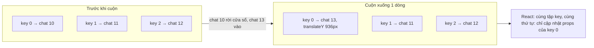

Danh sách chat bên trái WhatsApp Web có thể dài vài nghìn dòng, mỗi dòng có avatar, tên, tin cuối, giờ, số tin chưa đọc. Virtual list (danh sách ảo) là lời giải quen thuộc: chỉ render các dòng đang thấy cộng một ít dư ra mỗi phía. Nhưng virtual list kiểu thông thường vẫn tốn ở chỗ ít ai để ý: mỗi dòng mới vào màn hình là một component **mount mới**, dòng vừa ra là một lần **unmount**. Cuộn nhanh qua 100 dòng là 100 lần tạo và huỷ cây DOM của một dòng chat.

WhatsApp Web 2020 có một `FlatList` tự viết, với mẹo chính: **key React là một số được tái dùng**, không phải id của chat.

> [!TIP]
> **Tóm tắt**
> - KeyPool gán cho mỗi dòng trong cửa sổ một key số. Dòng mới vào lấy lại key của dòng vừa rời đi, nên React chỉ cập nhật props cho cây DOM có sẵn thay vì unmount/mount.
> - Kết quả được sắp theo key trước khi render, nên thứ tự con trong DOM không đổi khi cuộn. Vị trí do `transform: translateY(offset)` quyết định.
> - Overscan 5 dòng mỗi phía; phần không dùng được ở đầu (hoặc cuối) danh sách được dồn sang phía còn lại. Transition 200ms chỉ chạy khi **cùng một chat** đổi vị trí.
> - Cuộn gom theo `requestAnimationFrame`, và `pointer-events: none` trong lúc cuộn (bật lại sau 150ms). Bản gốc có lỗi `this.props.zIndex != this.props.zIndex` (luôn sai) và cờ pointer-events khởi tạo ngược.

<iframe class="demo-frame" src="/demos/web-patterns/index.html?theme=dark#/wa-flatlist" title="Demo wa-flatlist" loading="lazy" style="height: 950px"></iframe>

<p class="demo-links">▶ <a href="/demos/web-patterns/index.html#/wa-flatlist" target="_blank" rel="noopener">Mở demo toàn màn hình ↗</a> · <a href="https://stackblitz.com/github/hunghg255/blog-hunghg/tree/master/examples/web-patterns?file=src/lib/waFlatList.tsx" target="_blank" rel="noopener">Sửa code trên StackBlitz ↗</a> · <a href="https://github.com/hunghg255/blog-hunghg/blob/master/examples/web-patterns/src/lib/waFlatList.tsx" target="_blank" rel="noopener">Xem source trên GitHub ↗</a></p>

Cuộn danh sách ở chế độ đầu tiên: dù đã qua hàng trăm dòng, "mount thêm khi cuộn" và "node DOM chèn/di chuyển" vẫn là 0, và số key trên các dòng chỉ quanh quẩn từ 0 tới 15. Chuyển sang "key = itemKey" rồi cuộn: mỗi dòng mới là một lần mount. Chế độ "Tái dùng key, không sắp" không mount thêm, nhưng React phải di chuyển node DOM để khớp thứ tự. Bấm "Đẩy chat lên đầu": chat ở giữa màn hình trượt lên đầu, các dòng khác trượt xuống một bậc.

## WhatsApp làm thế nào?

Ba module trong bundle WhatsApp Web 2020 (bản 2020, có thể đã đổi):

- `bgheieccaj`: component `FlatList`. Mặc định dòng cao 72px, `extraItems = 5`, `forceConsistentRenderCount = true`, `reorderAnimationsEnabled = true`.
- `dhgihfccic`: lớp KeyPool, ánh xạ `itemKey` (id chat) sang `rctKey` (key React).
- `ffahjhaig`: `FlatListItem`, bọc từng dòng, đặt `translateY` và quyết định có transition hay không.

### KeyPool

```js
recycleKeysAndMap(items) {
  const nextData = new Map(), nextKey = new Map(), fresh = this.genNewKeys(items.length);
  const unused = new Set(this.rctKeyToData.keys()), waiting = [];
  items.forEach((it) => {
    const k = this.keyToRctKey.get(it.itemKey);
    k !== undefined ? (nextKey.set(it.itemKey, k), nextData.set(k, it), unused.delete(k)) : waiting.push(it);
  });
  const pool = [...fresh, ...unused];
  waiting.forEach((it) => { const k = pool.pop(); nextKey.set(it.itemKey, k); nextData.set(k, it); });
  const out = sortBy(items, [(it) => nextKey.get(it.itemKey)]).map((it) => ({ rctKey: nextKey.get(it.itemKey), data: it }));
  this.rctKeyToData = nextData; this.keyToRctKey = nextKey;
  return out;
}
```

(Đổi tên biến cho dễ đọc.) Dòng đã có key thì giữ key. Dòng mới lấy key bằng `pool.pop()`, và vì `unused` (key của dòng vừa rời cửa sổ) nằm cuối `pool` nên được lấy trước. Chỉ khi cửa sổ to ra mới cần key mới, và `genNewKeys(items.length)` cấp các số nhỏ nhất chưa dùng, đủ bù phần thiếu. Cuối cùng mảng được **sắp theo key**.

### Cửa sổ và overscan bất đối xứng

`computeIndexes` quét tuyến tính tìm dòng đầu tiên có đáy vượt qua `scrollFromStart`, rồi quét tiếp tìm dòng cuối. Với `forceConsistentRenderCount`, dòng cuối được tính từ **đỉnh của dòng đầu** cộng chiều cao khung, nên số dòng render không nhảy lên xuống theo phần lẻ của vị trí cuộn. Rồi tới phần đệm:

```js
let after = extraItems, p = extraItems - first;
p > 0 && (after += p);                       // đầu danh sách: phần đệm phía trước dồn ra sau
let before = extraItems, m = last + extraItems - data.length;
m > 0 && (before += m);                      // cuối danh sách: dồn lên trước
return { firstIndex: Math.max(first - before, 0), lastIndex: Math.min(last + after, data.length - 1) };
```

Ở đầu danh sách, 5 dòng đệm phía trước không tồn tại. Thay vì bỏ, chúng được cộng vào phía sau. Tổng số dòng render vì vậy gần như không đổi trên toàn bộ danh sách, và KeyPool hầu như không phải cấp key mới.

### Dòng: chỉ trượt khi đúng là nó di chuyển

```js
static getDerivedStateFromProps(props, state) {
  return { ...state, prevItemKey: props.data.itemKey, prevRowOffset: props.data.offset,
           shouldAnimate: props.animate && props.data.itemKey === state.prevItemKey && props.data.offset !== state.prevRowOffset };
}
render() {
  const transition = this.state.shouldAnimate ? 'transform 200ms ease-in-out' : 'none';
  return <div style={{ zIndex, transition, height, transform: `translateY(${offset}px)` }}>{renderItem(data)}</div>;
}
```

Khi key được tái dùng, cùng một component nhận một chat **khác** ở offset khác. Nếu để transition thì dòng sẽ bay từ vị trí cũ tới vị trí mới mỗi lần cuộn. Điều kiện `itemKey === prevItemKey` phân biệt hai trường hợp: tái dùng key (nhảy ngay) và chat đổi thứ tự khi có tin mới (trượt 200ms).

### Cuộn

`onScroll` chỉ xin một `requestAnimationFrame`; sự kiện cuộn tới khi frame đang chờ thì bật cờ `hanging` để chạy thêm một vòng sau khi `setState` xong. Mỗi frame tính cửa sổ một lần. `disablePointerEvents` đặt `pointer-events: none` cho list và báo "bận" cho bộ lập lịch `ui_idle` (để việc nền nhường chỗ). `enablePointerEvents` là debounce 150ms.

### Hai lỗi

1. **zIndex.** `shouldComponentUpdate` của dòng có điều kiện `this.props.zIndex != this.props.zIndex`: so prop **cũ** với chính nó, luôn sai. Dòng chỉ render lại khi các điều kiện khác đúng, nên zIndex mới có thể không bao giờ tới DOM. Thêm nữa, zIndex được tính là `data.length - r - 1` với `r` là vị trí trong mảng **đã sắp theo key**, không phải vị trí hiển thị. Hai lỗi cộng lại thì zIndex gần như ngẫu nhiên. Hậu quả chỉ lộ ra khi các dòng chồng lên nhau (trong lúc trượt reorder) và một dòng cần nằm trên.
2. **Cờ pointer-events khởi tạo ngược.** Cờ tên `pointerEvents` thực ra nghĩa là "đang tắt", và được khởi tạo `true`. `disablePointerEvents` chỉ tắt khi cờ là `false`, nên lần cuộn đầu tiên sau khi mount không tắt pointer-events. Sau lần bật lại đầu tiên (150ms) thì mọi thứ đúng.

## Bên trong trình duyệt: React reconcile mảng con có key thế nào

Khi một component trả về mảng con có key, React so danh sách key cũ và mới:

- Key có ở cả hai: **giữ** instance và node DOM, chỉ cập nhật props.
- Key chỉ có ở danh sách mới: **mount** (tạo component, tạo DOM, chạy effect).
- Key chỉ có ở danh sách cũ: **unmount**.
- Key có ở cả hai nhưng đổi thứ tự tương đối: React **di chuyển** node DOM (`insertBefore`) để thứ tự trong DOM khớp thứ tự mảng.

Với key là id chat, cuộn qua một dòng là một unmount và một mount. Với key tái dùng, tập key không đổi, nên chỉ còn trường hợp đầu tiên. Nhưng nếu xuất mảng theo thứ tự hiển thị thì key tái dùng sẽ "nhảy" từ đầu xuống cuối mảng, và React phải di chuyển node: đó là lý do phải sắp theo key. Với các dòng `position: absolute` định vị bằng `transform`, thứ tự DOM không ảnh hưởng gì tới hình ảnh.

`pointer-events: none` trong lúc cuộn có hai tác dụng: con trỏ lướt qua các dòng không kích hoạt `:hover` (đổi màu nền, tức là phải vẽ lại), và trình duyệt bỏ qua hit testing cho phần nội dung. Ngày nay lợi ích nhỏ hơn hồi 2020, nhưng vẫn có ích khi mỗi dòng có hiệu ứng hover nặng.



## Viết lại

KeyPool, gom hai bước của bản gốc vào một vòng:

```tsx title=src/lib/waFlatList.tsx
export class KeyPool {
  private keyOf = new Map<string, number>();
  private used = new Set<number>();

  /**
   * Gán key React (số nhỏ) cho các item của cửa sổ hiện tại. Item đã có key giữ key cũ;
   * item mới lấy key của item vừa rời cửa sổ, thiếu thì cấp số nhỏ nhất chưa dùng.
   */
  assign<T extends FlatItem>(items: readonly T[], firstIndex = 0, sortByKey = true): Keyed<T>[] {
    const nextKeyOf = new Map<string, number>();
    const free = new Set(this.used);
    for (const item of items) {
      const key = this.keyOf.get(item.itemKey);
      if (key !== undefined) {
        nextKeyOf.set(item.itemKey, key);
        free.delete(key);
      }
    }
    // Key của item vừa rời cửa sổ được dùng lại trước, rồi mới tới số nhỏ nhất chưa ai giữ.
    const recycled = [...free];
    const nextUsed = new Set(nextKeyOf.values());
    let n = 0;
    const out = items.map((item, i): Keyed<T> => {
      let key = nextKeyOf.get(item.itemKey);
      if (key === undefined) {
        key = recycled.pop();
        while (key === undefined && nextUsed.has(n)) n++;
        if (key === undefined) key = n++;
        nextKeyOf.set(item.itemKey, key);
        nextUsed.add(key);
      }
      return { rctKey: key, item, index: firstIndex + i };
    });
    this.keyOf = nextKeyOf;
    this.used = nextUsed;
    return sortByKey ? out.sort((a, b) => a.rctKey - b.rctKey) : out;
  }
}
```

Tính cửa sổ bằng binary search trên mảng offset cộng dồn:

```tsx title=src/lib/waFlatList.tsx
/** offsets[i] = tổng chiều cao các item trước i; offsets[n] = tổng chiều dài list. */
export function computeOffsets(items: readonly FlatItem[], defaultHeight: number): number[] {
  const offsets = new Array<number>(items.length + 1);
  offsets[0] = 0;
  for (let i = 0; i < items.length; i++) offsets[i + 1] = offsets[i] + (items[i].height ?? defaultHeight);
  return offsets;
}

/** Item đầu tiên có đáy vượt qua `y`, tìm bằng binary search trên offsets. */
function firstEndingAfter(offsets: readonly number[], y: number) {
  let lo = 0;
  let hi = offsets.length - 2;
  while (lo < hi) {
    const mid = (lo + hi) >>> 1;
    if (offsets[mid + 1] > y) hi = mid;
    else lo = mid + 1;
  }
  return lo;
}

export interface WindowRange {
  first: number;
  last: number;
}

/**
 * Cửa sổ cần render: các item giao với [scroll, scroll + viewport], cộng `extra` item mỗi phía.
 * Ở sát đầu list thì phần đệm phía trước không dùng được, nên dồn sang phía sau (và ngược lại),
 * để số item render luôn xấp xỉ nhau.
 */
export function computeWindow(offsets: readonly number[], scroll: number, viewport: number, extra: number): WindowRange {
  const count = offsets.length - 1;
  if (count <= 0) return { first: 0, last: -1 };
  const start = firstEndingAfter(offsets, Math.max(scroll, 0));
  const end = firstEndingAfter(offsets, Math.min(offsets[start] + viewport, offsets[count]) - 0.001);
  const after = extra + Math.max(0, extra - start);
  const before = extra + Math.max(0, end + extra - (count - 1));
  return { first: Math.max(start - before, 0), last: Math.min(end + after, count - 1) };
}
```

Dòng: transition chỉ khi cùng item, và `memo` so mọi prop kể cả `zIndex`:

```tsx title=src/lib/waFlatList.tsx
function RowImpl<T extends FlatItem>({ item, offset, height, zIndex, animate, renderItem, rctKey }: RowProps<T>) {
  const prev = useRef<{ key: string; offset: number } | null>(null);
  // Chỉ trượt khi đúng item này đổi chỗ; key vừa được tái dùng cho item khác thì nhảy ngay.
  const slide = animate && prev.current?.key === item.itemKey && prev.current.offset !== offset;
  useLayoutEffect(() => {
    prev.current = { key: item.itemKey, offset };
  });
  return (
    <div
      className='wa-fl-item'
      role='listitem'
      style={{
        position: 'absolute',
        left: 0,
        right: 0,
        top: 0,
        height,
        zIndex,
        transform: `translateY(${offset}px)`,
        transition: slide ? 'transform 200ms ease-in-out' : 'none',
      }}
    >
      {renderItem(item, rctKey)}
    </div>
  );
}

/** memo mặc định so nông MỌI prop, kể cả zIndex. */
const Row = memo(RowImpl) as typeof RowImpl;
```


::: spoiler Xem toàn bộ src/lib/waFlatList.tsx
```tsx title=src/lib/waFlatList.tsx
/**
 * Danh sách ảo (virtualized list) tái dùng key React, kiểu FlatList của WhatsApp Web 2020
 * (module `bgheieccaj` FlatList + `dhgihfccic` KeyPool + `ffahjhaig` FlatListItem).
 *
 * - KeyPool: item mới vào cửa sổ nhận lại key React của item vừa rời đi, nên React chỉ cập nhật
 *   props cho DOM sẵn có, không unmount/mount. Kết quả sắp theo key nên thứ tự con không đổi, React
 *   không phải di chuyển node DOM; vị trí do `translateY` quyết định.
 * - Overscan bất đối xứng: phần đệm không dùng được ở đầu danh sách dồn sang cuối và ngược lại.
 * - Transition 200ms chỉ khi CÙNG item đổi offset (đổi thứ tự chat), không khi key vừa bị tái dùng.
 * - Cuộn gom theo requestAnimationFrame; trong lúc cuộn tắt pointer-events, bật lại sau 150ms.
 *
 * Khác bản gốc: tìm cửa sổ bằng binary search, zIndex nằm trong phép so sánh của memo (bản gốc
 * so `this.props.zIndex != this.props.zIndex`, luôn false), và cờ pointer-events khởi tạo đúng.
 */
import { memo, useCallback, useEffect, useLayoutEffect, useMemo, useRef, useState, type ReactNode } from 'react';

export interface FlatItem {
  itemKey: string;
  height?: number;
}

export interface Keyed<T> {
  rctKey: number;
  item: T;
  index: number;
}

export class KeyPool {
  private keyOf = new Map<string, number>();
  private used = new Set<number>();

  /**
   * Gán key React (số nhỏ) cho các item của cửa sổ hiện tại. Item đã có key giữ key cũ;
   * item mới lấy key của item vừa rời cửa sổ, thiếu thì cấp số nhỏ nhất chưa dùng.
   */
  assign<T extends FlatItem>(items: readonly T[], firstIndex = 0, sortByKey = true): Keyed<T>[] {
    const nextKeyOf = new Map<string, number>();
    const free = new Set(this.used);
    for (const item of items) {
      const key = this.keyOf.get(item.itemKey);
      if (key !== undefined) {
        nextKeyOf.set(item.itemKey, key);
        free.delete(key);
      }
    }
    // Key của item vừa rời cửa sổ được dùng lại trước, rồi mới tới số nhỏ nhất chưa ai giữ.
    const recycled = [...free];
    const nextUsed = new Set(nextKeyOf.values());
    let n = 0;
    const out = items.map((item, i): Keyed<T> => {
      let key = nextKeyOf.get(item.itemKey);
      if (key === undefined) {
        key = recycled.pop();
        while (key === undefined && nextUsed.has(n)) n++;
        if (key === undefined) key = n++;
        nextKeyOf.set(item.itemKey, key);
        nextUsed.add(key);
      }
      return { rctKey: key, item, index: firstIndex + i };
    });
    this.keyOf = nextKeyOf;
    this.used = nextUsed;
    return sortByKey ? out.sort((a, b) => a.rctKey - b.rctKey) : out;
  }
}

/** offsets[i] = tổng chiều cao các item trước i; offsets[n] = tổng chiều dài list. */
export function computeOffsets(items: readonly FlatItem[], defaultHeight: number): number[] {
  const offsets = new Array<number>(items.length + 1);
  offsets[0] = 0;
  for (let i = 0; i < items.length; i++) offsets[i + 1] = offsets[i] + (items[i].height ?? defaultHeight);
  return offsets;
}

/** Item đầu tiên có đáy vượt qua `y`, tìm bằng binary search trên offsets. */
function firstEndingAfter(offsets: readonly number[], y: number) {
  let lo = 0;
  let hi = offsets.length - 2;
  while (lo < hi) {
    const mid = (lo + hi) >>> 1;
    if (offsets[mid + 1] > y) hi = mid;
    else lo = mid + 1;
  }
  return lo;
}

export interface WindowRange {
  first: number;
  last: number;
}

/**
 * Cửa sổ cần render: các item giao với [scroll, scroll + viewport], cộng `extra` item mỗi phía.
 * Ở sát đầu list thì phần đệm phía trước không dùng được, nên dồn sang phía sau (và ngược lại),
 * để số item render luôn xấp xỉ nhau.
 */
export function computeWindow(offsets: readonly number[], scroll: number, viewport: number, extra: number): WindowRange {
  const count = offsets.length - 1;
  if (count <= 0) return { first: 0, last: -1 };
  const start = firstEndingAfter(offsets, Math.max(scroll, 0));
  const end = firstEndingAfter(offsets, Math.min(offsets[start] + viewport, offsets[count]) - 0.001);
  const after = extra + Math.max(0, extra - start);
  const before = extra + Math.max(0, end + extra - (count - 1));
  return { first: Math.max(start - before, 0), last: Math.min(end + after, count - 1) };
}

interface RowProps<T> {
  item: T;
  offset: number;
  height: number;
  zIndex: number;
  animate: boolean;
  renderItem: (item: T, rctKey: number) => ReactNode;
  rctKey: number;
}

function RowImpl<T extends FlatItem>({ item, offset, height, zIndex, animate, renderItem, rctKey }: RowProps<T>) {
  const prev = useRef<{ key: string; offset: number } | null>(null);
  // Chỉ trượt khi đúng item này đổi chỗ; key vừa được tái dùng cho item khác thì nhảy ngay.
  const slide = animate && prev.current?.key === item.itemKey && prev.current.offset !== offset;
  useLayoutEffect(() => {
    prev.current = { key: item.itemKey, offset };
  });
  return (
    <div
      className='wa-fl-item'
      role='listitem'
      style={{
        position: 'absolute',
        left: 0,
        right: 0,
        top: 0,
        height,
        zIndex,
        transform: `translateY(${offset}px)`,
        transition: slide ? 'transform 200ms ease-in-out' : 'none',
      }}
    >
      {renderItem(item, rctKey)}
    </div>
  );
}

/** memo mặc định so nông MỌI prop, kể cả zIndex. */
const Row = memo(RowImpl) as typeof RowImpl;

export interface FlatListProps<T extends FlatItem> {
  items: readonly T[];
  renderItem: (item: T, rctKey: number) => ReactNode;
  /** chiều cao khung cuộn (px) */
  height: number;
  defaultItemHeight?: number;
  extraItems?: number;
  reorderAnimation?: boolean;
  /** tắt để so sánh: dùng itemKey làm key React (mount/unmount khi cuộn) */
  recycleKeys?: boolean;
  /** tắt để so sánh: giữ thứ tự theo list, React phải di chuyển node DOM */
  sortByKey?: boolean;
  onWindowChange?: (range: WindowRange) => void;
  className?: string;
  ariaLabel?: string;
}

export function FlatList<T extends FlatItem>({
  items,
  renderItem,
  height,
  defaultItemHeight = 72,
  extraItems = 5,
  reorderAnimation = true,
  recycleKeys = true,
  sortByKey = true,
  onWindowChange,
  className,
  ariaLabel,
}: FlatListProps<T>) {
  const scrollRef = useRef<HTMLDivElement>(null);
  const bodyRef = useRef<HTMLDivElement>(null);
  const pool = useMemo(() => new KeyPool(), []);
  const [scroll, setScroll] = useState(0);
  const raf = useRef(0);
  const pointerOff = useRef(false);
  const enableTimer = useRef<ReturnType<typeof setTimeout> | undefined>(undefined);

  const offsets = useMemo(() => computeOffsets(items, defaultItemHeight), [items, defaultItemHeight]);
  const range = computeWindow(offsets, scroll, height, extraItems);
  const slice = items.slice(range.first, range.last + 1);
  const rows = recycleKeys
    ? pool.assign(slice, range.first, sortByKey)
    : slice.map((item, i) => ({ rctKey: -1, item, index: range.first + i }));

  useEffect(() => {
    onWindowChange?.(range);
  }, [range.first, range.last]); // eslint-disable-line react-hooks/exhaustive-deps

  const onScroll = useCallback(() => {
    const el = scrollRef.current;
    const body = bodyRef.current;
    if (!el || !body) return;
    // Tắt trên phần nội dung, không trên khung cuộn: khung cuộn vẫn phải nhận wheel/touch.
    if (!pointerOff.current) {
      pointerOff.current = true;
      body.style.pointerEvents = 'none';
    }
    clearTimeout(enableTimer.current);
    enableTimer.current = setTimeout(() => {
      pointerOff.current = false;
      body.style.pointerEvents = '';
    }, 150);
    // rAF đọc scrollTop mới nhất lúc vẽ, nên không cần cờ "hanging" như bản gốc.
    if (!raf.current)
      raf.current = requestAnimationFrame(() => {
        raf.current = 0;
        setScroll(el.scrollTop);
      });
  }, []);

  useEffect(
    () => () => {
      cancelAnimationFrame(raf.current);
      clearTimeout(enableTimer.current);
    },
    [],
  );

  return (
    <div
      ref={scrollRef}
      className={className}
      onScroll={onScroll}
      style={{ height, overflowY: 'auto', position: 'relative' }}
    >
      <div ref={bodyRef} role='list' aria-label={ariaLabel} style={{ position: 'relative', height: offsets[items.length] }}>
        {rows.map(({ rctKey, item, index }) => (
          <Row
            key={recycleKeys ? rctKey : item.itemKey}
            rctKey={rctKey}
            item={item}
            offset={offsets[index]}
            height={offsets[index + 1] - offsets[index]}
            zIndex={items.length - index}
            animate={reorderAnimation}
            renderItem={renderItem}
          />
        ))}
      </div>
    </div>
  );
}
```
:::

## Đi qua code

- `KeyPool.assign` đi một vòng để giữ key cũ, coi mọi key cũ không còn dùng là `recycled`, rồi gán cho dòng mới: lấy từ `recycled` trước, hết thì lấy số nhỏ nhất chưa có trong `nextUsed`. Kết quả tương đương `genNewKeys` + `pool.pop()` của bản gốc.
- `assign` được gọi trong lúc render. Gọi hai lần với cùng đầu vào (StrictMode) cho cùng kết quả, vì lần hai thấy mọi dòng đã có key.
- `computeOffsets` dựng mảng tổng cộng dồn một lần cho mỗi phiên bản `items`. `computeWindow` tìm dòng đầu và dòng cuối bằng binary search: O(log n) thay vì quét từ đầu. Với 5000 chat, khác biệt là khoảng 13 phép so so với vài nghìn.
- Phần đệm bất đối xứng giữ đúng công thức gốc, chỉ sửa cận cuối thành `count - 1` (chỉ số cuối hợp lệ).
- `RowImpl` nhớ `{ key, offset }` của lần commit trước trong một ref, cập nhật bằng `useLayoutEffect`. `slide` chỉ đúng khi cùng `itemKey` và offset đổi.
- `memo(RowImpl)` so nông mọi prop, nên zIndex đổi thì dòng render lại. zIndex tính từ chỉ số trong danh sách (`items.length - index`): dòng trên nằm trên.
- `onScroll` tắt pointer-events trên **phần nội dung**, không phải trên khung cuộn. Đặt `pointer-events: none` lên chính phần tử cuộn thì sự kiện wheel rơi xuống phần tử bên dưới và trang cuộn thay cho list. Cờ `pointerOff` khởi tạo `false`, nên lần cuộn đầu cũng được xử lý.
- rAF đọc `scrollTop` **lúc chạy**, không phải lúc sự kiện tới, nên không cần cờ `hanging`: mọi sự kiện cuộn đến trước frame đều được phản ánh.
- Hai prop `recycleKeys` và `sortByKey` chỉ để demo so sánh. Dùng thật thì để mặc định.

**Khác bản gốc:** binary search thay quét tuyến tính; zIndex theo vị trí hiển thị và có trong phép so; cờ pointer-events đúng; bỏ báo "bận" cho bộ lập lịch, bỏ chiều ngang, bỏ animation khi thêm dòng.

## Tại sao không làm cách khác?

**Key là id (cách của hầu hết thư viện).** Đúng và đơn giản: state cục bộ của dòng (đang mở menu, đang hover) đi theo đúng chat. Với key tái dùng, state cục bộ **bị chuyển sang chat khác** khi cuộn. WhatsApp chấp nhận điều đó vì dòng chat gần như không có state cục bộ: mọi thứ lấy từ model qua props. Nếu dòng có state, phải reset theo `itemKey` (vd `useEffect(..., [item.itemKey])`) hoặc đừng dùng mẹo này.

**Để React di chuyển node (không sắp theo key).** Vẫn tránh được mount, nhưng mỗi lần cuộn một dòng thì một node bị gỡ ra và chèn lại. Với node có `` hoặc `<video>`, chèn lại có thể làm ảnh nháy hoặc video dừng.

**`content-visibility: auto` cho mọi dòng.** Không cần JS, nhưng 5000 dòng vẫn là 5000 component React và 5000 cây DOM.

**Tự quản lý DOM (không React) như Telegram.** Telegram Web A dùng `teactFastList` để tránh di chuyển node (xem [Telegram #6](/blogs/telegram-chat-list-flip)). Hiệu quả tương tự nhưng gắn với framework riêng.

## Edge case và cạm bẫy

- **State cục bộ trôi theo key.** Như trên: input đang gõ dở, menu đang mở, ảnh đang tải trong state của dòng sẽ hiện ở chat khác sau khi cuộn. Mọi state phải nằm ngoài dòng hoặc được reset theo `itemKey`.
- **Ảnh cũ nháy qua.** Dòng tái dùng vẫn giữ `` của chat trước cho tới khi `src` mới tải xong. Đặt `key={avatarUrl}` cho riêng thẻ ảnh, hoặc hiện placeholder khi `src` đổi.
- **Effect chạy theo key cũ.** `useEffect(() => subscribe(chat.id), [])` chỉ chạy một lần cho key, không chạy lại khi chat đổi. Dependency phải có `chat.id`.
- **Chiều cao thay đổi.** Bản này (như bản gốc) cần biết chiều cao trước. Dòng có chiều cao thay đổi theo nội dung thì phải đo và dựng lại offsets.
- **Transition bị cắt.** Nếu dòng render lại vì lý do khác trong lúc đang trượt (vd số tin chưa đọc đổi), `slide` thành false và dòng nhảy thẳng tới đích. Bản gốc cũng vậy.
- **Trợ năng.** List dùng `role="list"` và `role="listitem"`, nhưng trình đọc màn hình chỉ thấy các dòng đang render. Có thể thêm `aria-setsize`/`aria-posinset` cho mỗi dòng.

## Dùng trong dự án

```tsx
<FlatList
  items={chats}                       // mỗi chat có itemKey (id) và tuỳ chọn height
  height={window.innerHeight - 120}
  renderItem={(chat) => <ChatRow chat={chat} />}
  extraItems={5}
/>
```

`renderItem` nên ổn định (bọc `useCallback`) để `memo` của dòng có tác dụng. Khi danh sách đổi thứ tự (chat có tin mới), chỉ cần truyền mảng mới: dòng nào cùng `itemKey` mà đổi offset sẽ tự trượt.

::: spoiler Ví dụ test (bản phác, không có trong repo)
```ts
import { describe, expect, it } from 'vitest';
import { KeyPool, computeOffsets, computeWindow } from '../src/lib/waFlatList';

const items = (from: number, to: number) => Array.from({ length: to - from }, (_, i) => ({ itemKey: `c${from + i}` }));

describe('KeyPool', () => {
  it('dòng mới lấy key của dòng vừa rời đi, kết quả sắp theo key', () => {
    const pool = new KeyPool();
    const a = pool.assign(items(0, 4));
    expect(a.map((r) => r.rctKey)).toEqual([0, 1, 2, 3]);
    const b = pool.assign(items(1, 5));
    expect(new Set(b.map((r) => r.rctKey))).toEqual(new Set([0, 1, 2, 3]));
    expect(b.find((r) => r.item.itemKey === 'c4')!.rctKey).toBe(0);
    expect(b.map((r) => r.rctKey)).toEqual([0, 1, 2, 3]);
  });
  it('cửa sổ to ra thì cấp số nhỏ nhất chưa dùng', () => {
    const pool = new KeyPool();
    pool.assign(items(0, 2));
    expect(pool.assign(items(0, 4)).map((r) => r.rctKey)).toEqual([0, 1, 2, 3]);
  });
});

describe('computeWindow', () => {
  const offsets = computeOffsets(items(0, 100), 72);
  it('đầu danh sách: phần đệm dồn ra sau', () => {
    expect(computeWindow(offsets, 0, 432, 5)).toEqual({ first: 0, last: 15 });
  });
  it('giữa danh sách: 5 mỗi phía', () => {
    expect(computeWindow(offsets, 72 * 50, 432, 5)).toEqual({ first: 45, last: 60 });
  });
  it('cuối danh sách: phần đệm dồn lên trước', () => {
    expect(computeWindow(offsets, 72 * 94, 432, 5)).toEqual({ first: 84, last: 99 });
  });
});
```
:::

## So với thư viện và chuẩn web

- **`react-window`** và **`@tanstack/react-virtual`** dùng key theo chỉ số hoặc theo id do người dùng chọn. Truyền `itemKey={(i) => i % poolSize}` thì có thể bắt chước kiểu tái dùng, nhưng thứ tự con vẫn theo vị trí, nên vẫn có di chuyển node.
- **Recycler trên native** (`RecyclerView` của Android, `UITableView` của iOS, `FlashList` cho React Native) tái dùng view theo đúng ý tưởng này từ lâu. `FlashList` cũng ghi rõ cạm bẫy state cục bộ trôi theo view.
- **`content-visibility: auto`** có ở Chromium, Firefox và Safari (tính tới 10/2026), hợp với danh sách vài trăm dòng mà không muốn ảo hoá.
- Về ảo hoá danh sách **tin nhắn** (chiều cao thay đổi, neo ở đáy), xem [bài #8](/blogs/whatsapp-render-cursor-window) và [bài #9](/blogs/whatsapp-message-viewport-tracking).

---

Bài này thuộc series **[Học từ mã nguồn WhatsApp Web](/series/whatsapp)** (19 bài, đọc theo thứ tự).

::: spoiler Xem nhanh danh sách bài trong series

*Mở đầu*

- [Mở đầu: đọc bundle WhatsApp Web 2020](/blogs/learn-from-whatsapp-web-source-code)

*Phần 1: media và mã hoá*

- [#1 Giải mã JPEG progressive theo từng scan, kiểm HMAC](/blogs/whatsapp-progressive-jpeg-hmac)
- [#2 Ghép khoảng byte cho video streaming](/blogs/whatsapp-byte-range-merge)
- [#3 Xoá EXIF không re-encode, thumbnail theo ngân sách byte](/blogs/whatsapp-jpeg-strip-thumb-budget)
- [#4 Đọc metadata sticker WebP động](/blogs/whatsapp-webp-sticker-metadata)

*Phần 2: lưu trữ trên trình duyệt*

- [#5 Kho media LRU tự co theo quota](/blogs/whatsapp-quota-aware-media-lru)
- [#6 Cache blob trong RAM có refcount, tự revoke objectURL](/blogs/whatsapp-blob-cache-refcount)
- [#7 Khoá IndexedDB giữ đúng thứ tự từ điển](/blogs/whatsapp-indexeddb-ordered-keys)

*Phần 3: danh sách tin nhắn*

- [#8 Render tin nhắn theo cửa sổ chiều cao ước lượng](/blogs/whatsapp-render-cursor-window)
- [#9 Theo dõi viewport tin nhắn: binary search, ngày dính](/blogs/whatsapp-message-viewport-tracking)
- **#10 FlatList tái dùng key React, overscan bất đối xứng** (bài này)

*Phần 4: soạn tin và chữ*

- [#11 Emoticon thành emoji bằng trie đọc ngược, tìm emoji](/blogs/whatsapp-emoticon-trie-emoji-search)
- [#12 Mention bằng token zero-width, giới hạn theo code point](/blogs/whatsapp-mention-zero-width-input)
- [#13 Xác định hướng chữ bằng bảng delta nén](/blogs/whatsapp-text-direction-table)
- [#14 Phát hiện homograph trong link, chặn giả đuôi file RTLO](/blogs/whatsapp-homograph-rtlo-guard)

*Phần 5: realtime và tiện ích*

- [#15 Presence, "đang gõ" và thông báo theo kích thước group](/blogs/whatsapp-presence-typing-notifications)
- [#16 Đo FPS phát hiện UI đóng băng, idle monitor](/blogs/whatsapp-fps-freeze-idle)
- [#17 Cửa sổ PiP: resize 8 hướng, khoá tỉ lệ, né vật cản](/blogs/whatsapp-pip-resize-avoid)
- [#18 Parse giá tiền theo locale bằng Intl](/blogs/whatsapp-locale-price-parse)

:::

Code + demo: [`examples/web-patterns`](https://github.com/hunghg255/blog-hunghg/tree/master/examples/web-patterns) · [Mở trên StackBlitz](https://stackblitz.com/github/hunghg255/blog-hunghg/tree/master/examples/web-patterns)
