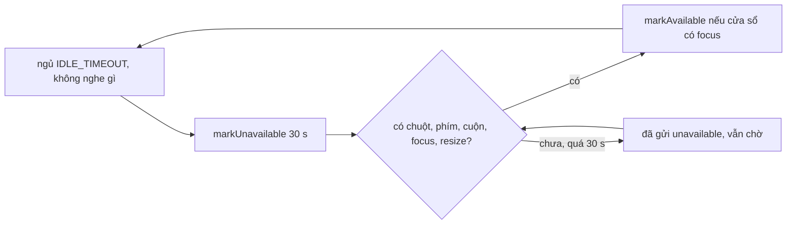

Ứng dụng web chạy trên máy người dùng, không phải máy của bạn. Một danh sách chat 5.000 tin trên laptop cũ có thể làm trang đứng hình 2 giây mỗi lần cuộn, và bạn sẽ không biết nếu không đo. WhatsApp Web 2020 có một bộ đo FPS nhỏ chạy nền để ghi lại sự kiện "UI đóng băng" (UI freeze) gửi về server.

Cùng khu vực code đó có một việc khác cần đo hành vi người dùng: **khi nào coi là người dùng rời máy** để báo "offline" cho người khác, dù tab vẫn mở.

Bài này đọc cả hai, và dùng mô phỏng để chỉ ra một điểm yếu của cách đo FPS: nó bỏ sót phần lớn các lần đứng hình mà nó được viết ra để bắt.

> [!TIP]
> **Tóm tắt**
> - Module `ihgefacbb` đếm khung bằng `requestAnimationFrame`, cứ mỗi ≥ 500 ms tính FPS trung bình, và gọi các callback đăng ký theo ngưỡng (`whenLessThan(fps, cb)`). App đăng ký ngưỡng 1 FPS để ghi "UI freeze".
> - FPS trung bình trộn khung dài với các khung bình thường trước nó trong cùng cửa sổ: một lần đứng hình 1,2 giây chỉ bị bắt khoảng 3% số lần, 5 giây khoảng 17%.
> - Đo **độ dài từng khung** (khung ≥ 1 giây là đứng hình) bắt được 100%, rẻ hơn, và hiện có sẵn API Long Animation Frames.
> - Idle monitor của WhatsApp chạy theo chu kỳ: hoạt động trong lúc chờ không được tính, nên thời gian từ lúc rời máy tới khi bị coi là "offline" dao động gấp ba lần.

<iframe class="demo-frame" src="/demos/web-patterns/index.html?theme=dark#/wa-fps" title="Demo wa-fps" loading="lazy" style="height: 1150px"></iframe>

<p class="demo-links">▶ <a href="/demos/web-patterns/index.html#/wa-fps" target="_blank" rel="noopener">Mở demo toàn màn hình ↗</a> · <a href="https://stackblitz.com/github/hunghg255/blog-hunghg/tree/master/examples/web-patterns?file=src/lib/waFpsMonitor.ts" target="_blank" rel="noopener">Sửa code trên StackBlitz ↗</a> · <a href="https://github.com/hunghg255/blog-hunghg/blob/master/examples/web-patterns/src/lib/waFpsMonitor.ts" target="_blank" rel="noopener">Xem source trên GitHub ↗</a></p>

## WhatsApp làm thế nào?

Bundle là WhatsApp Web năm 2020 (webpack, module đặt tên bằng hash); bản hiện tại có thể đã khác.

### Bộ đo FPS: module `ihgefacbb`

Module export một singleton với một phương thức công khai:

```js
whenLessThan(e, t) {
  if (e < 0 || e > 60) throw new RangeError("fps must be between 0 and 60");
  return this._insertTracker([e, t]), () => { this._removeTracker(t) }
}
```

- Các cặp `[ngưỡng, callback]` được chèn vào một mảng **sắp xếp tăng dần theo ngưỡng** bằng tìm kiếm nhị phân. Có tracker đầu tiên thì bắt đầu đo; tracker cuối cùng bị gỡ thì dừng.
- Mỗi khung `requestAnimationFrame`: cộng `now − prevFrame` vào tổng và tăng số mẫu. Nếu đã ≥ 500 ms kể từ lần cập nhật trước thì gọi `_update`.
- `_update` tính `fps = min(1000 / (tổng / số mẫu), 60)`. Chỉ khi FPS **đổi hơn 1** so với lần trước thì mới duyệt mảng tracker **từ ngưỡng cao xuống**, dừng ở tracker đầu tiên có ngưỡng ≤ FPS hiện tại. Các callback được gọi trong `requestIdleCallback` để không làm khung đang chậm chậm thêm.
- Đo chỉ khi cửa sổ có focus: `focus` thì bắt đầu, `blur` thì dừng. Tab ở nền thì `requestAnimationFrame` cũng không chạy nên đo lúc đó vô nghĩa.

Ở module ứng dụng `chgfegiddc`, lúc khởi động:

```js
this.stopTrackingFPS = S.default.whenLessThan(1, (e, t) => {
  new w.default.WebcUiFreeze({ webcUiFreezeFps: e, webcUiFreezeT: t }).commit()
})
```

FPS trung bình dưới 1 thì ghi một sự kiện thống kê `WebcUiFreeze` kèm FPS và thời điểm.

### Vì sao ngưỡng 1 FPS hiếm khi chạm tới

FPS trung bình dưới 1 nghĩa là **thời gian trung bình mỗi khung** trong cửa sổ trên 1000 ms. Một lần đứng hình dài `F` ms chỉ là **một** khung dài. Nếu trước nó trong cùng cửa sổ đã có `n` khung bình thường 16,7 ms thì:

```
trung bình = (F + 16,7 × n) / (n + 1) > 1000   ⇔   n < (F − 1000) / 983
```

Với `F = 1200`: `n < 0,2`, tức khung dài phải là **khung đầu tiên** của cửa sổ. Cửa sổ dài 500 ms, nên chuyện này chỉ xảy ra khi lần đứng hình bắt đầu trong khoảng 17 ms đầu cửa sổ: xác suất khoảng 3%. Mô phỏng 500 pha khác nhau trong `framesWithFreeze` + `windowedFps` cho ra:

| Đứng hình | Ngưỡng FPS < 1 bắt được |
| --- | --- |
| 1 giây | 0% |
| 1,2 giây | 3,4% |
| 2 giây | 6,8% |
| 3 giây | 10% |
| 5 giây | 16,8% |
| 10 giây | 33,4% |

Phần 2 của demo vẽ lại đúng bảng này: mỗi ô là 10 ms lệch pha, ô xanh là lần bắt được. Phần 1 chạy trên chính tab của bạn: bấm "Chặn 1,2 s" nhiều lần, ngưỡng `< 30` và `< 50` báo mỗi lần, ngưỡng `< 1` gần như không bao giờ.

Nói cách khác, sự kiện `WebcUiFreeze` của WhatsApp đo được **một mẫu ngẫu nhiên nhỏ, lệch về các lần đứng hình rất dài**. Nếu chỉ dùng để so sánh xu hướng giữa các bản phát hành thì có lẽ vẫn có ích; dùng để đếm số lần đứng hình thì sai cả chục lần.

### Idle monitor

Cũng trong `chgfegiddc`, `beginIdleMonitor` là một vòng lặp promise:

```js
this.idleMonitor = Promise.loop(() => Promise.delay(t).then(() => {
  B.default.markUnavailable(3e4);
  // chờ sự kiện đầu tiên trong: mousemove, scroll, keydown (document), focus, resize (window)
  return firstActivity.then(() => {
    document.hasFocus() && B.default.markAvailable(), t = _.default.IDLE_TIMEOUT
  })
}))
```

(Đã rút gọn phần gắn/gỡ listener.) Mỗi vòng: ngủ `IDLE_TIMEOUT`, gọi `markUnavailable(3e4)`, rồi đợi một hoạt động bất kỳ; có hoạt động thì đánh dấu `available` (nếu cửa sổ có focus) và bắt đầu vòng mới. Hằng số `IDLE_TIMEOUT` và phần thân `markUnavailable` nằm ở module khác không có trong bundle; tham số `3e4` có lẽ là thời gian chờ 30 giây trước khi thật sự gửi trạng thái "unavailable", và bị huỷ nếu người dùng quay lại kịp.

Điểm đáng chú ý: **trong lúc `Promise.delay(t)` chạy, không có listener nào**. Người dùng gõ phím liên tục trong khoảng đó cũng không làm hẹn giờ đếm lại. Hệ quả: thời gian từ lúc rời máy tới lúc bị coi là offline phụ thuộc vào việc bạn rời máy ở đâu trong chu kỳ. Phần 3 của demo giả định `IDLE_TIMEOUT` = 60 giây:

- Rời máy ngay sau mốc 60 giây (hoạt động cuối ở giây 61): vòng mới bắt đầu từ giây 61, ngủ tới giây 121, rồi thêm 30 giây: offline sau **90 giây**.
- Rời máy ngay trước mốc 120 (hoạt động cuối ở giây 119, lần "quay lại" gần nhất ở giây 61): ngủ tới giây 121, thêm 30 giây: offline sau **32 giây**.

Cách "đếm từ hoạt động cuối" luôn cho cùng một con số. Đổi lại, cách chu kỳ của WhatsApp **rẻ**: phần lớn thời gian không có listener `mousemove` nào chạy, trong khi cách đếm từ hoạt động cuối phải xử lý mọi sự kiện chuột (dù chỉ là reset một hẹn giờ).



## Bên trong trình duyệt

**`requestAnimationFrame`** gọi callback ngay trước mỗi lần trình duyệt vẽ, thường 60 lần/giây (120 trên màn hình 120 Hz). Khi main thread bị chặn, không có khung nào được vẽ, và callback tiếp theo đến muộn đúng bằng thời gian bị chặn. Đó là lý do khoảng cách giữa hai callback là thước đo trực tiếp của "đứng hình". Tab ở nền thì rAF dừng hẳn; khoảng cách lúc quay lại có thể là vài phút, nên phải dừng đo khi `blur`/`visibilitychange`, như WhatsApp làm.

**Long Tasks API** (`PerformanceObserver` với `entryTypes: ['longtask']`) báo các tác vụ > 50 ms trên main thread. **Long Animation Frames API** (`'long-animation-frame'`) báo các khung > 50 ms kèm script nào gây ra. Cả hai do trình duyệt đo, không tốn một vòng rAF chạy suốt. Bài [Performance span và long task](/blogs/web-performance-spans-long-tasks) dùng chúng để đo hiệu năng thực tế.

**`requestIdleCallback`** chạy callback khi main thread rảnh. WhatsApp dùng nó để gửi sự kiện thống kê không làm chậm thêm lúc đang chậm. Năm 2020 Safari chưa có `requestIdleCallback`; WhatsApp import hàm này từ một module riêng (`caghadhigf`), có lẽ là lớp bọc có phương án dự phòng.

**Idle Detection API** (`IdleDetector`) cho biết người dùng có đang dùng **máy** (không chỉ trang) và màn hình có khoá không. Cần quyền, chỉ có trên Chromium (tính tới 10/2026).

## Viết lại

`src/lib/waFpsMonitor.ts` giữ API `whenLessThan` của bản gốc và thêm `onLongFrame`, kèm hai hàm thuần để mô phỏng.

```ts title=src/lib/waFpsMonitor.ts
export function createFpsMonitor({
  windowMs = 500,
  longFrameMs = 1000,
  now = () => performance.now(),
  raf = (cb) => requestAnimationFrame(cb),
  caf = (id) => cancelAnimationFrame(id),
  pauseOnBlur = true,
}: FpsMonitorOptions = {}) {
  const thresholds: number[] = [];
  const callbacks: Callback[] = [];
  const freezeListeners = new Set<(gapMs: number, at: number) => void>();
  let current = 60;
  let frameId: number | undefined;
  let prevFrame = 0;
  let windowStart = 0;
  let samples = 0;
  let total = 0;

  const tick = () => {
    const t = now();
    const gap = t - prevFrame;
    samples += 1;
    total += gap;
    if (gap >= longFrameMs) freezeListeners.forEach((cb) => cb(gap, t));
    if (t - windowStart >= windowMs) update(t);
    prevFrame = t;
    frameId = raf(tick);
  };

  const update = (t: number) => {
    const fps = Math.min(1000 / (total / samples), 60);
    samples = 0;
    total = 0;
    windowStart = t;
    // chỉ báo khi FPS đổi đáng kể, để không gọi lại liên tục quanh một ngưỡng
    if (Math.abs(fps - current) <= 1) return;
    current = fps;
    for (let i = thresholds.length - 1; i >= 0 && thresholds[i] > fps; i--) callbacks[i](fps, t);
  };
```

Idle monitor (`createIdleMonitor`, đếm từ hoạt động cuối) và hai hàm mô phỏng nằm trong file đầy đủ:

::: spoiler Xem toàn bộ src/lib/waFpsMonitor.ts

```ts title=src/lib/waFpsMonitor.ts
/**
 * Đo FPS để phát hiện UI đóng băng + theo dõi người dùng rảnh — viết lại từ ý tưởng của
 * WhatsApp Web 2020 (module ihgefacbb, idle monitor trong chgfegiddc). Không phải mã gốc.
 */

type Callback = (fps: number, at: number) => void;

/** Vị trí chèn để mảng ngưỡng luôn tăng dần (binary search). */
export function insertionIndex(sorted: number[], value: number) {
  let lo = 0;
  let hi = sorted.length;
  while (lo < hi) {
    const mid = (lo + hi) >> 1;
    if (sorted[mid] < value) lo = mid + 1;
    else hi = mid;
  }
  return lo;
}

export interface FpsMonitorOptions {
  /** độ dài cửa sổ tính trung bình (bản gốc 500 ms) */
  windowMs?: number;
  /** một khung dài hơn mốc này thì báo "đứng hình" ngay, không chờ trung bình */
  longFrameMs?: number;
  now?: () => number;
  raf?: (cb: FrameRequestCallback) => number;
  caf?: (id: number) => void;
  /** chỉ đo khi tab có focus, giống bản gốc */
  pauseOnBlur?: boolean;
}

export function createFpsMonitor({
  windowMs = 500,
  longFrameMs = 1000,
  now = () => performance.now(),
  raf = (cb) => requestAnimationFrame(cb),
  caf = (id) => cancelAnimationFrame(id),
  pauseOnBlur = true,
}: FpsMonitorOptions = {}) {
  const thresholds: number[] = [];
  const callbacks: Callback[] = [];
  const freezeListeners = new Set<(gapMs: number, at: number) => void>();
  let current = 60;
  let frameId: number | undefined;
  let prevFrame = 0;
  let windowStart = 0;
  let samples = 0;
  let total = 0;

  const tick = () => {
    const t = now();
    const gap = t - prevFrame;
    samples += 1;
    total += gap;
    if (gap >= longFrameMs) freezeListeners.forEach((cb) => cb(gap, t));
    if (t - windowStart >= windowMs) update(t);
    prevFrame = t;
    frameId = raf(tick);
  };

  const update = (t: number) => {
    const fps = Math.min(1000 / (total / samples), 60);
    samples = 0;
    total = 0;
    windowStart = t;
    // chỉ báo khi FPS đổi đáng kể, để không gọi lại liên tục quanh một ngưỡng
    if (Math.abs(fps - current) <= 1) return;
    current = fps;
    for (let i = thresholds.length - 1; i >= 0 && thresholds[i] > fps; i--) callbacks[i](fps, t);
  };

  const start = () => {
    if (frameId !== undefined) return;
    prevFrame = windowStart = now();
    frameId = raf(tick);
  };
  const stop = () => {
    if (frameId === undefined) return;
    caf(frameId);
    frameId = undefined;
  };

  const listening = () => thresholds.length + freezeListeners.size > 0;
  const sync = () => {
    if (listening()) {
      if (pauseOnBlur && typeof window !== 'undefined') {
        window.addEventListener('focus', start);
        window.addEventListener('blur', stop);
      }
      start();
    } else {
      if (typeof window !== 'undefined') {
        window.removeEventListener('focus', start);
        window.removeEventListener('blur', stop);
      }
      stop();
    }
  };

  return {
    /** gọi cb khi FPS trung bình rơi xuống dưới `fps` */
    whenLessThan(fps: number, cb: Callback) {
      if (fps < 0 || fps > 60) throw new RangeError('fps must be between 0 and 60');
      const i = insertionIndex(thresholds, fps);
      thresholds.splice(i, 0, fps);
      callbacks.splice(i, 0, cb);
      sync();
      return () => {
        const j = callbacks.indexOf(cb);
        if (j !== -1) (thresholds.splice(j, 1), callbacks.splice(j, 1));
        sync();
      };
    },
    /** gọi cb với mỗi khung dài hơn longFrameMs — không phụ thuộc pha của cửa sổ trung bình */
    onLongFrame(cb: (gapMs: number, at: number) => void) {
      freezeListeners.add(cb);
      sync();
      return () => (freezeListeners.delete(cb), sync());
    },
    get fps() {
      return current;
    },
  };
}

/**
 * Mô phỏng thuần (không cần trình duyệt): cho dãy thời điểm vẽ khung, trả về các FPS trung bình
 * mà cách "cửa sổ 500 ms" sẽ báo. Dùng để thấy một lần đứng hình có bị báo hay không tuỳ pha.
 */
export function windowedFps(frameTimes: number[], windowMs = 500) {
  const reports: { at: number; fps: number }[] = [];
  let windowStart = frameTimes[0];
  let samples = 0;
  let total = 0;
  for (let i = 1; i < frameTimes.length; i++) {
    samples += 1;
    total += frameTimes[i] - frameTimes[i - 1];
    if (frameTimes[i] - windowStart >= windowMs) {
      reports.push({ at: frameTimes[i], fps: Math.min(1000 / (total / samples), 60) });
      samples = 0;
      total = 0;
      windowStart = frameTimes[i];
    }
  }
  return reports;
}

/** Dãy khung 60 fps có một lần đứng hình dài freezeMs bắt đầu tại freezeAt. */
export function framesWithFreeze(durationMs: number, freezeAt: number, freezeMs: number, frame = 1000 / 60) {
  const out: number[] = [];
  let t = 0;
  let frozen = false;
  while (t <= durationMs) {
    out.push(t);
    if (!frozen && t >= freezeAt) {
      t += freezeMs;
      frozen = true;
    } else t += frame;
  }
  return out;
}

// ---------------------------------------------------------------------------
// Idle monitor

export type IdleMode = 'periodic' | 'since-last-activity';

/**
 * Mô phỏng thời điểm bị coi là "rảnh".
 * - `periodic` (bản gốc): đợi idleMs kể từ lần QUAY LẠI gần nhất, rồi mới bắt đầu nghe hoạt động;
 *   hoạt động trong lúc đợi không được tính.
 * - `since-last-activity`: đếm idleMs từ hoạt động cuối cùng.
 * Trả về các khoảng [từ, đến) mà người dùng bị đánh dấu unavailable.
 */
export function simulateIdle(activity: number[], endAt: number, idleMs: number, graceMs: number, mode: IdleMode) {
  const sorted = [...activity].sort((a, b) => a - b);
  const spans: [number, number][] = [];
  if (mode === 'periodic') {
    let armedAt = idleMs;
    while (armedAt < endAt) {
      const next = sorted.find((a) => a >= armedAt);
      const awayAt = armedAt + graceMs;
      if (next === undefined) {
        if (awayAt < endAt) spans.push([awayAt, endAt]);
        break;
      }
      if (next > awayAt) spans.push([awayAt, next]);
      armedAt = next + idleMs;
    }
    return spans;
  }
  let last = 0;
  for (const a of [...sorted, endAt]) {
    const awayAt = last + idleMs;
    if (a > awayAt) spans.push([awayAt, a === endAt ? endAt : a]);
    last = a;
  }
  return spans.filter(([from, to]) => to > from);
}

/** Idle monitor thật trên trình duyệt: tính từ hoạt động cuối cùng. */
export function createIdleMonitor(idleMs: number, onChange: (idle: boolean) => void) {
  const events: [EventTarget, string][] = [
    [document, 'pointermove'],
    [document, 'keydown'],
    [document, 'scroll'],
    [window, 'focus'],
  ];
  let idle = false;
  let timer: ReturnType<typeof setTimeout>;
  const arm = () => {
    clearTimeout(timer);
    timer = setTimeout(() => ((idle = true), onChange(true)), idleMs);
  };
  const activity = () => {
    if (idle) ((idle = false), onChange(false));
    arm();
  };
  events.forEach(([t, e]) => t.addEventListener(e, activity, { passive: true }));
  arm();
  return () => {
    clearTimeout(timer);
    events.forEach(([t, e]) => t.removeEventListener(e, activity));
  };
}
```

:::

## Đi qua code

- **`tick`** làm hai việc trên cùng một khoảng cách `gap`: cộng vào trung bình cửa sổ (giống bản gốc) và so với `longFrameMs`. Khung dài được báo **ngay ở khung đầu tiên sau lần đứng hình**, không phụ thuộc cửa sổ bắt đầu lúc nào.
- **`update`** giữ quy tắc "chỉ báo khi đổi hơn 1 FPS" và duyệt ngưỡng từ cao xuống, nên khi FPS rơi từ 60 xuống 20, cả callback `< 50` và `< 30` được gọi, theo thứ tự đó.
- **`whenLessThan`** chèn bằng `insertionIndex` (tìm kiếm nhị phân) để mảng luôn tăng dần, trả về hàm huỷ đăng ký. `sync()` bật/tắt vòng rAF theo việc còn ai nghe không.
- **`windowedFps`** và **`framesWithFreeze`** là bản mô phỏng thuần của đúng thuật toán cửa sổ: test và demo dùng chúng để đo tỉ lệ bắt được mà không cần trình duyệt.
- **`simulateIdle`** mô phỏng cả hai chế độ trên một dãy thời điểm hoạt động; **`createIdleMonitor`** là bản chạy thật, dùng listener `passive` và reset hẹn giờ ở mỗi hoạt động.

**Khác bản gốc:**

- Thêm `onLongFrame`: phát hiện đứng hình bằng độ dài khung.
- FPS ban đầu là 60 (bản gốc là 0, nên lần cập nhật đầu tiên luôn "đổi").
- Callback gọi đồng bộ, không qua `requestIdleCallback`; nếu callback nặng (gửi mạng), hãy tự bọc.
- Có `now`, `raf`, `caf` truyền vào được để test bằng đồng hồ giả.
- Idle monitor đếm từ hoạt động cuối và dùng `pointermove` thay cho `mousemove` để có cả bút và cảm ứng.

## Tại sao không làm cách khác?

- **Chỉ dùng FPS trung bình, hạ cửa sổ xuống 100 ms.** Bớt lệch pha hơn nhưng vẫn trộn khung dài với khung ngắn, và tính toán nhiều gấp năm. Đo từng khung đơn giản hơn.
- **Chỉ dùng Long Animation Frames API.** Tốt nhất khi có: không chạy vòng rAF, có thông tin script gây ra. Nhưng chưa có trên Safari và Firefox (tính tới 10/2026), nên vòng rAF vẫn là phương án dự phòng.
- **`setInterval` đo độ trễ** (hẹn 100 ms, đo thực tế đến muộn bao nhiêu): bắt được main thread bị chặn kể cả khi tab ở nền, nhưng trình duyệt cố ý làm chậm hẹn giờ ở tab nền, nên số liệu khó đọc.
- **Idle theo chu kỳ (cách WhatsApp).** Không tốn gì khi người dùng đang hoạt động, chấp nhận độ trễ dao động. Với presence ("online/offline"), sai lệch 30–90 giây có lẽ là chấp nhận được. Nếu cần chính xác (tự khoá màn hình, tự đăng xuất), đếm từ hoạt động cuối.

## Edge case và cạm bẫy

- **Màn hình 120 Hz.** Ngưỡng "60 FPS" của bản gốc kẹp FPS ở 60; trên màn hình 120 Hz vẫn đúng vì chỉ quan tâm khi FPS thấp. Nhưng đừng giả định 16,7 ms/khung khi tính toán khác.
- **Khung dài lúc quay lại tab.** `focus` khởi động lại vòng rAF và đặt lại mốc thời gian; nếu chỉ nghe `visibilitychange` mà quên đặt lại mốc, khung đầu tiên sau khi quay lại sẽ dài bằng thời gian tab ở nền và bị báo nhầm là đứng hình.
- **Đo làm chậm thứ được đo.** Vòng rAF chạy suốt ngăn trình duyệt tiết kiệm pin khi trang tĩnh. WhatsApp chỉ đo khi có tracker và khi cửa sổ có focus; bản viết lại giữ đúng điều đó.
- **`mousemove` khi chuột không di chuyển.** Một số trình duyệt bắn `mousemove` khi nội dung dưới con trỏ thay đổi (cuộn, animation). Idle monitor có thể bị "đánh thức" giả; kiểm tra `movementX/movementY` khác 0 nếu cần chắc.
- **Hai tab.** Mỗi tab có idle monitor riêng; một tab ở nền có thể báo offline trong khi người dùng đang gõ ở tab kia. Cần một tab chủ hoặc gộp trạng thái qua `BroadcastChannel`.

## Dùng trong dự án

```ts
import { createFpsMonitor } from './waFpsMonitor';

const fps = createFpsMonitor();
fps.onLongFrame((gapMs, at) => {
  navigator.sendBeacon('/rum', JSON.stringify({ type: 'ui-freeze', gapMs: Math.round(gapMs), at, route: location.pathname }));
});

// có Long Animation Frames thì dùng thêm để biết script nào gây ra
if (PerformanceObserver.supportedEntryTypes?.includes('long-animation-frame')) {
  new PerformanceObserver((list) => {
    for (const e of list.getEntries()) if (e.duration > 1000) console.warn('LoAF', e);
  }).observe({ type: 'long-animation-frame', buffered: true });
}
```

## Kiểm thử

::: spoiler Ví dụ test (bản phác, không có trong repo)

```ts
import { expect, it } from 'vitest';
import { createFpsMonitor, framesWithFreeze, insertionIndex, simulateIdle, windowedFps } from './waFpsMonitor';

it('insertionIndex giữ mảng tăng dần', () => {
  expect(insertionIndex([], 5)).toBe(0);
  expect(insertionIndex([1, 30, 50], 30)).toBe(1);
  expect(insertionIndex([1, 30, 50], 60)).toBe(3);
});

it('trung bình cửa sổ hiếm khi xuống dưới 1 fps với lần đứng hình 1,2 s', () => {
  let caught = 0;
  for (let offset = 0; offset < 500; offset++) {
    const fps = windowedFps(framesWithFreeze(4200, 1000 + offset, 1200)).map((r) => r.fps);
    if (Math.min(...fps) < 1) caught++;
  }
  expect(caught / 500).toBeLessThan(0.05);
});

it('onLongFrame bắt mọi khung dài, gọi ngưỡng FPS từ cao xuống', () => {
  let t = 0;
  const frames: FrameRequestCallback[] = [];
  const m = createFpsMonitor({ now: () => t, raf: (cb) => frames.push(cb), caf: () => {}, pauseOnBlur: false });
  const calls: string[] = [];
  m.whenLessThan(30, () => calls.push('<30'));
  m.whenLessThan(50, () => calls.push('<50'));
  m.onLongFrame((gap) => calls.push(`long ${gap}`));
  const step = (ms: number) => ((t += ms), frames.shift()!(t));
  for (let i = 0; i < 10; i++) step(16);
  step(1200);
  expect(calls).toEqual(['long 1200', '<50', '<30']);
  expect(() => m.whenLessThan(61, () => {})).toThrow(RangeError);
});

it('idle: kiểu chu kỳ cho độ trễ thay đổi, kiểu "từ hoạt động cuối" luôn bằng idleMs', () => {
  const early = [10, 61]; // rời máy ngay sau mốc 60
  const late = [10, 61, 80, 100, 119]; // rời máy ngay trước mốc 120
  expect(simulateIdle(early, 300, 60, 30, 'periodic')[0][0]).toBe(151); // 90 s sau lần cuối
  expect(simulateIdle(late, 300, 60, 30, 'periodic')[0][0]).toBe(151); // 32 s sau lần cuối
  expect(simulateIdle(early, 300, 60, 30, 'since-last-activity')[0][0]).toBe(121);
  expect(simulateIdle(late, 300, 60, 30, 'since-last-activity')[0][0]).toBe(179);
});
```

:::

## So với các lựa chọn khác

- **web-vitals (INP)**: đo độ trễ từ tương tác tới khung vẽ tiếp theo. Bắt được "bấm mà không phản hồi", không bắt được đứng hình khi người dùng không thao tác.
- **Long Animation Frames API**: Chromium từ bản 123; chưa có trên Safari và Firefox (tính tới 10/2026).
- **Facebook** đo thời gian người dùng thực sự dùng trang bằng bitmap theo giây ([bài #23](/blogs/facebook-time-spent-bitmap)), một cách khác để trả lời câu hỏi "người dùng còn ở đây không"; bài [Idle, exit-intent và lắc chuột](/blogs/web-user-intent-idle-exit-wiggle) so sánh thêm vài cách phát hiện idle.

---

Bài này thuộc series **[Học từ mã nguồn WhatsApp Web](/series/whatsapp)** (19 bài, đọc theo thứ tự).

::: spoiler Xem nhanh danh sách bài trong series

*Mở đầu*

- [Mở đầu: đọc bundle WhatsApp Web 2020](/blogs/learn-from-whatsapp-web-source-code)

*Phần 1: media và mã hoá*

- [#1 Giải mã JPEG progressive theo từng scan, kiểm HMAC](/blogs/whatsapp-progressive-jpeg-hmac)
- [#2 Ghép khoảng byte cho video streaming](/blogs/whatsapp-byte-range-merge)
- [#3 Xoá EXIF không re-encode, thumbnail theo ngân sách byte](/blogs/whatsapp-jpeg-strip-thumb-budget)
- [#4 Đọc metadata sticker WebP động](/blogs/whatsapp-webp-sticker-metadata)

*Phần 2: lưu trữ trên trình duyệt*

- [#5 Kho media LRU tự co theo quota](/blogs/whatsapp-quota-aware-media-lru)
- [#6 Cache blob trong RAM có refcount, tự revoke objectURL](/blogs/whatsapp-blob-cache-refcount)
- [#7 Khoá IndexedDB giữ đúng thứ tự từ điển](/blogs/whatsapp-indexeddb-ordered-keys)

*Phần 3: danh sách tin nhắn*

- [#8 Render tin nhắn theo cửa sổ chiều cao ước lượng](/blogs/whatsapp-render-cursor-window)
- [#9 Theo dõi viewport tin nhắn: binary search, ngày dính](/blogs/whatsapp-message-viewport-tracking)
- [#10 FlatList tái dùng key React, overscan bất đối xứng](/blogs/whatsapp-flatlist-key-reuse)

*Phần 4: soạn tin và chữ*

- [#11 Emoticon thành emoji bằng trie đọc ngược, tìm emoji](/blogs/whatsapp-emoticon-trie-emoji-search)
- [#12 Mention bằng token zero-width, giới hạn theo code point](/blogs/whatsapp-mention-zero-width-input)
- [#13 Xác định hướng chữ bằng bảng delta nén](/blogs/whatsapp-text-direction-table)
- [#14 Phát hiện homograph trong link, chặn giả đuôi file RTLO](/blogs/whatsapp-homograph-rtlo-guard)

*Phần 5: realtime và tiện ích*

- [#15 Presence, "đang gõ" và thông báo theo kích thước group](/blogs/whatsapp-presence-typing-notifications)
- **#16 Đo FPS phát hiện UI đóng băng, idle monitor** (bài này)
- [#17 Cửa sổ PiP: resize 8 hướng, khoá tỉ lệ, né vật cản](/blogs/whatsapp-pip-resize-avoid)
- [#18 Parse giá tiền theo locale bằng Intl](/blogs/whatsapp-locale-price-parse)

:::

Code + demo: [`examples/web-patterns`](https://github.com/hunghg255/blog-hunghg/tree/master/examples/web-patterns) · [Mở trên StackBlitz](https://stackblitz.com/github/hunghg255/blog-hunghg/tree/master/examples/web-patterns)
