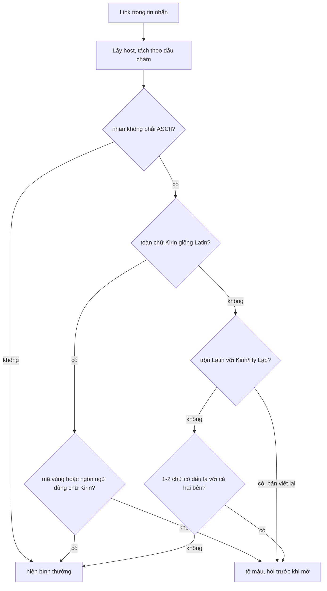

`аррӏе.com` và `apple.com` trông giống hệt nhau, nhưng cái đầu không có chữ Latin nào: `а`, `р`, `ӏ`, `е` đều là chữ Kirin (Cyrillic). Đó là tấn công **homograph** (ký tự đồng hình): đăng ký tên miền quốc tế (IDN) trông như tên miền thật rồi gửi link lừa đảo. Ứng dụng chat là kênh phát tán lý tưởng vì link đi kèm lời nhắn của người quen.

Một trò cùng họ nhắm vào tên file: `hoa_don_2026\u202Efdp.exe` hiện ra là `hoa_don_2026exe.pdf` (`\u202E` là ký tự RLO vô hình, viết dạng escape ở đây để không làm đảo chữ trên trang này). Ký tự U+202E (RIGHT-TO-LEFT OVERRIDE, viết tắt RLO) làm phần sau nó hiện **ngược**, nên đuôi `.exe` thật bị giấu sau một `.pdf` giả.

WhatsApp Web 2020 có hai lớp phòng thủ nhỏ cho hai trò này. Lớp thứ nhất có logic hay (xét theo mã vùng điện thoại và ngôn ngữ của người dùng) nhưng cũng có vài lỗi khiến nó bỏ sót đúng trường hợp phổ biến nhất.

> [!TIP]
> **Tóm tắt**
> - Link: tách host theo dấu `.`, xét nhãn không phải ASCII. Nhãn toàn chữ Kirin giống Latin thì cảnh báo, **trừ khi** người gửi/người nhận ở nước dùng chữ Kirin hoặc dùng ngôn ngữ chữ Kirin. Chữ có dấu hiếm (`í`, `ł`, `ạ`…) cũng xét theo ngôn ngữ và mã vùng.
> - Bản 2020 bỏ sót nhãn **trộn** Latin với Kirin (`аpple.com`, chỉ chữ `а` là Kirin) và mọi host có TLD không phải ASCII (`paypal.сом`).
> - Tên file: thay mọi ký tự điều khiển bidi (U+202A–202E, U+2066–2069, LRM, RLM, ALM) bằng `�`, bỏ đuôi rỗng/khoảng trắng cuối (`a.exe. ` → `a.exe`).
> - Quy tắc mang về: hiển thị dạng đã làm sạch, quyết định "có nguy hiểm không" bằng đuôi thật viết thường, và cảnh báo trước khi mở chứ không chỉ ghi log.

<iframe class="demo-frame" src="/demos/web-patterns/index.html?theme=dark#/wa-homograph" title="Demo wa-homograph" loading="lazy" style="height: 980px"></iframe>

<p class="demo-links">▶ <a href="/demos/web-patterns/index.html#/wa-homograph" target="_blank" rel="noopener">Mở demo toàn màn hình ↗</a> · <a href="https://stackblitz.com/github/hunghg255/blog-hunghg/tree/master/examples/web-patterns?file=src/lib/waHomograph.ts" target="_blank" rel="noopener">Sửa code trên StackBlitz ↗</a> · <a href="https://github.com/hunghg255/blog-hunghg/blob/master/examples/web-patterns/src/lib/waHomograph.ts" target="_blank" rel="noopener">Xem source trên GitHub ↗</a></p>

## WhatsApp làm thế nào?

Bundle WhatsApp Web 2020 (`0 Whatapp list/all.js` trong repo [facebook-codebase](https://github.com/hunghg255/facebook-codebase)); tên module là hash, bản hiện tại có lẽ đã khác.

| Module | Vai trò |
| --- | --- |
| `dbcedfihd` | Linkify: mỗi link tìm được kèm `suspiciousCharacters` |
| `cjegdbihch` | Lấy host từ URL, mã vùng của mình và của chat, ngôn ngữ viết thường |
| `fjehahjbc` | `findSuspiciousCharacters`: logic chính |
| `dibidhdcdg` | `LANGUAGE_TO_REGIONS`: 212 ngôn ngữ → mã vùng điện thoại, vd `vi: ['855', '84']` |
| `dbejeibfid` | `cleanFilename`, `cleanIncomingFilename` cho tên file nhận được |

### Ngữ cảnh: ai gửi cho ai

`cjegdbihch` lấy host bằng `/^(?:https?:\/\/)?([^/?#]+)(?:[/?#]|$)/i`, mã vùng của mình (`phoneCC(me)`), mã vùng của cuộc trò chuyện (rỗng nếu là tài khoản hệ thống `whatsapp`) và danh sách ngôn ngữ của người dùng. Ý tưởng: chữ Kirin trong link là bình thường nếu bạn ở Nga, hoặc người gửi ở Ukraina. Chữ `ł` là bình thường với người Ba Lan. Không có ngữ cảnh đó mới đáng ngờ.

### Logic chính

`fjehahjbc` có ba bảng: chuỗi 29 chữ Kirin giống Latin (`авгекмнорстухшщьѕіјѡѵүһӏԁԛԝԧꚙ`), 18 mã vùng nước dùng chữ Kirin (`7`, `380`, `375`, `381`…), 63 mã ngôn ngữ chữ Kirin (`ru`, `uk`, `bg`, `sr`, `kk`…), và bảng 22 chữ có dấu → ngôn ngữ dùng chữ đó (`í` có tiếng Tây Ban Nha, Séc, Hungary, Việt…; `ł` chỉ có tiếng Ba Lan, Navajo và hai tiếng Sorb; `ạ`, `ẹ`, `ị` có tiếng Việt). Phần lõi, rút gọn và đặt lại tên:

```js
let label, lastIsNonAscii = false;
host.split('.').forEach((l) => {
  if ((lastIsNonAscii = !/^[a-z0-9-]+$/.test(l))) {
    if (label) return null;                       // (!) return trong forEach: không thoát hàm
    label = l;
  }
});
if (!label || lastIsNonAscii) return null;        // (!) nhãn CUỐI không phải ASCII thì bỏ qua

let allLookalike = true, accents = [];
for (const c of Array.from(label)) {
  if (!(allLookalike = allLookalike && LOOKALIKE.includes(c)) && ACCENT_LANGS[c]) {
    if (accents.length >= 2) return null;         // 3 chữ có dấu trở lên: có lẽ là chữ thật
    accents.push(c);
  }
}
if (allLookalike) return cyrillicContext(myCC, chatCC, languages) ? null : new Set(label);
return oddAccents(accents, myCC, chatCC, languages);   // chữ có dấu không thuộc ngôn ngữ/vùng của ai
```

Kết quả (một `Set` ký tự) đi vào UI: các ký tự đó được tô màu trong bong bóng chat, và bấm vào link sẽ hiện hộp thoại cảnh báo trước khi mở.

### Ba lỗ hổng

Tôi chạy module gốc trong Node (thay các module phụ bằng stub) với người dùng ở Việt Nam, giao diện tiếng Việt, người gửi cũng ở Việt Nam:

| Host | Kết quả của bản 2020 | Đáng lẽ |
| --- | --- | --- |
| `аррӏе.com` (toàn chữ Kirin) | tô `а р ӏ е` | đúng |
| `аpple.com` (chỉ `а` là Kirin) | không cảnh báo | cảnh báo |
| `paypal.сом` (TLD Kirin) | không cảnh báo | cảnh báo |
| `аррӏе.рф` | không cảnh báo | cảnh báo (người dùng không đọc tiếng Nga) |
| `fałszywy.pl` | tô `ł` | đúng (người Việt hiếm khi gặp `ł`) |
| `wịkipedia.org` | không cảnh báo | đúng (`ị` là chữ tiếng Việt) |

1. **Trộn script không được xét.** `allLookalike` thành `false` ngay ở chữ Latin đầu tiên. Từ đó chỉ còn nhánh "chữ có dấu", mà `p`, `l`, `e` không có dấu, nên kết quả rỗng. Đây lại là kiểu tấn công rẻ nhất: chỉ cần thay một chữ.
2. **Nhãn cuối không phải ASCII thì bỏ qua.** Biến cờ bị ghi đè ở mỗi vòng `forEach`, nên cuối cùng nó chỉ nói về **nhãn cuối**. Có lẽ ý định là "có từ hai nhãn không-ASCII thì bỏ qua" (vì `return null` trong `forEach` vốn để thoát sớm), nhưng kết quả thực tế là mọi host có TLD quốc tế (`.рф`, `.сом` giả, `.中国`) đều không được xét.
3. **`return null` trong `forEach`** chỉ thoát callback của phần tử hiện tại. Nhãn không-ASCII thứ hai trở đi bị bỏ qua lặng lẽ, chỉ nhãn đầu tiên được xét.

Thêm một chi tiết: hàm chỉ chạy khi linkify **đã nhận ra** link, và linkify của WhatsApp coi phần tên miền là chuỗi Unicode. Một link viết sẵn dạng punycode (`xn--80ak6aa92e.com`) là ASCII thuần nên không bị cảnh báo, nhưng cũng không đánh lừa được ai vì người dùng thấy rõ chuỗi lạ.

### Tên file và RLO

`dbejeibfid` có `cleanFilename` (rút gọn bên dưới) và `cleanIncomingFilename`: gọi `cleanFilename`, nếu tên bị đổi và đuôi nằm trong danh sách file chạy được (`bat`, `exe`, `cmd`, `com`, `lnk`, `scr`, `js`, `ps1`, `msi`…) thì ghi log.

```js
const t = name.replace(/[\u202A-\u202E\u2066-\u2069\u200E\u200F\u061C]/g, '\uFFFD');
const parts = t.split('.');
for (let i = parts.length - 1; i > 0; i--) {
  const ext = parts[i].trim();
  if (ext.length) return parts.slice(0, i).join('.') + '.' + ext; // bỏ đuôi rỗng, cắt khoảng trắng
}
return t;
```

- Thay bằng `�` (U+FFFD) chứ không xoá: người dùng **thấy** có ký tự lạ, thay vì thấy một tên file "sạch sẽ" mà không biết nó từng bị cài bẫy.
- Bỏ đuôi rỗng và cắt khoảng trắng: `bao_gia.exe. ` thành `bao_gia.exe`. Windows tự bỏ dấu chấm và khoảng trắng ở cuối tên file khi lưu, nên đuôi thật là `.exe`; hiển thị `bao_gia.exe. ` sẽ làm người dùng nghĩ file không có đuôi.
- `cleanIncomingFilename` chỉ **ghi log** khi tên bị đổi và đuôi nằm trong danh sách file chạy được, để đội ngũ biết có người đang thử trò này. Danh sách so sánh phân biệt hoa thường, nên `virus.EXE` không được ghi; `vbe` xuất hiện hai lần trong mảng (vô hại).



## Bên trong trình duyệt: IDN, punycode và thuật toán bidi

Tên miền quốc tế được chuyển sang ASCII bằng **punycode** trước khi phân giải DNS: `new URL('http://аррӏе.com').hostname` trả `xn--80ak6aa92e.com`. Thanh địa chỉ của trình duyệt có chính sách riêng để quyết định khi nào hiện chữ Unicode và khi nào hiện punycode: theo tài liệu "IDN in Google Chrome", Chrome hiện punycode nếu nhãn trộn nhiều script theo cách không thường gặp, hoặc nếu toàn bộ nhãn là chữ Kirin giống Latin mà TLD không phải TLD của nước dùng chữ Kirin. Tức là khi người dùng **đã mở** link thì thanh địa chỉ đã bảo vệ phần nào; cảnh báo trong ứng dụng chat là để chặn trước khi bấm.

Ký tự RLO thuộc nhóm "điều khiển định dạng" của thuật toán bidi (UAX #9): nó ép mọi ký tự sau nó hiện theo thứ tự phải-sang-trái cho tới PDF (U+202C) hoặc hết đoạn. Chuỗi `hoa_don_2026\u202Efdp.exe` trong bộ nhớ vẫn kết thúc bằng `.exe`; chỉ có **hiển thị** bị đảo thành `exe.pdf`. Vì vậy mọi quyết định (icon, cảnh báo, cho phép mở) phải dựa trên chuỗi thật, và chuỗi hiển thị phải được làm sạch. Các ký tự isolate mới hơn (LRI/RLI/FSI/PDI, U+2066–2069) làm được trò tương tự nên cũng nằm trong danh sách.

## Viết lại

```ts title=src/lib/waHomograph.ts
function checkLabel(label: string, party: Party): Suspicion | null {
  const chars = Array.from(label);
  const lang = (l: string) => party.languages.some((x) => x.toLowerCase().split('-')[0] === l);

  // 1. Cả nhãn toàn chữ Kirin giống Latin: "аррӏе". Bỏ qua nếu một trong hai bên dùng chữ Kirin.
  if (chars.every((c) => CYRILLIC_LOOKALIKES.includes(c) || /[0-9-]/.test(c)) && chars.some((c) => CYRILLIC_LOOKALIKES.includes(c))) {
    const cyrillicUser =
      CYRILLIC_CALLING_CODES.has(party.myCallingCode) ||
      CYRILLIC_CALLING_CODES.has(party.senderCallingCode) ||
      [...CYRILLIC_LANGS].some(lang);
    return cyrillicUser ? null : { label, chars: new Set(chars.filter((c) => !/[0-9-]/.test(c))), reason: 'lookalike-label' };
  }

  // 2. Trộn Latin với Kirin/Hy Lạp trong cùng một nhãn: "аpple". Bản gốc bỏ sót trường hợp này.
  const foreign = chars.filter((c) => CONFUSABLE_SCRIPT.test(c));
  if (foreign.length && chars.some((c) => LATIN.test(c))) return { label, chars: new Set(foreign), reason: 'mixed-script' };

  // 3. Một hai chữ có dấu hiếm gặp với người dùng này: "wíkipedia".
  const accents = chars.filter((c) => c in ACCENT_LANGS);
  if (!accents.length || accents.length > 2) return null; // nhiều dấu: có lẽ là chữ thật của một ngôn ngữ
  const odd = accents.filter((c) => {
    const langs = ACCENT_LANGS[c];
    if (langs.some(lang)) return false;
    const regions = new Set(langs.flatMap((l) => LANGUAGE_REGIONS[l] ?? []));
    return !regions.has(party.myCallingCode) && !regions.has(party.senderCallingCode);
  });
  return odd.length ? { label, chars: new Set(odd), reason: 'rare-accent' } : null;
}
```

`findSuspicious` (dòng 93–100) gọi `checkLabel` cho **mọi** nhãn không phải ASCII của host và trả về nhãn đáng ngờ đầu tiên.

Phần dữ liệu (dòng 6–39) rút gọn từ bản gốc: giữ nguyên chuỗi chữ Kirin giống Latin và danh sách mã vùng, còn bảng chữ có dấu và bảng ngôn ngữ → mã vùng chỉ giữ các ngôn ngữ phổ biến. `findSuspicious2020` mô phỏng hành vi cũ để demo so sánh hai cột.

```ts title=src/lib/waHomograph.ts
/**
 * Thay ký tự điều khiển bidi bằng U+FFFD (để người dùng THẤY có gì đó lạ) và bỏ "đuôi rỗng" ở cuối:
 * "hoa_don\u202Efdp.exe" → "hoa_don�fdp.exe", "a.exe. " → "a.exe".
 */
export function cleanFilename(input: string): CleanResult {
  let name = input.replace(BIDI_CONTROLS, '\uFFFD');
  const parts = name.split('.');
  if (parts.length > 1) {
    for (let i = parts.length - 1; i > 0; i--) {
      const ext = parts[i].trim();
      if (ext) {
        name = parts.slice(0, i).join('.') + '.' + ext;
        break;
      }
    }
  }
  const dot = name.lastIndexOf('.');
  const extension = dot > 0 ? name.slice(dot + 1).toLowerCase() : '';
  return { name, extension, changed: name !== input, dangerous: DANGEROUS_EXTENSIONS.has(extension) };
}
```

::: spoiler Xem toàn bộ src/lib/waHomograph.ts
```ts title=src/lib/waHomograph.ts
/**
 * Cảnh báo link có ký tự giả dạng (homograph) và làm sạch tên file chống giả đuôi bằng ký tự điều khiển bidi.
 * Viết lại từ ý tưởng của WhatsApp Web 2020 (module fjehahjbc, cjegdbihch, dibidhdcdg, dbejeibfid).
 */

/** Chữ Kirin trông như chữ Latin (cùng danh sách với bản gốc). */
export const CYRILLIC_LOOKALIKES = 'авгекмнорстухшщьѕіјѡѵүһӏԁԛԝԧꚙ';
/** Mã vùng điện thoại của nước dùng chữ Kirin: Nga, Ukraina, Belarus, Kazakhstan, Serbia… */
const CYRILLIC_CALLING_CODES = new Set(['7', '359', '373', '374', '375', '380', '381', '382', '383', '387', '389', '976', '992', '993', '994', '995', '996', '998']);
/** Một phần ngôn ngữ viết chữ Kirin. */
const CYRILLIC_LANGS = new Set(['ru', 'uk', 'be', 'bg', 'sr', 'mk', 'kk', 'ky', 'tg', 'mn', 'uz', 'az', 'ba', 'tt', 'cv', 'ce', 'os', 'sah', 'tk']);

/** Ký tự Latin có dấu dễ nhầm với chữ không dấu → ngôn ngữ dùng nó thật (rút gọn). */
const ACCENT_LANGS: Record<string, string[]> = {
  í: ['es', 'pt', 'fr', 'cs', 'sk', 'hu', 'is', 'ga', 'nl', 'vi'],
  î: ['fr', 'ro', 'tr', 'ku', 'af'],
  ü: ['de', 'tr', 'hu', 'es', 'et', 'az', 'nl', 'fr'],
  ı: ['tr', 'az'],
  ł: ['pl'],
  š: ['cs', 'sk', 'sl', 'hr', 'bs', 'lv', 'lt', 'et', 'fi'],
  ī: ['lv', 'mi', 'haw'],
  ċ: ['mt'],
  ļ: ['lv'],
  ɑ: ['tmh'],
  ạ: ['vi'],
  ẹ: ['vi', 'yo'],
  ị: ['vi', 'ig'],
};
/** Ngôn ngữ → mã vùng nơi ngôn ngữ đó phổ biến (rút gọn từ bảng LANGUAGE_TO_REGIONS). */
const LANGUAGE_REGIONS: Record<string, string[]> = {
  vi: ['84', '855'], es: ['34', '52', '54', '56', '57'], pt: ['351', '55'], fr: ['33', '32', '41', '1'],
  cs: ['420'], sk: ['421'], hu: ['36'], de: ['49', '43', '41'], tr: ['90'], pl: ['48'], az: ['994'],
  ro: ['40', '373'], lv: ['371'], lt: ['370'], et: ['372'], mt: ['356'], nl: ['31', '32'], hr: ['385'],
  sl: ['386'], fi: ['358'], is: ['354'], ga: ['353'], mi: ['64'], yo: ['234'], ig: ['234'],
};

const ASCII_LABEL = /^[a-z0-9-]+$/;
const LATIN = /\p{sc=Latin}/u;
const CONFUSABLE_SCRIPT = /[\p{sc=Cyrillic}\p{sc=Greek}]/u;

export interface Party {
  /** Mã vùng điện thoại của mình và của người gửi ("" nếu tin của hệ thống). */
  myCallingCode: string;
  senderCallingCode: string;
  /** Ngôn ngữ của người dùng (navigator.languages rút gọn), vd ['vi', 'en']. */
  languages: string[];
}

export type Reason = 'lookalike-label' | 'mixed-script' | 'rare-accent';

export interface Suspicion {
  label: string;
  chars: Set<string>;
  reason: Reason;
}

/** Lấy host từ URL người dùng gõ (có hoặc không có http://), bỏ cổng, chữ thường. */
export function extractHost(url: string): string | null {
  const m = /^(?:https?:\/\/)?(?:[^@/?#]*@)?([^/?#:]+)(?::\d+)?(?:[/?#]|$)/i.exec(url.trim());
  return m ? m[1].toLowerCase().replace(/\.$/, '') : null;
}

function checkLabel(label: string, party: Party): Suspicion | null {
  const chars = Array.from(label);
  const lang = (l: string) => party.languages.some((x) => x.toLowerCase().split('-')[0] === l);

  // 1. Cả nhãn toàn chữ Kirin giống Latin: "аррӏе". Bỏ qua nếu một trong hai bên dùng chữ Kirin.
  if (chars.every((c) => CYRILLIC_LOOKALIKES.includes(c) || /[0-9-]/.test(c)) && chars.some((c) => CYRILLIC_LOOKALIKES.includes(c))) {
    const cyrillicUser =
      CYRILLIC_CALLING_CODES.has(party.myCallingCode) ||
      CYRILLIC_CALLING_CODES.has(party.senderCallingCode) ||
      [...CYRILLIC_LANGS].some(lang);
    return cyrillicUser ? null : { label, chars: new Set(chars.filter((c) => !/[0-9-]/.test(c))), reason: 'lookalike-label' };
  }

  // 2. Trộn Latin với Kirin/Hy Lạp trong cùng một nhãn: "аpple". Bản gốc bỏ sót trường hợp này.
  const foreign = chars.filter((c) => CONFUSABLE_SCRIPT.test(c));
  if (foreign.length && chars.some((c) => LATIN.test(c))) return { label, chars: new Set(foreign), reason: 'mixed-script' };

  // 3. Một hai chữ có dấu hiếm gặp với người dùng này: "wíkipedia".
  const accents = chars.filter((c) => c in ACCENT_LANGS);
  if (!accents.length || accents.length > 2) return null; // nhiều dấu: có lẽ là chữ thật của một ngôn ngữ
  const odd = accents.filter((c) => {
    const langs = ACCENT_LANGS[c];
    if (langs.some(lang)) return false;
    const regions = new Set(langs.flatMap((l) => LANGUAGE_REGIONS[l] ?? []));
    return !regions.has(party.myCallingCode) && !regions.has(party.senderCallingCode);
  });
  return odd.length ? { label, chars: new Set(odd), reason: 'rare-accent' } : null;
}

/** Xét MỌI nhãn không phải ASCII (kể cả TLD như ".сом"), trả về nhãn đáng ngờ đầu tiên. */
export function findSuspicious(host: string, party: Party): Suspicion | null {
  for (const label of host.toLowerCase().split('.')) {
    if (!label || ASCII_LABEL.test(label)) continue;
    const hit = checkLabel(label, party);
    if (hit) return hit;
  }
  return null;
}

/** Hành vi của bản 2020 (để so sánh): chỉ xét nhãn không-ASCII đầu tiên, bỏ cuộc nếu nhãn CUỐI không phải ASCII. */
export function findSuspicious2020(host: string, party: Party): Suspicion | null {
  const labels = host.split('.');
  const first = labels.find((l) => !ASCII_LABEL.test(l));
  if (!first || !ASCII_LABEL.test(labels[labels.length - 1])) return null;
  const chars = Array.from(first);
  if (!chars.every((c) => CYRILLIC_LOOKALIKES.includes(c))) {
    const hit = checkLabel(first, party);
    return hit?.reason === 'rare-accent' ? hit : null; // không có nhánh "trộn script"
  }
  return checkLabel(first, party);
}

// ---------------- Tên file ----------------

/** LRE RLE PDF LRO RLO, LRI RLI FSI PDI, LRM RLM, ALM. */
const BIDI_CONTROLS = /[\u202A-\u202E\u2066-\u2069\u200E\u200F\u061C]/g;
export const DANGEROUS_EXTENSIONS = new Set([
  'bat', 'exe', 'cmd', 'com', 'lnk', 'pif', 'scr', 'vb', 'vbe', 'vbs', 'wsh', 'js', 'ps1', 'hta', 'sh',
  'csh', 'msi', 'app', 'scpt', 'applescript', 'reg', 'wsf', 'sct', 'jar', 'dmg', 'pkg', 'iso',
]);

export interface CleanResult {
  name: string;
  extension: string;
  changed: boolean;
  dangerous: boolean;
}

/**
 * Thay ký tự điều khiển bidi bằng U+FFFD (để người dùng THẤY có gì đó lạ) và bỏ "đuôi rỗng" ở cuối:
 * "hoa_don\u202Efdp.exe" → "hoa_don�fdp.exe", "a.exe. " → "a.exe".
 */
export function cleanFilename(input: string): CleanResult {
  let name = input.replace(BIDI_CONTROLS, '\uFFFD');
  const parts = name.split('.');
  if (parts.length > 1) {
    for (let i = parts.length - 1; i > 0; i--) {
      const ext = parts[i].trim();
      if (ext) {
        name = parts.slice(0, i).join('.') + '.' + ext;
        break;
      }
    }
  }
  const dot = name.lastIndexOf('.');
  const extension = dot > 0 ? name.slice(dot + 1).toLowerCase() : '';
  return { name, extension, changed: name !== input, dangerous: DANGEROUS_EXTENSIONS.has(extension) };
}
```
:::

## Đi qua code

1. `extractHost` bỏ scheme, phần `user@`, cổng và dấu chấm cuối, đổi về chữ thường. Trong bản gốc, linkify đã tách sẵn phần tên miền trước khi gọi hàm kiểm tra nên không gặp vấn đề này; bản viết lại nhận URL bất kỳ nên phải tự làm.
2. `findSuspicious` duyệt **mọi** nhãn không phải ASCII, kể cả TLD, và dừng ở nhãn đáng ngờ đầu tiên.
3. `checkLabel` bước 1: nhãn chỉ gồm chữ Kirin giống Latin (cho phép thêm số và gạch ngang, như `аррӏе-24`). Có ngữ cảnh Kirin (mã vùng của một trong hai bên, hoặc ngôn ngữ người dùng) thì bỏ qua.
4. Bước 2: có ít nhất một chữ Kirin/Hy Lạp **và** ít nhất một chữ Latin trong cùng nhãn: luôn cảnh báo, không có ngoại lệ theo ngữ cảnh. Người Nga cũng không có lý do gõ `аpple`.
5. Bước 3: 1–2 chữ có dấu; chữ nào không thuộc ngôn ngữ của người dùng và không phổ biến ở vùng của cả hai bên thì cảnh báo.
6. `cleanFilename` thay ký tự điều khiển bằng `�`, bỏ đuôi rỗng, rồi trả thêm `extension` viết thường và cờ `dangerous` để UI hiện nhãn "file chạy được".
7. Demo: chọn link mẫu và ngữ cảnh. Bấm link trong bong bóng chat: nếu đáng ngờ thì hiện hộp thoại với các ký tự được tô màu và hostname dạng punycode (lấy bằng `new URL`).

**Khác bản gốc:**

- Xét nhãn trộn script (Latin + Kirin/Hy Lạp) và chữ Hy Lạp (`gοogle.com` với omicron `ο`).
- Xét mọi nhãn, kể cả TLD.
- Tên file: đuôi so sánh sau khi `toLowerCase()`, danh sách thêm `jar`, `dmg`, `pkg`, `iso`; trả cờ để UI cảnh báo thay vì chỉ ghi log.
- Bảng ngôn ngữ rút gọn: người dùng ngôn ngữ ít phổ biến có thể nhận cảnh báo thừa với chữ có dấu.

## Tại sao không làm cách khác?

**Luôn hiện punycode cho mọi tên miền không phải ASCII.** An toàn nhất, nhưng phá trải nghiệm của hàng trăm triệu người dùng tên miền tiếng Nga, tiếng Ả Rập, tiếng Trung. Người Nga nhận link `пример.рф` từ bạn bè thì không cần cảnh báo; đó là lý do bản gốc xét mã vùng và ngôn ngữ.

**Dùng bảng "confusables" đầy đủ của Unicode (UTS #39).** Chính xác hơn (bao phủ mọi cặp ký tự dễ nhầm), nhưng bảng nặng vài trăm KB và vẫn cần chính sách "khi nào thì cảnh báo". Bản gốc chọn danh sách 29 chữ Kirin hay bị lạm dụng nhất, đủ nhỏ để nằm trong bundle.

**Xoá ký tự RLO khỏi tên file.** Tên trông sạch, nhưng người dùng mất dấu hiệu rằng file này từng bị cài bẫy. Thay bằng `�` vừa phá được trò đảo chữ, vừa để lại dấu vết.

**Chặn hẳn file có đuôi nguy hiểm.** Người dùng có lý do chính đáng để gửi file `.exe` hay `.sh` cho đồng nghiệp. Cảnh báo dựa trên đuôi **thật** là cân bằng hợp lý hơn.

## Edge case và cạm bẫy

- **Viết hoa**: tên miền không phân biệt hoa thường, nhưng `toLowerCase()` của chữ Kirin hoa (`АРРӀЕ`) cũng cần ra chữ thường đúng; đừng chỉ so với bảng chữ thường mà quên đổi.
- **Ký tự ẩn khác trong URL**: U+200B (zero width space) và U+00AD (soft hyphen) bị bỏ khi trình duyệt chuẩn hoá host (`new URL('http://pay\u00ADpal.com').hostname` là `paypal.com`). Không nguy hiểm, nhưng hiển thị nên dùng hostname đã chuẩn hoá.
- **Ký tự giống dấu chấm**: `。` (U+3002) và `．` (U+FF0E) được IDNA coi là dấu chấm. Tách nhãn bằng `split('.')` trên chuỗi gốc sẽ ra kết quả khác với trình duyệt; nên lấy host qua `new URL(...)` khi có thể.
- **Tên file chỉ có điều khiển bidi ở giữa tên, không gần đuôi**: vẫn thay hết; tên trông hơi lạ nhưng không có cách nào để biết người gửi có ý tốt hay không.
- **Hiển thị tên file trong giao diện RTL**: ngay cả khi đã làm sạch, đặt tên file trong `<bdi>` để chữ Ả Rập trong tên không làm đảo vị trí đuôi so với phần tử xung quanh (xem [bài #13](/blogs/whatsapp-text-direction-table)).

## Dùng trong dự án

```ts
function onLinkClick(url: string, e: MouseEvent) {
  const host = extractHost(url);
  const hit = host && findSuspicious(host, party); // party: mã vùng hai bên + ngôn ngữ người dùng
  if (!hit) return;
  e.preventDefault();
  showWarning({ host, chars: hit.chars, asciiHost: new URL('http://' + host).hostname });
}
```

Với file đính kèm: hiển thị `cleanFilename(name).name`, gắn nhãn cảnh báo khi `dangerous` là `true`.

Kiểm tra ở client là lớp cảnh báo, không phải lớp bảo mật: server vẫn nên quét link và file. Phần tìm link trong văn bản có ở [bài #12](/blogs/whatsapp-mention-zero-width-input) và [Facebook #73](/blogs/facebook-autolink-safe-truncate).

## Kiểm thử

::: spoiler Ví dụ test (bản phác, không có trong repo)
```ts
import { describe, expect, it } from 'vitest';
import { cleanFilename, extractHost, findSuspicious, findSuspicious2020 } from './waHomograph';

const vi = { myCallingCode: '84', senderCallingCode: '84', languages: ['vi'] };
const ru = { myCallingCode: '7', senderCallingCode: '7', languages: ['ru'] };
const reason = (r: ReturnType<typeof findSuspicious>) => r?.reason ?? null;

describe('findSuspicious', () => {
  it('nhãn toàn chữ Kirin: cảnh báo trừ khi ngữ cảnh Kirin', () => {
    expect(reason(findSuspicious('аррӏе.com', vi))).toBe('lookalike-label');
    expect(findSuspicious('аррӏе.com', ru)).toBeNull();
  });
  it('trộn script: luôn cảnh báo, bản 2020 bỏ sót', () => {
    expect([...findSuspicious('аpple.com', ru)!.chars]).toEqual(['а']);
    expect(findSuspicious2020('аpple.com', vi)).toBeNull();
    expect(reason(findSuspicious('gοogle.com', vi))).toBe('mixed-script');
  });
  it('TLD không phải ASCII', () => {
    expect(reason(findSuspicious('paypal.сом', vi))).toBe('lookalike-label');
    expect(findSuspicious2020('paypal.сом', vi)).toBeNull();
  });
  it('chữ có dấu theo ngôn ngữ và mã vùng', () => {
    expect(findSuspicious('wịkipedia.org', vi)).toBeNull();
    expect([...findSuspicious('fałszywy.pl', vi)!.chars]).toEqual(['ł']);
    expect(findSuspicious('fałszywy.pl', { myCallingCode: '84', senderCallingCode: '48', languages: ['vi'] })).toBeNull();
  });
  it('lấy host', () => {
    expect(extractHost('http://user@аррӏе.com:8080/x')).toBe('аррӏе.com');
    expect(extractHost('Example.COM.')).toBe('example.com');
  });
});

describe('cleanFilename', () => {
  it('thay RLO và giữ đuôi thật', () => {
    expect(cleanFilename('hoa_don\u202Efdp.exe')).toEqual({ name: 'hoa_don\uFFFDfdp.exe', extension: 'exe', changed: true, dangerous: true });
  });
  it('bỏ đuôi rỗng và khoảng trắng', () => {
    expect(cleanFilename('a.exe. ').name).toBe('a.exe');
    expect(cleanFilename('a. pdf').name).toBe('a.pdf');
  });
  it('đuôi viết hoa vẫn bị nhận ra', () => {
    expect(cleanFilename('virus.EXE').dangerous).toBe(true);
    expect(cleanFilename('.bashrc').extension).toBe('');
  });
});
```
:::

## So với thư viện và chuẩn web

- `new URL(...).hostname` chuyển IDN sang punycode theo chuẩn WHATWG URL, có trên mọi trình duyệt. Chiều ngược lại (punycode → Unicode) không có API chuẩn trên trình duyệt; Node có `url.domainToUnicode()`.
- Unicode UTS #39 (Security Mechanisms) định nghĩa "confusables" và các mức hạn chế script (Highly Restrictive, Moderately Restrictive…). Chính sách hiển thị IDN của Chrome và Firefox dựa trên đó; thư viện ICU có `SpoofChecker` cài đặt UTS #39.
- Thư viện JavaScript như `confusables` hoặc `unicode-confusables` (npm) chứa bảng confusables để chuẩn hoá chuỗi trước khi so với danh sách tên miền quan trọng.
- Với tên file, không có API trình duyệt nào để làm sạch tên **hiển thị**. Trình duyệt có làm sạch tên khi lưu file tải về (thuộc tính `download`), nhưng đó là lúc đã quá muộn: người dùng đã thấy tên giả trong khung chat.

---

Bài này thuộc series **[Học từ mã nguồn WhatsApp Web](/series/whatsapp)** (19 bài, đọc theo thứ tự).

::: spoiler Xem nhanh danh sách bài trong series

*Mở đầu*

- [Mở đầu: đọc bundle WhatsApp Web 2020](/blogs/learn-from-whatsapp-web-source-code)

*Phần 1: media và mã hoá*

- [#1 Giải mã JPEG progressive theo từng scan, kiểm HMAC](/blogs/whatsapp-progressive-jpeg-hmac)
- [#2 Ghép khoảng byte cho video streaming](/blogs/whatsapp-byte-range-merge)
- [#3 Xoá EXIF không re-encode, thumbnail theo ngân sách byte](/blogs/whatsapp-jpeg-strip-thumb-budget)
- [#4 Đọc metadata sticker WebP động](/blogs/whatsapp-webp-sticker-metadata)

*Phần 2: lưu trữ trên trình duyệt*

- [#5 Kho media LRU tự co theo quota](/blogs/whatsapp-quota-aware-media-lru)
- [#6 Cache blob trong RAM có refcount, tự revoke objectURL](/blogs/whatsapp-blob-cache-refcount)
- [#7 Khoá IndexedDB giữ đúng thứ tự từ điển](/blogs/whatsapp-indexeddb-ordered-keys)

*Phần 3: danh sách tin nhắn*

- [#8 Render tin nhắn theo cửa sổ chiều cao ước lượng](/blogs/whatsapp-render-cursor-window)
- [#9 Theo dõi viewport tin nhắn: binary search, ngày dính](/blogs/whatsapp-message-viewport-tracking)
- [#10 FlatList tái dùng key React, overscan bất đối xứng](/blogs/whatsapp-flatlist-key-reuse)

*Phần 4: soạn tin và chữ*

- [#11 Emoticon thành emoji bằng trie đọc ngược, tìm emoji](/blogs/whatsapp-emoticon-trie-emoji-search)
- [#12 Mention bằng token zero-width, giới hạn theo code point](/blogs/whatsapp-mention-zero-width-input)
- [#13 Xác định hướng chữ bằng bảng delta nén](/blogs/whatsapp-text-direction-table)
- **#14 Phát hiện homograph trong link, chặn giả đuôi file RTLO** (bài này)

*Phần 5: realtime và tiện ích*

- [#15 Presence, "đang gõ" và thông báo theo kích thước group](/blogs/whatsapp-presence-typing-notifications)
- [#16 Đo FPS phát hiện UI đóng băng, idle monitor](/blogs/whatsapp-fps-freeze-idle)
- [#17 Cửa sổ PiP: resize 8 hướng, khoá tỉ lệ, né vật cản](/blogs/whatsapp-pip-resize-avoid)
- [#18 Parse giá tiền theo locale bằng Intl](/blogs/whatsapp-locale-price-parse)

:::

Code + demo: [`examples/web-patterns`](https://github.com/hunghg255/blog-hunghg/tree/master/examples/web-patterns) · [Mở trên StackBlitz](https://stackblitz.com/github/hunghg255/blog-hunghg/tree/master/examples/web-patterns)
