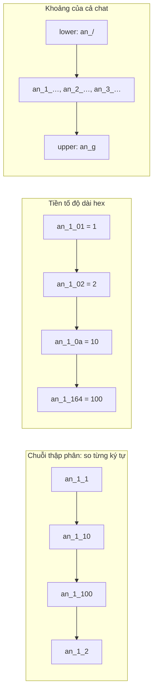

Lưu tin nhắn vào IndexedDB thì sớm muộn cũng cần hai truy vấn: "mọi tin của chat X theo thứ tự thời gian" và "các tin của chat X từ thời điểm T trở đi". Cách tự nhiên là ghép khoá kiểu `"an@c.us_1_1603872000"` rồi đọc bằng một `IDBKeyRange`. Nhưng IndexedDB so khoá chuỗi **theo từng ký tự**, nên `"…_10"` đứng trước `"…_9"`, và đọc ra danh sách là `1, 10, 100, 101, …`.

WhatsApp Web 2020 giải quyết bằng một hàm 3 dòng: viết số ở hệ 16 và **thêm một ký tự hex ghi độ dài** vào trước. Số nhiều chữ số hơn thì ký tự đầu lớn hơn, nên luôn đứng sau.

> [!TIP]
> **Tóm tắt**
> - `encode(n) = (hex.length - 1).toString(16) + hex`: 9 → `09`, 16 → `110`, 255 → `1ff`, 256 → `2100`. So sánh chuỗi cho ra đúng thứ tự số.
> - Khoá tin nhắn có dạng `chat_loại_encode(t)`. Mọi tin của một chat nằm trong khoảng `chat_/` … `chat_g`, vì `/` đứng ngay trước `0` và `g` đứng ngay sau `f` trong bảng mã ASCII.
> - Giới hạn: tối đa 16 chữ số hex, chỉ số không âm, chat id không được chứa `_`, và hàm giải mã dùng `parseInt` nên mất chính xác trên 2^53.
> - Hiện nay có thể dùng **khoá mảng** `[chat, loại, t]`: IndexedDB so mảng từng phần tử, số so như số.

<iframe class="demo-frame" src="/demos/web-patterns/index.html?theme=dark#/wa-ordered-keys" title="Demo wa-ordered-keys" loading="lazy" style="height: 1000px"></iframe>

<p class="demo-links">▶ <a href="/demos/web-patterns/index.html#/wa-ordered-keys" target="_blank" rel="noopener">Mở demo toàn màn hình ↗</a> · <a href="https://stackblitz.com/github/hunghg255/blog-hunghg/tree/master/examples/web-patterns?file=src/lib/waOrderedKeys.ts" target="_blank" rel="noopener">Sửa code trên StackBlitz ↗</a> · <a href="https://github.com/hunghg255/blog-hunghg/blob/master/examples/web-patterns/src/lib/waOrderedKeys.ts" target="_blank" rel="noopener">Xem source trên GitHub ↗</a></p>

Bấm "Ghi và đọc lại". Demo ghi 900 tin của 3 chat vào ba object store của một IndexedDB thật, theo thứ tự ngẫu nhiên, rồi đọc lại chat đầu bằng một `IDBKeyRange`. Khoá thập phân cho ra `1, 10, 100, …`, và truy vấn "từ tin #250" đếm sai (132 thay vì 51). Khoá kiểu WhatsApp và khoá mảng đều đúng. Ô "Thử mã hoá" cho phép nhập số bất kỳ để xem chuỗi mã hoá.

## WhatsApp làm thế nào?

Code nằm trong module `bigeebbfbi` của bundle WhatsApp Web 2020. Module này gom các hàm dựng khoá cho bảng tin nhắn. Wrapper IndexedDB thật nằm ở một chunk khác không có trong bundle này, nên phần "dùng khoá này trong `IDBKeyRange`" là suy luận từ tên hàm (có lẽ đúng, vì có cặp `beginningOf…`/`endOf…`). Đây là bản 2020, có thể đã đổi.

### Mã hoá số

```js
function u(e) {
  var t = e.toString(16);
  return (t.length - 1).toString(16) + t;
}
function f(e) {
  return parseInt(e.substring(1), 16);
}
```

`u` là hàm mã hoá, `f` là hàm giải mã. Ký tự đầu là `độ dài - 1` viết ở hệ 16, nên đi từ `0` (1 chữ số) tới `f` (16 chữ số). Hai số khác độ dài thì ký tự đầu quyết định; cùng độ dài thì phần còn lại là hex cùng số chữ số, so chuỗi trùng với so số.

### Khoá và khoảng

```js
craftMessageRangeIndex = (chat, incoming, system, t) =>
  `${chat}_${system ? '3' : incoming ? '1' : '2'}_${t != null ? u(t) : ''}`;
beginningOfMessageRange = (chat, type, t) => `${chat}_${type}_${t != null ? u(t) : ''}`;
endOfMessageRange = (chat, type) => `${chat}_${type}_g`;
beginningOfChat = (chat) => `${chat}_/`;
endOfChat = (chat) => `${chat}_g`;
extractC2STimestampFromMessageRangeIndex = (key) => f(key.split('_')[2]);
```

(Đã đổi tên biến cho dễ đọc.) Loại tin là một ký tự: `1` tin đến, `2` tin gửi đi, `3` tin hệ thống. Giá trị số cuối khoá là **timestamp C2S** (thời điểm client gửi lên server), theo tên hàm giải mã. Có hai mức khoảng:

- Cả chat: `chat_/` … `chat_g`. Ký tự ngay sau `_` của mọi khoá trong chat là `1`, `2` hoặc `3`, đều nằm giữa `/` (0x2F) và `g` (0x67).
- Một loại tin từ thời điểm T: `chat_1_u(T)` … `chat_1_g`. Mọi chuỗi mã hoá bắt đầu bằng `0`–`f`, nên đều nhỏ hơn `g`.

Còn một khoá nữa: `craftInternalId(chat, n) = chat_u(n)_m`, và `getInChatMsgId(id)` lấy lại `n` bằng `f(id.split('_')[1])`.

### Những giới hạn ngầm

- **16 chữ số hex.** Số có 17 chữ số hex trở lên làm `(len - 1).toString(16)` thành `10`, hai ký tự, và thứ tự vỡ. Với timestamp (khoảng 11 chữ số hex nếu là mili giây) thì còn rất xa.
- **Số âm.** `(-5).toString(16)` là `-5`, ký tự đầu là `1`, xen vào giữa các số dương. Code không kiểm tra.
- **Mất chính xác.** `parseInt` trả `number`, nên số trên 2^53 bị làm tròn. Không ảnh hưởng timestamp, nhưng hàm trông tổng quát mà không tổng quát.
- **Chat id chứa `_`.** `split('_')[2]` lấy sai đoạn, và khoảng `a_/`…`a_g` của chat `a` sẽ ôm luôn khoá của chat `a_b`. Chat id của WhatsApp có dạng `số@c.us` hoặc `số-số@g.us`, không có `_`, nên trong thực tế an toàn.

## Bên trong trình duyệt: IndexedDB so khoá thế nào

Đặc tả IndexedDB định nghĩa một thứ tự toàn phần trên khoá. Khác kiểu thì so kiểu trước: **Array > Binary > String > Date > Number**. Cùng kiểu thì:

- Number so như số.
- String so theo **từng code unit UTF-16**, như so sánh `<` của JS. Không theo locale, không theo "số trong chuỗi".
- Array so từng phần tử theo đúng quy tắc trên, phần tử đầu khác nhau thì quyết định. Mảng là tiền tố của mảng kia thì ngắn hơn đứng trước.

Object store lưu bản ghi theo thứ tự khoá trong một B-tree (Chromium dùng LevelDB, Firefox dùng SQLite). Một `IDBKeyRange.bound(lower, upper)` là một lần seek tới `lower` rồi đọc tuần tự tới `upper`: nhanh và không phụ thuộc kích thước bảng. Vì vậy thiết kế khoá sao cho truy vấn hay dùng là **một khoảng liên tục** quan trọng hơn mọi thứ khác.



## Viết lại

Bản viết lại giữ định dạng khoá (tương thích với dữ liệu kiểu cũ), nhưng kiểm tra đầu vào và giải mã ra `bigint`:

```ts title=src/lib/waOrderedKeys.ts
export const MAX_HEX_DIGITS = 16;

/** Mã hoá số nguyên không âm (tối đa 16 chữ số hex = 2^64 − 1). */
export function encodeOrderedHex(value: number | bigint): string {
  if (typeof value === 'number' && (!Number.isSafeInteger(value) || value < 0)) {
    throw new RangeError(`Cần số nguyên không âm an toàn, nhận ${value}`);
  }
  if (typeof value === 'bigint' && value < 0n) throw new RangeError('Cần số không âm');
  const hex = value.toString(16);
  if (hex.length > MAX_HEX_DIGITS) throw new RangeError('Quá 16 chữ số hex: tiền tố 1 ký tự không đủ');
  return (hex.length - 1).toString(16) + hex;
}

/** Giải mã về bigint để không mất chính xác khi vượt 2^53 (bản gốc dùng parseInt). */
export function decodeOrderedHex(encoded: string): bigint {
  const digits = parseInt(encoded[0], 16) + 1;
  const hex = encoded.slice(1);
  if (hex.length !== digits || !/^[0-9a-f]+$/.test(hex)) throw new Error(`Khoá không hợp lệ: ${encoded}`);
  return BigInt(`0x${hex}`);
}

export const MessageKind = { incoming: '1', outgoing: '2', system: '3' } as const;
export type MessageKind = (typeof MessageKind)[keyof typeof MessageKind];

function assertChatId(chatId: string) {
  // Khoảng `${chat}_/`..`${chat}_g` chỉ đúng khi chatId không chứa '_' (nếu không, chat "a" sẽ ôm luôn chat "a_b").
  if (chatId.includes('_')) throw new Error(`chatId không được chứa '_': ${chatId}`);
}

export function messageKey(chatId: string, kind: MessageKind, counter: number | bigint) {
  assertChatId(chatId);
  return `${chatId}_${kind}_${encodeOrderedHex(counter)}`;
}
```

Phần dựng khoảng:

```ts title=src/lib/waOrderedKeys.ts
export interface KeyRangeBounds {
  lower: string;
  upper: string;
}

/** Mọi khoá của một chat, mọi loại tin. */
export function chatBounds(chatId: string): KeyRangeBounds {
  assertChatId(chatId);
  return { lower: `${chatId}_/`, upper: `${chatId}_g` };
}

/** Khoá của một loại tin trong chat, tuỳ chọn bắt đầu từ một counter. */
export function kindBounds(chatId: string, kind: MessageKind, fromCounter?: number | bigint): KeyRangeBounds {
  assertChatId(chatId);
  const start = fromCounter === undefined ? '' : encodeOrderedHex(fromCounter);
  return { lower: `${chatId}_${kind}_${start}`, upper: `${chatId}_${kind}_g` };
}

export function toKeyRange({ lower, upper }: KeyRangeBounds): IDBKeyRange {
  return IDBKeyRange.bound(lower, upper);
}
```

::: spoiler Xem toàn bộ src/lib/waOrderedKeys.ts
```ts title=src/lib/waOrderedKeys.ts
/**
 * Khoá dạng chuỗi giữ đúng thứ tự số khi so sánh từ điển, kiểu WhatsApp Web (module `bigeebbfbi`).
 *
 * Chuỗi "10" < "9" khi so như chuỗi. WhatsApp thêm MỘT ký tự hex đứng đầu cho biết số chữ số hex
 * (trừ 1), nên số nhiều chữ số hơn luôn đứng sau: 9 → "09", 15 → "0f", 16 → "110", 255 → "1ff", 256 → "2100".
 * Khoá tin nhắn: `${chatId}_${loại}_${encode(counter)}`; cả một chat nằm trong khoảng `${chatId}_/` … `${chatId}_g`
 * vì '/' đứng ngay trước '0' và 'g' đứng ngay sau 'f' trong bảng mã.
 */

export const MAX_HEX_DIGITS = 16;

/** Mã hoá số nguyên không âm (tối đa 16 chữ số hex = 2^64 − 1). */
export function encodeOrderedHex(value: number | bigint): string {
  if (typeof value === 'number' && (!Number.isSafeInteger(value) || value < 0)) {
    throw new RangeError(`Cần số nguyên không âm an toàn, nhận ${value}`);
  }
  if (typeof value === 'bigint' && value < 0n) throw new RangeError('Cần số không âm');
  const hex = value.toString(16);
  if (hex.length > MAX_HEX_DIGITS) throw new RangeError('Quá 16 chữ số hex: tiền tố 1 ký tự không đủ');
  return (hex.length - 1).toString(16) + hex;
}

/** Giải mã về bigint để không mất chính xác khi vượt 2^53 (bản gốc dùng parseInt). */
export function decodeOrderedHex(encoded: string): bigint {
  const digits = parseInt(encoded[0], 16) + 1;
  const hex = encoded.slice(1);
  if (hex.length !== digits || !/^[0-9a-f]+$/.test(hex)) throw new Error(`Khoá không hợp lệ: ${encoded}`);
  return BigInt(`0x${hex}`);
}

export const MessageKind = { incoming: '1', outgoing: '2', system: '3' } as const;
export type MessageKind = (typeof MessageKind)[keyof typeof MessageKind];

function assertChatId(chatId: string) {
  // Khoảng `${chat}_/`..`${chat}_g` chỉ đúng khi chatId không chứa '_' (nếu không, chat "a" sẽ ôm luôn chat "a_b").
  if (chatId.includes('_')) throw new Error(`chatId không được chứa '_': ${chatId}`);
}

export function messageKey(chatId: string, kind: MessageKind, counter: number | bigint) {
  assertChatId(chatId);
  return `${chatId}_${kind}_${encodeOrderedHex(counter)}`;
}

export interface KeyRangeBounds {
  lower: string;
  upper: string;
}

/** Mọi khoá của một chat, mọi loại tin. */
export function chatBounds(chatId: string): KeyRangeBounds {
  assertChatId(chatId);
  return { lower: `${chatId}_/`, upper: `${chatId}_g` };
}

/** Khoá của một loại tin trong chat, tuỳ chọn bắt đầu từ một counter. */
export function kindBounds(chatId: string, kind: MessageKind, fromCounter?: number | bigint): KeyRangeBounds {
  assertChatId(chatId);
  const start = fromCounter === undefined ? '' : encodeOrderedHex(fromCounter);
  return { lower: `${chatId}_${kind}_${start}`, upper: `${chatId}_${kind}_g` };
}

export function toKeyRange({ lower, upper }: KeyRangeBounds): IDBKeyRange {
  return IDBKeyRange.bound(lower, upper);
}
```
:::

## Đi qua code

- `encodeOrderedHex` nhận cả `number` và `bigint`. Với `number`, nó từ chối số âm, số thực và số vượt `Number.MAX_SAFE_INTEGER` bằng `RangeError`, thay vì lặng lẽ sinh khoá sai thứ tự.
- Quá 16 chữ số hex cũng ném lỗi. Muốn rộng hơn thì đổi tiền tố thành 2 ký tự (đủ cho 256 chữ số), nhưng sẽ không còn tương thích với khoá cũ.
- `decodeOrderedHex` kiểm tra độ dài khớp với tiền tố và trả `BigInt('0x…')`, nên giải mã đúng tới 2^64 − 1.
- `assertChatId` chặn `_` trong chat id. Một ký tự phân cách không được xuất hiện trong thành phần mà nó phân cách: đây là điều kiện để khoảng `chat_/`…`chat_g` không ôm nhầm chat khác.
- `kindBounds(chat, kind, from)` trả cận dưới `chat_kind_encode(from)` và cận trên `chat_kind_g`. Bỏ `from` thì cận dưới là `chat_kind_`, nhỏ hơn mọi khoá có số.
- `toKeyRange` chỉ là `IDBKeyRange.bound(lower, upper)`, tách ra để phần dựng khoá chạy được trong Node (test không cần IndexedDB).

**Khác bản gốc:** kiểm tra đầu vào, giải mã ra `bigint`, chặn `_` trong chat id. Định dạng khoá giữ nguyên.

## Tại sao không làm cách khác?

**Đệm số 0 tới độ dài cố định** (`0000001603872000`). Cũng đúng thứ tự, nhưng phải chọn trước độ dài tối đa, và khoá luôn dài như số lớn nhất. Tiền tố độ dài cho số nhỏ khoá ngắn (`01`), và tự mở rộng tới 16 chữ số.

**Lưu số riêng một trường rồi tạo index.** Hoàn toàn được: index trên `[chatId, t]` là cách chuẩn ngày nay. Bản 2020 dùng khoá chuỗi có lẽ vì lý do tương thích (IE và Edge đời EdgeHTML hỗ trợ khoá mảng và index phức hợp không đầy đủ) hoặc vì khoá này còn dùng làm id ở nơi khác.

**Khoá mảng `[chat, loại, t]`.** Đây là lựa chọn hiện đại và demo có so sánh. Không cần mã hoá, số so như số, khoảng `[chat, '1', 250]` … `[chat, '1', Infinity]` đọc như chữ. Điểm trừ: không dùng được khoá này như một chuỗi id ở chỗ khác (URL, Map key) mà không serialize.

**Dùng `Date` làm khoá.** Date so đúng thứ tự, nhưng không ghép được với chat id trong một khoá chuỗi. Phải dùng khoá mảng, quay về trường hợp trên.

## Edge case và cạm bẫy

- **Ranh giới cận trên.** `chat_kind_g` đúng vì mã hoá chỉ dùng `0-9a-f`. Nếu sau này thêm hậu tố chữ hoa hoặc ký tự khác vào khoá thì phải xét lại cận.
- **Hậu tố sau số.** `craftInternalId` thêm `_m` sau số. Nhờ tiền tố độ dài, `chat_01_m` (1) vẫn đứng trước `chat_0a_m` (10). Nếu ghép hậu tố vào số thập phân không có tiền tố thì `_` (0x5F) lớn hơn mọi chữ số, nên `chat_1_m` lại đứng sau `chat_10_m`.
- **Unicode trong chat id.** IndexedDB so theo code unit UTF-16, không theo code point. Ký tự ngoài BMP (emoji) được so bằng surrogate, có thể đứng trước một số ký tự BMP lớn. Không ảnh hưởng tính liên tục của khoảng, chỉ ảnh hưởng thứ tự giữa các chat.
- **Đếm bằng `count(range)`.** Nhanh nhưng vẫn đi qua từng bản ghi trong khoảng trên một số trình duyệt. Với khoảng lớn, lưu bộ đếm riêng.
- **Đổi định dạng khoá.** Dữ liệu cũ vẫn còn trong IndexedDB của người dùng. Phải viết migration trong `onupgradeneeded`, hoặc giữ cả hai định dạng tới khi dữ liệu cũ hết hạn.

## Dùng trong dự án

```ts
// 50 tin đến mới nhất của một chat: đọc ngược khoảng bằng cursor 'prev'
const range = toKeyRange(kindBounds(chatId, MessageKind.incoming));
const latest: Message[] = [];
const req = db.transaction('messages').objectStore('messages').openCursor(range, 'prev');
req.onsuccess = () => {
  const cursor = req.result;
  if (!cursor || latest.length === 50) return render(latest);
  latest.push(cursor.value);
  cursor.continue();
};
```

Với dự án mới, nên dùng khoá mảng và một index phụ cho truy vấn khác (vd `[chatId, starred, t]`). Mẹo tiền tố độ dài vẫn hữu ích khi khoá **phải** là chuỗi: tên file trong OPFS, khoá trong `localStorage`, sort key của DynamoDB hay của một KV store chỉ so chuỗi.

::: spoiler Ví dụ test (bản phác, không có trong repo)
```ts
import { describe, expect, it } from 'vitest';
import { chatBounds, decodeOrderedHex, encodeOrderedHex, kindBounds, messageKey, MessageKind } from '../src/lib/waOrderedKeys';

describe('waOrderedKeys', () => {
  it('so chuỗi trùng so số', () => {
    const nums = [0, 1, 9, 10, 15, 16, 255, 256, 4095, 4096, 2 ** 40, Number.MAX_SAFE_INTEGER];
    const sorted = [...nums].sort((a, b) => (encodeOrderedHex(a) < encodeOrderedHex(b) ? -1 : 1));
    expect(sorted).toEqual(nums);
  });

  it('giải mã đúng trên 2^53', () => {
    const big = 2n ** 63n + 5n;
    expect(decodeOrderedHex(encodeOrderedHex(big))).toBe(big);
  });

  it('từ chối số âm và quá 16 chữ số', () => {
    expect(() => encodeOrderedHex(-1)).toThrow(RangeError);
    expect(() => encodeOrderedHex(2n ** 64n)).toThrow(RangeError);
  });

  it('khoảng của chat chứa mọi loại tin và không chứa chat khác', () => {
    const { lower, upper } = chatBounds('an@c.us');
    for (const kind of Object.values(MessageKind)) {
      const k = messageKey('an@c.us', kind, 123);
      expect(k > lower && k < upper).toBe(true);
    }
    const other = messageKey('an@c.usx', MessageKind.incoming, 1);
    expect(other > lower && other < upper).toBe(false);
  });

  it('kindBounds bắt đầu đúng từ counter', () => {
    const { lower } = kindBounds('a@c.us', MessageKind.incoming, 250);
    expect(messageKey('a@c.us', MessageKind.incoming, 249) < lower).toBe(true);
    expect(messageKey('a@c.us', MessageKind.incoming, 250) >= lower).toBe(true);
    expect(messageKey('a@c.us', MessageKind.incoming, 1000) >= lower).toBe(true);
  });
});
```
:::

## So với thư viện và chuẩn web

- **Khoá mảng và index phức hợp** có từ IndexedDB 1.0 và chạy trên mọi trình duyệt hiện đại (tính tới 10/2026). `getAll(range, count)` và `getAllKeys` thuộc IndexedDB 2.0.
- **Dexie.js** cho viết `where('[chatId+t]').between([id, 250], [id, Dexie.maxKey])`, dựa trên khoá mảng. `idb` (Jake Archibald) chỉ bọc Promise, không đổi cách so khoá.
- **Mã hoá giữ thứ tự** là kỹ thuật cũ: `lexicographic-integer` trên npm dùng đúng ý tưởng tiền tố độ dài; FoundationDB và CockroachDB có các bộ mã hoá tuple giữ thứ tự cho cả số âm và số thực.
- Facebook cũng gặp bài toán lưu trữ phía client, nhưng tập trung vào quota và dọn dẹp: xem [Facebook: lưu trữ theo quota](/blogs/facebook-quota-aware-storage).

---

Bài này thuộc series **[Học từ mã nguồn WhatsApp Web](/series/whatsapp)** (19 bài, đọc theo thứ tự).

::: spoiler Xem nhanh danh sách bài trong series

*Mở đầu*

- [Mở đầu: đọc bundle WhatsApp Web 2020](/blogs/learn-from-whatsapp-web-source-code)

*Phần 1: media và mã hoá*

- [#1 Giải mã JPEG progressive theo từng scan, kiểm HMAC](/blogs/whatsapp-progressive-jpeg-hmac)
- [#2 Ghép khoảng byte cho video streaming](/blogs/whatsapp-byte-range-merge)
- [#3 Xoá EXIF không re-encode, thumbnail theo ngân sách byte](/blogs/whatsapp-jpeg-strip-thumb-budget)
- [#4 Đọc metadata sticker WebP động](/blogs/whatsapp-webp-sticker-metadata)

*Phần 2: lưu trữ trên trình duyệt*

- [#5 Kho media LRU tự co theo quota](/blogs/whatsapp-quota-aware-media-lru)
- [#6 Cache blob trong RAM có refcount, tự revoke objectURL](/blogs/whatsapp-blob-cache-refcount)
- **#7 Khoá IndexedDB giữ đúng thứ tự từ điển** (bài này)

*Phần 3: danh sách tin nhắn*

- [#8 Render tin nhắn theo cửa sổ chiều cao ước lượng](/blogs/whatsapp-render-cursor-window)
- [#9 Theo dõi viewport tin nhắn: binary search, ngày dính](/blogs/whatsapp-message-viewport-tracking)
- [#10 FlatList tái dùng key React, overscan bất đối xứng](/blogs/whatsapp-flatlist-key-reuse)

*Phần 4: soạn tin và chữ*

- [#11 Emoticon thành emoji bằng trie đọc ngược, tìm emoji](/blogs/whatsapp-emoticon-trie-emoji-search)
- [#12 Mention bằng token zero-width, giới hạn theo code point](/blogs/whatsapp-mention-zero-width-input)
- [#13 Xác định hướng chữ bằng bảng delta nén](/blogs/whatsapp-text-direction-table)
- [#14 Phát hiện homograph trong link, chặn giả đuôi file RTLO](/blogs/whatsapp-homograph-rtlo-guard)

*Phần 5: realtime và tiện ích*

- [#15 Presence, "đang gõ" và thông báo theo kích thước group](/blogs/whatsapp-presence-typing-notifications)
- [#16 Đo FPS phát hiện UI đóng băng, idle monitor](/blogs/whatsapp-fps-freeze-idle)
- [#17 Cửa sổ PiP: resize 8 hướng, khoá tỉ lệ, né vật cản](/blogs/whatsapp-pip-resize-avoid)
- [#18 Parse giá tiền theo locale bằng Intl](/blogs/whatsapp-locale-price-parse)

:::

Code + demo: [`examples/web-patterns`](https://github.com/hunghg255/blog-hunghg/tree/master/examples/web-patterns) · [Mở trên StackBlitz](https://stackblitz.com/github/hunghg255/blog-hunghg/tree/master/examples/web-patterns)
