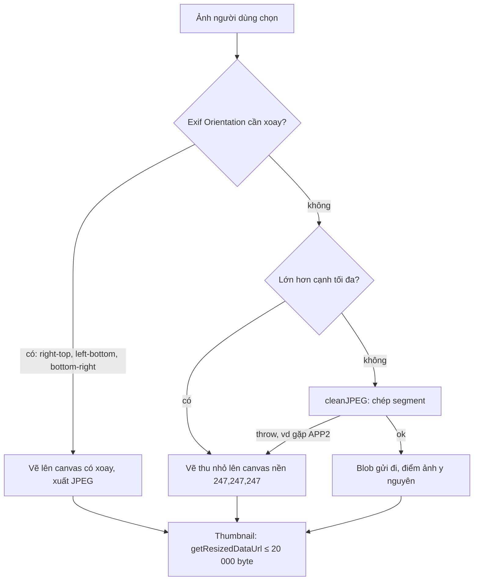

Ảnh chụp từ điện thoại mang theo nhiều thứ hơn người gửi nghĩ: hãng và đời máy, thời điểm chụp, và nếu bật định vị thì cả **toạ độ GPS** của căn nhà. Một app nhắn tin phải xoá những thứ đó trước khi gửi. Cách dễ nhất là vẽ ảnh lên `<canvas>` rồi xuất lại JPEG: metadata mất sạch, nhưng ảnh bị nén lại thêm một lần, mờ đi và đôi khi còn **to hơn** file gốc.

WhatsApp Web có hai đường. Ảnh không cần xoay, không cần thu nhỏ thì đi đường "phẫu thuật": đọc từng segment của file JPEG, bỏ segment metadata, chép nguyên phần còn lại. Ảnh cần xử lý thì mới vẽ lên canvas. Cùng nhóm tiện ích đó còn có hàm nén thumbnail cho vừa một ngân sách byte cố định và hàm lấy thumbnail video có kiểm frame đen. Cả ba đều có chỗ đáng học, và vài lỗi đáng sửa.

> [!TIP]
> **Tóm tắt**
> - JPEG là chuỗi segment có độ dài ghi sẵn. Bỏ APP1 (Exif, XMP), APP13 (IPTC), COM rồi chép phần còn lại: dữ liệu nén **giữ nguyên từng byte**, điểm ảnh không đổi, file nhỏ đi.
> - `cleanJPEG` gốc ném lỗi khi gặp APP2 (ICC profile, có trong rất nhiều ảnh điện thoại) hay APP14 (Adobe), và rơi về re-encode. Bản viết lại giữ hai segment đó.
> - Thumbnail ảnh phải ≤ 20 000 byte: bản gốc thử lần lượt chất lượng 0.9, 0.8, … (2 tới 11 lần encode, càng chặt càng nhiều). Tìm nhị phân giới hạn ở 7 lần và cho chất lượng sát ngân sách hơn.
> - Kiểm "frame đen" của thumbnail video chỉ lấy 5 điểm, cả 5 đều nằm trong **1/4 trên cùng** của ảnh: video có viền đen bị coi là đen, chờ thêm tới 5 giây. Lấy mẫu dạng lưới phủ cả khung sửa được.

<iframe class="demo-frame" src="/demos/web-patterns/index.html?theme=dark#/wa-jpeg-tools" title="Demo wa-jpeg-tools" loading="lazy" style="height: 1250px"></iframe>

<p class="demo-links">▶ <a href="/demos/web-patterns/index.html#/wa-jpeg-tools" target="_blank" rel="noopener">Mở demo toàn màn hình ↗</a> · <a href="https://stackblitz.com/github/hunghg255/blog-hunghg/tree/master/examples/web-patterns?file=src/lib/waJpegTools.ts" target="_blank" rel="noopener">Sửa code trên StackBlitz ↗</a> · <a href="https://github.com/hunghg255/blog-hunghg/blob/master/examples/web-patterns/src/lib/waJpegTools.ts" target="_blank" rel="noopener">Xem source trên GitHub ↗</a></p>

Phần 1: bấm **Xoá metadata**. Ô "điểm ảnh khác" của cách chép segment luôn là 0, còn re-encode qua canvas thì hàng chục nghìn điểm ảnh đổi màu. Bật **Ảnh có APP2 ICC profile** để thấy `cleanJPEG` gốc sẽ ném lỗi. Phần 2 so số lần encode và chất lượng đạt được giữa vòng lặp gốc và tìm nhị phân; thử cả ba mức ngân sách. Phần 3 vẽ điểm lấy mẫu: đỏ là 5 điểm của bản gốc, trắng là lưới 6×6.

## WhatsApp Web làm thế nào?

Ba module: `cjjjfdegjf` chứa `cleanJPEG`, `dgjacfgggf` chứa các tiện ích ảnh (`rotateAndResize`, `getResizedDataUrl`, `generateMicroThumb`, `generateVideoThumbAndDuration`), và `bccggdcfj` là nơi gọi chúng khi chuẩn bị gửi ảnh. Đây là bundle bản 2020, tên module là hash webpack.

### cleanJPEG: đọc segment, chép phần cần giữ

Hàm đọc file bằng hai con trỏ chạy song song, gặp marker nào thì quyết định chép hay bỏ:

| Marker | Xử lý trong `cleanJPEG` |
| --- | --- |
| `FFD8` SOI | bắt buộc ở đầu file |
| `FFE0` APP0 (JFIF) | đọc version, đơn vị và mật độ điểm ảnh rồi **bỏ**, cuối cùng dựng lại một JFIF 18 byte |
| `FFE1` APP1 | segment APP1 đầu tiên phải là `Exif\0\0`, bỏ |
| `FFED` APP13, `FFFE` COM | bỏ |
| SOF0–SOF15, DHT, DQT, DRI | chép nguyên |
| `FFDA` SOS | chép header và dữ liệu entropy tới marker kế tiếp |
| `FFD9` EOI | chép, dừng |
| APP2–APP12, APP14, APP15 | `throw "Received unexpected APP marker"` |

Ngoài ra, nếu gặp SOF, DHT, SOS… mà trước đó chưa thấy JFIF hay Exif thì ném `"Missing magic bytes marker."`. Đoạn quét dữ liệu entropy là chỗ tinh tế nhất:

```js
case SOS:
  a.advance(a.readUint16() - 2);                 // bỏ qua header SOS
  for (let cur, prev = a.readUint8(); a.size(); ) {
    cur = a.readUint8();
    if (prev === 0xff && ![0, 0xd0, 0xd1, 0xd2, 0xd3, 0xd4, 0xd5, 0xd6, 0xd7].includes(cur)) { marker = cur; break; }
    prev = cur;
  }
  out.writeByteArray(copy.readByteArray(copy.size() - a.size() - 2));
  continue;
```

Trong dữ liệu nén, byte `0xFF` thật được "nhồi" thành `FF 00`, còn `FF D0…D7` là marker khởi động lại (RST). Mọi `FF xx` khác là marker của segment kế tiếp. Nhờ vậy hàm xử lý được cả JPEG progressive có nhiều SOS xen DHT.

### Khi nào đi đường cleanJPEG?

`rotateAndResize` trong `dgjacfgggf` đọc Exif để biết hướng ảnh, rồi:

```js
if (!rotation) {                                  // size = boundHeightWidth(h, w, maxEdge)
  let needBlob = flags & BLOB;
  if (buffer && needBlob && w === size.width && h === size.height)
    try { images.blob = cleanJPEG(buffer); needBlob = false; } catch (e) { /* log "Could not parse JPEG" */ }
  if (needBlob || flags & ~BLOB) { /* vẽ lên canvas nền rgb(247,247,247), xuất JPEG */ }
}
```

Chỉ khi ảnh không cần xoay **và** không phải thu nhỏ thì mới thử `cleanJPEG`. Lỗi thì ghi log và đi tiếp xuống nhánh canvas. Trước khi vẽ, canvas được tô màu `rgb(247,247,247)`: ảnh PNG trong suốt chuyển sang JPEG sẽ có nền xám rất nhạt thay vì nền đen.

### Thumbnail theo ngân sách byte

`processRawImage` trong `bccggdcfj` thu nhỏ ảnh về cạnh tối đa của thumbnail rồi gọi:

```js
const url = getResizedDataUrl(canvas, 'image/jpeg', 2e4); // ngưỡng 20 000 byte nằm ở đây
const preview = url ? parseDataURL(url).data : null;      // log: "preview will be null"
```

Còn `getResizedDataUrl` trong `dgjacfgggf` thử từ chất lượng mặc định xuống dần:

```js
if (dataURLtoBlob(canvas.toDataURL(type)).size <= maxBytes) return canvas.toDataURL(type);
for (let q = 0.9; q >= 0.1; q -= 0.1) {
  const url = canvas.toDataURL(type, q);
  if (dataURLtoBlob(url).size <= maxBytes) return url;
}
return null;
```

Do cộng trừ số thực, `q` đi qua 0.9, 0.8, 0.7000000000000001… và lần cuối là 0.10000000000000014, vẫn ≥ 0.1, nên đủ 9 mức. Trường hợp xấu nhất là 11 lần encode, mỗi lần còn giải base64 để đo kích thước. Ảnh vừa ngay từ đầu thì bị encode **hai lần** giống hệt nhau.

Thumbnail của tài liệu (trang đầu PDF) thì dùng `generateMicroThumb(canvas, 1300, { mimetype: 'image/jpeg', maxAttempts: 10 })`, gọi từ `bbegjdfcja`: mỗi lần chưa vừa 1 300 byte thì thu kích thước còn một nửa.

### Thumbnail video và frame đen

Với một số bản Chrome có lỗi nạp video (`isBuggyVideoLoadChrome`), frame đầu vẽ ra canvas có thể toàn đen. Bản gốc thử lại tối đa 100 lần, mỗi lần cách 50 ms:

```js
const isBlack = img => {
  for (let t = img.width * img.height / 4, a = 0; a <= 1; a += 0.25) {
    const i = 4 * Math.round(t * a);
    if (img.data[i] || img.data[i + 1] || img.data[i + 2]) return false;
    if (img.data[i + 3] !== 0 && img.data[i + 3] !== 255) return false;
  }
  return true;
};
```

`t` là **một phần tư số điểm ảnh**, nên 5 chỉ số `0, t/4, t/2, 3t/4, t` đều nằm trong 1/4 đầu mảng, tức 1/4 chiều cao phía trên. Hơn nữa khi chiều cao chia hết cho 16 (720, 1280…), cả 5 điểm rơi đúng cột `x = 0`. Video có viền đen phía trên (letterbox) hoặc hai bên (pillarbox), rất hay gặp ở video quay màn hình hay video dọc ghép nền đen, sẽ luôn bị coi là "đen". Kết quả: chờ đủ 100 lần × 50 ms = 5 giây rồi mới lấy frame, cho dù frame đó hoàn toàn bình thường.

## Bên trong trình duyệt: segment JPEG và encoder canvas

Mỗi segment JPEG bắt đầu bằng `FF xx`, theo sau là 2 byte độ dài (big-endian, tính cả 2 byte đó). Trình giải mã chỉ cần các bảng lượng tử hoá (DQT), bảng Huffman (DHT), khung (SOF) và dữ liệu quét (SOS). Các segment APPn là "phụ lục" cho phần mềm khác đọc. Bỏ chúng đi thì dữ liệu nén y nguyên, decoder ra đúng từng điểm ảnh như cũ.

Ngược lại, `canvas.toBlob('image/jpeg', q)` giải nén ảnh ra điểm ảnh rồi nén lại bằng encoder của trình duyệt, với bảng lượng tử hoá của trình duyệt chứ không phải của máy ảnh. Mỗi lần như vậy mất thêm chi tiết. Chất lượng mặc định của Chrome là 0.92, cao hơn nhiều máy ảnh, nên file đầu ra hay to hơn file gốc dù ảnh xấu đi.

Không phải APPn nào cũng bỏ được an toàn:

- **APP2 `ICC_PROFILE`**: hồ sơ màu. iPhone chụp ở không gian màu Display P3; bỏ ICC thì trình duyệt hiểu thành sRGB, ảnh nhạt màu đi.
- **APP14 `Adobe`**: cho biết dữ liệu là YCbCr hay RGB/CMYK. Bỏ đi, ảnh CMYK có thể ra màu âm bản.
- **APP1 Exif** mang tag `Orientation`. Bỏ Exif của ảnh cần xoay thì ảnh hiện ngang. Đây là lý do bản gốc chỉ đi đường `cleanJPEG` khi không cần xoay.



## Viết lại

`src/lib/waJpegTools.ts` tách phần đọc segment thành hàm riêng để vừa xoá metadata vừa liệt kê được cho demo. Đọc segment, chịu được byte đệm `0xFF` liên tiếp trước marker (chuẩn cho phép, bản gốc ném lỗi):

```ts title=src/lib/waJpegTools.ts
/** Đi qua từng segment. Chịu được byte đệm 0xFF trước marker và nhiều SOS (progressive). */
export function listJpegSegments(b: Uint8Array): JpegSegment[] {
  if (b[0] !== 0xff || b[1] !== 0xd8) throw new Error('thiếu SOI ở đầu file');
  const out: JpegSegment[] = [{ marker: 0xd8, name: 'SOI', offset: 0, size: 2 }];
  let i = 2;
  while (i < b.length) {
    if (b[i] !== 0xff) throw new Error(`byte 0x${b[i].toString(16)} ở ${i} không phải marker`);
    const offset = i;
    while (b[i] === 0xff) i++; // byte đệm hợp lệ theo chuẩn
    const marker = b[i++];
    if (marker === 0xd9) {
      out.push({ marker, name: 'EOI', offset, size: i - offset });
      return out;
    }
    const len = (b[i] << 8) | b[i + 1];
    let end = i + len;
    if (marker === 0xda) {
      while (end + 1 < b.length && !(b[end] === 0xff && b[end + 1] !== 0 && (b[end + 1] < 0xd0 || b[end + 1] > 0xd7)))
        end++;
    }
    const tag = marker >= 0xe0 && marker <= 0xef ? readTag(b, i + 2, 12) : undefined;
    out.push({ marker, name: markerName(marker), offset, size: end - offset, tag });
    i = end;
  }
  throw new Error('không thấy EOI');
}
```

Chọn bỏ theo **nội dung** chứ không chỉ theo số marker: `isStrippable` bỏ COM và mọi APPn, trừ APP0 có tag `JFIF`, APP2 có tag `ICC_PROFILE` và APP14 có tag `Adobe`. APP2 cũng có thể là MPF (danh mục ảnh phụ), loại này thì bỏ, nên phải đọc chuỗi nhận dạng ở đầu payload chứ không chỉ nhìn số marker.

Nén theo ngân sách bằng tìm nhị phân trên chất lượng, đo kích thước thẳng từ `Blob`:

```ts title=src/lib/waJpegTools.ts
export async function encodeWithinBudget(
  canvas: HTMLCanvasElement,
  maxBytes: number,
  type = 'image/jpeg',
  { min = 0.1, max = 0.92, steps = 6 } = {},
): Promise<BudgetResult | null> {
  let encodes = 0;
  const at = async (q: number) => {
    encodes++;
    return canvasToBlob(canvas, type, q);
  };
  const top = await at(max);
  if (top && top.size <= maxBytes) return { blob: top, quality: max, encodes };
  let best: { blob: Blob; quality: number } | null = null;
  let lo = min;
  let hi = max;
  for (let i = 0; i < steps; i++) {
    const q = i === 0 ? lo : (lo + hi) / 2;
    const blob = await at(q);
    if (blob && blob.size <= maxBytes) {
      best = { blob, quality: q };
      lo = q;
      if (blob.size >= maxBytes * 0.9) break; // đã sát ngân sách: tăng chất lượng thêm cũng không đáng
    } else if (i === 0) {
      return null; // chất lượng thấp nhất còn quá lớn: phải thu nhỏ kích thước
    } else hi = q;
  }
  return best && { ...best, encodes };
}
```

::: spoiler Xem toàn bộ src/lib/waJpegTools.ts
```ts title=src/lib/waJpegTools.ts
// Xoá metadata JPEG mà không re-encode, nén thumbnail vừa ngân sách byte, phát hiện frame đen.
// Viết lại từ cjjjfdegjf (cleanJPEG) và dgjacfgggf (tiện ích ảnh) của WhatsApp Web bản 2020.

export interface JpegSegment {
  marker: number;
  name: string;
  offset: number;
  /** tổng số byte của segment, gồm 2 byte marker (với SOS: gồm cả dữ liệu entropy) */
  size: number;
  /** chuỗi nhận dạng ở đầu payload APPn: "Exif", "ICC_PROFILE", "Adobe"… */
  tag?: string;
}

const NAMES: Record<number, string> = { 0xc4: 'DHT', 0xdb: 'DQT', 0xdd: 'DRI', 0xda: 'SOS', 0xd9: 'EOI', 0xfe: 'COM' };

export function markerName(m: number): string {
  if (NAMES[m]) return NAMES[m];
  if (m >= 0xe0 && m <= 0xef) return `APP${m - 0xe0}`;
  if (m >= 0xc0 && m <= 0xcf) return `SOF${m - 0xc0}`;
  return `0x${m.toString(16)}`;
}

function readTag(b: Uint8Array, at: number, max: number): string {
  let s = '';
  for (let i = at; i < at + max && b[i] >= 0x20 && b[i] < 0x7f; i++) s += String.fromCharCode(b[i]);
  return s;
}

/** Đi qua từng segment. Chịu được byte đệm 0xFF trước marker và nhiều SOS (progressive). */
export function listJpegSegments(b: Uint8Array): JpegSegment[] {
  if (b[0] !== 0xff || b[1] !== 0xd8) throw new Error('thiếu SOI ở đầu file');
  const out: JpegSegment[] = [{ marker: 0xd8, name: 'SOI', offset: 0, size: 2 }];
  let i = 2;
  while (i < b.length) {
    if (b[i] !== 0xff) throw new Error(`byte 0x${b[i].toString(16)} ở ${i} không phải marker`);
    const offset = i;
    while (b[i] === 0xff) i++; // byte đệm hợp lệ theo chuẩn
    const marker = b[i++];
    if (marker === 0xd9) {
      out.push({ marker, name: 'EOI', offset, size: i - offset });
      return out;
    }
    const len = (b[i] << 8) | b[i + 1];
    let end = i + len;
    if (marker === 0xda) {
      while (end + 1 < b.length && !(b[end] === 0xff && b[end + 1] !== 0 && (b[end + 1] < 0xd0 || b[end + 1] > 0xd7)))
        end++;
    }
    const tag = marker >= 0xe0 && marker <= 0xef ? readTag(b, i + 2, 12) : undefined;
    out.push({ marker, name: markerName(marker), offset, size: end - offset, tag });
    i = end;
  }
  throw new Error('không thấy EOI');
}

/** Segment nào là metadata riêng tư/không cần để hiển thị. */
export function isStrippable(s: JpegSegment): boolean {
  if (s.marker === 0xfe) return true; // COM
  if (s.marker < 0xe0 || s.marker > 0xef) return false;
  if (s.marker === 0xe0) return s.tag !== 'JFIF'; // giữ JFIF (mật độ điểm ảnh), bỏ JFXX chứa thumbnail
  if (s.marker === 0xe2 && s.tag === 'ICC_PROFILE') return false; // màu Display P3 của điện thoại
  if (s.marker === 0xee && s.tag?.startsWith('Adobe')) return false; // cho biết YCbCr/CMYK
  return true; // Exif, XMP, IPTC (APP13), MPF (APP2), APP3..15 lạ
}

/**
 * Bỏ metadata bằng cách chép lại các segment cần giữ: dữ liệu ảnh (DQT, DHT, SOF, SOS…) giữ nguyên
 * từng byte nên điểm ảnh không đổi. Lưu ý: Exif mang cả Orientation; chỉ dùng khi ảnh không cần xoay.
 */
export function stripJpegMetadata(b: Uint8Array): { bytes: Uint8Array<ArrayBuffer>; removed: JpegSegment[] } {
  const segs = listJpegSegments(b);
  const keep: Uint8Array[] = [];
  const removed: JpegSegment[] = [];
  for (const s of segs) {
    if (isStrippable(s)) removed.push(s);
    else keep.push(b.subarray(s.offset, s.offset + s.size));
  }
  const out = new Uint8Array(keep.reduce((n, p) => n + p.byteLength, 0));
  let at = 0;
  for (const p of keep) {
    out.set(p, at);
    at += p.byteLength;
  }
  return { bytes: out, removed };
}

export interface ExifSummary {
  orientation: number;
  make?: string;
  model?: string;
  hasGps: boolean;
}

/** Đọc vài tag IFD0 trong APP1 Exif: đủ để biết có cần xoay và có lộ GPS không. */
export function readExifSummary(b: Uint8Array): ExifSummary | null {
  const seg = listJpegSegments(b).find((s) => s.marker === 0xe1 && s.tag === 'Exif');
  if (!seg) return null;
  const tiff = seg.offset + 4 + 6;
  const view = new DataView(b.buffer, b.byteOffset);
  const le = b[tiff] === 0x49;
  const u16 = (at: number) => view.getUint16(tiff + at, le);
  const u32 = (at: number) => view.getUint32(tiff + at, le);
  const ascii = (at: number, n: number) => readTag(b, tiff + at, n);
  const ifd = u32(4);
  const out: ExifSummary = { orientation: 1, hasGps: false };
  for (let k = 0, n = u16(ifd); k < n; k++) {
    const e = ifd + 2 + k * 12;
    const tag = u16(e);
    const count = u32(e + 4);
    const value = count <= 4 ? e + 8 : u32(e + 8);
    if (tag === 0x0112) out.orientation = u16(e + 8);
    else if (tag === 0x010f) out.make = ascii(value, count);
    else if (tag === 0x0110) out.model = ascii(value, count);
    else if (tag === 0x8825) out.hasGps = true;
  }
  return out;
}

export interface BudgetResult {
  blob: Blob;
  quality: number;
  /** số lần gọi encoder */
  encodes: number;
}

export function canvasToBlob(canvas: HTMLCanvasElement, type: string, quality?: number): Promise<Blob | null> {
  return new Promise((resolve) => canvas.toBlob(resolve, type, quality));
}

/**
 * Tìm chất lượng cao nhất mà file vẫn ≤ maxBytes bằng tìm kiếm nhị phân (tối đa 7 lần encode),
 * thay vì thử lần lượt 0.9, 0.8, … như bản gốc. Không vừa ở chất lượng thấp nhất thì trả null.
 */
export async function encodeWithinBudget(
  canvas: HTMLCanvasElement,
  maxBytes: number,
  type = 'image/jpeg',
  { min = 0.1, max = 0.92, steps = 6 } = {},
): Promise<BudgetResult | null> {
  let encodes = 0;
  const at = async (q: number) => {
    encodes++;
    return canvasToBlob(canvas, type, q);
  };
  const top = await at(max);
  if (top && top.size <= maxBytes) return { blob: top, quality: max, encodes };
  let best: { blob: Blob; quality: number } | null = null;
  let lo = min;
  let hi = max;
  for (let i = 0; i < steps; i++) {
    const q = i === 0 ? lo : (lo + hi) / 2;
    const blob = await at(q);
    if (blob && blob.size <= maxBytes) {
      best = { blob, quality: q };
      lo = q;
      if (blob.size >= maxBytes * 0.9) break; // đã sát ngân sách: tăng chất lượng thêm cũng không đáng
    } else if (i === 0) {
      return null; // chất lượng thấp nhất còn quá lớn: phải thu nhỏ kích thước
    } else hi = q;
  }
  return best && { ...best, encodes };
}

/**
 * Micro-thumbnail: mỗi lần chưa vừa thì thu nhỏ còn một nửa. Khác bản gốc: tôn trọng mimetype,
 * không bao giờ tạo canvas 0 px (toBlob của canvas rỗng trả null).
 */
export async function generateMicroThumb(
  source: HTMLCanvasElement,
  maxBytes: number,
  { mimetype = 'image/jpeg', maxAttempts = 10, quality = 0.8 } = {},
): Promise<{ blob: Blob; width: number; height: number; attempts: number }> {
  let canvas = source;
  let blob = await canvasToBlob(canvas, mimetype, quality);
  let attempts = 0;
  for (let scale = 0.5; attempts < maxAttempts && (!blob || blob.size > maxBytes); scale /= 2) {
    attempts++;
    const w = Math.max(1, Math.floor(source.width * scale));
    const h = Math.max(1, Math.floor(source.height * scale));
    canvas = document.createElement('canvas');
    canvas.width = w;
    canvas.height = h;
    canvas.getContext('2d')!.drawImage(source, 0, 0, w, h);
    blob = await canvasToBlob(canvas, mimetype, quality);
    if (w === 1 && h === 1) break;
  }
  if (!blob) throw new Error(`trình duyệt không encode được ${mimetype}`);
  return { blob, width: canvas.width, height: canvas.height, attempts };
}

/** Toạ độ lấy mẫu dạng lưới phủ cả khung hình (gồm cả giữa ảnh, nơi letterbox không che). */
export function gridSamplePoints(width: number, height: number, n = 6): [number, number][] {
  const pts: [number, number][] = [];
  for (let r = 0; r < n; r++)
    for (let c = 0; c < n; c++) pts.push([Math.floor(((c + 0.5) * width) / n), Math.floor(((r + 0.5) * height) / n)]);
  return pts;
}

/** Frame "đen" khi mọi điểm mẫu đều gần đen. Ngưỡng nhỏ để chịu được nhiễu nén của video. */
export function isBlackFrame(img: ImageData, n = 6, threshold = 16): boolean {
  return gridSamplePoints(img.width, img.height, n).every(([x, y]) => {
    const i = 4 * (y * img.width + x);
    return img.data[i] <= threshold && img.data[i + 1] <= threshold && img.data[i + 2] <= threshold;
  });
}
```
:::

## Đi qua code

- `listJpegSegments` trả mảng `{ marker, name, offset, size, tag }`. Tổng `size` của mọi segment bằng đúng độ dài file (test kiểm điều này), nên `stripJpegMetadata` chỉ việc ghép các lát `subarray` của segment được giữ.
- `readExifSummary` đọc IFD0 của Exif: byte order (`II` hay `MM`), số entry, rồi từng entry 12 byte. Chỉ lấy `Orientation` (0x0112), `Make`, `Model` và có hay không con trỏ GPS (0x8825). Đủ để quyết định "có cần xoay không" trước khi xoá.
- `encodeWithinBudget` thử chất lượng cao nhất trước (đa số ảnh nhỏ vừa ngay). Không vừa thì thử thấp nhất: vẫn không vừa thì trả `null` sớm để người gọi thu nhỏ kích thước. Còn lại chia đôi khoảng `[lo, hi]` tối đa 5 lần (độ chính xác khoảng 0.03), dừng sớm khi file đã đạt 90% ngân sách.
- `generateMicroThumb` giữ ý tưởng chia đôi kích thước của bản gốc nhưng truyền `mimetype` thật vào `toBlob` và kẹp kích thước tối thiểu 1 px.
- `isBlackFrame` lấy 36 điểm ở tâm các ô lưới 6×6, so với ngưỡng 16 thay vì đúng 0, vì frame đen của video nén hiếm khi đúng `0,0,0`.

**Khác bản gốc:**

- Giữ APP2 `ICC_PROFILE` và APP14 `Adobe` thay vì ném lỗi rồi re-encode. Bỏ APP2 loại khác (MPF), APP3–APP15 còn lại, kể cả APP0 không phải `JFIF` (JFXX chứa thumbnail).
- Không đòi JFIF hay Exif đứng đầu. JPEG xuất từ một số công cụ không có cả hai và vẫn hợp lệ.
- Giữ nguyên APP0 JFIF gốc thay vì dựng lại. Bản gốc dựng lại 18 byte để chắc chắn bỏ được thumbnail nhúng trong JFIF; nếu cần, bạn cũng có thể làm vậy.
- `generateMicroThumb` gốc nhận `mimetype` nhưng hàm `O(canvas, type)` bên trong bỏ qua tham số, luôn gọi `toBlob(cb, 'image/jpeg')`, còn `dataUrl` trả về cũng luôn là JPEG. Hiện chỉ có một nơi gọi và truyền đúng JPEG nên lỗi chưa lộ ra. Ngoài ra ảnh rất dẹt (vd 4000×6) sau vài lần chia đôi có chiều cao 0: `toBlob` của canvas 0 px trả `null` và dòng `c.size` ném `TypeError`.
- Kiểm frame đen bằng lưới phủ cả khung và ngưỡng nhỏ.

## Tại sao không làm cách khác?

- **Luôn re-encode qua canvas**: đơn giản và chắc chắn xoá hết metadata, nhưng mất chất lượng, tốn CPU với ảnh 12 MP, và hay làm file to lên. Đi đường segment cho trường hợp phổ biến nhất (ảnh đã nhỏ, không cần xoay) là đáng.
- **Sửa tag Exif thay vì xoá** (vd chỉ xoá GPS, giữ Orientation): làm được, nhưng phải viết lại cấu trúc IFD có con trỏ offset, dễ sai. Bỏ cả APP1 rồi xoay điểm ảnh khi cần thì đơn giản hơn.
- **Thử chất lượng tuyến tính như bản gốc**: dễ hiểu, và khi ảnh chỉ cần hạ nhẹ (q khoảng 0.6–0.9) thì còn **ít** lần encode hơn tìm nhị phân (demo với ngân sách 8 000 B: 5 lần so với 7). Nhưng ngân sách càng chặt càng tốn, tới 11 lần, và bước 0.1 thô: ảnh có thể chỉ cần q = 0.64 mà bị hạ xuống 0.6. Kích thước file tăng gần như đơn điệu theo chất lượng, đúng điều kiện để tìm nhị phân; dừng sớm khi đã đạt 90% ngân sách thì đỡ phí lượt.
- **Đo kích thước bằng độ dài base64**: nhanh hơn giải base64 (`Math.floor(len * 3 / 4) - số dấu =`), nhưng dùng `toBlob` thì có kích thước thật luôn, lại không phải giữ chuỗi base64 trong bộ nhớ.

## Edge case và cạm bẫy

- **Orientation lật gương** (giá trị 2, 4, 5, 7): bản gốc chỉ xử lý ba hướng `right-top`, `left-bottom`, `bottom-right`, các hướng lật gương được coi là "không cần xoay" và đi đường `cleanJPEG`, mất luôn thông tin lật. Hãy chỉ xoá metadata khi `orientation === 1`.
- **Trình duyệt đã tự xoay**: từ khoảng năm 2020, các trình duyệt lớn mặc định áp dụng Exif Orientation khi hiển thị `` (`image-orientation: from-image`), và ở phần lớn trình duyệt cả khi vẽ `` lên canvas. Code tự xoay thêm một lần nữa có thể làm ảnh bị xoay hai lần; có lẽ phần xoay thủ công của bản 2020 viết cho trình duyệt cũ. Kiểm tra bằng ảnh thật trước khi tự xoay.
- **Dữ liệu sau EOI**: ảnh "Live Photo", ảnh có gain map HDR hay ảnh độ sâu thường gắn thêm ảnh phụ sau `FFD9` (khai báo trong APP2 MPF). Cả bản gốc và bản viết lại dừng ở EOI đầu tiên nên các ảnh phụ bị bỏ, vừa nhỏ file vừa đỡ lộ thông tin.
- **Byte đệm**: chuẩn JPEG cho phép nhiều `0xFF` trước marker. Bản gốc đọc `FF FF` như marker `0xFF` và ném `"Did not understand marker"`, rồi rơi về re-encode. Không sai, chỉ phí.
- **Ngân sách quá nhỏ**: ảnh lớn ở chất lượng 0.1 vẫn có thể vượt 20 KB. Bản gốc khi đó gửi tin nhắn **không có preview**. Nên thu nhỏ thêm kích thước rồi thử lại, như `generateMicroThumb`.

## Dùng trong dự án

Form tải ảnh đại diện, ảnh sản phẩm, ảnh đính kèm: xoá metadata ngay trên trình duyệt trước khi upload.

```ts
const bytes = new Uint8Array(await file.arrayBuffer());
const exif = readExifSummary(bytes);
const clean = !exif || exif.orientation === 1 ? stripJpegMetadata(bytes).bytes : await reencodeUpright(file);
const thumb = await encodeWithinBudget(smallCanvas, 20_000);
```

Server vẫn nên xoá lại lần nữa: client có thể bị bỏ qua. Ý tưởng "gửi kèm một bản xem trước rất nhỏ" cũng có ở [thumbnail siêu nhỏ của Telegram](/blogs/telegram-tiny-thumbnails), nơi ảnh preview chỉ vài trăm byte.

## Kiểm thử

::: spoiler Ví dụ test (bản phác, không có trong repo)
```ts
import { describe, it, expect } from 'vitest';
import { readFileSync } from 'node:fs';
import { listJpegSegments, stripJpegMetadata, readExifSummary, isBlackFrame } from '../src/lib/waJpegTools';

const exif = new Uint8Array(readFileSync('public/wa-exif.jpg'));
const prog = new Uint8Array(readFileSync('public/wa-progressive.jpg'));

describe('waJpegTools', () => {
  it('tổng kích thước segment bằng file, progressive có 10 SOS', () => {
    for (const f of [exif, prog]) expect(listJpegSegments(f).reduce((n, s) => n + s.size, 0)).toBe(f.length);
    expect(listJpegSegments(prog).filter((s) => s.name === 'SOS').length).toBe(10);
  });

  it('đọc Exif: có GPS, orientation 1', () => {
    const e = readExifSummary(exif)!;
    expect(e.hasGps).toBe(true);
    expect(e.orientation).toBe(1);
  });

  it('xoá Exif + COM, giữ ICC, chịu byte đệm FF', () => {
    const icc = [0xff, 0xe2, 0, 16, ...new TextEncoder().encode('ICC_PROFILE\0'), 1, 1];
    const input = new Uint8Array([...exif.subarray(0, 2), 0xff, 0xff, ...icc, ...exif.subarray(2)]);
    const { bytes, removed } = stripJpegMetadata(input);
    expect(removed.map((s) => s.name).sort()).toEqual(['APP1', 'COM']);
    expect(readExifSummary(bytes)).toBeNull();
    expect(listJpegSegments(bytes).some((s) => s.tag === 'ICC_PROFILE')).toBe(true);
  });

  it('frame có viền đen trên dưới không bị coi là đen', () => {
    const w = 60, h = 40, data = new Uint8ClampedArray(w * h * 4);
    for (let y = 12; y < 28; y++) for (let x = 0; x < w; x++) data.set([200, 120, 40, 255], 4 * (y * w + x));
    expect(isBlackFrame({ width: w, height: h, data } as ImageData)).toBe(false);
    data.fill(0);
    expect(isBlackFrame({ width: w, height: h, data } as ImageData)).toBe(true);
  });
});
```

Kiểm "điểm ảnh không đổi" cần bộ giải mã ảnh: trong demo dùng `createImageBitmap` + `getImageData`, ngoài trình duyệt có thể dùng Pillow (`(np.array(a) != np.array(b)).sum() == 0`).
:::

## So với chuẩn web và thư viện

- **Không có API chuẩn để xoá metadata**. Thư viện như `piexifjs` (sửa/xoá Exif) hay `exifr` (đọc Exif nhanh) làm việc trên byte giống cách ở đây. Phía server, `sharp` mặc định bỏ metadata khi xuất ảnh trừ khi gọi `withMetadata()`.
- **`canvas.toBlob(cb, type, quality)`**: mọi trình duyệt hỗ trợ JPEG và PNG; WebP thì Chrome, Edge, Firefox có, Safari thì nên kiểm tra lại (tính tới 10/2026). Luôn kiểm `blob.type` sau khi encode: trình duyệt không hỗ trợ định dạng yêu cầu sẽ âm thầm trả PNG.
- **`OffscreenCanvas.convertToBlob`** làm được việc tương tự trong Web Worker, tránh chặn luồng chính khi nén nhiều ảnh.
- **`image-orientation: from-image`** là mặc định ở Chrome, Firefox và Safari hiện tại; xem [caniuse](https://caniuse.com/css-image-orientation).
- **`requestVideoFrameCallback`** (Chrome, Edge, Safari; Firefox từ bản 132, tính tới 10/2026) báo khi một frame video thật sự đã được vẽ, thay cho việc đoán bằng cách thử lại theo thời gian.

---

Bài này thuộc series **[Học từ mã nguồn WhatsApp Web](/series/whatsapp)** (19 bài, đọc theo thứ tự).

::: spoiler Xem nhanh danh sách bài trong series

*Mở đầu*

- [Mở đầu: đọc bundle WhatsApp Web 2020](/blogs/learn-from-whatsapp-web-source-code)

*Phần 1: media và mã hoá*

- [#1 Giải mã JPEG progressive theo từng scan, kiểm HMAC](/blogs/whatsapp-progressive-jpeg-hmac)
- [#2 Ghép khoảng byte cho video streaming](/blogs/whatsapp-byte-range-merge)
- **#3 Xoá EXIF không re-encode, thumbnail theo ngân sách byte** (bài này)
- [#4 Đọc metadata sticker WebP động](/blogs/whatsapp-webp-sticker-metadata)

*Phần 2: lưu trữ trên trình duyệt*

- [#5 Kho media LRU tự co theo quota](/blogs/whatsapp-quota-aware-media-lru)
- [#6 Cache blob trong RAM có refcount, tự revoke objectURL](/blogs/whatsapp-blob-cache-refcount)
- [#7 Khoá IndexedDB giữ đúng thứ tự từ điển](/blogs/whatsapp-indexeddb-ordered-keys)

*Phần 3: danh sách tin nhắn*

- [#8 Render tin nhắn theo cửa sổ chiều cao ước lượng](/blogs/whatsapp-render-cursor-window)
- [#9 Theo dõi viewport tin nhắn: binary search, ngày dính](/blogs/whatsapp-message-viewport-tracking)
- [#10 FlatList tái dùng key React, overscan bất đối xứng](/blogs/whatsapp-flatlist-key-reuse)

*Phần 4: soạn tin và chữ*

- [#11 Emoticon thành emoji bằng trie đọc ngược, tìm emoji](/blogs/whatsapp-emoticon-trie-emoji-search)
- [#12 Mention bằng token zero-width, giới hạn theo code point](/blogs/whatsapp-mention-zero-width-input)
- [#13 Xác định hướng chữ bằng bảng delta nén](/blogs/whatsapp-text-direction-table)
- [#14 Phát hiện homograph trong link, chặn giả đuôi file RTLO](/blogs/whatsapp-homograph-rtlo-guard)

*Phần 5: realtime và tiện ích*

- [#15 Presence, "đang gõ" và thông báo theo kích thước group](/blogs/whatsapp-presence-typing-notifications)
- [#16 Đo FPS phát hiện UI đóng băng, idle monitor](/blogs/whatsapp-fps-freeze-idle)
- [#17 Cửa sổ PiP: resize 8 hướng, khoá tỉ lệ, né vật cản](/blogs/whatsapp-pip-resize-avoid)
- [#18 Parse giá tiền theo locale bằng Intl](/blogs/whatsapp-locale-price-parse)

:::

Code + demo: [`examples/web-patterns`](https://github.com/hunghg255/blog-hunghg/tree/master/examples/web-patterns) · [Mở trên StackBlitz](https://stackblitz.com/github/hunghg255/blog-hunghg/tree/master/examples/web-patterns)
