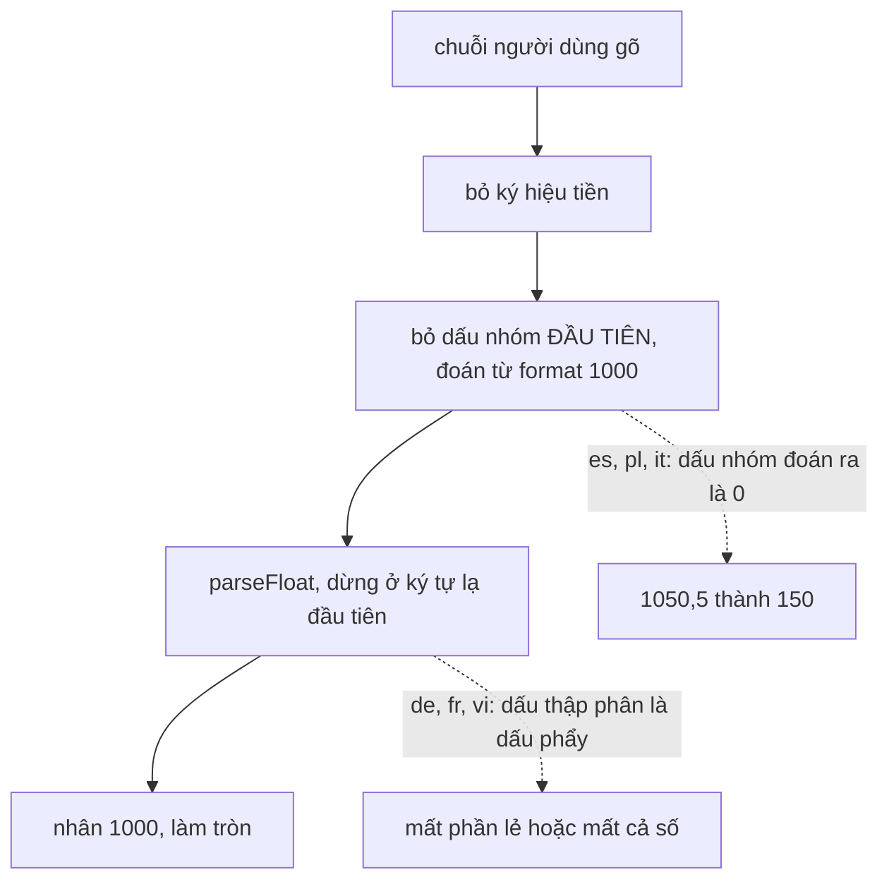

WhatsApp Business cho phép chủ cửa hàng đăng sản phẩm kèm giá. Người bán ở Madrid gõ `1050,5`, người bán ở Hà Nội gõ `1.250.000`, người bán ở Mumbai gõ `1,00,000`. Cùng một ô nhập, ba cách viết số khác nhau: dấu phẩy là dấu thập phân ở Tây Ban Nha nhưng là dấu nhóm ở Mỹ; dấu chấm là dấu nhóm ở Việt Nam nhưng là dấu thập phân ở Anh; Ấn Độ nhóm theo 2 chữ số sau nhóm nghìn đầu tiên.

`Intl.NumberFormat` **định dạng** số theo locale rất tốt, nhưng không có hàm ngược để **đọc** số. Mỗi app phải tự viết. Bài này đọc cách WhatsApp Web 2020 làm, chạy lại trên Node để xem nó sai ở đâu, rồi viết lại.

> [!TIP]
> **Tóm tắt**
> - WhatsApp lấy dấu thập phân là ký tự thứ 2 của `format(1.1)` và dấu nhóm là ký tự thứ 2 của `format(1000)`, bỏ dấu nhóm **đầu tiên**, rồi `parseFloat` và nhân 1000.
> - Tiếng Tây Ban Nha, Ba Lan, Ý không nhóm số 4 chữ số: `format(1000)` là `"1000"`, "dấu nhóm" thành chữ số `0`, và `1050,5` được đọc thành **150**.
> - Ở de/fr/vi, `parseFloat` dừng ở dấu thập phân của locale: `1.050,50 €` thành 1.050, `1 050,50 €` thành 1, `1.000.000 ₫` thành 1.000.
> - Cách sửa: lấy ký hiệu bằng `formatToParts`, đổi chữ số địa phương sang ASCII, kiểm tra vị trí dấu nhóm, ghép chuỗi chữ số rồi mới đổi thành số nguyên.

<iframe class="demo-frame" src="/demos/web-patterns/index.html?theme=dark#/wa-price" title="Demo wa-price" loading="lazy" style="height: 1000px"></iframe>

<p class="demo-links">▶ <a href="/demos/web-patterns/index.html#/wa-price" target="_blank" rel="noopener">Mở demo toàn màn hình ↗</a> · <a href="https://stackblitz.com/github/hunghg255/blog-hunghg/tree/master/examples/web-patterns?file=src/lib/waPriceParse.ts" target="_blank" rel="noopener">Sửa code trên StackBlitz ↗</a> · <a href="https://github.com/hunghg255/blog-hunghg/blob/master/examples/web-patterns/src/lib/waPriceParse.ts" target="_blank" rel="noopener">Xem source trên GitHub ↗</a></p>

## WhatsApp làm thế nào?

Bundle là WhatsApp Web năm 2020 (webpack, module đặt tên bằng hash); có thể đã sửa từ lâu. Hai module:

- `dgbiieecah`: bảng dữ liệu. `DEFAULT_CURRENCY = "USD"`, `DEFAULT_DIGITS = 2`, `MAX_FRACTION_DIGITS = 4`, `CURRENCY_DIGITS` (số chữ số thập phân của các đồng tiền khác 2: JPY, VND, KRW là 0; KWD, BHD, JOD, OMR, TND là 3; CLF, UYW là 4) và `REGION_TO_CURRENCY` (mã quốc gia → đồng tiền).
- `bjgiedaj`: định dạng, đọc và kiểm tra giá. Locale lấy từ cài đặt ngôn ngữ của WhatsApp, dạng `[fullLocale, locale]`.

Giá được lưu dưới dạng số nguyên **phần nghìn** (`amount1000`): 10,50 USD là `10500`. Cách này tránh số thực khi lưu và truyền, và đủ chỗ cho các đồng tiền có 3 chữ số thập phân.

### Ba hàm "dò" ký hiệu

```js
function d(e) { return new Intl.NumberFormat(e).format(1.1).substring(1, 2) }        // dấu thập phân
function c(e, t) { return l(e, t, 0).replace(/\d+([,.]\d+)?/g, "").trim() }         // ký hiệu tiền
var s = new Intl.NumberFormat(e).format(1e3).substr(1, 1)                            // "dấu nhóm"
```

Ý tưởng là định dạng một số đã biết rồi cắt ký tự ở vị trí đã biết. `1.1` luôn là "1", dấu thập phân, "1". `1000` thì giả định là "1", dấu nhóm, "000". Ký hiệu tiền là `format(0)` bỏ phần số.

### Đọc giá

```js
function u(e, t) {
  var i = c(a, e), r = t.replace(i, "").trim(), s = /* dấu nhóm */;
  return Math.round(1e3 * parseFloat(r.replace(s, "")))
}
```

`validatePrice` gọi hàm trên rồi từ chối nếu kết quả `NaN`, nhỏ hơn 1, lớn hơn 2^52, chuỗi kết thúc bằng ký tự không phải chữ số, hoặc phần sau dấu thập phân dài hơn số chữ số của đồng tiền.

### Chạy lại trên Node

File `src/demos/WaPriceOriginal.ts` chép lại đúng các phép tính trên. Kết quả với Node 22 (dữ liệu CLDR năm 2026; giá trị là phần nghìn, chia 1000 ra số tiền):

| Locale | Gõ | Kết quả | Đúng ra |
| --- | --- | --- | --- |
| en-US USD | `1,050.50` | 1.050,5 | 1.050,5 |
| en-US USD | `1,000,000` | **1.000** | 1.000.000 |
| es-ES EUR | `1050,5` | **150** | 1.050,5 |
| pl-PL PLN | `1050,5` | **150** | 1.050,5 |
| de-DE EUR | `1.050,50` | **1.050** | 1.050,5 |
| fr-FR EUR | `1 050,50` | **1** | 1.050,5 |
| vi-VN VND | `1.000.000` | **1.000** | 1.000.000 |
| id-ID IDR | `Rp 25.000` | 25.000 | 25.000 |
| en-IN INR | `1,00,000` | **100** | 100.000 |
| ar-EG EGP | `١٠٥٠٫٥` | NaN | 1.050,5 |

Tất cả các dòng sai (trừ ar-EG) đều **qua được** `validatePrice`. Người bán thấy giá được chấp nhận, khách thấy giá khác.

Từng lỗi một:

1. **"Dấu nhóm" là chữ số 0.** CLDR quy định tiếng Tây Ban Nha, Ba Lan, Ý (và vài ngôn ngữ khác) không nhóm số có 4 chữ số (`minimumGroupingDigits = 2`). `format(1000)` ra `"1000"`, ký tự thứ 2 là `"0"`. `"1050,5".replace("0", "")` thành `"150,5"`, `parseFloat` đọc `150`.
2. **`replace` không có cờ `g`.** Chỉ dấu nhóm đầu tiên bị bỏ. `"1,000,000"` thành `"1000,000"`, `parseFloat` dừng ở dấu phẩy: 1000. Hệ nhóm Ấn Độ `1,00,000` cũng vậy.
3. **`parseFloat` chỉ hiểu dấu chấm thập phân.** Ở de-DE, `"1.050,50"` bỏ dấu chấm đầu thành `"1050,50"`, `parseFloat` dừng ở dấu phẩy: phần lẻ mất. Với vi-VN không có phần lẻ thì lỗi số 2 vẫn làm `1.000.000` thành 1000.
4. **Dấu nhóm là khoảng trắng đặc biệt.** fr-FR dùng U+202F (khoảng trắng hẹp không ngắt dòng); người dùng gõ dấu cách thường U+0020. `replace` không khớp, `"1 050,50"` vào `parseFloat` thành 1.
5. **Chữ số không phải ASCII.** ar-EG định dạng bằng chữ số Ả Rập-Ấn (`٠١٢…`). Regex `\d` trong hàm lấy ký hiệu không khớp, nên "ký hiệu" là cả chuỗi; `parseFloat` không đọc chữ số này: NaN. Ít ra lỗi này bị chặn.

Một chi tiết khác: module có bảng `{ IDR: "in-ID", MXN: "es-MX", INR: "en-IN" }` để định dạng ký hiệu tiền "kiểu địa phương". `in` là mã ngôn ngữ cũ của tiếng Indonesia; các trình duyệt hiện tại tự đổi `in-ID` thành `id-ID`, nên vẫn chạy.



## Bên trong trình duyệt

**`Intl.NumberFormat.prototype.formatToParts`** trả về mảng các phần đã gắn nhãn: `integer`, `group`, `decimal`, `fraction`, `currency`, `literal`, `minusSign`… Thay vì đoán vị trí, đọc thẳng phần có `type: 'group'`. Chỉ cần định dạng một số đủ lớn để chắc chắn có dấu nhóm (`1234567.5`), tránh được bẫy "4 chữ số không nhóm".

**`resolvedOptions()`** trả locale thực sự được dùng (sau khi trình duyệt chuẩn hoá và chọn locale gần nhất) và `maximumFractionDigits` của đồng tiền theo ISO 4217. Không cần tự giữ bảng `CURRENCY_DIGITS`, trừ khi muốn khác chuẩn.

**Chữ số địa phương.** `new Intl.NumberFormat(locale, { useGrouping: false }).format(d)` với `d` từ 0 tới 9 cho ra 10 chữ số mà locale dùng. Người dùng có thể gõ bằng bàn phím Ả Rập hoặc bàn phím Latin, nên phải nhận cả hai.

**Unicode normalization.** `'￥'.normalize('NFKC')` thành `'¥'`, U+00A0 và U+202F thành dấu cách thường. Chuẩn hoá trước khi so sánh giúp bỏ được nhiều biến thể người dùng gõ.

## Viết lại

`src/lib/waPriceParse.ts` tách hai bước: lấy ký hiệu của locale (làm một lần, cache được) và đọc chuỗi.

```ts title=src/lib/waPriceParse.ts
/** Lấy ký hiệu từ formatToParts — không cắt chuỗi theo vị trí. */
export function numberSymbols(locale: string, currency: string): NumberSymbols {
  const nf = new Intl.NumberFormat(locale, { style: 'currency', currency });
  const parts = nf.formatToParts(1234567.5);
  const pick = (type: string) => parts.find((p) => p.type === type)?.value ?? '';
  const plain = new Intl.NumberFormat(locale, { useGrouping: false });
  return {
    locale: nf.resolvedOptions().locale,
    group: pick('group'),
    decimal: pick('decimal') || plain.formatToParts(1.5).find((p) => p.type === 'decimal')?.value || '.',
    digits: Array.from({ length: 10 }, (_, d) => plain.format(d)),
    currency: pick('currency'),
    fractionDigits: nf.resolvedOptions().maximumFractionDigits ?? 2,
  };
}
```

```ts title=src/lib/waPriceParse.ts
export function parsePrice(input: string, sym: NumberSymbols): ParseResult {
  // 1. chữ số địa phương → ASCII, bỏ ký hiệu/mã tiền tệ
  let s = input.normalize('NFKC');
  sym.digits.forEach((d, i) => (s = s.split(d).join(String(i))));
  if (sym.currency) s = s.split(sym.currency.normalize('NFKC')).join('');
  s = s.replace(/\p{Sc}|[A-Z]{3}|[\u200e\u200f\u061c]/gu, '').trim();
  if (!s) return { ok: false, reason: 'empty' };

  // 2. tách phần nguyên / phần thập phân theo dấu thập phân của locale
  const isSpaceGroup = SPACES.test(sym.group || ' ');
  const [intRaw, frac = '', ...rest] = s.split(sym.decimal);
  if (rest.length) return { ok: false, reason: 'chars' };
  const groups = isSpaceGroup ? intRaw.split(SPACES) : intRaw.split(sym.group || '\u0000');
  if (!groups.every((g) => /^\d+$/.test(g)) || !/^\d*$/.test(frac)) return { ok: false, reason: 'chars' };

  // 3. có dấu nhóm thì phải đúng chỗ: nhóm cuối 3 chữ số, nhóm giữa 2–3 (en-IN: 1,00,000)
  if (groups.length > 1) {
    const [first, ...others] = groups;
    const last = others.pop()!;
    if (first.length > 3 || last.length !== 3 || others.some((g) => g.length < 2 || g.length > 3)) {
      return { ok: false, reason: 'group' };
    }
  }
  if (frac.length > Math.min(sym.fractionDigits, 3)) return { ok: false, reason: 'decimals' };

  // 4. ghép chuỗi chữ số rồi mới đổi sang số: không qua parseFloat, không sai số dấu phẩy động
  const amount1000 = Number(groups.join('') + frac.padEnd(3, '0'));
  if (!(amount1000 >= 1 && amount1000 <= MAX_AMOUNT1000)) return { ok: false, reason: 'range' };
  return { ok: true, amount1000 };
}
```

::: spoiler Xem toàn bộ src/lib/waPriceParse.ts

```ts title=src/lib/waPriceParse.ts
/**
 * Đọc giá tiền người dùng gõ theo locale, trả về số nguyên "phần nghìn" (amount1000) —
 * viết lại từ ý tưởng của WhatsApp Web 2020 (module bjgiedaj, bảng dgbiieecah). Không phải mã gốc.
 */

export interface NumberSymbols {
  locale: string;
  group: string;
  decimal: string;
  /** chữ số của locale theo thứ tự 0–9 (Ả Rập: ٠١٢…) */
  digits: string[];
  /** ký hiệu tiền tệ như locale viết: "₫", "€", "Rp", "US$"… */
  currency: string;
  /** số chữ số thập phân của đơn vị tiền */
  fractionDigits: number;
}

/** Lấy ký hiệu từ formatToParts — không cắt chuỗi theo vị trí. */
export function numberSymbols(locale: string, currency: string): NumberSymbols {
  const nf = new Intl.NumberFormat(locale, { style: 'currency', currency });
  const parts = nf.formatToParts(1234567.5);
  const pick = (type: string) => parts.find((p) => p.type === type)?.value ?? '';
  const plain = new Intl.NumberFormat(locale, { useGrouping: false });
  return {
    locale: nf.resolvedOptions().locale,
    group: pick('group'),
    decimal: pick('decimal') || plain.formatToParts(1.5).find((p) => p.type === 'decimal')?.value || '.',
    digits: Array.from({ length: 10 }, (_, d) => plain.format(d)),
    currency: pick('currency'),
    fractionDigits: nf.resolvedOptions().maximumFractionDigits ?? 2,
  };
}

/** Các khoảng trắng mà locale dùng làm dấu nhóm (fr: U+202F, ru: U+00A0), người dùng thì gõ dấu cách thường. */
const SPACES = /[\s\u00a0\u202f\u2009]/;
/** Giới hạn của bản gốc: 2^52 phần nghìn. */
export const MAX_AMOUNT1000 = 2 ** 52;

export type ParseResult =
  | { ok: true; amount1000: number }
  | { ok: false; reason: 'empty' | 'chars' | 'group' | 'decimals' | 'range' };

export function parsePrice(input: string, sym: NumberSymbols): ParseResult {
  // 1. chữ số địa phương → ASCII, bỏ ký hiệu/mã tiền tệ
  let s = input.normalize('NFKC');
  sym.digits.forEach((d, i) => (s = s.split(d).join(String(i))));
  if (sym.currency) s = s.split(sym.currency.normalize('NFKC')).join('');
  s = s.replace(/\p{Sc}|[A-Z]{3}|[\u200e\u200f\u061c]/gu, '').trim();
  if (!s) return { ok: false, reason: 'empty' };

  // 2. tách phần nguyên / phần thập phân theo dấu thập phân của locale
  const isSpaceGroup = SPACES.test(sym.group || ' ');
  const [intRaw, frac = '', ...rest] = s.split(sym.decimal);
  if (rest.length) return { ok: false, reason: 'chars' };
  const groups = isSpaceGroup ? intRaw.split(SPACES) : intRaw.split(sym.group || '\u0000');
  if (!groups.every((g) => /^\d+$/.test(g)) || !/^\d*$/.test(frac)) return { ok: false, reason: 'chars' };

  // 3. có dấu nhóm thì phải đúng chỗ: nhóm cuối 3 chữ số, nhóm giữa 2–3 (en-IN: 1,00,000)
  if (groups.length > 1) {
    const [first, ...others] = groups;
    const last = others.pop()!;
    if (first.length > 3 || last.length !== 3 || others.some((g) => g.length < 2 || g.length > 3)) {
      return { ok: false, reason: 'group' };
    }
  }
  if (frac.length > Math.min(sym.fractionDigits, 3)) return { ok: false, reason: 'decimals' };

  // 4. ghép chuỗi chữ số rồi mới đổi sang số: không qua parseFloat, không sai số dấu phẩy động
  const amount1000 = Number(groups.join('') + frac.padEnd(3, '0'));
  if (!(amount1000 >= 1 && amount1000 <= MAX_AMOUNT1000)) return { ok: false, reason: 'range' };
  return { ok: true, amount1000 };
}

export function formatPrice(amount1000: number, locale: string, currency: string) {
  return new Intl.NumberFormat(locale, { style: 'currency', currency }).format(amount1000 / 1000);
}
```

:::

## Đi qua code

- **`numberSymbols`** lấy `group`, `decimal`, `currency` từ `formatToParts(1234567.5)`. Nếu locale không có dấu thập phân trong định dạng tiền (JPY không có phần lẻ), lấy từ định dạng số thường. `fractionDigits` lấy từ `resolvedOptions()`.
- **Bước 1** chuẩn hoá NFKC, đổi chữ số địa phương sang ASCII, bỏ ký hiệu tiền của locale, mọi ký tự thuộc nhóm Unicode "ký hiệu tiền tệ" (`\p{Sc}`: `$`, `€`, `₫`…), mã ba chữ cái (`USD`) và dấu điều khiển hướng chữ (U+200E, U+200F, U+061C, xuất hiện trong định dạng tiếng Ả Rập).
- **Bước 2** tách theo dấu thập phân; có hơn một dấu thì từ chối. Locale dùng khoảng trắng làm dấu nhóm thì mọi loại khoảng trắng đều được tính là dấu nhóm.
- **Bước 3** kiểm tra vị trí dấu nhóm: nhóm cuối 3 chữ số, các nhóm giữa 2 hoặc 3 (cho phép hệ Ấn Độ), nhóm đầu 1 tới 3. Đây là chỗ bắt chuỗi mơ hồ: người Đức gõ `1050.5` (thói quen kiểu Anh) bị từ chối với lý do `group` thay vì âm thầm thành 10.505.
- **Bước 4** ghép phần nguyên và phần lẻ (đệm đủ 3 chữ số) thành một chuỗi chữ số rồi `Number(...)`. Không có phép nhân số thực nào, nên không có chuyện `1.005 × 1000 = 1004.9999…`.

**Khác bản gốc:**

- Không đoán ký hiệu bằng vị trí ký tự; nhận chữ số địa phương, mọi kiểu khoảng trắng, nhiều dấu nhóm.
- Từ chối chuỗi mơ hồ (`group`), có lý do cụ thể để hiện cho người dùng.
- Số chữ số thập phân theo ISO 4217 qua `Intl`, giới hạn tối đa 3 (đơn vị phần nghìn không biểu diễn được chữ số thứ 4 của CLF/UYW; bản gốc cho phép 4 rồi làm tròn).
- Giữ giới hạn 2^52 của bản gốc.

## Tại sao không làm cách khác?

- **Bỏ mọi ký tự không phải chữ số và dấu thập phân**, rồi `parseFloat` sau khi đổi dấu thập phân thành `.`: ngắn, xử lý được de/fr/vi. Nhưng `1050.5` ở de vẫn thành 10505 không báo lỗi, và vẫn qua số thực.
- **Đoán locale từ chuỗi** (có hai loại dấu thì dấu cuối là thập phân): đúng trong đa số trường hợp, sai đúng ở chỗ nguy hiểm: `1.050` là một nghìn năm mươi hay một phẩy không năm? Phải biết locale.
- **`<input type="number">`**: trình duyệt tự đọc theo locale của **trình duyệt**, không phải locale của app; mỗi trình duyệt xử lý dấu phẩy một kiểu; không có ký hiệu tiền, không có dấu nhóm khi gõ. Không hợp cho ô giá tiền.
- **Hai ô riêng** (phần nguyên, phần lẻ): không bao giờ mơ hồ, nhưng gõ chậm và lạ với người dùng.
- **Thư viện** (`@internationalized/number` của Adobe React Spectrum có `NumberParser`): xử lý đầy đủ hơn, kể cả phần trăm và đơn vị. Nặng hơn vài KB; nếu đã dùng React Aria thì nên dùng luôn.

## Edge case và cạm bẫy

- **Dữ liệu CLDR thay đổi.** Ký hiệu, dấu nhóm, `minimumGroupingDigits` đổi theo phiên bản trình duyệt (fr-FR từng dùng U+00A0, dữ liệu CLDR gần đây dùng U+202F). Đừng viết cứng; luôn lấy từ `Intl` lúc chạy. Bảng kết quả ở trên đúng với dữ liệu năm 2026.
- **de-CH dùng `’` (U+2019) làm dấu nhóm**, người dùng thường gõ `'` (U+0027). Nếu cần, thêm các biến thể vào danh sách dấu nhóm được chấp nhận.
- **Số âm, phần trăm, ký hiệu khoa học** (`1e3`): bản viết lại từ chối hết (`chars`). Giá tiền không cần chúng.
- **Locale của app khác locale của bàn phím.** Người Việt dùng giao diện tiếng Anh vẫn có thể gõ `1.000.000`. Bản viết lại từ chối (`chars`, vì có tới hai dấu thập phân của en-US) chứ không đọc sai; có thể gợi ý "có phải 1,000,000?".
- **Hiện lại giá sau khi đọc.** Luôn định dạng lại bằng `formatPrice` khi ô nhập mất focus, để người dùng thấy máy hiểu số của họ thế nào.
- **Đơn vị lưu trữ.** Phần nghìn là lựa chọn của WhatsApp. Facebook lưu theo đơn vị nhỏ nhất của từng đồng tiền ([bài #49](/blogs/facebook-currency-minor-units)); hai cách đều tránh số thực, khác nhau ở chỗ có cần bảng số chữ số thập phân khi lưu hay không.

## Dùng trong dự án

```ts
import { formatPrice, numberSymbols, parsePrice } from './waPriceParse';

const sym = numberSymbols(userLocale, shopCurrency); // tính một lần

function onPriceBlur(input: HTMLInputElement) {
  const r = parsePrice(input.value, sym);
  if (!r.ok) {
    input.setCustomValidity(
      { empty: 'Nhập giá', chars: 'Chỉ dùng chữ số', group: 'Dấu phân cách không đúng chỗ', decimals: 'Quá nhiều số lẻ', range: 'Giá không hợp lệ' }[r.reason],
    );
    input.reportValidity();
    return;
  }
  input.setCustomValidity('');
  input.value = formatPrice(r.amount1000, userLocale, shopCurrency); // hiện lại cho người dùng kiểm tra
  form.amount1000 = r.amount1000; // gửi số nguyên lên server
}
```

## Kiểm thử

::: spoiler Ví dụ test (bản phác, không có trong repo)

```ts
import { expect, it } from 'vitest';
import { numberSymbols, parsePrice } from './waPriceParse';

const parse = (locale: string, currency: string, s: string) => parsePrice(s, numberSymbols(locale, currency));

it.each([
  ['en-US', 'USD', '1,050.50', 1_050_500],
  ['en-US', 'USD', '1,000,000', 1_000_000_000],
  ['es-ES', 'EUR', '1050,5', 1_050_500],
  ['pl-PL', 'PLN', '1050,5', 1_050_500],
  ['de-DE', 'EUR', '1.050,50', 1_050_500],
  ['fr-FR', 'EUR', '1 050,50', 1_050_500],
  ['vi-VN', 'VND', '1.000.000 ₫', 1_000_000_000],
  ['id-ID', 'IDR', 'Rp 25.000', 25_000_000],
  ['en-IN', 'INR', '1,00,000', 100_000_000],
  ['ar-EG', 'EGP', '١٠٥٠٫٥', 1_050_500],
])('%s %s "%s"', (locale, currency, s, want) => {
  expect(parse(locale, currency, s)).toEqual({ ok: true, amount1000: want });
});

it('từ chối chuỗi mơ hồ thay vì đoán', () => {
  expect(parse('de-DE', 'EUR', '1050.5')).toEqual({ ok: false, reason: 'group' });
  expect(parse('vi-VN', 'VND', '1.000,5')).toEqual({ ok: false, reason: 'decimals' });
  expect(parse('en-US', 'USD', '-5')).toEqual({ ok: false, reason: 'chars' });
  expect(parse('en-US', 'USD', '0')).toEqual({ ok: false, reason: 'range' });
  expect(parse('en-US', 'USD', '$')).toEqual({ ok: false, reason: 'empty' });
});
```

:::

## So với các lựa chọn khác

- **`Intl.NumberFormat`** có trên mọi trình duyệt; `formatToParts` từ Chrome 64, Firefox 58, Safari 13. Chưa có hàm `parse` trong chuẩn ECMA-402 (tính tới 10/2026).
- **`@internationalized/number`** (`NumberParser`): đọc số theo locale, hỗ trợ chữ số địa phương, phần trăm, đơn vị; dùng nội bộ trong React Aria.
- Bài [Intl thực chiến](/blogs/web-intl-in-production) (Apple, Outlook) tổng hợp các bẫy khác của `Intl` khi định dạng; bài [tiền tệ theo đơn vị nhỏ nhất](/blogs/facebook-currency-minor-units) của Facebook bàn cách lưu và ô nhập tiền.

---

Bài này thuộc series **[Học từ mã nguồn WhatsApp Web](/series/whatsapp)** (19 bài, đọc theo thứ tự).

::: spoiler Xem nhanh danh sách bài trong series

*Mở đầu*

- [Mở đầu: đọc bundle WhatsApp Web 2020](/blogs/learn-from-whatsapp-web-source-code)

*Phần 1: media và mã hoá*

- [#1 Giải mã JPEG progressive theo từng scan, kiểm HMAC](/blogs/whatsapp-progressive-jpeg-hmac)
- [#2 Ghép khoảng byte cho video streaming](/blogs/whatsapp-byte-range-merge)
- [#3 Xoá EXIF không re-encode, thumbnail theo ngân sách byte](/blogs/whatsapp-jpeg-strip-thumb-budget)
- [#4 Đọc metadata sticker WebP động](/blogs/whatsapp-webp-sticker-metadata)

*Phần 2: lưu trữ trên trình duyệt*

- [#5 Kho media LRU tự co theo quota](/blogs/whatsapp-quota-aware-media-lru)
- [#6 Cache blob trong RAM có refcount, tự revoke objectURL](/blogs/whatsapp-blob-cache-refcount)
- [#7 Khoá IndexedDB giữ đúng thứ tự từ điển](/blogs/whatsapp-indexeddb-ordered-keys)

*Phần 3: danh sách tin nhắn*

- [#8 Render tin nhắn theo cửa sổ chiều cao ước lượng](/blogs/whatsapp-render-cursor-window)
- [#9 Theo dõi viewport tin nhắn: binary search, ngày dính](/blogs/whatsapp-message-viewport-tracking)
- [#10 FlatList tái dùng key React, overscan bất đối xứng](/blogs/whatsapp-flatlist-key-reuse)

*Phần 4: soạn tin và chữ*

- [#11 Emoticon thành emoji bằng trie đọc ngược, tìm emoji](/blogs/whatsapp-emoticon-trie-emoji-search)
- [#12 Mention bằng token zero-width, giới hạn theo code point](/blogs/whatsapp-mention-zero-width-input)
- [#13 Xác định hướng chữ bằng bảng delta nén](/blogs/whatsapp-text-direction-table)
- [#14 Phát hiện homograph trong link, chặn giả đuôi file RTLO](/blogs/whatsapp-homograph-rtlo-guard)

*Phần 5: realtime và tiện ích*

- [#15 Presence, "đang gõ" và thông báo theo kích thước group](/blogs/whatsapp-presence-typing-notifications)
- [#16 Đo FPS phát hiện UI đóng băng, idle monitor](/blogs/whatsapp-fps-freeze-idle)
- [#17 Cửa sổ PiP: resize 8 hướng, khoá tỉ lệ, né vật cản](/blogs/whatsapp-pip-resize-avoid)
- **#18 Parse giá tiền theo locale bằng Intl** (bài này)

:::

Code + demo: [`examples/web-patterns`](https://github.com/hunghg255/blog-hunghg/tree/master/examples/web-patterns) · [Mở trên StackBlitz](https://stackblitz.com/github/hunghg255/blog-hunghg/tree/master/examples/web-patterns)
