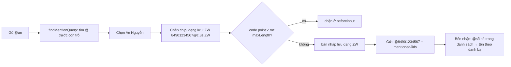

Trong group WhatsApp, gõ `@an` sẽ hiện danh sách gợi ý, chọn "An Nguyễn" thì ô soạn tin có một khối màu xanh `@An Nguyễn`. Người nhận thấy tên theo **danh bạ của họ** (có thể là "Anh An kế toán"), còn tin nhắn đi trên mạng chỉ chứa số điện thoại.

Vậy ô soạn tin phải giữ ba dạng của cùng một mention: dạng hiển thị (tên), dạng lưu bản nháp (biết đây là mention của ai), dạng gửi đi (`@84901234567` + danh sách người được nhắc). WhatsApp Web 2020 giải bằng một mẹo: bọc jid giữa hai ký tự **zero-width space** (U+200B). Bài này đi qua cách làm đó, cách ô soạn tin giới hạn độ dài theo **code point**, và cách nó quyết định khi nào gọi "xem trước link".

> [!TIP]
> **Tóm tắt**
> - Dạng lưu: `\u200B84901234567@c.us\u200B`. Ký tự U+200B không ai gõ được bằng bàn phím, nên regex `/\u200B(\d+@c\.us)\u200B/g` tìm mention chính xác mà không cần cấu trúc dữ liệu riêng.
> - Gửi đi: đổi token thành `@84901234567` và gom `mentionedJidList`; bên nhận ghép lại thành tên theo danh bạ của mình.
> - `maxLength` đếm **code point** của dạng lưu (emoji 😀 là 1, không phải 2), chặn ở `beforeinput`, khi dán thì kiểm trước, vượt thì khôi phục HTML cũ.
> - Xem trước link: debounce 700 ms khi gõ, gần như ngay khi dán, bỏ kết quả về muộn, nhớ link người dùng đã tắt.

<iframe class="demo-frame" src="/demos/web-patterns/index.html?theme=dark#/wa-mention-input" title="Demo wa-mention-input" loading="lazy" style="height: 1000px"></iframe>

<p class="demo-links">▶ <a href="/demos/web-patterns/index.html#/wa-mention-input" target="_blank" rel="noopener">Mở demo toàn màn hình ↗</a> · <a href="https://stackblitz.com/github/hunghg255/blog-hunghg/tree/master/examples/web-patterns?file=src/lib/waMentionInput.ts" target="_blank" rel="noopener">Sửa code trên StackBlitz ↗</a> · <a href="https://github.com/hunghg255/blog-hunghg/blob/master/examples/web-patterns/src/lib/waMentionInput.ts" target="_blank" rel="noopener">Xem source trên GitHub ↗</a></p>

## WhatsApp làm thế nào?

Bundle WhatsApp Web 2020 (`0 Whatapp list/all.js` trong repo [facebook-codebase](https://github.com/hunghg255/facebook-codebase)), tên module là hash; bản hiện tại có lẽ đã khác.

| Module | Vai trò |
| --- | --- |
| `ecddiajibj` | Plugin mention của ô soạn tin: parse, serialize, gợi ý, Backspace |
| `igieaiddf` | `BaseInput`: contentEditable tự quản, `maxLength` theo code point, paste, xuống dòng |
| `jhijifcjh` | Ô soạn tin của cuộc trò chuyện: hẹn giờ quét link, bản nháp |
| `dbcedfihd` | Linkify: regex tìm URL, cân ngoặc, kiểm cổng |

### Ba dạng của một mention

Plugin mention khai báo `parsers` (chuỗi lưu → HTML), `serializers` (HTML → chuỗi lưu) và hàm chuẩn bị gửi; `MENTION` là regex `/\u200B((\d+)@c\.us)\u200B/g`. Rút gọn:

```js
parse = (text) => text.replace(MENTION, (all, jid) => {
  const contact = Contacts.get(jid);
  if (!contact) return jid;                        // (!) xem phần lỗi bên dưới
  const name = displayName(contact);               // notifyName hoặc tên trong danh bạ
  return mentionSpan(jid, name, { dir: dir(name) || 'auto' }).outerHTML;
});
serializers = [['span[data-mention-jid]', (el) => '\u200B' + el.dataset.mentionJid + '\u200B']];
serializeForSend = (text, meta) => [text.replace(MENTION, (all, jid, phone) => (meta.mentionedJidList.push(jid), '@' + phone)), meta];
```

- Thuộc tính `dir` của tên lấy từ hàm `dir()` (bài [#13](/blogs/whatsapp-text-direction-table)), để tên tiếng Ả Rập không làm đảo thứ tự chữ xung quanh.
- Phần tử mention lưu sẵn `data-original-name`. Mỗi lần `input`, plugin so `textContent` với tên gốc; khác (người dùng đã sửa chữ bên trong khối) thì **gỡ mention**, biến nó thành chữ thường và đặt lại con trỏ. Nói cách khác: sửa một chữ trong mention là mention biến mất, không có mention "nửa vời".
- Chọn gợi ý thì gọi `replaceSelection('\u200B' + jid + '\u200B ')`, tức là chèn chính dạng lưu, phần render lo việc còn lại. Dấu cách cuối giúp con trỏ có chỗ đứng sau khối.
- Backspace/Delete ngay cạnh mention thì chọn **cả khối** (`range.selectNode`) để lần xoá tiếp theo xoá trọn.
- Quanh mỗi mention có chèn tạm các `span` zero-width `contentEditable=false` để con trỏ không lọt vào trong khối, rồi gỡ ra bằng `setTimeout(0)`. Trên Firefox còn phải xoá `<br type="_moz">` mà Gecko tự thêm sau phần tử inline.

### Khi nào mở gợi ý

Hàm kích hoạt đi lùi từ con trỏ tìm `@`. `@` hợp lệ khi đứng đầu dòng, sau ký tự không phải chữ (`\W`) hoặc sau emoji; độ dài truy vấn tối đa `2 * MAX_PUSHNAME_LENGTH`. Như vậy `an@gmail.com` không mở gợi ý. Nhưng `\W` trong JavaScript chỉ hiểu chữ ASCII, nên `bạn@` hay `café@` (ký tự trước là `ạ`, `é`) **vẫn** mở gợi ý.

### `maxLength` theo code point

`BaseInput` (`igieaiddf`) không để React render nội dung: `shouldComponentUpdate` luôn trả `false`, các thuộc tính như `contentEditable`, `dir`, placeholder được đặt thẳng vào DOM. Độ dài được kiểm ở ba chỗ: `beforeinput` (bỏ qua Backspace/Delete), `input` (lưới an toàn) và `paste` (luôn `preventDefault()`, file thì đưa cho `onFiles`, chữ thì kiểm trước rồi `replaceSelection`, vượt thì gọi `onMaxPasteExceeded`).

```js
onBeforeInput = (e) =>                             // true = chặn
  numCodepoints(e.data) > maxLength + this.selectionLength - this.length;

onInput = () => {
  const value = serialize(this.refInput);
  if (numCodepoints(value) > maxLength) {          // lọt qua beforeinput: khôi phục HTML cũ
    this.refInput.innerHTML = render(this.state.value);
    return this.restoreSelection(this.selection);
  }
  this.setValue(value);
};
```

`length` và `selectionLength` đều là số code point của **dạng lưu** (vùng chọn được `cloneContents()` rồi serialize). Hệ quả: một mention tốn 18 code point (2 ký tự U+200B + `84901234567@c.us`), cộng dấu cách theo sau là 19, dù chỉ hiện vài chữ. Demo cho thấy điều này: chèn một mention, bộ đếm nhảy 19.

`restoreSelection` lưu vị trí con trỏ dạng "chỉ số node con + offset" (−1 nghĩa là chính phần tử chứa), vì sau khi thay `innerHTML` mọi node cũ đã mất, không giữ được tham chiếu `Range` cũ.

Thêm một chi tiết nhỏ ở `insertNewLineAtSelection`: chèn text node `"\n"`; nếu `scrollHeight` không đổi (dòng trống ở **cuối** contentEditable không được vẽ) thì chèn thêm một `"\n"` nữa.

### Xem trước link

Trong `jhijifcjh`, mỗi lần nội dung đổi:

```js
pasteTriggered ? scanTimer.onOrBefore(1) : scanTimer.debounce(700); // dán: gần như ngay; gõ: đợi 700 ms

scan = () => {
  const link = findLinks(removeCodeBlocks(this.text), /* chỉ http(s) */ true)[0];
  if (!link) return this.clearLinkPreview();
  if (this.preview === link.url) return;           // đã lấy (hoặc đã bị tắt) cho URL này
  this.preview = link.url;
  fetchPreview(link.url).tap((r) => this.preview === r?.url && (r.data?.title || r.data?.description) && this.setState({ linkPreview: r }));
};
```

- Kết quả về muộn bị bỏ nếu `this.preview` đã đổi sang URL khác.
- Người dùng tắt preview (`omitLinkPreview`) thì URL được nhớ vào `omittedURL`, lưu cùng bản nháp: chuyển sang chat khác rồi quay lại cũng không bật lại.
- Gửi tin thì `cancelPendingLinkPreviews()` huỷ mọi promise đang chờ.
- Chỉ link có `http://`/`https://` mới được xem trước, và khối code bị bỏ qua.

### Linkify và một lỗi nhỏ

`dbcedfihd` thử nhanh `/\.(?:TLD)/i` trước khi chạy regex lớn, cân ngoặc ở phần path/query/fragment (bảng cặp `)`/`(`, `]`/`[`, `»`/`«`, `”`/`“`…) để `wikipedia.org/wiki/Foo_(bar))` không ăn mất dấu `)` cuối, kiểm cổng 1–65535 và không có số 0 đứng đầu. Với chữ nghiêng `_google.com_`, prefix `_` được cho phép nếu trước nó là khoảng trắng:

```js
if (match[1] === '_' && index - 1 && /\S/.test(match.input[index - 1])) return null;
```

Ý định là `index > 0`. Nhưng khi `_` ở **vị trí 0**, `index - 1` bằng −1 (truthy), `input[-1]` là `undefined`, và `/\S/.test(undefined)` kiểm chuỗi `"undefined"` nên trả `true`. Chạy thử module gốc trong Node:

| Tin nhắn | Link tìm được |
| --- | --- |
| `xem _google.com_ nhé` | `google.com` |
| `_google.com_ ở đầu tin` | (không có) |

Sửa: `index > 0 && /\S/.test(match.input[index - 1])`.



## Bên trong trình duyệt: code point, UTF-16 và grapheme

Chuỗi JavaScript là dãy đơn vị UTF-16. `'😀'.length === 2` vì emoji nằm ngoài BMP, cần một cặp surrogate. Có ba cách đếm:

| Chuỗi | `.length` (UTF-16) | code point | grapheme (người thấy) |
| --- | --- | --- | --- |
| `Chào` | 4 | 4 | 4 |
| `😀` | 2 | 1 | 1 |
| `👩🏽‍💻` | 7 | 4 | 1 |
| `\u200B84901234567@c.us\u200B` | 18 | 18 | 18 |

WhatsApp chọn code point: không phạt emoji đơn như UTF-16, và giống cách đếm của ứng dụng di động (có lẽ giới hạn phía server cũng tính như vậy). Emoji ghép như `👩🏽‍💻` vẫn tốn 4. `maxlength` của `<input>`/`<textarea>` đếm theo UTF-16, nên nếu dùng thuộc tính gốc thì 😀 tốn 2.

Ký tự U+200B là "zero width space": không có hình, không chiếm chỗ, nhưng vẫn là một ký tự thật trong chuỗi, `split`, `indexOf`, regex đều thấy. Đó là lý do nó làm được "dấu ngoặc vô hình". Nhược điểm: copy văn bản ra ngoài có thể mang theo ký tự này. Xem thêm [Telegram lưu rich text bằng entities](/blogs/telegram-rich-text-entities), cách tiếp cận ngược lại: chuỗi thuần + danh sách `{ offset, length, type }`.

## Viết lại

Bản viết lại tách logic chuỗi (thuần, dễ test) khỏi phần DOM. Chip mention dùng `contentEditable=false`: trình duyệt hiện đại coi nó là một khối nguyên, con trỏ không vào được bên trong và Backspace xoá cả khối, nên không cần các `span` zero-width tạm và `setTimeout(0)` như bản 2020.

### Dạng lưu và dạng gửi đi

```ts title=src/lib/waMentionInput.ts
/** Dạng gửi đi: "@<số>" trong thân tin + danh sách jid được nhắc (bên nhận tự đổi số thành tên). */
export function toWire(stored: string): { body: string; mentionedJids: string[] } {
  const jids = new Set<string>();
  const body = stored.replace(MENTION_RE, (_, jid: string) => {
    jids.add(jid);
    return '@' + phoneOf(jid);
  });
  return { body, mentionedJids: [...jids] };
}

/** Bên nhận: "@<số>" có trong mentionedJids → token zero-width (để render thành chip). */
export function fromWire(body: string, mentionedJids: string[]): string {
  const known = new Set(mentionedJids.map(phoneOf));
  return body.replace(/@(\d{5,})/g, (all, phone: string) => (known.has(phone) ? encodeMention(phone + '@c.us') : all));
}
```

`parseStored` (dòng 17–27) tách chuỗi lưu thành các đoạn chữ/mention bằng `matchAll`; `mentionLabel` trả tên trong danh bạ hoặc `+số` nếu không có.

### Đếm theo code point

```ts title=src/lib/waMentionInput.ts
/** Số code point (cặp surrogate tính là 1), không cấp phát mảng như [...s].length. */
export function countCodePoints(s: string): number {
  let n = 0;
  for (let i = 0; i < s.length; i++) {
    const c = s.charCodeAt(i);
    if (c >= 0xdc00 && c <= 0xdfff && i > 0) {
      const p = s.charCodeAt(i - 1);
      if (p >= 0xd800 && p <= 0xdbff) continue;
    }
    n++;
  }
  return n;
}
```

`sliceCodePoints` (dòng 76–85) dùng cùng phép kiểm surrogate để cắt mà không tách đôi cặp; `remaining` chỉ là `maxLength + selectionLength - currentLength`.

### Kích hoạt gợi ý

```ts title=src/lib/waMentionInput.ts
export function findMentionQuery(textBefore: string, maxQuery = 50): { at: number; query: string } | null {
  for (let i = textBefore.length - 1; i >= 0 && textBefore.length - i <= maxQuery + 1; i--) {
    const ch = textBefore[i];
    if (ch === '\n' || ch === ZW) return null;
    if (ch !== '@') continue;
    const prev = i > 0 ? textBefore[i - 1] : '';
    if (prev && WORD.test(prev)) return null; // email: an@gmail
    return { at: i, query: textBefore.slice(i + 1) };
  }
  return null;
}
```

Phần DOM (dòng 115–179): `createMentionChip` tạo `<span contenteditable="false" data-jid>` chứa `@` và `<bdi>` tên; `serializeNode` đi qua cây DOM, chip thành token, `<br>`/`<div>` thành `\n`; `insertMention` thay `@truy vấn` bằng chip và một dấu cách không ngắt.

::: spoiler Xem toàn bộ src/lib/waMentionInput.ts
```ts title=src/lib/waMentionInput.ts
/**
 * Mention trong ô soạn tin: lưu bằng token zero-width, đếm giới hạn theo code point.
 * Viết lại từ ý tưởng của WhatsApp Web 2020 (module ecddiajibj: plugin mention, igieaiddf: BaseInput).
 */

export const ZW = '\u200B';
/** Dạng lưu trong ô soạn tin / bản nháp: ZW + jid + ZW. */
export const MENTION_RE = /\u200B(\d+@c\.us)\u200B/g;

export type Segment = { type: 'text'; text: string } | { type: 'mention'; jid: string };
export type NameOf = (jid: string) => string | undefined;

export const encodeMention = (jid: string) => ZW + jid + ZW;
export const phoneOf = (jid: string) => jid.split('@')[0];

/** Chuỗi lưu → các đoạn chữ/mention. */
export function parseStored(stored: string): Segment[] {
  const out: Segment[] = [];
  let last = 0;
  for (const m of stored.matchAll(MENTION_RE)) {
    if (m.index > last) out.push({ type: 'text', text: stored.slice(last, m.index) });
    out.push({ type: 'mention', jid: m[1] });
    last = m.index + m[0].length;
  }
  if (last < stored.length) out.push({ type: 'text', text: stored.slice(last) });
  return out;
}

/** Nhãn hiện cho người dùng. Không có trong danh bạ thì hiện số, KHÔNG trả lại jid thô. */
export function mentionLabel(jid: string, nameOf: NameOf): string {
  return nameOf(jid) ?? '+' + phoneOf(jid);
}

/** Dạng gửi đi: "@<số>" trong thân tin + danh sách jid được nhắc (bên nhận tự đổi số thành tên). */
export function toWire(stored: string): { body: string; mentionedJids: string[] } {
  const jids = new Set<string>();
  const body = stored.replace(MENTION_RE, (_, jid: string) => {
    jids.add(jid);
    return '@' + phoneOf(jid);
  });
  return { body, mentionedJids: [...jids] };
}

/** Bên nhận: "@<số>" có trong mentionedJids → token zero-width (để render thành chip). */
export function fromWire(body: string, mentionedJids: string[]): string {
  const known = new Set(mentionedJids.map(phoneOf));
  return body.replace(/@(\d{5,})/g, (all, phone: string) => (known.has(phone) ? encodeMention(phone + '@c.us') : all));
}

// ---------------- Đếm độ dài ----------------

/** Số code point (cặp surrogate tính là 1), không cấp phát mảng như [...s].length. */
export function countCodePoints(s: string): number {
  let n = 0;
  for (let i = 0; i < s.length; i++) {
    const c = s.charCodeAt(i);
    if (c >= 0xdc00 && c <= 0xdfff && i > 0) {
      const p = s.charCodeAt(i - 1);
      if (p >= 0xd800 && p <= 0xdbff) continue;
    }
    n++;
  }
  return n;
}

const graphemes = typeof Intl !== 'undefined' && 'Segmenter' in Intl ? new Intl.Segmenter() : null;
/** Số "ký tự người dùng thấy" (grapheme), chỉ để hiển thị. */
export function countGraphemes(s: string): number {
  if (!graphemes) return countCodePoints(s);
  let n = 0;
  for (const _ of graphemes.segment(s)) n++;
  return n;
}

/** Cắt theo code point, không bao giờ cắt đôi cặp surrogate. */
export function sliceCodePoints(s: string, max: number): string {
  if (max <= 0) return '';
  let n = 0;
  for (let i = 0; i < s.length; i++) {
    const c = s.charCodeAt(i);
    const isLow = c >= 0xdc00 && c <= 0xdfff && i > 0 && s.charCodeAt(i - 1) >= 0xd800 && s.charCodeAt(i - 1) <= 0xdbff;
    if (!isLow && ++n > max) return s.slice(0, i);
  }
  return s;
}

/** Còn được thêm bao nhiêu code point nếu thay vùng chọn bằng chữ mới. */
export function remaining(maxLength: number, currentLength: number, selectionLength: number): number {
  return maxLength + selectionLength - currentLength;
}

// ---------------- Kích hoạt gợi ý mention ----------------

/** Chữ/số ở mọi ngôn ngữ ("ạ", "é" cũng là chữ), khác \W của bản gốc chỉ hiểu ASCII. */
const WORD = /[\p{L}\p{N}_]/u;

/**
 * Tìm "@truy vấn" ngay trước con trỏ. "@" phải ở đầu dòng hoặc sau ký tự không phải chữ,
 * truy vấn không có xuống dòng và không dài quá maxQuery.
 */
export function findMentionQuery(textBefore: string, maxQuery = 50): { at: number; query: string } | null {
  for (let i = textBefore.length - 1; i >= 0 && textBefore.length - i <= maxQuery + 1; i--) {
    const ch = textBefore[i];
    if (ch === '\n' || ch === ZW) return null;
    if (ch !== '@') continue;
    const prev = i > 0 ? textBefore[i - 1] : '';
    if (prev && WORD.test(prev)) return null; // email: an@gmail
    return { at: i, query: textBefore.slice(i + 1) };
  }
  return null;
}

// ---------------- DOM của ô soạn tin (contentEditable) ----------------

/** Chip mention: contentEditable=false nên con trỏ không lọt vào trong, Backspace xoá cả khối. */
export function createMentionChip(jid: string, nameOf: NameOf): HTMLSpanElement {
  const chip = document.createElement('span');
  chip.className = 'wa-mention-chip';
  chip.contentEditable = 'false';
  chip.dataset.jid = jid;
  const at = document.createElement('span');
  at.textContent = '@';
  const name = document.createElement('bdi'); // tên tiếng Ả Rập không đảo thứ tự chữ xung quanh
  name.textContent = mentionLabel(jid, nameOf);
  chip.append(at, name);
  return chip;
}

/** DOM → chuỗi lưu. Chip thành token zero-width, <br> và khối <div> thành "\n". */
export function serializeNode(root: Node): string {
  let out = '';
  const walk = (node: Node) => {
    if (node.nodeType === Node.TEXT_NODE) {
      out += (node.textContent ?? '').replaceAll(ZW, '').replaceAll('\u00A0', ' ');
      return;
    }
    if (!(node instanceof HTMLElement || node instanceof DocumentFragment)) return;
    if (node instanceof HTMLElement) {
      if (node.dataset.jid) {
        out += encodeMention(node.dataset.jid);
        return;
      }
      if (node.tagName === 'BR') {
        out += '\n';
        return;
      }
      if (node.tagName === 'DIV' && out && !out.endsWith('\n')) out += '\n';
    }
    node.childNodes.forEach(walk);
  };
  walk(root);
  return out;
}

/** Chuỗi lưu → nội dung của ô soạn tin. */
export function renderStored(root: HTMLElement, stored: string, nameOf: NameOf): void {
  root.replaceChildren(
    ...parseStored(stored).map((s) =>
      s.type === 'text' ? document.createTextNode(s.text) : createMentionChip(s.jid, nameOf),
    ),
  );
}

/** Thay "@truy vấn" trong text node bằng chip + một dấu cách, đặt con trỏ sau dấu cách. */
export function insertMention(textNode: Text, at: number, caret: number, jid: string, nameOf: NameOf): void {
  const range = document.createRange();
  range.setStart(textNode, at);
  range.setEnd(textNode, caret);
  range.deleteContents();
  const space = document.createTextNode('\u00A0');
  range.insertNode(space);
  range.insertNode(createMentionChip(jid, nameOf));
  const sel = getSelection();
  sel?.removeAllRanges();
  const after = document.createRange();
  after.setStartAfter(space);
  after.collapse(true);
  sel?.addRange(after);
}
```
:::

### Xem trước link

```ts title=src/lib/waLinkPreview.ts
  function scan(text: string) {
    const url = findFirstUrl(text);
    if (url === wanted || url === shown) return;
    if (!url || url === omitted) {
      wanted = shown = null;
      onChange(null, 'idle');
      return;
    }
    wanted = url;
    onChange(null, 'loading');
    fetchPreview(url).then((p) => {
      if (wanted !== url) return; // đã gõ sang URL khác: bỏ kết quả cũ
      wanted = null;
      if (p && (p.title || p.description)) {
        shown = url;
        onChange(p, 'idle');
      } else onChange(null, 'idle');
    });
  }
```

`onType` đặt lại hẹn giờ 700 ms, `onPaste` đặt 1 ms, `dismiss` nhớ URL vào `omitted`, `cancel` xoá hết khi gửi tin.

::: spoiler Xem toàn bộ src/lib/waLinkPreview.ts
```ts title=src/lib/waLinkPreview.ts
/**
 * Xem trước link khi soạn tin: tìm URL đầu tiên (cân ngoặc ở cuối), gọi preview có debounce,
 * bỏ kết quả cũ, nhớ URL người dùng đã tắt. Viết lại từ ý tưởng của WhatsApp Web 2020
 * (module dbcedfihd: linkify, jhijifcjh: ô soạn tin).
 */

const PAIRS: Record<string, string> = { ')': '(', ']': '[', '}': '{', '>': '<', '»': '«', '’': '‘', '”': '“' };
const OPENERS = new Set(Object.values(PAIRS));

/** Bỏ ngoặc đóng/dấu câu thừa ở cuối: "(xem a.com/x_(y))." → "a.com/x_(y)". */
export function trimUrlTail(url: string): string {
  const stack: string[] = [];
  let safe = 0; // độ dài phần chắc chắn thuộc URL
  for (let i = 0; i < url.length; i++) {
    const ch = url[i];
    if (OPENERS.has(ch)) stack.push(ch);
    else if (ch in PAIRS) {
      if (stack[stack.length - 1] !== PAIRS[ch]) break; // ngoặc đóng không có cặp → hết URL
      stack.pop();
      if (!stack.length) safe = i + 1;
    } else if (!stack.length) safe = i + 1;
  }
  let out = url.slice(0, safe);
  while (/[.,:;!?'"]$/.test(out)) out = out.slice(0, -1);
  return out;
}

/** Tìm URL đầu tiên. "_" ngay trước chỉ được chấp nhận ở đầu chuỗi hoặc sau khoảng trắng (chữ nghiêng). */
export function findFirstUrl(text: string): string | null {
  const re = /(^|[\s(<"'«“_])((?:https?:\/\/)?(?:[\p{L}\p{N}-]+\.)+[a-z]{2,}(?::\d{1,5})?(?:[/?#][^\s]*)?)/giu;
  for (const m of text.matchAll(re)) {
    const lead = m[1];
    const at = m.index;
    if (lead === '_' && at > 0 && /\S/.test(text[at - 1])) continue; // bản gốc viết `c - 1 &&` nên sai ở vị trí 0
    let url = trimUrlTail(m[2]);
    if (lead === '_' && url.endsWith('_')) url = url.slice(0, -1);
    const port = /:(\d+)/.exec(url.replace(/^https?:\/\//, ''))?.[1];
    if (port && (port[0] === '0' || +port < 1 || +port > 65535)) continue;
    if (url) return url;
  }
  return null;
}

export interface Preview {
  url: string;
  title: string;
  description?: string;
}

export interface PreviewSchedulerOptions {
  fetchPreview: (url: string) => Promise<Preview | null>;
  onChange: (preview: Preview | null, state: 'idle' | 'loading') => void;
  typingDelay?: number;
}

export function createPreviewScheduler({ fetchPreview, onChange, typingDelay = 700 }: PreviewSchedulerOptions) {
  let timer: ReturnType<typeof setTimeout> | undefined;
  let wanted: string | null = null; // URL đang chờ kết quả
  let shown: string | null = null;
  let omitted: string | null = null; // người dùng đã bấm ✕ cho URL này

  function scan(text: string) {
    const url = findFirstUrl(text);
    if (url === wanted || url === shown) return;
    if (!url || url === omitted) {
      wanted = shown = null;
      onChange(null, 'idle');
      return;
    }
    wanted = url;
    onChange(null, 'loading');
    fetchPreview(url).then((p) => {
      if (wanted !== url) return; // đã gõ sang URL khác: bỏ kết quả cũ
      wanted = null;
      if (p && (p.title || p.description)) {
        shown = url;
        onChange(p, 'idle');
      } else onChange(null, 'idle');
    });
  }

  return {
    /** Gõ phím: đợi người dùng ngừng gõ. */
    onType(text: string) {
      clearTimeout(timer);
      timer = setTimeout(() => scan(text), typingDelay);
    },
    /** Dán: gần như ngay lập tức. */
    onPaste(text: string) {
      clearTimeout(timer);
      timer = setTimeout(() => scan(text), 1);
    },
    dismiss() {
      omitted = shown ?? wanted;
      wanted = shown = null;
      onChange(null, 'idle');
    },
    /** Gửi tin: huỷ mọi preview đang chờ. */
    cancel() {
      clearTimeout(timer);
      wanted = shown = omitted = null;
      onChange(null, 'idle');
    },
  };
}
```
:::

## Đi qua code

1. Gõ `@an`: sự kiện `input` gọi `findMentionQuery(textBefore)` trên text node chứa con trỏ. Hàm đi lùi tối đa 51 ký tự, gặp `\n` hoặc U+200B thì dừng, gặp `@` thì kiểm ký tự đứng trước bằng `\p{L}\p{N}` (hiểu mọi ngôn ngữ, khác `\W`).
2. Chọn gợi ý: demo tính chi phí `countCodePoints(encodeMention(jid)) + 1 - độ dài "@an"`, không đủ chỗ thì từ chối. Đủ thì `insertMention` xoá `@an`, chèn chip và một dấu cách không ngắt, đặt con trỏ sau dấu cách.
3. `serializeNode` đi qua DOM: text node giữ nguyên (bỏ U+200B lạc, đổi NBSP thành dấu cách), chip thành `ZW + jid + ZW`, `<br>` và `<div>` thành `\n`. Kết quả là dạng lưu, hiện ở khung "Dạng lưu" của demo với ZW được tô màu.
4. `beforeinput`: `remaining(max, length, selectionLength)` ra số code point còn được thêm. Chữ sắp chèn dài hơn thì `preventDefault()`.
5. Dán: luôn `preventDefault()`, cắt bằng `sliceCodePoints` cho vừa (không cắt đôi cặp surrogate) rồi chèn bằng `execCommand('insertText')` để còn hoàn tác được.
6. Enter: `toWire` đổi token thành `@số`, gom `mentionedJids`. Phía nhận `fromWire` chỉ đổi lại những `@số` có trong danh sách (người gõ tay `@84901234567` sẽ không thành mention), rồi `renderStored` hiện tên theo danh bạ.
7. Xem trước link: mỗi lần `input` gọi `onType` (debounce 700 ms), khi dán gọi `onPaste`. `scan` bỏ qua nếu URL không đổi, bỏ kết quả về muộn bằng cách so `wanted !== url`.

**Khác bản gốc:**

- Liên hệ không có trong danh bạ: parser 2020 trả về `jid` **trần**, không còn U+200B. Ô soạn tin hiện `84977555333@c.us`, và khi gửi, regex không nhận ra nên mention mất, người kia nhận chuỗi `84977555333@c.us`. Điều này có lẽ xảy ra khi khôi phục bản nháp trước khi danh bạ tải xong, hoặc khi người được nhắc đã rời group. Bản viết lại vẫn render chip với nhãn `+84977555333`. Bấm "Bản nháp có số lạ" trong demo để so.
- Gợi ý mention kiểm ranh giới bằng `\p{L}\p{N}` thay cho `\W`.
- Dán vượt giới hạn thì cắt bớt thay vì từ chối cả đoạn (bản gốc gọi `onMaxPasteExceeded` để báo lỗi). Tuỳ sản phẩm; cắt bớt có thể làm mất phần cuối mà người dùng không để ý.
- Xem trước cả link không có `http(s)://`, và không bỏ khối code. `findFirstUrl` là bản rút gọn: không có danh sách TLD nên `xong.Mai` (thiếu dấu cách) cũng bị coi là link.
- Linkify sửa lỗi `_` ở đầu chuỗi.

## Tại sao không làm cách khác?

**Lưu HTML của ô soạn tin làm bản nháp.** HTML chứa tên hiển thị (có thể đổi), class CSS, và mọi thứ người dùng dán vào. Chuỗi có token là dạng gọn, ổn định, dễ so sánh và dễ gửi.

**Danh sách `{ offset, length, jid }` song song với chuỗi (kiểu entities).** Chính xác và không có ký tự lạ trong văn bản, nhưng mọi thao tác sửa chuỗi đều phải dịch offset của các mention phía sau, và offset tính theo UTF-16 hay code point là nguồn lỗi kinh điển (xem [bài Facebook về offset code point](/blogs/facebook-int64-utf-codepoints)). Token nằm ngay trong chuỗi nên tự đi theo khi chuỗi bị cắt, ghép.

**Ký tự riêng (Private Use Area) hoặc cú pháp kiểu `@[jid](name)`.** Cú pháp có chữ thì người dùng gõ tay được (giả mention), ký tự PUA thì font có thể vẽ ra ô vuông. U+200B vừa không gõ được bằng bàn phím, vừa không hiện ra.

**`maxlength` của `<textarea>`.** Đếm UTF-16, không biết gì về mention, và không áp dụng cho contentEditable.

## Edge case và cạm bẫy

- **IME**: kiểm giới hạn ở `beforeinput` trong lúc soạn chữ (Telex) có thể chặn sai. `BaseInput` có cờ `__isComposing`; khi tự làm, bỏ qua `isComposing` và kiểm lại ở `compositionend`/`input`.
- **Vùng chọn chứa một nửa mention**: chip `contentEditable=false` không thể bị chọn một nửa, nên `cloneContents()` luôn chứa cả chip hoặc không.
- **Firefox và `contentEditable=false`**: Backspace xoá chip được, nhưng đôi khi con trỏ "kẹt" trước chip ở cuối dòng. Dấu cách không ngắt sau chip là để có chỗ cho con trỏ.
- **Copy/paste mention**: dạng lưu có U+200B; khi copy ra ngoài, nên ghi `text/plain` là `@Tên` (sự kiện `copy`) để không mang ký tự vô hình sang ứng dụng khác.
- **`dir` của tên**: tên tiếng Ả Rập trong câu tiếng Việt cần được cô lập (`<bdi>` hoặc `dir`), nếu không dấu câu sau tên có thể nhảy sang trái.
- **Bản nháp cũ**: nếu sau này đổi định dạng token (ví dụ jid đổi đuôi `@s.whatsapp.net`), phải đọc được cả bản nháp kiểu cũ.

## Dùng trong dự án

```ts
editor.addEventListener('beforeinput', (e) => {
  if (!e.inputType.startsWith('insert') || !e.data || e.isComposing) return;
  const range = getSelection()!.getRangeAt(0);
  const left = remaining(MAX, countCodePoints(serializeNode(editor)), countCodePoints(serializeNode(range.cloneContents())));
  if (countCodePoints(e.data) > left) e.preventDefault();
});
const send = () => api.sendMessage(toWire(serializeNode(editor))); // { body, mentionedJids }
```

Bản nháp lưu bằng `serializeNode(editor)` (chuỗi có token), khôi phục bằng `renderStored(editor, draft, nameOf)`. Với ô soạn tin phức tạp hơn (định dạng, gợi ý theo caret), xem thêm [autocomplete theo vị trí con trỏ trong contentEditable](/blogs/web-caret-autocomplete-contenteditable). Phần tìm link chi tiết hơn có ở [Facebook #73: autolink và cắt chuỗi an toàn](/blogs/facebook-autolink-safe-truncate).

## Kiểm thử

::: spoiler Ví dụ test (bản phác, không có trong repo)
```ts
import { describe, expect, it } from 'vitest';
import { countCodePoints, encodeMention, findMentionQuery, fromWire, parseStored, sliceCodePoints, toWire } from './waMentionInput';
import { findFirstUrl, trimUrlTail } from './waLinkPreview';

const AN = '84901234567@c.us';

describe('dạng lưu và dạng gửi', () => {
  const stored = `Chào ${encodeMention(AN)} nhé`;
  it('tách đoạn', () => {
    expect(parseStored(stored)).toEqual([
      { type: 'text', text: 'Chào ' },
      { type: 'mention', jid: AN },
      { type: 'text', text: ' nhé' },
    ]);
  });
  it('gửi đi rồi nhận lại ra đúng dạng lưu', () => {
    const wire = toWire(stored);
    expect(wire).toEqual({ body: 'Chào @84901234567 nhé', mentionedJids: [AN] });
    expect(fromWire(wire.body, wire.mentionedJids)).toBe(stored);
  });
  it('@số gõ tay không thành mention', () => {
    expect(fromWire('gọi @84901234567', [])).toBe('gọi @84901234567');
  });
});

describe('code point', () => {
  it('đếm', () => {
    expect(countCodePoints('😀')).toBe(1);
    expect(countCodePoints('👩🏽‍💻')).toBe(4);
    expect(countCodePoints(encodeMention(AN))).toBe(18);
  });
  it('không cắt đôi surrogate', () => {
    expect(sliceCodePoints('a😀b', 2)).toBe('a😀');
    expect(sliceCodePoints('😀😀', 1)).toBe('😀');
  });
});

describe('findMentionQuery', () => {
  it('mở gợi ý', () => expect(findMentionQuery('hi @an')).toEqual({ at: 3, query: 'an' }));
  it('không mở trong email, kể cả chữ có dấu', () => {
    expect(findMentionQuery('an@gmail')).toBeNull();
    expect(findMentionQuery('bạn@x')).toBeNull();
  });
});

describe('link', () => {
  it('cân ngoặc ở cuối', () => expect(trimUrlTail('a.com/x_(y)).')).toBe('a.com/x_(y)'));
  it('chữ nghiêng ở đầu tin', () => expect(findFirstUrl('_google.com_ ở đầu tin')).toBe('google.com'));
  it('cổng có số 0 đầu không hợp lệ', () => expect(findFirstUrl('example.com:080/x')).toBeNull());
});
```
:::

## So với thư viện và chuẩn web

- Thư viện soạn thảo (Lexical, Tiptap, Slate) có node mention riêng trong mô hình tài liệu, serialize ra JSON. Phù hợp khi đã dùng trình soạn thảo đầy đủ; với một ô chat nhỏ, contentEditable + token như trên nhẹ hơn nhiều.
- `Intl.Segmenter` đếm grapheme, có trên mọi trình duyệt lớn (tính tới 10/2026). Dùng để **hiển thị** "còn N ký tự" cho dễ hiểu, còn giới hạn thật nên khớp với server (thường là code point hoặc byte UTF-8).
- `contenteditable="plaintext-only"` (đã có trên Chrome, Safari và Firefox, tính tới 10/2026) chặn định dạng khi dán, nhưng vẫn cho phép chèn phần tử bằng script như chip mention.
- `EditContext` API (Chromium) cho phép tự vẽ ô soạn tin mà vẫn nhận IME đúng; chưa có trên Safari và Firefox (tính tới 10/2026).

---

Bài này thuộc series **[Học từ mã nguồn WhatsApp Web](/series/whatsapp)** (19 bài, đọc theo thứ tự).

::: spoiler Xem nhanh danh sách bài trong series

*Mở đầu*

- [Mở đầu: đọc bundle WhatsApp Web 2020](/blogs/learn-from-whatsapp-web-source-code)

*Phần 1: media và mã hoá*

- [#1 Giải mã JPEG progressive theo từng scan, kiểm HMAC](/blogs/whatsapp-progressive-jpeg-hmac)
- [#2 Ghép khoảng byte cho video streaming](/blogs/whatsapp-byte-range-merge)
- [#3 Xoá EXIF không re-encode, thumbnail theo ngân sách byte](/blogs/whatsapp-jpeg-strip-thumb-budget)
- [#4 Đọc metadata sticker WebP động](/blogs/whatsapp-webp-sticker-metadata)

*Phần 2: lưu trữ trên trình duyệt*

- [#5 Kho media LRU tự co theo quota](/blogs/whatsapp-quota-aware-media-lru)
- [#6 Cache blob trong RAM có refcount, tự revoke objectURL](/blogs/whatsapp-blob-cache-refcount)
- [#7 Khoá IndexedDB giữ đúng thứ tự từ điển](/blogs/whatsapp-indexeddb-ordered-keys)

*Phần 3: danh sách tin nhắn*

- [#8 Render tin nhắn theo cửa sổ chiều cao ước lượng](/blogs/whatsapp-render-cursor-window)
- [#9 Theo dõi viewport tin nhắn: binary search, ngày dính](/blogs/whatsapp-message-viewport-tracking)
- [#10 FlatList tái dùng key React, overscan bất đối xứng](/blogs/whatsapp-flatlist-key-reuse)

*Phần 4: soạn tin và chữ*

- [#11 Emoticon thành emoji bằng trie đọc ngược, tìm emoji](/blogs/whatsapp-emoticon-trie-emoji-search)
- **#12 Mention bằng token zero-width, giới hạn theo code point** (bài này)
- [#13 Xác định hướng chữ bằng bảng delta nén](/blogs/whatsapp-text-direction-table)
- [#14 Phát hiện homograph trong link, chặn giả đuôi file RTLO](/blogs/whatsapp-homograph-rtlo-guard)

*Phần 5: realtime và tiện ích*

- [#15 Presence, "đang gõ" và thông báo theo kích thước group](/blogs/whatsapp-presence-typing-notifications)
- [#16 Đo FPS phát hiện UI đóng băng, idle monitor](/blogs/whatsapp-fps-freeze-idle)
- [#17 Cửa sổ PiP: resize 8 hướng, khoá tỉ lệ, né vật cản](/blogs/whatsapp-pip-resize-avoid)
- [#18 Parse giá tiền theo locale bằng Intl](/blogs/whatsapp-locale-price-parse)

:::

Code + demo: [`examples/web-patterns`](https://github.com/hunghg255/blog-hunghg/tree/master/examples/web-patterns) · [Mở trên StackBlitz](https://stackblitz.com/github/hunghg255/blog-hunghg/tree/master/examples/web-patterns)
