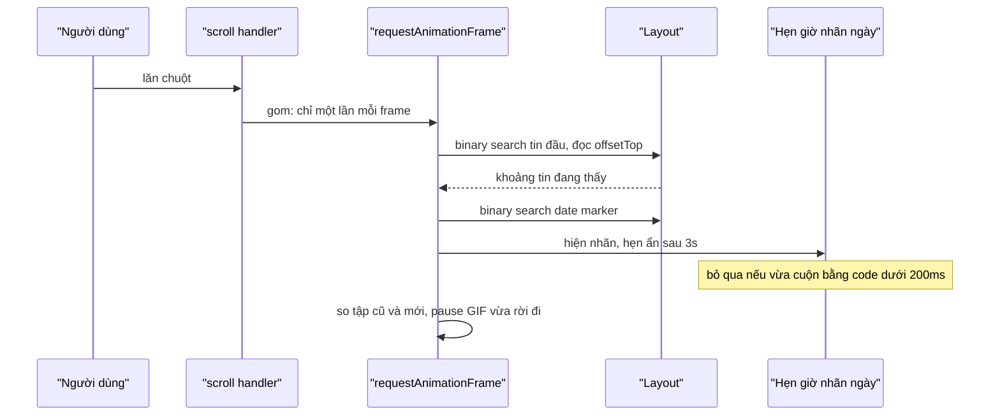

Mỗi lần khung chat cuộn, WhatsApp Web cần trả lời vài câu hỏi: những tin nào đang nằm trong màn hình (để gửi "đã xem", để biết ảnh nào cần tải), date marker nào đang ở đỉnh (để hiện nhãn ngày dính), GIF nào vừa trôi ra ngoài (để dừng phát). Khi người dùng mở panel thông tin bên phải, khung chat hẹp lại, tin nhắn xuống dòng và cao thêm, và vị trí đọc phải được giữ nguyên.

Câu trả lời của WhatsApp Web 2020 là một vài phép binary search trên `offsetTop`, gom theo frame, cộng một bộ hẹn giờ nhỏ cho nhãn ngày.

> [!TIP]
> **Tóm tắt**
> - Tin đang thấy: binary search tìm tin đầu tiên không còn nằm **trên** màn hình, rồi đi tiếp cho tới tin đầu tiên không còn thấy. Khoảng O(log n + số tin trên màn hình) lần đọc vị trí, thay vì quét từ đầu.
> - Date marker ở đỉnh: binary search marker cuối cùng có `offsetTop <= scrollTop + 8.5`.
> - Nhãn ngày dính hiện khi cuộn, ẩn sau 3 giây, và **không hiện** nếu vừa cuộn bằng code dưới 200ms trước. Marker thật nằm dưới nhãn dính thì bị ẩn để không thấy hai nhãn chồng nhau.
> - Đổi layout (mở/đóng panel): lưu khoảng cách từ đáy tin cuối đang thấy tới đáy viewport, đặt lại sau khi layout xong. GIF vừa rời màn hình bị `pause()` bằng cách so tập tin đang thấy cũ và mới.

<iframe class="demo-frame" src="/demos/web-patterns/index.html?theme=dark#/wa-viewport" title="Demo wa-viewport" loading="lazy" style="height: 1050px"></iframe>

<p class="demo-links">▶ <a href="/demos/web-patterns/index.html#/wa-viewport" target="_blank" rel="noopener">Mở demo toàn màn hình ↗</a> · <a href="https://stackblitz.com/github/hunghg255/blog-hunghg/tree/master/examples/web-patterns?file=src/lib/waViewport.ts" target="_blank" rel="noopener">Sửa code trên StackBlitz ↗</a> · <a href="https://github.com/hunghg255/blog-hunghg/blob/master/examples/web-patterns/src/lib/waViewport.ts" target="_blank" rel="noopener">Xem source trên GitHub ↗</a></p>

Lăn chuột trong khung chat: nhãn ngày hiện ở đỉnh rồi mờ đi sau 3 giây. Ô "lần đọc vị trí" so số lần đọc `offsetTop` của binary search với số lần một vòng quét từ đầu cần. Bấm "Cuộn bằng code tới 7 ngày trước": khung nhảy nhưng nhãn không bật lên. Bấm "Mở panel thông tin" với "giữ neo" bật rồi tắt để thấy tin cuối đang đọc đứng yên hay trôi đi vài nghìn pixel.

## WhatsApp làm thế nào?

Code nằm trong component `ConversationMsgs`, module `bggagdeaef` của bundle WhatsApp Web 2020 (bản 2020, có thể đã đổi). Nó bọc danh sách tin, giữ cursor cửa sổ render ([bài #8](/blogs/whatsapp-render-cursor-window)) và nghe sự kiện cuộn.

### Mỗi lần cuộn

`onScroll` gọi `updateForCurrentPosition`, một hàm đã được throttle 100ms và chờ thêm một nhịp qua module `cbcchiaeeb` (không có trong bundle này, có lẽ là `requestAnimationFrame` bọc trong Promise) trước khi chạy. Hàm này gọi `updateRenderedMsgCache`, rồi nạp thêm tin cũ nếu `scrollTop < 300`, nạp tin mới và gửi "đã xem" nếu đang gần đáy.

### Tìm tin đang thấy

```js
for (n = 0, o = msgs.length - 1; n < o; ) {
  const d = Math.floor((n + o) / 2);
  const ref = list.getMsgWrapperRef(msgs[d].id.toString());
  list.getMsgVisibility(ref).visibility === VISIBILITY.ABOVE ? (n = d + 1) : (o = d);
}
for (let u = n; u < msgs.length; u++) {
  const ref = list.getMsgWrapperRef(msgs[u].id.toString());
  if (!ref) throw new Error('msgRef not found!');
  const v = list.getMsgVisibility(ref);
  if (v.visibility !== VISIBILITY.VISIBLE) break;
  info[id] = { offset: v.offset, t: msgs[u].t };
  rendered.set(id, ref);
  order.push(msgs[u].id);
}
```

Danh sách đã sắp theo thời gian, và trạng thái "nằm trên / đang thấy / nằm dưới" đơn điệu theo chỉ số. Binary search trên tính chất đó cho ra tin đầu tiên không còn nằm trên. Vòng thứ hai đi tiếp tới khi gặp tin không còn thấy. Kết quả (`renderedMsgCache`, `visibleMsgOrder`) được dùng cho "đã xem", cho phím Page Up/Down, và cho việc giữ neo.

### Date marker và nhãn dính

```js
const top = scrollContainer.scrollTop;
n = 0; o = Object.keys(list.renderedDateMarkers).length - 1;
const first = list.getDateMarkerRef(0);
if (first && dom(first).offsetTop <= top + 8.5)
  while (n < o) {
    const v = Math.ceil((n + o) / 2);
    dom(list.getDateMarkerRef(v)).offsetTop > top + 8.5 ? (o = v - 1) : (n = v);
  }
else n = -1;
this.updateStickyDateMarker.onOrBefore(0, { dateMarkerIdx: n, silent });
```

`Math.ceil` ở đây (khác `Math.floor` ở trên) vì đang tìm **phần tử cuối cùng** thoả điều kiện. Hằng 8.5px cho phép marker còn cách đỉnh chưa tới 9px đã được tính là "tới đỉnh", có lẽ để nhãn dính đổi ngày đúng lúc marker thật trượt vào dưới nó.

`updateStickyDateMarker` hiện nhãn dính, trừ khi `silent` (cập nhật do re-render chứ không do cuộn) hoặc `Date.now() - this.programmaticScroll < 200`. Mọi chỗ gán `scrollTop` đều đi qua `setScrollTop`, hàm ghi lại `programmaticScroll = Date.now()`. Khi chỉ số marker đổi, marker thật cũ được `show()` và marker mới được `hide()`. `showStickyDateMarker` hẹn ẩn sau `3e3` ms bằng một `ShiftTimer.debounce`.

### Giữ chỗ đọc khi đổi pane

```js
getMsgBottom(c, m) { return c.scrollHeight - (m.offsetTop + m.clientHeight + (c.scrollHeight - (c.scrollTop + c.clientHeight))); }
setMsgBottom(c, m, gap) { this.setScrollTop(c, m.offsetTop + m.clientHeight + gap - c.clientHeight); }
```

Rút gọn `getMsgBottom` thì được `scrollTop + clientHeight - (offsetTop + clientHeight của tin)`: khoảng cách từ đáy tin tới đáy viewport. Sự kiện `panes_will_change` lưu con số này cho tin **cuối** trong `visibleMsgOrder`, `panes_did_change` đặt lại. Neo theo tin cuối hợp lý cho chat: người dùng thường đọc ở gần đáy.

### Dừng GIF ngoài màn hình

```js
pauseHiddenGifs(prev, next) {
  prev.forEach((component, id) => {
    if (!next.has(id)) {
      const msg = this.props.msgCollection.get(id);
      msg && msg.isGif && typeof component.pause === 'function' && component.pause();
    }
  });
}
```

So tập tin đang thấy của lần trước với lần này. Tin rời đi mà là GIF (video không tiếng, lặp) thì gọi `pause()`. GIF quay lại màn hình tự chạy tiếp nhờ component của nó.

### Vài chỗ đáng chú ý

- `getSequentialMsg(id)` dùng `findIndex` rồi trả `msgs[i + 1]`. Không tìm thấy thì `i = -1` và hàm trả **tin đầu tiên** thay vì không trả gì.
- Thiếu ref thì `throw new Error('msgRef not found!')` ngay trong handler cuộn. Một tin chưa kịp gắn ref là cả lần cập nhật hỏng.
- `onResizeDebounce` so `this.nearBottom !== e`, tức so **hàm** `nearBottom` với một boolean: luôn khác, nên mỗi lần resize đều `setState`. Có lẽ định so với `this.state.isNearBottom`.
- Khi ô soạn tin co lại, khoảng cách tới đáy được giữ bằng một animation 300ms với easing `[.1, .82, .25, 1]` thay vì nhảy.

## Bên trong trình duyệt: đọc offsetTop có đắt không?

`offsetTop`, `offsetHeight`, `scrollTop`, `getBoundingClientRect()` đều cần layout mới nhất. Nếu từ lần layout trước DOM chưa đổi, trình duyệt trả ngay giá trị đã tính. Nếu DOM vừa đổi (thêm class, đổi style), lần đọc đầu tiên buộc trình duyệt tính layout ngay lập tức (forced synchronous layout), các lần đọc sau thì rẻ.

Vì vậy quy tắc là **đọc hết rồi mới ghi**. `updateRenderedMsgCache` chạy trong một frame riêng (sau `requestAnimationFrame`), đọc mọi vị trí cần thiết, rồi mới cập nhật trạng thái. Binary search còn giảm số lần đọc: với 600 tin, khoảng 10 lần cho tin đầu tiên cộng số tin trên màn hình, so với vài trăm lần nếu quét từ đầu. Mỗi lần đọc rẻ, nhưng chạy 60 lần mỗi giây khi cuộn thì khác biệt vẫn đáng kể.

`offsetTop` tính từ **offsetParent**, tức tổ tiên gần nhất có `position` khác `static`. Container cuộn phải có `position: relative`, nếu không `offsetTop` sẽ tính từ `body` và mọi phép so với `scrollTop` đều lệch.



## Viết lại

Bản viết lại tách thành các hàm không phụ thuộc React, để dùng được với mọi danh sách có phần tử DOM.

Tìm tin đang thấy:

```ts title=src/lib/waViewport.ts
export type Visibility = 'above' | 'visible' | 'below';

export function visibilityOf(el: HTMLElement, container: HTMLElement): Visibility {
  const top = el.offsetTop - container.scrollTop;
  if (top + el.offsetHeight <= 0) return 'above';
  if (top >= container.clientHeight) return 'below';
  return 'visible';
}

/** Chỉ số nhỏ nhất trong [0, n) mà `isBefore(i)` sai; giả định `isBefore` đúng liền một đoạn đầu. */
export function lowerBound(n: number, isBefore: (i: number) => boolean): number {
  let lo = 0;
  let hi = n;
  while (lo < hi) {
    const mid = (lo + hi) >>> 1;
    if (isBefore(mid)) lo = mid + 1;
    else hi = mid;
  }
  return lo;
}

export interface VisibleRange {
  /** chỉ số tin đầu đang thấy, -1 nếu không có */
  first: number;
  /** chỉ số tin cuối đang thấy (bao gồm), -1 nếu không có */
  last: number;
  /** số lần đọc vị trí đã dùng, để so với quét tuần tự */
  reads: number;
}

/**
 * Khoảng tin đang thấy. `getEl(i)` có thể trả null (item chưa gắn ref): bản gốc ném lỗi
 * "msgRef not found!", ở đây coi như dừng.
 */
export function findVisibleRange(
  count: number,
  getEl: (i: number) => HTMLElement | null,
  container: HTMLElement,
): VisibleRange {
  let reads = 0;
  const vis = (i: number): Visibility | null => {
    const el = getEl(i);
    if (!el) return null;
    reads++;
    return visibilityOf(el, container);
  };
  const first = lowerBound(count, (i) => vis(i) === 'above');
  let last = first - 1;
  for (let i = first; i < count && vis(i) === 'visible'; i++) last = i;
  return last < first ? { first: -1, last: -1, reads } : { first, last, reads };
}
```

Date marker và nhãn dính:

```ts title=src/lib/waViewport.ts
export function findStickyDateIndex(
  count: number,
  top: (i: number) => number,
  scrollTop: number,
  fudge = DATE_MARKER_FUDGE,
): number {
  const limit = scrollTop + fudge;
  return lowerBound(count, (i) => top(i) <= limit) - 1;
}

export interface StickyDateOptions {
  onVisibility: (visible: boolean) => void;
  hideAfter?: number;
  /** bỏ qua lần cập nhật nếu vừa cuộn bằng code trong khoảng này */
  programmaticWindow?: number;
  now?: () => number;
}

/** Bật/tắt sticky date marker: hiện khi người dùng cuộn, ẩn sau `hideAfter` ms không cuộn. */
export class StickyDateController {
  private timer: ReturnType<typeof setTimeout> | undefined;
  private lastProgrammatic = -Infinity;
  private visible = false;
  private readonly hideAfter: number;
  private readonly programmaticWindow: number;
  private readonly now: () => number;
  private readonly onVisibility: (visible: boolean) => void;

  constructor({ onVisibility, hideAfter = 3000, programmaticWindow = 200, now = Date.now }: StickyDateOptions) {
    this.onVisibility = onVisibility;
    this.hideAfter = hideAfter;
    this.programmaticWindow = programmaticWindow;
    this.now = now;
  }

  /** Gọi ngay trước khi gán scrollTop bằng code (bản gốc: setScrollTop ghi programmaticScroll). */
  markProgrammatic() {
    this.lastProgrammatic = this.now();
  }

  /** Gọi sau mỗi lần cập nhật vị trí. `silent` = cập nhật do re-render, không phải do cuộn. */
  onPositionChange(silent = false) {
    if (silent || this.now() - this.lastProgrammatic < this.programmaticWindow) return;
    this.set(true);
    clearTimeout(this.timer);
    this.timer = setTimeout(() => this.set(false), this.hideAfter);
  }

  dispose() {
    clearTimeout(this.timer);
  }

  private set(visible: boolean) {
    if (visible === this.visible) return;
    this.visible = visible;
```

Giữ neo và tìm phần tử vừa rời màn hình:

```ts title=src/lib/waViewport.ts
  }
}

/** Khoảng cách từ đáy `el` tới đáy viewport (dương: el nằm trên đáy). */
export function captureBottomGap(container: HTMLElement, el: HTMLElement): number {
  return container.scrollTop + container.clientHeight - (el.offsetTop + el.offsetHeight);
}

/** Đặt lại scrollTop để `el` cách đáy viewport đúng `gap` như trước khi layout đổi. */
export function restoreBottomGap(container: HTMLElement, el: HTMLElement, gap: number) {
  container.scrollTop = el.offsetTop + el.offsetHeight + gap - container.clientHeight;
}

/** Các giá trị có trong `prev` mà không còn trong `next`: những item vừa rời màn hình. */
export function leftViewport<K, V>(prev: ReadonlyMap<K, V>, next: ReadonlyMap<K, V>): V[] {
  const out: V[] = [];
  prev.forEach((value, key) => {
    if (!next.has(key)) out.push(value);
  });
  return out;
}
```

::: spoiler Xem toàn bộ src/lib/waViewport.ts
```ts title=src/lib/waViewport.ts
/**
 * Theo dõi viewport của danh sách tin nhắn, kiểu WhatsApp Web 2020 (module `bggagdeaef` ConversationMsgs).
 *
 * - Tìm tin đầu tiên đang thấy bằng binary search trên trạng thái "nằm trên / đang thấy", rồi đi tiếp
 *   cho tới tin đầu tiên không còn thấy: O(log n + số tin trên màn hình) lần đọc vị trí.
 * - Tìm date marker đang "phụ trách" màn hình bằng binary search theo `offsetTop <= scrollTop + 8.5`.
 * - Sticky date marker: hiện khi người dùng cuộn, tự ẩn sau 3 giây, không hiện nếu vừa cuộn bằng code (< 200ms).
 * - Giữ chỗ đọc khi layout đổi (mở/đóng panel): lưu khoảng cách từ đáy tin cuối đang thấy tới đáy viewport.
 * - Tạm dừng media (GIF) vừa rời khỏi màn hình bằng cách so tập đang thấy cũ và mới.
 *
 * Mọi vị trí tính theo `offsetTop`, nên container phải là offsetParent của item (position: relative).
 */

export type Visibility = 'above' | 'visible' | 'below';

export function visibilityOf(el: HTMLElement, container: HTMLElement): Visibility {
  const top = el.offsetTop - container.scrollTop;
  if (top + el.offsetHeight <= 0) return 'above';
  if (top >= container.clientHeight) return 'below';
  return 'visible';
}

/** Chỉ số nhỏ nhất trong [0, n) mà `isBefore(i)` sai; giả định `isBefore` đúng liền một đoạn đầu. */
export function lowerBound(n: number, isBefore: (i: number) => boolean): number {
  let lo = 0;
  let hi = n;
  while (lo < hi) {
    const mid = (lo + hi) >>> 1;
    if (isBefore(mid)) lo = mid + 1;
    else hi = mid;
  }
  return lo;
}

export interface VisibleRange {
  /** chỉ số tin đầu đang thấy, -1 nếu không có */
  first: number;
  /** chỉ số tin cuối đang thấy (bao gồm), -1 nếu không có */
  last: number;
  /** số lần đọc vị trí đã dùng, để so với quét tuần tự */
  reads: number;
}

/**
 * Khoảng tin đang thấy. `getEl(i)` có thể trả null (item chưa gắn ref): bản gốc ném lỗi
 * "msgRef not found!", ở đây coi như dừng.
 */
export function findVisibleRange(
  count: number,
  getEl: (i: number) => HTMLElement | null,
  container: HTMLElement,
): VisibleRange {
  let reads = 0;
  const vis = (i: number): Visibility | null => {
    const el = getEl(i);
    if (!el) return null;
    reads++;
    return visibilityOf(el, container);
  };
  const first = lowerBound(count, (i) => vis(i) === 'above');
  let last = first - 1;
  for (let i = first; i < count && vis(i) === 'visible'; i++) last = i;
  return last < first ? { first: -1, last: -1, reads } : { first, last, reads };
}

/** Hằng của bản gốc: marker còn cách đỉnh dưới 8.5px đã coi như "tới đỉnh", để chuyển ngày sớm hơn một chút. */
export const DATE_MARKER_FUDGE = 8.5;

/**
 * Chỉ số date marker cuối cùng có `top(i) <= scrollTop + fudge`; -1 nếu marker đầu còn ở dưới.
 * `top(i)` phải tăng dần theo i.
 */
export function findStickyDateIndex(
  count: number,
  top: (i: number) => number,
  scrollTop: number,
  fudge = DATE_MARKER_FUDGE,
): number {
  const limit = scrollTop + fudge;
  return lowerBound(count, (i) => top(i) <= limit) - 1;
}

export interface StickyDateOptions {
  onVisibility: (visible: boolean) => void;
  hideAfter?: number;
  /** bỏ qua lần cập nhật nếu vừa cuộn bằng code trong khoảng này */
  programmaticWindow?: number;
  now?: () => number;
}

/** Bật/tắt sticky date marker: hiện khi người dùng cuộn, ẩn sau `hideAfter` ms không cuộn. */
export class StickyDateController {
  private timer: ReturnType<typeof setTimeout> | undefined;
  private lastProgrammatic = -Infinity;
  private visible = false;
  private readonly hideAfter: number;
  private readonly programmaticWindow: number;
  private readonly now: () => number;
  private readonly onVisibility: (visible: boolean) => void;

  constructor({ onVisibility, hideAfter = 3000, programmaticWindow = 200, now = Date.now }: StickyDateOptions) {
    this.onVisibility = onVisibility;
    this.hideAfter = hideAfter;
    this.programmaticWindow = programmaticWindow;
    this.now = now;
  }

  /** Gọi ngay trước khi gán scrollTop bằng code (bản gốc: setScrollTop ghi programmaticScroll). */
  markProgrammatic() {
    this.lastProgrammatic = this.now();
  }

  /** Gọi sau mỗi lần cập nhật vị trí. `silent` = cập nhật do re-render, không phải do cuộn. */
  onPositionChange(silent = false) {
    if (silent || this.now() - this.lastProgrammatic < this.programmaticWindow) return;
    this.set(true);
    clearTimeout(this.timer);
    this.timer = setTimeout(() => this.set(false), this.hideAfter);
  }

  dispose() {
    clearTimeout(this.timer);
  }

  private set(visible: boolean) {
    if (visible === this.visible) return;
    this.visible = visible;
    this.onVisibility(visible);
  }
}

/** Khoảng cách từ đáy `el` tới đáy viewport (dương: el nằm trên đáy). */
export function captureBottomGap(container: HTMLElement, el: HTMLElement): number {
  return container.scrollTop + container.clientHeight - (el.offsetTop + el.offsetHeight);
}

/** Đặt lại scrollTop để `el` cách đáy viewport đúng `gap` như trước khi layout đổi. */
export function restoreBottomGap(container: HTMLElement, el: HTMLElement, gap: number) {
  container.scrollTop = el.offsetTop + el.offsetHeight + gap - container.clientHeight;
}

/** Các giá trị có trong `prev` mà không còn trong `next`: những item vừa rời màn hình. */
export function leftViewport<K, V>(prev: ReadonlyMap<K, V>, next: ReadonlyMap<K, V>): V[] {
  const out: V[] = [];
  prev.forEach((value, key) => {
    if (!next.has(key)) out.push(value);
  });
  return out;
}
```
:::

## Đi qua code

- `lowerBound(n, isBefore)` là binary search chuẩn trên khoảng nửa mở `[0, n)`: trả chỉ số đầu tiên mà `isBefore` sai. Cả hai lần tìm (tin đầu tiên, marker cuối cùng) dùng chung nó. Marker cuối cùng thoả `top <= limit` chính là `lowerBound(top <= limit) - 1`.
- `visibilityOf` so `offsetTop - scrollTop` với `[0, clientHeight)`. Tin bị cắt một phần vẫn tính là "đang thấy", giống bản gốc.
- `findVisibleRange` đếm số lần đọc (`reads`) để demo hiển thị. Thiếu phần tử thì dừng thay vì ném lỗi.
- `StickyDateController` nhận `now` để test với đồng hồ giả. `onPositionChange(silent)` là toàn bộ logic: bỏ qua nếu im lặng hoặc vừa cuộn bằng code, nếu không thì hiện và đặt lại hẹn giờ ẩn. `set` chỉ gọi callback khi trạng thái đổi.
- `captureBottomGap`/`restoreBottomGap` là bản rút gọn của `getMsgBottom`/`setMsgBottom`, dùng `offsetHeight` thay vì `clientHeight` để tính cả viền.
- `leftViewport(prev, next)` trả các giá trị có trong `prev` mà không có trong `next`. Demo dùng nó để bỏ class `playing` của ô GIF; trong ứng dụng thật là `video.pause()`.

Trong demo, `onScroll` gom bằng `requestAnimationFrame`, và `useLayoutEffect` theo `drawer` đặt lại neo ngay sau khi React commit layout mới, trước khi trình duyệt vẽ, nên người dùng không thấy cú nhảy.

**Khác bản gốc:** không ném lỗi khi thiếu ref, không gom 100ms (chỉ gom theo frame), neo đo bằng `offsetHeight`. `getSequentialMsg` và phần "đã xem" không được viết lại.

## Tại sao không làm cách khác?

**IntersectionObserver cho từng tin.** Cho biết tin nào vào/ra màn hình mà không cần đọc layout trên main thread, và rất hợp cho "đã xem" (xem [Facebook: đo thời gian hiển thị](/blogs/facebook-use-viewport-duration)). Nhưng callback đến bất đồng bộ, sau frame, và không trả lời được câu "marker nào đang ở **đúng** đỉnh lúc này" mà nhãn ngày cần. Với danh sách đã cửa sổ hoá thì số tin trong DOM nhỏ, binary search đồng bộ đơn giản hơn.

**`position: sticky` cho từng marker.** Đây là cách của [Telegram Web](/blogs/telegram-sticky-date-scroll-lock): mỗi nhãn ngày dính trong nhóm tin của nó, trình duyệt tự đẩy nhãn cũ lên khi nhãn mới tới. Không cần tìm marker bằng JS. Cách của WhatsApp dùng một nhãn dính riêng và ẩn marker thật, nên phải biết chỉ số marker, nhưng điều khiển được thời điểm hiện/ẩn và nội dung ("HÔM NAY", "HÔM QUA").

**`overflow-anchor` thay cho giữ neo tay.** Trình duyệt tự chọn một phần tử neo và bù `scrollTop` khi nội dung **phía trên** đổi chiều cao. Khi mở panel thì mọi tin đều đổi chiều cao, và trình duyệt chọn neo gần đỉnh, trong khi chat cần neo ở đáy. Tự neo theo tin cuối đang thấy cho đúng ý hơn.

**Quét tuyến tính từ tin cuối ngược lên.** Ở gần đáy thì rất nhanh, nhưng khi đã cuộn lên xa thì quay về O(n). Binary search không phụ thuộc vị trí.

## Edge case và cạm bẫy

- **Container không phải offsetParent.** Lỗi phổ biến nhất. Thêm `position: relative` cho khung cuộn, hoặc dùng `getBoundingClientRect()` trừ cho rect của container.
- **Danh sách không đơn điệu.** Binary search chỉ đúng khi "nằm trên" là một đoạn liền ở đầu. Phần tử `position: absolute`, tin ghim nổi, hoặc `flex-direction: column-reverse` phá điều kiện đó.
- **Cuộn bằng code trong cùng frame với cuộn tay.** Ngưỡng 200ms có thể nuốt mất một lần hiện nhãn khi người dùng cuộn ngay sau khi app tự cuộn. Chấp nhận được.
- **Neo khi tin cuối không còn render.** Nếu đổi layout đồng thời làm cửa sổ render đổi (bài #8), phần tử neo có thể đã bị gỡ khỏi DOM. Phải kiểm tra trước khi đặt lại.
- **Animation khi đổi layout.** Nếu panel trượt vào bằng transition, layout đổi qua nhiều frame. Phải đặt lại neo sau `transitionend` (bản gốc có sự kiện `panes_did_change` riêng cho việc này), hoặc mỗi frame trong lúc trượt.
- **`pause()` khi không phải video.** GIF thật (``) không có API dừng. WhatsApp chuyển GIF sang video MP4 nên mới `pause()` được. Với `` thì phải đổi `src` sang khung tĩnh.

## Dùng trong dự án

```ts
const sticky = new StickyDateController({ onVisibility: (v) => label.classList.toggle('on', v) });
let frame = 0;
box.addEventListener('scroll', () => {
  cancelAnimationFrame(frame);
  frame = requestAnimationFrame(() => {
    const { first, last } = findVisibleRange(rows.length, (i) => rows[i], box);
    markSeen(first, last);
    const day = findStickyDateIndex(markers.length, (i) => markers[i].offsetTop, box.scrollTop);
    label.textContent = day >= 0 ? markers[day].textContent : '';
    sticky.onPositionChange();
  });
});

function scrollToMessage(el: HTMLElement) {
  sticky.markProgrammatic();
  box.scrollTop = el.offsetTop - 40;
}
```

Khi mở panel: `const gap = captureBottomGap(box, rows[last])` trước khi đổi layout, `restoreBottomGap(box, rows[last], gap)` trong `useLayoutEffect` hoặc sau `transitionend`.

::: spoiler Ví dụ test (bản phác, không có trong repo)
```ts
import { describe, expect, it, vi } from 'vitest';
import { StickyDateController, findStickyDateIndex, leftViewport, lowerBound } from '../src/lib/waViewport';

describe('lowerBound', () => {
  it('trả chỉ số đầu tiên không thoả', () => {
    const a = [1, 3, 5, 7, 9];
    expect(lowerBound(a.length, (i) => a[i] < 6)).toBe(3);
    expect(lowerBound(a.length, () => true)).toBe(5);
    expect(lowerBound(0, () => true)).toBe(0);
  });
});

describe('findStickyDateIndex', () => {
  const tops = [0, 400, 800, 1200];
  it('chọn marker cuối cùng đã tới đỉnh, có tính 8.5px', () => {
    expect(findStickyDateIndex(4, (i) => tops[i], 0)).toBe(0);
    expect(findStickyDateIndex(4, (i) => tops[i], 395)).toBe(1);
    expect(findStickyDateIndex(4, (i) => tops[i], 390)).toBe(0);
    expect(findStickyDateIndex(4, (i) => tops[i] + 100, 0)).toBe(-1);
  });
});

describe('StickyDateController', () => {
  it('hiện khi cuộn, ẩn sau 3s, bỏ qua cuộn bằng code', () => {
    vi.useFakeTimers();
    let now = 0;
    const seen: boolean[] = [];
    const c = new StickyDateController({ onVisibility: (v) => seen.push(v), now: () => now });
    c.onPositionChange();
    vi.advanceTimersByTime(2999);
    expect(seen).toEqual([true]);
    vi.advanceTimersByTime(1);
    expect(seen).toEqual([true, false]);
    now = 10_000;
    c.markProgrammatic();
    now = 10_150;
    c.onPositionChange();
    expect(seen).toEqual([true, false]);
    vi.useRealTimers();
  });
});

it('leftViewport', () => {
  const prev = new Map([[1, 'a'], [2, 'b'], [3, 'c']]);
  const next = new Map([[2, 'b'], [4, 'd']]);
  expect(leftViewport(prev, next)).toEqual(['a', 'c']);
});
```
:::

## So với thư viện và chuẩn web

- **IntersectionObserver** (mọi trình duyệt hiện đại, tính tới 10/2026) là lựa chọn mặc định cho "phần tử nào đang thấy" khi không cần kết quả đồng bộ. `react-intersection-observer` bọc nó cho React.
- **CSS scroll-driven animations** (`animation-timeline: view()`) làm được hiệu ứng theo vị trí cuộn mà không cần JS, nhưng không trả về "chỉ số marker" cho logic ứng dụng.
- **`scrollend`** là sự kiện khi cuộn dừng hẳn, thay được phần "debounce để biết đã dừng". Firefox và Chromium có, Safari đang triển khai ([caniuse](https://caniuse.com/mdn-api_element_scrollend_event)).
- Cách Telegram làm nhãn ngày, và các mẹo khoá cuộn liên quan, xem [Học từ Telegram #22](/blogs/telegram-sticky-date-scroll-lock).

---

Bài này thuộc series **[Học từ mã nguồn WhatsApp Web](/series/whatsapp)** (19 bài, đọc theo thứ tự).

::: spoiler Xem nhanh danh sách bài trong series

*Mở đầu*

- [Mở đầu: đọc bundle WhatsApp Web 2020](/blogs/learn-from-whatsapp-web-source-code)

*Phần 1: media và mã hoá*

- [#1 Giải mã JPEG progressive theo từng scan, kiểm HMAC](/blogs/whatsapp-progressive-jpeg-hmac)
- [#2 Ghép khoảng byte cho video streaming](/blogs/whatsapp-byte-range-merge)
- [#3 Xoá EXIF không re-encode, thumbnail theo ngân sách byte](/blogs/whatsapp-jpeg-strip-thumb-budget)
- [#4 Đọc metadata sticker WebP động](/blogs/whatsapp-webp-sticker-metadata)

*Phần 2: lưu trữ trên trình duyệt*

- [#5 Kho media LRU tự co theo quota](/blogs/whatsapp-quota-aware-media-lru)
- [#6 Cache blob trong RAM có refcount, tự revoke objectURL](/blogs/whatsapp-blob-cache-refcount)
- [#7 Khoá IndexedDB giữ đúng thứ tự từ điển](/blogs/whatsapp-indexeddb-ordered-keys)

*Phần 3: danh sách tin nhắn*

- [#8 Render tin nhắn theo cửa sổ chiều cao ước lượng](/blogs/whatsapp-render-cursor-window)
- **#9 Theo dõi viewport tin nhắn: binary search, ngày dính** (bài này)
- [#10 FlatList tái dùng key React, overscan bất đối xứng](/blogs/whatsapp-flatlist-key-reuse)

*Phần 4: soạn tin và chữ*

- [#11 Emoticon thành emoji bằng trie đọc ngược, tìm emoji](/blogs/whatsapp-emoticon-trie-emoji-search)
- [#12 Mention bằng token zero-width, giới hạn theo code point](/blogs/whatsapp-mention-zero-width-input)
- [#13 Xác định hướng chữ bằng bảng delta nén](/blogs/whatsapp-text-direction-table)
- [#14 Phát hiện homograph trong link, chặn giả đuôi file RTLO](/blogs/whatsapp-homograph-rtlo-guard)

*Phần 5: realtime và tiện ích*

- [#15 Presence, "đang gõ" và thông báo theo kích thước group](/blogs/whatsapp-presence-typing-notifications)
- [#16 Đo FPS phát hiện UI đóng băng, idle monitor](/blogs/whatsapp-fps-freeze-idle)
- [#17 Cửa sổ PiP: resize 8 hướng, khoá tỉ lệ, né vật cản](/blogs/whatsapp-pip-resize-avoid)
- [#18 Parse giá tiền theo locale bằng Intl](/blogs/whatsapp-locale-price-parse)

:::

Code + demo: [`examples/web-patterns`](https://github.com/hunghg255/blog-hunghg/tree/master/examples/web-patterns) · [Mở trên StackBlitz](https://stackblitz.com/github/hunghg255/blog-hunghg/tree/master/examples/web-patterns)
