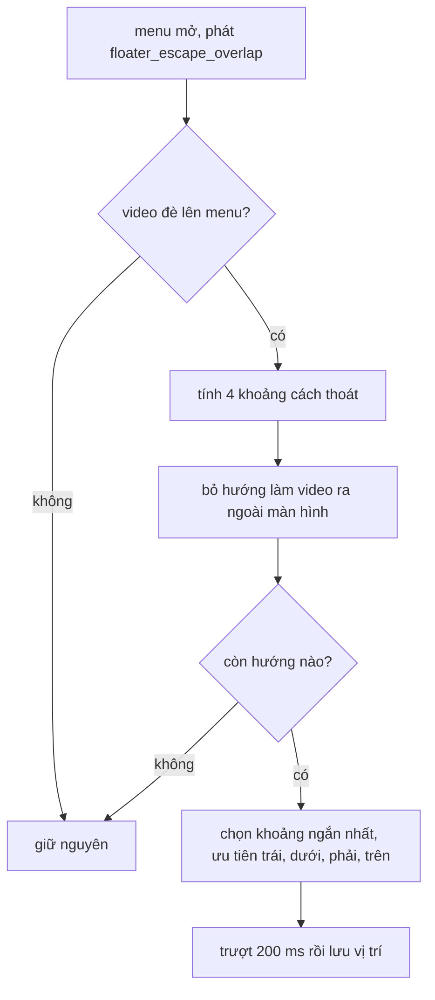

Bấm vào một video YouTube được gửi trong WhatsApp Web, video không mở tab mới mà hiện trong một **cửa sổ nổi** (picture-in-picture, PiP) ở góc màn hình. Bạn vẫn đọc và trả lời tin nhắn trong lúc xem. Cửa sổ kéo đi được, đổi kích thước được ở cả 4 cạnh và 4 góc, luôn giữ đúng tỉ lệ video, không bao giờ ra ngoài màn hình, và khi bạn mở một menu đè lên thì nó tự trượt sang chỗ khác.

Trình duyệt có API Picture-in-Picture thật, nhưng chỉ dùng được với thẻ `<video>` của chính trang; video YouTube nhúng bằng iframe thì không. Nên WhatsApp tự vẽ cửa sổ nổi bằng một `div` định vị tuyệt đối. Bài này đọc hai module làm việc đó.

> [!TIP]
> **Tóm tắt**
> - Kích thước mặc định: cạnh dài 330 px, cạnh ngắn tối thiểu 145 px, cách mép 10 px. Tỉ lệ video bị kẹp trong [145/330, 330/145]; video dọc hơn hoặc dẹt hơn thì lấp phần thừa bằng ảnh nền làm mờ.
> - Resize ở góc lấy chiều kéo mạnh hơn: `max(dx, tỉ lệ × dy)`. Kéo quá mép thì dừng **đúng ở mép** chứ không đứng im.
> - Khi một lớp nổi khác đè lên: tính 4 khoảng cách để thoát (trái, dưới, phải, trên), bỏ hướng làm cửa sổ ra ngoài màn hình, chọn khoảng ngắn nhất, trượt 200 ms.
> - Bản gốc chỉ nghe `mousemove`/`mouseup` trên `window`: không kéo được bằng cảm ứng. Bản viết lại dùng Pointer Events + pointer capture.

<iframe class="demo-frame" src="/demos/web-patterns/index.html?theme=dark#/wa-pip" title="Demo wa-pip" loading="lazy" style="height: 900px"></iframe>

<p class="demo-links">▶ <a href="/demos/web-patterns/index.html#/wa-pip" target="_blank" rel="noopener">Mở demo toàn màn hình ↗</a> · <a href="https://stackblitz.com/github/hunghg255/blog-hunghg/tree/master/examples/web-patterns?file=src/lib/waPip.ts" target="_blank" rel="noopener">Sửa code trên StackBlitz ↗</a> · <a href="https://github.com/hunghg255/blog-hunghg/blob/master/examples/web-patterns/src/lib/waPip.ts" target="_blank" rel="noopener">Xem source trên GitHub ↗</a></p>

## WhatsApp làm thế nào?

Bundle là WhatsApp Web năm 2020 (webpack, module đặt tên bằng hash), có thể đã đổi.

### Kích thước và tỉ lệ: module `bjegcccgec`

Module này là lớp ngoài của cửa sổ video, export các hằng số:

```js
t.MARGIN_X = 10; t.MARGIN_Y = 10;
t.LONGER_SIDE_DEFAULT_LENGTH = 330;
t.MIN_HEIGHT = 145; t.MIN_WIDTH = 145;
t.MIN_ASPECT_RATIO = 145 / 330;  // MAX_ASPECT_RATIO = 330 / 145
```

- `getAspectRatio` lấy tỉ lệ rộng/cao của video (không biết thì là 1), rồi kẹp vào khoảng trên. Video 9:21 (điện thoại dọc chụp màn hình dài) có tỉ lệ 0,43 < 0,44 nên bị kẹp.
- Khung ban đầu: tỉ lệ > 1 (ngang) thì rộng 330 px, ngược lại cao 330 px. Vị trí: mép phải trùng mép phải của **header cuộc trò chuyện** trừ 10 px, ngay dưới header.
- Bề rộng nhỏ nhất `max(145, 145 × tỉ lệ)`: đảm bảo cạnh ngắn hơn cũng không dưới 145 px.
- Nếu tỉ lệ bị kẹp khác tỉ lệ thật, component vẽ thêm một lớp nền (`bottomLayer`, `bgImg`) là ảnh thumbnail làm mờ, video thật nằm giữa. Giống cách điện thoại hiện ảnh dọc trên khung ngang.

### Kéo và resize: module `dffjiffehg`

Component cửa sổ nổi lưu `width`, `left`, `bottom` trong state (chiều cao luôn là `width / tỉ lệ`). Định vị theo `bottom` chứ không theo `top`, nên khi cửa sổ trình duyệt đổi chiều cao, video vẫn bám đáy.

Khi bấm chuột vào một tay nắm resize, state ghi lại hướng (0 trên, 1 dưới, 2 trái, 3 phải, 4–7 bốn góc), kích thước và vị trí lúc bắt đầu, toạ độ chuột lúc bắt đầu. Sau đó `onMouseMove` trên `window` tính độ thay đổi bề rộng `a`:

```js
case 4: // góc trên-phải
  i = (a = Math.max(e.clientX - start.x, this.props.aspectRatio * (start.y - e.clientY))) / this.props.aspectRatio;
```

Ở góc, lấy chiều nào kéo **mạnh hơn** sau khi quy về cùng đơn vị (dy nhân tỉ lệ thành pixel bề rộng). Kéo chéo, kéo gần ngang hay gần dọc đều cho cảm giác cửa sổ "đi theo" chuột. Ở cạnh, chỉ dùng một trục. Mỗi hướng có cạnh/góc đứng yên riêng: kéo cạnh trên thì đáy và mép trái đứng yên, kéo cạnh trái thì mép phải và đỉnh đứng yên.

`validateMoveResize` kiểm tra kết quả: làm tròn 2 chữ số thập phân, kiểm tra còn cách mép ít nhất 10 px và bề rộng ≥ tối thiểu. **Không hợp lệ thì đặt mọi delta về 0**, rồi sửa lại:

- Đang thu nhỏ: đặt bề rộng đúng bằng bề rộng tối thiểu.
- Đang phóng to: đặt bề rộng lớn nhất còn vừa, `Math.min(chỗ trống ngang, tỉ lệ × chỗ trống dọc) - .1`.

Bước sửa này là điểm hay: không có nó, kéo nhanh quá mép sẽ làm cửa sổ **đứng im** ở kích thước của lần `mousemove` hợp lệ cuối cùng, cách mép một khoảng tuỳ tốc độ chuột. Có nó, cửa sổ luôn chạm đúng mép. Phần `- .1` có lẽ để bù lỗi làm tròn, tránh lần kiểm tra sau lại thấy "vượt mép 0,01 px".

Kéo (move) dùng cùng hàm: trục nào vượt mép thì dính vào mép, trục kia vẫn đi theo chuột.

Khi cửa sổ trình duyệt đổi kích thước (`resize`, giới hạn 50 ms một lần), component thu nhỏ video nếu cần và đẩy vào trong. Nếu trước đó video đang thẳng hàng với mép phải của khung chat (lệch < 3 px), nó giữ thẳng hàng sau khi đổi kích thước.

### Né vật cản: `escapeOverlapMove`

Component đăng ký sự kiện `floater_escape_overlap`. Khi một menu, hộp thoại hay popup mở ra, nơi mở phát sự kiện kèm phần tử và khoảng đệm. Cửa sổ nổi:

```js
toLeftDistance:   e.right - t.left,   // dịch sang trái bao nhiêu thì hết đè
toBottomDistance: t.bottom - e.top,
toRightDistance:  t.right - e.left,
toTopDistance:    e.bottom - t.top
```

`e` là cửa sổ video, `t` là vật cản đã nới rộng thêm khoảng đệm. Thử lần lượt trái, dưới, phải, trên; hướng nào làm video ra ngoài màn hình (`isTranslationOutOfBound`) thì bỏ; giữ hướng có khoảng cách nhỏ nhất (so sánh `<`, nên khi bằng nhau thì hướng thử trước thắng). Sau đó animate 200 ms bằng một helper animation, xong mới cập nhật state.



### Chỗ còn thiếu

- **Chỉ có chuột.** Listener là `mousemove`, `mouseup` trên `window`, và mọi handler kiểm tra `e.button === 0`. Trên màn hình cảm ứng (laptop 2-trong-1, iPad dùng bản web) không kéo được. Không có cách điều khiển bằng bàn phím.
- **Tỉ lệ ở biên.** Video tỉ lệ đúng 330/145 có bề rộng tối thiểu `145 × 2,28 = 330`, bằng bề rộng mặc định: cửa sổ không thu nhỏ được nữa, chỉ phóng to. Demo chọn "32:9" để thấy.
- **Chỉ né một lần.** Video né khi menu mở; kéo video đè lại lên menu đang mở thì không có gì xảy ra.

## Bên trong trình duyệt

**Pointer Events** gộp chuột, bút và cảm ứng vào một luồng sự kiện (`pointerdown`, `pointermove`, `pointerup`, `pointercancel`). `element.setPointerCapture(pointerId)` khiến mọi sự kiện của con trỏ đó đi tới phần tử này cho tới khi thả, kể cả khi con trỏ ra ngoài phần tử hay ngoài iframe. Đó chính là lý do bản gốc phải gắn listener lên `window`, và pointer capture làm việc đó gọn hơn.

**`touch-action: none`** trên phần tử kéo được: báo cho trình duyệt không dùng cử chỉ chạm ở đây để cuộn hay phóng to trang. Thiếu nó, trên điện thoại `pointercancel` sẽ bắn ngay khi ngón tay bắt đầu di chuyển.

**Iframe nuốt sự kiện.** Video YouTube là iframe khác origin; con trỏ đi vào iframe thì trang mẹ không nhận `mousemove` nữa. Kéo cửa sổ nhanh, chuột lướt qua video, thao tác bị đứt. Pointer capture giải quyết, hoặc đặt `pointer-events: none` cho iframe trong lúc kéo.

**Document Picture-in-Picture API** (`documentPictureInPicture.requestWindow()`) mở một cửa sổ hệ điều hành luôn nổi trên cùng, chứa HTML tuỳ ý (kể cả iframe). Đây là cách hiện đại cho đúng nhu cầu này, nhưng chỉ có trên trình duyệt nhân Chromium (tính tới 10/2026).

## Viết lại

`src/lib/waPip.ts` là các hàm thuần trên hình chữ nhật `{ left, top, width, height }` (định vị theo `top` cho quen thuộc). Demo lo phần sự kiện con trỏ.

`pipRatio`, `minWidth`, `initialPipRect` chỉ là các hằng số và công thức ở trên, xem trong file đầy đủ. Resize 8 hướng:

```ts title=src/lib/waPip.ts
/**
 * Resize từ một tay nắm, giữ nguyên tỉ lệ. Cạnh/góc đối diện đứng yên.
 * Ở góc, lấy chiều kéo "mạnh" hơn: max(dx, ratio·dy) — kéo chéo hay kéo lệch đều cho cảm giác tự nhiên.
 * Kết quả luôn nằm trong [minWidth, bề rộng lớn nhất còn vừa khung], không bao giờ "kẹt" giữa chừng.
 */
export function resizeFromHandle(start: Rect, handle: Handle, dx: number, dy: number, ratio: number, bounds: Size, margin = PIP.margin): Rect {
  const sx = handle.includes('w') ? -1 : handle.includes('e') ? 1 : 0;
  const sy = handle.includes('n') ? -1 : handle.includes('s') ? 1 : 0;
  const grow = sx && sy ? Math.max(sx * dx, ratio * sy * dy) : sx ? sx * dx : ratio * sy * dy;

  // điểm neo (cạnh/góc đứng yên) và chỗ trống còn lại theo hướng kéo
  const right = start.left + start.width;
  const bottom = start.top + start.height;
  const roomX = sx < 0 ? right - margin : bounds.width - margin - start.left;
  const roomY = sy < 0 ? bottom - margin : bounds.height - margin - start.top;
  const maxWidth = Math.max(minWidth(ratio), Math.min(roomX, roomY * ratio));

  const width = Math.min(maxWidth, Math.max(minWidth(ratio), start.width + grow));
  const height = width / ratio;
  return {
    left: sx < 0 ? right - width : start.left,
    top: sy < 0 ? bottom - height : start.top,
    width,
    height,
  };
}
```

Né vật cản:

```ts title=src/lib/waPip.ts
/**
 * Nếu khung đè lên vật cản (menu, hộp thoại), tìm hướng dịch NGẮN nhất để thoát, theo thứ tự ưu tiên
 * trái → dưới → phải → trên khi bằng nhau, bỏ qua hướng làm khung ra ngoài vùng chứa.
 * Trả null nếu không đè hoặc không có hướng nào hợp lệ.
 */
export function escapeOverlap(pip: Rect, obstacle: Rect, bounds: Size, padding = PIP.margin, margin = PIP.margin) {
  if (!overlaps(pip, obstacle)) return null;
  const moves: [EscapeSide, number, number][] = [
    ['left', -(pip.left + pip.width - obstacle.left + padding), 0],
    ['bottom', 0, obstacle.top + obstacle.height - pip.top + padding],
    ['right', obstacle.left + obstacle.width - pip.left + padding, 0],
    ['top', 0, -(pip.top + pip.height - obstacle.top + padding)],
  ];
  let best: { side: EscapeSide; rect: Rect; distance: number } | null = null;
  for (const [side, dx, dy] of moves) {
    const rect = { ...pip, left: pip.left + dx, top: pip.top + dy };
    const distance = Math.abs(dx) + Math.abs(dy);
    if (inside(rect, bounds, margin) && (!best || distance < best.distance)) best = { side, rect, distance };
  }
  return best;
}
```

::: spoiler Xem toàn bộ src/lib/waPip.ts

```ts title=src/lib/waPip.ts
/**
 * Cửa sổ video nổi (PiP tự vẽ): kích thước theo tỉ lệ, resize 8 hướng, kéo trong khung, né vật cản —
 * viết lại từ ý tưởng của WhatsApp Web 2020 (module bjegcccgec, dffjiffehg). Không phải mã gốc.
 */

export interface Rect {
  left: number;
  top: number;
  width: number;
  height: number;
}
export interface Size {
  width: number;
  height: number;
}

/** Các hằng số giống bản gốc: lề 10px, cạnh dài mặc định 330px, cạnh ngắn tối thiểu 145px. */
export const PIP = { margin: 10, longSide: 330, minSide: 145 } as const;
export const MIN_RATIO = PIP.minSide / PIP.longSide;
export const MAX_RATIO = PIP.longSide / PIP.minSide;

/**
 * Tỉ lệ rộng/cao của khung. Video quá dài hoặc quá dẹt bị kẹp về [145/330, 330/145];
 * khi đó `clamped` = true và phần thừa nên lấp bằng nền mờ (bản gốc làm vậy).
 */
export function pipRatio(video: Size) {
  const raw = video.width > 0 && video.height > 0 ? video.width / video.height : 1;
  const ratio = Math.min(MAX_RATIO, Math.max(MIN_RATIO, raw));
  return { ratio, clamped: ratio !== raw };
}

/** Bề rộng nhỏ nhất: cả hai cạnh đều không dưới minSide. */
export const minWidth = (ratio: number) => Math.max(PIP.minSide, PIP.minSide * ratio);

/** Khung ban đầu: cạnh dài = 330px, đặt ở góc phải dưới của vùng chứa. */
export function initialPipRect(ratio: number, bounds: Size, margin = PIP.margin): Rect {
  const width = ratio > 1 ? PIP.longSide : PIP.longSide * ratio;
  const height = width / ratio;
  return { left: bounds.width - width - margin, top: bounds.height - height - margin, width, height };
}

export type Handle = 'n' | 's' | 'w' | 'e' | 'nw' | 'ne' | 'sw' | 'se';

/**
 * Resize từ một tay nắm, giữ nguyên tỉ lệ. Cạnh/góc đối diện đứng yên.
 * Ở góc, lấy chiều kéo "mạnh" hơn: max(dx, ratio·dy) — kéo chéo hay kéo lệch đều cho cảm giác tự nhiên.
 * Kết quả luôn nằm trong [minWidth, bề rộng lớn nhất còn vừa khung], không bao giờ "kẹt" giữa chừng.
 */
export function resizeFromHandle(start: Rect, handle: Handle, dx: number, dy: number, ratio: number, bounds: Size, margin = PIP.margin): Rect {
  const sx = handle.includes('w') ? -1 : handle.includes('e') ? 1 : 0;
  const sy = handle.includes('n') ? -1 : handle.includes('s') ? 1 : 0;
  const grow = sx && sy ? Math.max(sx * dx, ratio * sy * dy) : sx ? sx * dx : ratio * sy * dy;

  // điểm neo (cạnh/góc đứng yên) và chỗ trống còn lại theo hướng kéo
  const right = start.left + start.width;
  const bottom = start.top + start.height;
  const roomX = sx < 0 ? right - margin : bounds.width - margin - start.left;
  const roomY = sy < 0 ? bottom - margin : bounds.height - margin - start.top;
  const maxWidth = Math.max(minWidth(ratio), Math.min(roomX, roomY * ratio));

  const width = Math.min(maxWidth, Math.max(minWidth(ratio), start.width + grow));
  const height = width / ratio;
  return {
    left: sx < 0 ? right - width : start.left,
    top: sy < 0 ? bottom - height : start.top,
    width,
    height,
  };
}

/** Kéo khung, kẹp từng trục vào trong vùng chứa (trục nào vượt thì dính vào mép, trục kia vẫn đi). */
export function moveRect(start: Rect, dx: number, dy: number, bounds: Size, margin = PIP.margin): Rect {
  const clamp = (v: number, size: number, total: number) => Math.min(total - size - margin, Math.max(margin, v));
  return {
    ...start,
    left: clamp(start.left + dx, start.width, bounds.width),
    top: clamp(start.top + dy, start.height, bounds.height),
  };
}

export const overlaps = (a: Rect, b: Rect) =>
  a.left < b.left + b.width && b.left < a.left + a.width && a.top < b.top + b.height && b.top < a.top + a.height;

const inside = (r: Rect, bounds: Size, margin: number) =>
  r.left >= margin && r.top >= margin && r.left + r.width <= bounds.width - margin && r.top + r.height <= bounds.height - margin;

export type EscapeSide = 'left' | 'bottom' | 'right' | 'top';

/**
 * Nếu khung đè lên vật cản (menu, hộp thoại), tìm hướng dịch NGẮN nhất để thoát, theo thứ tự ưu tiên
 * trái → dưới → phải → trên khi bằng nhau, bỏ qua hướng làm khung ra ngoài vùng chứa.
 * Trả null nếu không đè hoặc không có hướng nào hợp lệ.
 */
export function escapeOverlap(pip: Rect, obstacle: Rect, bounds: Size, padding = PIP.margin, margin = PIP.margin) {
  if (!overlaps(pip, obstacle)) return null;
  const moves: [EscapeSide, number, number][] = [
    ['left', -(pip.left + pip.width - obstacle.left + padding), 0],
    ['bottom', 0, obstacle.top + obstacle.height - pip.top + padding],
    ['right', obstacle.left + obstacle.width - pip.left + padding, 0],
    ['top', 0, -(pip.top + pip.height - obstacle.top + padding)],
  ];
  let best: { side: EscapeSide; rect: Rect; distance: number } | null = null;
  for (const [side, dx, dy] of moves) {
    const rect = { ...pip, left: pip.left + dx, top: pip.top + dy };
    const distance = Math.abs(dx) + Math.abs(dy);
    if (inside(rect, bounds, margin) && (!best || distance < best.distance)) best = { side, rect, distance };
  }
  return best;
}
```

:::

## Đi qua code

- **`sx`, `sy`** mã hoá tay nắm thành hướng: `-1` (trái/trên), `1` (phải/dưới), `0` (không đổi trục đó). Tám nhánh `switch` của bản gốc thu về một công thức: góc dùng `max(sx·dx, tỉ lệ·sy·dy)`, cạnh dùng một trục.
- **`roomX`, `roomY`** là chỗ trống từ cạnh đứng yên tới mép vùng chứa theo hướng phóng to. `maxWidth = min(roomX, roomY × tỉ lệ)` là bề rộng lớn nhất còn vừa.
- **Kẹp thay vì từ chối.** Kết quả luôn là `min(maxWidth, max(minWidth, bề rộng mới))`, tương đương bước "đặt delta về 0 rồi sửa" của bản gốc nhưng không cần làm tròn hay `- .1`.
- **Cạnh đứng yên** được tính lại từ `right`/`bottom` lúc bắt đầu: kéo góc trên-trái thì `left = right − width`, `top = bottom − height`.
- **`escapeOverlap`** trả cả hướng, hình chữ nhật mới và khoảng cách. Demo dùng CSS `transition` 200 ms cho `left`/`top` thay vì helper animation.

**Khác bản gốc:**

- Định vị theo `top` (bản gốc theo `bottom`). Muốn bám đáy khi cửa sổ đổi chiều cao thì giữ `bottom` như bản gốc.
- `escapeOverlap` cộng khoảng đệm vào khoảng cách thay vì nới rộng hình chữ nhật của vật cản; kết quả như nhau.
- Kéo bằng Pointer Events + `setPointerCapture` (trong demo), chạy được với cảm ứng và bút.
- Vùng chứa quá hẹp so với bề rộng tối thiểu thì demo ưu tiên nằm trong vùng chứa (hàm `fit`); bản gốc giữ bề rộng tối thiểu và để tràn.

## Tại sao không làm cách khác?

- **CSS `resize: both`** cho một phần tử `overflow: auto`: miễn phí, nhưng chỉ có tay nắm ở góc dưới phải, không giữ tỉ lệ, không giới hạn trong vùng chứa.
- **`aspect-ratio` + chỉ đổi `width`**: CSS tự tính chiều cao, gọn. Nhưng logic kẹp vào vùng chứa và cạnh đứng yên vẫn phải tính bằng JS, nên lợi ích nhỏ.
- **Thư viện kéo-thả** (`react-rnd`, `interact.js`): có sẵn resize giữ tỉ lệ và giới hạn vùng chứa. Thêm 20–40 KB cho một cửa sổ; WhatsApp tự viết vài trăm dòng.
- **Né vật cản bằng `z-index`** (đặt menu lên trên video): đơn giản hơn, và với menu nhỏ thì đủ. WhatsApp chọn né vì video đang phát, che một phần là mất nội dung.
- **Né theo hướng cố định** (luôn sang trái): dễ đoán hơn, nhưng có lúc phải dịch rất xa trong khi chỉ cần dịch xuống 20 px.

## Edge case và cạm bẫy

- **Kéo nhanh ra ngoài.** Chỉ từ chối kết quả không hợp lệ thì cửa sổ đứng lại cách mép một khoảng ngẫu nhiên. Luôn kẹp.
- **Làm tròn số thực.** `width / ratio` cho số lẻ; so sánh `<=` với mép có thể lệch 0,0001 px. Bản gốc làm tròn 2 chữ số và trừ 0,1; bản viết lại tránh bằng cách tính kết quả từ phép kẹp, không kiểm tra lại.
- **Vùng chứa đổi kích thước** (xoay điện thoại, mở DevTools): nghe `resize` hoặc `ResizeObserver`, thu nhỏ nếu cần rồi đẩy vào trong. Bản gốc giới hạn 50 ms một lần.
- **Không có hướng nào thoát được.** Vật cản to gần bằng màn hình: `escapeOverlap` trả `null`, video giữ nguyên. Có thể thu nhỏ video về bề rộng tối thiểu rồi thử lại.
- **`prefers-reduced-motion`.** Animation 200 ms khi né nên tắt nếu người dùng chọn giảm chuyển động.
- **Truy cập bằng bàn phím.** Thêm `tabindex="0"`, phím mũi tên để di chuyển và Shift + mũi tên để đổi kích thước, gọi đúng `moveRect`/`resizeFromHandle` với `dx`, `dy` = 10.

## Dùng trong dự án

```ts
function startDrag(e: PointerEvent, start: Rect, ratio: number, handle?: Handle) {
  const el = e.currentTarget as HTMLElement;
  const bounds = { width: innerWidth, height: innerHeight };
  el.setPointerCapture(e.pointerId); // pointermove tới el kể cả khi con trỏ ra ngoài
  el.onpointermove = (ev) => {
    const [dx, dy] = [ev.clientX - e.clientX, ev.clientY - e.clientY];
    render(handle ? resizeFromHandle(start, handle, dx, dy, ratio, bounds) : moveRect(start, dx, dy, bounds));
  };
  el.onpointerup = () => (el.onpointermove = null);
}

// khi mở một menu
const esc = escapeOverlap(currentRect, menuEl.getBoundingClientRect(), { width: innerWidth, height: innerHeight });
if (esc) animateTo(esc.rect);
```

`render` gán `left`/`top`/`width`/`height` cho phần tử; `animateTo` làm giống vậy nhưng có transition 200 ms.

## Kiểm thử

::: spoiler Ví dụ test (bản phác, không có trong repo)

```ts
import { expect, it } from 'vitest';
import { escapeOverlap, initialPipRect, minWidth, moveRect, pipRatio, resizeFromHandle } from './waPip';

const bounds = { width: 1000, height: 700 };

it('tỉ lệ bị kẹp trong [145/330, 330/145]', () => {
  expect(pipRatio({ width: 16, height: 9 })).toEqual({ ratio: 16 / 9, clamped: false });
  expect(pipRatio({ width: 32, height: 9 }).clamped).toBe(true);
  expect(pipRatio({ width: 0, height: 0 }).ratio).toBe(1);
  expect(minWidth(16 / 9)).toBeCloseTo(257.78, 2);
});

it('khung ban đầu: cạnh dài 330, góc phải dưới', () => {
  const r = initialPipRect(9 / 16, bounds);
  expect(r.height).toBeCloseTo(330);
  expect(r.left + r.width).toBe(990);
  expect(r.top + r.height).toBeCloseTo(690);
});

it('resize góc giữ tỉ lệ, góc đối diện đứng yên, kẹp trong khung', () => {
  const start = { left: 600, top: 400, width: 320, height: 180 };
  const r = resizeFromHandle(start, 'nw', -40, 0, 16 / 9, bounds);
  expect(r.width).toBe(360);
  expect(r.width / r.height).toBeCloseTo(16 / 9);
  expect(r.left + r.width).toBe(920);
  expect(r.top + r.height).toBe(580);
  // kéo rất xa: dừng ở mép (lề 10px) thay vì đứng im
  expect(resizeFromHandle(start, 'se', 999, 999, 16 / 9, bounds).width).toBe(390);
  // thu nhỏ quá mức: dừng ở bề rộng tối thiểu
  expect(resizeFromHandle(start, 'e', -999, 0, 16 / 9, bounds).width).toBeCloseTo(minWidth(16 / 9));
});

it('kéo: từng trục dính vào mép', () => {
  expect(moveRect({ left: 500, top: 300, width: 200, height: 100 }, 900, -50, bounds)).toMatchObject({ left: 790, top: 250 });
});

it('né vật cản theo hướng ngắn nhất, bỏ hướng ra ngoài khung', () => {
  const pip = { left: 760, top: 10, width: 230, height: 130 };
  const menu = { left: 770, top: 10, width: 220, height: 170 };
  // trái: 990 - 770 + 10 = 230; dưới: 180 - 10 + 10 = 180
  expect(escapeOverlap(pip, menu, bounds)).toMatchObject({ side: 'bottom', rect: { top: 190 } });
  expect(escapeOverlap({ ...pip, top: 400 }, menu, bounds)).toBeNull();
});
```

:::

## So với các lựa chọn khác

- **Picture-in-Picture API** (`video.requestPictureInPicture()`): cửa sổ hệ điều hành thật, nổi trên mọi ứng dụng, nhưng chỉ cho `<video>` của chính trang. Có trên Chrome, Edge, Safari; Firefox có nút PiP riêng nhưng không có API cho trang (tính tới 10/2026).
- **Document Picture-in-Picture API**: chứa được HTML bất kỳ, kể cả iframe YouTube; chỉ có trên Chromium (tính tới 10/2026). Có thể dùng làm lựa chọn ưu tiên, cửa sổ nổi tự vẽ làm dự phòng.
- **CSS anchor positioning** giúp đặt popup cạnh phần tử, không giúp "né": nó chọn vị trí dự phòng cho chính popup, không dịch phần tử khác. Bài [popover tự lật](/blogs/facebook-popover-auto-flip) của Facebook giải bài toán ngược lại: popup tự chọn phía tràn ít nhất.
- Kéo-thả không nhấp nháy và vùng thả file ở Facebook: [bài #35](/blogs/facebook-flicker-free-drag-drop).

---

Bài này thuộc series **[Học từ mã nguồn WhatsApp Web](/series/whatsapp)** (19 bài, đọc theo thứ tự).

::: spoiler Xem nhanh danh sách bài trong series

*Mở đầu*

- [Mở đầu: đọc bundle WhatsApp Web 2020](/blogs/learn-from-whatsapp-web-source-code)

*Phần 1: media và mã hoá*

- [#1 Giải mã JPEG progressive theo từng scan, kiểm HMAC](/blogs/whatsapp-progressive-jpeg-hmac)
- [#2 Ghép khoảng byte cho video streaming](/blogs/whatsapp-byte-range-merge)
- [#3 Xoá EXIF không re-encode, thumbnail theo ngân sách byte](/blogs/whatsapp-jpeg-strip-thumb-budget)
- [#4 Đọc metadata sticker WebP động](/blogs/whatsapp-webp-sticker-metadata)

*Phần 2: lưu trữ trên trình duyệt*

- [#5 Kho media LRU tự co theo quota](/blogs/whatsapp-quota-aware-media-lru)
- [#6 Cache blob trong RAM có refcount, tự revoke objectURL](/blogs/whatsapp-blob-cache-refcount)
- [#7 Khoá IndexedDB giữ đúng thứ tự từ điển](/blogs/whatsapp-indexeddb-ordered-keys)

*Phần 3: danh sách tin nhắn*

- [#8 Render tin nhắn theo cửa sổ chiều cao ước lượng](/blogs/whatsapp-render-cursor-window)
- [#9 Theo dõi viewport tin nhắn: binary search, ngày dính](/blogs/whatsapp-message-viewport-tracking)
- [#10 FlatList tái dùng key React, overscan bất đối xứng](/blogs/whatsapp-flatlist-key-reuse)

*Phần 4: soạn tin và chữ*

- [#11 Emoticon thành emoji bằng trie đọc ngược, tìm emoji](/blogs/whatsapp-emoticon-trie-emoji-search)
- [#12 Mention bằng token zero-width, giới hạn theo code point](/blogs/whatsapp-mention-zero-width-input)
- [#13 Xác định hướng chữ bằng bảng delta nén](/blogs/whatsapp-text-direction-table)
- [#14 Phát hiện homograph trong link, chặn giả đuôi file RTLO](/blogs/whatsapp-homograph-rtlo-guard)

*Phần 5: realtime và tiện ích*

- [#15 Presence, "đang gõ" và thông báo theo kích thước group](/blogs/whatsapp-presence-typing-notifications)
- [#16 Đo FPS phát hiện UI đóng băng, idle monitor](/blogs/whatsapp-fps-freeze-idle)
- **#17 Cửa sổ PiP: resize 8 hướng, khoá tỉ lệ, né vật cản** (bài này)
- [#18 Parse giá tiền theo locale bằng Intl](/blogs/whatsapp-locale-price-parse)

:::

Code + demo: [`examples/web-patterns`](https://github.com/hunghg255/blog-hunghg/tree/master/examples/web-patterns) · [Mở trên StackBlitz](https://stackblitz.com/github/hunghg255/blog-hunghg/tree/master/examples/web-patterns)
