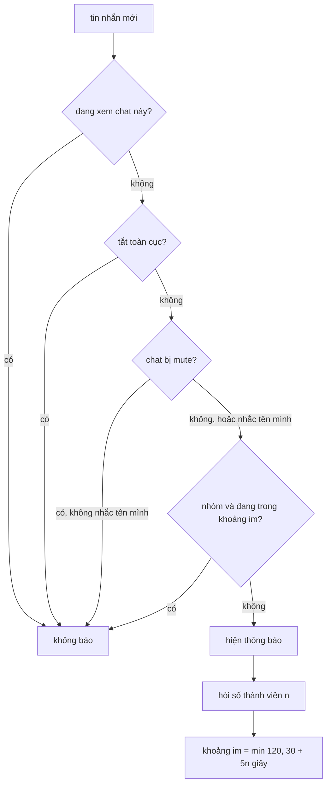

Mở một cuộc trò chuyện trên WhatsApp Web, dòng nhỏ dưới tên người kia cho biết họ đang "online", "đang gõ…" hay "last seen hôm nay lúc 09:12". Thông tin đó đến từ server qua một kênh riêng, và **luôn đến sau** khi bạn đã mở chat. Hiện ngay thứ đang có thì header sẽ nháy: trống → "last seen…" → "online" trong vòng nửa giây.

Nhóm còn khó hơn: mười người cùng gõ thì hiện ai? Một gói "ngừng gõ" đến trễ sau khi người đó đã offline thì sao? Và nhóm 200 người nhắn liên tục thì máy kêu bao nhiêu lần?

Bài này đọc ba module của bundle WhatsApp Web 2020 xử lý đúng ba chuyện đó.

> [!TIP]
> **Tóm tắt**
> - Mở chat mà chưa có dữ liệu presence: giữ dòng chữ mặc định tối đa 1,5 giây, sau 2 giây vẫn không có gì thì để trống. Header không bao giờ nháy qua trạng thái sai.
> - Trong nhóm chỉ hiện **một** người: ai gửi `composing`/`recording` gần nhất. Gói `paused` chỉ có tác dụng khi người đó đang gõ.
> - Sau mỗi thông báo nhóm, im `min(120, 30 + 5 × số thành viên)` giây. Nhóm càng đông càng ít bị làm phiền.
> - Hai lỗi nhỏ của bản gốc: khoảng im được đặt **bất đồng bộ** nên hai tin sát nhau đều kêu, và tin nhắc tên mình cũng bị khoảng im nuốt mất.

<iframe class="demo-frame" src="/demos/web-patterns/index.html?theme=dark#/wa-presence" title="Demo wa-presence" loading="lazy" style="height: 1300px"></iframe>

<p class="demo-links">▶ <a href="/demos/web-patterns/index.html#/wa-presence" target="_blank" rel="noopener">Mở demo toàn màn hình ↗</a> · <a href="https://stackblitz.com/github/hunghg255/blog-hunghg/tree/master/examples/web-patterns?file=src/lib/waPresence.ts" target="_blank" rel="noopener">Sửa code trên StackBlitz ↗</a> · <a href="https://github.com/hunghg255/blog-hunghg/blob/master/examples/web-patterns/src/lib/waPresence.ts" target="_blank" rel="noopener">Xem source trên GitHub ↗</a></p>

## WhatsApp làm thế nào?

Bundle là bản WhatsApp Web năm 2020 (webpack, tên module là chuỗi hash), nên bản hiện tại có thể đã khác. Ba module liên quan:

- `igjghefdb`: model **Presence** của một chat (một người hoặc một nhóm).
- `bbehjhfdfe`: nhận gói chatstate từ server và cập nhật model đó.
- `dgjifchfde`: quyết định có hiện thông báo desktop cho một tin nhắn mới hay không.

### Header không nháy: hai bộ hẹn giờ

Model Presence có hai cờ `withholdDisplay` (mặc định `true`) và `forceDisplay` (mặc định `false`). Khi chat được mở (`onChatActiveChange`):

```js
this.hasData ? this.withholdDisplay = !1
  : this.withholdDisplayTimer = setTimeout(() => this.set({ withholdDisplay: !1 }), 1500),
this.forceDisplayTimer = setTimeout(() => this.set({ forceDisplay: !0 }), 2e3)
```

Component header (module `bcagigidbd`) đọc hai cờ này:

- `withholdDisplay` còn bật: hiện chữ mặc định ("nhấn vào đây để xem thông tin liên hệ").
- Hết giữ: có chuỗi trạng thái thì hiện; không có thì vẫn chữ mặc định, cho tới khi `forceDisplay` bật thì để trống.

Nếu dữ liệu presence **đã có** trong bộ nhớ lúc mở chat (vừa mở chat này cách đây ít phút), trạng thái hiện ngay. Nếu chưa có, người dùng thấy chữ mặc định trong 1,5 giây, **kể cả khi** dữ liệu về sau 200 ms: không có chỗ nào tắt `withholdDisplay` sớm khi dữ liệu tới. Cột "kiểu WhatsApp" trong demo cho thấy độ trễ này.

### Nhóm: một danh sách chatstate

Với chat một người, Presence giữ một `chatstate`. Với nhóm, nó giữ một collection `chatstates`, mỗi phần tử là trạng thái của một thành viên kèm `updateTime`. Dòng dưới tên nhóm lấy phần tử có `type` là `composing` hoặc `recording` và `updateTime` lớn nhất; nhóm được coi là "online" nếu có ít nhất một phần tử khác `unavailable`.

Khi nhận một gói từ server, `bbehjhfdfe` làm vài việc:

- Gói `paused` (vừa ngừng gõ) được đổi thành `available`, nhưng chỉ áp dụng nếu trạng thái hiện tại là `composing` hoặc `recording`: `i && "composing" !== a.type && "recording" !== a.type || a.set(t)`. Nghĩa là gói `paused` đến trễ khi người đó đã `unavailable` bị bỏ qua, không làm họ "online" trở lại. (Ghi chú săn code trước đó của mình viết ngược điều kiện này; đọc lại thì đúng như trên.)
- Trong nhóm, mỗi gói khác `available`/`unavailable` thì cập nhật `updateTime = Date.now()`.
- `composing`/`recording` có hẹn giờ hết hạn `PRESENCE_COMPOSING_TIMEOUT`: server không gửi "ngừng gõ" nếu máy kia mất mạng, nên client tự hạ về `available`. Giá trị hằng số nằm ở module khác, không có trong bundle mình có.
- Đặt `hasData = true` và `forceDisplay ||= isOnline || (isUser && !deny)`: có tin "online" thì cho hiện ngay không chờ.

### Thông báo: bốn lớp lọc

`showMsgNotification` trong `dgjifchfde` chạy lần lượt:

1. Cửa sổ đang focus và chat đang mở: không báo.
2. Tắt thông báo toàn cục: không báo.
3. Chat bị mute: chat một người thì im luôn; chat nhóm thì vẫn báo nếu tin **nhắc tên** hoặc **trả lời** mình, trừ khi chính người gửi bị mute. Chat đã lưu trữ (archive) có cùng quy tắc.
4. **Squelch** (chặn bớt) cho nhóm không phải chỉ-đọc:

```js
var t = Date.now(), a = e.squelch || 0;
if (t > a) return u.default.find(e.id).then(() => {
  var a = t.participants.length, i = 1e3 * Math.min(120, 30 + 5 * a);
  e.squelch = Date.now() + i
}).catchType(d.WebdDrop, () => { e.squelch = Date.now() + 6e4 }), !1;
return !0
```

Nhóm 2 người im 40 giây, nhóm 10 người im 80 giây, từ 18 người trở lên im 2 phút. Không lấy được số thành viên (mất kết nối) thì im 1 phút.

Phần còn lại là chi tiết hiển thị: body bắt đầu bằng ký tự ngoài ASCII (emoji, chữ Ả Rập) được thêm một dấu cách ở đầu, có lẽ để tránh lỗi hiển thị hướng chữ trên một số hệ điều hành; ảnh đại diện tải quá 1,5 giây thì dùng icon mặc định; mỗi chat giữ một thông báo, thông báo mới thay thông báo cũ.

### Hai chỗ chưa ổn

- **Khoảng im đặt bất đồng bộ.** `e.squelch` chỉ được gán **sau khi** `find(e.id)` xong. Tin thứ hai đến trong lúc đó vẫn thấy `squelch` cũ và cũng kêu. Nhóm sôi nổi gửi 3 tin trong 100 ms là 3 tiếng "ting".
- **Tin nhắc tên bị nuốt.** Ngoại lệ "nhắc tên mình" chỉ có ở lớp mute. Ở lớp squelch, tin `@bạn` đến trong 2 phút im lặng thì không có thông báo nào.



## Bên trong trình duyệt

**Notification API.** `new Notification(title, { body, icon, tag })` hiện thông báo hệ điều hành khi `Notification.permission === 'granted'`. Cùng `tag` thì thông báo mới thay thông báo cũ, tương đương việc WhatsApp tự giữ một thông báo cho mỗi chat. Âm thanh không thuộc API này: WhatsApp tự phát một file âm thanh sau khi thông báo hiện.

**Focus.** `document.hasFocus()` cho biết cửa sổ đang được focus; `document.visibilityState` cho biết tab có đang hiện không. Tab hiện nhưng người dùng đang gõ ở cửa sổ khác thì `hasFocus()` là `false`, nên vẫn nên báo.

**Nhiều tab.** Mỗi tab WhatsApp Web chạy logic này độc lập. Mở hai tab thì có thể nhận hai thông báo; bài [Bầu một tab chủ cho thông báo](/blogs/web-leader-tab-notifications) giải quyết đúng chuyện này.

## Viết lại

File `src/lib/waPresence.ts` có ba phần, mỗi phần là hàm thuần hoặc một đối tượng nhỏ có hẹn giờ, không đụng DOM.

Quy tắc `paused`:

```ts title=src/lib/waPresence.ts
const isActive = (t: ChatStateType) => t === 'composing' || t === 'recording';

/**
 * Áp một update vào trạng thái hiện tại.
 * `paused` chỉ có nghĩa khi người đó ĐANG gõ/ghi âm: khi đó chuyển về `available`.
 * Nếu họ đang `unavailable` thì bỏ qua, để một gói `paused` đến trễ không làm họ "online" lại.
 */
export function applyChatState(current: ChatState, incoming: IncomingType, now: number): ChatState {
  if (incoming === 'paused') {
    return isActive(current.type) ? { type: 'available', updateTime: current.updateTime } : current;
  }
  return { type: incoming, updateTime: isActive(incoming) ? now : current.updateTime };
}
```

Thông báo nhóm, phần sửa hai lỗi nằm ở `reserveSynchronously` và `mentionBypassesSquelch`:

```ts title=src/lib/waPresence.ts
export function createNotifyPolicy({
  now,
  participants,
  mentionBypassesSquelch = true,
  reserveSynchronously = true,
}: NotifyPolicyOptions) {
  const squelchUntil = new Map<string, number>();

  return function shouldNotify(msg: IncomingMessage): { notify: boolean; reason: string } {
    if (msg.chatMuted) {
      // chat đã mute: chỉ báo khi được nhắc tên, trừ khi người gửi cũng bị mute
      if (!msg.isGroup || !msg.mentionsMe || msg.senderMuted) return { notify: false, reason: 'muted' };
    }
    if (!msg.isGroup) return { notify: true, reason: 'direct' };
    if (msg.mentionsMe && mentionBypassesSquelch) return { notify: true, reason: 'mention' };

    const t = now();
    const until = squelchUntil.get(msg.chatId);
    if (until !== undefined && t < until) return { notify: false, reason: 'squelched' };

    // giữ chỗ ngay (60 s) để tin thứ hai đến trong lúc chờ server cũng bị chặn
    if (reserveSynchronously) squelchUntil.set(msg.chatId, t + 60_000);
    participants(msg.chatId).then(
      (n) => squelchUntil.set(msg.chatId, now() + squelchSeconds(n) * 1000),
      () => squelchUntil.set(msg.chatId, now() + 60_000),
    );
    return { notify: true, reason: 'group' };
  };
}
```

`summarizeGroup`, `createComposingExpiry` và `createDisplayGate` (header) nằm trong file đầy đủ bên dưới.

::: spoiler Xem toàn bộ src/lib/waPresence.ts

```ts title=src/lib/waPresence.ts
/**
 * Presence, "đang gõ" và chặn bớt thông báo nhóm — viết lại từ ý tưởng của WhatsApp Web 2020
 * (module igjghefdb, bbehjhfdfe, dgjifchfde). Không phải mã gốc.
 */

export type ChatStateType = 'available' | 'unavailable' | 'composing' | 'recording';
/** Server còn gửi `paused` = vừa ngừng gõ. */
export type IncomingType = ChatStateType | 'paused';

export interface ChatState {
  type: ChatStateType;
  /** lần cuối nhận composing/recording (chỉ dùng trong nhóm) */
  updateTime: number;
}

const isActive = (t: ChatStateType) => t === 'composing' || t === 'recording';

/**
 * Áp một update vào trạng thái hiện tại.
 * `paused` chỉ có nghĩa khi người đó ĐANG gõ/ghi âm: khi đó chuyển về `available`.
 * Nếu họ đang `unavailable` thì bỏ qua, để một gói `paused` đến trễ không làm họ "online" lại.
 */
export function applyChatState(current: ChatState, incoming: IncomingType, now: number): ChatState {
  if (incoming === 'paused') {
    return isActive(current.type) ? { type: 'available', updateTime: current.updateTime } : current;
  }
  return { type: incoming, updateTime: isActive(incoming) ? now : current.updateTime };
}

/** Trong nhóm: hiện người gõ gần nhất; nhóm "online" nếu có ai khác unavailable. */
export function summarizeGroup(states: Map<string, ChatState>) {
  let typist: { id: string; state: ChatState } | null = null;
  let online = false;
  for (const [id, state] of states) {
    if (isActive(state.type) && (!typist || typist.state.updateTime < state.updateTime)) {
      typist = { id, state };
    }
    online ||= state.type !== 'unavailable';
  }
  return { typist, online };
}

/**
 * Bộ hẹn giờ cho composing: server không gửi "ngừng gõ" nếu mạng rớt,
 * nên client tự hạ về available sau một khoảng.
 */
export function createComposingExpiry(timeoutMs: number, onExpire: (id: string) => void) {
  const timers = new Map<string, ReturnType<typeof setTimeout>>();
  return {
    touch(id: string, type: ChatStateType) {
      clearTimeout(timers.get(id));
      timers.delete(id);
      if (isActive(type)) timers.set(id, setTimeout(() => (timers.delete(id), onExpire(id)), timeoutMs));
    },
    dispose() {
      timers.forEach(clearTimeout);
      timers.clear();
    },
  };
}

// ---------------------------------------------------------------------------
// Dòng trạng thái ở header: tránh nháy "last seen…" rồi đổi ngay sang "online"

export type HeaderMode = 'placeholder' | 'status' | 'empty';

export interface DisplayGateOptions {
  /** giữ placeholder tối đa bao lâu khi mở chat mà chưa có dữ liệu presence */
  withholdMs?: number;
  /** sau mốc này, chưa có gì để hiện thì để trống thay vì placeholder */
  forceMs?: number;
  /**
   * Bản gốc chỉ thả placeholder sớm nếu dữ liệu ĐÃ có lúc mở chat; dữ liệu về sau đó vẫn phải
   * chờ đủ withholdMs. Bật cờ này để thả ngay khi dữ liệu đầu tiên tới.
   */
  releaseOnData?: boolean;
}

export function createDisplayGate(
  onChange: (mode: HeaderMode) => void,
  { withholdMs = 1500, forceMs = 2000, releaseOnData = true }: DisplayGateOptions = {},
) {
  let hasData = false;
  let withhold = true;
  let force = false;
  let timers: ReturnType<typeof setTimeout>[] = [];
  let hasStatus = false;

  const emit = () => onChange(withhold ? 'placeholder' : hasStatus ? 'status' : force ? 'empty' : 'placeholder');
  const clear = () => (timers.forEach(clearTimeout), (timers = []));

  return {
    open() {
      clear();
      withhold = !hasData;
      force = false;
      if (withhold) timers.push(setTimeout(() => ((withhold = false), emit()), withholdMs));
      timers.push(setTimeout(() => ((force = true), emit()), forceMs));
      emit();
    },
    data(statusText: string | null) {
      hasData = true;
      hasStatus = Boolean(statusText);
      if (releaseOnData) withhold = false;
      emit();
    },
    close: clear,
  };
}

// ---------------------------------------------------------------------------
// Thông báo desktop: nhóm đông thì im lâu hơn, mention xuyên qua mute

export interface IncomingMessage {
  chatId: string;
  isGroup: boolean;
  /** tin nhắc tên hoặc trả lời chính mình */
  mentionsMe: boolean;
  senderMuted: boolean;
  chatMuted: boolean;
}

export interface NotifyPolicyOptions {
  now: () => number;
  /** lấy số thành viên; có thể chậm (gọi server) */
  participants: (chatId: string) => Promise<number>;
  /** bản gốc: false — mention cũng bị chặn nếu đang trong khoảng im */
  mentionBypassesSquelch?: boolean;
  /** bản gốc: false — đặt khoảng im SAU khi lấy xong số thành viên, nên 2 tin sát nhau đều kêu */
  reserveSynchronously?: boolean;
}

/** Khoảng im sau mỗi thông báo nhóm: min(120, 30 + 5×n) giây. */
export const squelchSeconds = (participants: number) => Math.min(120, 30 + 5 * participants);

export function createNotifyPolicy({
  now,
  participants,
  mentionBypassesSquelch = true,
  reserveSynchronously = true,
}: NotifyPolicyOptions) {
  const squelchUntil = new Map<string, number>();

  return function shouldNotify(msg: IncomingMessage): { notify: boolean; reason: string } {
    if (msg.chatMuted) {
      // chat đã mute: chỉ báo khi được nhắc tên, trừ khi người gửi cũng bị mute
      if (!msg.isGroup || !msg.mentionsMe || msg.senderMuted) return { notify: false, reason: 'muted' };
    }
    if (!msg.isGroup) return { notify: true, reason: 'direct' };
    if (msg.mentionsMe && mentionBypassesSquelch) return { notify: true, reason: 'mention' };

    const t = now();
    const until = squelchUntil.get(msg.chatId);
    if (until !== undefined && t < until) return { notify: false, reason: 'squelched' };

    // giữ chỗ ngay (60 s) để tin thứ hai đến trong lúc chờ server cũng bị chặn
    if (reserveSynchronously) squelchUntil.set(msg.chatId, t + 60_000);
    participants(msg.chatId).then(
      (n) => squelchUntil.set(msg.chatId, now() + squelchSeconds(n) * 1000),
      () => squelchUntil.set(msg.chatId, now() + 60_000),
    );
    return { notify: true, reason: 'group' };
  };
}

/** Body bắt đầu bằng ký tự ngoài ASCII (emoji, chữ RTL) thì thêm một dấu cách, như bản gốc. */
export const padNotificationBody = (body: string) => (body.charCodeAt(0) >= 128 ? ` ${body}` : body);
```

:::

## Đi qua code

- **`applyChatState`** giữ đúng quy tắc của bản gốc: `paused` chỉ hạ người **đang** gõ về `available`; trả lại đúng đối tượng cũ khi bỏ qua, nên React (hoặc bất kỳ store nào so sánh tham chiếu) biết không có gì đổi.
- **`summarizeGroup`** duyệt một lần: vừa tìm người gõ gần nhất, vừa xem nhóm có ai online.
- **`createComposingExpiry`** là hẹn giờ theo từng người: mỗi gói mới huỷ hẹn giờ cũ; gói `composing`/`recording` thì đặt hẹn giờ mới. Demo dùng 4 giây vì không biết giá trị thật.
- **`createDisplayGate`** trả về `placeholder`, `status` hoặc `empty`. Cờ `releaseOnData` (mặc định bật) thả chữ mặc định ngay khi dữ liệu tới; tắt cờ là hành vi gốc.
- **`createNotifyPolicy`** nhận `participants` là hàm bất đồng bộ (vì số thành viên có thể phải hỏi server). Điểm khác: **giữ chỗ 60 giây ngay lập tức**, rồi khi biết số thành viên mới chỉnh lại cho đúng. Tin thứ hai đến trong lúc chờ server sẽ thấy khoảng im và không kêu.

**Khác bản gốc:**

- Dữ liệu presence tới sau khi mở chat thì hiện ngay, không chờ đủ 1,5 giây.
- Khoảng im được giữ chỗ đồng bộ (`reserveSynchronously`).
- Tin nhắc tên/trả lời mình xuyên qua khoảng im (`mentionBypassesSquelch`). Cả hai cờ đặt `false` thì giống bản gốc, demo dùng đúng cách đó để so sánh.
- Chỉ có một mốc thời gian chung `now()` truyền vào, nên test và demo tua được đồng hồ.

## Tại sao không làm cách khác?

- **Hiện ngay thứ đang có, cập nhật sau.** Đơn giản nhất, nhưng header nháy qua "last seen 3 giờ trước" rồi mới "online": người dùng đọc được thông tin sai trong nửa giây. Chữ mặc định trung tính hơn.
- **Skeleton (thanh xám nhấp nháy) thay chữ mặc định.** Hợp với danh sách, nhưng header chat là chỗ người dùng nhìn liên tục. Chữ mặc định còn có ích: bấm vào để mở thông tin liên hệ.
- **Hiện danh sách tất cả người đang gõ** ("Bình, Chi và 3 người khác đang gõ"): Slack và Telegram làm vậy. Nhiều thông tin hơn nhưng dòng chữ dài và thay đổi liên tục; WhatsApp chọn một tên.
- **Debounce thông báo** (gom các tin trong N giây thành một thông báo "5 tin mới"): cho người dùng biết có bao nhiêu tin, nhưng thông báo đầu tiên bị chậm N giây. Squelch thì báo ngay tin đầu và im phần sau.
- **Khoảng im cố định.** Nhóm 3 người bạn thân khác nhóm 200 người của khu chung cư. Tăng theo số thành viên là cách rẻ để phân biệt mà không cần người dùng cài đặt gì.

## Edge case và cạm bẫy

- **Gói đến sai thứ tự.** `paused` đến sau `unavailable` là ví dụ quy tắc trên xử lý. Nếu server gửi kèm số thứ tự hoặc timestamp, so sánh trước khi áp dụng là cách chắc hơn; bài [presence có version](/blogs/facebook-threadlist-ranged-presence) của Facebook làm vậy.
- **Đồng hồ máy khách.** `updateTime = Date.now()` chỉ dùng để so sánh các gói trên cùng một máy, nên đồng hồ lệch không sao. Đừng so nó với timestamp từ server.
- **Đổi chat liên tục.** Mỗi lần mở chat phải huỷ hẹn giờ của chat trước (`close()` trong bản viết lại, nhánh `else` của `onChatActiveChange` trong bản gốc), không thì một hẹn giờ cũ bật cờ của chat mới.
- **Số thành viên thay đổi.** Khoảng im tính lúc có thông báo; người mới vào nhóm chỉ ảnh hưởng lần sau. Chấp nhận được.
- **"Người gửi bị mute".** Bản gốc kiểm tra người gửi có bị mute (một tính năng riêng, không phải chặn) trước khi cho tin nhắc tên đi qua; bản viết lại nhận cờ `senderMuted` từ ngoài.
- **Quyền thông báo.** Gọi `Notification.requestPermission()` trong một sự kiện người dùng (bấm nút), không gọi lúc tải trang: trình duyệt hiện đại sẽ chặn hoặc ẩn yêu cầu đó.

## Dùng trong dự án

```ts
const shouldNotify = createNotifyPolicy({ now: Date.now, participants: (id) => api.getGroup(id).then((g) => g.members.length) });

socket.on('message', (msg) => {
  if (document.hasFocus() && msg.chatId === openChatId) return;
  const mentionsMe = msg.mentions.includes(me.id) || msg.quotedAuthor === me.id;
  const { notify } = shouldNotify({ ...msg, mentionsMe, senderMuted: mutedUsers.has(msg.senderId), chatMuted: mutedChats.has(msg.chatId) });
  if (notify && Notification.permission === 'granted') {
    new Notification(msg.chatTitle, { body: padNotificationBody(msg.preview), tag: msg.chatId });
  }
});
```

Mỗi chat một `tag`, nên thông báo mới của cùng chat thay cho thông báo cũ thay vì xếp chồng.

## Kiểm thử

::: spoiler Ví dụ test (bản phác, không có trong repo)

```ts
import { afterEach, beforeEach, expect, it, vi } from 'vitest';
import { applyChatState, createDisplayGate, createNotifyPolicy, squelchSeconds, summarizeGroup, type ChatState } from './waPresence';

beforeEach(() => vi.useFakeTimers());
afterEach(() => vi.useRealTimers());

it('paused chỉ hạ người đang gõ về available', () => {
  const typing: ChatState = { type: 'composing', updateTime: 5 };
  const away: ChatState = { type: 'unavailable', updateTime: 5 };
  expect(applyChatState(typing, 'paused', 9).type).toBe('available');
  expect(applyChatState(away, 'paused', 9)).toBe(away);
  expect(applyChatState(away, 'recording', 9)).toEqual({ type: 'recording', updateTime: 9 });
});

it('nhóm hiện người gõ gần nhất', () => {
  const states = new Map<string, ChatState>([
    ['a', { type: 'composing', updateTime: 1 }],
    ['b', { type: 'recording', updateTime: 3 }],
    ['c', { type: 'unavailable', updateTime: 0 }],
  ]);
  expect(summarizeGroup(states).typist?.id).toBe('b');
  expect(summarizeGroup(new Map([['c', { type: 'unavailable', updateTime: 0 }]])).online).toBe(false);
});

it('header: kiểu gốc chờ đủ 1,5 s, bản viết lại hiện ngay khi có dữ liệu', () => {
  const wa: string[] = [];
  const mine: string[] = [];
  const g1 = createDisplayGate((m) => wa.push(m), { releaseOnData: false });
  const g2 = createDisplayGate((m) => mine.push(m));
  g1.open();
  g2.open();
  vi.advanceTimersByTime(300);
  g1.data('online');
  g2.data('online');
  expect(wa.at(-1)).toBe('placeholder');
  expect(mine.at(-1)).toBe('status');
  vi.advanceTimersByTime(1200);
  expect(wa.at(-1)).toBe('status');
});

it('header: không có dữ liệu thì sau 2 s để trống', () => {
  const modes: string[] = [];
  createDisplayGate((m) => modes.push(m)).open();
  vi.advanceTimersByTime(2000);
  expect(modes).toEqual(['placeholder', 'placeholder', 'empty']);
});

it('thông báo nhóm: giữ chỗ đồng bộ, mention xuyên qua khoảng im', async () => {
  let now = 0;
  const msg = { chatId: 'g', isGroup: true, mentionsMe: false, senderMuted: false, chatMuted: false };
  const participants = () => Promise.resolve(20);
  const orig = createNotifyPolicy({ now: () => now, participants, mentionBypassesSquelch: false, reserveSynchronously: false });
  const mine = createNotifyPolicy({ now: () => now, participants });
  // hai tin cùng lúc, trước khi biết số thành viên
  expect([orig(msg).notify, orig(msg).notify]).toEqual([true, true]);
  expect([mine(msg).notify, mine(msg).notify]).toEqual([true, false]);
  await Promise.resolve();
  expect(squelchSeconds(20)).toBe(120);
  now = 60_000;
  expect(orig({ ...msg, mentionsMe: true }).notify).toBe(false);
  expect(mine({ ...msg, mentionsMe: true }).reason).toBe('mention');
  now = 120_001;
  expect(mine(msg).notify).toBe(true);
});
```

:::

## So với các lựa chọn khác

- **Notification API + `tag`** (mọi trình duyệt desktop, tính tới 10/2026): đủ cho việc "một thông báo mỗi chat". Thuộc tính `renotify: true` cho phép kêu lại khi thay thông báo cùng tag, chỉ có trên trình duyệt nhân Chromium.
- **Service worker + Push API**: cần thiết nếu muốn báo khi tab đã đóng. Logic squelch khi đó phải chạy trong service worker, và trạng thái (`squelchUntil`) nên lưu vào IndexedDB vì service worker có thể bị dừng bất cứ lúc nào.
- **Badging API** (`navigator.setAppBadge`): hiện số tin chưa đọc trên icon app đã cài (PWA), không làm phiền như thông báo. Kết hợp được: squelch thông báo nhưng vẫn cập nhật badge. Telegram Web đổi tiêu đề tab và favicon cho việc này, xem [bài về tiêu đề và favicon](/blogs/telegram-title-favicon-unread).
- Facebook đo "người dùng có đang thật sự dùng tab không" bằng bitmap theo giây ([bài #23](/blogs/facebook-time-spent-bitmap)); có thể dùng tín hiệu đó thay cho `document.hasFocus()` khi quyết định có báo hay không.

---

Bài này thuộc series **[Học từ mã nguồn WhatsApp Web](/series/whatsapp)** (19 bài, đọc theo thứ tự).

::: spoiler Xem nhanh danh sách bài trong series

*Mở đầu*

- [Mở đầu: đọc bundle WhatsApp Web 2020](/blogs/learn-from-whatsapp-web-source-code)

*Phần 1: media và mã hoá*

- [#1 Giải mã JPEG progressive theo từng scan, kiểm HMAC](/blogs/whatsapp-progressive-jpeg-hmac)
- [#2 Ghép khoảng byte cho video streaming](/blogs/whatsapp-byte-range-merge)
- [#3 Xoá EXIF không re-encode, thumbnail theo ngân sách byte](/blogs/whatsapp-jpeg-strip-thumb-budget)
- [#4 Đọc metadata sticker WebP động](/blogs/whatsapp-webp-sticker-metadata)

*Phần 2: lưu trữ trên trình duyệt*

- [#5 Kho media LRU tự co theo quota](/blogs/whatsapp-quota-aware-media-lru)
- [#6 Cache blob trong RAM có refcount, tự revoke objectURL](/blogs/whatsapp-blob-cache-refcount)
- [#7 Khoá IndexedDB giữ đúng thứ tự từ điển](/blogs/whatsapp-indexeddb-ordered-keys)

*Phần 3: danh sách tin nhắn*

- [#8 Render tin nhắn theo cửa sổ chiều cao ước lượng](/blogs/whatsapp-render-cursor-window)
- [#9 Theo dõi viewport tin nhắn: binary search, ngày dính](/blogs/whatsapp-message-viewport-tracking)
- [#10 FlatList tái dùng key React, overscan bất đối xứng](/blogs/whatsapp-flatlist-key-reuse)

*Phần 4: soạn tin và chữ*

- [#11 Emoticon thành emoji bằng trie đọc ngược, tìm emoji](/blogs/whatsapp-emoticon-trie-emoji-search)
- [#12 Mention bằng token zero-width, giới hạn theo code point](/blogs/whatsapp-mention-zero-width-input)
- [#13 Xác định hướng chữ bằng bảng delta nén](/blogs/whatsapp-text-direction-table)
- [#14 Phát hiện homograph trong link, chặn giả đuôi file RTLO](/blogs/whatsapp-homograph-rtlo-guard)

*Phần 5: realtime và tiện ích*

- **#15 Presence, "đang gõ" và thông báo theo kích thước group** (bài này)
- [#16 Đo FPS phát hiện UI đóng băng, idle monitor](/blogs/whatsapp-fps-freeze-idle)
- [#17 Cửa sổ PiP: resize 8 hướng, khoá tỉ lệ, né vật cản](/blogs/whatsapp-pip-resize-avoid)
- [#18 Parse giá tiền theo locale bằng Intl](/blogs/whatsapp-locale-price-parse)

:::

Code + demo: [`examples/web-patterns`](https://github.com/hunghg255/blog-hunghg/tree/master/examples/web-patterns) · [Mở trên StackBlitz](https://stackblitz.com/github/hunghg255/blog-hunghg/tree/master/examples/web-patterns)
