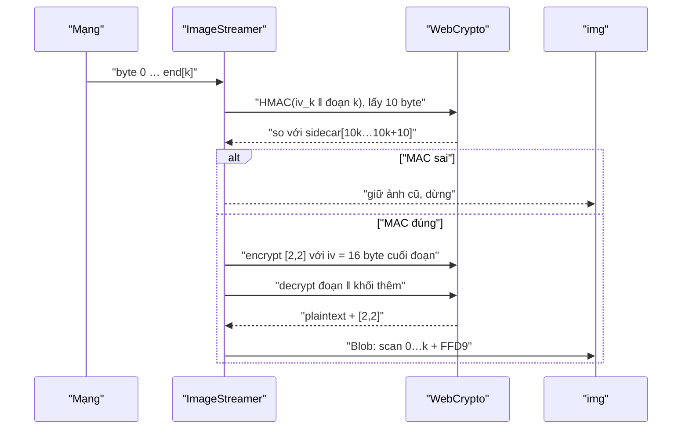

Ảnh trong WhatsApp được mã hoá đầu-cuối (end-to-end encryption): server chỉ giữ một khối byte vô nghĩa, khoá nằm trong tin nhắn. Cách đơn giản nhất là tải hết file, kiểm HMAC, giải mã AES rồi mới hiện ảnh. Với ảnh 2 MB trên mạng 3G, người dùng nhìn khung xám vài giây.

Định dạng JPEG progressive vốn sinh ra để tránh chuyện đó: file gồm nhiều **scan** (lượt quét), scan đầu đã cho ảnh mờ toàn khung, các scan sau làm nét dần. Nhưng muốn tận dụng thì phải **giải mã từng phần** một file đã mã hoá AES-CBC, và phải chắc phần đó không bị sửa trên đường truyền trước khi đưa vào bộ giải mã ảnh. WhatsApp Web làm được cả hai, với một mẹo nhỏ để qua mặt WebCrypto.

> [!TIP]
> **Tóm tắt**
> - Bên gửi đính kèm danh sách độ dài từng scan và một **sidecar**: mỗi đoạn ciphertext có 10 byte HMAC riêng. Bên nhận tải xong đoạn nào thì kiểm và giải mã đoạn đó, ảnh nét dần theo scan.
> - WebCrypto chỉ giải mã AES-CBC khi khối cuối có padding PKCS#7 hợp lệ. Đoạn giữa file thì không có, nên WhatsApp **mã hoá thêm khối `[2,2]`** nối vào cuối để tạo padding hợp lệ, giải mã xong cắt 2 byte đó đi.
> - Ảnh dở dang được nối thêm marker `FFD9` (EOI) để trình duyệt chịu hiển thị.
> - Bản gốc so sánh MAC của sidecar bằng vòng lặp **thoát sớm**, trong khi hàm giải mã cả file lại so sánh không thoát sớm. Bản viết lại dùng một hàm so sánh cho mọi chỗ.

<iframe class="demo-frame" src="/demos/web-patterns/index.html?theme=dark#/wa-progressive-jpeg" title="Demo wa-progressive-jpeg" loading="lazy" style="height: 820px"></iframe>

<p class="demo-links">▶ <a href="/demos/web-patterns/index.html#/wa-progressive-jpeg" target="_blank" rel="noopener">Mở demo toàn màn hình ↗</a> · <a href="https://stackblitz.com/github/hunghg255/blog-hunghg/tree/master/examples/web-patterns?file=src/lib/waProgressiveJpeg.ts" target="_blank" rel="noopener">Sửa code trên StackBlitz ↗</a> · <a href="https://github.com/hunghg255/blog-hunghg/blob/master/examples/web-patterns/src/lib/waProgressiveJpeg.ts" target="_blank" rel="noopener">Xem source trên GitHub ↗</a></p>

Bấm **Gửi và tải ảnh**: demo tự sinh khoá 32 byte, mã hoá một JPEG progressive 10 scan, rồi "tải" từng 384 byte. Thanh màu cho thấy ranh giới các đoạn, ảnh nét dần mỗi khi một đoạn chuyển xanh. Bật **Lật 1 bit ở đoạn 4** rồi chạy lại: bốn đoạn đầu vẫn hiện, đoạn 4 bị chặn trước khi tới bộ giải mã ảnh. Nút **Giải mã đoạn giữa không có mẹo** cho thấy WebCrypto từ chối ngay.

## WhatsApp Web làm thế nào?

Mã nguồn là bundle WhatsApp Web năm 2020, đã qua webpack nên tên module là chuỗi hash. Ba module liên quan: `daiahejada` sinh khoá, `dgeebjciej` giải mã cả file, `dhibedeibc` là lớp `ImageStreamer` giải mã theo scan. Các đoạn trích dưới đây đã đổi tên biến cho dễ đọc. Đây là bản 2020, cách làm hiện tại có thể đã khác.

### Một khoá media, bốn khoá con

`daiahejada` chạy HKDF với `mediaKey` trong tin nhắn và một chuỗi theo loại media (`"WhatsApp Image Keys"`, `"WhatsApp Video Keys"`, `"WhatsApp Audio Keys"`…), lấy ra 112 byte rồi cắt:

| Byte | 0–15 | 16–47 | 48–79 | 80–111 |
| --- | --- | --- | --- | --- |
| Dùng làm | `iv` | `encKey` (AES-256) | `macKey` (HMAC-SHA256) | `refKey` |

File trên server là `AES-CBC(encKey, iv, ảnh)` nối với 10 byte đầu của `HMAC-SHA256(macKey, iv ‖ ciphertext)`. Hàm giải mã cả file trong `dgeebjciej` (`decryptE2EMedia`) đòi file dài ít nhất 10 byte, tách 10 byte cuối làm MAC, ký lại `iv ‖ ciphertext`, so sánh bằng một cờ `bad = true` chạy hết vòng lặp (không `return` giữa chừng) rồi mới gọi `aesCbcDecrypt`. Chi tiết nhỏ này sẽ quay lại ở phần "Khác bản gốc".

### Chia ciphertext theo scan

Tin nhắn ảnh kèm hai trường: `scanLengths` (độ dài plaintext của từng scan) và `scansSidecar` (10 byte MAC cho mỗi đoạn). Ranh giới scan nằm giữa khối AES nên phải làm tròn lên bội 16, phần dư thuộc về đoạn sau. Hàm `alignChunkLengthsToMultipleOfAesBlockSize` trong `dhgjbgdbhg` cộng dồn độ dài scan, mỗi khi tổng vượt mốc đã căn thì đẩy ra một đoạn dài `16 * ceil((tổng - mốc) / 16)`. Riêng scan cuối thì đoạn kéo tới hết file, nên chứa luôn padding PKCS#7 thật và 10 byte MAC. Với ảnh mẫu trong demo (12 726 byte, ciphertext + MAC 12 746 byte):

| Scan | 0 | 1 | 2 | 3 | 4 | 5 | 6 | 7 | 8 | 9 |
| --- | --- | --- | --- | --- | --- | --- | --- | --- | --- | --- |
| Plaintext | 1767 | 1350 | 554 | 881 | 1454 | 1603 | 482 | 511 | 645 | 3479 |
| Đoạn ciphertext | 1776 | 1344 | 560 | 880 | 1456 | 1600 | 480 | 512 | 640 | 3498 |

Đoạn 0 dài hơn scan 0 chín byte (làm tròn lên 1776), nên đoạn 1 ngắn lại tương ứng. Đoạn cuối = 3479 byte còn lại + 9 byte padding + 10 byte MAC.

### Kiểm từng đoạn bằng sidecar

`ImageStreamer._validateSidecar(chunk, t)` lấy `sidecar.slice(10 * t, 10 * t + 10)`, ký `iv ‖ chunk` bằng `macKey` (cắt 10 byte), so sánh bằng hàm `arrayBufferEquals` (module `gchhabjba`), sai thì reject `ChunkValidationError`. Với `t === 0`, iv là iv của file. Với các đoạn sau, iv là `chunk.slice(-16)` của đoạn trước, cất trong `this._nextChunkIV`. Đây cũng chính là iv mà AES-CBC cần để giải mã đoạn đó, nên một giá trị dùng cho cả hai việc.

### Mẹo khối [2,2]

Đây là phần đáng học nhất. `crypto.subtle.decrypt` với AES-CBC luôn coi khối cuối là padding PKCS#7 và ném `OperationError` nếu padding sai. Đoạn giữa file thì khối cuối là dữ liệu ảnh, không phải padding. `_cleanupCipherTextAndIV` xử lý như sau:

```js
const _ = new Uint8Array([2, 2]);
_cleanupCipherTextAndIV(chunk, t) {
  const aligned = chunk.byteLength % 16 === 0;
  const iv = t === 0 ? this._cryptoKeys.iv : this._downloadedBytes.slice(end[t - 1] - 16, end[t - 1]);
  if (!aligned) return { cipherText: chunk.slice(0, -10), iv }; // đoạn cuối: bỏ MAC
  // đoạn giữa: mã hoá [2,2] với iv = khối cuối của đoạn, lấy 16 byte, nối vào
  return aesCbcEncrypt(encKey, _, chunk.slice(-16))
    .then(extra => ({ cipherText: concat(chunk, extra.slice(-16)), iv }));
}
// _handleChunk: … aesCbcDecrypt(encKey, concat(iv, cipherText)) → removeEncryptedPadding(plain, _)
```

Mã hoá `[2,2]` với iv là khối ciphertext cuối của đoạn, trình duyệt tự thêm 14 byte padding giá trị `0x0e`. Khối 16 byte thu được, khi nối vào sau đoạn và giải mã theo chuỗi CBC, sẽ giải ra đúng `[2,2,14×0x0e]`. Padding hợp lệ, WebCrypto bỏ 14 byte, còn lại dữ liệu thật cộng `[2,2]`, `removeEncryptedPadding` cắt nốt.

### Ảnh dở dang cần EOI

Khi đã có `k` đoạn, `_generateBlobFromFullyLoadedChunks` ghép plaintext, cắt đúng tổng độ dài `k` scan đầu, thêm `FF D9` nếu chưa có rồi tạo `Blob`:

```js
const len = this._scanLengths.slice(0, k).reduce((a, b) => a + b, 0);
const body = concat(...decrypted).slice(0, len);
const parts = [arrayBufferEquals(EOI, body.slice(-2)) ? body : concat(body, EOI)];
blobCache.put(getProgressiveMediaCacheKey(filehash, k), new Blob(parts, { type: mimetype }));
this._onProgressiveUpdate(k);
```

Blob của từng mức scan được cache với khoá `<filehash>-progressive-<k>`, có lẽ để cuộn qua lại không phải giải mã lại.

## Bên trong trình duyệt: CBC, padding và scan

AES-CBC mã hoá từng khối 16 byte, mỗi khối XOR với ciphertext của khối trước. Hệ quả quan trọng: **muốn giải mã khối `i` chỉ cần ciphertext khối `i` và khối `i-1`**. Không cần giải mã lại từ đầu file, cũng không cần khoá gì khác. Vì thế cắt ciphertext ở bất kỳ ranh giới bội 16 nào, lấy 16 byte cuối của phần trước làm iv, là giải mã độc lập được phần sau.

Cản trở duy nhất là padding. WebCrypto không có chế độ "AES-CBC không padding". Gửi 64 byte giữa file vào `decrypt`, khối cuối giải ra dữ liệu ảnh ngẫu nhiên. Phần lớn trường hợp byte cuối không phải padding hợp lệ và hàm ném lỗi. Tệ hơn, khoảng 1/256 trường hợp byte cuối tình cờ là `0x01`, hàm **không** ném lỗi mà âm thầm cắt mất 1 byte. Mẹo `[2,2]` biến chuyện may rủi đó thành chắc chắn.

Về phía ảnh, bộ giải mã JPEG của trình duyệt chấp nhận file dừng ở ranh giới scan nếu có marker kết thúc `FFD9`. Thiếu `FFD9`, tuỳ bộ giải mã mà ảnh có thể vẫn hiện, hiện thiếu hoặc bị coi là hỏng. Thêm 2 byte là cách rẻ nhất để khỏi phụ thuộc vào chuyện đó.



## Viết lại

Bản viết lại ở `src/lib/waProgressiveJpeg.ts` có đủ hai phía: bên gửi (sinh khoá, mã hoá, tính sidecar) để demo tự tạo dữ liệu, và bên nhận (`ProgressiveDecryptor`). Khoá trong demo do `crypto.getRandomValues` sinh, không liên quan tới khoá thật nào.

Sinh khoá dùng `crypto.subtle.deriveBits` với thuật toán `HKDF` (salt 32 byte 0, hash SHA-256), chia 112 byte như bảng trên. So sánh MAC ở mọi chỗ dùng chung `timingSafeEqual`: gom mọi khác biệt bằng `diff |= a[i] ^ b[i]` rồi mới kết luận.

Căn đoạn. Khác bản gốc ở chỗ trường hợp "mốc căn đã chạm cuối ciphertext" được gộp tường minh, để đoạn áp chót không bao giờ phải chứa padding thật:

```ts title=src/lib/waProgressiveJpeg.ts
const alignUp = (n: number) => Math.ceil(n / BLOCK) * BLOCK;

/**
 * Độ dài plaintext từng scan → độ dài đoạn ciphertext, mỗi đoạn kết thúc ở bội 16.
 * Đoạn cuối kéo tới hết file mã hoá (gồm padding PKCS#7 và 10 byte MAC).
 * Scan quá ngắn không vượt qua mốc đã căn thì gộp vào đoạn sau.
 */
export function alignChunkLengths(scanLengths: number[], encTotal: number): number[] {
  const out: number[] = [];
  let plainEnd = 0;
  let aligned = 0;
  for (let i = 0; i < scanLengths.length - 1; i++) {
    plainEnd += scanLengths[i];
    if (plainEnd <= aligned) continue;
    const next = alignUp(plainEnd);
    out.push(next - aligned);
    aligned = next;
  }
  // Nếu mốc căn trước đã chạm cuối ciphertext thì đoạn cuối sẽ rỗng: gộp vào đoạn trước.
  if (aligned >= encTotal - MAC_LENGTH && out.length) aligned -= out.pop()!;
  out.push(encTotal - aligned);
  return out;
}
```

Phía nhận: nhận byte theo từng mảnh bất kỳ, xong đoạn nào xử lý đoạn đó, sai MAC thì khoá luôn bộ giải mã. Mẹo `[2,2]` nằm trong `decryptChunk`:

```ts title=src/lib/waProgressiveJpeg.ts
  /** Cộng thêm byte vừa tải; trả về các đoạn mới giải mã được (rỗng nếu chưa đủ đoạn nào). */
  async push(bytes: Bytes): Promise<ChunkResult[]> {
    if (this.failed) throw new Error('đã dừng vì đoạn trước sai MAC');
    this.received = concat(this.received, bytes);
    const out: ChunkResult[] = [];
    while (!this.done && this.received.byteLength >= this.chunkEnds[this.plain.length]) {
      const index = this.plain.length;
      const start = index ? this.chunkEnds[index - 1] : 0;
      const chunk = this.received.subarray(start, this.chunkEnds[index]);
      const expected = this.sidecar.subarray(index * MAC_LENGTH, (index + 1) * MAC_LENGTH);
      if (!timingSafeEqual(await hmac10(this.keys.macKey, concat(this.iv, chunk)), expected)) {
        this.failed = true;
        throw new Error(`đoạn ${index} không khớp sidecar`);
      }
      this.plain.push(await this.decryptChunk(chunk, this.iv));
      this.iv = chunk.slice(-BLOCK);
      out.push(this.render(index));
    }
    return out;
  }

  private async decryptChunk(chunk: Bytes, iv: Bytes): Promise<Bytes> {
    const aes = { name: 'AES-CBC', iv };
    if (chunk.byteLength % BLOCK !== 0) {
      // Đoạn cuối: bỏ 10 byte MAC, phần còn lại có padding PKCS#7 thật.
      return new Uint8Array(await crypto.subtle.decrypt(aes, this.keys.encKey, chunk.subarray(0, -MAC_LENGTH)));
    }
    // Đoạn giữa không có padding nên WebCrypto sẽ từ chối. Mã hoá [2,2] với iv = khối cuối của đoạn:
    // khối thu được giải mã ra [2,2] + padding hợp lệ, nối vào là giải mã được, rồi cắt [2,2] đi.
    const tail = new Uint8Array(
      await crypto.subtle.encrypt({ name: 'AES-CBC', iv: chunk.slice(-BLOCK) }, this.keys.encKey, FAKE_TAIL),
    );
    const plain = new Uint8Array(await crypto.subtle.decrypt(aes, this.keys.encKey, concat(chunk, tail)));
    return plain.subarray(0, plain.byteLength - FAKE_TAIL.byteLength);
  }
```

::: spoiler Xem toàn bộ src/lib/waProgressiveJpeg.ts
```ts title=src/lib/waProgressiveJpeg.ts
// Giải mã JPEG progressive theo từng scan, mỗi đoạn kiểm HMAC riêng.
// Viết lại từ module ImageStreamer (dhibedeibc) và tiện ích crypto (dhgjbgdbhg)
// của WhatsApp Web bản 2020. Khoá trong demo do trình duyệt tự sinh.

/** Byte nằm trên ArrayBuffer thường (WebCrypto không nhận SharedArrayBuffer). */
export type Bytes = Uint8Array<ArrayBuffer>;

export const MAC_LENGTH = 10;
const BLOCK = 16;
/** Khối "đệm giả" WhatsApp mã hoá thêm để giải mã được ciphertext dở dang. */
const FAKE_TAIL = new Uint8Array([2, 2]);
export const EOI = new Uint8Array([0xff, 0xd9]);

export interface MediaKeys {
  iv: Bytes;
  encKey: CryptoKey;
  macKey: CryptoKey;
}

/** HKDF-SHA256(mediaKey, info) → 112 byte: iv | encKey | macKey | refKey. */
export async function deriveMediaKeys(mediaKey: Bytes, info = 'WhatsApp Image Keys'): Promise<MediaKeys> {
  const base = await crypto.subtle.importKey('raw', mediaKey, 'HKDF', false, ['deriveBits']);
  const bits = new Uint8Array(
    await crypto.subtle.deriveBits(
      { name: 'HKDF', hash: 'SHA-256', salt: new Uint8Array(32), info: new TextEncoder().encode(info) },
      base,
      112 * 8,
    ),
  );
  const encKey = await crypto.subtle.importKey('raw', bits.slice(16, 48), 'AES-CBC', false, ['encrypt', 'decrypt']);
  const macKey = await crypto.subtle.importKey('raw', bits.slice(48, 80), { name: 'HMAC', hash: 'SHA-256' }, false, [
    'sign',
  ]);
  return { iv: bits.slice(0, 16), encKey, macKey };
}

export function concat(...parts: Uint8Array[]): Bytes {
  const out = new Uint8Array(parts.reduce((n, p) => n + p.byteLength, 0));
  let at = 0;
  for (const p of parts) {
    out.set(p, at);
    at += p.byteLength;
  }
  return out;
}

/** So sánh không thoát sớm: thời gian chạy không phụ thuộc vị trí byte sai đầu tiên. */
export function timingSafeEqual(a: Uint8Array, b: Uint8Array): boolean {
  if (a.byteLength !== b.byteLength) return false;
  let diff = 0;
  for (let i = 0; i < a.byteLength; i++) diff |= a[i] ^ b[i];
  return diff === 0;
}

export async function hmac10(key: CryptoKey, data: Bytes): Promise<Bytes> {
  return new Uint8Array(await crypto.subtle.sign('HMAC', key, data)).slice(0, MAC_LENGTH);
}

/** Bên gửi: AES-CBC rồi gắn 10 byte HMAC(iv ‖ ciphertext) vào cuối. */
export async function encryptMedia(plain: Bytes, keys: MediaKeys): Promise<Bytes> {
  const ct = new Uint8Array(await crypto.subtle.encrypt({ name: 'AES-CBC', iv: keys.iv }, keys.encKey, plain));
  return concat(ct, await hmac10(keys.macKey, concat(keys.iv, ct)));
}

/** Bên nhận, kiểu tải hết rồi mới giải mã (decryptE2EMedia). */
export async function decryptMedia(enc: Bytes, keys: MediaKeys): Promise<Bytes> {
  if (enc.byteLength < MAC_LENGTH + BLOCK) throw new Error('ciphertext quá ngắn');
  const ct = enc.subarray(0, enc.byteLength - MAC_LENGTH);
  const mac = enc.subarray(enc.byteLength - MAC_LENGTH);
  if (!timingSafeEqual(await hmac10(keys.macKey, concat(keys.iv, ct)), mac)) throw new Error('HMAC không khớp');
  return new Uint8Array(await crypto.subtle.decrypt({ name: 'AES-CBC', iv: keys.iv }, keys.encKey, ct));
}

const alignUp = (n: number) => Math.ceil(n / BLOCK) * BLOCK;

/**
 * Độ dài plaintext từng scan → độ dài đoạn ciphertext, mỗi đoạn kết thúc ở bội 16.
 * Đoạn cuối kéo tới hết file mã hoá (gồm padding PKCS#7 và 10 byte MAC).
 * Scan quá ngắn không vượt qua mốc đã căn thì gộp vào đoạn sau.
 */
export function alignChunkLengths(scanLengths: number[], encTotal: number): number[] {
  const out: number[] = [];
  let plainEnd = 0;
  let aligned = 0;
  for (let i = 0; i < scanLengths.length - 1; i++) {
    plainEnd += scanLengths[i];
    if (plainEnd <= aligned) continue;
    const next = alignUp(plainEnd);
    out.push(next - aligned);
    aligned = next;
  }
  // Nếu mốc căn trước đã chạm cuối ciphertext thì đoạn cuối sẽ rỗng: gộp vào đoạn trước.
  if (aligned >= encTotal - MAC_LENGTH && out.length) aligned -= out.pop()!;
  out.push(encTotal - aligned);
  return out;
}

/** Bên gửi: 10 byte HMAC(iv của đoạn ‖ đoạn) cho mỗi đoạn. iv của đoạn sau = 16 byte cuối đoạn trước. */
export async function buildScansSidecar(enc: Bytes, chunkLengths: number[], keys: MediaKeys) {
  const macs: Uint8Array[] = [];
  let iv = keys.iv;
  let at = 0;
  for (const len of chunkLengths) {
    const chunk = enc.subarray(at, at + len);
    macs.push(await hmac10(keys.macKey, concat(iv, chunk)));
    iv = chunk.slice(-BLOCK);
    at += len;
  }
  return concat(...macs);
}

/**
 * Tách JPEG progressive thành các scan: độ dài thứ i kết thúc ngay sau dữ liệu entropy
 * của scan i (đoạn đầu gồm cả header). Cộng dồn k phần đầu + FFD9 là một JPEG hợp lệ k scan.
 */
export function splitJpegScans(jpeg: Uint8Array): number[] {
  if (jpeg[0] !== 0xff || jpeg[1] !== 0xd8) throw new Error('không phải JPEG');
  const ends: number[] = [];
  let i = 2;
  while (i + 4 <= jpeg.length) {
    if (jpeg[i] !== 0xff) throw new Error(`mất đồng bộ marker ở ${i}`);
    const marker = jpeg[i + 1];
    if (marker === 0xd9) break;
    const len = (jpeg[i + 2] << 8) | jpeg[i + 3];
    i += 2 + len;
    if (marker !== 0xda) continue;
    // Dữ liệu entropy: chạy tới 0xFF đi sau bởi byte khác 00 và khác RST0..7.
    while (i + 1 < jpeg.length && !(jpeg[i] === 0xff && jpeg[i + 1] !== 0 && (jpeg[i + 1] < 0xd0 || jpeg[i + 1] > 0xd7)))
      i++;
    ends.push(i);
  }
  ends[ends.length - 1] = jpeg.length;
  return ends.map((end, k) => end - (k ? ends[k - 1] : 0));
}

export interface ChunkResult {
  index: number;
  /** số scan hiển thị được sau đoạn này */
  scans: number;
  image: Bytes;
}

/**
 * Bên nhận: nhận dần các byte đã tải, xong đoạn nào thì kiểm sidecar, giải mã đoạn đó
 * (không giải mã lại phần trước) và dựng ảnh từ các scan đã đủ.
 */
export class ProgressiveDecryptor {
  private chunkLengths: number[];
  private chunkEnds: number[];
  private plain: Uint8Array[] = [];
  private iv: Bytes;
  private received = new Uint8Array(0);
  private failed = false;

  constructor(
    private keys: MediaKeys,
    private scanLengths: number[],
    private sidecar: Bytes,
    encTotal: number,
  ) {
    this.chunkLengths = alignChunkLengths(scanLengths, encTotal);
    let sum = 0;
    this.chunkEnds = this.chunkLengths.map((n) => (sum += n));
    this.iv = keys.iv;
    if (sidecar.byteLength !== this.chunkLengths.length * MAC_LENGTH) throw new Error('sidecar sai độ dài');
  }

  get chunkCount() {
    return this.chunkLengths.length;
  }

  get done() {
    return this.plain.length === this.chunkLengths.length;
  }

  /** Cộng thêm byte vừa tải; trả về các đoạn mới giải mã được (rỗng nếu chưa đủ đoạn nào). */
  async push(bytes: Bytes): Promise<ChunkResult[]> {
    if (this.failed) throw new Error('đã dừng vì đoạn trước sai MAC');
    this.received = concat(this.received, bytes);
    const out: ChunkResult[] = [];
    while (!this.done && this.received.byteLength >= this.chunkEnds[this.plain.length]) {
      const index = this.plain.length;
      const start = index ? this.chunkEnds[index - 1] : 0;
      const chunk = this.received.subarray(start, this.chunkEnds[index]);
      const expected = this.sidecar.subarray(index * MAC_LENGTH, (index + 1) * MAC_LENGTH);
      if (!timingSafeEqual(await hmac10(this.keys.macKey, concat(this.iv, chunk)), expected)) {
        this.failed = true;
        throw new Error(`đoạn ${index} không khớp sidecar`);
      }
      this.plain.push(await this.decryptChunk(chunk, this.iv));
      this.iv = chunk.slice(-BLOCK);
      out.push(this.render(index));
    }
    return out;
  }

  private async decryptChunk(chunk: Bytes, iv: Bytes): Promise<Bytes> {
    const aes = { name: 'AES-CBC', iv };
    if (chunk.byteLength % BLOCK !== 0) {
      // Đoạn cuối: bỏ 10 byte MAC, phần còn lại có padding PKCS#7 thật.
      return new Uint8Array(await crypto.subtle.decrypt(aes, this.keys.encKey, chunk.subarray(0, -MAC_LENGTH)));
    }
    // Đoạn giữa không có padding nên WebCrypto sẽ từ chối. Mã hoá [2,2] với iv = khối cuối của đoạn:
    // khối thu được giải mã ra [2,2] + padding hợp lệ, nối vào là giải mã được, rồi cắt [2,2] đi.
    const tail = new Uint8Array(
      await crypto.subtle.encrypt({ name: 'AES-CBC', iv: chunk.slice(-BLOCK) }, this.keys.encKey, FAKE_TAIL),
    );
    const plain = new Uint8Array(await crypto.subtle.decrypt(aes, this.keys.encKey, concat(chunk, tail)));
    return plain.subarray(0, plain.byteLength - FAKE_TAIL.byteLength);
  }

  private render(index: number): ChunkResult {
    const all = concat(...this.plain);
    // Số scan đã nằm trọn trong phần plaintext đang có.
    let scans = 0;
    let need = 0;
    while (scans < this.scanLengths.length && need + this.scanLengths[scans] <= all.byteLength) need += this.scanLengths[scans++];
    const body = all.subarray(0, need);
    const hasEoi = body[need - 2] === 0xff && body[need - 1] === 0xd9;
    return { index, scans, image: hasEoi ? body : concat(body, EOI) };
  }
}
```
:::

## Đi qua code

- `splitJpegScans` đi qua các segment JPEG. Gặp `SOS` (`FFDA`) thì chạy tiếp qua dữ liệu entropy tới marker kế tiếp: `0xFF` đi sau bởi byte khác `00` (byte nhồi) và khác `D0…D7` (marker RST). Vị trí đó là chỗ cắt an toàn, vì phần sau thường là `DHT` cho scan kế. Trong thực tế độ dài scan do bên gửi tính sẵn và gửi kèm tin nhắn.
- `alignChunkLengths` bỏ qua scan quá ngắn không vượt mốc đã căn, như nhánh `plain > aligned` của bản gốc.
- `push` giữ `iv` là 16 byte cuối của đoạn vừa xử lý. Ở bản gốc iv được lấy lại từ `_downloadedBytes`; ở đây giữ trong biến cho rõ.
- `decryptChunk` phân biệt đoạn cuối bằng `byteLength % 16`. Đoạn cuối luôn lẻ vì có 10 byte MAC, đoạn giữa luôn chẵn bội 16.
- `render` chỉ đếm những scan đã nằm **trọn** trong plaintext. Plaintext của một đoạn thường lấn sang scan sau vài byte, phần đó được giữ lại cho lần sau.

**Khác bản gốc:**

- Sidecar so sánh bằng `timingSafeEqual`. Bản gốc dùng `gchhabjba`, một vòng lặp `return false` ngay ở byte khác đầu tiên, trong khi `decryptE2EMedia` cùng codebase lại cố ý không thoát sớm, và `macAndDecrypt` trong `dhgjbgdbhg` thì so hai chuỗi base64 bằng `!==`. Ba cách cho cùng một việc. Trong trình duyệt, kẻ tấn công khó đo được vài nano giây chênh lệch, nhưng giữ một hàm duy nhất thì không phải nghĩ lại ở mỗi chỗ.
- Bản gốc đổi toàn bộ chuỗi nhị phân của XHR sang `Uint8Array` bằng `[...s].map(c => c.codePointAt(0))` ở **mỗi** sự kiện progress. File 2 MB với vài chục sự kiện là vài chục lần dựng mảng 2 triệu phần tử. Bản viết lại nhận thẳng `Uint8Array` (từ `fetch` + `ReadableStream`).
- Sau khi đoạn sai MAC, `ProgressiveDecryptor` từ chối mọi byte sau đó. Bản gốc ghi log và gửi báo cáo lỗi; promise bị reject vẫn nằm trong `_decryptedChunks`, nên mỗi sự kiện progress sau lại rơi vào nhánh lỗi và gửi log thêm lần nữa.

## Tại sao không làm cách khác?

- **Tải hết rồi giải mã**: đơn giản, an toàn, nhưng mất toàn bộ lợi ích của JPEG progressive. WhatsApp vẫn giữ đường này (`decryptE2EMedia`), có lẽ cho media không kèm sidecar.
- **Giải mã từ đầu file mỗi lần có thêm dữ liệu**: không cần mẹo vì có thể chờ tới khi có cả file… nhưng đó lại chính là tải hết. Giải mã tiền tố mà không có padding vẫn vấp đúng vấn đề trên.
- **Đổi sang AES-CTR**: CTR không cần padding, giải mã đoạn nào cũng được. Nhưng định dạng media của WhatsApp đã là CBC từ trước, các client cũ phải đọc được. Có lẽ đó là lý do họ chọn mẹo phía client thay vì đổi định dạng.
- **Một MAC cho cả file**: phải tải hết mới kiểm được, và không được đưa byte chưa kiểm vào bộ giải mã ảnh (bộ giải mã ảnh là nơi hay có lỗ hổng bộ nhớ). Sidecar 10 byte mỗi đoạn là giá rẻ cho việc kiểm sớm.
- **Mã hoá mảng rỗng thay cho `[2,2]`**: thử trong trình duyệt thì cũng chạy (khối thêm vào giải ra 16 byte `0x10`, bị bỏ hết). Có lẽ WhatsApp chọn `[2,2]` để có một đuôi nhận diện được: `removeEncryptedPadding` chỉ cắt khi đuôi khớp, nếu không thì giữ nguyên dữ liệu.

## Edge case và cạm bẫy

- **Scan rất nhỏ**: scan đầu của JPEG progressive có thể chỉ vài trăm byte, nhỏ hơn header. Sau khi căn 16 byte, hai scan có thể rơi vào cùng một đoạn. Số đoạn vì thế có thể ít hơn số scan; `render` phải đếm scan theo plaintext chứ không theo chỉ số đoạn.
- **Đoạn áp chót chạm hết ciphertext**: nếu scan cuối chỉ có `FFD9`, mốc căn của scan áp chót có thể trùng cuối ciphertext, đoạn cuối chỉ còn 10 byte MAC. Khi đó đoạn áp chót chứa padding thật; nếu vẫn nối khối `[2,2]` thì kết quả sai. Hàm `alignChunkLengths` gộp hai đoạn trong trường hợp này.
- **Thứ tự**: đoạn `k` cần 16 byte cuối của đoạn `k-1` làm iv, và MAC của đoạn `k` ký trên iv đó. Tải song song nhiều Range thì vẫn phải kiểm theo thứ tự hoặc giữ iv riêng cho từng đoạn.
- **Nhiều Blob**: mỗi mức scan là một `Blob` và một object URL mới. Nhớ `URL.revokeObjectURL` bản cũ (demo làm trong `show`), nếu không thì bộ nhớ tăng theo số scan.
- **Mã hoá ≠ toàn vẹn**: AES-CBC không tự phát hiện sửa đổi. Lật 1 bit trong ciphertext làm hỏng khối đó và lật đúng bit tương ứng ở khối sau. Phải kiểm MAC **trước** khi giải mã và trước khi đưa cho bộ giải mã ảnh.

## Dùng trong dự án

Nếu bạn tự làm hệ thống lưu file mã hoá phía client (ghi chú riêng tư, kho ảnh mã hoá), cách chia đoạn + MAC từng đoạn dùng lại được gần như nguyên vẹn:

```ts
const dec = new ProgressiveDecryptor(await deriveMediaKeys(mediaKey), scanLengths, sidecar, totalLength);
const reader = (await fetch(url)).body!.getReader();
for (let r = await reader.read(); !r.done; r = await reader.read())
  for (const out of await dec.push(r.value)) show(out.image); // show: tạo object URL, revoke bản cũ
```

Với thiết kế mới hoàn toàn, nên chọn định dạng có sẵn tính chất này: AES-GCM theo từng khối có kích thước cố định (mỗi khối một tag), hoặc chuẩn như [RFC 8188](https://www.rfc-editor.org/rfc/rfc8188) (mã hoá nội dung HTTP theo bản ghi). Khi đó không cần mẹo padding. Bài #2 xem tiếp cách WhatsApp làm việc tương tự cho video, nơi các khoảng byte về không theo thứ tự.

Về mặt hiển thị, ý tưởng "cho người dùng thấy gì đó trước" cũng xuất hiện ở [thumbnail siêu nhỏ của Telegram](/blogs/telegram-tiny-thumbnails) và [bộ tải media làm mờ dần](/blogs/telegram-media-loader-blur-buffering).

## Kiểm thử

::: spoiler Ví dụ test (bản phác, không có trong repo)
```ts
import { describe, it, expect } from 'vitest';
import { readFileSync } from 'node:fs';
import {
  deriveMediaKeys, encryptMedia, decryptMedia, alignChunkLengths,
  buildScansSidecar, splitJpegScans, ProgressiveDecryptor,
} from '../src/lib/waProgressiveJpeg';

const jpeg = new Uint8Array(readFileSync('public/wa-progressive.jpg'));

async function setup() {
  const keys = await deriveMediaKeys(crypto.getRandomValues(new Uint8Array(32)));
  const enc = await encryptMedia(jpeg, keys);
  const scans = splitJpegScans(jpeg);
  const chunks = alignChunkLengths(scans, enc.byteLength);
  return { keys, enc, scans, chunks, sidecar: await buildScansSidecar(enc, chunks, keys) };
}

describe('waProgressiveJpeg', () => {
  it('tách đủ scan, tổng bằng độ dài file', () => {
    const scans = splitJpegScans(jpeg);
    expect(scans.length).toBe(10);
    expect(scans.reduce((a, b) => a + b, 0)).toBe(jpeg.length);
  });

  it('gộp đoạn cuối khi mốc căn chạm hết ciphertext', () => {
    // plaintext 31 byte → ciphertext 32 → file 42; scan đầu 30 byte căn lên 32
    expect(alignChunkLengths([30, 1], 42)).toEqual([42]);
  });

  it('giải mã cả file khớp bản gốc, sửa 1 byte thì lỗi', async () => {
    const { keys, enc } = await setup();
    expect(await decryptMedia(enc, keys)).toEqual(jpeg);
    const bad = enc.slice();
    bad[100] ^= 1;
    await expect(decryptMedia(bad, keys)).rejects.toThrow('HMAC');
  });

  it('giải mã theo đoạn: ảnh cuối trùng file gốc, ảnh giữa kết thúc bằng FFD9', async () => {
    const { keys, enc, scans, sidecar } = await setup();
    const dec = new ProgressiveDecryptor(keys, scans, sidecar, enc.byteLength);
    const results = [];
    for (let at = 0; at < enc.length; at += 777) results.push(...(await dec.push(enc.subarray(at, at + 777))));
    expect(results.at(-1)!.image).toEqual(jpeg);
    for (const r of results) expect(Array.from(r.image.slice(-2))).toEqual([0xff, 0xd9]);
  });

  it('byte hỏng ở đoạn 3 bị chặn ngay ở đoạn 3', async () => {
    const { keys, enc, scans, chunks, sidecar } = await setup();
    const bad = enc.slice();
    bad[chunks[0] + chunks[1] + chunks[2] + 5] ^= 0xff;
    const dec = new ProgressiveDecryptor(keys, scans, sidecar, enc.byteLength);
    await expect(dec.push(bad)).rejects.toThrow('đoạn 3');
  });
});
```
:::

## So với chuẩn web và thư viện

- **Web Crypto API**: AES-CBC, HMAC, HKDF đều có trong `crypto.subtle` ở mọi trình duyệt hiện đại, chỉ chạy trong secure context (HTTPS hoặc localhost). API này không có chế độ mã hoá luồng (streaming) hay HMAC cộng dồn, nên mọi cách giải mã từng phần đều phải tự chia đoạn như trên.
- **AES-CBC không padding**: WebCrypto không cho tắt PKCS#7 (tính tới 10/2026). Thư viện JavaScript thuần (vd `aes-js`) cho giải mã thô từng khối, nhưng chậm hơn nhiều so với bản dựng sẵn trong trình duyệt và tự quản lý khoá trong bộ nhớ JS.
- **JPEG progressive**: `` của mọi trình duyệt lớn đều vẽ dần JPEG progressive khi tải trực tiếp qua mạng. Cái khó ở đây chỉ vì dữ liệu phải giải mã trước. `ImageDecoder` của WebCodecs (Chrome/Edge từ bản 94; trình duyệt khác xem [caniuse](https://caniuse.com/mdn-api_imagedecoder)) có tuỳ chọn `completeFramesOnly: false` để giải mã ảnh dở dang mà không cần tự thêm `FFD9`.

---

Bài này thuộc series **[Học từ mã nguồn WhatsApp Web](/series/whatsapp)** (19 bài, đọc theo thứ tự).

::: spoiler Xem nhanh danh sách bài trong series

*Mở đầu*

- [Mở đầu: đọc bundle WhatsApp Web 2020](/blogs/learn-from-whatsapp-web-source-code)

*Phần 1: media và mã hoá*

- **#1 Giải mã JPEG progressive theo từng scan, kiểm HMAC** (bài này)
- [#2 Ghép khoảng byte cho video streaming](/blogs/whatsapp-byte-range-merge)
- [#3 Xoá EXIF không re-encode, thumbnail theo ngân sách byte](/blogs/whatsapp-jpeg-strip-thumb-budget)
- [#4 Đọc metadata sticker WebP động](/blogs/whatsapp-webp-sticker-metadata)

*Phần 2: lưu trữ trên trình duyệt*

- [#5 Kho media LRU tự co theo quota](/blogs/whatsapp-quota-aware-media-lru)
- [#6 Cache blob trong RAM có refcount, tự revoke objectURL](/blogs/whatsapp-blob-cache-refcount)
- [#7 Khoá IndexedDB giữ đúng thứ tự từ điển](/blogs/whatsapp-indexeddb-ordered-keys)

*Phần 3: danh sách tin nhắn*

- [#8 Render tin nhắn theo cửa sổ chiều cao ước lượng](/blogs/whatsapp-render-cursor-window)
- [#9 Theo dõi viewport tin nhắn: binary search, ngày dính](/blogs/whatsapp-message-viewport-tracking)
- [#10 FlatList tái dùng key React, overscan bất đối xứng](/blogs/whatsapp-flatlist-key-reuse)

*Phần 4: soạn tin và chữ*

- [#11 Emoticon thành emoji bằng trie đọc ngược, tìm emoji](/blogs/whatsapp-emoticon-trie-emoji-search)
- [#12 Mention bằng token zero-width, giới hạn theo code point](/blogs/whatsapp-mention-zero-width-input)
- [#13 Xác định hướng chữ bằng bảng delta nén](/blogs/whatsapp-text-direction-table)
- [#14 Phát hiện homograph trong link, chặn giả đuôi file RTLO](/blogs/whatsapp-homograph-rtlo-guard)

*Phần 5: realtime và tiện ích*

- [#15 Presence, "đang gõ" và thông báo theo kích thước group](/blogs/whatsapp-presence-typing-notifications)
- [#16 Đo FPS phát hiện UI đóng băng, idle monitor](/blogs/whatsapp-fps-freeze-idle)
- [#17 Cửa sổ PiP: resize 8 hướng, khoá tỉ lệ, né vật cản](/blogs/whatsapp-pip-resize-avoid)
- [#18 Parse giá tiền theo locale bằng Intl](/blogs/whatsapp-locale-price-parse)

:::

Code + demo: [`examples/web-patterns`](https://github.com/hunghg255/blog-hunghg/tree/master/examples/web-patterns) · [Mở trên StackBlitz](https://stackblitz.com/github/hunghg255/blog-hunghg/tree/master/examples/web-patterns)
