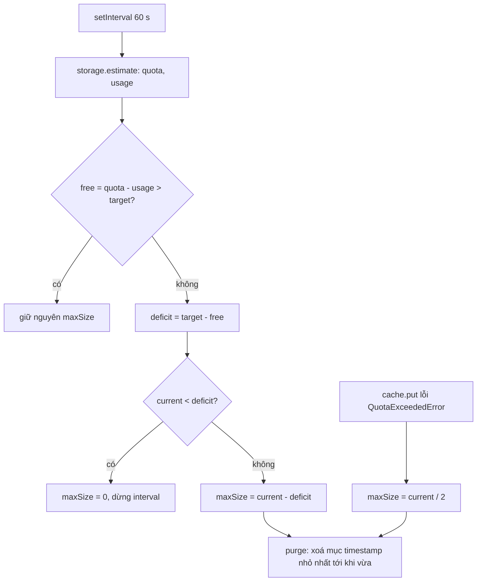

Mỗi lần mở lại một cuộc trò chuyện, WhatsApp Web hiện lại hàng chục ảnh và video. Tải lại và giải mã từ đầu thì tốn mạng, tốn CPU, và ảnh nhấp nháy. Nên giữ bản đã giải mã trong trình duyệt. Nhưng bộ nhớ của trình duyệt có hạn và được **chia chung** cho mọi thứ của trang (IndexedDB chứa tin nhắn, Cache API, service worker…). Kho media chiếm quá tay thì trình duyệt ném `QuotaExceededError` vào đúng lúc lưu tin nhắn, hoặc tệ hơn là xoá sạch dữ liệu của cả trang khi máy hết đĩa.

WhatsApp Web giải bài này bằng một kho LRU (least recently used, ít dùng gần đây nhất bị đuổi trước) có giới hạn kích thước **tự điều chỉnh**: cứ một phút hỏi trình duyệt còn bao nhiêu chỗ, luôn chừa lại một khoảng trống an toàn, phần còn lại mới cho kho media dùng.

> [!TIP]
> **Tóm tắt**
> - Bytes nằm trong Cache API (khoá là URL giả), metadata (`id`, `timestamp`, `size`) nằm trong IndexedDB để sắp xếp theo thời gian và cộng kích thước.
> - Mỗi 60 giây, `navigator.storage.estimate()` cho biết quota và usage. Kho luôn chừa trống **1% quota, kẹp trong 100–500 MB**. Thiếu chỗ thì co giới hạn và đuổi mục cũ; gặp `QuotaExceededError` thì co còn một nửa.
> - Bản gốc **ghi lại cả file** mỗi lần đọc trúng cache chỉ để cập nhật thời gian; ghi metadata trước bytes nên lỗi ghi để lại mục "ma"; và hàng đợi theo key **kẹt vĩnh viễn** sau một lần lỗi.
> - Bản viết lại chỉ cập nhật metadata khi đọc, ghi metadata sau khi bytes đã lưu, và dọn hàng đợi ở cả nhánh lỗi.

<iframe class="demo-frame" src="/demos/web-patterns/index.html?theme=dark#/wa-media-lru" title="Demo wa-media-lru" loading="lazy" style="height: 900px"></iframe>

<p class="demo-links">▶ <a href="/demos/web-patterns/index.html#/wa-media-lru" target="_blank" rel="noopener">Mở demo toàn màn hình ↗</a> · <a href="https://stackblitz.com/github/hunghg255/blog-hunghg/tree/master/examples/web-patterns?file=src/lib/waMediaLru.ts" target="_blank" rel="noopener">Sửa code trên StackBlitz ↗</a> · <a href="https://github.com/hunghg255/blog-hunghg/blob/master/examples/web-patterns/src/lib/waMediaLru.ts" target="_blank" rel="noopener">Xem source trên GitHub ↗</a></p>

Demo dùng Cache API thật của trình duyệt, còn quota là giả lập 40 MB để thấy kho co lại. Bấm **Nhận 4 media** vài lần, bấm **Mở** ở mục cũ nhất để thấy nó nhảy xuống cuối danh sách. Kéo thanh **Dữ liệu khác** lên 36 MB: kho phải co và đuổi mục cũ. Bấm **Lần ghi sau hết quota** rồi nhận tiếp để thấy kho co còn một nửa. Ô "byte ghi: kiểu gốc" cộng thêm cả file mỗi lần mở. Khung "Hàng đợi theo key" chạy cùng một hàm lỗi lần đầu qua hai cách xếp hàng.

## WhatsApp Web làm thế nào?

Năm module trong bundle 2020 (tên là hash webpack, biến đã đổi tên): `ciaihgijjb` chọn backend, `dgbehccfjg` là `LruMediaStore`, `djgdheeehd` là kho metadata có giới hạn kích thước, `fheibeebe` là kho `ArrayBuffer` trên Cache API, `bihghijhgb` có `createEnqueue`.

### Chọn backend

`MediaStore` tạo backend một lần (lazy) theo thứ tự ưu tiên: nếu bật cờ tính năng `LRU_MEDIA_STORE`, có một điều kiện phụ thuộc (module này không có trong bundle, có lẽ kiểm IndexedDB dùng được) và `'caches' in self`, thì `LruMediaStore` với bytes trong Cache API tên `lru-media-array-buffer-cache`; thiếu Cache API thì bytes nằm trong IndexedDB; mở kho lỗi (`SecurityError` ở chế độ riêng tư, hay lỗi khác) thì dùng một kho "giả" không lưu gì. Giới hạn ban đầu là `Number.MAX_SAFE_INTEGER`, tức chưa giới hạn cho tới lần kiểm quota đầu tiên. Kho Cache API đặt khoá là URL giả `https://_media_cache_v2_.whatsapp.com/<tên kho>_<key>` và tra với `ignoreSearch`, `ignoreMethod`, `ignoreVary` để Cache API chỉ so đường dẫn.

### Ghi, đọc, đuổi

```js
doPut = enqueue((id, bytes) => {
  if (bytes.byteLength > this.getMaxSize() || bytes.byteLength > 3e7) return Promise.resolve(bytes); // > 30 MB: không lưu
  return this._lruStore.putObject({ id, timestamp: Date.now(), size: bytes.byteLength })
    .then(() => this._bufferStore.put(id, bytes))
    .catchType(AbortError, e => { if (e.message.includes('QuotaExceededError')) this.setMaxSize(this.getCurrentSize() / 2); else throw e; });
});
doGet(id) { return this._bufferStore.get(id).then(b => (b != null && this.put(id, b), b)); }
```

Kho metadata (`djgdheeehd`) cộng dồn `size`, và 2 giây sau mỗi lần ghi (debounce) thì chạy `_purge`: chừng nào tổng còn vượt `maxSize`, lấy mục có `timestamp` nhỏ nhất qua chỉ mục ngày rồi xoá cả metadata lẫn bytes.

### Co giới hạn theo quota

```js
_updateMaxSize = async () => {
  const est = await storageEstimate();              // có lẽ bọc navigator.storage.estimate
  if (est == null) return this._clearStoreForThisSession();
  const free = est.quota - est.usage, target = clamp(Math.floor(0.01 * est.quota), 1e8, 5e8);
  if (free > target) return;
  const deficit = target - free, current = this.getCurrentSize();
  current < deficit ? this._clearStoreForThisSession() : this.setMaxSize(current - deficit);
};
setInterval(this._updateMaxSize, 6e4);
```

`_clearStoreForThisSession` đặt `maxSize = 0` (đuổi hết) và dừng hẳn interval. Ý tưởng chừa trống theo phần trăm có kẹp trên dưới rất đáng học: máy có quota 10 GB chừa 100 MB, quota 300 GB chừa 500 MB, không bao giờ để trang chạm sát trần.

### createEnqueue

```js
createEnqueue = () => { const pending = {};
  return (fn, keyOf) => function run(...args) {
    const k = (keyOf || (a => String(a)))(...args);
    if (pending[k]) return (pending[k] = pending[k].then(() => (delete pending[k], run(...args))));
    const p = fn.apply(this, args).then(r => (pending[k] === p && delete pending[k], r));
    return (pending[k] = p);
  };
};
```

Mục đích: hai lần `put` cùng một media không chạy chồng lên nhau. Nhưng `delete pending[k]` chỉ nằm trong nhánh **thành công**. Nếu `fn` reject, `pending[k]` giữ promise bị reject; lần gọi sau đi vào nhánh `pending[k].then(...)`, callback không bao giờ chạy, promise mới cũng reject và được gán lại vào `pending[k]`. Mình chạy đúng đoạn code gốc trong Node với một hàm lỗi ở lần đầu: gọi 3 lần với cùng key thì cả 3 đều reject, hàm thật chỉ chạy **1** lần; key khác vẫn chạy bình thường.

## Bên trong trình duyệt: quota, estimate và Cache API

Trình duyệt cấp cho mỗi origin một **quota** chung cho IndexedDB, Cache API, OPFS và service worker. Chrome cho tới khoảng 60% dung lượng đĩa, Firefox và Safari có cách tính riêng. `navigator.storage.estimate()` trả `{ quota, usage }` cho origin hiện tại. Con số `usage` là ước lượng: Chrome cố ý làm tròn và độn thêm để trang không suy ra kích thước response từ origin khác (opaque response trong Cache API được tính rất lớn). Vì vậy chừa trống một khoảng dư như WhatsApp là hợp lý.

Khi vượt quota, thao tác ghi đang chạy thất bại với `QuotaExceededError`: với Cache API là promise của `cache.put` reject bằng `DOMException`, với IndexedDB là transaction bị huỷ (`AbortError`, lỗi gốc là `QuotaExceededError`). Có lẽ vì thế bản gốc bắt `AbortError` rồi đọc `message`. Nếu backend là Cache API mà lỗi không được bọc lại thành `AbortError` (module bọc lỗi không có trong bundle), nhánh co còn một nửa sẽ không chạy, lỗi văng ra và key bị kẹt như phân tích ở trên.

Khi máy hết đĩa, trình duyệt có thể **xoá toàn bộ** dữ liệu của các origin ít dùng (dữ liệu "best-effort"). `navigator.storage.persist()` xin chuyển sang "persistent" để tránh việc này, nhưng trình duyệt có thể từ chối.



## Viết lại

`src/lib/waMediaLru.ts` gom lại thành một lớp `MediaLruStore`. Cache API được tiêm qua `openCache` (kiểu `CacheLike`), nên test dùng `Map` trong bộ nhớ còn demo bọc Cache API thật để giả lập lỗi quota. Hàng đợi theo key dọn ở cả hai nhánh:

```ts title=src/lib/waMediaLru.ts
/**
 * Hàng đợi theo key: lời gọi cùng key chạy nối tiếp. Khác createEnqueue gốc: dọn key khi promise
 * xong ở CẢ hai nhánh, nên một lần lỗi không làm mọi lần gọi sau với key đó lỗi theo.
 */
export function createKeyedQueue() {
  const tails = new Map<string, Promise<unknown>>();
  return <A extends unknown[], R>(fn: (...args: A) => Promise<R>, keyOf: (...args: A) => string = (...a) => String(a[0])) =>
    (...args: A): Promise<R> => {
      const key = keyOf(...args);
      const run = (tails.get(key) ?? Promise.resolve()).then(() => fn(...args));
      const tail = run.then(
        () => undefined,
        () => undefined,
      );
      tails.set(key, tail);
      tail.then(() => tails.get(key) === tail && tails.delete(key));
      return run;
    };
}
```

Đọc (`get`) chỉ `cache.match` rồi đổi `lastUsed` trong metadata. Ghi thì dọn chỗ trước, ghi bytes, rồi mới ghi metadata:

```ts title=src/lib/waMediaLru.ts
  put = (key: string, bytes: Uint8Array<ArrayBuffer>) =>
    this.queue(async (k: string, data: Uint8Array<ArrayBuffer>) => {
      const size = data.byteLength;
      if (size > (this.o.maxItemBytes ?? 30_000_000) || size > this.maxSize) return false;
      // Dọn chỗ TRƯỚC khi ghi, không để kho vượt giới hạn rồi mới dọn.
      await this.evictUntil(this.maxSize - size, 'nhường chỗ', k);
      const lastUsed = this.now();
      try {
        await this.c.put(
          urlOf(k),
          new Response(data, { headers: { [SIZE_HEADER]: String(size), [TIME_HEADER]: String(lastUsed) } }),
        );
      } catch (e) {
        if ((e as Error).name !== 'QuotaExceededError') throw e;
        // Trình duyệt hết chỗ: co giới hạn còn một nửa kích thước hiện tại, không ghi metadata "ma".
        this.maxSize = Math.floor(this.currentSize / 2);
        await this.evictUntil(this.maxSize, 'QuotaExceededError');
        return false;
      }
      this.meta.set(k, { size, lastUsed });
      this.bytesWritten += size;
      return true;
    })(key, bytes);
```

`updateMaxSize` gọi `estimate`, rồi đặt `maxSize = max(0, currentSize + free − target)` và đuổi tới khi vừa: một công thức cho cả hai chiều co và giãn.

::: spoiler Xem toàn bộ src/lib/waMediaLru.ts
```ts title=src/lib/waMediaLru.ts
// Kho media LRU trên Cache API, tự co lại theo quota trình duyệt.
// Viết lại từ dgbehccfjg (LruMediaStore), fheibeebe (kho ArrayBuffer trên Cache API),
// ciaihgijjb (chọn backend) và bihghijhgb (createEnqueue) của WhatsApp Web bản 2020.

/** Phần Cache API mà kho cần: tiêm vào được để test hoặc giả lập lỗi quota. */
export type CacheLike = Pick<Cache, 'match' | 'put' | 'delete' | 'keys'>;

export interface StorageEstimateLike {
  quota?: number;
  usage?: number;
}

const MB = 1024 * 1024;

/** Chừa trống 1% quota, kẹp trong [100 MB, 500 MB] như bản gốc. */
export const defaultTargetFree = (quota: number) => Math.min(500 * MB, Math.max(100 * MB, Math.floor(quota * 0.01)));

export interface MediaLruOptions {
  openCache: () => Promise<CacheLike>;
  /** mặc định navigator.storage.estimate */
  estimate?: () => Promise<StorageEstimateLike | undefined>;
  targetFree?: (quota: number) => number;
  /** file lớn hơn thì không cache (bản gốc: 30 MB) */
  maxItemBytes?: number;
  /** giới hạn khi chưa biết quota */
  initialMaxSize?: number;
  now?: () => number;
  onEvict?: (key: string, size: number, reason: string) => void;
}

interface Meta {
  size: number;
  lastUsed: number;
}

const SIZE_HEADER = 'x-media-size';
const TIME_HEADER = 'x-media-last-used';
const urlOf = (key: string) => `https://media-cache.invalid/${encodeURIComponent(key)}`;

/**
 * Hàng đợi theo key: lời gọi cùng key chạy nối tiếp. Khác createEnqueue gốc: dọn key khi promise
 * xong ở CẢ hai nhánh, nên một lần lỗi không làm mọi lần gọi sau với key đó lỗi theo.
 */
export function createKeyedQueue() {
  const tails = new Map<string, Promise<unknown>>();
  return <A extends unknown[], R>(fn: (...args: A) => Promise<R>, keyOf: (...args: A) => string = (...a) => String(a[0])) =>
    (...args: A): Promise<R> => {
      const key = keyOf(...args);
      const run = (tails.get(key) ?? Promise.resolve()).then(() => fn(...args));
      const tail = run.then(
        () => undefined,
        () => undefined,
      );
      tails.set(key, tail);
      tail.then(() => tails.get(key) === tail && tails.delete(key));
      return run;
    };
}

export class MediaLruStore {
  private meta = new Map<string, Meta>();
  private cache?: CacheLike;
  private queue = createKeyedQueue();
  maxSize: number;
  /** tổng byte đã ghi xuống đĩa (để so với bản gốc ghi lại cả file mỗi lần đọc) */
  bytesWritten = 0;

  constructor(private o: MediaLruOptions) {
    this.maxSize = o.initialMaxSize ?? 200 * MB;
  }

  get currentSize() {
    let n = 0;
    for (const m of this.meta.values()) n += m.size;
    return n;
  }

  /** Danh sách từ cũ nhất tới mới nhất. */
  entries(): [string, Meta][] {
    return [...this.meta].sort((a, b) => a[1].lastUsed - b[1].lastUsed);
  }

  private now() {
    return this.o.now?.() ?? Date.now();
  }

  /** Mở cache và dựng lại metadata từ header đã ghi kèm mỗi response. */
  async open() {
    this.cache = await this.o.openCache();
    this.meta.clear();
    for (const req of await this.cache.keys()) {
      const res = await this.cache.match(req);
      const size = Number(res?.headers.get(SIZE_HEADER));
      const key = decodeURIComponent(new URL(req.url).pathname.slice(1));
      if (res && size >= 0) this.meta.set(key, { size, lastUsed: Number(res.headers.get(TIME_HEADER)) || 0 });
    }
  }

  private get c() {
    if (!this.cache) throw new Error('chưa open()');
    return this.cache;
  }

  /** Đọc: chỉ cập nhật thời điểm dùng trong metadata, không ghi lại bytes. */
  get = (key: string) =>
    this.queue(async (k: string) => {
      const res = await this.c.match(urlOf(k));
      if (!res) {
        this.meta.delete(k);
        return null;
      }
      const m = this.meta.get(k);
      if (m) m.lastUsed = this.now();
      return new Uint8Array(await res.arrayBuffer());
    })(key);

  put = (key: string, bytes: Uint8Array<ArrayBuffer>) =>
    this.queue(async (k: string, data: Uint8Array<ArrayBuffer>) => {
      const size = data.byteLength;
      if (size > (this.o.maxItemBytes ?? 30_000_000) || size > this.maxSize) return false;
      // Dọn chỗ TRƯỚC khi ghi, không để kho vượt giới hạn rồi mới dọn.
      await this.evictUntil(this.maxSize - size, 'nhường chỗ', k);
      const lastUsed = this.now();
      try {
        await this.c.put(
          urlOf(k),
          new Response(data, { headers: { [SIZE_HEADER]: String(size), [TIME_HEADER]: String(lastUsed) } }),
        );
      } catch (e) {
        if ((e as Error).name !== 'QuotaExceededError') throw e;
        // Trình duyệt hết chỗ: co giới hạn còn một nửa kích thước hiện tại, không ghi metadata "ma".
        this.maxSize = Math.floor(this.currentSize / 2);
        await this.evictUntil(this.maxSize, 'QuotaExceededError');
        return false;
      }
      this.meta.set(k, { size, lastUsed });
      this.bytesWritten += size;
      return true;
    })(key, bytes);

  delete = (key: string) =>
    this.queue(async (k: string) => {
      await this.c.delete(urlOf(k));
      this.meta.delete(k);
    })(key);

  private async evictUntil(limit: number, reason: string, except?: string) {
    for (const [key, m] of this.entries()) {
      if (this.currentSize <= limit) return;
      if (key === except) continue;
      await this.c.delete(urlOf(key));
      this.meta.delete(key);
      this.o.onEvict?.(key, m.size, reason);
    }
  }

  /**
   * Gọi định kỳ (bản gốc: mỗi 60 giây). Giới hạn = phần kho đang chiếm + chỗ trống − chỗ phải chừa.
   * Khác bản gốc: giới hạn tăng lại được khi trống thêm, và thiếu estimate thì giữ nguyên thay vì tắt kho.
   */
  async updateMaxSize() {
    const est = await (this.o.estimate ?? (() => navigator.storage?.estimate?.()))();
    if (est?.quota == null || est.usage == null) return this.maxSize;
    const free = est.quota - est.usage;
    const target = (this.o.targetFree ?? defaultTargetFree)(est.quota);
    this.maxSize = Math.max(0, this.currentSize + free - target);
    await this.evictUntil(this.maxSize, 'quota');
    return this.maxSize;
  }
}
```
:::

## Đi qua code

- `createKeyedQueue` giữ một `tail` cho mỗi key: promise "đã xong, bất kể kết quả" của lần gọi cuối. Lời gọi mới nối vào sau `tail`, nên lỗi của lần trước không truyền sang lần sau. Khi `tail` xong và vẫn là `tail` mới nhất thì xoá key khỏi `Map`.
- `get` và `put` dùng chung hàng đợi, nên đọc một media đang được ghi sẽ chờ ghi xong.
- `put` bỏ qua file lớn hơn `maxItemBytes` (mặc định 30 000 000 byte như bản gốc) hoặc lớn hơn cả giới hạn kho. Gọi `evictUntil(maxSize - size)` trước khi ghi nên kho không bao giờ vượt giới hạn, dù chỉ trong 2 giây.
- Metadata giữ trong `Map` và được dựng lại khi `open()` từ header `x-media-size`, `x-media-last-used` ghi kèm mỗi `Response`. Đủ cho demo; bản thật nên giữ metadata trong IndexedDB như WhatsApp để thứ tự LRU sống qua lần tải lại trang.
- `updateMaxSize` tính `maxSize = current + free - target`. Khi thiếu chỗ (`free < target`) công thức trùng với `current - deficit` của bản gốc; khi `current < deficit` thì ra số âm, kẹp về 0, cũng trùng. Khác ở chỗ khi có thêm chỗ trống, giới hạn tăng trở lại.

**Khác bản gốc:**

- **Không ghi lại bytes khi đọc**. Bản gốc gọi `put(id, bytes)` trong `doGet` để làm mới `timestamp`, tức ghi lại toàn bộ file xuống đĩa mỗi lần xem lại một video 20 MB. Ở đây chỉ đổi `lastUsed` trong metadata.
- **Ghi bytes trước, metadata sau**. Bản gốc `putObject` metadata trước; nếu ghi bytes lỗi, metadata vẫn nằm đó, cộng vào `currentSize` cho tới khi bị đuổi.
- **Hàng đợi không kẹt** sau một lần lỗi.
- **Không tắt kho khi thiếu `estimate`**. Bản gốc gọi `_clearStoreForThisSession` khi `estimate` trả `null`, tức trình duyệt không hỗ trợ API này thì không có cache media nào. Ở đây giữ giới hạn khởi tạo.
- **Giới hạn giãn lại được**. Bản gốc chỉ co: người dùng xoá file trên máy cho trống đĩa thì kho vẫn ở mức nhỏ tới khi tải lại trang; về 0 thì dừng hẳn kiểm tra.
- Bản gốc `doClear` gọi `caches.delete(tên kho)` nhưng vẫn giữ object `Cache` cũ trong `this.cacheStore`. Theo đặc tả, object đó vẫn dùng được nhưng không còn gắn với tên nào, nên có lẽ mọi lần ghi sau `clear()` đi vào một cache "mồ côi" và mất khi tải lại trang. Bản viết lại không có `clear` toàn kho; muốn xoá hết thì `delete` từng key hoặc tạo `MediaLruStore` mới sau `caches.delete`.

## Tại sao không làm cách khác?

- **Lưu bytes trong IndexedDB luôn**: làm được (đó là backend dự phòng của WhatsApp), nhưng IndexedDB với blob lớn từng chậm và có lỗi ở một số trình duyệt. Cache API sinh ra để chứa `Response`, ghi đọc file lớn theo luồng.
- **Lưu metadata trong Cache API** (header như demo): đủ cho kích thước, nhưng muốn "mục cũ nhất" phải đọc mọi entry. IndexedDB có chỉ mục theo `timestamp`, lấy mục cũ nhất bằng một con trỏ.
- **Giới hạn cố định** (vd 500 MB): máy ít đĩa thì vẫn đầy, máy nhiều đĩa thì phí. Quota thay đổi theo đĩa trống, nên giới hạn phải tính lại định kỳ.
- **Đợi `QuotaExceededError` rồi mới co**: lỗi có thể rơi vào thao tác quan trọng hơn (lưu tin nhắn) chứ không phải kho media. Chủ động chừa trống thì kho media là thứ nhường chỗ trước.

## Edge case và cạm bẫy

- **`usage` gồm cả kho media**: `free = quota − usage` đã trừ phần kho đang chiếm. Vì vậy công thức đúng là `current + free − target`, không phải `free − target`.
- **Chạy nhiều tab**: mỗi tab có `MediaLruStore` riêng nhưng chung một Cache. Metadata trong bộ nhớ của tab này không biết tab kia vừa ghi gì. Metadata trong IndexedDB (như bản gốc) đỡ hơn; muốn chính xác thì một tab làm "leader" quản lý kho.
- **Opaque response**: nếu lưu response `no-cors` từ CDN khác origin, Chrome tính mỗi mục cỡ vài MB vào `usage` bất kể kích thước thật. Kho media nên lưu bytes đã đọc (`new Response(bytes)`) như ở đây.
- **Chế độ riêng tư**: quota nhỏ hơn nhiều, có trình duyệt ném `SecurityError` khi mở storage. Bản gốc chuyển sang kho giả không lưu gì, cách xử lý đúng.
- **Interval chạy khi tab ẩn**: trình duyệt hãm timer của tab nền (Chrome có thể giãn tới mỗi phút một lần). Không sao với kiểm tra quota, nhưng đừng dựa vào nó để dọn đúng giờ.

## Dùng trong dự án

Bất cứ app nào hiển thị lại nhiều media do người dùng tải về (chat, email, trình đọc truyện, bản đồ offline):

```ts
const store = new MediaLruStore({ openCache: () => caches.open('media-v1') });
await store.open();
setInterval(() => store.updateMaxSize(), 60_000);
const bytes = (await store.get(id)) ?? (await download(id).then(async (b) => (await store.put(id, b), b)));
```

Đổi tên cache (`media-v1` → `media-v2`) khi đổi định dạng lưu, cách làm ở bài [cache phía client có version](/blogs/web-client-cache-versioned). Facebook giải bài toán quota tương tự cho dữ liệu trang ở [bài lưu trữ theo quota](/blogs/facebook-quota-aware-storage).

## Kiểm thử

::: spoiler Ví dụ test (bản phác, không có trong repo)
```ts
import { describe, it, expect } from 'vitest';
import { MediaLruStore, createKeyedQueue, type CacheLike } from '../src/lib/waMediaLru';

function memoryCache(flags = { quota: false }): CacheLike {
  const map = new Map<string, Response>();
  return {
    async match(req) { return map.get(String(req instanceof Request ? req.url : req))?.clone(); },
    async put(req, res) {
      if (flags.quota) { flags.quota = false; throw new DOMException('full', 'QuotaExceededError'); }
      map.set(String(req), res);
    },
    async delete(req) { return map.delete(String(req)); },
    async keys() { return [...map.keys()].map((u) => new Request(u)); },
  } as CacheLike;
}
const bytes = (n: number) => new Uint8Array(n).fill(1);

describe('MediaLruStore', () => {
  it('đuổi mục ít dùng nhất, đọc không ghi lại bytes', async () => {
    let t = 0;
    const s = new MediaLruStore({ openCache: async () => memoryCache(), initialMaxSize: 300, now: () => ++t });
    await s.open();
    for (const k of ['a', 'b', 'c']) await s.put(k, bytes(100));
    await s.get('a');
    expect(s.bytesWritten).toBe(300);
    await s.put('d', bytes(100));
    expect(s.entries().map(([k]) => k)).toEqual(['c', 'a', 'd']);
  });

  it('QuotaExceeded: co còn nửa, không để metadata ma, key không kẹt', async () => {
    const flags = { quota: false };
    const s = new MediaLruStore({ openCache: async () => memoryCache(flags), initialMaxSize: 1000 });
    await s.open();
    for (const k of ['a', 'b', 'c', 'd']) await s.put(k, bytes(100));
    flags.quota = true;
    expect(await s.put('e', bytes(100))).toBe(false);
    expect(s.maxSize).toBe(200);
    expect(s.entries().map(([k]) => k)).toEqual(['c', 'd']);
    expect(await s.put('e', bytes(100))).toBe(true);
  });

  it('updateMaxSize co rồi giãn theo estimate', async () => {
    let other = 0;
    const s: MediaLruStore = new MediaLruStore({
      openCache: async () => memoryCache(), initialMaxSize: 1000, targetFree: () => 100,
      estimate: async () => ({ quota: 1000, usage: other + s.currentSize }),
    });
    await s.open();
    for (const k of ['a', 'b', 'c']) await s.put(k, bytes(100));
    other = 750;
    expect(await s.updateMaxSize()).toBe(150);
    other = 100;
    expect(await s.updateMaxSize()).toBe(800);
  });
});

describe('createKeyedQueue', () => {
  it('nối tiếp theo key, lỗi không làm kẹt key', async () => {
    const q = createKeyedQueue();
    let fail = true;
    const f = q(async (_k: string) => { if (fail) { fail = false; throw new Error('x'); } return 'ok'; });
    await expect(f('k')).rejects.toThrow('x');
    expect(await f('k')).toBe('ok');
  });
});
```
:::

## So với chuẩn web và thư viện

- **`navigator.storage.estimate()`**: Chrome, Edge, Firefox; Safari từ bản 17 (tính tới 10/2026). Chỉ có trong secure context. **`navigator.storage.persist()`** có ở cả ba nhóm trình duyệt, kết quả tuỳ chính sách từng trình duyệt.
- **Cache API** có ở mọi trình duyệt hiện đại, dùng được cả ngoài service worker (`window.caches`), cũng chỉ trong secure context.
- **Workbox** (`workbox-expiration`) có `ExpirationPlugin` với `maxEntries`, `maxAgeSeconds` và `purgeOnQuotaError`: đuổi theo số mục và tuổi, xoá cache khi gặp lỗi quota. Nó không tính theo byte và không đọc `estimate`, nên với media kích thước chênh lệch lớn thì cách của WhatsApp hợp hơn.
- **Storage Buckets API** (Chromium, tính tới 10/2026) cho tách dữ liệu thành nhiều "bucket" với quota và độ ưu tiên xoá riêng; khi phổ biến, kho media có thể nằm trong một bucket "best-effort" riêng, tin nhắn trong bucket "persistent".

---

Bài này thuộc series **[Học từ mã nguồn WhatsApp Web](/series/whatsapp)** (19 bài, đọc theo thứ tự).

::: spoiler Xem nhanh danh sách bài trong series

*Mở đầu*

- [Mở đầu: đọc bundle WhatsApp Web 2020](/blogs/learn-from-whatsapp-web-source-code)

*Phần 1: media và mã hoá*

- [#1 Giải mã JPEG progressive theo từng scan, kiểm HMAC](/blogs/whatsapp-progressive-jpeg-hmac)
- [#2 Ghép khoảng byte cho video streaming](/blogs/whatsapp-byte-range-merge)
- [#3 Xoá EXIF không re-encode, thumbnail theo ngân sách byte](/blogs/whatsapp-jpeg-strip-thumb-budget)
- [#4 Đọc metadata sticker WebP động](/blogs/whatsapp-webp-sticker-metadata)

*Phần 2: lưu trữ trên trình duyệt*

- **#5 Kho media LRU tự co theo quota** (bài này)
- [#6 Cache blob trong RAM có refcount, tự revoke objectURL](/blogs/whatsapp-blob-cache-refcount)
- [#7 Khoá IndexedDB giữ đúng thứ tự từ điển](/blogs/whatsapp-indexeddb-ordered-keys)

*Phần 3: danh sách tin nhắn*

- [#8 Render tin nhắn theo cửa sổ chiều cao ước lượng](/blogs/whatsapp-render-cursor-window)
- [#9 Theo dõi viewport tin nhắn: binary search, ngày dính](/blogs/whatsapp-message-viewport-tracking)
- [#10 FlatList tái dùng key React, overscan bất đối xứng](/blogs/whatsapp-flatlist-key-reuse)

*Phần 4: soạn tin và chữ*

- [#11 Emoticon thành emoji bằng trie đọc ngược, tìm emoji](/blogs/whatsapp-emoticon-trie-emoji-search)
- [#12 Mention bằng token zero-width, giới hạn theo code point](/blogs/whatsapp-mention-zero-width-input)
- [#13 Xác định hướng chữ bằng bảng delta nén](/blogs/whatsapp-text-direction-table)
- [#14 Phát hiện homograph trong link, chặn giả đuôi file RTLO](/blogs/whatsapp-homograph-rtlo-guard)

*Phần 5: realtime và tiện ích*

- [#15 Presence, "đang gõ" và thông báo theo kích thước group](/blogs/whatsapp-presence-typing-notifications)
- [#16 Đo FPS phát hiện UI đóng băng, idle monitor](/blogs/whatsapp-fps-freeze-idle)
- [#17 Cửa sổ PiP: resize 8 hướng, khoá tỉ lệ, né vật cản](/blogs/whatsapp-pip-resize-avoid)
- [#18 Parse giá tiền theo locale bằng Intl](/blogs/whatsapp-locale-price-parse)

:::

Code + demo: [`examples/web-patterns`](https://github.com/hunghg255/blog-hunghg/tree/master/examples/web-patterns) · [Mở trên StackBlitz](https://stackblitz.com/github/hunghg255/blog-hunghg/tree/master/examples/web-patterns)
