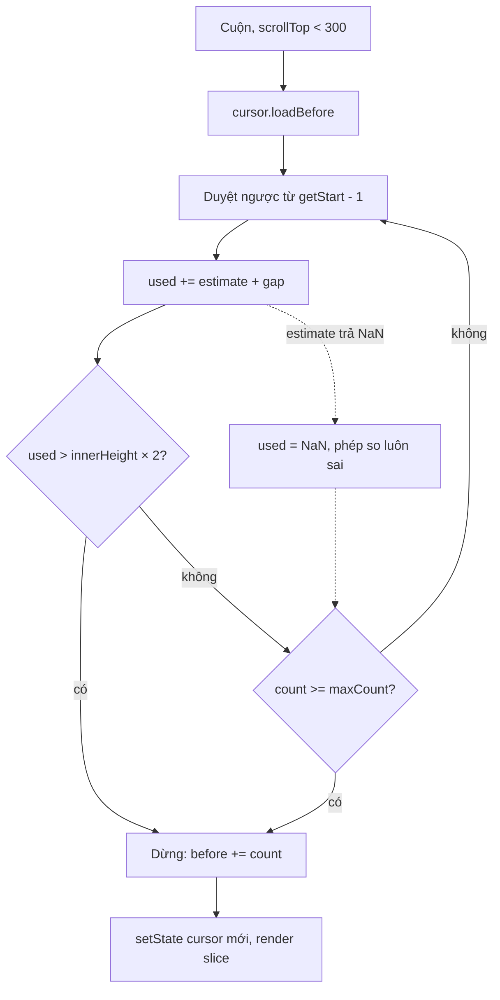

Một nhóm chat lâu năm có hàng chục nghìn tin. Render hết thì trang đơ; render cố định "50 tin gần nhất" thì không ổn, vì 50 tin chữ ngắn chưa lấp nổi nửa màn hình, còn 50 ảnh thì cao gần 20 màn hình. Cái cần biết là **bao nhiêu tin thì đủ lấp màn hình**, và phải biết điều đó **trước khi** render, vì chưa có DOM để đo.

WhatsApp Web 2020 trả lời bằng một bảng chiều cao đoán trước theo loại tin (tin chữ thì tính theo số ký tự, ảnh thì theo tỉ lệ khung, tin thoại 67px…) và một "con trỏ" (cursor) bất biến mô tả cửa sổ đang render.

> [!TIP]
> **Tóm tắt**
> - Cửa sổ render là `{ tin focus, before, after }`. `loadBefore`/`loadAfter` thêm vừa đủ tin để lấp `innerHeight × 2` px theo chiều cao **ước lượng**, không đo DOM.
> - Ước lượng theo loại tin: chữ = `19 × ceil(số ký tự / 100) + 13`, ảnh = `min(330 × cao / rộng, 330)`, video 166, tin thoại 67, sticker 125; trả lời +54, chú thích +31. Khoảng cách giữa hai tin 2px nếu cùng người gửi, 12px nếu khác.
> - Cursor bất biến: mỗi thao tác trả cursor mới, nên `setState` và so sánh `!==` rất rẻ.
> - Bản gốc viết `t + (w && h || 0) ? A : 330`: dấu `+` được tính trước `?:`. Ảnh trả lời chưa có kích thước ra **NaN**, vòng lặp không dừng sớm và cửa sổ phình tới hết tin trong bộ nhớ.

<iframe class="demo-frame" src="/demos/web-patterns/index.html?theme=dark#/wa-render-cursor" title="Demo wa-render-cursor" loading="lazy" style="height: 1150px"></iframe>

<p class="demo-links">▶ <a href="/demos/web-patterns/index.html#/wa-render-cursor" target="_blank" rel="noopener">Mở demo toàn màn hình ↗</a> · <a href="https://stackblitz.com/github/hunghg255/blog-hunghg/tree/master/examples/web-patterns?file=src/lib/waRenderCursor.ts" target="_blank" rel="noopener">Sửa code trên StackBlitz ↗</a> · <a href="https://github.com/hunghg255/blog-hunghg/blob/master/examples/web-patterns/src/lib/waRenderCursor.ts" target="_blank" rel="noopener">Xem source trên GitHub ↗</a></p>

Cuộn lên đầu khung chat vài lần ở chế độ "Bản viết lại": mỗi lần cửa sổ nới thêm khoảng 6–10 tin. Chuyển sang "Ước lượng kiểu WhatsApp 2020" rồi cuộn lại: khi lần nạp chạm tới một tin viền đỏ (ảnh trả lời chưa có kích thước), cửa sổ nhảy thêm 600 tin một lúc. Demo chặn ở 600; bản gốc không chặn.

## WhatsApp làm thế nào?

Ba module trong bundle WhatsApp Web 2020 (bản 2020, có thể đã đổi):

- `jcfhjhibi`: lớp `RenderCursor` và các hàm đếm số tin đủ lấp màn hình.
- `bdecdecede`: hàm ước lượng chiều cao một tin.
- `djdhjggcbi`: trả `window.innerHeight`, được cache và cập nhật khi resize (gom 500ms).

Component dùng nó là `ConversationMsgs` (module `bggagdeaef`, xem [bài #9](/blogs/whatsapp-message-viewport-tracking)): khi `scrollTop < 300` thì gọi `cursor.loadBefore(...)`, khi cuộn về đáy thì `resetBeforeCursor(...)`, rồi render `msgs.slice(cursor.getStart(), cursor.getEnd())`.

### Cursor bất biến

```js
class RenderCursor {
  constructor({ type, before, after, focusedMsgKey, prevFocusedMsgKey }) { … }
  _cloneWith(patch) { return new RenderCursor({ ...this.fields, ...patch }); }
  getStart(msgs) { return Math.max(indexOf(this._focusedMsgKey, msgs) - this.before, 0); }
  getEnd(msgs)   { return Math.min(indexOf(this._focusedMsgKey, msgs) + this.after + 1, msgs.length); }
  loadBefore(msgs, { count, maxCount = Number.MAX_SAFE_INTEGER, factor = 2 } = {}) {
    const n = count || this._getCursorSize(msgs, Math.max(0, this.getStart(msgs) - 1), 'before', factor, maxCount);
    return this._cloneWith({ before: this.before + n });
  }
}
```

(Rút gọn, đổi tên biến.) Cửa sổ không lưu chỉ số tuyệt đối mà lưu **tin focus** và hai bộ đếm. Tin mới về ở đáy không làm lệch cửa sổ, vì chỉ số của tin focus vẫn tìm lại được. Nếu tin focus không còn (bị xoá), `indexOf` trả về tin cuối (danh sách chat) hoặc tin đầu (ngăn "tin đã gắn sao", mới nhất ở trên). `ensureValidFocus` lùi về `prevFocusedMsgKey` khi tin focus bị xoá.

`create` khởi tạo bằng `factor: 1` cho cả hai phía: lần mở chat đầu tiên chỉ render khoảng một màn hình mỗi phía của tin focus.

### Đếm tin đủ lấp màn hình

Hàm đếm cho chat 1:1 (rút gọn):

```js
for (let used = 0, count = 0, prevCode; it.hasNext(); ) {
  const msg = it.next();
  const code = 2 * (msg.isNotification ? 1 : 0) + msg.isSentByMe;
  count++;
  if ((used += estimate(msg) + (code && code === prevCode ? 2 : 12)) > innerHeight * factor) break;
  if (count >= maxCount) break;
  // album và sticker nhóm: gom các tin kế tiếp thành một khối
  prevCode = code;
}
```

Có ba biến thể: chat 1:1 (như trên), group (thêm 19px cho dòng tên tác giả khi tác giả đổi, và so tác giả thay vì "phía") và ngăn tin gắn sao (cộng phẳng 65px mỗi tin). Album đủ lớn được vẽ thành một lưới nên chỉ tính chiều cao của tin đầu.

Để ý biểu thức khoảng cách: `code` của tin đến (không phải thông báo) là `0`, nên `code && …` luôn sai và hai tin đến liên tiếp luôn cách **12px**, trong khi hai tin gửi đi liên tiếp cách 2px. Có lẽ đây là sót, vì giao diện WhatsApp xếp các tin đến liên tiếp sát nhau như tin gửi đi. Sai số 10px mỗi tin chỉ làm cửa sổ hơi ngắn hơn cần thiết, không gây lỗi.

### Ước lượng chiều cao, và lỗi NaN

```js
export default function estimate(e) {
  let t = 0;
  if (!e) return t;
  e.quotedMsg && (t += 54);
  e.caption && (t += 31);
  switch (e.type) {
    case CHAT: /* … */ return t + 19 * Math.ceil(numCodepoints(e.body) / 100) + 13;
    case IMAGE:
      return t + (e.mediaData && e.mediaData.fullWidth && e.mediaData.fullHeight || 0)
        ? Math.floor(Math.min(330 / e.mediaData.fullWidth * e.mediaData.fullHeight, 330))
        : 330;
    case LOCATION:
      return t + e.isLive ? LIVE_MSG_HEIGHT /* 220 */ : PREVIEW_HEIGHT /* 150 */;
    // VIDEO 166 (GIF 137), PTT 67, VCARD 74, DOCUMENT 188, STICKER 125
  }
}
```

Toán tử `+` có độ ưu tiên cao hơn `?:`, nên `t + (…) ? A : B` được hiểu là `(t + (…)) ? A : B`. Hậu quả:

| Trường hợp | Ý định | Thực tế |
| --- | --- | --- |
| Ảnh có kích thước | `t + min(…)` | `min(…)`: mất phần trả lời/chú thích |
| Ảnh chưa có kích thước, không trả lời | `t + 330` | `330` (đúng do may) |
| Ảnh chưa có kích thước, **có trả lời** | `54 + 330` | `330 / undefined * undefined` = **NaN** |
| Vị trí tĩnh, không trả lời | `150` | `150` |
| Vị trí tĩnh, **có trả lời** | `54 + 150` | `220`: tính như vị trí trực tiếp |

NaN là trường hợp nặng nhất. Một khi `used` thành NaN, phép so `NaN > budget` luôn sai, nên vòng lặp chỉ dừng khi hết tin hoặc chạm `maxCount`. `ConversationMsgs` gọi `loadBefore` không truyền `maxCount`, tức `Number.MAX_SAFE_INTEGER`: cửa sổ phình ra tới **mọi tin đang có trong bộ nhớ** của chat đó. Ảnh trả lời mà metadata chưa về thì khá dễ gặp khi vừa mở một chat cũ.

## Bên trong trình duyệt: vì sao không đo DOM

Đo chiều cao thật nghĩa là render tin vào DOM rồi đọc `offsetHeight`. Mỗi lần đọc sau khi DOM vừa đổi buộc trình duyệt tính lại layout ngay lập tức (forced synchronous layout). Với một danh sách nạp thêm theo từng đợt khi cuộn, cách "render thử rồi đo" làm mỗi đợt tốn hai lần layout và dễ giật.

Ước lượng thì sai, nhưng sai không sao: cửa sổ chỉ cần **đủ dài** để người dùng không thấy khoảng trống khi cuộn. Ước lượng hụt một ít thì lần cuộn kế tiếp sẽ nạp thêm; ước lượng dư thì render thêm vài tin. Hệ số `factor = 2` (2 màn hình) là biên an toàn cho sai số đó.

Còn một lý do: tin chưa render thì ảnh chưa tải, font chưa áp, chiều cao thật chưa tồn tại. Chiều cao ước lượng là con số duy nhất có được ngay từ dữ liệu.



## Viết lại

Phần ước lượng: phần cộng thêm luôn được cộng **sau** khi tính phần thân, nên không có chỗ cho lỗi ưu tiên toán tử.

```ts title=src/lib/waRenderCursor.ts
/** Chiều cao đoán trước (px) của một bong bóng tin, chưa tính khoảng cách giữa các tin. */
export function estimateHeight(m: MsgLike): number {
  // Phần cộng thêm luôn được cộng SAU khi tính phần thân, không trộn vào điều kiện.
  const extra = (m.quoted ? HEIGHTS.quoted : 0) + (m.caption ? HEIGHTS.caption : 0);
  return extra + bodyHeight(m);
}

function bodyHeight(m: MsgLike): number {
  switch (m.type) {
    case 'chat':
    case 'notification': {
      const lines = Math.ceil(codepoints(m.body) / HEIGHTS.charsPerLine);
      return (m.linkPreview ? HEIGHTS.linkPreview : 0) + HEIGHTS.textLine * lines + HEIGHTS.textPadding;
    }
    case 'image':
      return m.width && m.height
        ? Math.floor(Math.min((HEIGHTS.imageMax / m.width) * m.height, HEIGHTS.imageMax))
        : HEIGHTS.imageMax;
    case 'video':
      return HEIGHTS.video;
    case 'gif':
      return HEIGHTS.gif;
    case 'ptt':
      return HEIGHTS.ptt;
    case 'location':
      return m.isLive ? HEIGHTS.locationLive : HEIGHTS.locationStatic;
    case 'vcard':
      return HEIGHTS.vcard;
    case 'document':
      return HEIGHTS.document;
    case 'sticker':
      return HEIGHTS.sticker;
    default:
      return 0;
  }
}

export type Estimate = (m: MsgLike) => number;
export type Gap = (prev: MsgLike | undefined, cur: MsgLike, group: boolean) => number;

/** Khoảng cách phía trên tin `cur` khi tin liền kề theo hướng duyệt là `prev`. */
export function gapBefore(prev: MsgLike | undefined, cur: MsgLike, group: boolean): number {
  if (group) {
    const author = cur.fromMe ? 'me' : cur.author;
    const prevAuthor = prev && (prev.fromMe ? 'me' : prev.author);
    const nameRow = !cur.fromMe && author !== prevAuthor ? HEIGHTS.authorName : 0;
    return nameRow + (author === prevAuthor ? HEIGHTS.sameSenderGap : HEIGHTS.otherSenderGap);
  }
  // Bản gốc so `2*isNotification + isSentByMe` và đòi giá trị khác 0, nên hai tin đến liên tiếp
  // luôn cách 12px; ở đây "cùng phía" là đủ.
  const side = (m: MsgLike) => (m.type === 'notification' ? 'n' : m.fromMe ? 'me' : 'them');
  return prev && side(prev) === side(cur) ? HEIGHTS.sameSenderGap : HEIGHTS.otherSenderGap;
}
```

Hàm đếm, dùng chung cho cả hai hướng:

```ts title=src/lib/waRenderCursor.ts
/**
 * Đếm bao nhiêu tin, bắt đầu từ `start` và đi theo `dir`, thì đủ lấp `budget` px.
 * Album đủ lớn được tính như một khối có chiều cao của tin đầu.
 */
export function countToFill(list: readonly MsgLike[], start: number, dir: -1 | 1, opts: FillOptions): number {
  const { budget, maxCount = Infinity, group = false, albumMinSize = 4, estimate = estimateHeight, gap = gapBefore } = opts;
  let used = 0;
  let count = 0;
  let prev: MsgLike | undefined;
  for (let i = start; i >= 0 && i < list.length && count < maxCount; ) {
    const m = list[i];
    let height = estimate(m);
    let size = 1;
    if (m.albumId) {
      while (count + size < maxCount && list[i + dir * size]?.albumId === m.albumId) size++;
      // Album nhỏ hơn ngưỡng vẫn vẽ từng ảnh riêng, nên cộng đủ từng tin.
      if (size < albumMinSize) for (let k = 1; k < size; k++) height += estimate(list[i + dir * k]);
    }
    used += gap(prev, m, group) + height;
    count += size;
    i += dir * size;
    prev = m;
    if (used > budget) break;
  }
  return count;
}
```

Cursor chỉ còn ba trường `readonly` (`focusedId`, `before`, `after`) và các hàm `getStart`/`getEnd`/`loadBefore`/`loadAfter`/`resetBefore`, mỗi hàm vài dòng, giữ đúng ngữ nghĩa của bản gốc. Xem trong file đầy đủ:

::: spoiler Xem toàn bộ src/lib/waRenderCursor.ts
```ts title=src/lib/waRenderCursor.ts
/**
 * Cửa sổ render tin nhắn theo "chiều cao ước lượng", kiểu WhatsApp Web 2020
 * (module `jcfhjhibi` RenderCursor + `bdecdecede` ước lượng chiều cao + `djdhjggcbi` innerHeight).
 *
 * Không đo DOM: mỗi tin có một chiều cao đoán trước theo loại tin. Cửa sổ là
 * {focusedId, before, after}; loadBefore/loadAfter thêm vừa đủ tin để lấp `viewport × factor` px.
 * Cursor bất biến: mỗi thao tác trả về cursor mới, nên có thể so sánh bằng === trong React.
 *
 * Khác bản gốc: sửa lỗi thứ tự toán tử (ảnh ra NaN, location tĩnh bị tính như live, mất phần
 * quote/caption), gom album bằng albumId, và tra vị trí tin bằng Map thay cho indexOf.
 */

export type MsgType =
  | 'chat'
  | 'notification'
  | 'image'
  | 'video'
  | 'gif'
  | 'ptt'
  | 'location'
  | 'vcard'
  | 'document'
  | 'sticker'
  | 'unknown';

export interface MsgLike {
  id: string;
  type: MsgType;
  fromMe: boolean;
  /** tác giả trong group; 1:1 thì bỏ trống */
  author?: string;
  body?: string;
  quoted?: boolean;
  caption?: string;
  linkPreview?: boolean;
  width?: number;
  height?: number;
  isLive?: boolean;
  /** các tin liên tiếp cùng albumId được vẽ thành một lưới */
  albumId?: string;
}

export const HEIGHTS = {
  quoted: 54,
  caption: 31,
  linkPreview: 53,
  textLine: 19,
  textPadding: 13,
  charsPerLine: 100,
  imageMax: 330,
  video: 166,
  gif: 137,
  ptt: 67,
  vcard: 74,
  document: 188,
  sticker: 125,
  locationLive: 220,
  locationStatic: 150,
  authorName: 19,
  sameSenderGap: 2,
  otherSenderGap: 12,
} as const;

const codepoints = (s = '') => {
  let n = 0;
  for (const _ of s) n++;
  return n;
};

/** Chiều cao đoán trước (px) của một bong bóng tin, chưa tính khoảng cách giữa các tin. */
export function estimateHeight(m: MsgLike): number {
  // Phần cộng thêm luôn được cộng SAU khi tính phần thân, không trộn vào điều kiện.
  const extra = (m.quoted ? HEIGHTS.quoted : 0) + (m.caption ? HEIGHTS.caption : 0);
  return extra + bodyHeight(m);
}

function bodyHeight(m: MsgLike): number {
  switch (m.type) {
    case 'chat':
    case 'notification': {
      const lines = Math.ceil(codepoints(m.body) / HEIGHTS.charsPerLine);
      return (m.linkPreview ? HEIGHTS.linkPreview : 0) + HEIGHTS.textLine * lines + HEIGHTS.textPadding;
    }
    case 'image':
      return m.width && m.height
        ? Math.floor(Math.min((HEIGHTS.imageMax / m.width) * m.height, HEIGHTS.imageMax))
        : HEIGHTS.imageMax;
    case 'video':
      return HEIGHTS.video;
    case 'gif':
      return HEIGHTS.gif;
    case 'ptt':
      return HEIGHTS.ptt;
    case 'location':
      return m.isLive ? HEIGHTS.locationLive : HEIGHTS.locationStatic;
    case 'vcard':
      return HEIGHTS.vcard;
    case 'document':
      return HEIGHTS.document;
    case 'sticker':
      return HEIGHTS.sticker;
    default:
      return 0;
  }
}

export type Estimate = (m: MsgLike) => number;
export type Gap = (prev: MsgLike | undefined, cur: MsgLike, group: boolean) => number;

/** Khoảng cách phía trên tin `cur` khi tin liền kề theo hướng duyệt là `prev`. */
export function gapBefore(prev: MsgLike | undefined, cur: MsgLike, group: boolean): number {
  if (group) {
    const author = cur.fromMe ? 'me' : cur.author;
    const prevAuthor = prev && (prev.fromMe ? 'me' : prev.author);
    const nameRow = !cur.fromMe && author !== prevAuthor ? HEIGHTS.authorName : 0;
    return nameRow + (author === prevAuthor ? HEIGHTS.sameSenderGap : HEIGHTS.otherSenderGap);
  }
  // Bản gốc so `2*isNotification + isSentByMe` và đòi giá trị khác 0, nên hai tin đến liên tiếp
  // luôn cách 12px; ở đây "cùng phía" là đủ.
  const side = (m: MsgLike) => (m.type === 'notification' ? 'n' : m.fromMe ? 'me' : 'them');
  return prev && side(prev) === side(cur) ? HEIGHTS.sameSenderGap : HEIGHTS.otherSenderGap;
}

export interface FillOptions {
  /** chiều cao cần lấp (px) */
  budget: number;
  maxCount?: number;
  group?: boolean;
  albumMinSize?: number;
  estimate?: Estimate;
  gap?: Gap;
}

/**
 * Đếm bao nhiêu tin, bắt đầu từ `start` và đi theo `dir`, thì đủ lấp `budget` px.
 * Album đủ lớn được tính như một khối có chiều cao của tin đầu.
 */
export function countToFill(list: readonly MsgLike[], start: number, dir: -1 | 1, opts: FillOptions): number {
  const { budget, maxCount = Infinity, group = false, albumMinSize = 4, estimate = estimateHeight, gap = gapBefore } = opts;
  let used = 0;
  let count = 0;
  let prev: MsgLike | undefined;
  for (let i = start; i >= 0 && i < list.length && count < maxCount; ) {
    const m = list[i];
    let height = estimate(m);
    let size = 1;
    if (m.albumId) {
      while (count + size < maxCount && list[i + dir * size]?.albumId === m.albumId) size++;
      // Album nhỏ hơn ngưỡng vẫn vẽ từng ảnh riêng, nên cộng đủ từng tin.
      if (size < albumMinSize) for (let k = 1; k < size; k++) height += estimate(list[i + dir * k]);
    }
    used += gap(prev, m, group) + height;
    count += size;
    i += dir * size;
    prev = m;
    if (used > budget) break;
  }
  return count;
}

export interface CursorInit {
  focusedId?: string;
  before?: number;
  after?: number;
}

export interface LoadOptions {
  /** viewport tính bằng px (bản gốc: window.innerHeight cache, cập nhật khi resize sau 500ms) */
  viewport: number;
  factor?: number;
  count?: number;
  maxCount?: number;
  group?: boolean;
  estimate?: Estimate;
  gap?: Gap;
}

/** Vị trí của tin trong list; dùng Map dựng một lần thay cho indexOf O(n) mỗi lần gọi. */
export class MessageIndex {
  private readonly pos = new Map<string, number>();
  constructor(readonly items: readonly MsgLike[]) {
    items.forEach((m, i) => this.pos.set(m.id, i));
  }
  get length() {
    return this.items.length;
  }
  indexOf(id: string | undefined) {
    return id === undefined ? -1 : (this.pos.get(id) ?? -1);
  }
}

export class RenderCursor {
  readonly focusedId?: string;
  readonly before: number;
  readonly after: number;

  constructor({ focusedId, before = 0, after = 0 }: CursorInit = {}) {
    this.focusedId = focusedId;
    this.before = before;
    this.after = after;
  }

  /** Cửa sổ ban đầu: lấp đúng một màn hình mỗi phía của tin focus (tin mới nhất nếu không có). */
  static create(list: MessageIndex, opts: LoadOptions & { focusedId?: string }) {
    return new RenderCursor({ focusedId: opts.focusedId })
      .loadBefore(list, { ...opts, factor: 1 })
      .loadAfter(list, { ...opts, factor: 1 });
  }

  /** Tin focus không còn trong list (bị xoá) thì neo về tin mới nhất ở đáy. */
  focusIndex(list: MessageIndex) {
    const i = list.indexOf(this.focusedId);
    return i === -1 ? list.length - 1 : i;
  }

  getStart(list: MessageIndex) {
    return Math.max(this.focusIndex(list) - this.before, 0);
  }

  getEnd(list: MessageIndex) {
    return Math.min(this.focusIndex(list) + this.after + 1, list.length);
  }

  hasBefore(list: MessageIndex) {
    return this.getStart(list) > 0;
  }

  hasAfter(list: MessageIndex) {
    return this.getEnd(list) < list.length;
  }

  slice(list: MessageIndex) {
    return list.items.slice(this.getStart(list), this.getEnd(list));
  }

  loadBefore(list: MessageIndex, opts: LoadOptions) {
    const n = opts.count || this.fill(list, this.getStart(list) - 1, -1, opts);
    return n ? new RenderCursor({ ...this, before: this.before + n }) : this;
  }

  loadAfter(list: MessageIndex, opts: LoadOptions) {
    const n = opts.count || this.fill(list, this.getEnd(list), 1, opts);
    return n ? new RenderCursor({ ...this, after: this.after + n }) : this;
  }

  /** Về lại đáy: chỉ giữ phần "before" đủ lấp `factor` màn hình tính ngược từ tin cuối cửa sổ. */
  resetBefore(list: MessageIndex, opts: LoadOptions) {
    const keep = this.fill(list, this.getEnd(list) - 1, -1, opts);
    return keep < this.before ? new RenderCursor({ ...this, before: keep }) : this;
  }

  private fill(list: MessageIndex, start: number, dir: -1 | 1, opts: LoadOptions) {
    const { viewport, factor = 2, ...rest } = opts;
    return countToFill(list.items, start, dir, { ...rest, budget: viewport * factor });
  }
}
```
:::

## Đi qua code

- `estimateHeight` tách `extra` (trả lời, chú thích) khỏi `bodyHeight`. Mỗi `case` của `bodyHeight` chỉ trả phần thân, nên không thể "quên cộng" hay cộng nhầm chỗ.
- `codepoints` đếm bằng `for…of` (duyệt theo code point), tương đương `numCodepoints` của bản gốc: emoji 2 code unit chỉ tính 1 ký tự.
- `gapBefore` cho chat 1:1 so "phía" (`n`, `me`, `them`) thay vì so mã số rồi đòi khác 0. Group thì so tác giả và cộng 19px cho dòng tên khi tác giả đổi.
- `countToFill` nhận `dir = -1 | 1` nên một hàm phục vụ cả `loadBefore` và `loadAfter`. Ước lượng và khoảng cách được tiêm vào (`estimate`, `gap`), demo dùng chỗ này để chạy lại cách tính cũ.
- Album: các tin liên tiếp cùng `albumId` được gom. Đủ `albumMinSize` thì chỉ tính tin đầu, không đủ thì cộng từng tin (vẽ rời).
- `MessageIndex` dựng `Map<id, index>` một lần cho mỗi phiên bản danh sách. Bản gốc gọi `collection.get` rồi `indexOf`, tức O(n) cho mỗi `getStart`/`getEnd`.
- `RenderCursor` chỉ có ba trường `readonly`. `loadBefore` trả về chính `this` khi không nạp thêm được gì, nên React bỏ qua `setState` vô ích.
- `resetBefore` giữ phần "before" vừa đủ lấp 2 màn hình tính ngược từ tin cuối: dùng khi người dùng bấm "về đáy", để cửa sổ thu lại sau khi đã cuộn lên rất xa.

**Khác bản gốc:** sửa thứ tự toán tử ở ảnh và vị trí, giữ phần trả lời/chú thích, khoảng cách 2px cho tin đến liên tiếp, tra vị trí bằng Map, bỏ `prevFocusedMsgKey` (tin focus mất thì về tin mới nhất). Chưa làm biến thể ngăn tin gắn sao.

## Tại sao không làm cách khác?

**Virtual list với chiều cao đo được** (`react-virtuoso`, `@tanstack/react-virtual` với `measureElement`). Đó là cách phổ biến ngày nay và thường tốt hơn, nhưng bù lại phải giữ một bảng chiều cao đã đo và sửa vị trí cuộn khi chiều cao ước lượng khác chiều cao thật. Cách của WhatsApp không định vị tuyệt đối: các tin vẫn chảy trong luồng bình thường, chỉ bớt tin ở hai đầu. Trình duyệt tự lo layout, và giữ chỗ đọc chỉ cần một neo (xem bài #9).

**Số tin cố định.** Như đã nói, 50 tin có thể là nửa màn hình hoặc 20 màn hình.

**`content-visibility: auto`.** Bỏ qua render của phần ngoài màn hình nhưng vẫn phải tạo DOM và chạy React cho mọi tin. Hữu ích để giảm chi phí vẽ, không giảm chi phí tạo component.

**IntersectionObserver trên phần tử "lính canh" ở đầu danh sách.** Thay được phép thử `scrollTop < 300` để biết **khi nào** nạp, nhưng vẫn cần cursor để biết nạp **bao nhiêu**.

## Edge case và cạm bẫy

- **Thứ tự toán tử với `?:`.** Quy tắc an toàn: không bao giờ để biểu thức số học trần ở vế điều kiện. Viết `const body = cond ? A : B; return t + body;`. ESLint có `no-mixed-operators` để bắt kiểu này.
- **NaN lan truyền âm thầm.** Mọi phép so với NaN đều sai, nên `while (used <= budget)` sẽ chạy mãi còn `if (used > budget) break` thì không bao giờ dừng. Test nên có trường hợp "thiếu dữ liệu" cho từng loại tin.
- **Viewport đổi.** Bản gốc cache `innerHeight` và chỉ cập nhật sau 500ms kể từ lần resize cuối. Ngay sau khi xoay máy hoặc phóng to, cửa sổ có thể tính theo chiều cao cũ, nhưng lần cuộn sau sẽ bù.
- **Tin focus bị xoá.** `focusIndex` trả về tin cuối. Nếu đang đọc giữa chừng, cửa sổ sẽ nhảy về đáy. Muốn giữ chỗ thì làm như bản gốc: nhớ tin đứng trước tin focus.
- **Giữ vị trí cuộn khi nạp phía trên.** Chèn tin lên trên làm nội dung đẩy xuống. Demo ghi lại tin đầu đang thấy và đặt lại `scrollTop` trong `useLayoutEffect`, đồng thời tắt `overflow-anchor` để trình duyệt không bù thêm lần nữa.

## Dùng trong dự án

```tsx
const [cursor, setCursor] = useState(() => RenderCursor.create(index, { viewport: innerHeight }));
const onScroll = (e: React.UIEvent<HTMLElement>) => {
  const box = e.currentTarget;
  if (box.scrollTop < 300 && cursor.hasBefore(index)) {
    rememberAnchor(box);
    setCursor(cursor.loadBefore(index, { viewport: box.clientHeight }));
  }
};
return <div onScroll={onScroll}>{cursor.slice(index).map(renderMsg)}</div>;
```

Hằng số trong `HEIGHTS` nên lấy từ CSS thật của ứng dụng (đo một lần trên máy dev). Không cần chính xác, chỉ cần không sai một bậc độ lớn.

::: spoiler Ví dụ test (bản phác, không có trong repo)
```ts
import { describe, expect, it } from 'vitest';
import { MessageIndex, RenderCursor, countToFill, estimateHeight, type MsgLike } from '../src/lib/waRenderCursor';
import { estimateHeightWhatsApp2020 } from '../src/demos/WaRenderCursorWhatsAppStyle';

const text = (id: number, fromMe = false): MsgLike => ({ id: `m${id}`, type: 'chat', fromMe, body: 'xin chào' });

describe('estimateHeight', () => {
  it('cộng phần trả lời cho ảnh, kể cả khi chưa có kích thước', () => {
    expect(estimateHeight({ id: 'a', type: 'image', fromMe: false, quoted: true })).toBe(54 + 330);
    expect(estimateHeight({ id: 'b', type: 'image', fromMe: false, quoted: true, width: 800, height: 400 })).toBe(54 + 165);
  });
  it('vị trí tĩnh có trả lời không bị tính như vị trí trực tiếp', () => {
    expect(estimateHeight({ id: 'c', type: 'location', fromMe: false, quoted: true })).toBe(54 + 150);
  });
  it('cách tính cũ ra NaN', () => {
    expect(estimateHeightWhatsApp2020({ id: 'd', type: 'image', fromMe: false, quoted: true })).toBeNaN();
  });
});

describe('countToFill', () => {
  it('dừng khi vượt ngân sách', () => {
    const list = Array.from({ length: 100 }, (_, i) => text(i)); // tin đầu 32 + 12px, các tin sau 32 + 2px
    expect(countToFill(list, 99, -1, { budget: 340 })).toBe(10); // 44 + 9 × 34 = 350 > 340
  });
  it('NaN làm vòng lặp chỉ dừng ở maxCount', () => {
    const list = Array.from({ length: 100 }, (_, i) => text(i));
    list[95] = { id: 'x', type: 'image', fromMe: false, quoted: true };
    expect(countToFill(list, 99, -1, { budget: 340, maxCount: 60, estimate: estimateHeightWhatsApp2020 })).toBe(60);
  });
});

describe('RenderCursor', () => {
  it('bất biến và neo theo tin focus', () => {
    const index = new MessageIndex(Array.from({ length: 1000 }, (_, i) => text(i)));
    const c = RenderCursor.create(index, { viewport: 340 });
    const d = c.loadBefore(index, { viewport: 340 });
    expect(d).not.toBe(c);
    expect(d.getStart(index)).toBeLessThan(c.getStart(index));
    expect(c.getEnd(index)).toBe(1000);
  });
});
```
:::

## So với thư viện và chuẩn web

- **`@tanstack/react-virtual`** có `estimateSize` (đoán trước) và `measureElement` (đo lại sau khi render), tức kết hợp cả hai cách. `react-virtuoso` đo bằng ResizeObserver và có sẵn chế độ chat "dính đáy" (`followOutput`).
- **`content-visibility: auto`** và **`contain-intrinsic-size`** cho trình duyệt bỏ qua vẽ phần ngoài màn hình, có ở Chromium, Firefox và Safari (tính tới 10/2026). `contain-intrinsic-size` chính là "chiều cao ước lượng" ở tầng CSS.
- **`overflow-anchor`** (scroll anchoring) giúp giữ chỗ đọc khi nội dung phía trên đổi, nhưng mức hỗ trợ và hành vi khác nhau giữa các trình duyệt ([caniuse](https://caniuse.com/css-overflow-anchor)), và nó dễ "bù" chồng lên phần tự giữ neo. Các app chat thường tắt nó rồi tự giữ neo như demo.

---

Bài này thuộc series **[Học từ mã nguồn WhatsApp Web](/series/whatsapp)** (19 bài, đọc theo thứ tự).

::: spoiler Xem nhanh danh sách bài trong series

*Mở đầu*

- [Mở đầu: đọc bundle WhatsApp Web 2020](/blogs/learn-from-whatsapp-web-source-code)

*Phần 1: media và mã hoá*

- [#1 Giải mã JPEG progressive theo từng scan, kiểm HMAC](/blogs/whatsapp-progressive-jpeg-hmac)
- [#2 Ghép khoảng byte cho video streaming](/blogs/whatsapp-byte-range-merge)
- [#3 Xoá EXIF không re-encode, thumbnail theo ngân sách byte](/blogs/whatsapp-jpeg-strip-thumb-budget)
- [#4 Đọc metadata sticker WebP động](/blogs/whatsapp-webp-sticker-metadata)

*Phần 2: lưu trữ trên trình duyệt*

- [#5 Kho media LRU tự co theo quota](/blogs/whatsapp-quota-aware-media-lru)
- [#6 Cache blob trong RAM có refcount, tự revoke objectURL](/blogs/whatsapp-blob-cache-refcount)
- [#7 Khoá IndexedDB giữ đúng thứ tự từ điển](/blogs/whatsapp-indexeddb-ordered-keys)

*Phần 3: danh sách tin nhắn*

- **#8 Render tin nhắn theo cửa sổ chiều cao ước lượng** (bài này)
- [#9 Theo dõi viewport tin nhắn: binary search, ngày dính](/blogs/whatsapp-message-viewport-tracking)
- [#10 FlatList tái dùng key React, overscan bất đối xứng](/blogs/whatsapp-flatlist-key-reuse)

*Phần 4: soạn tin và chữ*

- [#11 Emoticon thành emoji bằng trie đọc ngược, tìm emoji](/blogs/whatsapp-emoticon-trie-emoji-search)
- [#12 Mention bằng token zero-width, giới hạn theo code point](/blogs/whatsapp-mention-zero-width-input)
- [#13 Xác định hướng chữ bằng bảng delta nén](/blogs/whatsapp-text-direction-table)
- [#14 Phát hiện homograph trong link, chặn giả đuôi file RTLO](/blogs/whatsapp-homograph-rtlo-guard)

*Phần 5: realtime và tiện ích*

- [#15 Presence, "đang gõ" và thông báo theo kích thước group](/blogs/whatsapp-presence-typing-notifications)
- [#16 Đo FPS phát hiện UI đóng băng, idle monitor](/blogs/whatsapp-fps-freeze-idle)
- [#17 Cửa sổ PiP: resize 8 hướng, khoá tỉ lệ, né vật cản](/blogs/whatsapp-pip-resize-avoid)
- [#18 Parse giá tiền theo locale bằng Intl](/blogs/whatsapp-locale-price-parse)

:::

Code + demo: [`examples/web-patterns`](https://github.com/hunghg255/blog-hunghg/tree/master/examples/web-patterns) · [Mở trên StackBlitz](https://stackblitz.com/github/hunghg255/blog-hunghg/tree/master/examples/web-patterns)
