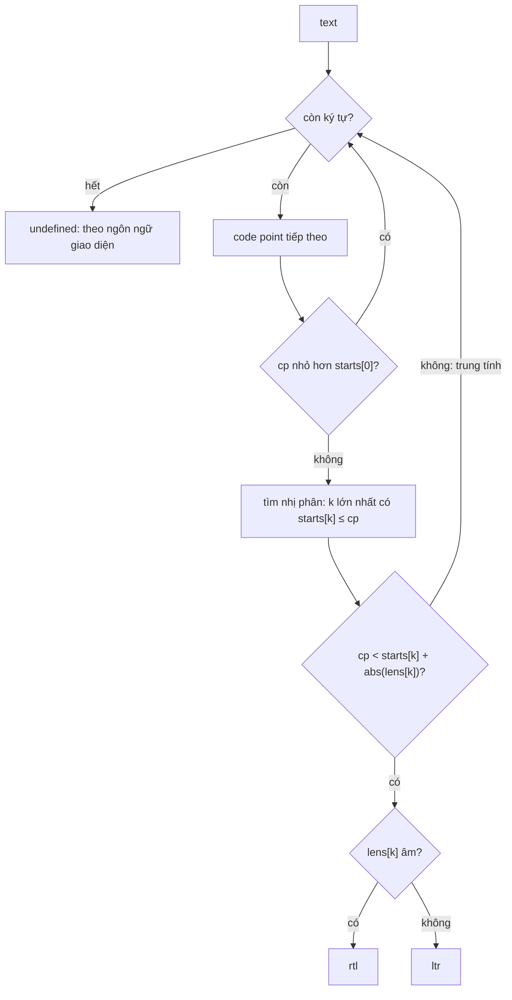

WhatsApp có rất nhiều người dùng viết tiếng Ả Rập, tiếng Hebrew, tiếng Ba Tư, tiếng Urdu: chữ chạy từ phải sang trái (RTL). Trong cùng một cuộc trò chuyện, tin này tiếng Việt, tin sau tiếng Ả Rập, tên trong group trộn đủ kiểu. Mỗi tin nhắn phải được căn và sắp chữ theo **chính nó**, không theo ngôn ngữ giao diện: tin `مرحبا! hẹn 9h` phải căn phải dù giao diện là tiếng Việt.

Quy tắc phổ biến (và là quy tắc của Unicode cho đoạn văn) là nhìn **ký tự mạnh đầu tiên**: chữ cái Latin, Hán, Thái… là "mạnh trái-sang-phải", chữ Hebrew, Ả Rập là "mạnh phải-sang-trái", còn số, dấu câu, emoji, khoảng trắng là trung tính. Câu hỏi là: làm sao biết một code point thuộc loại nào mà không mang theo cả cơ sở dữ liệu Unicode? WhatsApp Web 2020 dùng một bảng ~730 khoảng, nén thành dãy số chưa tới 4KB.

> [!TIP]
> **Tóm tắt**
> - `dir(text)` trả `'ltr'`, `'rtl'` hoặc `undefined` theo ký tự mạnh đầu tiên; không có ký tự mạnh thì ô soạn tin theo ngôn ngữ giao diện.
> - Bảng là dãy cặp `[khoảng cách từ đầu khoảng trước, độ dài có dấu]`, âm = RTL. Giải nén lười vào hai `Int32Array`, tra bằng tìm kiếm nhị phân.
> - Bản viết lại tự sinh bảng từ thuộc tính Unicode của regex (`\p{sc=Arabic}`, `\p{L}`…) ở bước build, kích thước tương đương, sai khác chủ yếu do phiên bản Unicode.
> - `dir="auto"` của HTML làm việc tương tự ngay trong trình duyệt, nhưng chỉ dùng được khi phần tử đã nằm trong DOM, và không có "theo ngôn ngữ giao diện" khi không có ký tự mạnh.

<iframe class="demo-frame" src="/demos/web-patterns/index.html?theme=dark#/wa-text-direction" title="Demo wa-text-direction" loading="lazy" style="height: 1020px"></iframe>

<p class="demo-links">▶ <a href="/demos/web-patterns/index.html#/wa-text-direction" target="_blank" rel="noopener">Mở demo toàn màn hình ↗</a> · <a href="https://stackblitz.com/github/hunghg255/blog-hunghg/tree/master/examples/web-patterns?file=src/lib/waTextDirection.ts" target="_blank" rel="noopener">Sửa code trên StackBlitz ↗</a> · <a href="https://github.com/hunghg255/blog-hunghg/blob/master/examples/web-patterns/src/lib/waTextDirection.ts" target="_blank" rel="noopener">Xem source trên GitHub ↗</a></p>

## WhatsApp làm thế nào?

Bundle WhatsApp Web 2020 (`0 Whatapp list/all.js` trong repo [facebook-codebase](https://github.com/hunghg255/facebook-codebase)); tên module là hash, bản hiện tại có lẽ đã khác.

| Module | Vai trò |
| --- | --- |
| `dadiabfgjj` | `JSON.parse("[65,26,32,26,73,1,…]")`: bảng khoảng, 1460 số |
| `dehfadfiij` | `dir(text)`: giải nén lười và tra bảng |
| `igieaiddf` | `BaseInput`: `dir` của ô soạn tin = `dir(text) || (giao diện RTL ? 'rtl' : 'ltr')` |
| `ecddiajibj` | Mention: `<span dir={dir(name) || 'auto'}>` cho tên |

### Bảng nén

Bảng bắt đầu bằng `65, 26, 32, 26, 73, 1, 11, 1, …`. Đọc theo cặp:

| Cặp | Đầu khoảng (cộng dồn) | Độ dài | Ký tự |
| --- | --- | --- | --- |
| `65, 26` | 65 | +26 | `A`–`Z`, LTR |
| `32, 26` | 97 | +26 | `a`–`z`, LTR |
| `73, 1` | 170 | +1 | `ª`, LTR |
| `11, 1` | 181 | +1 | `µ`, LTR |
| … | | | |
| `55, -1` | 1424 | −1 | U+0590: ô chưa gán đầu khối Hebrew, RTL theo mặc định của Unicode |
| `46, -1` | 1470 | −1 | `־` (dấu nối Hebrew), RTL |

Số đầu tiên của mỗi cặp là **khoảng cách từ đầu khoảng trước**, không phải vị trí tuyệt đối. Vị trí tuyệt đối có thể tới 1.114.111 (7 chữ số), còn khoảng cách thường chỉ 1–3 chữ số, nên chuỗi JSON ngắn hơn hẳn. Dấu của số thứ hai mang luôn thông tin hướng, không cần mảng thứ ba. Cặp cuối `…, 788480, 65534, 65536, 65534` là hai vùng Private Use ở plane 15 và 16 (LTR theo Unicode).

### Giải nén lười và tìm nhị phân

Lần gọi `dir()` đầu tiên mới tạo hai `Int32Array`: `starts[k] = table[2k] + starts[k-1]` và `lens[k] = table[2k+1]`. Sau đó mỗi lời gọi duyệt chuỗi (rút gọn, đặt lại tên):

```js
for (let i = 0; i < text.length; i++) {
  let cp = text.charCodeAt(i);
  if (cp >= 0xd800 && cp < 0xdc00) {               // surrogate cao
    if (++i === text.length) break;
    const lo = text.charCodeAt(i);
    if (!(lo >= 0xdc00 && lo < 0xe000)) continue;  // (!) bỏ luôn ký tự ở vị trí i
    cp = 0x10000 + (((cp & 0x3ff) << 10) | (lo & 0x3ff));
  } else if (cp >= 0xdc00 && cp < 0xe000) continue; // surrogate thấp lẻ
  const k = lastIndexWithStartAtMost(starts, cp);  // tìm nhị phân
  if (k >= 0 && cp < starts[k] + Math.abs(lens[k])) return lens[k] < 0 ? 'rtl' : 'ltr';
}
return undefined;                                  // không có ký tự mạnh
```

Bảng chỉ được giải nén khi có người gọi `dir()` lần đầu, tức là không tốn gì lúc tải trang nếu chưa mở chat nào. Hai `Int32Array` ~730 phần tử mỗi mảng là khoảng 6KB bộ nhớ, tra mỗi ký tự tốn tối đa 10 bước so sánh.

Tôi đã kiểm tra vòng tìm nhị phân của bản gốc (viết tay với `d`, `l`, `c`): bất biến `starts[d] ≤ cp` được giữ ở mọi nhánh nên kết quả đúng.

### Lỗi nhỏ với surrogate lẻ

Khi gặp surrogate cao mà ký tự sau **không** phải surrogate thấp (chuỗi hỏng, thường do cắt đôi emoji), code tăng `i` rồi `continue`, nên ký tự ở vị trí `i` bị bỏ qua luôn. Với `"\uD83Dא world"` (surrogate lẻ, rồi chữ Hebrew `א`), `א` bị bỏ, ký tự mạnh đầu tiên thành `w`, kết quả `ltr`. Đúng ra phải là `rtl`.

Điều thú vị: `dir="auto"` của Chromium (trình duyệt trong demo) cũng trả `ltr` cho chuỗi này, có lẽ vì cũng đọc UTF-16 theo cặp theo cách tương tự. Chuỗi hỏng kiểu này hiếm gặp, nên đây là lỗi vô hại; bản viết lại dùng `codePointAt`, surrogate lẻ được coi là trung tính và `א` vẫn được xét.



## Bên trong trình duyệt: thuật toán bidi và `dir="auto"`

Unicode Bidirectional Algorithm (UAX #9) gán mỗi code point một lớp `Bidi_Class`: `L` (mạnh trái-sang-phải), `R` (Hebrew…), `AL` (chữ Ả Rập), các lớp yếu như `EN` (số châu Âu), `AN` (số Ả Rập), và các lớp trung tính. Quy tắc P2–P3 xác định hướng đoạn văn: ký tự đầu tiên thuộc `L`, `R` hoặc `AL`, **bỏ qua** phần nằm giữa ký tự cô lập (LRI/RLI/FSI) và PDI tương ứng.

HTML có `dir="auto"`: trình duyệt tự tìm ký tự mạnh đầu tiên trong nội dung phần tử. Nếu không có ký tự mạnh, kết quả là `ltr`. Có thể đọc hướng đã tính bằng `getComputedStyle(el).direction` hoặc `el.matches(':dir(rtl)')` (`:dir()` có trên mọi trình duyệt lớn, tính tới 10/2026).

Vậy tại sao WhatsApp không dùng `dir="auto"` cho mọi thứ?

- Ô soạn tin là contentEditable mà React không render lại (`shouldComponentUpdate` luôn `false`, xem [bài #12](/blogs/whatsapp-mention-zero-width-input)), và khi không có ký tự mạnh, WhatsApp muốn theo **ngôn ngữ giao diện**, không phải `ltr` cố định: người dùng giao diện tiếng Ả Rập gõ `123` thì con trỏ vẫn đứng bên phải.
- Có những chỗ cần biết hướng **trước khi** render hoặc không có DOM: đặt `dir` cho span tên trong chuỗi HTML được tạo bằng code, chọn căn lề cho bong bóng chat, tính vị trí đuôi bong bóng.
- `dir="auto"` của trình duyệt cũ có khác biệt nhỏ giữa các engine; một hàm JavaScript cho cùng kết quả ở mọi nơi.

## Viết lại

Bản gốc nhúng bảng sinh sẵn. Bản viết lại cũng nhúng bảng (`waTextDirectionData.ts`), nhưng kèm luôn **cách sinh bảng**, để cập nhật khi Unicode thêm chữ mới. JavaScript không có `\p{Bidi_Class=R}` trong regex, nên phải xấp xỉ bằng thuộc tính script và loại ký tự.

### Sinh và nén bảng

```ts title=src/lib/waTextDirection.ts
/** Gom các code point liên tiếp cùng hướng thành khoảng. `classify` trả null cho ký tự trung tính. */
export function buildRanges(classify: (cp: number) => Dir | null, maxCodePoint = 0x10ffff): Range[] {
  const ranges: Range[] = [];
  let cur: Range | null = null;
  for (let cp = 0; cp <= maxCodePoint; cp++) {
    if (cp === 0xd800) cp = 0xe000; // bỏ vùng surrogate
    const d = classify(cp);
    if (d && cur && cur.dir === d && cur.start + cur.length === cp) cur.length++;
    else if (d) ranges.push((cur = { start: cp, length: 1, dir: d }));
    else cur = null;
  }
  return ranges;
}
```

`packRanges` (dòng 21–29) chỉ đổi mỗi khoảng thành cặp `[start - startTrước, ±length]`.

### Phân loại một code point

```ts title=src/lib/waTextDirection.ts
export function classifyByScript(cp: number): Dir | null {
  if (cp === 0x200e) return 'ltr'; // LRM
  if (cp === 0x200f || cp === 0x061c) return 'rtl'; // RLM, ALM
  const ch = String.fromCodePoint(cp);
  if (PRIVATE_USE.test(ch)) return 'ltr'; // vùng dùng riêng có Bidi_Class = L
  if (UNASSIGNED.test(ch)) {
    if ((cp & 0xfffe) === 0xfffe || (cp >= 0xfdd0 && cp <= 0xfdef)) return null; // noncharacter
    return RTL_DEFAULT_BLOCKS.some(([a, b]) => cp >= a && cp <= b) ? 'rtl' : null;
  }
  if (RTL_COMMON.has(cp)) return 'rtl';
  if (rtlRegex().test(ch)) return RTL_WEAK.test(ch) || RTL_WEAK_CPS.has(cp) || isArabicDigit(cp) ? null : 'rtl';
  return STRONG.test(ch) ? 'ltr' : null;
}
```

`classifyByScript` dùng các hằng ở dòng 46–82: danh sách script viết phải-sang-trái, các ký tự yếu trong script đó (dấu phụ, ngoặc, chữ số Ả Rập là `AN`), vài ký tự thuộc script Common nhưng có lớp `AL` (`؛`, `؟`, `ـ`), và các khối mà Unicode quy định ký tự chưa gán mặc định là RTL.

### Tra bảng

`DirectionTable` giữ dãy số nén và giải nén vào `starts`/`lengths` ở lần tra đầu tiên (dòng 109–122), giống bản gốc.

```ts title=src/lib/waTextDirection.ts
  lookup(cp: number): Dir | null {
    if (!this.starts) this.decode();
    const starts = this.starts!;
    let lo = 0;
    let hi = starts.length - 1;
    if (hi < 0 || cp < starts[0]) return null;
    while (lo < hi) {
      const mid = (lo + hi + 1) >> 1; // khoảng cuối cùng có start ≤ cp
      if (starts[mid] <= cp) lo = mid;
      else hi = mid - 1;
    }
    const len = this.lengths![lo];
    return cp < starts[lo] + Math.abs(len) ? (len < 0 ? 'rtl' : 'ltr') : null;
  }
```

```ts title=src/lib/waTextDirection.ts
/** Hướng của ký tự mạnh đầu tiên; undefined nếu chuỗi chỉ có số, dấu câu, emoji… */
export function detectDir(text: string, table: DirectionTable, { skipIsolates = true }: DirOptions = {}): Dir | undefined {
  let depth = 0;
  for (let i = 0; i < text.length; i++) {
    const cp = text.codePointAt(i)!;
    if (cp > 0xffff) i++; // cặp surrogate hợp lệ; surrogate lẻ tự rơi vào vùng trung tính
    if (skipIsolates) {
      if (cp >= 0x2066 && cp <= 0x2068) depth++;
      else if (cp === 0x2069 && depth > 0) depth--;
      if (depth > 0 || cp === 0x2069) continue;
    }
    const d = table.lookup(cp);
    if (d) return d;
  }
  return undefined;
}
```

::: spoiler Xem toàn bộ src/lib/waTextDirection.ts
```ts title=src/lib/waTextDirection.ts
/**
 * Xác định hướng chữ (ltr/rtl) theo ký tự mạnh đầu tiên, tra trong bảng khoảng code point nén delta.
 * Viết lại từ ý tưởng của WhatsApp Web 2020 (module dehfadfiij: dir(), dadiabfgjj: bảng JSON).
 */

export type Dir = 'ltr' | 'rtl';

/**
 * Bảng nén: dãy cặp [khoảng cách từ đầu khoảng trước, độ dài có dấu].
 * Độ dài dương = chữ mạnh trái-sang-phải, âm = phải-sang-trái. Ví dụ [65, 26, 32, 26] = A–Z, a–z.
 */
export type PackedTable = readonly number[];

export interface Range {
  start: number;
  length: number;
  dir: Dir;
}

/** Danh sách khoảng (đã sắp xếp, không chồng nhau) → dãy số nén. */
export function packRanges(ranges: Range[]): number[] {
  const out: number[] = [];
  let prev = 0;
  for (const r of ranges) {
    out.push(r.start - prev, r.dir === 'rtl' ? -r.length : r.length);
    prev = r.start;
  }
  return out;
}

/** Gom các code point liên tiếp cùng hướng thành khoảng. `classify` trả null cho ký tự trung tính. */
export function buildRanges(classify: (cp: number) => Dir | null, maxCodePoint = 0x10ffff): Range[] {
  const ranges: Range[] = [];
  let cur: Range | null = null;
  for (let cp = 0; cp <= maxCodePoint; cp++) {
    if (cp === 0xd800) cp = 0xe000; // bỏ vùng surrogate
    const d = classify(cp);
    if (d && cur && cur.dir === d && cur.start + cur.length === cp) cur.length++;
    else if (d) ranges.push((cur = { start: cp, length: 1, dir: d }));
    else cur = null;
  }
  return ranges;
}

/** Hướng của chữ cái theo script. JS regex không có Bidi_Class nên đây là bản xấp xỉ (R/AL ≈ chữ thuộc script viết phải-sang-trái). */
const RTL_SCRIPT_NAMES = [
  'Hebrew', 'Arabic', 'Syriac', 'Thaana', 'Nko', 'Samaritan', 'Mandaic', 'Adlam', 'Hanifi_Rohingya',
  'Mende_Kikakui', 'Imperial_Aramaic', 'Phoenician', 'Kharoshthi', 'Old_South_Arabian', 'Old_North_Arabian',
  'Avestan', 'Inscriptional_Parthian', 'Inscriptional_Pahlavi', 'Psalter_Pahlavi', 'Manichaean', 'Nabataean',
  'Palmyrene', 'Hatran', 'Old_Hungarian', 'Sogdian', 'Old_Sogdian', 'Yezidi', 'Elymaic', 'Chorasmian', 'Lydian',
  'Cypriot', 'Meroitic_Cursive', 'Meroitic_Hieroglyphs', 'Old_Turkic', 'Old_Uyghur', 'Garay',
];
let rtlScripts: RegExp | undefined;
/** Tạo lười: script mới (vd Old_Uyghur, Unicode 14) làm regex literal lỗi cú pháp trên engine cũ. */
function rtlRegex(): RegExp {
  if (rtlScripts) return rtlScripts;
  const known = RTL_SCRIPT_NAMES.filter((n) => {
    try {
      new RegExp(`\\p{sc=${n}}`, 'u');
      return true;
    } catch {
      return false;
    }
  });
  return (rtlScripts = new RegExp(`[${known.map((n) => `\\p{sc=${n}}`).join('')}]`, 'u'));
}

const STRONG = /[\p{L}\p{Mc}\p{Nl}]/u;
/** Trong script phải-sang-trái, dấu câu (־ ۔) cũng là ký tự mạnh; dấu phụ, ngoặc thì không. */
const RTL_WEAK = /[\p{Mn}\p{Me}\p{Cf}\p{Z}\p{Cc}\p{Ps}\p{Pe}]/u;
/** Chữ số Ả Rập là "số Ả Rập" (AN, yếu); chữ số N'Ko, Adlam… là R (mạnh). */
const isArabicDigit = (cp: number) =>
  (cp >= 0x0660 && cp <= 0x0669) || (cp >= 0x06f0 && cp <= 0x06f9) || (cp >= 0x10d30 && cp <= 0x10d39) || (cp >= 0x10e60 && cp <= 0x10e7e);
const RTL_WEAK_CPS = new Set([0x0609, 0x060a, 0x060c, 0x066a, 0x066b, 0x066c, 0x06dd, 0x0890, 0x0891, 0x08e2]);
/** Ký tự thuộc script Common nhưng Bidi_Class = AL: ؛ ؟ và ـ (tatweel). */
const RTL_COMMON = new Set([0x061b, 0x061f, 0x0640]);
const PRIVATE_USE = /\p{Co}/u;
const UNASSIGNED = /\p{Cn}/u;
/** Khối mà Unicode quy định ký tự chưa gán mặc định là R/AL (DerivedBidiClass.txt). */
const RTL_DEFAULT_BLOCKS: [number, number][] = [
  [0x0590, 0x08ff], [0xfb1d, 0xfdcf], [0xfdf0, 0xfdff], [0xfe70, 0xfeff], [0x10800, 0x10fff], [0x1e800, 0x1efff],
];

export function classifyByScript(cp: number): Dir | null {
  if (cp === 0x200e) return 'ltr'; // LRM
  if (cp === 0x200f || cp === 0x061c) return 'rtl'; // RLM, ALM
  const ch = String.fromCodePoint(cp);
  if (PRIVATE_USE.test(ch)) return 'ltr'; // vùng dùng riêng có Bidi_Class = L
  if (UNASSIGNED.test(ch)) {
    if ((cp & 0xfffe) === 0xfffe || (cp >= 0xfdd0 && cp <= 0xfdef)) return null; // noncharacter
    return RTL_DEFAULT_BLOCKS.some(([a, b]) => cp >= a && cp <= b) ? 'rtl' : null;
  }
  if (RTL_COMMON.has(cp)) return 'rtl';
  if (rtlRegex().test(ch)) return RTL_WEAK.test(ch) || RTL_WEAK_CPS.has(cp) || isArabicDigit(cp) ? null : 'rtl';
  return STRONG.test(ch) ? 'ltr' : null;
}

/** Bảng đã giải nén: mảng đầu khoảng và độ dài có dấu, tra bằng tìm kiếm nhị phân. */
export class DirectionTable {
  private starts?: Int32Array;
  private lengths?: Int32Array;

  constructor(private readonly packed: PackedTable) {}

  get rangeCount(): number {
    return this.packed.length / 2;
  }

  /** Giải nén lần đầu dùng (bản gốc cũng lười như vậy): cộng dồn khoảng cách thành vị trí tuyệt đối. */
  private decode() {
    const n = this.packed.length / 2;
    const starts = new Int32Array(n);
    const lengths = new Int32Array(n);
    let pos = 0;
    for (let k = 0; k < n; k++) {
      pos += this.packed[2 * k];
      starts[k] = pos;
      lengths[k] = this.packed[2 * k + 1];
    }
    this.starts = starts;
    this.lengths = lengths;
  }

  lookup(cp: number): Dir | null {
    if (!this.starts) this.decode();
    const starts = this.starts!;
    let lo = 0;
    let hi = starts.length - 1;
    if (hi < 0 || cp < starts[0]) return null;
    while (lo < hi) {
      const mid = (lo + hi + 1) >> 1; // khoảng cuối cùng có start ≤ cp
      if (starts[mid] <= cp) lo = mid;
      else hi = mid - 1;
    }
    const len = this.lengths![lo];
    return cp < starts[lo] + Math.abs(len) ? (len < 0 ? 'rtl' : 'ltr') : null;
  }
}

export interface DirOptions {
  /** Bỏ qua phần nằm giữa LRI/RLI/FSI … PDI như thuật toán bidi (bản gốc không làm). */
  skipIsolates?: boolean;
}

/** Hướng của ký tự mạnh đầu tiên; undefined nếu chuỗi chỉ có số, dấu câu, emoji… */
export function detectDir(text: string, table: DirectionTable, { skipIsolates = true }: DirOptions = {}): Dir | undefined {
  let depth = 0;
  for (let i = 0; i < text.length; i++) {
    const cp = text.codePointAt(i)!;
    if (cp > 0xffff) i++; // cặp surrogate hợp lệ; surrogate lẻ tự rơi vào vùng trung tính
    if (skipIsolates) {
      if (cp >= 0x2066 && cp <= 0x2068) depth++;
      else if (cp === 0x2069 && depth > 0) depth--;
      if (depth > 0 || cp === 0x2069) continue;
    }
    const d = table.lookup(cp);
    if (d) return d;
  }
  return undefined;
}
```
:::

## Đi qua code

1. `buildRanges(classifyByScript)` đi qua mọi code point từ 0 tới U+10FFFF (bỏ vùng surrogate), gom các ký tự liền nhau cùng hướng thành một khoảng. Trên Node 22 việc này mất khoảng 80–110 ms, nên chạy một lần ở bước build và lưu kết quả.
2. `packRanges` đổi mỗi khoảng thành cặp `[start - startTrước, ±length]`. Kết quả: 747 khoảng, chuỗi JSON 3969 byte; bảng 2020 có 730 khoảng, 3926 byte.
3. `DirectionTable` giữ dãy số nén, chỉ giải nén vào hai `Int32Array` khi `lookup` được gọi lần đầu.
4. `lookup(cp)` tìm nhị phân khoảng cuối cùng có `start ≤ cp` (lấy `mid` lệch lên để vòng lặp luôn thu hẹp), rồi kiểm `cp` có nằm trong độ dài của khoảng đó không.
5. `detectDir(text)` duyệt bằng `codePointAt`, mặc định bỏ qua phần giữa LRI/RLI/FSI và PDI, trả hướng của ký tự mạnh đầu tiên.
6. Demo: ô soạn tin dùng `detectDir(draft) ?? uiDir`; bảng so sánh ba cột: bản viết lại, hành vi 2020 (viết lại để mô phỏng) và `dir="auto"` của trình duyệt đọc qua `getComputedStyle`.

So bảng tự sinh với bảng 2020 trên toàn bộ không gian code point: 18.984 code point cho kết quả khác nhau, chỉ 1.660 trong số đó nằm ở BMP (U+0000–U+FFFF). Phần lớn là chữ được Unicode thêm sau 2020 (khối Hán mở rộng, script mới), bảng cũ coi là trung tính. Phần còn lại là chỗ xấp xỉ chưa khớp `Bidi_Class` thật: chữ bổ trợ như `ʹ` (U+02B9) là `\p{L}` nhưng có lớp trung tính, vài ký hiệu như `҂` (U+0482) hay dấu câu Armenia lại có lớp `L`. Với văn bản chat thông thường (chữ cái), hai bảng cho cùng kết quả: cả 7 chuỗi mẫu trong demo đều khớp, trừ hai chuỗi minh hoạ ở dưới.

**Khác bản gốc:**

- Bỏ qua phần cô lập (isolate) theo UAX #9 P2. Chuỗi `\u2067שלום\u2069 hello` (tên Hebrew được bọc RLI…PDI rồi chữ Latin) cho `ltr` ở bản viết lại; bản 2020 cho `rtl`. Lưu ý: `dir="auto"` của Chromium trong demo cũng cho `rtl`, tức là bản viết lại theo UAX #9 chứ không giống trình duyệt ở điểm này. Muốn giống trình duyệt, gọi `detectDir(text, table, { skipIsolates: false })`.
- Surrogate lẻ không làm mất ký tự kế tiếp.
- Bảng sinh từ dữ liệu Unicode của engine JavaScript lúc build. Nút "Sinh lại bảng lúc chạy" trong demo cho thấy Chromium mới hơn Node 22 ra 757 khoảng: chính là chữ mới của Unicode bản sau.

## Tại sao không làm cách khác?

**Regex trên từng ký tự lúc chạy** (`/[\p{sc=Hebrew}\p{sc=Arabic}…]/u.test(ch)`). Không cần bảng, nhưng regex thuộc tính Unicode chậm hơn tra mảng: trong demo, 200.000 lần `detectDir` mất ~10 ms, gọi `classifyByScript` trên từng ký tự mất ~47 ms. Quan trọng hơn, regex vẫn không có `Bidi_Class` nên phải xấp xỉ giống hệt, chỉ là xấp xỉ lại mỗi lần gọi.

**Vài khoảng viết tay** (`/[֐-ࣿיִ-﷿ﹰ-]/`). Đủ cho Hebrew và Ả Rập, nhưng sai với N'Ko, Thaana (tiếng Maldives), Adlam (tiếng Fula), Syriac, và coi cả số Ả Rập (lớp yếu `AN`) là RTL. Bảng sinh tự động không bỏ sót.

**Mảng vị trí tuyệt đối thay vì delta.** `[65, 91, 97, 123, …]` dễ đọc hơn, nhưng các số lớn (đến 7 chữ số) làm chuỗi JSON dài gấp khoảng 1,5–2 lần. Delta + độ dài có dấu là cách nén đơn giản nhất mà vẫn giải nén bằng một vòng `for`.

**Thư viện i18n đầy đủ.** Thư viện bidi đầy đủ (vd `bidi-js`) chạy cả thuật toán UAX #9, cần khi tự vẽ chữ lên canvas. Chỉ để chọn `dir` cho một đoạn thì một bảng 4KB là đủ.

## Edge case và cạm bẫy

- **Chuỗi chỉ có số, emoji, dấu câu**: `dir()` trả `undefined`. Đừng mặc định `ltr`; hãy theo ngôn ngữ giao diện như WhatsApp, hoặc theo hướng của tin trước đó.
- **Số đứng đầu**: `2024 مرحبا` vẫn là `rtl` vì số là trung tính. Đây là điều người viết code ngây thơ hay sai khi chỉ nhìn ký tự đầu tiên.
- **Mention đứng đầu**: `@An مرحبا` là `ltr` vì `A` là ký tự mạnh đầu tiên. Nếu muốn tin này là `rtl`, phải bỏ qua phần mention khi xét hướng (bọc mention bằng FSI…PDI rồi dùng chế độ bỏ qua isolate).
- **Tên người trong câu**: tên tiếng Ả Rập trong câu tiếng Việt cần `<bdi>` hoặc `dir` riêng; không có thì dấu câu và số bên cạnh có thể bị "kéo" sang hướng của tên.
- **`textarea` và `dir`**: đổi `dir` của ô soạn tin khi người dùng đang gõ sẽ đổi căn lề và vị trí con trỏ; WhatsApp chỉ tính lại khi nội dung đổi, không theo từng lần di chuyển con trỏ.
- **Unicode mới**: bảng cố định sẽ coi chữ mới là trung tính. Với chữ Latin/Ả Rập thông dụng điều này không xảy ra, nhưng nên sinh lại bảng khi nâng Node hoặc mỗi năm một lần.

## Dùng trong dự án

```tsx
const table = new DirectionTable(DIRECTION_TABLE);
const uiDir = document.documentElement.dir === 'rtl' ? 'rtl' : 'ltr';
const Bubble = ({ text }: { text: string }) => <p dir={detectDir(text, table) ?? uiDir}>{text}</p>;
```

Khi chỉ cần trình duyệt tự xử lý và nội dung đã ở trong DOM, `dir="auto"` là đủ và nên dùng trước. Bảng như trên hữu ích khi cần hướng chữ ngoài DOM (server-side render, canvas, tính layout trước), hoặc cần fallback theo ngôn ngữ giao diện. Xem thêm cách [Telegram tự giãn ô nhập](/blogs/telegram-auto-grow-input-grouping) và [Facebook tách cụm emoji](/blogs/facebook-emoji-segmentation).

Để sinh lại bảng, chạy trong Node một lần:

```ts
import { writeFileSync } from 'node:fs';
import { buildRanges, classifyByScript, packRanges } from './waTextDirection';
writeFileSync('table.json', JSON.stringify(packRanges(buildRanges(classifyByScript))));
```

## Kiểm thử

::: spoiler Ví dụ test (bản phác, không có trong repo)
```ts
import { describe, expect, it } from 'vitest';
import { buildRanges, classifyByScript, detectDir, DirectionTable, packRanges } from './waTextDirection';
import { DIRECTION_TABLE } from './waTextDirectionData';

const table = new DirectionTable(DIRECTION_TABLE);

describe('packRanges', () => {
  it('nén delta và dấu', () => {
    expect(packRanges([{ start: 65, length: 26, dir: 'ltr' }, { start: 97, length: 26, dir: 'ltr' }, { start: 1488, length: 27, dir: 'rtl' }]))
      .toEqual([65, 26, 32, 26, 1391, -27]);
  });
  it('bảng nhúng khớp với bảng sinh lại (cùng phiên bản Unicode)', () => {
    const fresh = new DirectionTable(packRanges(buildRanges(classifyByScript, 0xffff)));
    for (const cp of [0x41, 0x5d0, 0x627, 0x660, 0x4e00, 0x1f600]) expect(fresh.lookup(cp)).toBe(table.lookup(cp));
  });
});

describe('lookup', () => {
  it('phân loại', () => {
    expect(table.lookup(0x41)).toBe('ltr');   // A
    expect(table.lookup(0x5d0)).toBe('rtl');  // א
    expect(table.lookup(0x627)).toBe('rtl');  // ا
    expect(table.lookup(0x660)).toBeNull();   // ٠ số Ả Rập: yếu
    expect(table.lookup(0x31)).toBeNull();    // 1
    expect(table.lookup(0x1f600)).toBeNull(); // 😀
  });
});

describe('detectDir', () => {
  it('ký tự mạnh đầu tiên', () => {
    expect(detectDir('2024 مرحبا', table)).toBe('rtl');
    expect(detectDir('@An مرحبا', table)).toBe('ltr');
    expect(detectDir('12:30 😀', table)).toBeUndefined();
  });
  it('bỏ qua isolate', () => {
    expect(detectDir('\u2067שלום\u2069 hello', table)).toBe('ltr');
    expect(detectDir('\u2067שלום\u2069 hello', table, { skipIsolates: false })).toBe('rtl');
  });
  it('surrogate lẻ không nuốt ký tự sau', () => {
    expect(detectDir('\uD83Dא world', table)).toBe('rtl');
  });
});
```
:::

## So với thư viện và chuẩn web

- `dir="auto"` và `<bdi>`: có trên mọi trình duyệt lớn, là lựa chọn đầu tiên khi nội dung nằm trong DOM. CSS `unicode-bidi: plaintext` cho mỗi đoạn (paragraph) tự chọn hướng theo ký tự mạnh đầu tiên, hữu ích cho `textarea` nhiều dòng trộn ngôn ngữ.
- `Intl.Locale.prototype.getTextInfo()` (trước đây là thuộc tính `textInfo`) cho biết hướng của **ngôn ngữ** (`ar` → `rtl`), không phải của một chuỗi; dùng để chọn `uiDir`. Chưa có ở mọi trình duyệt, xem [caniuse](https://caniuse.com/?search=getTextInfo) trước khi dùng.
- Thư viện `rtl-detect` xét theo mã ngôn ngữ; `direction` (npm) xét theo chuỗi bằng regex các khoảng ký tự, cùng ý tưởng "ký tự mạnh đầu tiên" như bài này.

---

Bài này thuộc series **[Học từ mã nguồn WhatsApp Web](/series/whatsapp)** (19 bài, đọc theo thứ tự).

::: spoiler Xem nhanh danh sách bài trong series

*Mở đầu*

- [Mở đầu: đọc bundle WhatsApp Web 2020](/blogs/learn-from-whatsapp-web-source-code)

*Phần 1: media và mã hoá*

- [#1 Giải mã JPEG progressive theo từng scan, kiểm HMAC](/blogs/whatsapp-progressive-jpeg-hmac)
- [#2 Ghép khoảng byte cho video streaming](/blogs/whatsapp-byte-range-merge)
- [#3 Xoá EXIF không re-encode, thumbnail theo ngân sách byte](/blogs/whatsapp-jpeg-strip-thumb-budget)
- [#4 Đọc metadata sticker WebP động](/blogs/whatsapp-webp-sticker-metadata)

*Phần 2: lưu trữ trên trình duyệt*

- [#5 Kho media LRU tự co theo quota](/blogs/whatsapp-quota-aware-media-lru)
- [#6 Cache blob trong RAM có refcount, tự revoke objectURL](/blogs/whatsapp-blob-cache-refcount)
- [#7 Khoá IndexedDB giữ đúng thứ tự từ điển](/blogs/whatsapp-indexeddb-ordered-keys)

*Phần 3: danh sách tin nhắn*

- [#8 Render tin nhắn theo cửa sổ chiều cao ước lượng](/blogs/whatsapp-render-cursor-window)
- [#9 Theo dõi viewport tin nhắn: binary search, ngày dính](/blogs/whatsapp-message-viewport-tracking)
- [#10 FlatList tái dùng key React, overscan bất đối xứng](/blogs/whatsapp-flatlist-key-reuse)

*Phần 4: soạn tin và chữ*

- [#11 Emoticon thành emoji bằng trie đọc ngược, tìm emoji](/blogs/whatsapp-emoticon-trie-emoji-search)
- [#12 Mention bằng token zero-width, giới hạn theo code point](/blogs/whatsapp-mention-zero-width-input)
- **#13 Xác định hướng chữ bằng bảng delta nén** (bài này)
- [#14 Phát hiện homograph trong link, chặn giả đuôi file RTLO](/blogs/whatsapp-homograph-rtlo-guard)

*Phần 5: realtime và tiện ích*

- [#15 Presence, "đang gõ" và thông báo theo kích thước group](/blogs/whatsapp-presence-typing-notifications)
- [#16 Đo FPS phát hiện UI đóng băng, idle monitor](/blogs/whatsapp-fps-freeze-idle)
- [#17 Cửa sổ PiP: resize 8 hướng, khoá tỉ lệ, né vật cản](/blogs/whatsapp-pip-resize-avoid)
- [#18 Parse giá tiền theo locale bằng Intl](/blogs/whatsapp-locale-price-parse)

:::

Code + demo: [`examples/web-patterns`](https://github.com/hunghg255/blog-hunghg/tree/master/examples/web-patterns) · [Mở trên StackBlitz](https://stackblitz.com/github/hunghg255/blog-hunghg/tree/master/examples/web-patterns)
