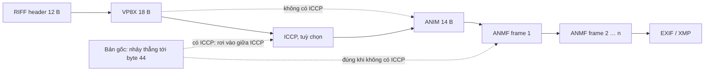

Sticker của WhatsApp là file WebP, nhiều cái là WebP **động** (animated). Trước khi hiển thị, app cần biết vài thứ mà thẻ `` không cho biết: sticker có động không, một vòng dài bao lâu (để dừng sau vài vòng, đỡ tốn pin), frame đầu kết thúc ở byte nào (để hiện ngay một khung tĩnh và ký riêng phần đó), và sticker gắn với emoji nào (để gợi ý khi gõ 😀).

Tất cả nằm sẵn trong file, chỉ cần đọc đúng chỗ. WhatsApp Web đọc bằng vài chục dòng JavaScript, không cần thư viện. Nhưng "đúng chỗ" ở bản 2020 là một offset cố định, và chỉ cần sticker có thêm một chunk hợp lệ theo chuẩn là phép tính lệch hết.

> [!TIP]
> **Tóm tắt**
> - WebP là file RIFF: chuỗi chunk `fourcc + độ dài + dữ liệu`, chunk lẻ được đệm 1 byte. Muốn đọc an toàn thì **đi theo chunk**, không nhảy tới offset cố định.
> - Thời lượng một vòng = tổng 3 byte duration của mọi chunk `ANMF`. WhatsApp cho lặp tối đa 3 vòng nhưng không quá 5 giây.
> - Bản gốc đọc frame từ offset 44, chỉ đúng khi `ANIM` đứng ngay sau `VP8X`. Sticker có chunk `ICCP` (hồ sơ màu) bị đọc ra thời lượng 0, tức **bị coi là ảnh tĩnh**.
> - Emoji gắn kèm nằm trong JSON ở chunk `EXIF` hoặc `XMP `. Bản gốc so fourcc với `"XMP"` (thiếu dấu cách) nên nhánh XMP không bao giờ chạy.

<iframe class="demo-frame" src="/demos/web-patterns/index.html?theme=dark#/wa-webp-sticker" title="Demo wa-webp-sticker" loading="lazy" style="height: 760px"></iframe>

<p class="demo-links">▶ <a href="/demos/web-patterns/index.html#/wa-webp-sticker" target="_blank" rel="noopener">Mở demo toàn màn hình ↗</a> · <a href="https://stackblitz.com/github/hunghg255/blog-hunghg/tree/master/examples/web-patterns?file=src/lib/waWebpMeta.ts" target="_blank" rel="noopener">Sửa code trên StackBlitz ↗</a> · <a href="https://github.com/hunghg255/blog-hunghg/blob/master/examples/web-patterns/src/lib/waWebpMeta.ts" target="_blank" rel="noopener">Xem source trên GitHub ↗</a></p>

Demo dựng sticker ngay trong trình duyệt: canvas vẽ từng frame, encode WebP, rồi ghép chunk `VP8X`, `ICCP`, `ANIM`, `ANMF`, `EXIF`/`XMP ` bằng tay. Bật/tắt **Có chunk ICCP** để thấy cột "Bản gốc" chuyển từ đúng sang 0 ms. Đổi **Emoji nằm trong** sang XMP để thấy bản gốc mất emoji. Hàng chip dưới cùng là danh sách chunk với offset; khi không có ICCP, chunk `ANMF` đầu tiên nằm đúng ở byte 44.

## WhatsApp Web làm thế nào?

Module `dbjchhfjhj` trong bundle WhatsApp Web 2020 (tên module là hash webpack, biến đã đổi tên). Nó được gọi từ `bccggdcfj` khi nhận sticker và từ `cfjbaecadg` khi gửi.

### Kiểm định dạng mở rộng và cờ động

```js
const VP8X = [86, 80, 56, 88], ANMF = [65, 78, 77, 70];
const isExtendedFile = b => equals(b.slice(12, 16), VP8X);
const isAnimatedWebp = b => isExtendedFile(b) && (b[20] & 2) !== 0;
```

Byte 12–15 là fourcc của chunk đầu tiên; WebP "mở rộng" bắt đầu bằng `VP8X`. Byte 20 là byte cờ của `VP8X` (12 + 8 byte header), bit `0x02` là cờ animation. Phần này đúng.

### Cộng duration từ offset 44

```js
let total = 0, s = 44, first;
while (equals(b.slice(s, s + 4), ANMF)) {
  total += le(b.slice(s + 20, s + 23));        // 3 byte duration
  s += 8 + le(b.slice(s + 4, s + 8));          // nhảy qua chunk
  if (first == null) first = s;                // byte kết thúc frame đầu
}
return { animationDuration: loops(total), firstFrameLength: first, singleLoopDuration: total, emojis: getCorrespondingEmojis(b) };
```

Con số 44 = 12 (header RIFF) + 18 (`VP8X`: 8 header + 10 dữ liệu) + 14 (`ANIM`: 8 + 6). Trong chunk `ANMF`, 16 byte đầu dữ liệu là X, Y, rộng−1, cao−1 (mỗi thứ 3 byte), duration 3 byte, 1 byte cờ; nên duration nằm ở `s + 8 + 12 = s + 20`. Số vòng lặp:

```js
const loops = d => d === 0 ? 0 : Math.max(Math.min(Math.floor(5000 / d), 3), 1) * d; // MAX_LOOPS 3, MAX_DURATION 5000
```

Sticker 1 giây chạy 3 vòng, sticker 2 giây chạy 2 vòng (4 giây), sticker 6 giây chạy đúng 1 vòng.

### Tìm emoji

```js
for (let i = 12; i < b.byteLength; ) {
  const id = decoder.decode(b.slice(i, i + 4));
  let size = le(b.slice(i + 4, i + 8));
  if (size % 2 !== 0) size += 1;
  if (id === 'EXIF' || id === 'XMP') { /* từ i tới HẾT FILE: tìm '}' cuối, lùi tới NUL, JSON.parse */ return json.emojis; }
  i += 8 + size;
}
```

Hàm này đi đúng theo chunk, có xử lý byte đệm. Nhưng fourcc của chunk XMP trong chuẩn WebP là `"XMP "`, bốn ký tự có dấu cách ở cuối; `decode` 4 byte ra `"XMP "` và không bao giờ bằng `"XMP"`.

### Kết quả được dùng vào đâu

Trong `bccggdcfj`, metadata sticker có trường `isAnimated: webpData.animationDuration > 0`. Ở nhánh trình duyệt không tự giải mã WebP được, `animationDuration` bằng 0 thì sticker được giải mã thành **một** ảnh RGBA (`decodeWebpToRGBANoOpaque`), có lẽ chỉ frame đầu. Khi gửi, `cfjbaecadg` chỉ tính `firstFrameSidecar` (HMAC 10 byte phủ ciphertext tới hết frame đầu, module `bcdhbefeei`) khi `firstFrameLength != null`.

Mình nạp nguyên module gốc vào Node với các phụ thuộc giả rồi chạy trên ba file dựng bằng code của bài:

| File | `singleLoopDuration` | `firstFrameLength` | `emojis` |
| --- | --- | --- | --- |
| Không ICCP, emoji trong EXIF | 350 | 108 | `['😀']` |
| Có ICCP 20 byte | **0** | **undefined** | `['😀']` |
| Không ICCP, emoji trong `XMP ` | 350 | 108 | **`[]`** |

Sticker động có ICC profile vì thế bị coi là ảnh tĩnh và không có first-frame sidecar. Có lẽ các sticker do WhatsApp tự tạo năm 2020 không có ICCP nên lỗi ít lộ ra, nhưng công cụ làm sticker bên ngoài (hoặc encoder giữ hồ sơ màu của ảnh gốc) thì có thể sinh ra chunk này.

## Bên trong trình duyệt: định dạng RIFF của WebP

Một file WebP động trông như sau:

| Offset | Chunk | Ghi chú |
| --- | --- | --- |
| 0 | `RIFF` + độ dài + `WEBP` | 12 byte |
| 12 | `VP8X` (10 byte) | cờ: ICC 0x20, alpha 0x10, EXIF 0x08, XMP 0x04, animation 0x02; kích thước canvas |
| 30 | `ICCP` (tuỳ chọn) | hồ sơ màu, **phải** đứng ngay sau VP8X nếu có |
| tiếp | `ANIM` (6 byte) | màu nền, số vòng lặp |
| tiếp | `ANMF` × n | mỗi frame: vị trí, kích thước, duration, rồi các chunk ảnh `ALPH`/`VP8 `/`VP8L` |
| cuối | `EXIF`, `XMP ` (tuỳ chọn) | metadata |

Mỗi chunk là 4 byte fourcc, 4 byte độ dài little-endian (không tính phần đệm), dữ liệu, và 1 byte đệm nếu độ dài lẻ. Parser chỉ cần lặp `at += 8 + size + (size & 1)`. Chunk lạ thì bỏ qua, nên định dạng mở rộng được mà parser cũ không vỡ. Offset cố định thì ngược lại: chèn bất cứ chunk hợp lệ nào phía trước là hỏng.



## Viết lại

`src/lib/waWebpMeta.ts` có một hàm đi chunk dùng chung, giới hạn bởi độ dài khai báo trong header RIFF để không đọc tràn file cụt:

```ts title=src/lib/waWebpMeta.ts
/** Danh sách chunk trong [start, end); payload lẻ được đệm 1 byte theo chuẩn RIFF. */
export function walkChunks(b: Uint8Array, start = 12, end = b.byteLength): RiffChunk[] {
  const out: RiffChunk[] = [];
  for (let at = start; at + 8 <= end; ) {
    const size = u32(b, at + 4);
    if (at + 8 + size > end) break; // file cụt: dừng, không đọc tràn
    out.push({ fourcc: fourcc(b, at), offset: at, size });
    at += 8 + size + (size & 1);
  }
  return out;
}
```

Đọc metadata chỉ còn là lọc chunk theo fourcc. Emoji thì tìm JSON **trong phạm vi chunk**, không quét tới hết file:

```ts title=src/lib/waWebpMeta.ts
export function parseWebpSticker(b: Uint8Array): StickerMeta {
  if (fourcc(b, 0) !== 'RIFF' || fourcc(b, 8) !== 'WEBP') throw new Error('không phải WebP');
  const chunks = walkChunks(b, 12, Math.min(b.byteLength, 8 + u32(b, 4)));
  const vp8x = chunks[0]?.fourcc === 'VP8X' ? chunks[0] : undefined;
  const flags = vp8x ? b[vp8x.offset + 8] : 0;
  const frames: StickerMeta['frames'] = [];
  let firstFrameLength: number | undefined;
  for (const c of chunks) {
    if (c.fourcc !== 'ANMF') continue;
    const p = c.offset + 8;
    frames.push({ width: u24(b, p + 6) + 1, height: u24(b, p + 9) + 1, duration: u24(b, p + 12) });
    firstFrameLength ??= c.offset + 8 + c.size + (c.size & 1);
  }
  const singleLoopDuration = frames.reduce((n, f) => n + f.duration, 0);
  return {
    extended: !!vp8x,
    animated: (flags & 0x02) !== 0,
    hasIccp: chunks.some((c) => c.fourcc === 'ICCP'),
    frames,
    singleLoopDuration,
    animationDuration: totalAnimationDuration(singleLoopDuration),
    firstFrameLength,
    emojis: stickerEmojis(b, chunks),
  };
}

/** JSON {"emojis": [...]} nằm trong chunk EXIF hoặc "XMP " (4 ký tự, có dấu cách). Chỉ đọc trong chunk đó. */
export function stickerEmojis(b: Uint8Array, chunks = walkChunks(b)): string[] {
  const dec = new TextDecoder();
  for (const c of chunks) {
    if (c.fourcc !== 'EXIF' && c.fourcc !== 'XMP ') continue;
    const text = dec.decode(b.subarray(c.offset + 8, c.offset + 8 + c.size));
    const open = text.indexOf('{');
    const close = text.lastIndexOf('}');
    if (open < 0 || close < open) continue;
    try {
      const json = JSON.parse(text.slice(open, close + 1));
      if (Array.isArray(json.emojis)) return json.emojis.filter((e: unknown) => typeof e === 'string');
    } catch {
      // chunk không chứa JSON hợp lệ: thử chunk kế
    }
  }
  return [];
}
```

File còn có `buildAnimatedWebp` (ghép chunk thành file, dùng cho demo và test) và `parseLikeOriginal` (bản port logic gốc để so sánh).

::: spoiler Xem toàn bộ src/lib/waWebpMeta.ts
```ts title=src/lib/waWebpMeta.ts
// Đọc metadata sticker WebP động: tổng thời lượng, số vòng lặp, độ dài frame đầu, emoji gắn kèm.
// Viết lại từ module dbjchhfjhj của WhatsApp Web bản 2020: đi theo chunk RIFF thay vì offset cố định.

export interface RiffChunk {
  fourcc: string;
  /** vị trí header chunk (fourcc) trong file */
  offset: number;
  /** kích thước payload, chưa tính byte đệm */
  size: number;
}

const u24 = (b: Uint8Array, at: number) => b[at] | (b[at + 1] << 8) | (b[at + 2] << 16);
const u32 = (b: Uint8Array, at: number) => (b[at] | (b[at + 1] << 8) | (b[at + 2] << 16) | (b[at + 3] << 24)) >>> 0;
const fourcc = (b: Uint8Array, at: number) => String.fromCharCode(b[at], b[at + 1], b[at + 2], b[at + 3]);

/** Danh sách chunk trong [start, end); payload lẻ được đệm 1 byte theo chuẩn RIFF. */
export function walkChunks(b: Uint8Array, start = 12, end = b.byteLength): RiffChunk[] {
  const out: RiffChunk[] = [];
  for (let at = start; at + 8 <= end; ) {
    const size = u32(b, at + 4);
    if (at + 8 + size > end) break; // file cụt: dừng, không đọc tràn
    out.push({ fourcc: fourcc(b, at), offset: at, size });
    at += 8 + size + (size & 1);
  }
  return out;
}

export const MAX_DURATION = 5000;
export const MAX_LOOPS = 3;

/** Như bản gốc: lặp tối đa 3 vòng nhưng không quá 5 giây (ít nhất 1 vòng). */
export function totalAnimationDuration(singleLoop: number): number {
  if (singleLoop === 0) return 0;
  return Math.max(Math.min(Math.floor(MAX_DURATION / singleLoop), MAX_LOOPS), 1) * singleLoop;
}

export interface StickerMeta {
  extended: boolean;
  animated: boolean;
  hasIccp: boolean;
  frames: { duration: number; width: number; height: number }[];
  singleLoopDuration: number;
  animationDuration: number;
  /** byte kết thúc frame đầu: đủ để hiện frame tĩnh trước khi tải hết */
  firstFrameLength?: number;
  emojis: string[];
}

export function parseWebpSticker(b: Uint8Array): StickerMeta {
  if (fourcc(b, 0) !== 'RIFF' || fourcc(b, 8) !== 'WEBP') throw new Error('không phải WebP');
  const chunks = walkChunks(b, 12, Math.min(b.byteLength, 8 + u32(b, 4)));
  const vp8x = chunks[0]?.fourcc === 'VP8X' ? chunks[0] : undefined;
  const flags = vp8x ? b[vp8x.offset + 8] : 0;
  const frames: StickerMeta['frames'] = [];
  let firstFrameLength: number | undefined;
  for (const c of chunks) {
    if (c.fourcc !== 'ANMF') continue;
    const p = c.offset + 8;
    frames.push({ width: u24(b, p + 6) + 1, height: u24(b, p + 9) + 1, duration: u24(b, p + 12) });
    firstFrameLength ??= c.offset + 8 + c.size + (c.size & 1);
  }
  const singleLoopDuration = frames.reduce((n, f) => n + f.duration, 0);
  return {
    extended: !!vp8x,
    animated: (flags & 0x02) !== 0,
    hasIccp: chunks.some((c) => c.fourcc === 'ICCP'),
    frames,
    singleLoopDuration,
    animationDuration: totalAnimationDuration(singleLoopDuration),
    firstFrameLength,
    emojis: stickerEmojis(b, chunks),
  };
}

/** JSON {"emojis": [...]} nằm trong chunk EXIF hoặc "XMP " (4 ký tự, có dấu cách). Chỉ đọc trong chunk đó. */
export function stickerEmojis(b: Uint8Array, chunks = walkChunks(b)): string[] {
  const dec = new TextDecoder();
  for (const c of chunks) {
    if (c.fourcc !== 'EXIF' && c.fourcc !== 'XMP ') continue;
    const text = dec.decode(b.subarray(c.offset + 8, c.offset + 8 + c.size));
    const open = text.indexOf('{');
    const close = text.lastIndexOf('}');
    if (open < 0 || close < open) continue;
    try {
      const json = JSON.parse(text.slice(open, close + 1));
      if (Array.isArray(json.emojis)) return json.emojis.filter((e: unknown) => typeof e === 'string');
    } catch {
      // chunk không chứa JSON hợp lệ: thử chunk kế
    }
  }
  return [];
}

// ---------------------------------------------------------------------------
// Dựng file WebP từ các chunk: dùng trong demo/test để tạo sticker có hoặc không có ICCP, XMP.

export function chunk(id: string, payload: Uint8Array): Uint8Array {
  const pad = payload.byteLength & 1;
  const out = new Uint8Array(8 + payload.byteLength + pad);
  for (let i = 0; i < 4; i++) out[i] = id.charCodeAt(i);
  new DataView(out.buffer).setUint32(4, payload.byteLength, true);
  out.set(payload, 8);
  return out;
}

const le24 = (n: number) => [n & 255, (n >> 8) & 255, (n >> 16) & 255];

export interface BuildFrame {
  width: number;
  height: number;
  duration: number;
  /** các chunk ảnh của frame (VP8/VP8L, có thể kèm ALPH) */
  image: Uint8Array;
}

export function buildAnimatedWebp(
  frames: BuildFrame[],
  { iccp, exif, xmp, loops = 0 }: { iccp?: Uint8Array; exif?: Uint8Array; xmp?: Uint8Array; loops?: number } = {},
): Uint8Array<ArrayBuffer> {
  const w = Math.max(...frames.map((f) => f.width));
  const h = Math.max(...frames.map((f) => f.height));
  const flags = (iccp ? 0x20 : 0) | 0x10 | (exif ? 0x08 : 0) | (xmp ? 0x04 : 0) | 0x02;
  const parts = [chunk('VP8X', new Uint8Array([flags, 0, 0, 0, ...le24(w - 1), ...le24(h - 1)]))];
  if (iccp) parts.push(chunk('ICCP', iccp)); // chuẩn đặt ICCP ngay sau VP8X, trước ANIM
  parts.push(chunk('ANIM', new Uint8Array([0, 0, 0, 0, loops & 255, loops >> 8])));
  for (const f of frames) {
    const head = [0, 0, 0, 0, 0, 0, ...le24(f.width - 1), ...le24(f.height - 1), ...le24(f.duration), 0];
    parts.push(chunk('ANMF', new Uint8Array([...head, ...f.image])));
  }
  if (exif) parts.push(chunk('EXIF', exif));
  if (xmp) parts.push(chunk('XMP ', xmp));
  const body = parts.reduce((n, p) => n + p.byteLength, 0);
  const out = new Uint8Array(12 + body);
  out.set([82, 73, 70, 70], 0);
  new DataView(out.buffer).setUint32(4, 4 + body, true);
  out.set([87, 69, 66, 80], 8);
  let at = 12;
  for (const p of parts) {
    out.set(p, at);
    at += p.byteLength;
  }
  return out;
}

/** Payload EXIF kiểu sticker WhatsApp: vài byte TIFF, NUL rồi JSON. */
export function stickerJsonPayload(meta: Record<string, unknown>): Uint8Array {
  return new Uint8Array([0x49, 0x49, 0x2a, 0, 8, 0, 0, 0, 0, ...new TextEncoder().encode(JSON.stringify(meta))]);
}

// ---------------------------------------------------------------------------
// Bản port logic gốc (dbjchhfjhj), chỉ để so sánh trong demo và test.

export function parseLikeOriginal(t: Uint8Array) {
  const eq = (at: number, s: string) => fourcc(t, at) === s;
  const le = (a: Uint8Array) => a.reduce((n, x, i) => n + (x << (8 * i)), 0);
  const empty = { animationDuration: 0, singleLoopDuration: 0, emojis: [] as string[], firstFrameLength: undefined as number | undefined };
  if (!eq(12, 'VP8X')) return empty;
  let single = 0;
  let s = 44; // giả định ANIM ngay sau VP8X: 12 + 18 + 14
  let first: number | undefined;
  while (eq(s, 'ANMF')) {
    single += le(t.slice(s + 20, s + 23));
    s += 8 + le(t.slice(s + 4, s + 8));
    first ??= s;
  }
  // g(): so fourcc với "XMP" (3 ký tự) nên chunk "XMP " không bao giờ khớp
  const dec = new TextDecoder();
  let emojis: string[] = [];
  for (let i = 12; i < t.byteLength; ) {
    const id = dec.decode(t.slice(i, i + 4));
    let size = le(t.slice(i + 4, i + 8));
    if (size % 2) size += 1;
    if (id === 'EXIF' || id === 'XMP') {
      const l = dec.decode(t.slice(i));
      let open: number | undefined;
      let close: number | undefined;
      for (let h = l.length; h > 0; --h) {
        if (close == null && l[h] === '}') close = h;
        else if (close != null && l[h] === '\0') {
          open = h + 1;
          break;
        }
      }
      try {
        emojis = open != null && close != null ? JSON.parse(l.substring(open, close + 1)).emojis : [];
      } catch {
        emojis = [];
      }
      break;
    }
    i += 8 + size;
  }
  return { animationDuration: totalAnimationDuration(single), singleLoopDuration: single, emojis, firstFrameLength: first };
}
```
:::

## Đi qua code

- `walkChunks` nhận `start` và `end` nên dùng được cho cả cấp ngoài cùng lẫn chunk lồng (các chunk ảnh bên trong `ANMF` bắt đầu ở `offset + 8 + 16`).
- `parseWebpSticker` giới hạn `end` bằng `8 + độ dài RIFF`: dữ liệu rác sau file (hay gặp khi file bị nối thêm) không bị đọc như chunk.
- Mỗi `ANMF` được đọc tại `c.offset + 8`, các trường 3 byte theo thứ tự X, Y, rộng−1, cao−1, duration. `firstFrameLength` là vị trí ngay sau chunk `ANMF` đầu tiên, tính cả byte đệm.
- `stickerEmojis` lấy `{` đầu và `}` cuối **trong chunk**, `JSON.parse`, chỉ nhận mảng chuỗi. Payload không phải JSON thì thử chunk kế thay vì trả rỗng ngay.
- Trong demo, frame thật được encode bằng `canvas.toBlob(cb, 'image/webp')`, rồi lấy các chunk `VP8 `/`VP8L`/`ALPH` từ file đó nhét vào `ANMF`. Nhờ vậy `` hiển thị được sticker động vừa ghép.

**Khác bản gốc:**

- Đi theo chunk thay cho offset 44: sticker có `ICCP` vẫn đọc đúng thời lượng và frame đầu.
- So fourcc với `"XMP "` có dấu cách.
- Bản gốc cộng độ dài `ANMF` mà không cộng byte đệm. Thực tế chunk `ANMF` luôn có độ dài chẵn vì các chunk con đã được đệm, nên đây chỉ là lỗi tiềm ẩn với file tạo sai chuẩn; bản viết lại đệm như mọi chunk khác.
- Bản gốc tìm JSON emoji bằng cách quét lùi từ **cuối file** tới `}` rồi tới byte NUL. Nếu sau `EXIF` còn chunk khác có ký tự `}`, kết quả sai.

## Tại sao không làm cách khác?

- **`ImageDecoder` của WebCodecs**: cho số frame và duration từng frame (`decoder.tracks.selectedTrack.frameCount`, `frame.duration`), không cần tự parse. Nhưng nó phải giải mã ảnh, nặng hơn đọc vài chục byte header; năm 2020 cũng chưa có. Và nó không cho đọc chunk EXIF/XMP.
- **Thư viện WebP đầy đủ** (libwebp qua WebAssembly): làm được mọi thứ, nhưng vài trăm KB tải thêm cho một việc chỉ cần 50 dòng.
- **Để server gửi kèm metadata**: WhatsApp mã hoá đầu-cuối, server không đọc được file. Mọi metadata phải do client tự đọc (người nhận) hoặc tự gửi kèm trong tin nhắn đã mã hoá (người gửi).

## Edge case và cạm bẫy

- **Duration 0 hoặc rất nhỏ**: một số encoder ghi duration 0 hoặc vài ms; trình duyệt có thể tự áp thời lượng tối thiểu khi phát (với GIF, frame quá ngắn thường bị kéo lên 100 ms). Tổng duration đọc từ file vì thế có thể khác thời gian phát thật. Dùng con số này để giới hạn vòng lặp là đủ, đừng dùng để đồng bộ hình ảnh.
- **Số vòng lặp trong `ANIM`**: 0 nghĩa là lặp mãi. WhatsApp tự áp giới hạn 3 vòng / 5 giây phía app, không sửa file.
- **File cụt khi đang tải**: `walkChunks` dừng khi chunk vượt `end`. Kết hợp với `firstFrameLength`, có thể hiện frame đầu khi mới tải đủ tới đó.
- **WebP đơn giản** (bắt đầu bằng `VP8 ` hoặc `VP8L`, không có `VP8X`): không có animation, không có EXIF. `extended: false`, danh sách frame rỗng.
- **`TextDecoder` trên dữ liệu nhị phân**: giải mã byte không hợp lệ UTF-8 ra ký tự thay thế `U+FFFD`, nên chỉ số ký tự trong chuỗi có thể lệch so với chỉ số byte. Chỉ tìm JSON trong chuỗi đã giải mã, đừng dùng chỉ số đó để cắt mảng byte.

## Dùng trong dự án

Kho sticker, trình chọn GIF/WebP, hay dịch vụ upload cần biết ảnh có động không trước khi tạo thumbnail:

```ts
const meta = parseWebpSticker(new Uint8Array(await file.arrayBuffer()));
if (meta.animated) player.stopAfter(meta.animationDuration);
suggestions.add(meta.emojis);
```

Nguyên tắc chung khi đọc định dạng nhị phân dạng "chunk" (RIFF, PNG, ISO-BMFF của MP4): luôn đi theo độ dài khai báo, bỏ qua chunk lạ, kiểm biên trước khi đọc. Ý tưởng tách emoji theo cụm ký tự có ở bài [tách emoji của Facebook](/blogs/facebook-emoji-segmentation).

## Kiểm thử

::: spoiler Ví dụ test (bản phác, không có trong repo)
```ts
import { describe, it, expect } from 'vitest';
import { chunk, buildAnimatedWebp, parseWebpSticker, parseLikeOriginal, stickerJsonPayload, totalAnimationDuration } from '../src/lib/waWebpMeta';

const img = (n: number) => chunk('VP8L', new Uint8Array(n).fill(7)); // chunk ảnh giả, có byte đệm
const frames = [
  { width: 64, height: 64, duration: 100, image: img(31) },
  { width: 64, height: 64, duration: 250, image: img(40) },
  { width: 64, height: 64, duration: 150, image: img(12) },
];
const meta = stickerJsonPayload({ emojis: ['😀', '🎉'] });

describe('waWebpMeta', () => {
  it('đọc đúng thời lượng và emoji', () => {
    const m = parseWebpSticker(buildAnimatedWebp(frames, { exif: meta }));
    expect(m.animated).toBe(true);
    expect(m.singleLoopDuration).toBe(500);
    expect(m.animationDuration).toBe(1500);
    expect(m.emojis).toEqual(['😀', '🎉']);
  });

  it('có ICCP: bản gốc ra 0, bản viết lại vẫn đúng', () => {
    const f = buildAnimatedWebp(frames, { iccp: new Uint8Array(37).fill(1), exif: meta });
    expect(parseLikeOriginal(f).singleLoopDuration).toBe(0);
    expect(parseLikeOriginal(f).firstFrameLength).toBeUndefined();
    expect(parseWebpSticker(f).singleLoopDuration).toBe(500);
  });

  it('emoji trong chunk "XMP ": bản gốc bỏ sót', () => {
    const f = buildAnimatedWebp(frames, { xmp: meta });
    expect(parseLikeOriginal(f).emojis).toEqual([]);
    expect(parseWebpSticker(f).emojis).toEqual(['😀', '🎉']);
  });

  it('lặp tối đa 3 vòng, không quá 5 giây', () => {
    expect(totalAnimationDuration(1000)).toBe(3000);
    expect(totalAnimationDuration(2000)).toBe(4000);
    expect(totalAnimationDuration(6000)).toBe(6000);
  });
});
```
:::

## So với chuẩn web và thư viện

- **Đặc tả WebP Container** ([developers.google.com/speed/webp/docs/riff_container](https://developers.google.com/speed/webp/docs/riff_container)) quy định thứ tự chunk: `VP8X`, rồi `ICCP` nếu có, rồi `ANIM`, các `ANMF`, cuối cùng `EXIF` và `XMP `. Định dạng nay cũng có trong [RFC 9649](https://www.rfc-editor.org/rfc/rfc9649).
- **Hiển thị WebP động** trong ``: mọi trình duyệt hiện đại (tính tới 10/2026). Không có API để dừng ảnh động sau N vòng; app phải tự thay bằng frame tĩnh hoặc dùng `<canvas>` + `ImageDecoder`.
- **`ImageDecoder`** (WebCodecs) có ở Chrome/Edge từ bản 94; trình duyệt khác xem [caniuse](https://caniuse.com/mdn-api_imagedecoder).
- Phía Node, `node-webpmux` đọc và ghi đủ các chunk, kể cả JSON metadata sticker kiểu WhatsApp trong chunk `EXIF`.

---

Bài này thuộc series **[Học từ mã nguồn WhatsApp Web](/series/whatsapp)** (19 bài, đọc theo thứ tự).

::: spoiler Xem nhanh danh sách bài trong series

*Mở đầu*

- [Mở đầu: đọc bundle WhatsApp Web 2020](/blogs/learn-from-whatsapp-web-source-code)

*Phần 1: media và mã hoá*

- [#1 Giải mã JPEG progressive theo từng scan, kiểm HMAC](/blogs/whatsapp-progressive-jpeg-hmac)
- [#2 Ghép khoảng byte cho video streaming](/blogs/whatsapp-byte-range-merge)
- [#3 Xoá EXIF không re-encode, thumbnail theo ngân sách byte](/blogs/whatsapp-jpeg-strip-thumb-budget)
- **#4 Đọc metadata sticker WebP động** (bài này)

*Phần 2: lưu trữ trên trình duyệt*

- [#5 Kho media LRU tự co theo quota](/blogs/whatsapp-quota-aware-media-lru)
- [#6 Cache blob trong RAM có refcount, tự revoke objectURL](/blogs/whatsapp-blob-cache-refcount)
- [#7 Khoá IndexedDB giữ đúng thứ tự từ điển](/blogs/whatsapp-indexeddb-ordered-keys)

*Phần 3: danh sách tin nhắn*

- [#8 Render tin nhắn theo cửa sổ chiều cao ước lượng](/blogs/whatsapp-render-cursor-window)
- [#9 Theo dõi viewport tin nhắn: binary search, ngày dính](/blogs/whatsapp-message-viewport-tracking)
- [#10 FlatList tái dùng key React, overscan bất đối xứng](/blogs/whatsapp-flatlist-key-reuse)

*Phần 4: soạn tin và chữ*

- [#11 Emoticon thành emoji bằng trie đọc ngược, tìm emoji](/blogs/whatsapp-emoticon-trie-emoji-search)
- [#12 Mention bằng token zero-width, giới hạn theo code point](/blogs/whatsapp-mention-zero-width-input)
- [#13 Xác định hướng chữ bằng bảng delta nén](/blogs/whatsapp-text-direction-table)
- [#14 Phát hiện homograph trong link, chặn giả đuôi file RTLO](/blogs/whatsapp-homograph-rtlo-guard)

*Phần 5: realtime và tiện ích*

- [#15 Presence, "đang gõ" và thông báo theo kích thước group](/blogs/whatsapp-presence-typing-notifications)
- [#16 Đo FPS phát hiện UI đóng băng, idle monitor](/blogs/whatsapp-fps-freeze-idle)
- [#17 Cửa sổ PiP: resize 8 hướng, khoá tỉ lệ, né vật cản](/blogs/whatsapp-pip-resize-avoid)
- [#18 Parse giá tiền theo locale bằng Intl](/blogs/whatsapp-locale-price-parse)

:::

Code + demo: [`examples/web-patterns`](https://github.com/hunghg255/blog-hunghg/tree/master/examples/web-patterns) · [Mở trên StackBlitz](https://stackblitz.com/github/hunghg255/blog-hunghg/tree/master/examples/web-patterns)
